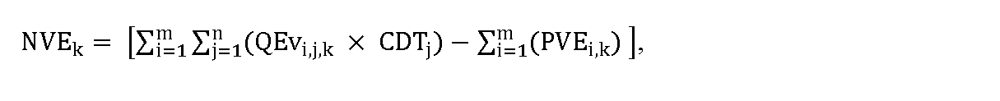

# § 49 Cenová regulácia výkonu činnosti výkupcu elektriny

(1) Odmena k-tého výkupcu elektriny v eurách za základný časový úsek podľa § 9 ods. 2 zákona o podpore QVEk sa vypočíta podľa vzorca

QVEk = (QEvk × UCVEk) – NVEk,

kde

- a) QEvk je množstvo elektriny s nárokom na podporu výkupom elektriny podľa § 3 ods. 1 písm. b) zákona o podpore a prevzatím zodpovednosti za odchýlku podľa § 3 ods. 1 písm. d) zákona o podpore vykúpenej k-tym výkupcom elektriny v režime prenesenej zodpovednosti za odchýlku v základnom časovom úseku v jednotkách množstva elektriny,

- b) UCVEk je úhrada za činnosť k-tého výkupcu elektriny za základný časový úsek v eurách na jednotku množstva elektriny vo výške koeficientu určeného podľa odsekov 2 a 3,

- c) NVEk sú nadvýnosy k-tého výkupcu elektriny z vykúpenej elektriny v základnom časovom úseku podľa § 9 ods. 2 zákona o podpore v eurách, ktorých výška sa vypočíta podľa vzorca

- 

- kde

  - 1. QEvi,j,kje množstvo elektriny s nárokom na podporu výkupom elektriny podľa § 3 ods. 1 písm. b) zákona o podpore a prevzatím zodpovednosti za odchýlku podľa § 3 ods. 1 písm. d) zákona o podpore vyrobenej v i-tom zariadení výrobcu elektriny a vykúpenej k-tým výkupcom elektriny v režime prenesenej zodpovednosti za odchýlku v j-tej hodine základného časového úseku v jednotkách množstva elektriny,

  - 2. CDTj je cena elektriny slovenskej obchodnej oblasti na dennom trhu organizovanom organizátorom krátkodobého trhu s elektrinou v j-tej hodine základného časového úseku v eurách na jednotku množstva elektriny,

  - 3. PVEi,kje platba za vykúpenú elektrinu vyrobenú v i-tom zariadení výrobcu elektriny, ktorý využil právo na podporu výkupom elektriny podľa § 3 ods. 1 písm. b) zákona o podpore a prevzatím zodpovednosti za odchýlku podľa § 3 ods. 1 písm. d) zákona o podpore k-tým výkupcom elektriny za základný časový úsek v eurách vypočítaná podľa § 48 ods. 7,

  - 4. m je počet zariadení výrobcu elektriny, pre ktoré výrobca elektriny využil právo na podporu výkupom elektriny podľa § 3 ods. 1 písm. b) zákona o podpore a prevzatím zodpovednosti za odchýlku podľa § 3 ods. 1 písm. d) zákona o podpore, z ktorých vykupuje elektrinu k-tý výkupca elektriny, ktoré sú zahrnuté do vyhodnotenia podľa tohto odseku za príslušný základný časový úsek,

  - 5. n je počet hodín základného časového úseku.

(2) Ak bol výkupca elektriny vybratý ministerstvom hospodárstva formou aukcie, UCVEk v odseku 1 sa pre rok t rovná výške úhrady za činnosť výkupcu elektriny požadovanej výkupcom elektriny v aukcii vyhlásenej ministerstvom hospodárstva podľa § 19 ods. 1 písm. n) zákona o podpore.

(3) Ak bol výkupca elektriny určený ministerstvom hospodárstva46) alebo ak činnosť výkupcu elektriny vykonáva dodávateľ poslednej inštancie,47) UCVEkv odseku 1 v eurách na jednotku množstva elektriny sa pre rok t vypočíta podľa vzorca

U

C

V

E

k

,

t

=

O

t

+

V

t

+

P

Z

t

+

K

U

C

V

E

t

,

kde

- a) Ot sú určené náklady regulovaného subjektu na odchýlku súvisiace s výkupom elektriny od výrobcov elektriny s nárokom na podporu výkupom elektriny podľa § 3 ods. 1 písm. b) zákona o podpore a prevzatím zodpovednosti za odchýlku podľa § 3 ods. 1 písm. d) zákona o podpore v eurách na jednotku množstva elektriny vykúpenej v režime prenesenej zodpovednosti za odchýlku v roku t. Pre rok 2025 a pre nasledujúce roky sa náklady regulovaného subjektu na odchýlku vypočítajú podľa prílohy č. 7,

- b) Vt sú schválené alebo určené prevádzkové náklady regulovaného subjektu na obsluhu výrobcov elektriny s nárokom na podporu výkupom elektriny podľa § 3 ods. 1 písm. b) zákona o podpore a prevzatím zodpovednosti za odchýlku podľa § 3 ods. 1 písm. d) zákona o podpore v eurách na jednotku množstva elektriny vykúpenej v režime prenesenej zodpovednosti za odchýlku v roku t a vypočítajú sa podľa vzorca

- 

- V

- t

- =

- P

- OPEX

- ×

- ∏

- n=2025

- t

- 1+

- JPI

- n

- -X

- 100

- %

- ,

- kde

  - 1. POPEX sú schválené alebo určené priemerné ročné prevádzkové náklady regulovaného subjektu súvisiace s výkupom elektriny od výrobcov elektriny s nárokom na podporu výkupom elektriny podľa § 3 ods. 1 písm. b) zákona o podpore a prevzatím zodpovednosti za odchýlku podľa § 3 ods. 1 písm. d) zákona o podpore v eurách vypočítané ako priemer skutočných prevádzkových nákladov za obdobie rokov 2021, 2022 a 2023, vrátane osobných nákladov podľa § 4 ods. 1 písm. b), určených ako skutočné osobné náklady za rok 2023 súvisiace s regulovanou činnosťou, a bez odpisov podľa § 4 ods. 1 písm. d); ak regulovaný subjekt vykonáva činnosť menej ako tri roky, použijú sa aritmetické priemery údajov za dva roky, za ktoré sú údaje k dispozícii, ak regulovaný subjekt vykonáva činnosť menej ako dva kalendárne roky, použijú sa údaje za jeden kalendárny rok alebo ak regulovaný subjekt nevykonával regulovanú činnost, použijú sa priemerné ročné prevádzkové náklady,

  - 2. JPIn je aritmetický priemer indexov jadrovej inflácie v percentách zverejnených štatistickým úradom za obdobie od júla roku n-2 do júna roku n-1,

  - 3. X je faktor efektivity, ktorého hodnota v každom roku regulačného obdobia je 3,0 %, pričom ak je hodnota rozdielu JPIn a X nižšia ako 0 %, na výpočet úhrady za činnosť výkupcu elektriny na rok t sa hodnota rozdielu JPIn a X rovná 0 %,

- c) PZt je primeraný zisk v eurách na jednotku množstva elektriny vykúpenej v režime prenesenej zodpovednosti za odchýlku v roku t, ktorý je možné zahrnúť do úhrady za činnosť výkupcu elektriny, ktorý sa vypočíta podľa vzorca

- PZt = Vt × WACCt,

- kde

- WACCt je miera výnosnosti regulačnej bázy aktív na 6. regulačné obdobie určená podľa § 5,

- d) KUCVEt je korekcia úhrady za činnosť k-tého výkupcu elektriny za obdobie t-2 v eurách na jednotku množstva elektriny v režime prenesenej zodpovednosti za odchýlku v roku t, ktorá sa vypočíta podľa vzorca

- 

- KUCVE

- t

- =

- (QEpl

- t-2

- -

- Qesk

- t-2

- )

- ×

- (O

- t-2

- +

- V

- t-2

- +

- PZ

- t-2

- +

- KUCVE

- t-2

- )

- Qepl

- t

- +

- KO

- t-2

- ×

- Qesk

- t-2

- Qepl

- t

- ,

- kde

  - 1. Qeplt je schválené alebo určené množstvo elektriny s nárokom na podporu výkupom elektriny podľa § 3 ods. 1 písm. b) zákona o podpore a prevzatím zodpovednosti za odchýlku podľa § 3 ods. 1 písm. d) zákona o podpore vykúpenej k-tým výkupcom elektriny v režime prenesenej zodpovednosti za odchýlku v roku t v jednotkách množstva elektriny vykúpenej v režime prenesenej zodpovednosti za odchýlku v roku t,

  - 2. Qeplt-2 je plánované množstvo elektriny s nárokom na podporu výkupom elektriny podľa § 3 ods. 1 písm. b) zákona o podpore a prevzatím zodpovednosti za odchýlku podľa § 3 ods. 1 písm. d) zákona o podpore vykúpenej k-tým výkupcom elektriny v režime prenesenej zodpovednosti za odchýlku v roku t-2 v jednotkách množstva elektriny vykúpenej v režime prenesenej zodpovednosti za odchýlku v roku t-2,

  - 3. Qeskt-2 je skutočné množstvo elektriny s nárokom na podporu výkupom elektriny podľa § 3 ods. 1 písm. b) zákona o podpore a prevzatím zodpovednosti za odchýlku podľa § 3 ods. 1 písm. d) zákona o podpore vykúpenej k-tým výkupcom elektriny v režime prenesenej zodpovednosti za odchýlku v roku t-2 v jednotkách množstva elektriny vykúpenej v režime prenesenej zodpovednosti za odchýlku v roku t-2,

  - 4. KOt-2 je korekcia nákladov regulovaného subjektu na odchýlku súvisiaca s výkupom elektriny od výrobcov elektriny s nárokom na podporu výkupom elektriny podľa § 3 ods. 1 písm. b) zákona o podpore a prevzatím zodpovednosti za odchýlku podľa § 3 ods. 1 písm. d) zákona o podpore v eurách na jednotku množstva elektriny vykúpenej v režime prenesenej zodpovednosti za odchýlku v roku t-2,

  - KOt–2 = SkOt–2 – Ot–2,

  - kde

    - 4a. SkOt-2 sú skutočné náklady regulovaného subjektu v roku t-2 na odchýlku súvisiace s výkupom elektriny od výrobcov elektriny s nárokom na podporu výkupom elektriny podľa § 3 ods. 1 písm. b) zákona o podpore a prevzatím zodpovednosti za odchýlku podľa § 3 ods. 1 písm. d) zákona o podpore v eurách na jednotku množstva elektriny vykúpenej v režime prenesenej zodpovednosti za odchýlku v roku t-2,

    - 4b. Ot-2 sú určené náklady regulovaného subjektu na odchýlku v roku t-2 súvisiace s výkupom elektriny od výrobcov elektriny s nárokom na podporu výkupom elektriny podľa § 3 ods. 1 písm. b) zákona o podpore a prevzatím zodpovednosti za odchýlku podľa § 3 ods. 1 písm. d) zákona o podpore v eurách na jednotku množstva elektriny vykúpenej v režime prenesenej zodpovednosti za odchýlku v roku t-2,

  - 5. Vt-2 sú schválené alebo určené prevádzkové náklady regulovaného subjektu v roku t-2 na obsluhu výrobcov elektriny s nárokom na podporu výkupom elektriny podľa § 3 ods. 1 písm. b) zákona o podpore a prevzatím zodpovednosti za odchýlku podľa § 3 ods. 1 písm. d) zákona o podpore v eurách na jednotku množstva elektriny vykúpenej v režime prenesenej zodpovednosti za odchýlku v roku t,

  - 6. PZt-2 je schválený alebo určený primeraný zisk regulovaného subjektu v roku t-2 na obsluhu výrobcov elektriny s nárokom na podporu výkupom elektriny podľa § 3 ods. 1 písm. b) zákona o podpore a prevzatím zodpovednosti za odchýlku podľa § 3 ods. 1 písm. d) zákona o podpore v eurách na jednotku množstva elektriny vykúpenej v režime prenesenej zodpovednosti za odchýlku v roku t,

  - 7. KUCVEt-2 je korekcia korekcie úhrady za činnosť k-tého výkupcu elektriny za obdobie roku t-2 v eurách na jednotku množstva elektriny v režime prenesenej zodpovednosti za odchýlku v roku t, ktorú je možné zahrnúť do úhrady za činnosť výkupcu elektriny v roku t = 2027 a pre nasledujúce roky.
