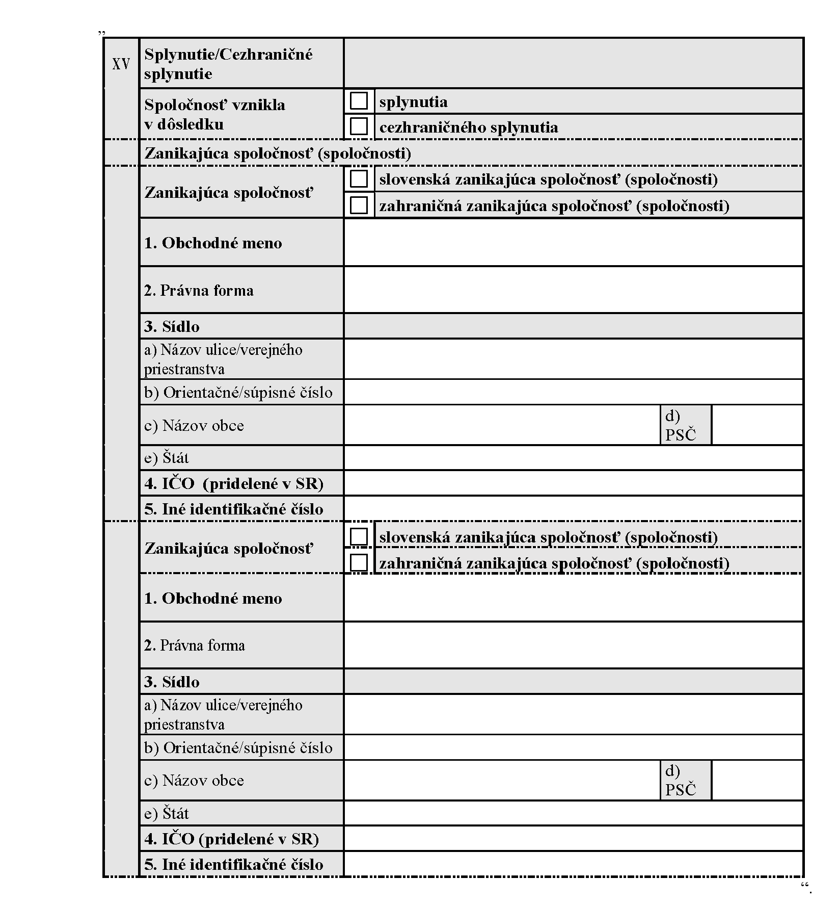
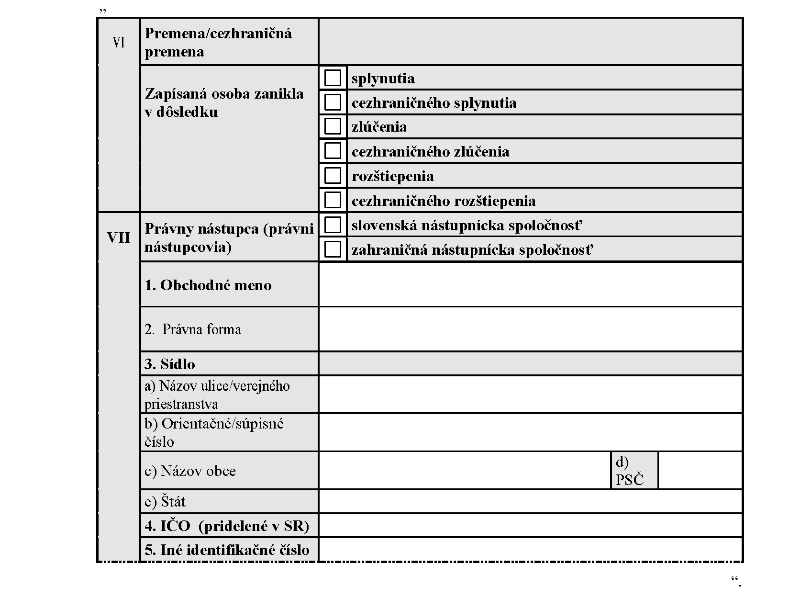
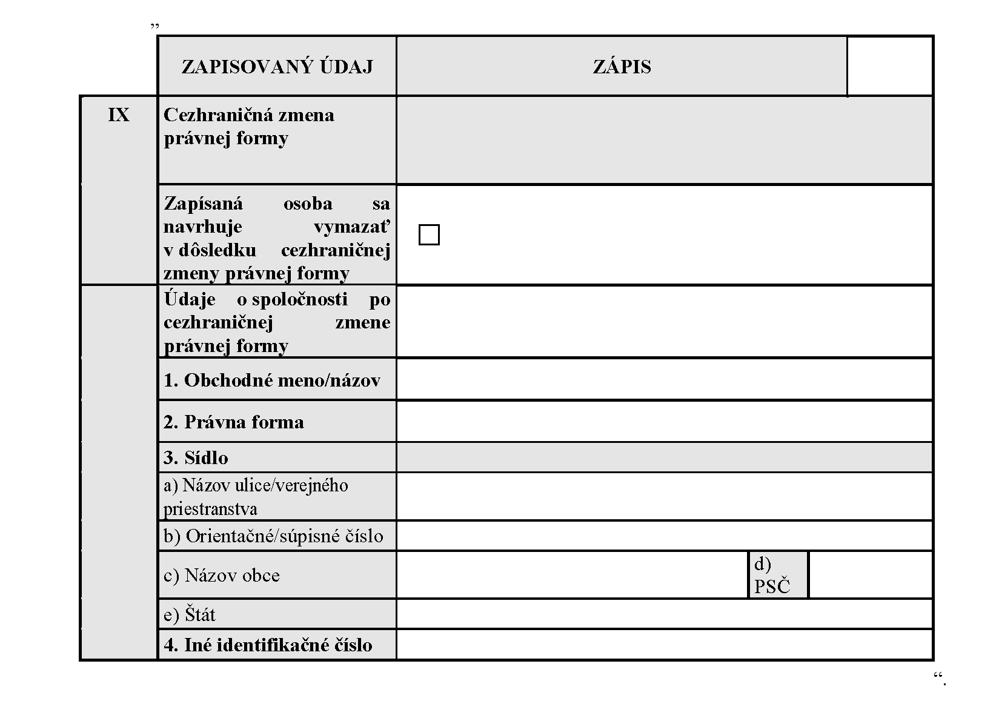

# Čl. I

Vyhláška Ministerstva spravodlivosti Slovenskej republiky č. 25/2004 Z. z., ktorou sa ustanovujú vzory tlačív na podávanie návrhov na zápis do obchodného registra a zoznam listín, ktoré je potrebné k návrhu na zápis priložiť v znení vyhlášky č. 563/2004 Z. z., vyhlášky č. 150/2007 Z. z., vyhlášky č. 656/2007 Z. z., vyhlášky č. 231/2010 Z. z., vyhlášky č. 98/2012 Z. z., vyhlášky č. 291/2012 Z. z., vyhlášky č. 148/2013 Z. z., vyhlášky č. 399/2013 Z. z., vyhlášky č. 91/2015 Z. z., vyhlášky č. 334/2016 Z. z., vyhlášky č. 265/2017 Z. z., vyhlášky č. 178/2018 Z. z., vyhlášky č. 79/2020 Z. z., vyhlášky č. 153/2022 Z. z. a vyhlášky č. 20/2023 Z. z. sa mení a dopĺňa takto:

- 1. V § 23 ods. 4 písmeno a) znie:

- „a)

- rozhodnutie o schválení návrhu projektu zmeny právnej formy,“.

- 2. V § 23 ods. 4 sa za písmeno a) vkladá nové písmeno b), ktoré znie:

- „b)

- schválený projekt zmeny právnej formy,“.

  - Doterajšie písmená b) až e) sa označujú ako písmená c) až f).

- 3. V § 23 ods. 4 písm. c) a e) sa slová „o zmene“ nahrádzajú slovami „o schválení návrhu projektu zmeny“.

- 4. Nadpis nad § 24 znie: „Návrh na zápis údajov pri premene, cezhraničnej premene alebo cezhraničnej zmene právnej formy obchodných spoločností“.

- 5. V § 24 ods. 2, § 25 ods. 2, § 25a ods. 2 a § 26 ods. 2 sa vypúšťajú slová „na základe osobitného zákona,3)“.

  - Poznámka pod čiarou k odkazu 3 sa vypúšťa.

- 6. V § 24 ods. 3, § 25a ods. 3 a § 26 ods. 3 sa vypúšťajú slová „na základe osobitného zákona,4)“.

  - Poznámka pod čiarou k odkazu 4 sa vypúšťa.

- 7. V § 24 ods. 4 písmeno b) znie:

- „b)

- schválený projekt premeny,“.

- 8. V § 24 ods. 4 písm. e), § 25 ods. 4 písm. f), § 26 ods. 6 písm. e) a § 26 ods. 7 písm. f) sa slová „nezávislého experta“ nahrádzajú slovami „audítora o preskúmaní návrhu projektu premeny“.

- 9. Poznámky pod čiarou k odkazom 4c a 4d znejú:

- „4c) § 15 zákona č. 309/2023 Z. z. o premenách obchodných spoločností a družstiev a o zmene a doplnení niektorých zákonov.

- 4d) § 15 ods. 3, § 23 a § 35 zákona č. 309/2023 Z. z.“.

- 10. V § 25 ods. 3, § 25a ods. 4 a § 26 ods. 4 sa vypúšťajú slová „na základe osobitného zákona,5)“.

  - Poznámka pod čiarou k odkazu 5 sa vypúšťa.

- 11. V § 25 ods. 4 písmená b) a c) znejú:

- „b)

- rozhodnutie nástupníckej spoločnosti o schválení návrhu projektu premeny, ak osobitný predpis neustanovuje inak,6)

- c)

- schválený projekt premeny,“.

  - Poznámka pod čiarou k odkazu 6 znie:

  - „6) § 32 ods. 1, § 33 ods. 1 a 2, § 49 ods. 1 a § 50 ods. 1 a 2 zákona č. 309/2023 Z. z.“.

- 12. § 25a vrátane nadpisu znie:

- 㤠25a

- Návrh na zápis údajov pri cezhraničnom splynutí obchodných spoločností

- (1)

- Návrh na zápis údajov pri cezhraničnom splynutí obchodných spoločností sa podáva na tlačivách podľa odsekov 2 a 3.

- (2)

- Na zápis údajov, ktoré sa pri obchodnej spoločnosti alebo obchodných spoločnostiach zanikajúcich v dôsledku cezhraničného splynutia zapisujú do obchodného registra, sa použije tlačivo návrhu na výmaz zapísanej osoby z obchodného registra.

- (3)

- Na zápis novovznikajúcej nástupníckej spoločnosti do obchodného registra a na zápis údajov, ktoré sa pri tejto obchodnej spoločnosti zapisujú do obchodného registra, sa použije tlačivo návrhu na zápis obchodnej spoločnosti do obchodného registra určené na základe právnej formy novovznikajúcej nástupníckej spoločnosti.

- (4)

- K návrhu na zápis údajov pri cezhraničnom splynutí obchodných spoločností sa okrem listín podľa § 4 prikladajú

- a)

- listiny podľa § 28 ods. 3 písm. a),

- b)

- schválený projekt cezhraničnej premeny,

- c)

- schválený projekt cezhraničnej premeny v cudzom jazyku s overeným prekladom do štátneho jazyka,

- d)

- osvedčenie predchádzajúce cezhraničnej premene podľa osobitného predpisu,6a) a to za každú zúčastnenú spoločnosť,

- e)

- osvedčenie alebo iná verejná listina vydaná v súlade s právom členského štátu Európskej únie, na ktorého území má zahraničná zúčastnená spoločnosť sídlo, a to za každú zúčastnenú spoločnosť,

- f)

- dohoda o spôsobe a rozsahu účasti zamestnancov na riadení, ak tak ustanovuje osobitný predpis,6b) rozhodnutie o ukončení rokovaní podľa osobitného predpisu6ba) alebo písomné vyhlásenie štatutárneho orgánu o tom, že lehota na vyjednávanie podľa osobitného predpisu6bb) uplynula bez uzavretia dohody,

- g)

- správa audítora o preskúmaní návrhu projektu cezhraničnej premeny podľa osobitného predpisu,6bc)

- h)

- listina, ktorou sa preukazuje, že nástupnícka spoločnosť bola zapísaná do obchodného registra alebo inej evidencie, ak je zúčastnenou spoločnosťou verejná obchodná spoločnosť alebo komanditná spoločnosť a výsledkom cezhraničného splynutia je nástupnícka spoločnosť so sídlom mimo územia Slovenskej republiky a ak právo štátu, ktorým sa nástupnícka spoločnosť spravuje, ukladá povinnosť zápisu do obchodného registra alebo inej evidencie,

- i)

- iné listiny, ak tak ustanoví osobitný predpis,6bd)

- j)

- čestné vyhlásenie s úradne osvedčeným podpisom navrhovateľa, že

- 1.

- zanikajúca spoločnosť nie je v likvidácii,

- 2.

- voči zanikajúcej spoločnosti nepôsobia účinky začatia konkurzného konania alebo vyhlásenia konkurzu alebo písomný súhlas s úradne osvedčeným podpisom správcu s cezhraničným splynutím tejto spoločnosti,

- 3.

- voči zanikajúcej spoločnosti nepôsobia účinky začatia reštrukturalizačného konania alebo povolenia reštrukturalizácie,

- 4.

- voči zanikajúcej spoločnosti sa nevedie konanie o jej zrušení alebo nebola súdom alebo na základe rozhodnutia súdu zrušená.“.

  - Poznámky pod čiarou k odkazom 6a až 6bd znejú:

  - „6a) § 87 zákona č. 309/2023 Z. z.

  - 6b) § 123 zákona č. 309/2023 Z. z.

  - 6ba) § 119 ods. 3 zákona č. 309/2023 Z. z.

  - 6bb) § 125 ods. 1 písm. c) zákona č. 309/2023 Z. z.

  - 6bc) § 82 zákona č. 309/2023 Z. z.

  - 6bd) Napríklad § 28 ods. 1 písm. b) zákona č. 483/2001 Z. z. o bankách a o zmene a doplnení niektorých zákonov v znení neskorších predpisov, § 6 ods. 1 písm. c) zákona č. 429/2002 Z. z. o burze cenných papierov v znení zákona č. 309/2023 Z. z., § 77 ods. 1 písm. b) zákona č. 39/2015 Z. z. o poisťovníctve a o zmene a doplnení niektorých zákonov v znení zákona č. 309/2023 Z. z.“.

- 13. Za § 25a sa vkladá § 25b, ktorý vrátane nadpisu znie:

- 㤠25b

- Návrh na zápis údajov pri cezhraničnom zlúčení obchodných spoločností

- (1)

- Návrh na zápis údajov pri cezhraničnom zlúčení obchodných spoločností sa podáva na tlačivách podľa odsekov 2 a 3.

- (2)

- Na zápis údajov, ktoré sa pri obchodnej spoločnosti alebo obchodných spoločnostiach zanikajúcich v dôsledku cezhraničného zlúčenia zapisujú do obchodného registra, sa použije tlačivo návrhu na výmaz zapísanej osoby z obchodného registra.

- (3)

- Na zápis údajov, ktoré sa pri nástupníckej spoločnosti zapisujú do obchodného registra, sa použije tlačivo návrhu na zápis zmeny zapísaných údajov určené na základe právnej formy nástupníckej spoločnosti.

- (4)

- K návrhu na zápis údajov pri cezhraničnom zlúčení obchodných spoločností sa okrem listín podľa § 4 prikladajú

- a)

- listiny podľa § 28 ods. 3 písm. a),

- b)

- schválený projekt cezhraničnej premeny spolu s rozhodnutím nástupníckej spoločnosti o schválení návrhu projektu cezhraničnej premeny,

- c)

- schválený projekt cezhraničnej premeny v cudzom jazyku s overeným prekladom do štátneho jazyka,

- d)

- osvedčenie predchádzajúce cezhraničnej premene podľa osobitného predpisu,6a) a to za každú zúčastnenú spoločnosť,

- e)

- osvedčenie alebo iná verejná listina vydaná v súlade s právom členského štátu Európskej únie, na ktorého území má zahraničná zúčastnená spoločnosť sídlo, a to za každú zúčastnenú spoločnosť,

- f)

- dohoda o spôsobe a rozsahu účasti zamestnancov na riadení, ak tak ustanovuje osobitný predpis,6b) rozhodnutie o ukončení rokovaní podľa osobitného predpisu6ba) alebo písomné vyhlásenie štatutárneho orgánu o tom, že lehota na vyjednávanie podľa osobitného predpisu6bb) uplynula bez uzavretia dohody,

- g)

- správa audítora o preskúmaní návrhu projektu cezhraničnej premeny podľa osobitného predpisu,6bc)

- h)

- listina, ktorou sa preukazuje, že nástupnícka spoločnosť, ktorá je výsledkom cezhraničného zlúčenia bola zapísaná do obchodného registra alebo inej evidencie, ak je zúčastnenou spoločnosťou verejná obchodná spoločnosť alebo komanditná spoločnosť a výsledkom cezhraničného zlúčenia je nástupnícka spoločnosť so sídlom mimo územia Slovenskej republiky a ak právo štátu, ktorým sa nástupnícka spoločnosť spravuje, ukladá povinnosť zápisu do obchodného registra alebo inej evidencie,

- i)

- iné listiny, ak tak ustanoví osobitný predpis,6bd)

- j)

- čestné vyhlásenie s úradne osvedčeným podpisom navrhovateľa, že

- 1.

- nástupnícka spoločnosť a zanikajúca spoločnosť nie je v likvidácii,

- 2.

- voči nástupníckej spoločnosti a zanikajúcej spoločnosti nepôsobia účinky začatia konkurzného konania alebo vyhlásenia konkurzu alebo písomný súhlas s úradne osvedčeným podpisom správcu s cezhraničným zlúčením tejto spoločnosti,

- 3.

- voči nástupníckej spoločnosti a zanikajúcej spoločnosti nepôsobia účinky začatia reštrukturalizačného konania alebo povolenia reštrukturalizácie,

- 4.

- voči nástupníckej spoločnosti a zanikajúcej spoločnosti sa nevedie konanie o jej zrušení alebo nebola súdom alebo na základe rozhodnutia súdu zrušená.“.

- 14. V § 26 sa za odsek 4 vkladá nový odsek 5, ktorý znie:

- „(5)

- Ak ide o odštiepenie obchodnej spoločnosti, na zápis údajov, ktoré sa pri rozdeľovanej spoločnosti zapisujú do obchodného registra, sa použije tlačivo návrhu na zápis zmeny zapísaných údajov určené na základe právnej formy rozdeľovanej spoločnosti.“.

  - Doterajšie odseky 5 a 6 sa označujú ako odseky 6 a 7.

- 15. V § 26 ods. 6 písmeno a) znie:

- „a)

- listiny podľa § 28 ods. 3 písm. a); ak ide o rozdelenie odštiepením, rozhodnutie rozdeľovanej spoločnosti o schválení návrhu projektu premeny,“.

- 16. V § 26 ods. 6 písm. b) a ods. 7 písm. c) sa slovo „rozdelenia“ nahrádza slovom „premeny“.

- 17. V § 26 ods. 6 písm. d) a v § 26 ods. 7 písm. e) sa slovo „zanikajúca“ vo všetkých tvaroch nahrádza slovom „rozdeľovaná“ v príslušnom tvare.

- 18. V § 26 ods. 6 sa písmeno d) dopĺňa piatym bodom, ktorý znie:

- „5.

- v dôsledku odštiepenia nebude rozdeľovaná spoločnosť v hroziacom úpadku.“.

- 19. V § 26 ods. 7 písmeno a) znie:

- „a)

- listiny podľa § 28 ods. 3 písm. a); ak ide o rozdelenie odštiepením, rozhodnutie rozdeľovanej spoločnosti o schválení návrhu projektu premeny, ak osobitný predpis neustanovuje inak,6be)“.

  - Poznámka pod čiarou k odkazu 6be znie:

  - „6be) § 63 a 69 zákona č. 309/2023 Z. z.“.

- 20. V § 26 ods. 7 písm. b) sa slová „rozdelení obchodnej spoločnosti zlúčením“ nahrádzajú slovami „schválení návrhu projektu premeny, ak osobitný predpis neustanovuje inak,6bf)“

  - Poznámka pod čiarou k odkazu 6bf znie:

  - „6bf) § 64 a 70 zákona č. 309/2023 Z. z.“.

- 21. V § 26 ods. 7 písm. e) druhom bode sa vypúšťajú slová „alebo zlúčením“.

- 22. V § 26 ods. 7 sa písmeno e) dopĺňa štvrtým bodom, ktorý znie:

- „4.

- v dôsledku odštiepenia nebude rozdeľovaná alebo niektorá z nástupníckych spoločností v hroziacom úpadku.“.

- 23. Za § 26a sa vkladajú § 26b a 26c, ktoré vrátane nadpisov znejú:

- 㤠26b

- Návrh na zápis údajov pri cezhraničnom rozdelení

- (1)

- Návrh na zápis údajov pri cezhraničnom rozdelení obchodnej spoločnosti sa podáva na tlačivách podľa odsekov 2 až 4.

- (2)

- Na zápis údajov, ktoré sa pri obchodnej spoločnosti zanikajúcej v dôsledku cezhraničného rozdelenia zapisujú do obchodného registra, sa použije tlačivo návrhu na výmaz zapísanej osoby z obchodného registra.

- (3)

- Na zápis novovznikajúcich nástupníckych spoločností do obchodného registra a na zápis údajov, ktoré sa pri novovznikajúcich nástupníckych spoločnostiach zapisujú do obchodného registra, sa použije tlačivo návrhu na zápis obchodnej spoločnosti do obchodného registra určené na základe právnej formy novovznikajúcej nástupníckej spoločnosti.

- (4)

- Ak ide o cezhraničné odštiepenie, na zápis údajov, ktoré sa pri rozdeľovanej spoločnosti zapisujú do obchodného registra, sa použije tlačivo návrhu na zápis zmeny zapísaných údajov určené na základe právnej formy rozdeľovanej spoločnosti.

- (5)

- K návrhu na zápis údajov pri cezhraničnom rozdelení obchodnej spoločnosti sa okrem listín podľa § 4 prikladajú

- a)

- listiny podľa § 28 ods. 3 písm. a),

- b)

- schválený projekt cezhraničnej premeny spoločnosti,

- c)

- projekt cezhraničnej premeny spoločnosti schválený príslušným orgánom zahraničnej zúčastnenej spoločnosti v cudzom jazyku s overeným prekladom do štátneho jazyka,

- d)

- osvedčenie predchádzajúce cezhraničnej premene podľa osobitného predpisu,6a) a to za každú zúčastnenú spoločnosť,

- e)

- osvedčenie alebo iná verejná listina vydaná v súlade s právom členského štátu Európskej únie, na ktorého území má zahraničná zúčastnená spoločnosť sídlo, a to za každú zúčastnenú spoločnosť,

- f)

- dohoda o spôsobe a rozsahu účasti zamestnancov na riadení, ak tak ustanovuje osobitný predpis,6b) alebo písomné vyhlásenie štatutárneho orgánu o tom, že lehota na vyjednávanie podľa osobitného predpisu6bb) uplynula bez uzavretia dohody,

- g)

- správa audítora o preskúmaní návrhu projektu premeny podľa osobitného predpisu,6bc)

- h)

- iné listiny, ak tak ustanoví osobitný predpis,6bd)

- i)

- čestné vyhlásenie s úradne osvedčeným podpisom navrhovateľa, že

- 1.

- rozdeľovaná spoločnosť nie je v likvidácii,

- 2.

- voči rozdeľovanej spoločnosti nepôsobia účinky začatia konkurzného konania alebo vyhlásenia konkurzu alebo písomný súhlas s úradne osvedčeným podpisom správcu s rozdelením tejto spoločnosti,

- 3.

- voči rozdeľovanej spoločnosti nepôsobia účinky začatia reštrukturalizačného konania alebo povolenia reštrukturalizácie,

- 4.

- voči rozdeľovanej spoločnosti sa nevedie konanie o jej zrušení alebo nebola súdom alebo na základe rozhodnutia súdu zrušená,

- 5.

- v dôsledku cezhraničného odštiepenia nebude rozdeľovaná spoločnosť v hroziacom úpadku.

- § 26c

- Návrh na zápis údajov pri cezhraničnej zmene právnej formy

- (1)

- Návrh na zápis údajov pri cezhraničnej zmene právnej formy spoločnosti sa podáva na tlačivách podľa odsekov 2 a 3.

- (2)

- Na zápis údajov, ktoré sa pri obchodnej spoločnosti, ktorá cezhranične zmenila právnu formu spolu so sídlom z územia Slovenskej republiky zapisujú do obchodného registra, sa použije tlačivo návrhu na výmaz zapísanej osoby z obchodného registra.

- (3)

- Na zápis údajov, ktoré sa pri obchodnej spoločnosti, ktorá cezhranične zmenila právnu formu spolu so sídlom na územie Slovenskej republiky zapisujú do obchodného registra, sa použije tlačivo návrhu na zápis obchodnej spoločnosti do obchodného registra určené na základe právnej formy spoločnosti.

- (4)

- K návrhu na zápis údajov pri cezhraničnej zmene právnej formy obchodnej spoločnosti sa okrem listín podľa § 4 prikladajú

- a)

- schválený projekt cezhraničnej zmeny právnej formy spoločnosti spolu s rozhodnutím spoločnosti o schválení návrhu projektu cezhraničnej zmeny právnej formy,

- b)

- schválený projekt cezhraničnej zmeny právnej formy spoločnosti v cudzom jazyku s overeným prekladom do štátneho jazyka,

- c)

- osvedčenie predchádzajúce cezhraničnej premene podľa osobitného predpisu,6a)

- d)

- osvedčenie alebo iná verejná listina vydaná v súlade s právom členského štátu Európskej únie, na ktorého území má spoločnosť pred cezhraničnou zmenou právnej formy sídlo,

- e)

- dohoda o spôsobe a rozsahu účasti zamestnancov na riadení, ak tak ustanovuje osobitný predpis,6b) alebo písomné vyhlásenie štatutárneho orgánu o tom, že lehota na vyjednávanie podľa osobitného predpisu6bb) uplynula bez uzavretia dohody,

- f)

- správa audítora o preskúmaní návrhu projektu cezhraničnej zmeny právnej formy podľa osobitného predpisu,6bc)

- g)

- iné listiny, ak tak ustanoví osobitný predpis,6bg)

- h)

- čestné vyhlásenie s úradne osvedčeným podpisom navrhovateľa, že

- 1.

- spoločnosť, ktorá cezhranične mení právnu formu nie je v likvidácii,

- 2.

- voči spoločnosti, ktorá cezhranične mení právnu formu nepôsobia v pôvodnom štáte účinky začatia konkurzného konania alebo vyhlásenia konkurzu alebo písomný súhlas s úradne osvedčeným podpisom správcu s rozdelením tejto spoločnosti,

- 3.

- voči spoločnosti, ktorá cezhranične mení právnu formu nepôsobia v pôvodnom štáte účinky začatia reštrukturalizačného konania alebo povolenia reštrukturalizácie,

- 4.

- voči spoločnosti, ktorá cezhranične mení právnu formu sa v pôvodnom štáte nevedie konanie o jej zrušení alebo nebola súdom alebo na základe rozhodnutia súdu zrušená.“.

  - Poznámka pod čiarou k odkazu 6bg znie:

  - „6bg) Napríklad § 28 ods. 1 písm. c) zákona č. 483/2001 Z. z. o bankách a o zmene a doplnení niektorých zákonov v znení zákona č. 309/2023 Z. z., § 6 ods. 1 písm. c) zákona č. 429/2002 Z. z. o burze cenných papierov v znení zákona č. 309/2023 Z. z., § 77 ods. 1 písm. w) zákona č. 39/2015 Z. z. o poisťovníctve a o zmene a doplnení niektorých zákonov v znení zákona č. 309/2023 Z. z.“.

- 24. V § 28 ods. 3 úvodná veta znie: „Ak ide o zrušenie obchodnej spoločnosti, družstva alebo štátneho podniku bez likvidácie, k návrhu na výmaz obchodnej spoločnosti, družstva alebo štátneho podniku na základe zákona sa prikladajú“.

- 25. V § 28 ods. 3 písmeno a) znie:

- „a)

- rozhodnutia spoločníkov alebo príslušného orgánu zrušovaných obchodných spoločností alebo družstiev o premene, cezhraničnej premene alebo cezhraničnej zmene právnej formy, ak osobitný predpis neustanovuje inak,7)“.

  - Poznámka pod čiarou k odkazu 7 znie:

    - „7) § 63 zákona č. 309/2023 Z. z.“.

- 26. V Prílohe č. 7 časť XV znie:

- 

- 27. V prílohe č. 7 sa za časť XV vkladajú nové časti XVI a XVII, ktoré znejú:

- „[Príloha - pdf](assets/4a844ab08aad87ed17056e2f9ef77c4554556554eedcf7bd48cbb8940a41bb56.pdf)“.

- 28. V prílohe č. 8, časť Zlúčenie/Rozdelenie zlúčením znie:

- „[Príloha - pdf](assets/db20542da070f97c5978ad6d20da9a47822ae00e13183eb0bc78ab9533453ef3.pdf)“.

- 29. V prílohe č. 9 časť XVI znie:

- „[Príloha - pdf](assets/3f636e8e4018df55c75c3d029f71b05a9a37360f882559c8d4db31b3bcd9a3a4.pdf)“.

- 30. V prílohe č. 9 sa za časť XVI vkladajú nové časti XVII a XVIII, ktoré znejú:

- „[Príloha - pdf](assets/7afcc6e0e099a595f082f1379fec8134557c3fe63d5c5721ce59dd4e25f63705.pdf)“.

- 31. V prílohe č. 10, časť Zlúčenie/Rozdelenie zlúčením znie:

- „[Príloha - pdf](assets/8ed0e58f58ff31267d514bf442a569ff5204c3f9f592f5c50245391ad8d29e41.pdf)“.

- 32. V prílohe č. 19 časti VI a VII znejú:

- 

- 33. V prílohe č. 19 sa za časť VIII vkladá nová časť IX, ktorá znie:

- 
