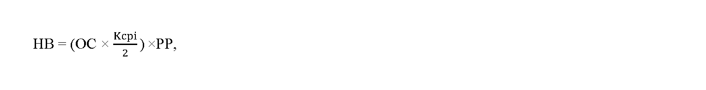

Príloha k vyhláške č. 281/2024 Z. z.

- URČENIE HODNOTY BYTU

  - A. Hodnota bytu, ktorý bol skolaudovaný do 31. januára 2001, sa určuje takto:

    - HB = PP × NOB,

    - kde

    - HB je hodnota bytu,

    - PP je podlahová plocha bytu v m2, pričom podlahová plocha bytu je súčet plochy jeho obytných miestností, plochy príslušenstva bytu12) a plochy lodžie, balkóna a terasy,

    - NOB je náklad na obstaranie 1 m2podlahovej plochy bytu, ktorý je uvedený podľa veľkostnej kategórie obce v tejto tabuľke:

  - Veľkostná kategória obce, v ktorej sa nachádza byt, ktorého hodnota sa určuje | Náklad na obstaranie 1 m2podlahovej plochy bytu

  - Obec s počtom obyvateľov nižším ako 10 000 | 1 480 eur

  - Obec s počtom obyvateľov 10 000 alebo vyšším | 1 620 eur

  - Hlavné mesto Slovenskej republiky Bratislava alebo jeho mestské časti | 1 840 eur

    - Veľkostná kategória obce je údaj o celkovom počte obyvateľov s trvalým pobytom na území obce podľa údajov Štatistického úradu Slovenskej republiky zverejnených na jeho webovom sídle k 31. decembru roka predchádzajúcemu roku, v ktorom sa určuje hodnota bytu podľa tabuľky.

    - Ak prenajímateľ nemá doklad o kolaudácii bytu alebo stavby, na určenie roku výstavby bytu alebo stavby sa použije

      - a) rozhodnutie o pridelení súpisného čísla,

      - b) vyjadrenie obce o veku, v ktorom je jednoznačne označená stavba a uvedené, kedy bola podľa dostupných podkladov obce stavba daná do užívania, pričom obec uvedie z akých listín vychádzala,

      - c) list vlastníctva, z ktorého vyplýva dátum nadobudnutia bytu prenajímateľom,

      - d) zmluva o nadobudnutí bytu,

      - e) informácia zo znaleckého posudku vypracovaného odborne spôsobilou osobou, z ktorého je zrejmý vek bytu (rok výstavby), alebo

      - f) iný doklad, z ktorého jednoznačne vyplýva dátum, kedy bola predmetná stavba daná do užívania, napríklad odovzdanie stavby mestom do správy bytového podniku.

    - Pri stavbe dokončenej do 30. septembra 1976 je možné na určenie veku stavby použiť doklad o povolení stavby do trvalej prevádzky alebo užívania.

  - B. Hodnota bytu, ktorý bol skolaudovaný od 1. februára 2001, sa určuje takto:

    - 

    - kde

    - HB je hodnota bytu,

    - OC je obstarávacia cena v eurách za m2, ktorá zahŕňa cenu zhotovenia stavby, cenu projektovej dokumentácie a cenu inžinierskych činností súvisiacich s prípravou a zhotovením stavby; do obstarávacej ceny bytu sa započítavajú aj náklady na vodovodné, teplonosné, kanalizačné, elektrické a plynové prípojky,

    - PP je podlahová plocha bytu v m2, pričom podlahová plocha bytu je súčet plochy jeho obytných miestností, plochy príslušenstva bytu12) a plochy lodžie, balkóna a terasy,

    - Kcpi je koeficient vyjadrujúci medziročnú mieru rastu spotrebiteľských cien, ktorý vyjadruje vývoj spotrebiteľských cien medzi termínom kolaudácie bytu alebo stavby a rokom 2024; koeficient sa určí pomocou verejne publikovaných údajov Štatistického úradu Slovenskej republiky zverejnených na jeho webovom sídle, pričom pri zápornej hodnote v konkrétnom roku sa nahrádza 0.

    - Ak prenajímateľ nemá doklad o kolaudácii bytu alebo stavby, na určenie roku výstavby bytu alebo stavby sa použije

      - a) rozhodnutie o pridelení súpisného čísla,

      - b) vyjadrenie obce o veku, v ktorom je jednoznačne označená stavba a uvedené, kedy bola podľa dostupných podkladov obce stavba daná do užívania, pričom obec uvedie z akých listín vychádzala,

      - c) list vlastníctva, z ktorého vyplýva dátum nadobudnutia bytu prenajímateľom,

      - d) zmluva o nadobudnutí bytu,

      - e) informácia zo znaleckého posudku vypracovaného odborne spôsobilou osobou, z ktorého je zrejmý vek bytu (rok výstavby), alebo

      - f) iný doklad, z ktorého jednoznačne vyplýva dátum, kedy bola predmetná stavba daná do užívania, napríklad odovzdanie stavby mestom do správy bytového podniku.

    - Pri stavbe dokončenej do 30. septembra 1976 je možné na určenie veku stavby použiť doklad o povolení stavby do trvalej prevádzky alebo užívania.
