# Čl. I

Vyhláška Štatistického úradu Slovenskej republiky č. 425/2023 Z. z., ktorou sa vydáva Program štátnych štatistických zisťovaní na roky 2024 až 2026 sa mení a dopĺňa takto:

- 1. V § 1 ods. 7 sa slová „1.1, 3.1, 4.1, 5.1, 7.1 a 48.1“ nahrádzajú slovami „1.1, 5.1 a 7.1“.

- 2. § 2 sa vypúšťa.

- 3. V prílohe č. 1 časti A dvanásty bod znie:

- 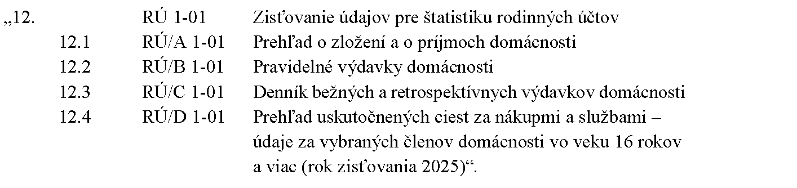

- 4. V prílohe č. 1 časti A sa za trinásty bod vkladá bod 13a, ktorý znie:

- 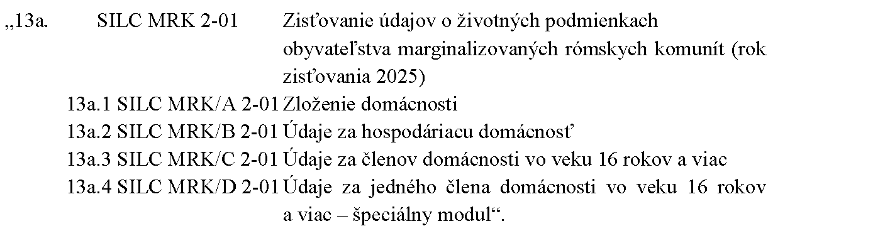

- 5. V prílohe č. 1 časti A tridsiaty druhý bod znie:

- 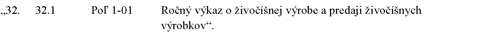

- 6. V prílohe č. 1 časti B dvanásty bod znie:

- „

- 12.

- Značka štátneho štatistického zisťovania: RÚ 1-01

- Názov štátneho štatistického zisťovania: Zisťovanie údajov pre štatistiku rodinných účtov

- Značka štatistického formulára a názov štatistického formulára:

- 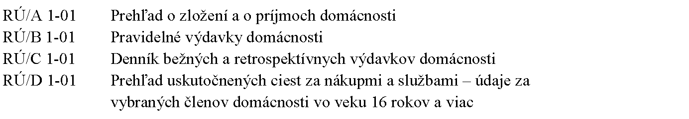

- a) Účel a využitie výsledkov štátneho štatistického zisťovania

- Účelom štátneho štatistického zisťovania je získať informácie o výške, štruktúre a vývoji peňažných výdavkov a príjmov a nepeňažných výdavkov a príjmov fyzických osôb v rôznych typoch domácností. Výsledky štátneho štatistického zisťovania poskytujú informácie, ktoré sú potrebné na tvorbu a monitorovanie verejných politík orgánmi verejnej správy, na plnenie Európskeho štatistického programu a na plnenie záväzkov vyplývajúcich z členstva Slovenskej republiky v medzinárodných organizáciách. Účelom špeciálneho modulu pre rok 2025 obsiahnutého v štatistickom formulári RÚ/D 1-01 je získať informácie o vybraných mobilitných charakteristikách (hybnosť, priestorové vzťahy) členov domácnosti pri realizácii nákupov a využívaní komerčných služieb. Výsledky štátneho štatistického zisťovania poskytujú údaje potrebné na tvorbu, kalibráciu a aktualizáciu Dopravného modelu Slovenskej republiky, ktoré sa využívajú pri analýze vplyvov strategických politík, opatrení a investičných projektov najmä v sektore dopravy v rámci systému komplexného dopravného plánovania. Údaje budú využiteľné pri príprave rôznych typov projektov implementovaných v rámci programov spolufinancovaných zo zdrojov Európskej únie.

- b) Vecná (obsahová) charakteristika a postupy realizácie štátneho štatistického zisťovania

- Použitá metóda štátneho štatistického zisťovania: výberové zisťovanie.

- Charakteristika premenných štátneho štatistického zisťovania: sociálne vzťahy medzi členmi domácnosti, demografické a ekonomické ukazovatele členov domácnosti, spotrebné výdavky na potraviny a nealkoholické nápoje, na alkoholické nápoje, tabak a narkotiká, na odievanie a obuv, na bývanie, na nájomné a údržbu obydlia, na bytové zariadenie, vybavenie a prevádzku domácnosti, na starostlivosť o zdravie, na dopravu, na informácie a komunikácie, na kultúru, šport a rekreáciu, na vzdelávacie služby, na verejné stravovanie a ubytovacie služby, na poistenie a finančné služby, na osobnú starostlivosť, sociálnu ochranu a rozličné výrobky a služby; ostatné výdavky, peňažné príjmy a naturálna osobná spotreba domácnosti; premenné špeciálneho modulu pre rok 2025: adresa pracoviska alebo školy člena domácnosti, dátum nákupu, obec (mestská časť) miesta nákupu, typ miesta nákupu (nákupné centrum, supermarket, samostatná prevádzka, čerpacia stanica pohonných hmôt), druh tovaru alebo služby (potraviny, spotrebný tovar, stravovanie a služby), spôsob vykonania cesty (druh použitého dopravného prostriedku), spôsob realizácie nákupu (online alebo osobne).

- c) Vymedzenie spravodajských jednotiek

- Členovia domácnosti.

- d) Periodicita a lehoty na poskytovanie štatistických údajov

- Periodicita štátneho štatistického zisťovania: ročne.

- Lehota na poskytovanie štatistických údajov spravodajskou jednotkou: do 20 dní

- po sledovanom roku.

- e) Orgán vykonávajúci štátnu štatistiku príslušný na vykonanie štátneho štatistického zisťovania

- Štatistický úrad.“.

- 7. V prílohe č. 1 časti B sa za trinásty bod vkladá bod 13a, ktorý znie:

- „

- 13a.

- Značka štátneho štatistického zisťovania: SILC MRK 2-01

- Názov štátneho štatistického zisťovania: Zisťovanie údajov o životných podmienkach obyvateľstva marginalizovaných rómskych komunít

- Značka štatistického formulára a názov štatistického formulára:

- 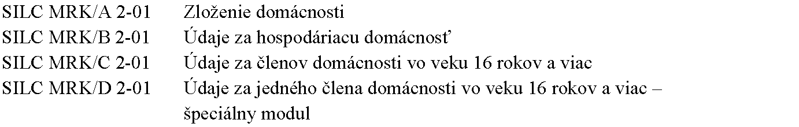

- a) Účel a využitie výsledkov štátneho štatistického zisťovania

- Účelom štátneho štatistického zisťovania je získať informácie o rozdelení príjmov, o úrovni a zložení chudoby a sociálneho vylúčenia (sociálnej exklúzie) a diskriminácie obyvateľov marginalizovaných rómskych komunít. Výsledky štátneho štatistického zisťovania poskytujú informácie, ktoré sú potrebné na splnenie Akčného plánu k Stratégii rovnosti, inklúzie a participácie Rómov do roku 2030 na roky 2022 – 2024.

- b) Vecná (obsahová) charakteristika a postupy realizácie štátneho štatistického zisťovania

- Použitá metóda štátneho štatistického zisťovania: výberové zisťovanie.

- Charakteristika premenných štátneho štatistického zisťovania: sociálne vzťahy medzi členmi domácnosti, demografické a ekonomické ukazovatele členov domácnosti, životné podmienky, bývanie, príjmy, zadlženosť domácnosti, sociálne vylúčenie, zdravie, materiálna deprivácia, skúsenosti s diskrimináciou, obťažovaním, násilím, políciou a dôverou voči inštitúciám.

- c) Vymedzenie spravodajských jednotiek

- Členovia domácnosti.

- d) Periodicita a lehoty na poskytovanie štatistických údajov

- Periodicita štátneho štatistického zisťovania: ročne (rok zisťovania 2025).

- Lehota na poskytovanie štatistických údajov spravodajskou jednotkou: do 28. februára sledovaného roka.

- e) Orgán vykonávajúci štátnu štatistiku príslušný na vykonanie štátneho štatistického zisťovania

- Štatistický úrad.“.

- 8. V prílohe č. 1 časti B dvadsiatom bode písmeno c) znie:

- 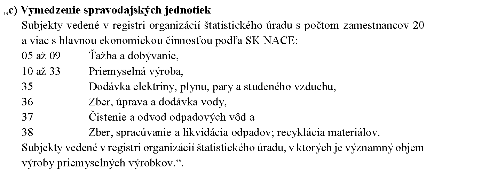

- 9. V prílohe č. 1 časti B dvadsiatom deviatom bode písmeno c) znie:

- „c) Vymedzenie spravodajských jednotiek

- Subjekty vedené v registri organizácií štatistického úradu, ktoré patria do sektora nefinančných korporácií podľa ESA 2010 s počtom zamestnancov 100 a viac (vyčerpávajúce zisťovanie).

- Subjekty vedené v registri organizácií štatistického úradu, ktoré patria do sektora nefinančných korporácií podľa ESA 2010 s počtom zamestnancov od 20 do 99 (výberové zisťovanie).

- Subjekty vedené v registri organizácií štatistického úradu, ktoré patria do sektora nefinančných korporácií podľa ESA 2010 s počtom zamestnancov 0 až 19 s ročnými tržbami za vlastné výkony a tovar 5 000 000 eur a viac (výberové zisťovanie).

- Vybrané subjekty vedené v registri organizácií štatistického úradu, ktoré patria do sektora nefinančných korporácií, u ktorých sa predpokladá významná investičná činnosť (vyčerpávajúce zisťovanie).

- Do štátneho štatistického zisťovania podľa prvej až štvrtej vety štatistický úrad zaradí len subjekty s hlavnou ekonomickou činnosťou podľa SK NACE:“.

- 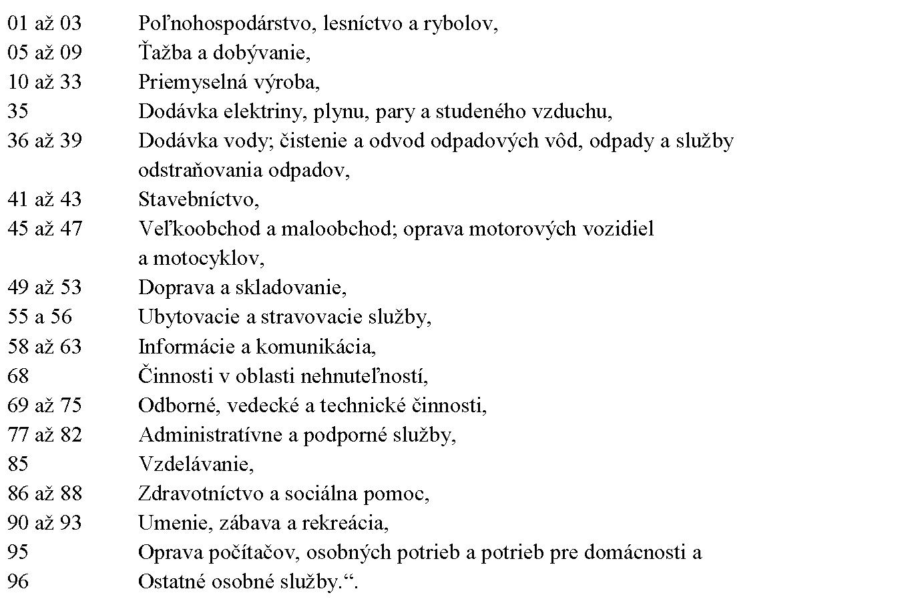

- 10. V prílohe č. 1 časti B tridsiatom bode písm. b) sa vypúšťajú slová „a informácie potrebné na implementáciu štatistickej klasifikácie ekonomických činností v znení revidovanom podľa osobitného predpisu,6) ktorá sa v Európskej únii začne uplatňovať od roku 2025“.

- 11. V prílohe č. 1 časti B tridsiatom druhom bode značka štátneho štatistického zisťovania a značka štatistického formulára znie: „Poľ 1-01“.

- 12. V prílohe č. 1 časti B tridsiatom druhom bode názov štátneho štatistického zisťovania a názov štatistického formulára znie: „Ročný výkaz o živočíšnej výrobe a predaji živočíšnych výrobkov“.

- 13. V prílohe č. 1 časti B tridsiatom druhom bode písm. d) sa slovo „štvrťročne“ nahrádza slovom „ročne“ a slová „12 dní po sledovanom štvrťroku“ sa nahrádzajú slovami „12. januára nasledujúceho roka“.

- 14. V prílohe č. 1 časti B. tridsiatom siedmom bode písm. b) sa vypúšťajú slová „a výmera plôch osiatych oziminami“.

- 15. V prílohe č. 1 časti B štyridsiatom prvom bode písm. b) sa na konci pripájajú tieto slová: „a informácie potrebné na implementáciu Zoznamu vybraných priemyselných výrobkov PRODSLOV vytvoreného na základe štatistickej klasifikácie ekonomických činností v znení revidovanom podľa osobitného predpisu,6) ktorá sa v Európskej únii uplatňuje od roku 2025“.

- 16. V prílohe č. 1 časti B päťdesiatom štvrtom bode písmeno b) znie:

- „b) Vecná (obsahová) charakteristika a postupy realizácie štátneho štatistického zisťovania

- Použitá metóda štátneho štatistického zisťovania: vyčerpávajúce zisťovanie.

- Charakteristika premenných štátneho štatistického zisťovania: informácie o ubytovacom zariadení, kapacity a výkony ubytovacieho zariadenia; informácie o kongresovom cestovnom ruchu.“.

- 17. V prílohe č. 1 časti B päťdesiatom štvrtom bode písm. d) sa číslo „25“ nahrádza číslom „20“.

- 18. V prílohe č. 1 časti B šesťdesiatom deviatom bode písm. d) sa za slovom „mesiaci“ vypúšťa bodkočiarka a slová „pre nepárne mesiace počas uplatňovania osobitného predpisu7) do ôsmich dní po sledovanom mesiaci“.

  - Poznámka pod čiarou k odkazu 7 sa vypúšťa.

- 19. V prílohe č. 1 časti B sedemdesiatom šiestom bode písm. b) sa na konci pripájajú tieto slová: „a skladovanie elektriny“.

- 20. V prílohe č. 1 časti B sedemdesiatom šiestom bode písm. c) sa slová „a prevádzkovatelia“ nahrádzajú čiarkou a slovom „prevádzkovatelia“ a na konci sa pripájajú tieto slová: „a prevádzkovatelia batérií na uskladnenie elektriny s akumulačnou kapacitou 1 MWh a vyššou“.

- 21. V prílohe č. 1 časti B sedemdesiatom ôsmom bode písm. d) sa slová „15. marca“ nahrádzajú slovami „15. apríla“.

- 22. V prílohe č. 1 časti B osemdesiatom šiestom bode písmeno a) znie:

- „a) Účel a využitie výsledkov štátneho štatistického zisťovania

- Účelom štátneho štatistického zisťovania je získať údaje o stavebných konaniach, kolaudačných rozhodnutiach, o bytových budovách a nebytových budovách, o domoch, bytoch a nebytových priestoroch pre postcenzy v rámci štatistiky obyvateľstva, na rozhodovanie o prijímaní opatrení v oblasti bývania na národnej úrovni, na tvorbu a monitorovanie verejných politík orgánmi verejnej správy, na plnenie Európskeho štatistického programu a na plnenie záväzkov vyplývajúcich z členstva Slovenskej republiky v medzinárodných organizáciách.“.

- 23. V prílohe č. 1 časti B osemdesiatom šiestom bode písmená c) a d) znejú:

- „c) Vymedzenie spravodajských jednotiek

- Od 1. januára 2025 do 31. marca 2025: obce, mestské časti hlavného mesta Slovenskej republiky Bratislava, mestské časti mesta Košice a špeciálne stavebné úrady.

- Od 1. apríla 2025: regionálne stavebné úrady a špeciálne stavebné úrady.

- d) Periodicita a lehoty na poskytovanie štatistických údajov

- Periodicita štátneho štatistického zisťovania: nepravidelne.

- Lehota na poskytovanie štatistických údajov spravodajskou jednotkou: priebežne, na účely stavebných konaní najneskôr do 12 dní po sledovanom štvrťroku, vrátane negatívneho hlásenia, na účely postcenzov do 31. decembra sledovaného roku.“.

- 24. V prílohe č. 2 časti B šesťdesiatom šiestom bode písm. b) sa za slovo „spracovanie“ vkladajú slová „(na potravinársku a kŕmnu spotrebu)“.

- 25. V prílohe č. 2 časti B stosiedmom bode písm. b) a stoôsmom bode písm. b) sa slovo „vyčerpávajúce“ nahrádza slovom „výberové“.

- 26. V prílohe č. 3 časti A I. kapitole desiatom bode sa slová „Úč EB 1-02“ nahrádzajú slovami „Úč EB 2-01“.

- 27. V prílohe č. 3 časti A I. kapitole tridsiatom bode sa vypúšťajú slová „č. 431/2002 Z. z. o účtovníctve v znení neskorších predpisov“.

- 28. V prílohe č. 3 časti A I. kapitole sa vypúšťa päťdesiaty prvý bod.

- 29. V prílohe č. 3 časti A I. kapitole sa za päťdesiaty druhý bod vkladajú tieto slová:

- „Finančné riaditeľstvo Slovenskej republiky – Útvar sociálneho zabezpečenia“.

- 30. V prílohe č. 3 časti A I. kapitole sa za slová „Finančné riaditeľstvo Slovenskej republiky – Útvar sociálneho zabezpečenia“ vkladá bod 52a, ktorý znie:

- 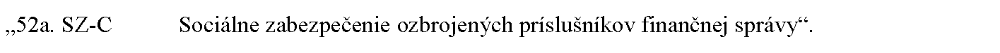

- 31. V prílohe č. 3 časti A I. kapitole päťdesiaty šiesty bod znie:

- 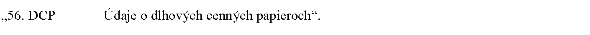

- 32. V prílohe č. 3 časti A I. kapitole šesťdesiatom deviatom bode sa vypúšťajú slová „v podrobnom členení“.

- 33. V prílohe č. 3 časti A I. kapitole sa vypúšťajú sedemdesiaty bod, sedemdesiaty prvý bod, osemdesiaty bod, osemdesiaty deviaty bod, deväťdesiaty tretí bod, deväťdesiaty piaty bod, deväťdesiaty ôsmy bod, deväťdesiaty deviaty bod, stý bod, stodruhý bod, stoštvrtý bod, stopiaty bod, stošiesty bod, stoosemnásty bod a stodvadsiaty prvý bod.

- 34. V prílohe č. 3 časti A I. kapitole sedemdesiatom treťom bode sa slová „Finančné účty“ nahrádzajú slovami „Sektorové štvrťročné finančné účty“.

- 35. V prílohe č. 3 časti A I. kapitole sa za sedemdesiaty tretí bod vkladá bod 73a, ktorý znie:

- 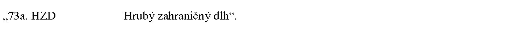

- 36. V prílohe č. 3 časti A I. kapitole sedemdesiatom šiestom bode sa za slovo „pasívach“ vkladá slovo „verejného“.

- 37. V prílohe č. 3 časti A I. kapitole sedemdesiatom siedmom bode sa za slovo „nákladoch“ vkladá slovo „verejného“.

- 38. V prílohe č. 3 časti A I. kapitole sa za sedemdesiaty deviaty bod vkladajú body 79a a 79b, ktoré znejú:

- 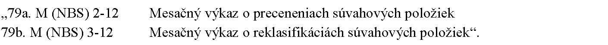

- 39. V prílohe č. 3 časti A I. kapitole osemdesiatom štvrtom bode sa slová „Mk (NBS) 1-12“ nahrádzajú slovami „M (NBS) 1-12“.

- 40. V prílohe č. 3 časti A I. kapitole sa za deväťdesiaty štvrtý bod vkladajú body 94a až 94c, ktoré znejú:

- 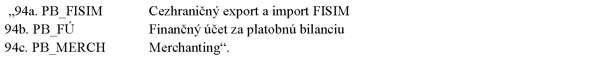

- 41. V prílohe č. 3 časti A I. kapitole sa za stoprvý bod vkladá bod 101a, ktorý znie:

- 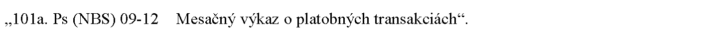

- 42. V prílohe č. 3 časti A I. kapitole sa za stotretí bod vkladá bod 103a, ktorý znie:

- 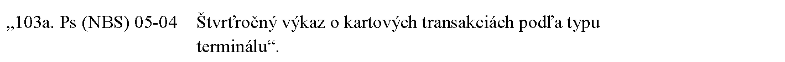

- 43. V prílohe č. 3 časti A I. kapitole stoôsmom bode značka znie: „SLUZ (NBS) 1-04“.

- 44. V prílohe č. 3 časti A I. kapitole sa za stoôsmy bod vkladá bod 108a, ktorý znie:

- 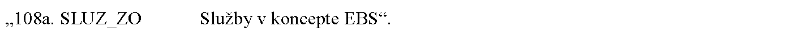

- 45. V prílohe č. 3 časti A I. kapitole sa za stodeviaty bod vkladá bod 109a, ktorý znie:

- 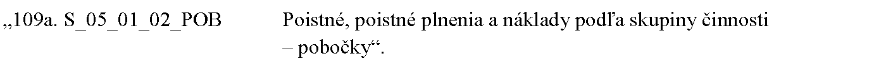

- 46. V prílohe č. 3 časti A I. kapitole stojedenásty až stotrinásty bod znejú:

- 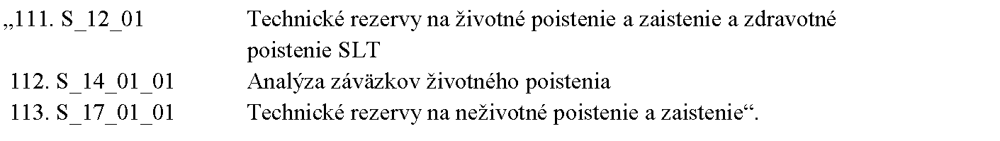

- 47. V prílohe č. 3 časti A I. kapitole sa za stotrinásty bod vkladá bod 113a, ktorý znie:

- 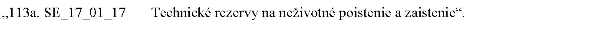

- 48. V prílohe č. 3 časti A I. kapitole stoštrnástom bode názov znie: „Prognózy budúcich peňažných tokov (najlepší odhad – neživotné poistenie a zaistenie)“.

- 49. V prílohe č. 3 časti A I. kapitole stosedemnásty bod znie:

- 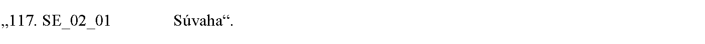

- 50. V prílohe č. 3 časti A I. kapitole sa za stosedemnásty bod vkladajú body 117a a 117b, ktoré znejú:

- 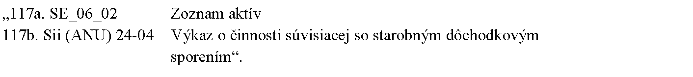

- 51. V prílohe č. 3 časti A I. kapitole sa za stodvadsiaty šiesty bod vkladajú tieto slová:

- „Správca administratívneho zdroja údajov:

- Národná diaľničná spoločnosť“.

- 52. V prílohe č. 3 časti A I. kapitole sa za slová „Národná diaľničná spoločnosť“ vkladá bod 126a, ktorý znie:

- 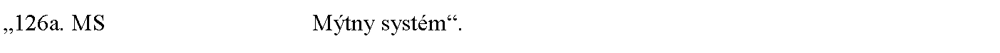

- 53. V prílohe č. 3 časti A I. kapitole sa za dvestosedemnásty bod vkladá bod 217a, ktorý znie:

- 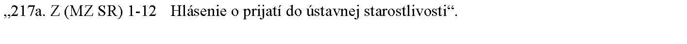

- 54. V prílohe č. 3 časti B I. kapitole desiatom bode značka administratívneho zdroja údajov znie: „Úč EB 2-01“.

- 55. V prílohe č. 3 časti B I. kapitole tridsiatom bode názov administratívneho zdroja údajov znie: „Výkaz vybraných údajov z individuálnej účtovnej závierky podľa § 17a zákona“.

- 56. V prílohe č. 3 časti B I. kapitole tridsiatom bode písmená b) a c) znejú:

- „b) Charakteristika údajov poskytovaných z administratívneho zdroja údajov

- Sumár a individuálne mikroúdaje za všetky poisťovne a zaisťovne, pobočky poisťovní a zaisťovní z iného členského štátu a pobočky zahraničných poisťovní a zaisťovní v Slovenskej republike spolu a v triedení podľa druhu poskytovaných poisťovacích služieb – údaje za poisťovne a zaisťovne, pobočky poisťovní a zaisťovní z iného členského štátu a pobočky zahraničných poisťovní a zaisťovní poskytujúce životné poistenie, za poisťovne a zaisťovne, pobočky poisťovní a zaisťovní z iného členského štátu a pobočky zahraničných poisťovní a zaisťovní poskytujúce neživotné poistenie a za poisťovne a zaisťovne, pobočky poisťovní a zaisťovní z iného členského štátu a pobočky zahraničných poisťovní a zaisťovní poskytujúce životné poistenie a neživotné poistenie a údaje za Slovenskú kanceláriu poisťovateľov.

- c) Periodicita a lehoty na poskytovanie údajov z administratívneho zdroja údajov

- Periodicita poskytovania údajov z administratívneho zdroja údajov: štvrťročne a ročne.

- Lehota na poskytovanie údajov z administratívneho zdroja údajov: za 1. až 3. štvrťrok do 60 dní po referenčnom štvrťroku, za 4. štvrťrok do 6 mesiacov po referenčnom štvrťroku, ročne do 6 mesiacov po referenčnom roku.“.

- 57. V prílohe č. 3 časti B I. kapitole sa vypúšťa päťdesiaty prvý bod.

- 58. V prílohe č. 3 časti B I. kapitole sa za päťdesiaty druhý bod vkladajú tieto slová:

- „Finančné riaditeľstvo Slovenskej republiky – Útvar sociálneho zabezpečenia“.

- 59. V prílohe č. 3 časti B I. kapitole sa za slová „Finančné riaditeľstvo Slovenskej republiky – Útvar sociálneho zabezpečenia“ vkladá bod 52a, ktorý znie:

- „

- 52a.

- Značka administratívneho zdroja údajov: SZ-C

- Názov administratívneho zdroja údajov: Sociálne zabezpečenie ozbrojených príslušníkov finančnej správy

- a) Účel a využitie údajov z administratívneho zdroja údajov

- Administratívne údaje sa využijú pri tvorbe Európskeho integrovaného systému štatistík sociálnej ochrany (ESSPROS).

- b) Charakteristika údajov poskytovaných z administratívneho zdroja údajov

- Prijaté poistné na nemocenské, úrazové a výsluhové zabezpečenie; príjmy zo štátneho rozpočtu a rozpočtu fondu a iné príjmy. Počet poistencov podľa druhu poistného vzťahu, veku a pohlavia. Výdavky na dávky sociálneho zabezpečenia podľa zabezpečenia a dávok, administratívne výdavky a iné výdavky. Počet poberateľov dávok podľa veku, pohlavia a druhu dávok. Dane z vyplatených imputovaných sociálnych dávok.

- c) Periodicita a lehoty na poskytovanie údajov z administratívneho zdroja údajov

- Periodicita poskytovania údajov z administratívneho zdroja údajov: ročne.

- Lehota na poskytovanie údajov z administratívneho zdroja údajov: do deviatich mesiacov po referenčnom roku.“.

- 60. V prílohe č. 3 časti B I. kapitole päťdesiaty šiesty bod znie:

- „

- 56.

- Značka administratívneho zdroja údajov DCP

- Názov administratívneho zdroja údajov: Údaje o dlhových cenných papieroch

- a) Účel a využitie údajov z administratívneho zdroja údajov

- Administratívne údaje sa využijú na zostavovanie národných účtov.

- b) Charakteristika údajov poskytovaných z administratívneho zdroja údajov

- Kompletné údaje o dlhových cenných papieroch.

- c) Periodicita a lehoty na poskytovanie údajov z administratívneho zdroja údajov

- Periodicita poskytovania údajov z administratívneho zdroja údajov: štvrťročne a ročne.

- Lehota na poskytovanie údajov z administratívneho zdroja údajov: štvrťročné údaje o portfóliových cenných papieroch do 85 dní po referenčnom štvrťroku, kompletné údaje o cenných papieroch do 110 dní po referenčnom štvrťroku, ročné údaje do 8 mesiacov po referenčnom roku.“.

- 61. V prílohe č. 3 časti B I. kapitole päťdesiatom siedmom bode písm. b), päťdesiatom ôsmom bode písm. b), päťdesiatom deviatom bode písm. b), šesťdesiatom bode písm. b), šesťdesiatom prvom bode písm. b), šesťdesiatom treťom bode písm. b), šesťdesiatom piatom bode písm. b), šesťdesiatom šiestom bode písm. b), šesťdesiatom siedmom bode písm. b) a šesťdesiatom ôsmom bode písm. b) sa za slovo „Sumár“ vkladajú slová „a mikroúdaje“.

- 62. V prílohe č. 3 časti B I. kapitole šesťdesiatom deviatom bode názov administratívneho zdroja údajov znie: „Dovoz a vývoz služieb“.

- 63. V prílohe č. 3 časti B I. kapitole šesťdesiatom deviatom bode písmená b) a c) znejú:

- „b) Charakteristika údajov poskytovaných z administratívneho zdroja údajov

- Údaje za dovoz a vývoz služieb pre potreby zostavenia hrubého domáceho produktu. Údaje za dovoz a vývoz služieb v členení štruktúry Y1 zasielanej pre potreby Eurostatu.

- c) Periodicita a lehoty na poskytovanie údajov z administratívneho zdroja údajov

- Periodicita poskytovania údajov z administratívneho zdroja údajov: štvrťročne a ročne.

- Lehota na poskytovanie údajov z administratívneho zdroja údajov: pre Flash HDP do 41 dní po referenčnom štvrťroku, pre spresnenie HDP do 51 dní po referenčnom štvrťroku, revidované ročné údaje do 8 mesiacov a 15 dní po referenčnom štvrťroku, ročné údaje do 10 mesiacov po referenčnom roku.“.

- 64. V prílohe č. 3 časti B I. kapitole sa vypúšťa sedemdesiaty bod, sedemdesiaty prvý bod, osemdesiaty bod, osemdesiaty deviaty bod, deväťdesiaty tretí bod, deväťdesiaty piaty bod, deväťdesiaty ôsmy bod, deväťdesiaty deviaty bod, stý bod, stodruhý bod, stoštvrtý bod, stopiaty bod, stošiesty bod, stoosemnásty bod a stodvadsiaty prvý bod.

- 65. V prílohe č. 3 časti B I. kapitole sedemdesiatom druhom bode písmeno b) znie:

- „b) Charakteristika údajov poskytovaných z administratívneho zdroja údajov

- Sumár za všetky poisťovne a zaisťovne Slovenskej republiky, pobočky poisťovní a zaisťovní z iného členského štátu a pobočky zahraničných poisťovní a zaisťovní, dôchodkové správcovské spoločnosti, doplnkové dôchodkové spoločnosti, dôchodkové fondy a doplnkové dôchodkové fondy vrátane zoznamu spoločností podľa identifikačného čísla organizácie, ktoré sú zahrnuté do spracovania.“.

- 66. V prílohe č. 3 časti B I. kapitole sedemdesiatom treťom bode názov administratívneho zdroja údajov znie: „Sektorové štvrťročné finančné účty“.

- 67. V prílohe č. 3 časti B I. kapitole sedemdesiatom treťom bode písm. b) sa vypúšťa druhá veta.

- 68. V prílohe č. 3 časti B I. kapitole sedemdesiatom treťom bode písm. c) sa vypúšťajú slová „a ročne“.

- 69. V prílohe č. 3 časti B I. kapitole sa za sedemdesiaty tretí bod vkladá bod 73a, ktorý znie:

- „

- 73a.

- Značka administratívneho zdroja údajov: HZD

- Názov administratívneho zdroja údajov: Hrubý zahraničný dlh

- a) Účel a využitie údajov z administratívneho zdroja údajov

- Administratívne údaje sa využijú na zostavovanie národných účtov.

- b) Charakteristika údajov poskytovaných z administratívneho zdroja údajov

- Údaje o zahraničnom dlhu za sektor verejnej správy, centrálnu banku, komerčné banky a ostatné sektory spolu. Údaje hrubého zahraničného dlhu podľa sektorov v členení na krátkodobé a dlhodobé údaje. Údaje o priamych investíciách medzipodnikových pôžičiek v členení na dlhové záväzky voči dcérskym spoločnostiam v zahraničí a dlhové záväzky voči priamym zahraničným investorom.

- c) Periodicita a lehoty na poskytovanie údajov z administratívneho zdroja údajov

- Periodicita poskytovania údajov z administratívneho zdroja údajov: štvrťročne.

- Lehota na poskytovanie údajov z administratívneho zdroja údajov: do 95 dní po referenčnom štvrťroku.“.

- 70. V prílohe č. 3 časti B I. kapitole sedemdesiatom šiestom bode názov administratívneho zdroja údajov znie: „Výkaz o aktívach a pasívach verejného špeciálneho podielového fondu nehnuteľností“.

- 71. V prílohe č. 3 časti B I. kapitole sedemdesiatom siedmom bode názov administratívneho zdroja údajov znie: „Výkaz o výnosoch a nákladoch verejného špeciálneho podielového fondu nehnuteľností“.

- 72. V prílohe č. 3 časti B I. kapitole sa za sedemdesiaty deviaty bod vkladajú body 79a a 79b, ktoré znejú:

- „

- 79a.

- Značka administratívneho zdroja údajov: M (NBS) 2-12

- Názov administratívneho zdroja údajov: Mesačný výkaz o preceneniach súvahových položiek

- a) Účel a využitie údajov z administratívneho zdroja údajov

- Administratívne údaje sa využijú na zostavovanie národných účtov.

- b) Charakteristika údajov poskytovaných z administratívneho zdroja údajov

- Sumár za Národnú banku Slovenska.

- c) Periodicita a lehoty na poskytovanie údajov z administratívneho zdroja údajov

- Periodicita poskytovania údajov z administratívneho zdroja údajov: mesačne a ročne.

- Lehota na poskytovanie údajov z administratívneho zdroja údajov: mesačne do 30 dní po referenčnom mesiaci, ročne stav k 31. decembru predbežné údaje do 2 mesiacov po referenčnom roku, definitívne údaje do 4 mesiacov po referenčnom roku.

- 79b.

- Značka administratívneho zdroja údajov: M (NBS) 3-12

- Názov administratívneho zdroja údajov: Mesačný výkaz o reklasifikáciách súvahových položiek

- a) Účel a využitie údajov z administratívneho zdroja údajov

- Administratívne údaje sa využijú na zostavovanie národných účtov.

- b) Charakteristika údajov poskytovaných z administratívneho zdroja údajov

- Sumár za Národnú banku Slovenska.

- c) Periodicita a lehoty na poskytovanie údajov z administratívneho zdroja údajov

- Periodicita poskytovania údajov z administratívneho zdroja údajov: mesačne a ročne.

- Lehota na poskytovanie údajov z administratívneho zdroja údajov: mesačne do 30 dní po referenčnom mesiaci, ročne stav k 31. decembru predbežné údaje do 2 mesiacov po referenčnom roku, definitívne údaje do 4 mesiacov po referenčnom roku.“.

- 73. V prílohe č. 3 časti B I. kapitole osemdesiatom štvrtom bode značka administratívneho zdroja údajov znie: „M (NBS) 1-12“.

- 74. V prílohe č. 3 časti B I. kapitole deväťdesiatom štvrtom bode písmeno b) znie:

- „b) Charakteristika údajov poskytovaných z administratívneho zdroja údajov

- Platobná bilancia v štruktúre zasielanej pre potreby Európskej centrálnej banky.“.

- 75. V prílohe č. 3 časti B I. kapitole sa za deväťdesiaty štvrtý bod vkladajú body 94a až 94c, ktoré znejú:

- „

- 94a.

- Značka administratívneho zdroja údajov: PB_FISIM

- Názov administratívneho zdroja údajov: Cezhraničný export a import FISIM

- a) Účel a využitie údajov z administratívneho zdroja údajov

- Administratívne údaje sa využijú na zostavovanie národných účtov.

- b) Charakteristika údajov poskytovaných z administratívneho zdroja údajov

- Cezhraničný export a import FISIM (Financial Intermediation Services Indirectly Measured) vrátane referenčnej úrokovej sadzby v členení na úvery a vklady v dohodnutej štruktúre.

- c) Periodicita a lehoty na poskytovanie údajov z administratívneho zdroja údajov

- Periodicita poskytovania údajov z administratívneho zdroja údajov: štvrťročne.

- Lehota na poskytovanie údajov z administratívneho zdroja údajov: štvrťročne pre Flash HDP do 41 dní po referenčnom štvrťroku (len export a import), pre spresnenie HDP do 51 dní po referenčnom štvrťroku, revidované údaje do 4 mesiacov po referenčnom štvrťroku.

- 94b.

- Značka administratívneho zdroja údajov: PB_FÚ

- Názov administratívneho zdroja údajov: Finančný účet za platobnú bilanciu

- a) Účel a využitie údajov z administratívneho zdroja údajov

- Administratívne údaje sa využijú na zostavovanie národných účtov.

- b) Charakteristika údajov poskytovaných z administratívneho zdroja údajov

- Údaje za finančný účet za platobnú bilanciu.

- c) Periodicita a lehoty na poskytovanie údajov z administratívneho zdroja údajov

- Periodicita poskytovania údajov z administratívneho zdroja údajov: štvrťročne.

- Lehota na poskytovanie údajov z administratívneho zdroja údajov: štvrťročne do troch mesiacov po referenčnom štvrťroku.

- 94c.

- Značka administratívneho zdroja údajov: PB_MERCH

- Názov administratívneho zdroja údajov: Merchanting

- a) Účel a využitie údajov z administratívneho zdroja údajov

- Administratívne údaje sa využijú na zostavovanie národných účtov.

- b) Charakteristika údajov poskytovaných z administratívneho zdroja údajov

- Údaje za vývoz výrobkov v rámci obchodovania (merchanting) medzi rezidentami a nerezidentami bez vstupu tovaru na územie Slovenskej republiky.

- c) Periodicita a lehoty na poskytovanie údajov z administratívneho zdroja údajov

- Periodicita poskytovania údajov z administratívneho zdroja údajov: štvrťročne.

- Lehota na poskytovanie údajov z administratívneho zdroja údajov: štvrťročne do 41 dní po referenčnom štvrťroku, revidované údaje do 8 mesiacov po referenčnom štvrťroku.“.

- 76. V prílohe č. 3 časti B I. kapitole bod 101a znie:

- „

- 101a.

- Značka administratívneho zdroja údajov: Ps (NBS) 09-12

- Názov administratívneho zdroja údajov: Mesačný výkaz o platobných transakciách

- a) Účel a využitie údajov z administratívneho zdroja údajov

- Administratívne údaje sa využijú na zostavovanie národných účtov.

- b) Charakteristika údajov poskytovaných z administratívneho zdroja údajov

- Sumár za banky a pobočky zahraničných bánk v Slovenskej republike.

- c) Periodicita a lehoty na poskytovanie údajov z administratívneho zdroja údajov

- Periodicita poskytovania údajov z administratívneho zdroja údajov: mesačne.

- Lehota na poskytovanie údajov z administratívneho zdroja údajov: do dvoch mesiacov po referenčnom mesiaci.“.

- 77. V prílohe č. 3 časti B I. kapitole bod 103a znie:

- „

- 103a.

- Značka administratívneho zdroja údajov: Ps (NBS) 05-04

- Názov administratívneho zdroja údajov: Štvrťročný výkaz o kartových transakciách podľa typu terminálu

- a) Účel a využitie údajov z administratívneho zdroja údajov

- Administratívne údaje sa využijú na zostavovanie národných účtov.

- b) Charakteristika údajov poskytovaných z administratívneho zdroja údajov

- Sumár za banky a pobočky zahraničných bánk v Slovenskej republike.

- c) Periodicita a lehoty na poskytovanie údajov z administratívneho zdroja údajov

- Periodicita poskytovania údajov z administratívneho zdroja údajov: štvrťročne.

- Lehota na poskytovanie údajov z administratívneho zdroja údajov: do štyroch mesiacov po referenčnom štvrťroku.“.

- 78. V prílohe č. 3 časti B I. kapitole stoôsmom bode značka administratívneho zdroja údajov znie: „SLUZ (NBS) 1-04“.

- 79. V prílohe č. 3 časti B I. kapitole stoôsmom bode písm. b) sa za slovo „poisťovne,“ vkladajú slová „ zaisťovne, pobočky poisťovní a zaisťovní z iného členského štátu a“.

- 80. V prílohe č. 3 časti B I. kapitole sa za stoôsmy bod vkladá bod 108a, ktorý znie:

- „

- 108a.

- Značka administratívneho zdroja údajov: SLUZ_ZO

- Názov administratívneho zdroja údajov: Služby v koncepte EBS

- a) Účel a využitie údajov z administratívneho zdroja údajov

- Administratívne údaje sa využijú na zostavovanie štatistiky medzinárodného obchodu so službami podľa spoločného rámca pre rozvoj, tvorbu a šírenie európskych podnikových štatistík (EBS).

- b) Charakteristika údajov poskytovaných z administratívneho zdroja údajov

- Mikroúdaje za všetky subjekty, ktoré vykazujú prijaté služby zo zahraničia alebo poskytnuté služby do zahraničia vrátane nonresponse a metodických úprav.

- c) Periodicita a lehoty na poskytovanie údajov z administratívneho zdroja údajov

- Periodicita poskytovania údajov z administratívneho zdroja údajov: ročne.

- Lehota na poskytovanie údajov z administratívneho zdroja údajov: do deviatich mesiacov po referenčnom roku.“.

- 81. V prílohe č. 3 časti B I. kapitole stodeviatom bode písm. b) sa slovo „Údaje“ nahrádza slovami „Sumár a mikroúdaje“.

- 82. V prílohe č. 3 časti B I. kapitole sa za stodeviaty bod vkladá bod 109a, ktorý znie:

- „

- 109a.

- Značka administratívneho zdroja údajov: S_05_01_02_POB

- Názov administratívneho zdroja údajov: Poistné, poistné plnenia a náklady podľa skupiny činnosti – pobočky

- a) Účel a využitie údajov z administratívneho zdroja údajov

- Administratívne údaje sa využijú na zostavenie národných účtov.

- b) Charakteristika údajov poskytovaných z administratívneho zdroja údajov

- Sumár za všetky pobočky poisťovní a zaisťovní z iného členského štátu a mikroúdaje za pobočky poisťovní a zaisťovní z iného členského štátu.

- c) Periodicita a lehoty na poskytovanie údajov z administratívneho zdroja údajov

- Periodicita poskytovania údajov z administratívneho zdroja údajov: ročne.

- Lehota na poskytovanie údajov z administratívneho zdroja údajov: do šiestich mesiacov po referenčnom roku.“.

- 83. V prílohe č. 3 časti B I. kapitole stojedenástom bode názov administratívneho zdroja údajov znie: „Technické rezervy na životné poistenie a zaistenie a zdravotné poistenie SLT“.

- 84. V prílohe č. 3 časti B I. kapitole stodvanástom bode názov administratívneho zdroja údajov znie: „Analýza záväzkov životného poistenia“.

- 85. V prílohe č. 3 časti B I. kapitole stotrinástom bode značka administratívneho zdroja údajov znie: „S_17_01_01“.

- 86. V prílohe č. 3 časti B I. kapitole stotrinástom bode názov administratívneho zdroja údajov znie: „Technické rezervy na neživotné poistenie a zaistenie“.

- 87. V prílohe č. 3 časti B I. kapitole stotrinástom bode písmeno c) znie:

- „c) Periodicita a lehoty na poskytovanie údajov z administratívneho zdroja údajov

- Periodicita poskytovania údajov z administratívneho zdroja údajov: ročne.

- Lehota na poskytovanie údajov z administratívneho zdroja údajov: do šiestich mesiacov po referenčnom roku.“.

- 88. V prílohe č. 3 časti B I. kapitole sa za stotrinásty bod vkladá bod 113a, ktorý znie:

- „

- 113a.

- Značka administratívneho zdroja údajov: SE_17_01_17

- Názov administratívneho zdroja údajov: Technické rezervy na neživotné poistenie a zaistenie

- a) Účel a využitie údajov z administratívneho zdroja údajov

- Administratívne údaje sa využijú na zostavenie národných účtov.

- b) Charakteristika údajov poskytovaných z administratívneho zdroja údajov

- Údaje za všetky poisťovne a zaisťovne, na ktoré sa neuplatňuje osobitný režim.

- c) Periodicita a lehoty na poskytovanie údajov z administratívneho zdroja údajov

- Periodicita poskytovania údajov z administratívneho zdroja údajov: štvrťročne.

- Lehota na poskytovanie údajov z administratívneho zdroja údajov: do 70 dní po referenčnom štvrťroku.“.

- 89. V prílohe č. 3 časti B I. kapitole stoštrnástom bode názov administratívneho zdroja údajov znie: „Prognózy budúcich peňažných tokov (najlepší odhad – neživotné poistenie a zaistenie)“.

- 90. V prílohe č. 3 časti B I. kapitole stosedemnástom bode značka administratívneho zdroja údajov znie: „SE _02_01“.

- 91. V prílohe č. 3 časti B I. kapitole stosedemnástom bode názov administratívneho zdroja údajov znie: „Súvaha“.

- 92. V prílohe č. 3 časti B I. kapitole sa za stosedemnásty bod vkladajú body 117a a 117b, ktoré znejú:

- „

- 117a.

- Značka administratívneho zdroja údajov: SE_06_02

- Názov administratívneho zdroja údajov: Zoznam aktív

- a) Účel a využitie údajov z administratívneho zdroja údajov

- Administratívne údaje sa využijú na zostavenie národných účtov.

- b) Charakteristika údajov poskytovaných z administratívneho zdroja údajov

- Agregované údaje za všetky poisťovne, zaisťovne, na ktoré sa neuplatňuje osobitný režim.

- c) Periodicita a lehoty na poskytovanie údajov z administratívneho zdroja údajov

- Periodicita poskytovania údajov z administratívneho zdroja údajov: štvrťročne a ročne.

- Lehota na poskytovanie údajov z administratívneho zdroja údajov: štvrťročne do 70 dní po referenčnom štvrťroku; ročne do 6 mesiacov po referenčnom roku.

- 117b.

- Značka administratívneho zdroja údajov: Sii (ANU) 24-04

- Názov administratívneho zdroja údajov: Výkaz o činnosti súvisiacej so starobným dôchodkovým sporením

- a) Účel a využitie údajov z administratívneho zdroja údajov

- Administratívne údaje sa využijú na zostavenie národných účtov.

- b) Charakteristika údajov poskytovaných z administratívneho zdroja údajov

- Sumár za subjekty poistného trhu vykonávajúce činnosti súvisiace so starobným dôchodkovým sporením, zoznam subjektov poistného trhu vykonávajúcich činnosti súvisiace so starobným dôchodkovým sporením.

- c) Periodicita a lehoty na poskytovanie údajov z administratívneho zdroja údajov

- Periodicita poskytovania údajov z administratívneho zdroja údajov: štvrťročne.

- Lehota na poskytovanie údajov z administratívneho zdroja údajov: štvrťročne do 70 dní po referenčnom štvrťroku, definitívne údaje za posledný štvrťrok do 6 mesiacov po referenčnom roku.“.

- 93. V prílohe č. 3 časti B I. kapitole sa za stodvadsiaty šiesty bod vkladajú tieto slová:

- „Správca administratívneho zdroja údajov:

- Národná diaľničná spoločnosť“.

- 94. V prílohe č. 3 časti B I. kapitole sa za slová „Národná diaľničná spoločnosť“ vkladá bod 126a, ktorý znie:

- „

- 126a.

- Značka administratívneho zdroja údajov: MS

- Názov administratívneho zdroja údajov: Mýtny systém

- a) Účel a využitie údajov z administratívneho zdroja údajov

- Administratívne údaje sa využijú na účely štátnej štatistiky, zostavovanie dátových súborov pre Eurostat, ostatné inštitúcie Európskej únie a ďalšie medzinárodné orgány a organizácie.

- b) Charakteristika údajov poskytovaných z administratívneho zdroja údajov

- Údaje z elektronického mýtneho systému o výbere mýta za užívanie vymedzených úsekov pozemných komunikácií na úrovni anonymizovaného identifikátora vozidla/záznamu.

- c) Periodicita a lehoty na poskytovanie údajov z administratívneho zdroja údajov

- Periodicita poskytovania údajov z administratívneho zdroja údajov: mesačne a ročne.

- Lehota na poskytovanie údajov z administratívneho zdroja údajov: mesačne do 10 dní po referenčnom mesiaci, ročne do 31 dní po referenčnom roku.“.

- 95. V prílohe č. 3 časti B I. kapitole stošesťdesiatom treťom bode písmená b) a c) znejú:

- „b) Charakteristika údajov poskytovaných z administratívneho zdroja údajov

- Ročné štruktúrované údaje o vykonávaní opatrení sociálnoprávnej ochrany detí a sociálnej kurately v pôsobnosti orgánov štátnej správy v triedení za Slovenskú republiku.

- c) Periodicita a lehoty na poskytovanie údajov z administratívneho zdroja údajov

- Periodicita poskytovania údajov z administratívneho zdroja údajov: ročne.

- Lehota na poskytovanie údajov z administratívneho zdroja údajov: do troch mesiacov po referenčnom roku.“.

- 96. V prílohe č. 3 časti B I. kapitole stoosemdesiatom bode písmeno b) znie:

- „b) Charakteristika údajov poskytovaných z administratívneho zdroja údajov

- Počet tried a detí podľa formy výchovy a vzdelávania, počet detí podľa národnosti, veku a špeciálnych výchovno-vzdelávacích potrieb, počet detí zo sociálne znevýhodneného prostredia, počet detí vyslaných do školy v prírode, evidenčný počet zamestnancov v materských školách.“.

- 97. V prílohe č. 3 časti B I. kapitole stoosemdesiatom prvom bode písm. b) sa za slovo „potrieb“ vkladá čiarka a slová „počet žiakov zo sociálne znevýhodneného prostredia,“ a za slovami „jednotlivých ročníkov“ sa vypúšťa čiarka a slová „vyučované predmety a odbornosť vyučovania predmetov“.

- 98. V prílohe č. 3 časti B I. kapitole stoosemdesiatom druhom bode písm. b) sa za slovo „potrieb“ vkladá čiarka a slová „počet žiakov zo sociálne znevýhodneného prostredia“ a za slovom „rok“ sa vypúšťa čiarka a slová „vyučované predmety a odbornosť vyučovania predmetov“.

- 99. V prílohe č. 3 časti B I. kapitole stoosemdesiatom treťom bode písmeno b) znie:

- „b) Charakteristika údajov poskytovaných z administratívneho zdroja údajov

- Počet materských škôl pre deti so špeciálnymi výchovno-vzdelávacími potrebami, počet detí zo sociálne znevýhodneného prostredia, počet tried, počet detí podľa veku, zdravotného znevýhodnenia a národnosti, počet učiteľov, počet ostatných zamestnancov.

- Počet škôl pre žiakov so špeciálnymi výchovno-vzdelávacími potrebami, počet učební, počet tried, počet žiakov podľa ročníkov, veku, zdravotného znevýhodnenia a národnosti, počet žiakov učiacich sa cudzí jazyk, počet učiteľov, počet ostatných zamestnancov.

- Počet škôl pri zdravotníckych zariadeniach, počet učební, počet tried, počet žiakov, počet učiteľov.“.

- 100. V prílohe č. 3 časti B I. kapitole stoosemdesiatom piatom bode písm. b) sa za slová „zapísaných študentov“ vkladajú slová „podľa štátnej príslušnosti“.

- 101. V prílohe č. 3 časti B I. kapitole stoosemdesiatom šiestom bode písm. b) sa na konci pripája táto veta: „Absolventi podľa štátnej príslušnosti.“.

- 102. V prílohe č. 3 časti B I. kapitole stoosemdesiatom ôsmom bode písm. b) sa za slovom „stoloch“ vypúšťa čiarka a slová „počet jedální podľa počtu stravníkov“.

- 103. V prílohe č. 3 časti B I. kapitole stoosemdesiatom deviatom bode písm. b) sa vypúšťajú slová „podľa krajov a za Slovenskú republiku“.

- 104. V prílohe č. 3 časti B I. kapitole stodeväťdesiatom druhom bode písmeno b) znie:

- „b) Charakteristika údajov poskytovaných z administratívneho zdroja údajov

- Počet základných umeleckých škôl, počet učební, počet žiakov a absolventov podľa umeleckého zamerania, počet žiakov hudobného odboru podľa hudobných nástrojov a počet učiteľov podľa umeleckého zamerania.“.

- 105. V prílohe č. 3 časti B I. kapitole sa za dvestosedemnásty bod vkladá bod 217a, ktorý znie:

- „

- 217a.

- Značka administratívneho zdroja údajov: Z (MZ SR) 1-12

- Názov administratívneho zdroja údajov: Hlásenie o prijatí do ústavnej starostlivosti

- a) Účel a využitie údajov z administratívneho zdroja údajov

- Administratívne údaje sa využijú na tvorbu štatistických produktov a zvyšovanie kvality štátnej štatistiky.

- b) Charakteristika údajov poskytovaných z administratívneho zdroja údajov

- Údaje o počte ošetrovacích dní a ukončených hospitalizácií vo vybraných zariadeniach ústavnej zdravotnej starostlivosti.

- c) Periodicita a lehoty na poskytovanie údajov z administratívneho zdroja údajov

- Periodicita poskytovania údajov z administratívneho zdroja údajov: ročne.

- Lehota na poskytovanie údajov z administratívneho zdroja údajov: do siedmich mesiacov po referenčnom roku.“.

- 106. V prílohe č. 3 časti B IV. kapitole druhom bode písmeno b) znie:

- „b) Charakteristika údajov poskytovaných z administratívneho zdroja údajov

- Počet žiakov podľa stupňa vzdelania, študijného odboru alebo učebného odboru, formy štúdia (denná, externá, kombinovaná), pohlavia, veku a regiónu; počet žiakov opakujúcich ročník; počet mobilných žiakov v rámci výmenného programu a žiakov, ktorí sú deťmi cudzincov podľa stupňa vzdelania; počet novozapísaných žiakov podľa stupňa vzdelania, pohlavia a veku; počet žiakov, ktorí ukončili vzdelávanie, podľa stupňa vzdelania, študijného odboru alebo učebného odboru, pohlavia a veku. Pedagogickí zamestnanci a odborní zamestnanci podľa kvalifikácie a pohlavia, zriaďovateľa, druhu školy; vedúci pedagogickí zamestnanci.“.

- 107. V prílohe č. 3 časti B IV. kapitole štvrtom bode písm. b) sa vypúšťajú slová „podľa národnosti“.

- 108. V prílohe č. 3 časti B IV. kapitole piatom bode písmeno b) znie:

- „b) Charakteristika údajov poskytovaných z administratívneho zdroja údajov

- Počet zapísaných študentov podľa stupňa vysokoškolského vzdelania (terciárne vzdelávanie), pohlavia a podrobne špecifikovanej oblasti vzdelávania vykazovaný v súlade s bakalárskym a magisterským štúdiom a so štruktúrou doktorandského vzdelávania; počet študentov podľa stupňa vysokoškolského vzdelania, zamerania programu, účelu programu, pohlavia a veku, štátnej príslušnosti, krajiny pôvodu (miesto obvyklého pobytu a/alebo predchádzajúceho vzdelávania); počet novozapísaných študentov podľa stupňa vysokoškolského vzdelania, pohlavia a veku; počet študentov s pokrytím zodpovedajúcim štatistike vzdelávacieho personálu podľa stupňa vysokoškolského vzdelania, zamerania programu, účelu programu a formy štúdia; učitelia a akademickí pracovníci podľa stupňa vysokoškolského vzdelania, zamerania programu, pohlavia, veku a zamestnaneckého statusu; mapovanie národných vzdelávacích programov.“.

- 109. V prílohe č. 3 časti B IV. kapitole šiestom bode písmeno b) znie:

- „b) Charakteristika údajov poskytovaných z administratívneho zdroja údajov

- Počet absolventov/udelených diplomov (vysokoškolské štúdium) podľa pohlavia a podrobne špecifikovanej oblasti vzdelávania vykazovaný v súlade s bakalárskym a magisterským štúdiom a so štruktúrou doktorandského vzdelávania; počet absolventov podľa stupňa vysokoškolského vzdelania, účelu programu a štátnej príslušnosti.“.

- 110. V prílohe č. 3 celom texte sa slová „vedy, výskumu a športu“ nahrádzajú slovami „výskumu, vývoja a mládeže“.

- 111. V prílohe č. 3 celom texte sa slová „(MŠVVŠ SR)“ nahrádzajú slovami „(MŠVVM SR)“.

- 112. Príloha č. 4 sa vypúšťa.
