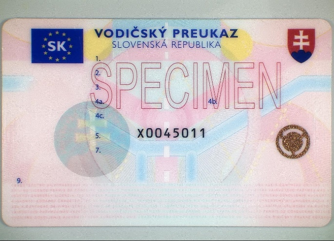
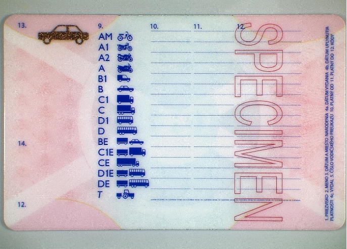

# Čl. I

Vyhláška Ministerstva vnútra Slovenskej republiky č. 9/2009 Z. z., ktorou sa vykonáva zákon o cestnej premávke a o zmene a doplnení niektorých zákonov v znení vyhlášky č. 130/2010 Z. z., vyhlášky č. 413/2010 Z. z., vyhlášky č. 361/2011 Z. z., vyhlášky č. 381/2012 Z. z., vyhlášky č. 128/2013 Z. z., vyhlášky č. 467/2013 Z. z., vyhlášky č. 20/2016 Z. z., vyhlášky č. 19/2018 Z. z., vyhlášky č. 406/2019 Z. z., vyhlášky č. 29/2020 Z. z., vyhlášky č. 223/2020 Z. z., vyhlášky č. 316/2021 Z. z., vyhlášky č. 467/2021 Z. z., vyhlášky č. 273/2022 Z. z. a vyhlášky č. 480/2022 Z. z. sa mení a dopĺňa takto:

- 1. V § 15 ods. 3 písm. e) sa za slovo „podľa“ vkladajú slová „§ 77 ods. 1 písm. q),“.

- 2. V § 18 ods. 9 sa slová „B, BE a T“ nahrádzajú slovami „B a BE“.

- 3. V § 18 ods. 10 sa slová „D a DE“ nahrádzajú slovami „D, DE a T“.

- 4. V § 20 ods. 4 písm. b) prvom bode sa na konci pripájajú tieto slová: „bez zaradenia spätného chodu“.

- 5. V § 25a sa za odsek 3 vkladá nový odsek 4, ktorý znie:

- „(4)

- Skúšobný komisár sa nezúčastňuje pravidelného výcviku v kalendárnom roku, v ktorom absolvoval odbornú prípravu žiadateľa o vydanie preukazu skúšobného komisára, v rozsahu podľa § 23 ods. 1 a 2.“.

  - Doterajší odsek 4 sa označuje ako odsek 5.

- 6. V § 31c ods. 1 sa slová „16 a 18“ nahrádzajú slovami „§ 16 a 17a“.

- 7. V § 32 ods. 4 písm. a) sa na konci vypúšťa čiarka a pripájajú sa tieto slová: „a kód 95 sa vo vodičskom preukaze uvádza len pri výmene vodičského preukazu podľa § 104 zákona alebo pri obnovení vodičského preukazu podľa § 105 zákona,“.

- 8. Za § 41f sa vkladá § 41g, ktorý vrátane nadpisu znie:

- 㤠41g

- Prechodné ustanovenie k úpravám účinným od 1. decembra 2024

- Vodičské preukazy podľa predpisov účinných do 30. novembra 2024 možno vydávať do vyčerpania ich skladových zásob, najneskôr do 31. decembra 2024.“.

- 9. Príloha č. 14 znie:

- „Príloha č. 14

- k vyhláške č. 9/2009 Z. z.

- VZOR VODIČSKÉHO PREUKAZU

- 1.

- Predná strana

- 

- 2.

- Zadná strana

- 

- “.

- “.
