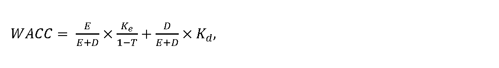
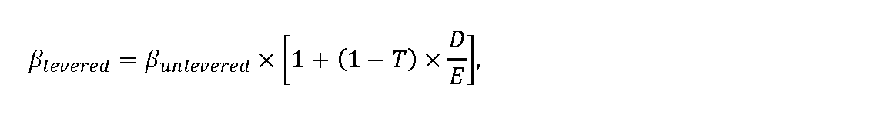

# Čl. I

Vyhláška Úradu pre reguláciu sieťových odvetví č. 323/2022 Z. z., ktorou sa ustanovuje cenová regulácia výroby, distribúcie a dodávky pitnej vody verejným vodovodom a odvádzania a čistenia odpadovej vody verejnou kanalizáciou a niektoré podmienky vykonávania regulovaných činností vo vodnom hospodárstve v znení vyhlášky č. 498/2023 Z. z. sa mení a dopĺňa takto:

- 1. V § 4 ods. 1 písmená a) a b) znejú:

- „a)

- náklady na nadobudnutie vody z podzemných vodárenských zdrojov, povrchových vodárenských zdrojov alebo nákupom; za ekonomicky oprávnené náklady sa považujú platby a poplatky za odbery vody a nákup vody vo výške množstva dodanej pitnej vody pre všetkých odberateľov2) a za množstvo vody na technologické účely, vlastnú spotrebu vody a straty vody vo výške maximálne 20 % z množstva dodanej pitnej vody rovnomerne rozdelené vo všetkých prípadoch nadobudnutia,

- b)

- primerané výrobné náklady a prevádzkové náklady zahŕňajúce náklady na energie, materiál a služby,“.

- 2. V § 4 ods. 1 písmeno e) znie:

- „e)

- odpisy hmotného majetku a nehmotného majetku,6) ktorý bol obstaraný z vlastných zdrojov alebo z úveru, okrem odpisov hmotného majetku a nehmotného majetku podľa písmena g), vo výške podľa prílohy č. 1,“.

- 3. V § 4 ods. 1 písmeno h) znie:

- „h)

- nájomné za prenájom hmotného majetku a nehmotného majetku, o ktorom účtuje vlastník a ktorý sa používa výhradne na regulovanú činnosť, preukázateľné zmluvou uzatvorenou medzi vlastníkom majetku a jeho nájomcom, najviac do preukázanej výšky odpisov podľa písmen e) až g); ak prenajatý hmotný majetok podlieha dani z nehnuteľností, najviac vo výške súčtu odpisov podľa písmen e) až g) a dane z nehnuteľností a ak je preukázaný výber nájomcu verejným obstarávaním podľa osobitného predpisu7a) nájomné za prenájom hmotného majetku a nehmotného majetku, o ktorom účtuje vlastník a ktorý sa používa výhradne na regulovanú činnosť, preukázateľné zmluvou uzatvorenou medzi vlastníkom majetku a jeho nájomcom, maximálne do výšky jeho odpisov podľa písmen e) až g) zvýšených o 10 % s pripočítaním dane z nehnuteľností, ak prenajatý hmotný majetok podlieha dani z nehnuteľností,“.

  - Poznámka pod čiarou k odkazu 7a znie:

  - „7a) Zákon č. 343/2015 Z. z. o verejnom obstarávaní a o zmene a doplnení niektorých zákonov v znení neskorších predpisov.“.

- 4. V § 4 ods. 1 písmeno j) znie:

- „j)

- úrok z úveru poskytnutého bankou alebo pobočkou zahraničnej banky

- 10) na obstaranie hmotného majetku alebo nehmotného majetku, ktorý sa používa výhradne na regulovanú činnosť najviac do hodnoty úroku rovnajúceho sa aritmetickému priemeru hodnôt mesačných priemerov ukazovateľa 12M EURIBOR za obdobie posledných 12 mesiacov predchádzajúcich mesiacu, v ktorom sa začalo konanie o cenovej regulácii podľa § 14 ods. 1 zákona, zverejnených na webovom sídle www.euribor-ebf.eu v časti „Euribor rates“,“.

- 5. V § 4 ods. 1 sa vypúšťa písmeno k).

  - Poznámka pod čiarou k odkazu 11 sa vypúšťa.

- 6. V § 4 ods. 7 sa za písmeno al) vkladajú nové písmená am) až ao), ktoré znejú:

- „am)

- náklady na konzultácie, poradenstvo a štúdie,

- an)

- vyplatené kompenzačné platby,21a)

- ao)

- náklady na právne služby okrem právnych služieb na majetkovoprávne vysporiadanie a právnych služieb vyplývajúcich z obchodnoprávnych vzťahov so spotrebiteľmi,“.

  - Doterajšie písmeno am) sa označuje ako písmeno ap).

  - Poznámka pod čiarou k odkazu 21a znie:

  - „21a) Vyhláška Úradu pre reguláciu sieťových odvetví č. 276/2012 Z. z., ktorou sa ustanovujú štandardy kvality dodávky pitnej vody verejným vodovodom a odvádzania odpadovej vody verejnou kanalizáciou v znení neskorších predpisov.“.

- 7. § 5 vrátane nadpisu znie:

- 㤠5

- Spôsob určenia miery výnosnosti regulačnej bázy aktív

- (1)

- Miera výnosnosti regulačnej bázy aktív sa určuje na celé regulačné obdobie, pričom zohľadňuje

- a)

- návratnosť prevádzkových aktív používaných výhradne na zabezpečenie regulovanej činnosti,

- b)

- rozsah potrebných investícií na zabezpečenie dlhodobej spoľahlivej, bezpečnej a udržateľnej prevádzky aktív používaných pri výkone regulovanej činnosti.

- (2)

- Miera výnosnosti regulačnej bázy aktív pred zdanením na regulačné obdobie sa vyjadruje ako vážený priemer nákladov na kapitál WACC pred zdanením, vyjadrený v percentuálnej hodnote, matematicky zaokrúhlenej na dve desatinné miesta, a vypočíta sa podľa vzorca

- 

- kde

- a)

- Ke sú náklady na vlastný kapitál v percentách určené podľa odseku 3,

- b)

- Kd sú náklady na cudzí kapitál vo výške 2,77 %,

- c)

- 

- E

- E

- +

- D

- je podiel vlastného majetku na celkovom majetku, ktorý sa ustanovuje na celé regulačné obdobie vo výške 40 %,

- d)

- 

- D

- E

- +

- D

- je podiel cudzieho majetku na celkovom majetku, ktorý sa ustanovuje na celé regulačné obdobie vo výške 60 %,

- e)

- T je sadzba dane z príjmov právnických osôb v roku t v percentách.

- (3)

- Náklady na vlastný kapitál sa vypočítajú podľa vzorca

- Ke = Rf + βlevered× MRP,

- kde

- a)

- Rf je bezriziková výnosová miera, ktorá sa na regulačné obdobie ustanovuje vo výške 1,11 %,

- b)

- βlevered je vážený beta koeficient vyjadrujúci systematické riziko a citlivosť konkrétneho odvetvia na zmenu trhu, ktorý sa vypočíta podľa vzorca

- 

- kde

- 1.

- βunlevered je nevážený beta koeficient bez vplyvu sadzby dane z príjmov a podielu cudzích zdrojov; pre regulačné obdobie sa ustanovuje vo výške 0,49,

- 2.

- D/E je pomer cudzích zdrojov k vlastnému majetku, ktorý sa ustanovuje na celé regulačné obdobie vo výške 1,5,

- c)

- MRP je trhová riziková prirážka, ktorá sa na regulačné obdobie ustanovuje vo výške 5,84 %.

- (4)

- Hodnota WACC pred zdanením sa na rok 2025 a zvyšok regulačného obdobia ustanovuje vo výške 5,39 %. Ak sa určí nová hodnota WACC na rok t podľa odseku 5, hodnota WACC podľa prvej vety sa na rok t a zvyšok regulačného obdobia nepoužije.

- (5)

- Ak odchýlka medzi rokmi t-2 a t-1 v niektorom z parametrov vstupujúcich do výpočtu WACC v priebehu regulačného obdobia bude vyššia ako 20 %, určí sa nová hodnota WACC na rok t a na zvyšok regulačného obdobia, ktorá sa zverejní na webovom sídle úradu najneskôr do 30. júna roku t-1. Zmena vyjadrená ako hodnota pomeru medzi aktuálnou číselnou hodnotou WACC a novou číselnou hodnotou WACC nesmie presiahnuť 10 %, teda pomer nepresiahne hodnoty uzavretého matematického intervalu [0,9 - 1,1].“.

- 8. V § 6 ods. 1 písmeno h) znie:

- „h)

- ďalšie podklady potrebné na posúdenie návrhu ceny úradom, ak podklady uvedené v písmenách a) až g) nie sú dostatočné na preukázanie nevyhnutnosti vynaloženia ekonomicky oprávnených nákladov a primeraného zisku,“.

- 9. V § 6 ods. 1 sa vypúšťa písmeno i).

- 10. Nadpis § 7 znie: „Spôsob predkladania návrhu ceny“.

- 11. V § 7 sa vypúšťa odsek 7.

- 12. § 8 až 11 vrátane nadpisov znejú:

- 㤠8

- Spôsob výpočtu maximálnej ceny za výrobu, distribúciu a dodávku pitnej vody a výšky primeraného zisku pre regulované subjekty, ktorých distribúcia a dodávka pitnej vody v roku t presiahne 2 000 000 m3

- (1)

- Maximálna cena MCVt za výrobu a dodávku pitnej vody, za dodávku pitnej vody a za výrobu a dodávku pitnej vody pre jednotlivé skupiny odberateľov sa navrhuje ako dvojzložková, ktorá sa skladá z fixnej zložky maximálnej ceny v eurách za rok a variabilnej zložky maximálnej ceny v eurách na objemovú jednotku, pričom je maximálna v jednotlivých zložkách ceny. Maximálna cena za výrobu a distribúciu pitnej vody sa navrhuje ako jednozložková v eurách na objemovú jednotku do výšky určenej podľa odseku 8. Pri návrhu maximálnej ceny sa prihliada na sociálne, environmentálne a ekonomické dôsledky úhrady za vodohospodárske služby, ako aj na geografické podmienky a klimatické podmienky príslušného regiónu.

- (2)

- Na určenie maximálnej ceny za výrobu, distribúciu a dodávku pitnej vody, za výrobu a dodávku pitnej vody pre skupinu odberateľov sa vypočíta priemerná cena PRVt v eurách na objemovú jednotku na rok t podľa vzorca

- 

- P

- R

- V

- t

- =

- P

- V

- V

- t

- Q

- V

- T

- t

- —

- 2

- ,

- kde

- a)

- PRVtje priemerná cena za výrobu, distribúciu a dodávku pitnej vody v eurách na objemovú jednotku,

- b)

- PVVtsú povolené výnosy na rok t vypočítané na

- 1.

- prvý rok regulačného obdobia podľa vzorca

- PVVt= PNVt+ OVt–2+ POVt–1+ (PZt× IMDSt–2),

- 2.

- ďalšie roky regulačného obdobia podľa vzorca

- PVVt= PNVtz+ OVt–1+ (POVt– ROVt–1) + (PZt× IMDSt–1),

- c)

- QVTt-2je skutočné množstvo dodanej a distribuovanej pitnej vody v objemových jednotkách pre všetkých odberateľov v roku t-2 vrátane vlastnej spotreby.

- (3)

- Na účely výpočtu povolených výnosov PVVtpodľa odseku 2 písm. b) sa veličinami vzorcov rozumejú

- a)

- PNVtplánované prevádzkové náklady v eurách na výrobu, distribúciu a dodávku pitnej vody v roku t určené podľa odseku 4,

- b)

- OVt-2odpisy hmotného majetku a nehmotného majetku podľa prílohy č. 1 v eurách využívaného výhradne na výrobu, distribúciu a dodávku pitnej vody skutočne zaradeného do účtovníctva do konca roka t-2 podľa § 4 ods. 1 písm. e) až g) a nájomné v eurách za prenájom majetku využívaného výhradne na výrobu, distribúciu a dodávku pitnej vody do konca roka t-2 podľa § 4 ods. 1 písm. h),

- c)

- POVt-1hodnota plánovaných odpisov v eurách nového hmotného majetku a nehmotného majetku, ktorý regulovaný subjekt plánuje zaradiť v roku t-1 do účtovnej evidencie a nájomného v eurách za prenájom majetku plánovaného zaradiť vlastníkom v roku t-1 do účtovnej evidencie, využívaného výhradne na výrobu, distribúciu a dodávku pitnej vody,

- d)

- PZt výška primeraného zisku v roku t v eurách určená podľa odseku 5, pričom slúži na obnovu prevádzkových aktív, používaných výhradne na zabezpečenie regulovanej činnosti a uskutočnenie investícií potrebných na zabezpečenie dlhodobej spoľahlivej, bezpečnej a udržateľnej prevádzky aktív používaných pri výkone regulovanej činnosti,

- e)

- IMDSt-2index miery využitia dosiahnutých disponibilných zdrojov regulovaného subjektu za rok t-2 na obnovu a rozvoj verejných vodovodov a určí sa podľa vzorca

- 

- pričom, ak je P

- vyšší alebo sa rovná 0,8, tak IMDSt-2 = 1,00,

- menší ako 0,8 a zároveň vyšší alebo sa rovná 0,7, tak IMDSt-2 = 0,98,

- menší ako 0,7 a zároveň vyšší alebo sa rovná 0,6, tak IMDSt-2 = 0,96,

- menší ako 0,6 a zároveň vyšší alebo sa rovná 0,5, tak IMDSt-2 = 0,94,

- menší ako 0,5 a zároveň vyšší alebo sa rovná 0,4, tak IMDSt-2 = 0,92,

- menší ako 0,4 a zároveň vyšší alebo sa rovná 0,3, tak IMDSt-2 = 0,89,

- menší ako 0,3 a zároveň vyšší alebo sa rovná 0,2, tak IMDSt-2 = 0,86,

- menší ako 0,2 a zároveň vyšší alebo sa rovná 0,1, tak IMDSt-2 = 0,83,

- menší ako 0,1, tak IMDSt-2 = 0,80,

- kde

- 1.

- P je podiel využitia dosiahnutých disponibilných zdrojov regulovaného subjektu na obnovu a rozvoj za rok t-2,

- 2.

- INVt-2je skutočná hodnota investícií v eurách na obnovu a rozvoj verejných vodovodov v roku t-2,

- 3.

- DispZdrt-2je hodnota odpisov majetku regulovaného subjektu v eurách využívaného na výkon regulovanej činnosti k 31. decembru roka t-2 podľa prílohy č. 13 a hodnota plánovaných odpisov POVt po úprave o hodnotu ROVt-1,

- f)

- PNVtzplánované prevádzkové náklady v eurách na výrobu, distribúciu a dodávku pitnej vody v ďalších rokoch regulačného obdobia určené podľa odseku 4,

- g)

- OVt-1odpisy hmotného majetku a nehmotného majetku v eurách využívaného výhradne na výrobu, distribúciu a dodávku pitnej vody skutočne zaradeného do účtovníctva do konca roka t-1 podľa § 4 ods. 1 písm. e) až g) a nájomné v eurách za prenájom majetku využívaného výhradne na výrobu, distribúciu a dodávku pitnej vody do konca roka t-1 podľa § 4 ods. 1 písm. h),

- h)

- POVthodnota plánovaných odpisov v eurách nového hmotného majetku a nehmotného majetku, ktorý regulovaný subjekt plánuje zaradiť v roku t do účtovnej evidencie a nájomného v eurách za prenájom majetku plánovaného zaradiť vlastníkom v roku t do účtovnej evidencie, využívaného výhradne na výrobu, distribúciu a dodávku pitnej vody,

- i)

- ROVt-1rozdiel odpisov hmotného majetku, nehmotného majetku plánovaného zaradiť do konca roka t-1, a skutočne zaradeného do účtovníctva do konca roka t-1 podľa § 4 ods. 1 písm. e) až g) a rozdiel plánovaného nájomného za prenájom majetku využívaného výhradne na výrobu, distribúciu a dodávku pitnej vody do konca roka t-1 a skutočne uhradeného nájomného do konca roka t-1 podľa § 4 ods. 1 písm. h), pričom táto hodnota zohľadňuje rozdiel za viaceré roky, počas ktorých nedošlo k zmene ceny; zároveň, ak je hodnota ROVt-1záporná, pre potreby výpočtu sa ROVt-1= 0,

- j)

- IMDSt-1index miery využitia dosiahnutých disponibilných zdrojov regulovaného subjektu za rok t-1 na obnovu a rozvoj verejných vodovodov a určí sa podľa vzorca uvedeného v písmene e), pričom údaje za rok t-2 sa nahradia údajmi za rok t-1.

- (4)

- Plánované prevádzkové náklady na rok t sa vypočítajú na

- a)

- prvý rok regulačného obdobia podľa vzorca

- PNVt= NNVt–2+ (1,08 × ONVt–2)+ (1,02 ×OPNVt),

- kde

- 1.

- NNVt-2 sú neovplyvniteľné náklady v roku t-2, ktorými sú náklady na nadobudnutie vody z podzemných vodárenských zdrojov, povrchových vodárenských zdrojov alebo nákupom podľa § 4 ods. 1 písm. a) a dane a poplatky uvedené v prílohe č. 6 riadkoch č. 8 a 12,

- 2.

- ONVt-2 sú osobné náklady a vypočítajú sa ako súčin priemerného počtu zamestnancov za rok t-2 a osobných nákladov podľa § 4 ods. 1 písm. c) v roku t-2,

- 3.

- OPNVtsú ovplyvniteľné náklady, ktoré sú uvedené v § 4 ods. 1 písm. b), d) a i) a hodnota ktorých sa určuje vo výške zahrnutej do schválenej alebo určenej ceny platnej k 31. júlu 2022; ak sa cena nezmenila od 1. januára 2022 do 31. júla 2022, ovplyvniteľné náklady na účely výpočtu ceny na rok t sú ovplyvniteľné náklady roku t-2,

- b)

- ďalšie roky regulačného obdobia podľa vzorca

- 

- pričom ak (JPIt – X) < 0, na účely výpočtu maximálnej ceny sa hodnota rozdielu JPIt a X rovná nule,

- kde

- 1.

- NNVt-1 sú neovplyvniteľné náklady v roku t-1, ktorými sú náklady na nadobudnutie vody z podzemných vodárenských zdrojov, povrchových vodárenských zdrojov alebo nákupom podľa § 4 ods. 1 písm. a) a dane a poplatky uvedené v prílohe č. 6 riadkoch č. 8 a 12,

- 2.

- JPIt je aritmetický priemer hodnôt ukazovateľa „jadrová inflácia“ za posledných 12 mesiacov predchádzajúcich mesiacu, v ktorom sa predkladá návrh ceny, zverejnených na webovom sídle Štatistického úradu Slovenskej republiky v časti „Jadrová a čistá inflácia – oproti rovnakému obdobiu minulého roku v % – DATAcube“,

- 3.

- X je faktor efektivity, ktorý sa ustanovuje vo výške 3,0 %,

- 4.

- OPNVt-1sú ovplyvniteľné náklady, ktoré sú uvedené v § 4 ods. 1 písm. b) až d) a i).

- (5)

- Výška primeraného zisku na rok t sa vypočíta na

- a)

- prvý rok regulačného obdobia podľa vzorca

- PZt= RAB2021× WACCt,

- pričom najvyššia miera primeraného zisku je 0,14 eura na 1 m3množstva dodanej pitnej vody v roku t vrátane vlastnej spotreby,

- kde

- 1.

- RAB2021je účtovná hodnota (zostatková cena) hmotného majetku a nehmotného majetku obstaraného z vlastných zdrojov alebo úveru v eurách k 31. decembru 2021 používaného na regulovanú činnosť, pričom táto hodnota sa zníži o hodnotu hmotného majetku a nehmotného majetku s neprimerane vysokou účtovnou hodnotou, zistenou úradom pri výkone pôsobnosti podľa § 9 ods. 1 písm. b) piateho bodu zákona; hodnota RAB2021je na celé regulačné obdobie konštantná,

- 2.

- WACCtje hodnota vážených nákladov na kapitál pred zdanením, ustanovená v § 5,

- b)

- roky 2024 a 2025, bez ocenenia majetku jeho reálnou hodnotou, podľa vzorca

- PZt = (RAB2021× WACCt) + (RABt–1× WACCt),

- pričom najvyššia miera primeraného zisku vypočítaná z hodnoty RAB2021 je 0,14 eura na 1 m3 množstva dodanej pitnej vody v roku t-1 vrátane vlastnej spotreby,

- kde

- 1.

- RABt-1je účtovná hodnota (zostatková cena) hmotného majetku a nehmotného majetku obstaraného z vlastných zdrojov alebo úveru v eurách v roku t-1 používaného na regulovanú činnosť, pričom táto hodnota je kumulatívna od 1. januára 2022 po rok t-1, a zníži sa o hodnotu hmotného majetku a nehmotného majetku s neprimerane vysokou účtovnou hodnotou, zistenou úradom pri výkone pôsobnosti podľa § 9 ods. 1 písm. b) piateho bodu zákona,

- 2.

- WACCtje hodnota vážených nákladov na kapitál pred zdanením, ustanovená v § 5,

- c)

- roky 2025, 2026 a nasledujúce roky, ak bol majetok ocenený jeho reálnou hodnotou, podľa vzorca

- PZt = (RABvých × WACCt),

- pričom najvyššia miera primeraného zisku vypočítaná v prvej časti vzorca z RABvých je

- 10 % z výšky plánovaných prevádzkových nákladov PNV vyjadrená v eurách na 1 m3 množstva dodanej pitnej vody v roku t vrátane vlastnej spotreby,

- kde

- 1.

- RABvých je východisková hodnota regulačnej bázy aktív používaných výhradne na regulovanú činnosť v eurách, ktorá sa rovná všeobecnej hodnote majetku k 31. decembru 2024 určenej na základe znaleckého posudku vypracovaného znalcom zapísaným v zozname znalcov v odbore „Ekonomika a riadenie podnikov“ podľa osobitného predpisu,22c)

- 2.

- WACCt je hodnota vážených nákladov na kapitál pred zdanením ustanovená v § 5.

- (6)

- Ak regulovaný subjekt dodáva vodu inému regulovanému subjektu, návrh maximálnej ceny za výrobu a distribúciu pitnej vody sa predkladá tak, že vychádza z celkového množstva vody dodávanej iným regulovaným subjektom takto:

- a)

- ak QVVt-2je menšie alebo sa rovná 0,25 × QVTt-2, potom MCVtza distribuovanú vodu je menšia alebo sa rovná 0,55 × PRVt,

- b)

- ak 0,25 × QVTt-2je menšie ako QVVt-2a zároveň menšie alebo rovné 0,50 × QVTt-2, potom MCVtza distribuovanú vodu je menšia alebo sa rovná 0,65 × PRVt,

- c)

- ak QVVt-2je väčšie ako 0,50 × QVTt-2, potom MCVtza distribuovanú vodu je menšia alebo sa rovná 0,8 × PRVt, kde

- QVVt-2je skutočné množstvo distribuovanej pitnej vody pre iné regulované subjekty v roku t-2.

- (7)

- Na rok 2025 a na ďalšie roky regulačného obdobia určenie maximálnej ceny za výrobu a dodávku pitnej vody, maximálnej ceny za výrobu a distribúciu pitnej vody, maximálnej ceny za dodávku pitnej vody alebo maximálnej ceny za výrobu a dodávku pitnej vody pre skupinu odberateľov vychádza z výpočtu priemernej ceny podľa odsekov 2 až 6. Ak nie sú známe údaje za rok t-1, rok t-1 nebol účtovne uzavretý a neboli predložené skutočné údaje podľa § 15 za rok t-1, použijú sa pre výpočet maximálnej ceny údaje za rok t-2.

- (8)

- Fixná zložka maximálnej ceny za výrobu a dodávku pitnej vody, maximálnej ceny za dodávku pitnej vody alebo maximálnej ceny za výrobu a dodávku pitnej vody pre skupinu odberateľov zohľadňuje nákladovosť odberného miesta a určuje sa v eurách za rok v príslušnej tarifnej skupine podľa DN vodomera osadeného na príslušnom odbernom mieste takto:

- Tarifná skupina | DN vodomera na odbernom mieste | Tarifa v eurách/rok

- T1 | do DN 25 (vrátane) | 10

- T2 | od DN 30 (vrátane) | 18

- T3 | od DN 50 (vrátane) | 39

- T4 | od DN 80 (vrátane) | 68

- T5 | od DN 150 (vrátane) | 112

- T6 | združené vodomery všetky DN | 121

- pričom

- a)

- DN je vnútorný priemer (menovitý priemer, svetlosť) vodomera v milimetroch,

- b)

- pre odberné miesta bez osadeného vodomera je tarifa = 10 eur/rok,

- c)

- odberné miesta pre rodinné domy odoberajúce pitnú vodu pre vlastnú spotrebu v domácnosti sa zaraďujú do tarifnej skupiny T1 bez ohľadu na DN vodomera osadeného na príslušnom odbernom mieste.

- (9)

- Variabilná zložka maximálnej ceny za výrobu a dodávku pitnej vody v eurách na objemovú jednotku sa navrhuje tak, aby vážený priemer variabilnej zložky maximálnej ceny za výrobu a dodávku pitnej vody a maximálnej ceny za výrobu a distribúciu pitnej vody prepočítaný na objemovú jednotku neprekročil priemernú variabilnú zložku maximálnej ceny za výrobu, distribúciu a dodávku pitnej vody v eurách na objemovú jednotku na rok t vypočítanú podľa odseku 10.

- (10)

- Na určenie variabilnej zložky maximálnej ceny za výrobu a dodávku pitnej vody, maximálnej ceny za dodávku pitnej vody alebo maximálnej ceny za výrobu a dodávku pitnej vody pre skupinu odberateľov v eurách na objemovú jednotku pre všetky tarifné skupiny T1 až T6 sa vypočíta priemerná variabilná zložka maximálnej ceny pitnej vody podľa vzorca

- 

- kde

- a)

- PRVCVt je priemerná variabilná zložka maximálnej ceny za výrobu, distribúciu a dodávku pitnej vody v eurách na objemovú jednotku,

- b)

- FCVi je fixná zložka maximálnej ceny pitnej vody v eurách za rok v tarifnej skupine Ti,

- c)

- POMVTi jepočet odberných miest odberateľov v tarifnej skupine Tiv roku t-1 zaradených podľa odseku 8,

- d)

- QVTt-1 je skutočné množstvo dodanej a distribuovanej pitnej vody v objemových jednotkách pre všetkých odberateľov v roku t-1 vrátane vlastnej spotreby.

- § 9

- Spôsob výpočtu maximálnej ceny za výrobu, distribúciu a dodávku pitnej vody a výšky primeraného zisku pre regulované subjekty, ktorých distribúcia a dodávka pitnej vody v roku t je menej ako 2 000 000 m3

- (1)

- Ak regulovaný subjekt vykonáva dodávku pitnej vody, ktorú nakupuje od iného regulovaného subjektu, môže navrhnúť prevzatie jeho maximálnej ceny za výrobu a dodávku pitnej vody alebo maximálnej ceny za výrobu a dodávku pitnej vody pre skupinu odberateľov v eurách na objemovú jednotku.

- (2)

- Ak regulovaný subjekt vykonáva výrobu a dodávku pitnej vody, výrobu a distribúciu pitnej vody alebo ak neprevezme maximálnu cenu za výrobu a dodávku pitnej vody alebo za výrobu a dodávku pitnej vody pre skupinu odberateľov od regulovaného subjektu, od ktorého pitnú vodu nakupuje, maximálna cena MCVt za výrobu a dodávku pitnej vody, za dodávku pitnej vody a za výrobu a dodávku pitnej vody pre jednotlivé skupiny odberateľov sa navrhuje ako dvojzložková, ktorá sa skladá z fixnej zložky maximálnej ceny pitnej vody v eurách za rok a variabilnej zložky maximálnej ceny pitnej vody v eurách na objemovú jednotku, pričom je maximálna v jednotlivých zložkách ceny. Maximálna cena za výrobu a distribúciu pitnej vody sa navrhuje ako jednozložková v eurách na objemovú jednotku do výšky určenej podľa odseku 5. Maximálna cena za distribúciu pitnej vody sa navrhuje ako jednozložková do výšky určenej podľa odseku 6. Pri návrhu maximálnej ceny sa prihliada na sociálne, environmentálne a ekonomické dôsledky úhrady za vodohospodárske služby, ako aj na geografické podmienky a klimatické podmienky príslušného regiónu.

- (3)

- Priemerná cena za výrobu, distribúciu a dodávku pitnej vody, za výrobu a dodávku pitnej vody pre skupinu odberateľov PRVtv eurách na objemovú jednotku na rok t sa vypočíta na

- a)

- prvý rok regulačného obdobia podľa vzorca

- 

- pričom ak (JPIt– X) < 0 alebo ak sa na výpočet použijú plánované údaje na rok t

- podľa odseku 7, na účely výpočtu maximálnej ceny sa hodnota rozdielu JPIta X rovná nule,

- kde

- 1.

- PRVtje priemer maximálnych cien za výrobu, distribúciu a dodávku pitnej vody v eurách na objemovú jednotku,

- 2.

- OVt-2sú odpisy hmotného majetku a nehmotného majetku podľa prílohy č. 1 v eurách využívaného výhradne na výrobu, distribúciu a dodávku pitnej vody skutočne zaradeného do účtovníctva do konca roka t-2 podľa § 4 ods. 1 písm. e) až g) a nájomné v eurách za prenájom majetku využívaného výhradne na výrobu, distribúciu a dodávku pitnej vody do konca roka t-2 podľa § 4 ods. 1 písm. h),

- 3.

- NVt-2sú ekonomicky oprávnené prevádzkové náklady v eurách na výrobu, distribúciu a dodávku pitnej vody v roku t-2, ktoré sú uvedené v § 4 ods. 1 písm. a) až d), i) a j),

- 4.

- QVTt-2je skutočné množstvo dodanej a distribuovanej pitnej vody v objemových jednotkách pre všetkých odberateľov v roku t-2 vrátane vlastnej spotreby,

- 5.

- JPItje aritmetický priemer hodnôt ukazovateľa „jadrová inflácia“ za posledných 12 mesiacov predchádzajúcich mesiacu, v ktorom sa návrh ceny predkladá, zverejnených na webovom sídle Štatistického úradu Slovenskej republiky v časti „Jadrová a čistá inflácia – oproti rovnakému obdobiu minulého roku v percentách“,

- 6.

- PZtje výška primeraného zisku, ktorá je pri výrobe a dodávke pitnej vody najviac 0,06 eura na 1 m3množstva vyrobenej a dodanej pitnej vody v roku t-2 vrátane vlastnej spotreby a pri výrobe a distribúcii vody najviac 0,03 eura na 1 m3množstva vyrobenej a distribuovanej pitnej vody v roku t-2,

- 7.

- X je faktor efektivity, ktorý sa ustanovuje vo výške 3,0 %,

- b)

- roky 2024 a 2025 podľa vzorca uvedeného v písmene a), pričom vo vzorci sa údaje za rok t-2 nahradia údajmi za rok t-1, ak sú známe údaje za rok t-1, rok t-1 bol účtovne uzavretý a boli predložené skutočné údaje podľa § 15 za rok t-1,

- c)

- rok 2026 a nasledujúce roky podľa vzorca

- 

- pričom ak (JPIt – X) < 0, na účely výpočtu maximálnej ceny sa hodnota rozdielu JPIt a X rovná nule,

- kde

- 1.

- OV2024 sú odpisy hmotného majetku a nehmotného majetku podľa prílohy č. 1 v eurách využívaného výhradne na výrobu, distribúciu a dodávku pitnej vody skutočne zaradeného do účtovníctva do konca roka 2024, vychádzajúce zo zostatkovej hodnoty majetku, ktorá sa rovná všeobecnej hodnote majetku podľa stavu k 31. decembru 2024 určenej na základe znaleckého posudku vypracovaného znalcom zapísaným v zozname znalcov v odbore „Ekonomika a riadenie podnikov“ podľa osobitného predpisu;22c) ak nie je možné určiť hodnotu OV2024, potom OV2024 = OVt-1,

- 2.

- δ je zmena odpisov voči hodnote OV2024vzniknutá ukončením odpisovania časti majetku alebo zaradením nového majetku v rokoch 2025 a nasledujúcich, pričom ak OV2024 = OVt-1, potom δ = 0,

- 3.

- OVt-1sú odpisy hmotného majetku a nehmotného majetku podľa prílohy č. 1 v eurách využívaného výhradne na výrobu, distribúciu a dodávku pitnej vody skutočne zaradeného do účtovníctva do konca roka t-1 podľa § 4 ods. 1 písm. e) až g) a nájomné v eurách za prenájom majetku využívaného výhradne na výrobu, distribúciu a dodávku pitnej vody do konca roka t-1 podľa § 4 ods. 1 písm. h),

- 4.

- NVt-1 sú ekonomicky oprávnené prevádzkové náklady v eurách na výrobu, distribúciu a dodávku pitnej vody v roku t-1, ktoré sú uvedené v § 4 ods. 1 písm. a) až d), i) a j),

- 5.

- QVTt-1 je skutočné množstvo dodanej a distribuovanej pitnej vody v objemových jednotkách pre všetkých odberateľov v roku t-1 vrátane vlastnej spotreby,

- 6.

- PZt je výška primeraného zisku, ktorá je pri výrobe a dodávke pitnej vody najviac 0,06 eura na 1 m3 množstva vyrobenej a dodanej pitnej vody v roku t-1 vrátane vlastnej spotreby a pri výrobe a distribúcii vody najviac 0,03 eura na 1 m3 množstva vyrobenej a distribuovanej pitnej vody v roku t-1,

- 7.

- X je faktor efektivity, ktorý sa ustanovuje vo výške 3,0 %.

- (4)

- Návrh na zmenu maximálnej ceny v ďalších rokoch regulačného obdobia sa odôvodňuje analýzami zmien ekonomicky oprávnených nákladov.

- (5)

- Ak regulovaný subjekt dodáva pitnú vodu inému regulovanému subjektu, návrh maximálnej ceny za výrobu a distribúciu pitnej vody MCVtvychádza z celkového množstva vody dodávanej iným regulovaným subjektom takto:

- a)

- ak QVVt-2je menšie alebo sa rovná 0,25 × QVTt-2, potom MCVtza distribuovanú vodu je menšia alebo sa rovná 0,55 × PRVt,

- b)

- ak 0,25 × QVTt-2je menšie ako QVVt-2a zároveň menšie alebo sa rovná 0,5 × QVTt-2, potom

- MCVtza distribuovanú vodu je menšia alebo sa rovná 0,65 × PRVt,

- c)

- ak QVVt-2je väčšie ako 0,50 × QVTt-2, potom MCVtza distribuovanú vodu je menšia alebo sa rovná 0,8 × PRVt,

- kde

- QVVt-2je skutočné množstvo distribuovanej pitnej vody iným regulovaným subjektom v roku t-2.

- (6)

- Ak regulovaný subjekt dodáva nakupovanú vodu inému regulovanému subjektu, návrh maximálnej ceny za distribúciu pitnej vody sa predkladá tak, že maximálna cena za distribúciu pitnej vody je znížená o priemerné náklady spojené s dodávkou pitnej vody konečným spotrebiteľom.

- (7)

- Ak sa návrh ceny na určenie maximálnej ceny za výrobu a dodávku pitnej vody, maximálnej ceny za výrobu a distribúciu pitnej vody, maximálnej ceny za dodávku pitnej vody alebo maximálnej ceny za výrobu a dodávku pitnej vody pre skupinu odberateľov predkladá prvýkrát, vypočíta sa priemerná cena za výrobu, distribúciu a dodávku pitnej vody v eurách na objemovú jednotku na rok t podľa odseku 3, pričom sa na výpočet použijú plánované údaje na rok t a návrh maximálnej ceny sa predkladá podľa odsekov 2, 5, 6 a 8 až 10.

- (8)

- Fixná zložka maximálnej ceny za výrobu a dodávku pitnej vody, maximálnej ceny za dodávku pitnej vody alebo maximálnej ceny za výrobu a dodávku pitnej vody pre skupinu odberateľov zohľadňuje nákladovosť odberného miesta a určuje sa v eurách za rok v príslušnej tarifnej skupine podľa DN vodomera osadeného na príslušnom odbernom mieste takto:

- tarifná skupina | DN vodomera na odbernom mieste | tarifa v eurách/rok

- T1 | do DN 25 (vrátane) | 10

- T2 | od DN 30 (vrátane) | 18

- T3 | od DN 50 (vrátane) | 39

- T4 | od DN 80 (vrátane) | 68

- T5 | od DN 150 (vrátane) | 112

- T6 | združené vodomery všetky DN | 121

- pričom

- a)

- DN je vnútorný priemer (menovitý priemer, svetlosť) vodomera v milimetroch,

- b)

- pre odberné miesta bez osadeného vodomera je tarifa = 10 eur/rok,

- c)

- odberné miesta pre rodinné domy odoberajúce pitnú vodu pre vlastnú spotrebu v domácnosti sa zaraďujú do tarifnej skupiny T1 bez ohľadu na DN vodomera osadeného na príslušnom odbernom mieste.

- (9)

- Variabilná zložka maximálnej ceny za výrobu a dodávku pitnej vody v eurách na objemovú jednotku sa navrhuje tak, aby vážený priemer variabilnej zložky maximálnej ceny za výrobu a dodávku pitnej vody a maximálnej ceny za výrobu a distribúciu pitnej vody prepočítaný na objemovú jednotku neprekročil priemernú variabilnú zložku maximálnej ceny za výrobu, distribúciu a dodávku pitnej vody v eurách na objemovú jednotku na rok t vypočítanú podľa odseku 10.

- (10)

- Na určenie variabilnej zložky maximálnej ceny za výrobu a dodávku pitnej vody, maximálnej ceny za dodávku pitnej vody alebo maximálnej ceny za výrobu a dodávku pitnej vody pre skupinu odberateľov v eurách na objemovú jednotku pre všetky tarifné skupiny T1 až T6 sa vypočíta priemerná variabilná zložka maximálnej ceny pitnej vody podľa vzorca

- 

- kde

- a)

- PRVCVt je priemerná variabilná zložka maximálnej ceny za výrobu, distribúciu a dodávku pitnej vody v eurách na objemovú jednotku,

- b)

- FCVi je fixná zložka maximálnej ceny pitnej vody v eurách za rok v tarifnej skupine Ti,

- c)

- POMVTi je počet odberných miest odberateľov v tarifnej skupine Tiv roku t-1 zaradených podľa odseku 8,

- d)

- QVTt-1 je skutočné množstvo dodanej a distribuovanej pitnej vody v objemových jednotkách pre všetkých odberateľov v roku t-1 vrátane vlastnej spotreby.

- § 10

- Spôsob výpočtu maximálnej ceny za odvádzanie a čistenie odpadovej vody a výšky primeraného zisku pre regulované subjekty, ktorých odvádzanie a čistenie odpadovej vody v roku t presiahne 2 000 000 m3

- (1)

- Maximálna cena za odvádzanie a čistenie odpadovej vody, maximálna cena za odvádzanie odpadovej vody, maximálna cena za čistenie odpadovej vody alebo maximálna cena za odvádzanie a čistenie odpadovej vody pre skupinu producentov3) sa navrhuje ako dvojzložková, ktorá sa skladá z fixnej zložky maximálnej ceny v eurách za rok a variabilnej zložky maximálnej ceny v eurách na objemovú jednotku, pričom je maximálna v jednotlivých zložkách ceny. Pri tvorbe maximálnej ceny sa zohľadňuje štruktúra producentov a navrhuje sa tak, aby zohľadňovala nákladovosť odberných miest producentov v tarifných skupinách. Maximálna cena za odvádzanie a čistenie odpadovej vody od iného regulovaného subjektu alebo maximálna cena za čistenie odpadovej vody je jednozložková v eurách na objemovú jednotku. Pri návrhu maximálnej ceny sa prihliada na sociálne, environmentálne a ekonomické dôsledky úhrady za vodohospodárske služby, ako aj na geografické podmienky a klimatické podmienky príslušného regiónu.

- (2)

- Na určenie maximálnej ceny za odvádzanie a čistenie odpadovej vody, za odvádzanie odpadovej vody, za čistenie odpadovej vody, za odvádzanie a čistenie odpadovej vody pre skupinu producentov v eurách na objemovú jednotku na rok t sa vypočíta priemerná cena podľa vzorca

- 

- P

- R

- S

- t

- =

- P

- V

- S

- t

- Q

- S

- T

- t

- –

- 2

- ,

- kde

- a)

- PRStje priemer maximálnych cien za odvádzanie a čistenie odpadovej vody v eurách na objemovú jednotku,

- b)

- PVStsú povolené výnosy na rok t vypočítané na

- 1.

- prvý rok regulačného obdobia podľa vzorca

- PVSt= PNSt+ OSt–2+ POSt–1+ (PZt× IMDSt–2),

- 2.

- ďalšie roky regulačného obdobia podľa vzorca

- PVSt= PNStz+ OSt-1+ (POSt- ROSt–1) + (PZt× IMDSt–1),

- c)

- QSTt-2je skutočné množstvo odvedenej a čistenej odpadovej vody v objemových jednotkách od všetkých producentov v roku t-2 vrátane vlastnej produkcie.

- (3)

- Na účely výpočtu povolených výnosov PVStsa veličinami vzorcov rozumejú

- a)

- PNStplánované prevádzkové náklady v eurách na odvádzanie a čistenie odpadovej vody v roku t určené podľa odseku 4,

- b)

- OSt-2odpisy hmotného majetku a nehmotného majetku podľa prílohy č. 1 v eurách využívaného výhradne na odvádzanie a čistenie odpadovej vody skutočne zaradeného do účtovníctva do konca roka t-2 podľa § 4 ods. 1 písm. e) až g) a nájomné v eurách za prenájom majetku využívaného výhradne na odvádzanie a čistenie odpadovej vody do konca roka t-2 podľa § 4 ods. 1 písm. h),

- c)

- POSt-1hodnota plánovaných odpisov v eurách nového hmotného majetku a nehmotného majetku, ktorý regulovaný subjekt plánuje zaradiť v roku t-1 do účtovnej evidencie a nájomného v eurách za prenájom majetku plánovaného zaradiť vlastníkom v roku t-1 do účtovnej evidencie, využívaného výhradne na odvádzanie a čistenie odpadovej vody,

- d)

- PZt výška primeraného zisku v roku t v eurách určená podľa odseku 5,

- e)

- IMDSt-2index miery využitia dosiahnutých disponibilných zdrojov regulovaného subjektu za rok t-2 na obnovu a rozvoj verejných kanalizácií a určí sa podľa vzorca 

- pričom, ak je P

- vyšší alebo sa rovná 0,8, tak IMDSt-2= 1,00,

- menší ako 0,8 a zároveň vyšší alebo sa rovná 0,7, tak IMDSt-2= 0,98,

- menší ako 0,7 a zároveň vyšší alebo sa rovná 0,6, tak IMDSt-2= 0,96,

- menší ako 0,6 a zároveň vyšší alebo sa rovná 0,5, tak IMDSt-2= 0,94,

- menší ako 0,5 a zároveň vyšší alebo sa rovná 0,4, tak IMDSt-2= 0,92,

- menší ako 0,4 a zároveň vyšší alebo sa rovná 0,3, tak IMDSt-2 = 0,89,

- menší ako 0,3 a zároveň vyšší alebo sa rovná 0,2, tak IMDSt-2 = 0,86,

- menší ako 0,2 a zároveň vyšší alebo sa rovná 0,1, tak IMDSt-2 = 0,83,

- menší ako 0,1, tak IMDSt-2 = 0,80,

- kde

- 1.

- P je podiel využitia dosiahnutých disponibilných zdrojov regulovaného subjektu na obnovu a rozvoj za rok t-2,

- 2.

- INVt-2 je skutočná hodnota investícií v eurách na obnovu a rozvoj verejných kanalizácií v roku t-2,

- 3.

- DispZdrt-2 je hodnota odpisov majetku regulovaného subjektu v eurách využívaného na výkon regulovanej činnosti k 31. decembru roka t-2 podľa prílohy č. 13 a hodnota plánovaných odpisov POSt po úprave o hodnotu ROSt-1,

- f)

- PNStzplánované prevádzkové náklady v eurách na odvádzanie a čistenie odpadovej vody v ďalších rokoch regulačného obdobia určené podľa odseku 4,

- g)

- OSt-1odpisy hmotného majetku a nehmotného majetku podľa prílohy č. 1 v eurách využívaného výhradne na odvádzanie a čistenie odpadovej vody skutočne zaradeného do účtovníctva do konca roka t-1 podľa § 4 ods. 1 písm. e) až g) a nájomné v eurách za prenájom majetku využívaného výhradne na odvádzanie a čistenie odpadovej vody do konca roka t-1 podľa § 4 ods. 1 písm. h),

- h)

- POSthodnota plánovaných odpisov v eurách nového hmotného majetku a nehmotného majetku, ktorý regulovaný subjekt plánuje zaradiť v roku t do účtovnej evidencie a nájomného v eurách za prenájom majetku plánovaného zaradiť vlastníkom v roku t do účtovnej evidencie, využívaného výhradne na odvádzanie a čistenie odpadovej vody,

- i)

- ROSt-1rozdiel odpisov hmotného majetku, nehmotného majetku plánovaného zaradiť do konca roka t-1 a skutočne zaradeného do účtovníctva do konca roka t-1 podľa § 4 ods. 1 písm. e) až g) a rozdiel plánovaného nájomného za prenájom majetku využívaného výhradne na odvádzanie a čistenie odpadovej vody do konca roka t-1 a skutočne uhradeného nájomného do konca roka t-1 podľa § 4 ods. 1 písm. h), pričom táto hodnota zohľadňuje rozdiel za viaceré roky, počas ktorých nedošlo k zmene ceny; zároveň ak je hodnota ROSt-1záporná, pre potreby výpočtu sa ROSt-1= 0,

- j)

- IMDSt-1index miery využitia dosiahnutých disponibilných zdrojov regulovaného subjektu za rok t-1 na obnovu a rozvoj verejných kanalizácií a určí sa podľa vzorca uvedeného v písmene e), pričom údaje za rok t-2 sa nahradia údajmi za rok t-1.

- (4)

- Plánované prevádzkové náklady na rok t sa vypočítajú na

- a)

- prvý rok regulačného obdobia podľa vzorca

- PNSt= NNSt-2+ (1,08 × ONSt-2) + (1,02 × OPNSt),

- kde

- 1.

- NNSt-2sú neovplyvniteľné náklady v roku t-2, ktorými sú poplatky za vypúšťanie odpadových vôd a dane a poplatky uvedené v prílohe č. 6 riadkoch č. 8 a 12,

- 2.

- ONSt-2sú osobné náklady a vypočítajú sa ako súčin priemerného počtu zamestnancov za rok t-2 a osobných nákladov podľa § 4 ods. 1 písm. c) v roku t-2,

- 3.

- OPNStsú ovplyvniteľné náklady, ktoré sú uvedené v § 4 ods. 1 písm. b), d) a i) a ktorých hodnota sa určuje vo výške zahrnutej do schválenej alebo určenej ceny platnej k 31. júlu 2022; ak nedošlo k zmene ceny od 1. januára 2022 do 31. júla 2022, ovplyvniteľné náklady na účely výpočtu ceny na rok t sú ovplyvniteľné náklady roku t-2,

- b)

- ďalšie roky regulačného obdobia podľa vzorca

- 

- pričom ak (JPIt – X) < 0, na účely výpočtu maximálnej ceny sa hodnota rozdielu JPIt a X rovná nule,

- kde

- 1.

- NNSt-1sú neovplyvniteľné náklady v roku t-1, ktorými sú poplatky za vypúšťanie odpadových vôd a dane a poplatky uvedené v prílohe č. 6 riadkoch č. 8 a 12,

- 2.

- JPIt je aritmetický priemer hodnôt ukazovateľa „jadrová inflácia“ za posledných 12 mesiacov predchádzajúcich mesiacu, v ktorom sa predkladá návrh ceny, zverejnených na webovom sídle Štatistického úradu Slovenskej republiky v časti „Jadrová a čistá inflácia – oproti rovnakému obdobiu minulého roku v % – DATAcube“,

- 3.

- X je faktor efektivity, ktorý sa ustanovuje vo výške 3,0 %,

- 4.

- OPNSt-1 sú ovplyvniteľné náklady v roku t-1, ktoré sú uvedené v § 4 ods. 1 písm. b) až d) a i).

- (5)

- Výška primeraného zisku na rok t sa vypočíta na

- a)

- prvý rok regulačného obdobia podľa vzorca

- PZt= RAB2021× WACCt,

- pričom najvyššia miera primeraného zisku je 0,14 eura na 1 m3množstva odvedenej a čistenej odpadovej vody v roku t vrátane vlastnej produkcie,

- kde

- 1.

- RAB2021je účtovná hodnota (zostatková cena) hmotného majetku a nehmotného majetku obstaraného z vlastných zdrojov alebo úveru v eurách k 31. decembru 2021 používaného na regulovanú činnosť, pričom táto hodnota sa zníži o hodnotu hmotného majetku a nehmotného majetku s neprimerane vysokou účtovnou hodnotou zistenou úradom pri výkone pôsobnosti podľa § 9 ods. 1 písm. b) piateho bodu zákona; hodnota RAB2021je na celé regulačné obdobie konštantná,

- 2.

- WACCtje hodnota vážených nákladov na kapitál pred zdanením ustanovená v § 5,

- b)

- roky 2024 a 2025, bez ocenenia majetku jeho reálnou hodnotou, podľa vzorca

- PZt = (RAB2021× WACCt) + (RABt–1× WACCt),

- pričom najvyššia miera primeraného zisku vypočítaná z hodnoty RAB2021 je 0,14 eura na 1 m3 množstva odvedenej a čistenej odpadovej vody v roku t-1 vrátane vlastnej produkcie,

- kde

- 1.

- RABt-1je účtovná hodnota (zostatková cena) hmotného majetku a nehmotného majetku obstaraného z vlastných zdrojov alebo úveru v eurách v roku t-1 používaného na regulovanú činnosť, pričom táto hodnota je kumulatívna od 1. januára 2022 po rok t-1 a zníži sa o hodnotu hmotného majetku a nehmotného majetku s neprimerane vysokou účtovnou hodnotou zistenou úradom pri výkone pôsobnosti podľa § 9 ods. 1 písm. b) piateho bodu zákona,

- 2.

- WACCt je hodnota vážených nákladov na kapitál pred zdanením ustanovená v § 5,

- c)

- roky 2025, 2026 a nasledujúce roky, ak bol majetok ocenený jeho reálnou hodnotou, podľa vzorca

- PZt = (RABvých× WACCt),

- pričom najvyššia miera primeraného zisku vypočítaná v prvej časti vzorca z RABvýchje 10 % z výšky plánovaných prevádzkových nákladov PNS vyjadrená v eurách na 1 m3 množstva odvedenej a čistenej odpadovej vody v roku t vrátane vlastnej produkcie,

- kde

- 1.

- RABvých je východisková hodnota regulačnej bázy aktív používaných výhradne na regulovanú činnosť v eurách, ktorá sa rovná všeobecnej hodnote majetku podľa stavu k 31. decembru 2024 určenej na základe znaleckého posudku vypracovaného znalcom zapísaným v zozname znalcov v odbore „Ekonomika a riadenie podnikov“ podľa osobitného predpisu,22c)

- 2.

- WACCt je hodnota vážených nákladov na kapitál pred zdanením ustanovená v § 5.

- (6)

- Ak regulovaný subjekt čistí odpadovú vodu odvádzanú od iného regulovaného subjektu, návrh maximálnej ceny za čistenie odpadovej vody sa predkladá tak, že maximálna cena za odvádzanie a čistenie odpadovej vody je cena znížená o priemerné náklady spojené s odvádzaním odpadovej vody od konečných producentov3) a o odpisy majetku spojeného s odvádzaním odpadovej vody. Pri výpočte ceny za čistenie odpadovej vody sa uplatní najviac polovica hodnoty PZt.

- (7)

- Ak regulovaný subjekt odvádza a čistí odpadovú vodu privádzanú prevádzkovo súvisiacou kanalizáciou23) od iného regulovaného subjektu, návrh maximálnej ceny za odvádzanie a čistenie odpadovej vody od iného regulovaného subjektu vychádza z celkového množstva odpadovej vody privedenej od iných regulovaných subjektov takto:

- a)

- ak QSRt-2je menšie alebo sa rovná 0,20 × QSTt-2, potom MCStje menšia alebo sa rovná 0,65 × PRSt,

- b)

- ak 0,20 × QSTt-2je menšie ako QSRt-2a zároveň menšie alebo sa rovná 0,6 × QSTt-2, potom

- MCStje menšia alebo sa rovná 0,75 × PRSt,

- c)

- ak QSRt-2je väčšie ako 0,6 × QSTt-2, potom MCStje menšia alebo sa rovná 0,85 × PRSt ,

- kde

- QSRt-2je skutočné množstvo odvádzanej a čistenej odpadovej vody od iných regulovaných subjektov v roku t-2.

- (8)

- Na ďalšie roky regulačného obdobia určenie maximálnej ceny za odvádzanie a čistenie odpadovej vody, za čistenie odpadovej vody alebo za odvádzanie a čistenie odpadovej vody pre skupinu producentov vychádza z výpočtu priemernej ceny podľa odsekov 2 až 7. Ak nie sú známe údaje za rok t-1, rok t-1 nebol účtovne uzavretý a neboli predložené skutočné údaje podľa § 15 za rok t-1, použijú sa na výpočet maximálnej ceny údaje za rok t-2.

- (9)

- Fixná zložka maximálnej ceny za odvádzanie a čistenie odpadovej vody, za čistenie odpadovej vody alebo za odvádzanie a čistenie odpadovej vody pre skupinu producentov zohľadňuje nákladovosť odberného miesta vrátane kapacitných nárokov na odvádzanie a čistenie odpadovej vody a určuje sa v eurách za rok v príslušnej tarifnej skupine podľa zaradenia odberného miesta pitnej vody podľa § 8 ods. 8. Táto tarifa sa zvyšuje o 20 %, ak sú v danom odbernom mieste odvádzané aj vody z povrchového odtoku.

- (10)

- Variabilná zložka maximálnej ceny za odvádzanie a čistenie odpadovej vody, za čistenie odpadovej vody alebo za odvádzanie a čistenie odpadovej vody pre skupinu producentov v eurách na objemovú jednotku sa navrhuje tak, aby vážený priemer variabilnej zložky maximálnej ceny za odvádzanie a čistenie odpadovej vody a maximálnej ceny za odvádzanie a čistenie odpadovej vody privádzanej prevádzkovo súvisiacou kanalizáciou od iného regulovaného subjektu prepočítaný na objemovú jednotku neprekročil priemernú variabilnú zložku maximálnej ceny za odvádzanie a čistenie odpadovej vody v eurách na objemovú jednotku na rok t vypočítanú podľa odseku 11.

- (11)

- Na určenie variabilnej zložky maximálnej ceny za odvádzanie a čistenie odpadovej vody, maximálnej ceny za odvádzanie odpadovej vody, maximálnej ceny za čistenie odpadovej vody alebo maximálnej ceny za odvádzanie a čistenie odpadovej vody pre skupinu producentov v eurách na objemovú jednotku pre všetky tarifné skupiny T1 až T6 sa vypočíta priemerná variabilná zložka maximálnej ceny podľa vzorca

- 

- kde

- a)

- PRVCSt je priemerná variabilná zložka maximálnej ceny za odvádzanie a čistenie odpadovej vody v eurách na objemovú jednotku,

- b)

- FCSi je fixná zložka maximálnej ceny odpadovej vody v eurách za rok v tarifnej skupine Ti,

- c)

- POMSTi je počet odberných miest producentov v tarifnej skupine Ti v roku t-2 zaradených podľa odseku 9,

- d)

- QSTt-1 je skutočné množstvo odvedenej a čistenej odpadovej vody v objemových jednotkách od všetkých producentov v roku t-1 vrátane vlastnej produkcie.

- § 11

- Spôsob výpočtu maximálnej ceny za odvádzanie a čistenie odpadovej vody a výšky primeraného zisku pre regulované subjekty, ktorých odvádzanie a čistenie odpadovej vody v roku t je menej ako 2 000 000 m3

- (1)

- Ak regulovaný subjekt odvádza odpadovú vodu do prevádzkovo súvisiacej kanalizácie23) iného regulovaného subjektu, u ktorého sa vykonáva aj jej čistenie, môže navrhnúť prevzatie jeho maximálnej ceny za odvádzanie a čistenie odpadovej vody alebo maximálnej ceny za odvádzanie a čistenie odpadovej vody pre skupinu producentov v eurách na objemovú jednotku.

- (2)

- Ak regulovaný subjekt vykonáva odvádzanie a čistenie odpadovej vody alebo ak neprevezme maximálnu cenu za odvádzanie a čistenie odpadovej vody alebo maximálnu cenu za odvádzanie a čistenie odpadovej vody pre skupinu producentov v eurách na objemovú jednotku od regulovaného subjektu, do ktorého kanalizácie odvádza odpadovú vodu na účely jej ďalšieho odvádzania a čistenia v čistiarni odpadových vôd, maximálna cena sa navrhuje ako zložená z fixnej zložky maximálnej ceny v eurách za rok a variabilnej zložky maximálnej ceny v eurách na objemovú jednotku, pričom je maximálna v jednotlivých zložkách ceny. Maximálna cena za odvádzanie a čistenie odpadovej vody od iného regulovaného subjektu je jednozložková v eurách na objemovú jednotku a navrhuje sa podľa odseku 7, maximálna cena za čistenie odpadovej vody je jednozložková v eurách na objemovú jednotku a navrhuje sa podľa odseku 6. Pri návrhu maximálnej ceny sa prihliada na sociálne, environmentálne a ekonomické dôsledky úhrady za vodohospodárske služby, ako aj na geografické podmienky a klimatické podmienky príslušného regiónu.

- (3)

- Priemerná cena za odvádzanie a čistenie odpadovej vody, za odvádzanie a čistenie odpadovej vody pre skupinu producentov PRStv eurách na objemovú jednotku na rok t sa vypočíta na

- a)

- prvý rok regulačného obdobia podľa vzorca

- 

- pričom ak (JPIt– X) < 0 alebo ak sa na výpočet použijú plánované údaje na rok t podľa odseku 8, na účely výpočtu maximálnej ceny sa hodnota rozdielu JPIta X rovná nule,

- kde

- 1.

- PRStje priemerná cena za odvádzanie a čistenie odpadovej vody v eurách na objemovú jednotku,

- 2.

- OSt-2sú odpisy hmotného majetku a nehmotného majetku podľa prílohy č. 1 v eurách využívaného výhradne na odvádzanie a čistenie odpadovej vody skutočne zaradeného do účtovníctva do konca roka t-2 podľa § 4 ods. 1 písm. e) až g) a nájomné v eurách za prenájom majetku používaného výhradne na odvádzanie a čistenie odpadovej vody do konca roka t-2 podľa § 4 ods. 1 písm. h),

- 3.

- NSt-2sú ekonomicky oprávnené prevádzkové náklady v eurách na odvádzanie a čistenie odpadovej vody v roku t-2 uvedené v § 4 ods. 1 písm. b) až d), i) a j),

- 4.

- QSTt-2je skutočné množstvo odvedenej a čistenej odpadovej vody v objemových jednotkách od všetkých producentov v roku t-2 vrátane vlastnej produkcie,

- 5.

- JPItje aritmetický priemer hodnôt ukazovateľa „jadrová inflácia“ za posledných 12 mesiacov predchádzajúcich mesiacu, v ktorom sa návrh ceny predkladá, zverejnených na webovom sídle Štatistického úradu Slovenskej republiky v časti „Jadrová a čistá inflácia – oproti rovnakému obdobiu minulého roku v percentách“,

- 6.

- PZtje výška primeraného zisku, ktorá je pri odvádzaní a čistení odpadovej vody najviac 0,06 eura na 1 m3množstva odvedenej a čistenej odpadovej vody v roku t-2 vrátane vlastnej produkcie; pri výpočte ceny za čistenie odpadovej vody sa uplatní najviac polovica hodnoty PZt,

- 7.

- X je faktor efektivity, ktorý sa ustanovuje vo výške 3,0 %,

- b)

- roky 2024 a 2025 podľa vzorca uvedeného v písmene a), pričom vo vzorci sa údaje za rok t-2 nahradia údajmi za rok t-1, ak sú známe údaje za rok t-1, rok t-1 bol účtovne uzavretý a boli predložené skutočné údaje podľa § 15 za rok t-1,

- c)

- rok 2026 a nasledujúce roky podľa vzorca

- 

- pričom ak (JPIt – X) < 0, na účely výpočtu maximálnej ceny sa hodnota rozdielu JPIt a X rovná nule,

- kde

- 1.

- OS2024 sú odpisy hmotného majetku a nehmotného majetku podľa prílohy č. 1 v eurách využívaného výhradne na odvádzanie a čistenie odpadovej vody skutočne zaradeného do účtovníctva do konca roka 2024, vychádzajúce zo zostatkovej hodnoty majetku, ktorá sa rovná všeobecnej hodnote majetku podľa stavu k 31. decembru 2024 určenej na základe znaleckého posudku vypracovaného znalcom zapísaným v zozname znalcov v odbore „Ekonomika a riadenie podnikov“ podľa osobitného predpisu;22c) ak nie je možné určiť hodnotu OS2024, tak OS2024 = OSt-1,

- 2.

- δ je zmena odpisov voči hodnote OS2024vzniknutá ukončením odpisovania časti majetku alebo zaradením nového majetku v rokoch 2025 a nasledujúcich, pričom ak

- OS2024 = OSt-1, potom δ = 0,

- 3.

- OSt-1sú odpisy hmotného majetku a nehmotného majetku podľa prílohy č. 1 v eurách využívaného výhradne na odvádzanie a čistenie odpadovej vody skutočne zaradeného do účtovníctva do konca roka t-1 podľa § 4 ods. 1 písm. e) až g) a nájomné v eurách za prenájom majetku využívaného výhradne na odvádzanie a čistenie odpadovej vody do konca roka t-1 podľa § 4 ods. 1 písm. h),

- 4.

- NSt-1 sú ekonomicky oprávnené prevádzkové náklady v eurách na odvádzanie a čistenie odpadovej vody v roku t-1, ktoré sú uvedené v § 4 ods. 1 písm. b) až d), i) a j),

- 5.

- QSTt-1 je skutočné množstvo odvedenej a čistenej odpadovej vody v objemových jednotkách pre všetkých producentov v roku t-1 vrátane vlastnej produkcie,

- 6.

- PZt je výška primeraného zisku, ktorá je pri odvádzaní a čistení odpadovej vody najviac 0,06 eura na 1 m3 množstva odvedenej a čistenej odpadovej vody v roku t-1 vrátane vlastnej produkcie a pri čistení odpadovej vody najviac 0,03 eura na 1 m3 množstva odvedenej a čistenej odpadovej vody v roku t-1,

- 7.

- X je faktor efektivity, ktorý sa ustanovuje vo výške 3,0 %.

- (4)

- Maximálna cena za odvádzanie odpadovej vody alebo za čistenie odpadovej vody sa navrhuje najviac do výšky vypočítanej priemernej ceny.

- (5)

- Návrh na zmenu maximálnej ceny v ďalších rokoch regulačného obdobia sa odôvodňuje analýzou zmien ekonomicky oprávnených nákladov.

- (6)

- Ak regulovaný subjekt čistí odpadovú vodu privádzanú od iného regulovaného subjektu do čistiarne odpadových vôd, návrh maximálnej ceny za čistenie odpadovej vody sa predkladá tak, že maximálna cena za odvádzanie a čistenie odpadovej vody je cena znížená o priemerné náklady spojené s odvádzaním odpadovej vody od konečných producentov a o odpisy majetku spojeného s odvádzaním odpadovej vody.

- (7)

- Ak regulovaný subjekt odvádza a čistí odpadovú vodu privádzanú prevádzkovo súvisiacou kanalizáciou23) od iného regulovaného subjektu, návrh maximálnej ceny za odvádzanie a čistenie odpadovej vody od iného regulovaného subjektu vychádza z celkového množstva odpadovej vody privedenej od iných regulovaných subjektov takto:

- a) ak QSRt-2je menšie alebo sa rovná 0,20 × QSTt-2, potom MCStje menšia alebo sa rovná 0,65 × PRSt,

- b) ak 0,20 × QSTt-2je menšie ako QSRt-2a zároveň menšie alebo sa rovná 0,6 × QSTt-2, potom MCStje menšia alebo sa rovná 0,75 × PRSt,

- c) ak QSRt-2je väčšie ako 0,6 × QSTt-2, potom MCStje menšia alebo sa rovná 0,85 × PRSt, kde QSRt-2je skutočné množstvo odvádzanej a čistenej odpadovej vody od iných regulovaných subjektov v roku t-2.

- (8)

- Ak sa návrh na určenie maximálnej ceny za odvádzanie a čistenie odpadovej vody, za odvádzanie odpadovej vody, za čistenie odpadovej vody alebo za odvádzanie a čistenie odpadovej vody pre skupinu producentov predkladá prvýkrát, vypočíta sa priemerná cena za odvádzanie a čistenie odpadovej vody v eurách na objemovú jednotku na rok t podľa odseku 3, pričom sa na výpočet použijú plánované údaje na rok t a návrh maximálnej ceny sa predkladá podľa odsekov 2 a 4 až 7.

- (9)

- Fixná zložka maximálnej ceny za odvádzanie a čistenie odpadovej vody, za čistenie odpadovej vody alebo za odvádzanie a čistenie odpadovej vody pre skupinu producentov zohľadňuje nákladovosť odberného miesta vrátane kapacitných nárokov na odvádzanie a čistenie odpadovej vody a určuje sa v eurách za rok v príslušnej tarifnej skupine podľa zaradenia odberného miesta pitnej vody podľa § 9 ods. 8. Táto tarifa sa zvyšuje o 20 %, ak sú v danom odbernom mieste odvádzané aj vody z povrchového odtoku.

- (10)

- Variabilná zložka maximálnej ceny za odvádzanie a čistenie odpadovej vody, za čistenie odpadovej vody alebo za odvádzanie a čistenie odpadovej vody pre skupinu producentov v eurách na objemovú jednotku sa navrhuje tak, aby vážený priemer variabilnej zložky maximálnej ceny za odvádzanie a čistenie odpadovej vody a maximálnej ceny za odvádzanie a čistenie odpadovej vody privádzanej prevádzkovo súvisiacou kanalizáciou od iného regulovaného subjektu prepočítaný na objemovú jednotku neprekročil priemernú variabilnú zložku maximálnej ceny za odvádzanie a čistenie odpadovej vody v eurách na objemovú jednotku na rok t vypočítanú podľa odseku 11.

- (11)

- Na určenie variabilnej zložky maximálnej ceny za odvádzanie a čistenie odpadovej vody, maximálnej ceny za odvádzanie odpadovej vody, maximálnej ceny za čistenie odpadovej vody alebo maximálnej ceny za odvádzanie a čistenie odpadovej vody pre skupinu producentov v eurách na objemovú jednotku pre všetky tarifné skupiny T1 až T6 sa vypočíta priemerná variabilná zložka maximálnej ceny podľa vzorca

- 

- kde

- a)

- PRVCSt je priemerná variabilná zložka maximálnej ceny za odvádzanie a čistenie odpadovej vody v eurách na objemovú jednotku,

- b)

- FCSi je fixná zložka maximálnej ceny odpadovej vody v eurách za rok v tarifnej skupine Ti,

- c)

- POMSTi je počet odberných miest producentov v tarifnej skupine Ti v roku t-2 zaradených podľa odseku 9.“.

  - Poznámka pod čiarou k odkazu 22c znie:

  - „22c) Zákon č. 382/2004 Z. z. o znalcoch, tlmočníkoch a prekladateľoch a o zmene a doplnení niektorých zákonov v znení neskorších predpisov.“.

- 13. Príloha č. 1 vrátane nadpisu znie:

- „Príloha č. 1

- k vyhláške č. 323/2022 Z. z.

- Technické doby životnosti majetku

- P. č. | Názov | Životnosť v rokoch

- 1 | Aktívna protikorózna ochrana vrátane SKAO | 30

- 2 | Akumulátory (batérie) | 8

- 3 | Analyzátor sietí | 8

- 4 | Anténne stožiare | 30

- 5 | Armatúry | 10

- 6 | Betónové základy | 80

- 7 | Bleskozvody a uzemnenia | 30

- 8 | Budovy malých staníc – betónové (len samostatné objekty, najmä regulačné stanice ZP, trafostanice, výmenníkové stanice, dotláčacie stanice) | 50

- 9 | Budovy administratívne | 50

- 10 | Budovy malých staníc – kioskové (len samostatné objekty, najmä regulačné stanice ZP, trafostanice, výmenníkové stanice, dotláčacie stanice) | 50

- 11 | Budovy malých staníc – murované (len samostatné objekty, najmä regulačné stanice ZP, trafostanice, výmenníkové stanice, dotláčacie stanice) | 50

- 12 | Budovy malých staníc – plechové (len samostatné objekty, najmä regulačné stanice ZP, trafostanice, výmenníkové stanice, dotláčacie stanice) | 30

- 13 | Budovy malých staníc – vstavané (len samostatné objekty, najmä regulačné stanice ZP, trafostanice, výmenníkové stanice, dotláčacie stanice) | 60

- 14 | Bunky a objekty z plastu a sklolaminátu a podobne (len samostatné objekty, najmä regulačné stanice ZP, trafostanice, výmenníkové stanice, dotláčacie stanice, telemetrické skrinky) | 30

- 15 | Čerpacie a prečerpávacie stanice – stavebná časť | 60

- 16 | Čerpacie a prečerpávacie stanice – technologická časť | 10

- 17 | Čerpadlá (najmä čerpadlá kvapalín oleja, vody, kondenzátu, vysávače, vývevy) | 12

- 18 | Čistiace komory (najmä v rozvodoch plynu, tepla, vody a podobne – nie stavebné časti) | 10

- 19 | Čistiarne odpadových vôd (ČOV) – stavebná časť | 50

- 20 | Čistiarne odpadových vôd (ČOV) – technologická časť | 25

- 21 | Čistička ultrazvuková | 10

- 22 | Defektoskop | 10

- 23 | Dopravníky a dopravné zariadenia (najmä pásové, závitovkové, korčekové) | 17

- 24 | Dotláčacie stanice | 15

- 25 | Ekonomizéry, rekuperátory, ohrievače | 17

- 26 | Elektrické motory (najmä synchrónne, asynchrónne, krokové, derivačné, iné ako generátory) | 25

- 27 | Elektrické prípojky NN (najmä káblové zemné, káblové vzdušné, vzdušné) | 25

- 28 | Elektrické prípojky VN (najmä káblové zemné, káblové vzdušné, vzdušné) | 25

- 29 | Elektrické prípojky VVN | 25

- 30 | Elektrocentrály prenosné (najmä zážihové, vznetové) | 12

- 31 | Elektroinštalácia v objektoch (najmä v regulačných staniciach, rozvodniach, výmenníkových staniciach, zariadeniach na úpravu vody) | 25

- 32 | Elektromery | 12

- 33 | Elektromery – inteligentné meracie systémy | 12

- 34 | Elektronické prístroje kancelárske (najmä faxy, písacie stroje, tlačiarne, kopírovacie stroje, fotoaparáty, skenery, chladničky, TV prijímače, videokonferenčné zariadenia, prevodníky, čítačky) | 7

- 35 | Elektronické zariadenia s individuálnymi funkciami (najmä kalibrátory, termokamery, analyzátory spalín, tlaku a iných neelektrických veličín) | 10

- 36 | Energomosty | 40

- 37 | Etalónový plynomer | 12

- 38 | Filtre (najmä pieskové, zariadenia s aktívnym uhlím, s vymeniteľnými kartušami, samočistiace) | 15

- 39 | Fotovoltické panely | 20

- 40 | Frekvenčné meniče samostatné | 20

- 41 | Garáže betónové | 50

- 42 | Garáže inej konštrukcie | 25

- 43 | Generátory, alternátory | 25

- 44 | GPS jednotky | 6

- 45 | Hasiace prístroje | 12

- 46 | Havarijné jamy | 60

- 47 | Horáky na kvapalné palivo, plynové palivo, práškové palivo | 15

- 48 | Hydraulické zdviháky | 20

- 49 | Chladiace veže | 40

- 50 | Chladiace veže – betónové | 60

- 51 | Chladiace, vetracie a klimatizačné zariadenia | 12

- 52 | Chladiče kondenzátu (dochladzovače kondenzátu) | 12

- 53 | Káblové bubny | 8

- 54 | Káblové kanály | 50

- 55 | Kanalizácia | 60

- 56 | Kanalizačné šachty, odľahčovacie komory, dažďové nádrže | 60

- 57 | Kogeneračné jednotky | 25

- 58 | Koľajisko a ostatné dráhy | 30

- 59 | Kolektory pre rozvod tepla | 50

- 60 | Komínové zostavy nerezové | 30

- 61 | Komínové zostavy plastové | 20

- 62 | Komíny betónové | 50

- 63 | Komíny nerezové | 30

- 64 | Komíny plastové | 30

- 65 | Kompresory bez pohonnej jednotky | 12

- 66 | Komunikácie nespevnené | 20

- 67 | Komunikácie spevnené – cesty | 50

- 68 | Komunikačná technika ( mobilné telefóny, vysielačky) | 5

- 69 | Kondenzačné nádrže | 12

- 70 | Kondenzátory pary | 12

- 71 | Kontajnery na odpad | 10

- 72 | Kosačka na trávu | 8

- 73 | Kotly na biomasu | 20

- 74 | Kotly na pevné palivo, kvapalné palivo, plynné palivo, elektrokotly | 20

- 75 | Kotolne – celé zostavy, najmä na plynné palivo, pevné palivo a iné, okrem tých, ktoré sa využívajú na podnikanie v tepelnej energetike | 25

- 76 | Lesné kolesové traktory | 10

- 77 | Malé lode a člny | 10

- 78 | Malotraktory | 10

- 79 | Melioračné zariadenia | 60

- 80 | Meracie a diagnostické prístroje so špeciálnymi funkciami | 17

- 81 | Meracie transformátory napätia | 30

- 82 | Meracie transformátory prúdu | 30

- 83 | Meteorologická stanica | 7

- 84 | Mlyny | 12

- 85 | Monitorovacie, riadiace systémy technologických procesov vrátane softvéru a hardvéru všeobecne | 15

- 86 | Montážne plošiny mechanické | 17

- 87 | Montážne plošiny v motorovom vozidle | 17

- 88 | Mosty | 50

- 89 | Motory s iným ako elektrickým pohonom (najmä zážihové, vznetové, plynové) | 17

- 90 | Nabíjačky prenosné | 10

- 91 | Nabíjačky stacionárne | 17

- 92 | Nábytok | 15

- 93 | Nábytok dielenský | 12

- 94 | Nádrže na tokoch | 60

- 95 | Nádrže na tokoch – environmentálna stavba | 40

- 96 | Nakladacia rampa | 40

- 97 | Nákladné automobily | 12

- 98 | Navŕtavacie súpravy (najmä pre pripojenie plynových prípojok, vodovodných prípojok) | 20

- 99 | Obrábacie stroje stacionárne, všeobecne (najmä sústruhy, frézy, vŕtačky, brúsky) | 20

- 100 | Oceľové konštrukcie | 30

- 101 | Oceľové montované sklady | 30

- 102 | Oceľové prístrešky | 30

- 103 | Odlučovače oleja | 30

- 104 | Odlučovače popolčeka | 30

- 105 | Odorizačná stanica | 10

- 106 | Odovzdávacie stanice tepla | 25

- 107 | Odškvarovací systém (bez dopravníka) | 10

- 108 | Ochranné hrádze (inundačné) | 80

- 109 | Ochrany – elektronické | 15

- 110 | Ochrany – neelektronické | 15

- 111 | Olejové nádrže | 30

- 112 | Oplotenia | 30

- 113 | Oporné múry | 60

- 114 | Optické vedenia | 30

- 115 | Osobné automobily (dispečerské, poruchová služba) | 12

- 116 | Paletové vozíky | 17

- 117 | Plynomery | 20

- 118 | Plynovody oceľové | 30

- 119 | Plynovody polyetylénové | 50

- 120 | Počítačové zostavy, notebooky, tablety, monitory, tlačiarne | 5

- 121 | Potrubia na rozvod tepla – oceľové | 20

- 122 | Potrubia na rozvod tepla – predizolované | 25

- 123 | Prepínacie hodiny | 15

- 124 | Priehrady a hate | 100

- 125 | Priemyselné váhy | 17

- 126 | Prípojky plynu oceľové | 30

- 127 | Prípojky plynu polyetylénové | 50

- 128 | Prístavy, vodné cesty a plavebné objekty | 80

- 129 | Prívesy | 12

- 130 | Rádioreléové zariadenia (najmä vysielačky, prijímacie zariadenia a iné komunikačné nástroje) | 8

- 131 | Redukčné stanice pary | 15

- 132 | Regulátory tlaku plynu | 25

- 133 | Rozvádzače skriňové NN | 25

- 134 | Rozvádzače skriňové VN | 25

- 135 | Rozvádzače zapuzdrené NN | 25

- 136 | Rozvádzače zapuzdrené VN | 25

- 137 | Rozvádzače zapuzdrené VVN | 25

- 138 | Rozvod plynu areálový | 20

- 139 | Rozvodná istiaca skriňa | 25

- 140 | Rozvodne ZVN 220/110 kV | 40

- 141 | Rozvodne VVN 110/22 kV | 30

- 142 | Rozvody NN | 25

- 143 | Rozvody VN | 25

- 144 | Rozvody VVN a ZVN | 35

- 145 | Ručné elektrické náradie | 10

- 146 | Ručné mechanické náradie | 8

- 147 | Servery | 8

- 148 | Skladové kontajnery | 20

- 149 | Sklady betónové | 50

- 150 | Snežné skútre | 12

- 151 | Softvér jednoúčelový (na vykonanie konkrétneho typu úlohy) | 5

- 152 | Softvér nepodliehajúci vonkajším vplyvom (dĺžka životnosti je rovnaká ako doba podpory od dodávateľa) | 8

- 153 | Softvér viazaný so zariadením | 8

- 154 | Solárne kolektory | 20

- 155 | Spalinovody | 30

- 156 | Stanovištia transformátorov | 30

- 157 | Studne | 80

- 158 | Súprava balónovacia s havarijným vakom | 12

- 159 | Sušičky a triedičky uhoľného prachu | 20

- 160 | Svetelné zdroje (najmä svetelné reklamy, svetelné znaky, značky, svetelné oznamovacie tabule, svietidlá pre osvetlenie hál, rozvodní, regulačných staníc) | 8

- 161 | Systém ústredného kúrenia | 25

- 162 | Systémy SCADA, HDO a MaR | 10

- 163 | Systémy synchronizácie reálneho času | 20

- 164 | Špeciálne podvozky | 15

- 165 | Špeciálne prívesy | 15

- 166 | Štúdie a modely | 10

- 167 | Technická dokumentácia | 10

- 168 | Technológia regulačných staníc | 15

- 169 | Telemetrické zariadenia | 17

- 170 | Tepelné čerpadlá | 25

- 171 | Terapeutické nástroje a prístroje, dýchacie prístroje | 7

- 172 | Tlakové nádoby | 20

- 173 | Tlmivka | 30

- 174 | Trafostanice VN/NN betónové bez technológie a objektu bez transformátora | 50

- 175 | Trafostanice VN/NN kioskové bez technológie a objektu bez transformátora | 50

- 176 | Trafostanice VN/NN murované bez technológie a objektu bez transformátora | 50

- 177 | Trafostanice VN/NN stĺpové bez technológie a objektu bez transformátora | 50

- 178 | Trafostanice VN/NN stožiarové bez technológie a objektu bez transformátora | 50

- 179 | Trafostanice VN/NN vstavané bez transformátora a stavebnej časti | 50

- 180 | Trafostanice zapúzdrené a objektu bez transformátora | 50

- 181 | Traktorové prívesy | 15

- 182 | Traktory vrátane prídavných zariadení | 10

- 183 | Transformátor ZVN/VVN | 30

- 184 | Transformátory (VN, VVN ) | 25

- 185 | Trasové uzávery | 50

- 186 | Trezory | 50

- 187 | Tunely a podzemné dráhy | 80

- 188 | Turbíny (najmä parné, plynové) | 25

- 189 | Úpravne vody – stavebná časť | 50

- 190 | Úpravne vody – technologická časť (deionizácia, demineralizácia, dekarbonizácia vody) | 14

- 191 | Úsekové odpojovače | 25

- 192 | Vaňa z nehrdzavejúcej ocele | 60

- 193 | Vedenia NN káblové podzemné | 25

- 194 | Vedenia NN káblové vzdušné | 25

- 195 | Vedenia NN vzdušné | 25

- 196 | Vedenia VN káblové podzemné | 25

- 197 | Vedenia VN káblové vzdušné | 25

- 198 | Vedenia VN vzdušné | 25

- 199 | Vedenia VVN káblové podzemné | 25

- 200 | Vedenia VVN vzdušné | 25

- 201 | Vedenia ZVN vzdušné | 35

- 202 | Vodné toky regulované | 60

- 203 | Vodojemy podzemného typu | 70

- 204 | Vodojemy vežového typu | 50

- 205 | Vodomerné šachty (plastové, z kovu, murované a podobne) | 50

- 206 | Vodomerné uzávery | 50

- 207 | Vodomery, prietokomery | 12

- 208 | Vodovodné potrubia (PE, PPR, PVC, zo sieťovaného polyetylénu, polymérne, kovovo-plastové, kovové) | 50

- 209 | Vonkajšie osvetlenie (najmä na stĺpoch, vonkajších konštrukciách) | 17

- 210 | Vozidlá s elektrickým pohonom (najmä elektromobily, elektrické vozíky, elektrické regálové zakladače) | 14

- 211 | Vozidlá so špeciálnou nadstavbou | 15

- 212 | Vozíky štartovacie | 10

- 213 | Vozíky vŕtacie | 10

- 214 | Vyhnívacie nádrže | 60

- 215 | Vyklápač plastových nádob | 17

- 216 | Výpočtová technika | 5

- 217 | Výsledky meraní | 10

- 218 | Vysokozdvižné vozíky | 15

- 219 | Výťahy | 14

- 220 | Vzduchové a dymové ventilátory | 15

- 221 | Vzduchovody | 25

- 222 | Zabezpečovacie, poplachové a signalizačné zariadenia a systémy | 10

- 223 | Záložné zdroje | 8

- 224 | Zariadenia na úpravu vody (najmä filtračné, zmäkčovacie stanice, úprava kondenzátu, úprava demineralizovanej vody) | 14

- 225 | Zásobníky na sypké hmoty (škvara, vápno a iné) | 20

- 226 | Závesné montážne rebríky | 12

- 227 | Zdvíhacie zariadenia reťazové, kladkostroje a podobne | 17

- 228 | Zdviháky – ručné | 17

- 229 | Zváracie agregáty | 11

- 230 | Žeriavy mostové | 17

- 231 | Žeriavy na vozidlách | 17

- 232 | Žeriavy portálové | 17

- 233 | Žumpy | 60

- Vysvetlivky k tabuľke:

- ZP – zemný plyn,

- SKAO – sklolaminátový kiosk aktívnej protikoróznej ochrany,

- ČOV – čistiareň odpadových vôd,

- NN – nízke napätie,

- VN – vysoké napätie,

- VVN – veľmi vysoké napätie,

- ZVN – zvlášť vysoké napätie,

- GPS – globálny lokalizačný systém,

- SCADA – informačný a merací systém,

- HDO – hromadné diaľkové ovládanie,

- MaR – meranie a regulácia,

- PE – polyetylén,

- PPR – tripropylpolyetylén,

- PVC – polyvinylchlorid.“.

- 14. Príloha č. 15 sa vypúšťa.
