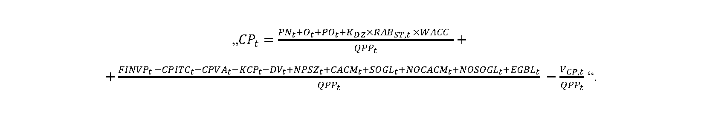

# Čl. I

Vyhláška Úradu pre reguláciu sieťových odvetví č. 154/2024 Z. z., ktorou sa ustanovuje cenová regulácia v elektroenergetike a niektoré podmienky vykonávania regulovaných činností v elektroenergetike sa mení a dopĺňa takto:

- 1. V § 4 sa odsek 2 dopĺňa písmenom am), ktoré znie:

- „am)

- platba za prekročenie hraničnej hodnoty tokov dodávky jalovej kapacitnej elektriny z regionálnej distribučnej sústavy a z miestnej distribučnej sústavy do prenosovej sústavy.“.

- 2. V § 7 sa odsek 10 dopĺňa písmenom l), ktoré znie:

- „l)

- elektrinu vyrobenú a spotrebovanú spoločenstvom vlastníkov bytov a nebytových priestorov v bytovom dome bez využitia distribučnej sústavy.“.

- 3. V § 8 ods. 1 písm. a) a § 19 ods. 12 písm. b) sa číslo „0,90“ nahrádza číslom „0,95“.

- 4. V § 8 odsek 8 znie:

- „(8)

- Na výpočty podľa odsekov 2 až 6 sa použijú aritmetické priemery údajov koncového odberateľa elektriny za obdobie posledných troch kalendárnych rokov v štruktúre podľa prílohy č. 4. Ak koncový odberateľ elektriny vykonáva činnosť menej ako tri kalendárne roky, alebo v priebehu posledných troch kalendárnych rokov bola jeho činnosť prerušená dlhšie ako jeden kalendárny rok, použijú sa aritmetické priemery údajov za dva kalendárne roky predchádzajúce roku, v ktorom došlo k prerušeniu činnosti, za ktoré sú údaje k dispozícii. Ak koncový odberateľ elektriny vykonáva činnosť menej ako dva kalendárne roky, použijú sa údaje za kalendárny rok, za ktorý sú údaje k dispozícii.“.

- 5. § 10 sa dopĺňa odsekom 5, ktorý znie:

- „(5)

- Koeficient zahrnutia hodnoty základného imania organizátora krátkodobého trhu s elektrinou kZItsa určuje úradom pre

- a)

- činnosti zúčtovanie, vyhodnotenie a vysporiadanie odchýlok pre rok t vo výške 0 až 1,

- b)

- činnosti organizovanie a vyhodnotenie krátkodobého trhu s elektrinou pre rok t vo výške 0 až 1,

- c)

- výkon ostatných činností organizátora krátkodobého trhu s elektrinou pre rok t vo výške 0 až 1.“.

- 6. V § 16 ods. 1 vzorec CPt znie:

- 

- 7. V § 16 sa odsek 1 dopĺňa písmenom s), ktoré znie:

- „s)

- VCP,t sú výnosy z platieb za rezervovanú kapacitu a prenos elektriny za dodávku jalovej kapacitnej elektriny do prenosovej sústavy v roku t-2 podľa § 17a ods. 1 písm. a) a b).“.

- 8. V § 16 ods. 4 sa za tretiu vetu vkladá nová štvrtá veta, ktorá znie: „Rovnaký postup sa použije, ak hodnota skutočne nameraného mesačného maxima štvrťhodinového činného výkonu koncového odberateľa elektriny priamo pripojeného do prenosovej sústavy v príslušnom mesiaci počas roku t presiahne 1,10-násobok alebo nedosiahne 0,50-násobok hodnoty dohodnutej rezervovanej kapacity určenej podľa odseku 2.“.

- 9. V § 17 ods. 1 vzorec PSstratyt znie:

- 

- 10. V § 17 sa odsek 1 dopĺňa písmenom g), ktoré znie:

- „g)

- VSTR,t sú platby za straty za dodávku jalovej kapacitnej elektriny v roku t-2 podľa § 17a ods. 1 písm. c).“.

- 12. V § 19 ods. 3 písm. d) sa na konci bodka nahrádza bodkočiarkou a pripájajú sa tieto slová: „pomernou odchýlkou subjektu zúčtovania sa rozumie priemerná hodnota za obdobie posledných 12 mesiacov predchádzajúcich dátumu predloženia žiadosti, a ak v priebehu posledných troch kalendárnych rokov bola činnosť koncového odberateľa prerušená dlhšie ako jeden kalendárny rok, použijú sa parametre za dva kalendárne roky predchádzajúce roku, v ktorom došlo k prerušeniu činnosti.“.

- 13. V § 19 ods. 5 vzorec NPSSt znie:

- „NPSSt= PPSt+ PNDis,t+ ODis,t+ PODis,t+ RABDis,ST,t × WACC + FINVDis,t – DVPpS,t – TSSVAt– KSt– VTSS,t“.

- 14. V § 19 sa odsek 5 dopĺňa písmenom k), ktoré znie:

- „k)

- VTSS,t sú výnosy z platieb za jalovú kapacitnú elektrinu podľa § 17b za rok t-2.“.

- 15. V § 19 ods. 11 sa vypúšťa písmeno h).

  - Doterajšie písmeno i) sa označuje ako písmeno h).

- 16. V § 22 ods. 2 písm. e) sa vypúšťajú slová „do 31. júla v každom roku regulačného obdobia,“.

- 17. V § 23 ods. 8 sa slová „vybavené určeným meradlom s meraním štvrťhodinového činného výkonu s mesačným odpočtom môže byť rezervovaná kapacita zmluvne dohodnutá a môže byť nižšia, ako je hodnota kapacity zodpovedajúca amperickej hodnote hlavného ističa“ nahrádzajú slovami „odberateľov elektriny mimo domácnosti vybavené určeným meradlom s meraním štvrťhodinového činného výkonu s mesačným odpočtom je minimálnou rezervovanou kapacitou 50 % z hodnoty maximálnej rezervovanej kapacity“.

- 18. V § 23 odsek 12 znie:

- „(12)

- Ak užívateľ regionálnej distribučnej sústavy v odbernom mieste a odovzdávacom mieste súčasne v jednom mieste pripojenia do regionálnej distribučnej sústavy prevádzkuje zariadenie na výrobu elektriny z vodnej energie s celkovým inštalovaným výkonom do 1 MW, prevádzkuje prečerpávaciu vodnú elektráreň, alebo prevádzkuje certifikované zariadenie výlučne na poskytovanie podporných služieb prevádzkovateľovi prenosovej sústavy alebo výlučne na dodávku alebo odber regulačnej elektriny, neuhrádza prevádzkovateľovi regionálnej distribučnej sústavy platbu za prístup do distribučnej sústavy podľa odseku 11, ak predloží prevádzkovateľovi regionálnej distribučnej sústavy potvrdenie o poskytnutí podporných služieb za predchádzajúci mesiac vydané prevádzkovateľom prenosovej sústavy, najneskôr do piateho pracovného dňa nasledujúceho mesiaca, a to do maximálnej výšky výkonu elektroenergetického zariadenia určeného na poskytovanie podporných služieb. Potvrdenie prevádzkovateľa prenosovej sústavy o poskytnutí podporných služieb obsahuje obdobie poskytovania podporných služieb a identifikačné číslo EIC odberného miesta alebo odovzdávacieho miesta zazmluvneného u prevádzkovateľa distribučnej sústavy, u ktorého je žiadané neuhrádzanie platby za prístup do distribučnej sústavy, a to podľa toho, cez ktoré identifikačné číslo EIC boli poskytované podporné služby a zazmluvnený výkon určený na poskytovanie podporných služieb. Ak užívateľ regionálnej distribučnej sústavy nepredloží prevádzkovateľovi regionálnej distribučnej sústavy potvrdenie o poskytnutí podporných služieb v lehote podľa prvej vety, vyfakturuje sa užívateľovi regionálnej distribučnej sústavy dohodnutá rezervovaná kapacita za príslušný mesiac.“.

- 19. V § 23 ods. 17 prvej vete sa za slovo „piateho“ vkladá slovo „pracovného“.

- 20. V § 24 ods. 11 sa na konci pripájajú tieto vety: „Ak odberateľ elektriny okrem odberateľa elektriny v domácnosti má na napäťovej úrovni nízkeho napätia v odbernom mieste nižšiu rezervovanú kapacitu ako je amperická hodnota hlavného ističa pred elektromerom, pri prekročení rezervovanej kapacity sa uplatnia tarify za prekročenie rezervovanej kapacity. Výrobcovi elektriny pripojeného na napäťovej úrovni nízkeho napätia sa pri prekročení maximálnej rezervovanej kapacity na dodávku elektriny do distribučnej sústavy účtujú tarify za prekročenie maximálnej rezervovanej kapacity.“.

- 21. V § 24 ods. 15 písm. a) a b) a ods. 17 sa slovo „polrok“ nahrádza slovom „rok“.

- 22. V § 25 ods. 3 písmeno h) znie:

- „h)

- DVHN,t sú skutočné dodatočné výnosy na príslušnej napäťovej úrovni v roku t-2 v eurách, ktoré sú zložené z celkových skutočných výnosov

- 1.

- z uplatnenia ceny za pripojenie do distribučnej sústavy sa zohľadnia vo výške 100 %; ak žiadateľ predčasne ukončí zmluvu o pripojení do distribučnej sústavy a prevádzkovateľ regionálnej distribučnej sústavy nevynaloží na rozvoj distribučnej sústavy žiadne náklady, cena za pripojenie do distribučnej sústavy sa žiadateľovi vráti vo výške 90 %, pričom maximálna výška časti ceny za pripojenie do distribučnej sústavy, ktorá sa nevráti žiadateľovi o pripojenie, je 30 000 eur,

- 2.

- zo sankcií za prekročenie rezervovanej kapacity sa zohľadnia vo výške 100 %,

- 3.

- z platieb za rezervovanú kapacitu a distribúciu jalovej kapacitnej elektriny za nedodržanie účinníka na príslušnej napäťovej úrovni účtované užívateľom distribučnej sústavy na základe cenového rozhodnutia úradu sa zohľadnia vo výške 100 %,

- 4.

- z výnosov cenníka služieb za distribúciu elektriny, podľa prílohy č. 9, sa zohľadnia vo výške 50 % pre roky t = 2026 a nasledujúce roky,

- 5.

- 100 % z rozdielu výnosov neuplatnenia zníženia maximálnej rezervovanej kapacity v odberných miestach podľa § 31 ods. 5, ktoré sa zohľadní pre rok

- t = 2027 a nasledujúce roky,

- 6.

- 50 % výnosov z uplatnenia cien prístupu do distribučnej sústavy a distribúcie elektriny, v súlade s platným rozhodnutím úradu, z prepravy elektriny príslušnému susednému prevádzkovateľovi sústavy na území Európskej únie alebo na území tretích štátov, v súlade s podmienkami prepravy schválených úradom.“.

- 23. V § 26 ods. 2 vzorec VVSDHN, tznie:

- „VVSDHN, t= CSDHN+1,t× VystETRHN+1,t+ CSHDHN,t × VystEHN,t“.

- 24. V § 26 ods. 3 písm. b) prvom bode sa za slovo „Futures“ vkladá slovo „Baseload“.

- 25. V § 27 ods. 2 písm. e) sa vypúšťajú slová „ktoré sa predkladajú do 31. júla v každom roku regulačného obdobia,“.

- 26. V § 31 ods. 5 sa na konci pripájajú tieto vety: „Odberateľ elektriny môže požiadať prevádzkovateľa distribučnej sústavy o zníženie maximálnej rezervovanej kapacity. Tejto žiadosti sa vyhovie, ak sú splnené technické podmienky vydané prevádzkovateľom distribučnej sústavy odberateľovi elektriny, ktoré súvisia výhradne s úpravou fakturačného merania; táto zmena sa nespoplatňuje. Ak odberateľ elektriny požiadal prevádzkovateľa distribučnej sústavy o zníženie maximálnej rezervovanej kapacity, pri žiadosti o jej opätovné zvýšenie sa uplatní cena za pripojenie za zvýšenie maximálnej rezervovanej kapacity, ak sa nepostupuje podľa nasledujúcej vety. Odberateľ elektriny pripojený do regionálnej distribučnej sústavy na napäťovej úrovni vysokého napätia alebo veľmi vysokého napätia, ktorý požiada prevádzkovateľa regionálnej distribučnej sústavy o zníženie maximálnej rezervovanej kapacity v odbernom mieste po 30. júni 2024, môže najneskôr do 31. decembra 2025 jedenkrát požiadať prevádzkovateľa regionálnej distribučnej sústavy o bezplatné zvýšenie maximálnej rezervovanej kapacity, maximálne však do výšky pôvodnej maximálnej rezervovanej kapacity. Skutočnosť, že prevádzkovateľ distribučnej sústavy nedisponuje dostatočnou kapacitou na zvýšenie maximálnej rezervovanej kapacity, sa preukazuje úradu výpisom zmluvne dohodnutého výkonu v zmluvách o pripojení do distribučnej sústavy a skutočnou spotrebou elektriny za kalendárny rok t-1 v príslušnom bode pripojenia do distribučnej sústavy.“.

- 27. V § 35 odsek 3 znie:

- „(3)

- Cena za pripojenie zariadenia na výrobu elektriny alebo zariadenia na uskladňovanie elektriny bez existujúceho odberného miesta sa vypočíta podľa odseku 1.“.

- 28. V § 35 ods. 8 sa slová „odsekov 9 a 10“ nahrádzajú slovami „odsekov 6 a 7“.

- 29. V § 39 sa za odsek 4 vkladá nový odsek 5, ktorý znie:

- „(5)

- Za dodávku elektriny zraniteľným odberateľom okrem zraniteľných odberateľov elektriny v domácnosti sa pre jednotlivé odberné miesta uplatní najviac dvanásť sadzieb, a to

- a)

- DMP1 je jednopásmová sadzba s nižšou spotrebou elektriny,

- b)

- DMP2 je jednopásmová sadzba so strednou spotrebou elektriny,

- c)

- DMP3 je jednopásmová sadzba s vyššou spotrebou elektriny,

- d)

- DMP4 je dvojpásmová sadzba s nižšou spotrebou elektriny; nízke pásmo sa poskytuje minimálne osem hodín denne, sadzba DMP4 sa použije aj pre odberné miesto s nabíjacou stanicou elektrických vozidiel,

- e)

- DMP5 je dvojpásmová sadzba so strednou spotrebou elektriny; nízke pásmo sa poskytuje minimálne osem hodín denne, sadzba DMP5 sa použije aj pre odberné miesto s nabíjacou stanicou elektrických vozidiel,

- f)

- DMP6 je dvojpásmová sadzba s vyššou spotrebou elektriny; nízke pásmo sa poskytuje minimálne osem hodín denne, sadzba DMP6 sa použije aj pre odberné miesto s nabíjacou stanicou elektrických vozidiel,

- g)

- DMP7 je dvojpásmová sadzba, pričom nízke pásmo sa poskytuje minimálne 20 hodín denne s blokovaním priamo výhrevných elektrických spotrebičov v čase vysokého pásma; sadzba DMP7 sa použije aj pre odberné miesto s nabíjacou stanicou elektrických vozidiel,

- h)

- DMP8 je dvojpásmová sadzba pre tepelné čerpadlo, pričom nízke pásmo sa poskytuje minimálne 20 hodín denne s blokovaním výhrevných elektrických spotrebičov v čase vysokého pásma; sadzba DMP8 sa použije aj pre odberné miesto s nabíjacou stanicou elektrických vozidiel,

- i)

- DMP9 je sadzba pre nemerané odbery elektriny,

- j)

- DMP10 je sadzba pre verejné osvetlenie,

- k)

- DMP11 je sadzba pre dočasné odbery elektriny,

- l)

- DMP12 je viacpásmová sadzba pre odberné miesto s nainštalovaným inteligentným meracím systémom.“.

  - Doterajšie odseky 5 a 6 sa označujú ako odseky 6 a 7.

- 30. § 47 sa dopĺňa odsekom 11, ktorý znie:

- „(11)

- Cena elektriny vyrobenej v zariadení výrobcu elektriny v spaľovacom motore s palivom zemný plyn, ktoré nie je pripojené do sústavy a je trvalo oddelené od sústavy a bolo uvedené do prevádzky do 31. júla 2019, je vo výške 127,41 eura/MWh.“.

- 31. Za § 49a sa vkladá § 49a, ktorý vrátane nadpisu znie:

- 㤠49a

- Podrobnosti k výpočtu čistých nákladov povinnosti vo všeobecnom hospodárskom záujme

- (1)

- Úprava podrobností k výpočtu čistých nákladov povinnosti vo všeobecnom hospodárskom záujme sa vzťahuje na regulovaný subjekt pri poskytovaní povinnosti vo všeobecnom hospodárskom záujme podľa § 24d ods. 1 zákona o energetike.

- (2)

- Žiadosť o potvrdenie o výške čistých nákladov povinnosti vo všeobecnom hospodárskom záujme, alebo, ak sa poskytuje náhrada podľa § 24c ods. 1 zákona o energetike žiadosť o potvrdenie o predpokladanej výške čistých nákladov povinnosti vo všeobecnom hospodárskom záujme (ďalej len „potvrdenie o výške nákladov“) sa predkladá úradu podľa vzoru uvedeného v prílohe č. 16. Súčasťou žiadosti o vydanie potvrdenia o výške nákladov sú aj ďalšie údaje a podklady nevyhnutné na posúdenie žiadosti o vydanie potvrdenia o výške nákladov.

- (3)

- Pri výpočte čistých nákladov povinnosti uloženej vo všeobecnom hospodárskom záujme úrad prihliada aj na nákladovú efektívnosť poskytovania povinnosti vo všeobecnom hospodárskom záujme a primeraný zisk vo výške podľa tejto vyhlášky v závislosti od vykonávanej regulovanej činnosti. Čisté náklady povinnosti uloženej vo všeobecnom hospodárskom záujme CNP sa vypočítajú podľa vzorca

- CNP = CNBVHZ– CNVHZ ,

- kde

- a)

- CNBVHZsú čisté náklady poskytovateľa povinnosti vo všeobecnom hospodárskom záujme, ak by povinnosť uloženú vo všeobecnom hospodárskom záujme neposkytoval,

- b)

- CNVHZ sú čisté náklady poskytovateľa povinnosti vo všeobecnom hospodárskom záujme pri plnení povinnosti uloženej vo všeobecnom hospodárskom záujme.“.

- 32. Príloha č. 1 vrátane nadpisu znie:

- „[Príloha č. 1 k vyhláške č. 154/2024 Z. z.](assets/6d48acd4d04cc4a710216347820aa0adb583a5ea1a117dcfb099b25119bd709f.pdf)“.

- 33. Nadpis prílohy č. 7 znie: „Spôsob výpočtu nákladov na odchýlku súvisiacich s diagramom strát elektriny a s výkupom elektriny od výrobcov elektriny s nárokom na podporu výkupom elektriny určených na základe skutočných cien odchýlky“.

- 34. V prílohe č. 7 ods. 4 písm. b) sa slová „31. júna“ nahrádzajú slovami „30. júna“.

- 35. Vyhláška sa dopĺňa prílohou č. 16, ktorá vrátane nadpisu znie:

- „[Príloha č. 16 k vyhláške č. 154/2024 Z. z.](assets/2a8577139c8d3c11250b84cdcc818b5c4ac35661e3444ac65709bafcaf32a2fb.pdf)“.
