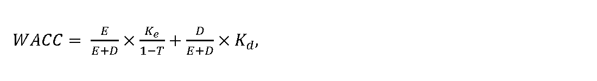
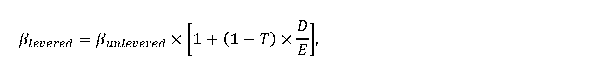

# Čl. I

Vyhláška Úradu pre reguláciu sieťových odvetví č. 445/2022 Z. z., ktorou sa ustanovuje cenová regulácia odberu povrchovej vody a energetickej vody z vodných tokov a využívania hydroenergetického potenciálu vodných tokov sa mení a dopĺňa takto:

- 1. V § 4 ods. 1 písmeno g) znie:

- „g)

- úrok z úveru poskytnutého bankou alebo pobočkou zahraničnej banky

- 7) na obstaranie hmotného majetku alebo nehmotného majetku, ktorý sa používa výhradne na regulovanú činnosť najviac do hodnoty úroku rovnajúceho sa aritmetickému priemeru hodnôt mesačných priemerov ukazovateľa 12M EURIBOR za obdobie posledných 12 mesiacov predchádzajúcich mesiacu, v ktorom sa začalo cenové konanie podľa § 14 ods. 1 zákona, zverejnených na webovom sídle www.euribor-ebf.eu v časti „Euribor rates“,“.

- 2. V § 4 ods. 1 sa vypúšťa písmeno h).

  - Poznámka pod čiarou k odkazu 8 sa vypúšťa.

- 3. V § 4 ods. 4 prvej vete sa vypúšťajú slová „pri vykonávaní cenovej regulácie na rok 2023“.

- 4. V § 4 sa vypúšťa odsek 6.

  - Doterajšie odseky 7 a 8 sa označujú ako odseky 6 a 7.

- 5. V § 4 ods. 6 sa za písmeno ah) vkladajú nové písmená ai) a aj), ktoré znejú:

- „ai)

- náklady na konzultácie, poradenstvo a štúdie,

- aj)

- náklady na právne služby okrem právnych služieb na majetkovoprávne vysporiadanie a právnych služieb vyplývajúcich z obchodnoprávnych vzťahov so spotrebiteľmi,“.

  - Doterajšie písmeno ai) sa označuje ako písmeno ak).

- 6. § 5 vrátane nadpisu znie:

- 㤠5

- Spôsob určenia miery výnosnosti regulačnej bázy aktív

- (1)

- Miera výnosnosti regulačnej bázy aktív sa určuje na celé regulačné obdobie, pričom zohľadňuje

- a)

- návratnosť prevádzkových aktív používaných výhradne na zabezpečenie regulovanej činnosti,

- b)

- rozsah potrebných investícií na zabezpečenie dlhodobej spoľahlivej, bezpečnej a udržateľnej prevádzky aktív používaných pri výkone regulovanej činnosti.

- (2)

- Miera výnosnosti regulačnej bázy aktív pred zdanením na regulačné obdobie sa vyjadruje ako vážený priemer nákladov na kapitál WACC pred zdanením, vyjadrený v percentuálnej hodnote, matematicky zaokrúhlenej na dve desatinné miesta, a vypočíta sa podľa vzorca

- 

- kde

- a)

- Ke sú náklady na vlastný kapitál v percentách určené podľa odseku 3,

- b)

- Kd sú náklady na cudzí kapitál vo výške 2,77 %,

- c)

- 

- E

- E

- +

- D

- je podiel vlastného majetku na celkovom majetku, ktorý sa ustanovuje na celé regulačné obdobie vo výške 40 %,

- d)

- 

- D

- E

- +

- D

- je podiel cudzieho majetku na celkovom majetku, ktorý sa ustanovuje na celé regulačné obdobie vo výške 60 %,

- e)

- T je sadzba dane z príjmov právnických osôb v roku t v percentách.

- (3)

- Náklady na vlastný kapitál sa vypočítajú podľa vzorca

- Ke = Rf + βlevered× MRP,

- kde

- a)

- Rf je bezriziková výnosová miera, ktorá sa na regulačné obdobie ustanovuje vo výške 1,11 %,

- b)

- βlevered je vážený beta koeficient vyjadrujúci systematické riziko a citlivosť konkrétneho odvetvia na zmenu trhu, ktorý sa vypočíta podľa vzorca

- 

- kde

- 1.

- βunlevered je nevážený beta koeficient bez vplyvu sadzby dane z príjmov a podielu cudzích zdrojov, ktorý sa na regulačné obdobie ustanovuje vo výške 0,49,

- 2.

- D/E je pomer cudzích zdrojov k vlastnému majetku, ktorý sa ustanovuje na celé regulačné obdobie vo výške 1,5,

- c)

- MRP je trhová riziková prirážka, ktorá sa na regulačné obdobie ustanovuje vo výške 5,84 %.

- (4)

- Hodnota WACC pred zdanením sa na rok 2025 a zvyšok regulačného obdobia ustanovuje vo výške 5,39 %. Ak sa určí nová hodnota WACC na rok t podľa odseku 5, hodnota WACC podľa prvej vety sa na rok t a zvyšok regulačného obdobia nepoužije.

- (5)

- Ak odchýlka medzi rokmi t-2 a t-1 v niektorom z parametrov vstupujúcich do výpočtu WACC v priebehu regulačného obdobia bude vyššia ako 20 %, určí sa nová hodnota WACC na rok t a na zvyšok regulačného obdobia, ktorá sa zverejní na webovom sídle úradu najneskôr do 30. júna roku t-1. Zmena vyjadrená ako hodnota pomeru medzi aktuálnou číselnou hodnotou WACC a novou číselnou hodnotou WACC nesmie presiahnuť 10 %, teda pomer nepresiahne hodnoty uzavretého matematického intervalu [0,9 - 1,1].“.

- 7. V § 6 sa vypúšťa písmeno j).

- 8. V § 8 ods. 1 písm. h) druhom bode sa hodnota „2,5 %“ nahrádza hodnotou „3,0 %“.

- 9. V § 8 odsek 2 znie:

- „(2)

- Maximálny primeraný zisk za odber povrchovej vody v eurách na rok t sa vypočíta podľa vzorca

- 

- P

- Z

- t

- =

- O

- N

- P

- V

- t

- –

- 1

- ×

- R

- ,

- kde

- a)

- ONPVt-1 sú ekonomicky oprávnené náklady podľa § 4 ods. 1 písm. a) až g) v eurách na odber povrchovej vody v cene schválenej alebo určenej úradom na rok t-1,

- b)

- R je hodnota uplatňovaná na účely cenovej regulácie na rok t, pričom R = WACCt.“.

- 10. V § 8 sa vypúšťa odsek 3.

- 11. Za § 9 sa vkladá § 9a, ktorý vrátane nadpisu znie:

- 㤠9a

- Spôsob výpočtu ceny za využívanie hydroenergetického potenciálu a výšky primeraného zisku na rok 2027

- (1)

- Na určenie ceny za využívanie hydroenergetického potenciálu sa vypočíta základná cena za využívanie hydroenergetického potenciálu ZCHPt v eurách na jednotku vyrobenej elektriny pri 100 % účinnosti výrobného zariadenia podľa vzorca

- 

- kde

- a)

- PNHPt sú náklady na využívanie hydroenergetického potenciálu vrátane primeraného zisku určené podľa odseku 2,

- b)

- QEt je priemerné množstvo vyrobenej elektriny v rokoch t-1 až t-10.

- (2)

- Náklady na využívanie hydroenergetického potenciálu sa vypočítajú podľa vzorca

- 

- pričom ak (JPIn – X) < 0, na účely výpočtu sa hodnota rozdielu do súčinu nezapočíta,

- kde

- a)

- OHPt sú odpisy majetku alebo nájomné za majetok podľa § 4 ods. 1 písm. d) a e) a úroky z úveru podľa § 4 ods. 1 písm. g) v eurách v roku t-1, pričom vo výpočte na

- 1.

- roky 2025 a 2026 sa použijú účtovné odpisy,

- 2.

- rok 2027 sa použijú odpisy podľa technickej doby životnosti majetku podľa prílohy č. 5 vychádzajúce zo zostatkovej hodnoty majetku RABvých, kde RABvých. je všeobecná hodnota majetku podľa stavu k 31. decembru 2024 určená na základe znaleckého posudku vypracovaného znalcom zapísaným v zozname znalcov podľa osobitného predpisu,22a)

- b)

- POPEX sú ekonomicky oprávnené náklady podľa § 4 ods. 1 písm. a), b), c) a f) v eurách na využívanie hydroenergetického potenciálu vypočítané ako priemer prevádzkových nákladov v rokoch t-1 až t-10,

- c)

- JPIn je aritmetický priemer indexov jadrovej inflácie v percentách za obdobie od júla roku n-2 do júna roku n-1, zverejnených na webovom sídle Štatistického úradu Slovenskej republiky http://datacube.statistics.sk v priečinku „Makroekonomické štatistiky“ v sekcii „Spotrebiteľské ceny a ceny produkčných štatistík“ v časti „Indexy spotrebiteľských cien (inflácia)“ v časti „Jadrová a čistá inflácia“ v priečinku „Jadrová a čistá inflácia – oproti rovnakému obdobiu minulého roku v percentách – mesačne“,

- d)

- X je faktor efektivity, ktorý sa ustanovuje vo výške 3,0 %,

- e)

- PZt je maximálna výška primeraného zisku v eurách určená podľa odseku 3.

- (3)

- Maximálny primeraný zisk za využívanie hydroenergetického potenciálu v eurách sa vypočíta podľa vzorca

- 

- P

- Z

- t

- =

- O

- N

- H

- P

- t

- –

- 1

- ×

- R

- ,

- kde

- a)

- ONHPt-1 sú ekonomicky oprávnené náklady podľa § 4 ods. 1 písm. a) až g) v eurách na využívanie hydroenergetického potenciálu v cene schválenej alebo určenej úradom na rok t-1,

- b)

- R je hodnota uplatňovaná na účely cenovej regulácie na rok t, pričom R = WACCt.

- (4)

- Tarify pre jednotlivé skupiny využívateľov hydroenergetického potenciálu sa vypočítajú podľa vzorca

- 

- kde

- a)

- THEPi je tarifa účtovaná i-tému užívateľovi HEP,

- b)

- ZCHPt je základná cena za využívanie hydroenergetického potenciálu určená podľa odseku 1,

- c)

- 

- η

- i

- c

- je celková účinnosť výrobného zariadenia i-tého užívateľa HEP preukázaná meraním alebo na základe znaleckého posudku vypracovaného znalcom zapísaným v zozname znalcov v odbore „Elektrotechnika – Elektroenergetické stroje a zariadenia“ alebo „Energetika – Regulácia a riadenie sieťových odvetví“ podľa osobitného predpisu22a) pre rok t prevádzky výrobného technologického zariadenia, ktorá sa preukazuje jedenkrát za tri roky, alebo pri každej zmene cenového rozhodnutia, pričom celková účinnosť výrobného zariadenia sa vypočíta podľa vzorca

- 

- 

- k

- d

- e

- 

- 1

- .

- η

- i

- c

- je účinnosť celého výrobného zariadenia (sústroja),

- 

- 2

- .

- η

- t

- je účinnosť turbíny,

- 

- 3

- .

- η

- p

- je účinnosť prevodu,

- 

- 4

- .

- η

- g

- je účinnosť generátora.“.

  - Poznámka pod čiarou k odkazu 22a znie:

  - „22a) Zákon č. 382/2004 Z. z. o znalcoch, tlmočníkoch a prekladateľoch a o zmene a doplnení niektorých zákonov v znení neskorších predpisov.“.

- 12. V § 10 ods.1 písm. h) druhom bode sa hodnota „2,5 %“ nahrádza hodnotou „3,0 %“.

- 13. V § 10 odsek 2 znie:

- „(2)

- Maximálny primeraný zisk za odber energetickej vody v eurách na rok t sa vypočíta podľa vzorca

- 

- P

- Z

- t

- =

- (

- O

- N

- E

- V

- t

- –

- 1

- ×

- R

- )

- ,

- kde

- a)

- ONEVt-1 sú ekonomicky oprávnené náklady podľa § 4 ods. 1 písm. a) až g) v eurách na odber energetickej vody v cene schválenej alebo určenej úradom na rok t-1,

- b)

- R je hodnota uplatňovaná na účely cenovej regulácie pre rok t, pričom R = WACCt.“.

- 14. V § 10 sa vypúšťa odsek 3.

- 15. V § 11 ods. 1 sa vypúšťa písmeno d).

- 16. Za § 12 sa vkladá § 12a, ktorý vrátane nadpisu znie:

- 㤠12a

- Prechodné ustanovenia k úpravám účinným od 1. januára 2025

- (1)

- Podľa § 9 v znení účinnom do 31. decembra 2024 sa postupuje pri vykonávaní cenovej regulácie na roky 2025 a 2026.

- (2)

- Podľa § 9a sa prvýkrát postupuje pri vykonávaní cenovej regulácie na rok 2027.“.

- 17. Príloha č. 5 vrátane nadpisu znie:

- „Príloha č. 5

- k vyhláške č. 445/2022 Z. z.

- Technické doby životnosti majetku

- P. č. | Názov | Životnosť v rokoch

- 1 | Aktívna protikorózna ochrana vrátane SKAO | 30

- 2 | Akumulátory (batérie) | 8

- 3 | Analyzátor sietí | 8

- 4 | Anténne stožiare | 30

- 5 | Armatúry | 10

- 6 | Betónové základy | 80

- 7 | Bleskozvody a uzemnenia | 30

- 8 | Budovy malých staníc – betónové (len samostatné objekty, najmä regulačné stanice ZP, trafostanice, výmenníkové stanice, dotláčacie stanice) | 50

- 9 | Budovy administratívne | 50

- 10 | Budovy malých staníc – kioskové (len samostatné objekty, najmä regulačné stanice ZP, trafostanice, výmenníkové stanice, dotláčacie stanice) | 50

- 11 | Budovy malých staníc – murované (len samostatné objekty, najmä regulačné stanice ZP, trafostanice, výmenníkové stanice, dotláčacie stanice) | 50

- 12 | Budovy malých staníc – plechové (len samostatné objekty, najmä regulačné stanice ZP, trafostanice, výmenníkové stanice, dotláčacie stanice) | 30

- 13 | Budovy malých staníc – vstavané (len samostatné objekty, najmä regulačné stanice ZP, trafostanice, výmenníkové stanice, dotláčacie stanice) | 60

- 14 | Bunky a objekty z plastu a sklolaminátu a podobne (len samostatné objekty, najmä regulačné stanice ZP, trafostanice, výmenníkové stanice, dotláčacie stanice, telemetrické skrinky) | 30

- 15 | Čerpacie a prečerpávacie stanice – stavebná časť | 60

- 16 | Čerpacie a prečerpávacie stanice – technologická časť | 10

- 17 | Čerpadlá (najmä čerpadlá kvapalín oleja, vody, kondenzátu, vysávače, vývevy) | 12

- 18 | Čistiace komory (najmä v rozvodoch plynu, tepla, vody a podobne – nie stavebné časti) | 10

- 19 | Čistiarne odpadových vôd (ČOV) – stavebná časť | 50

- 20 | Čistiarne odpadových vôd (ČOV) – technologická časť | 25

- 21 | Čistička ultrazvuková | 10

- 22 | Defektoskop | 10

- 23 | Dopravníky a dopravné zariadenia (najmä pásové, závitovkové, korčekové) | 17

- 24 | Dotláčacie stanice | 15

- 25 | Ekonomizéry, rekuperátory, ohrievače | 17

- 26 | Elektrické motory (najmä synchrónne, asynchrónne, krokové, derivačné, iné ako generátory) | 25

- 27 | Elektrické prípojky NN (najmä káblové zemné, káblové vzdušné, vzdušné) | 25

- 28 | Elektrické prípojky VN (najmä káblové zemné, káblové vzdušné, vzdušné) | 25

- 29 | Elektrické prípojky VVN | 25

- 30 | Elektrocentrály prenosné (najmä zážihové, vznetové) | 12

- 31 | Elektroinštalácia v objektoch (najmä v regulačných staniciach, rozvodniach, výmenníkových staniciach, zariadeniach na úpravu vody) | 25

- 32 | Elektromery | 12

- 33 | Elektromery – inteligentné meracie systémy | 12

- 34 | Elektronické prístroje kancelárske (najmä faxy, písacie stroje, tlačiarne, kopírovacie stroje, fotoaparáty, skenery, chladničky, TV prijímače, videokonferenčné zariadenia, prevodníky, čítačky) | 7

- 35 | Elektronické zariadenia s individuálnymi funkciami (najmä kalibrátory, termokamery, analyzátory spalín, tlaku a iných neelektrických veličín) | 10

- 36 | Energomosty | 40

- 37 | Etalónový plynomer | 12

- 38 | Filtre (najmä pieskové, zariadenia s aktívnym uhlím, s vymeniteľnými kartušami, samočistiace) | 15

- 39 | Fotovoltické panely | 20

- 40 | Frekvenčné meniče samostatné | 20

- 41 | Garáže betónové | 50

- 42 | Garáže inej konštrukcie | 25

- 43 | Generátory, alternátory | 25

- 44 | GPS jednotky | 6

- 45 | Hasiace prístroje | 12

- 46 | Havarijné jamy | 60

- 47 | Horáky na kvapalné palivo, plynové palivo, práškové palivo | 15

- 48 | Hydraulické zdviháky | 20

- 49 | Chladiace veže | 40

- 50 | Chladiace veže – betónové | 60

- 51 | Chladiace, vetracie a klimatizačné zariadenia | 12

- 52 | Chladiče kondenzátu (dochladzovače kondenzátu) | 12

- 53 | Káblové bubny | 8

- 54 | Káblové kanály | 50

- 55 | Kanalizácia | 60

- 56 | Kanalizačné šachty, odľahčovacie komory, dažďové nádrže | 60

- 57 | Kogeneračné jednotky | 25

- 58 | Koľajisko a ostatné dráhy | 30

- 59 | Kolektory pre rozvod tepla | 50

- 60 | Komínové zostavy nerezové | 30

- 61 | Komínové zostavy plastové | 20

- 62 | Komíny betónové | 50

- 63 | Komíny nerezové | 30

- 64 | Komíny plastové | 30

- 65 | Kompresory bez pohonnej jednotky | 12

- 66 | Komunikácie nespevnené | 20

- 67 | Komunikácie spevnené – cesty | 50

- 68 | Komunikačná technika ( mobilné telefóny, vysielačky) | 5

- 69 | Kondenzačné nádrže | 12

- 70 | Kondenzátory pary | 12

- 71 | Kontajnery na odpad | 10

- 72 | Kosačka na trávu | 8

- 73 | Kotly na biomasu | 20

- 74 | Kotly na pevné palivo, kvapalné palivo, plynné palivo, elektrokotly | 20

- 75 | Kotolne – celé zostavy, najmä na plynné palivo, pevné palivo a iné, okrem tých, ktoré sa využívajú na podnikanie v tepelnej energetike | 25

- 76 | Lesné kolesové traktory | 10

- 77 | Malé lode a člny | 10

- 78 | Malotraktory | 10

- 79 | Melioračné zariadenia | 60

- 80 | Meracie a diagnostické prístroje so špeciálnymi funkciami | 17

- 81 | Meracie transformátory napätia | 30

- 82 | Meracie transformátory prúdu | 30

- 83 | Meteorologická stanica | 7

- 84 | Mlyny | 12

- 85 | Monitorovacie, riadiace systémy technologických procesov vrátane softvéru a hardvéru všeobecne | 15

- 86 | Montážne plošiny mechanické | 17

- 87 | Montážne plošiny v motorovom vozidle | 17

- 88 | Mosty | 50

- 89 | Motory s iným ako elektrickým pohonom (najmä zážihové, vznetové, plynové) | 17

- 90 | Nabíjačky prenosné | 10

- 91 | Nabíjačky stacionárne | 17

- 92 | Nábytok | 15

- 93 | Nábytok dielenský | 12

- 94 | Nádrže na tokoch | 60

- 95 | Nádrže na tokoch – environmentálna stavba | 40

- 96 | Nakladacia rampa | 40

- 97 | Nákladné automobily | 12

- 98 | Navŕtavacie súpravy (najmä pre pripojenie plynových prípojok, vodovodných prípojok) | 20

- 99 | Obrábacie stroje stacionárne, všeobecne (najmä sústruhy, frézy, vŕtačky, brúsky) | 20

- 100 | Oceľové konštrukcie | 30

- 101 | Oceľové montované sklady | 30

- 102 | Oceľové prístrešky | 30

- 103 | Odlučovače oleja | 30

- 104 | Odlučovače popolčeka | 30

- 105 | Odorizačná stanica | 10

- 106 | Odovzdávacie stanice tepla | 25

- 107 | Odškvarovací systém (bez dopravníka) | 10

- 108 | Ochranné hrádze (inundačné) | 80

- 109 | Ochrany – elektronické | 15

- 110 | Ochrany – neelektronické | 15

- 111 | Olejové nádrže | 30

- 112 | Oplotenia | 30

- 113 | Oporné múry | 60

- 114 | Optické vedenia | 30

- 115 | Osobné automobily (dispečerské, poruchová služba) | 12

- 116 | Paletové vozíky | 17

- 117 | Plynomery | 20

- 118 | Plynovody oceľové | 30

- 119 | Plynovody polyetylénové | 50

- 120 | Počítačové zostavy, notebooky, tablety, monitory, tlačiarne | 5

- 121 | Potrubia na rozvod tepla – oceľové | 20

- 122 | Potrubia na rozvod tepla – predizolované | 25

- 123 | Prepínacie hodiny | 15

- 124 | Priehrady a hate | 100

- 125 | Priemyselné váhy | 17

- 126 | Prípojky plynu oceľové | 30

- 127 | Prípojky plynu polyetylénové | 50

- 128 | Prístavy, vodné cesty a plavebné objekty | 80

- 129 | Prívesy | 12

- 130 | Rádioreléové zariadenia (najmä vysielačky, prijímacie zariadenia a iné komunikačné nástroje) | 8

- 131 | Redukčné stanice pary | 15

- 132 | Regulátory tlaku plynu | 25

- 133 | Rozvádzače skriňové NN | 25

- 134 | Rozvádzače skriňové VN | 25

- 135 | Rozvádzače zapuzdrené NN | 25

- 136 | Rozvádzače zapuzdrené VN | 25

- 137 | Rozvádzače zapuzdrené VVN | 25

- 138 | Rozvod plynu areálový | 20

- 139 | Rozvodná istiaca skriňa | 25

- 140 | Rozvodne ZVN 220/110 kV | 40

- 141 | Rozvodne VVN 110/22 kV | 30

- 142 | Rozvody NN | 25

- 143 | Rozvody VN | 25

- 144 | Rozvody VVN a ZVN | 35

- 145 | Ručné elektrické náradie | 10

- 146 | Ručné mechanické náradie | 8

- 147 | Servery | 8

- 148 | Skladové kontajnery | 20

- 149 | Sklady betónové | 50

- 150 | Snežné skútre | 12

- 151 | Softvér jednoúčelový (na vykonanie konkrétneho typu úlohy) | 5

- 152 | Softvér nepodliehajúci vonkajším vplyvom (dĺžka životnosti je rovnaká ako doba podpory od dodávateľa) | 8

- 153 | Softvér viazaný so zariadením | 8

- 154 | Solárne kolektory | 20

- 155 | Spalinovody | 30

- 156 | Stanovištia transformátorov | 30

- 157 | Studne | 80

- 158 | Súprava balónovacia s havarijným vakom | 12

- 159 | Sušičky a triedičky uhoľného prachu | 20

- 160 | Svetelné zdroje (najmä svetelné reklamy, svetelné znaky, značky, svetelné oznamovacie tabule, svietidlá pre osvetlenie hál, rozvodní, regulačných staníc) | 8

- 161 | Systém ústredného kúrenia | 25

- 162 | Systémy SCADA, HDO a MaR | 10

- 163 | Systémy synchronizácie reálneho času | 20

- 164 | Špeciálne podvozky | 15

- 165 | Špeciálne prívesy | 15

- 166 | Štúdie a modely | 10

- 167 | Technická dokumentácia | 10

- 168 | Technológia regulačných staníc | 15

- 169 | Telemetrické zariadenia | 17

- 170 | Tepelné čerpadlá | 25

- 171 | Terapeutické nástroje a prístroje, dýchacie prístroje | 7

- 172 | Tlakové nádoby | 20

- 173 | Tlmivka | 30

- 174 | Trafostanice VN/NN betónové bez technológie a objektu bez transformátora | 50

- 175 | Trafostanice VN/NN kioskové bez technológie a objektu bez transformátora | 50

- 176 | Trafostanice VN/NN murované bez technológie a objektu bez transformátora | 50

- 177 | Trafostanice VN/NN stĺpové bez technológie a objektu bez transformátora | 50

- 178 | Trafostanice VN/NN stožiarové bez technológie a objektu bez transformátora | 50

- 179 | Trafostanice VN/NN vstavané bez transformátora a stavebnej časti | 50

- 180 | Trafostanice zapúzdrené a objektu bez transformátora | 50

- 181 | Traktorové prívesy | 15

- 182 | Traktory vrátane prídavných zariadení | 10

- 183 | Transformátor ZVN/VVN | 30

- 184 | Transformátory (VN, VVN ) | 25

- 185 | Trasové uzávery | 50

- 186 | Trezory | 50

- 187 | Tunely a podzemné dráhy | 80

- 188 | Turbíny (najmä parné, plynové) | 25

- 189 | Úpravne vody – stavebná časť | 50

- 190 | Úpravne vody – technologická časť (deionizácia, demineralizácia, dekarbonizácia vody) | 14

- 191 | Úsekové odpojovače | 25

- 192 | Vaňa z nehrdzavejúcej ocele | 60

- 193 | Vedenia NN káblové podzemné | 25

- 194 | Vedenia NN káblové vzdušné | 25

- 195 | Vedenia NN vzdušné | 25

- 196 | Vedenia VN káblové podzemné | 25

- 197 | Vedenia VN káblové vzdušné | 25

- 198 | Vedenia VN vzdušné | 25

- 199 | Vedenia VVN káblové podzemné | 25

- 200 | Vedenia VVN vzdušné | 25

- 201 | Vedenia ZVN vzdušné | 35

- 202 | Vodné toky regulované | 60

- 203 | Vodojemy podzemného typu | 70

- 204 | Vodojemy vežového typu | 50

- 205 | Vodomerné šachty (plastové, z kovu, murované a podobne) | 50

- 206 | Vodomerné uzávery | 50

- 207 | Vodomery, prietokomery | 12

- 208 | Vodovodné potrubia (PE, PPR, PVC, zo sieťovaného polyetylénu, polymérne, kovovo-plastové, kovové) | 50

- 209 | Vonkajšie osvetlenie (najmä na stĺpoch, vonkajších konštrukciách) | 17

- 210 | Vozidlá s elektrickým pohonom (najmä elektromobily, elektrické vozíky, elektrické regálové zakladače) | 14

- 211 | Vozidlá so špeciálnou nadstavbou | 15

- 212 | Vozíky štartovacie | 10

- 213 | Vozíky vŕtacie | 10

- 214 | Vyhnívacie nádrže | 60

- 215 | Vyklápač plastových nádob | 17

- 216 | Výpočtová technika | 5

- 217 | Výsledky meraní | 10

- 218 | Vysokozdvižné vozíky | 15

- 219 | Výťahy | 14

- 220 | Vzduchové a dymové ventilátory | 15

- 221 | Vzduchovody | 25

- 222 | Zabezpečovacie, poplachové a signalizačné zariadenia a systémy | 10

- 223 | Záložné zdroje | 8

- 224 | Zariadenia na úpravu vody (najmä filtračné, zmäkčovacie stanice, úprava kondenzátu, úprava demineralizovanej vody) | 14

- 225 | Zásobníky na sypké hmoty (škvara, vápno a iné) | 20

- 226 | Závesné montážne rebríky | 12

- 227 | Zdvíhacie zariadenia reťazové, kladkostroje a podobne | 17

- 228 | Zdviháky – ručné | 17

- 229 | Zváracie agregáty | 11

- 230 | Žeriavy mostové | 17

- 231 | Žeriavy na vozidlách | 17

- 232 | Žeriavy portálové | 17

- 233 | Žumpy | 60

- Vysvetlivky k tabuľke:

- ZP – zemný plyn,

- SKAO – sklolaminátový kiosk aktívnej protikoróznej ochrany,

- ČOV – čistiareň odpadových vôd,

- NN – nízke napätie,

- VN – vysoké napätie,

- VVN – veľmi vysoké napätie,

- ZVN – zvlášť vysoké napätie,

- GPS – globálny lokalizačný systém,

- SCADA – informačný a merací systém,

- HDO – hromadné diaľkové ovládanie,

- MaR – meranie a regulácia,

- PE – polyetylén,

- PPR – tripropylpolyetylén,

- PVC – polyvinylchlorid.“.
