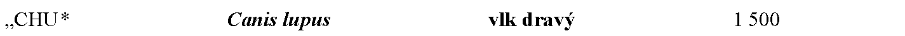

# Čl. I

Vyhláška Ministerstva životného prostredia Slovenskej republiky č. 170/2021 Z. z., ktorou sa vykonáva zákon č. 543/2002 Z. z. o ochrane prírody a krajiny v znení neskorších predpisov sa mení a dopĺňa takto:

- 1. V prílohe č. 5 časti A. Rad „Rodentia – hlodavce“ v tabuľke prvom riadku sa v stĺpci „Spoločenská hodnota €/jedinec“ číslo „2 000“ nahrádza číslom „500“.

- 2. V prílohe č. 5 časti A. Rad „Carnivora – šelmy“ v tabuľke sa vypúšťa prvý riadok.

- 3. V prílohe č. 5 časti A. Rad „Carnivora – šelmy“ v tabuľke ôsmom riadku sa v stĺpci „Spoločenská hodnota €/jedinec“ číslo „5 000“ nahrádza číslom „2 500“.

- 4. V prílohe č. 7 Trieda „Mammalia – cicavce“ sa pred slová „Meles meles“ vkladajú slová

- 

- Celoročne je zakázané jedince druhu vlk dravý (Canis lupus) chytať, zraňovať, usmrcovať alebo ničiť ich obydlia, najmä brlohy s mláďatami na území

  - a) Národného parku Slovenský kras vrátane jeho ochranného pásma a katastrálnych území Háj, Turňa nad Bodvou, Dvorníky, Zádiel a Včeláre v okrese Košice – okolie a katastrálnych území Hrhov a Jablonov nad Turňou v okrese Rožňava,

  - b) Chránenej krajinnej oblasti Kysuce a katastrálnych území Čadca, Horelica, Olešná, Staškov, Turzovka, Oščadnica, Raková, Klokočov, Svrčinovec, Čierne, Skalité v okrese Čadca,

  - c) Chránenej krajinnej oblasti Horná Orava, Pieninského národného parku a jeho ochranného pásma, Tatranského národného parku, katastrálnych území Bobrov, Breza, Zubrohlava, Klin, Krušetnica, Mútne, Námestovo, Oravská Jasenica, Oravská Polhora, Oravské Veselé, Rabča, Slanica, Sihelné a Zákamenné v okrese Námestovo a katastrálnych území Trstená, Oravice, Tichá dolina, Čimhová, Hladovka, Liesek, Suchá Hora a Vitanová v okrese Tvrdošín,

  - d) Chránenej krajinnej oblasti Východné Karpaty, Národného parku Poloniny a jeho ochranného pásma, katastrálnych území Becherov, Cigeľka, Frička, Gaboltov, Gerlachov, Hrabské, Hutka, Chmeľová, Kurov, Lenartov, Malcov, Nižná Polianka, Ondavka, Petrová, Regetovka, Snakov, Stebnícka Huta, Stebník, Varadka, Vyšná Polianka, Nižný Tvarožec a Vyšný Tvarožec v okrese Bardejov a katastrálnych území Kečkovce, Roztoky, Vyšný Mirošov v okrese Svidník,

  - e) katastrálneho územia Staré Mesto v okrese Bratislava I, katastrálnych území Vajnory, Rača, Nové Mesto a Vinohrady v okrese Bratislava III, katastrálnych území Karlova Ves, Lamač, Dúbravka a Záhorská Bystrica v okrese Bratislava IV, katastrálnych území Borinka, Jablonové, Kuchyňa, Lozorno, Marianka, Pernek, Plavecké Podhradie, Plavecký Mikuláš, Rohožník, Sološnica, Mást, Stupava, Mástske grefty, Záhorie, Bystrická hora, Obora, Šranek, Bažantnica a Turecký vrch v okrese Malacky, katastrálnych území Budmerice, Častá, Doľany, Dubová, Svätý Jur, Neštich, Limbach, Modra, Grinava, Pezinok, Píla, Slovenský Grob, Veľké Šenkvice, Štefanová, Viničné, Veľké Tŕnie, Malé Tŕnie a Vištuk v okrese Pezinok, katastrálnych území Cerová-Lieskové, Hlboké, Hradište pod Vrátnom, Jablonica, Kunov, Osuské, Plavecký Peter, Prietrž, Prievaly, Rozbehy a Senica v okrese Senica a katastrálnych území Bíňovce, Bohdanovce nad Trnavou, Boleráz, Klčovany, Borová, Buková, Dechtice, Dlhá, Dobrá Voda, Dolná Krupá, Dolné Dubové, Dolné Orešany, Horná Krupá, Horné Dubové, Horné Orešany, Bohunice, Kátlovce, Košolná, Lošonec, Naháč, Paderovce, Radošovce, Ružindol, Smolenice, Smolenická Nová Ves, Suchá nad Parnou, Šelpice, Špačince a Trstín v okrese Trnava,

  - f) do 500 m meraných v okruhu od stredu telesa ekoduktu,

  - g) určenom v ročnej kvóte lovu vlka dravého.27a)

- Na ostatnom území Slovenskej republiky je zakázané jedince druhu vlk dravý (Canis lupus) chytať, zraňovať alebo usmrcovať v období od 16. januára do 31. augusta a celoročne ničiť ich obydlia, najmä brlohy s mláďatami. V období od 1. septembra do 15. januára sa na ostatnom území Slovenskej republiky jedince druhu vlk dravý (Canis lupus) môžu chytať, zraňovať alebo usmrcovať len v rozsahu a za podmienok určených v ročnej kvóte lovu vlka dravého.“.

  - Poznámka pod čiarou k odkazu 27a znie:

  - „27a) § 72 písm. m) zákona č. 274/2009 Z. z. o poľovníctve a o zmene a doplnení niektorých zákonov v znení neskorších predpisov.“.

5.

V prílohe č. 7 sa časť „Poznámky:“ dopĺňa tretím bodom, ktorý znie:

„3.

Prioritné druhy sú označené znakom *.“.
