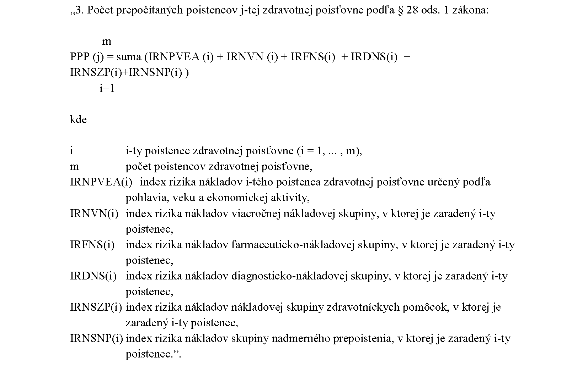
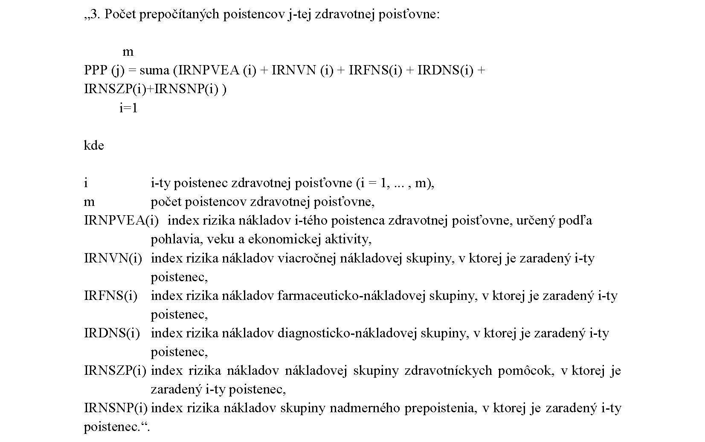

# Čl. I

Vyhláška Ministerstva zdravotníctva Slovenskej republiky č. 67/2018 Z. z., ktorou sa ustanovujú podrobnosti o mesačnom prerozdeľovaní preddavkov na poistné na verejné zdravotné poistenie a o ročnom prerozdeľovaní poistného na verejné zdravotné poistenie v znení vyhlášky č. 47/2019 Z. z., vyhlášky č. 433/2020 Z. z., vyhlášky č. 67/2023 Z. z. a vyhlášky č. 456/2023 Z. z. sa mení a dopĺňa takto:

- 1. V § 1 odsek 2 znie:

- „(2)

- Údaj o počte poistencov zaradených do jednotlivých farmaceuticko-nákladových skupín, diagnosticko-nákladových skupín, nákladových skupín zdravotníckych pomôcok a skupiny nadmerného prepoistenia za kalendárny mesiac, za ktorý sa mesačné prerozdeľovanie vykonáva podľa § 27 ods. 2 písm. d), g), i) a k) zákona, sa oznamuje na formulári, ktorého vzor je uvedený v prílohe č. 2.“.

- 2. V § 1 sa za odsek 6 vkladá nový odsek 7, ktorý znie:

- „(7)

- Údaje podľa § 27 ods. 2 písm. l) zákona sa zasielajú v elektronickej podobe podľa prílohy č. 4c.“.

  - Doterajšie odseky 7 až 9 sa označujú ako odseky 8 až 10.

- 3. § 2 sa dopĺňa odsekmi 6 a 7, ktoré znejú:

- „(6)

- Ak poistenec zdravotnej poisťovne splnil kritériá podľa § 27f ods. 1 až 4 zákona pre zaradenie do skupiny nadmerného prepoistenia a bol poistencom príslušnej zdravotnej poisťovne aspoň jeden deň kalendárneho mesiaca, za ktorý sa vykonáva mesačné prerozdeľovanie, zaradí sa do skupiny nadmerného prepoistenia počas celého kalendárneho mesiaca, za ktorý sa vykonáva mesačné prerozdeľovanie.

- (7)

- Poistenec, ktorý bol zdravotnou poisťovňou zaradený do skupiny nadmerného prepoistenia a ktorý ani jeden deň v období, za ktoré sa vykonáva prerozdeľovanie, nie je v centrálnom registri poistencov evidovaný ako poistenec príslušnej zdravotnej poisťovne, sa z tohto zoznamu vyradí.“.

- 4. V § 3 ods. 5 sa slová „§ 1 ods. 8“ nahrádzajú slovami „údajov z centrálneho registra poistencov“, slová „poistenca v oznámení“ sa nahrádzajú slovami „poistenca, ktoré bolo oznámené,“ a za slová „starostlivosťou podľa § 28a ods. 6 zákona“ sa vkladajú slová „v kalendárnom roku nasledujúcom po kalendárnom roku, za ktorý sa ročné prerozdeľovanie vykonáva,“.

- 5. V § 3 sa za odsek 5 vkladá nový odsek 6, ktorý znie:

- „(6)

- Údaj o počte poistencov zaradených do skupiny nadmerného prepoistenia podľa § 27f ods. 1 až 4 zákona za rozhodujúce obdobie za každú zdravotnú poisťovňu sa určuje ako súčet poistencov zaradených do skupiny nadmerného prepoistenia za jednotlivé kalendárne mesiace rozhodujúceho obdobia podľa údajov z centrálneho registra poistencov.“.

  - Doterajší odsek 6 sa označuje ako odsek 7.

- 6. Za § 5e sa vkladá § 5f, ktorý vrátane nadpisu znie:

- 㤠5f

- Prechodné ustanovenia k úpravám účinným od 1. januára 2025

- (1)

- Mesačné prerozdeľovanie preddavkov na poistné podľa tejto vyhlášky v znení účinnom od 1. januára 2025 sa vykoná prvýkrát v marci 2025 za január 2025. Ročné prerozdeľovanie poistného podľa tejto vyhlášky v znení účinnom od 1. januára 2025 sa vykoná prvýkrát v roku 2026 za rok 2025.

- (2)

- Určenie počtu poistencov zaradených do jednotlivých viacročných nákladových skupín podľa § 3 ods. 5 prvej vety v znení účinnom od 1. januára 2025 sa prvýkrát uskutoční v ročnom prerozdeľovaní poistného, ktoré sa vykoná v roku 2025 za rok 2024.“.

- 7. Príloha č. 2 sa dopĺňa tabuľkou č. 4, ktorá znie:

- „Tabuľka č. 4

- Počet poistencov zaradených do skupiny nadmerného prepoistenia |

- “.

- 8. Za prílohu č. 4b sa vkladá príloha č. 4c, ktorá znie:

- „[Príloha č. 4c](assets/6fab375563c801cf9264756f43751c33033af4b09d1f40ffbb10aa70ab2446b6.pdf)

- “.

- 9. V prílohe č. 5 tretí bod znie:

- 

- 10. V prílohe č. 9 tretí bod znie:

- 
