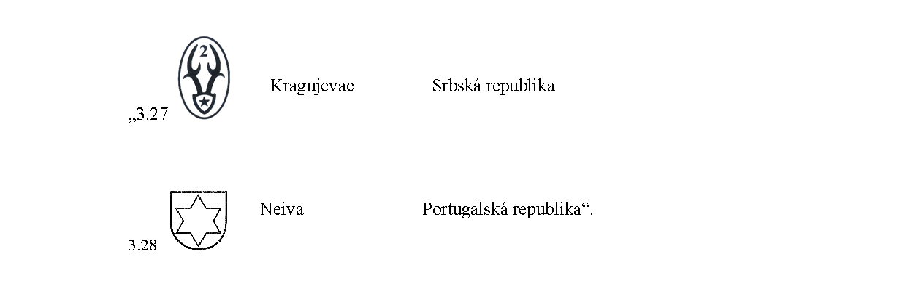

# Čl. I

Vyhláška Úradu pre normalizáciu, metrológiu a skúšobníctvo Slovenskej republiky č. 72/2019 Z. z., ktorou sa ustanovujú podrobnosti o základných požiadavkách, postupoch posudzovania zhody a spôsobe označovania strelnej zbrane a streliva na civilné použitie v znení vyhlášky č. 279/2022 Z. z. sa dopĺňa takto:

- V prílohe č. 8 časti B sa tretí odsek dopĺňa bodmi 3.27 a 3.28, ktoré znejú:

- 
