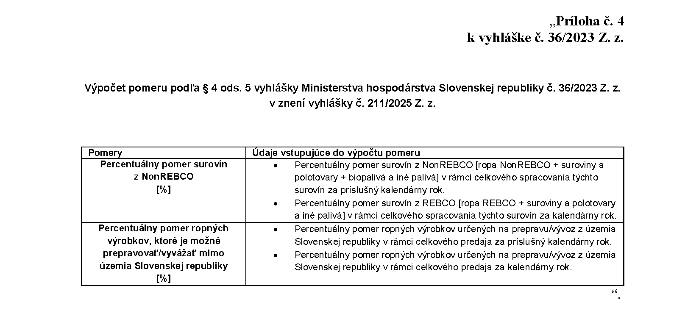

# Čl. I

Vyhláška Ministerstva hospodárstva Slovenskej republiky č. 36/2023 Z. z., ktorou sa ustanovuje rozsah oznamovaných údajov súvisiacich s ropou a ropnými výrobkami, na ktoré sa vzťahujú sankcie podľa osobitného predpisu a spôsob ich oznamovania, podrobnosti o označovaní ropy a ropných výrobkov a podrobnosti o vedení hmotnostnej bilancie sa mení a dopĺňa takto:

- 1. § 1 sa dopĺňa písmenom f), ktoré znie:

- „f)

- nakladaním s ropnými výrobkami nákup, predaj, preprava, dovoz alebo vývoz ropného výrobku.“.

- 2. § 2 vrátane nadpisu znie:

- 㤠2

- Rozsah a spôsob oznamovania údajov

- (1)

- Osoba podľa § 87a ods. 2 zákona oznamuje ministerstvu do ôsmeho dňa kalendárneho mesiaca nasledujúceho po troch po sebe bezprostredne nasledujúcich kalendárnych mesiacoch údaje o množstve ropy s pôvodom v Ruskej federácii dovezenej ropovodom v rozsahu podľa prílohy č. 1.

- (2)

- Osoba, ktorá chce počas kalendárneho roka nakladať s ropnými výrobkami podľa § 87a ods. 4 zákona, oznámi ministerstvu túto skutočnosť najneskôr 15 pracovných dní vopred. Súčasťou oznámenia je čestné vyhlásenie, že ropný výrobok je určený na výlučné použitie na území krajiny, pre ktorú sa nakladanie s ropnými výrobkami požaduje a cieľom takéhoto nakladania s ropným výrobkom nie je obchádzanie zákazov podľa osobitného predpisu.3)

- (3)

- Osoba, ktorej bolo udelené povolenie v súlade s osobitným predpisom3a) na nakladanie s ropnými výrobkami, na ktoré sa vzťahujú sankcie podľa osobitného predpisu3a) na základe oznámenia podľa odseku 2 alebo osoba, ktorá nakladá s ropnými výrobkami, na ktoré sa vzťahujú sankcie podľa osobitného predpisu3a) v súlade s výnimkami podľa osobitného predpisu,3a) oznámi ministerstvu údaje o takýchto ropných výrobkoch v rozsahu podľa prílohy č. 2 do 25 dní po skončení kalendárneho štvrťroka.

- (4)

- Ak osobitný predpis3a) určí iný časový úsek platnosti povolenia na nakladanie s ropnými výrobkami, na ktoré sa vzťahujú sankcie podľa osobitného predpisu,3a) ako je ucelený kalendárny mesiac, oznamovanie údajov podľa odseku 3 sa vykoná v štvrťroku, do ktorého tieto mesiace spadajú.“.

  - Poznámka pod čiarou k odkazu 3a znie:

  - „3a) Nariadenie Rady (EÚ) č. 833/2014 v platnom znení.“.

  - Poznámka pod čiarou k odkazu 2 sa vypúšťa.

- 3. V § 3 sa za odsek 3 vkladá nový odsek 4, ktorý znie:

- „(4)

- Ropný výrobok, ktorý je vyrobený z ropy s pôvodom v Ruskej federácii a je prepravený alebo dovezený na územie Slovenskej republiky v súlade s osobitným predpisom,3a) sa na obchodných dokumentoch označuje ako „REBCO product“.

  - Doterajšie odseky 4 a 5 sa označujú ako odseky 5 a 6.

- 4. V § 3 ods. 6 sa slová „1 až 4“ nahrádzajú slovami „1 až 5“ a na konci sa pripájajú tieto slová: „alebo krajiny pôvodu“.

- 5. V § 4 odsek 1 znie:

- „(1)

- Osoba podľa § 87a ods. 1 zákona preukazuje dodržiavanie povinností podľa osobitného predpisu3) za kalendárny rok prostredníctvom systému hmotnostnej bilancie. Hmotnostná bilancia obsahuje najmä údaje o množstve a pôvode spracovanej ropy, surovín, polotovarov vyrobených z ropy, biopalív4) a iných palív5) použitých na výrobu ropných výrobkov a evidenciu nakúpených a prepravených ropných výrobkov. Rozsah údajov, ktorý má hmotnostná bilancia obsahovať, je uvedený v prílohe č. 3. V systéme hmotnostnej bilancie sa uvedie množstvo ropných výrobkov vyrobených alebo nakúpených za kalendárny rok, ktoré je možné doviezť alebo prepraviť na územie Slovenskej republiky a množstvo ropných výrobkov vyrobených alebo nakúpených za kalendárny rok, ktoré je možné prepraviť z územia Slovenskej republiky do iného členského štátu alebo vyviezť z územia Slovenskej republiky pri

- a)

- vyrobených ropných výrobkoch ako pomer spracovanej ropy s pôvodom iným ako v Ruskej federácii, biopaliva a iného zmiešaného paliva na celkovom množstve spracovanej ropy, biopaliva a iného paliva alebo polotovaru,

- b)

- nakúpených ropných výrobkoch ako pomer ropných výrobkov vyrobených z ropy s pôvodom iným ako v Ruskej federácii vrátane ropných výrobkov vyrobených z ropy s pôvodom v Ruskej federácii a prepravených na územie Slovenskej republiky na celkovom množstve nakúpených ropných výrobkov.“.

- 6. V § 4 ods. 5 sa slová „prílohe č. 3“ nahrádzajú slovami „prílohe č. 4“.

- 7. § 4 sa dopĺňa odsekom 7, ktorý znie:

- „(7)

- Ak osobitný predpis3a) v priebehu príslušného kalendárneho roka zmení rozsah ropných výrobkov vyrobených z ropy s pôvodom v Ruskej federácii, ktoré je možné na územie Slovenskej republiky dovážať alebo prepravovať, alebo takéto ropné výrobky z územia Slovenskej republiky vyvážať alebo prepravovať, alebo sa zmení časové ohraničenie takýchto dovozov, prepráv alebo vývozov, osoba podľa odseku 1 je oprávnená hmotnostnú bilanciu viesť tak, aby logicky zodpovedala a zohľadňovala samostatne obdobie pred nadobudnutím účinnosti takejto zmeny a samostatne obdobie po nadobudnutí účinnosti takejto zmeny.“.

- 8. Prílohy č. 1 až 3 vrátane nadpisov znejú:

- „[Prílohy č. 1 až 3 k vyhláške č. 36/2023 Z. z.](assets/271dbde91fe83f8e3fbd80fe720e9f014b592189d878844ab83abe5cb5d67cb6.pdf)“.

- 9. Vyhláška sa dopĺňa prílohou č. 4, ktorá vrátane nadpisu znie:

- 
