# Čl. I

Vyhláška Štatistického úradu Slovenskej republiky č. 425/2023 Z. z., ktorou sa vydáva Program štátnych štatistických zisťovaní na roky 2024 až 2026 v znení vyhlášky č. 305/2024 Z. z. a vyhlášky č. 57/2025 Z. z. sa mení a dopĺňa takto:

- 1. V § 1 odsek 5 znie:

- „(5)

- Ekonomická činnosť uvedená v prílohách č. 1 až 3 je určená podľa vnútroštátnej úrovne štatistickej klasifikácie ekonomických činností NACE Revision 23) (ďalej len „SK NACE“). Hlavná ekonomická činnosť spravodajskej jednotky podľa SK NACE a zároveň podľa štatistickej klasifikácie ekonomických činností NACE Revision 2.1.3a) je zverejnená v registri organizácií štatistického úradu.“.

  - Poznámka pod čiarou k odkazu 3a znie:

  - „3a) Nariadenie Európskeho parlamentu a Rady (ES) č. 1893/2006 z 20. decembra 2006, ktorým sa zavádza štatistická klasifikácia ekonomických činností NACE Revision 2 a ktorým sa mení a dopĺňa nariadenie Rady (EHS) č. 3037/90 a niektoré nariadenia ES o osobitných oblastiach štatistiky (Ú. v. EÚ L 393, 30. 12. 2006) v platnom znení.“.

- 2. V § 1 odsek 7 znie:

- „(7)

- Spravodajská jednotka, od ktorej sa požaduje poskytnutie údajov pre štátne štatistické zisťovania podľa

- a)

- prílohy č. 1 bodov 1.1 a 5.1, odovzdá štatistickému úradu vyplnené štatistické formuláre v listinnej podobe,

- b)

- prílohy č. 1 bodu 3.1, môže odovzdať štatistickému úradu vyplnené štatistické formuláre v listinnej podobe.“.

- 3. Za § 1 sa vkladá § 2, ktorý znie:

- 㤠2

- Touto vyhláškou sa preberajú právne záväzné akty Európskej únie uvedené v prílohe č. 4.“.

- 4. V prílohe č. 1 časti A dvanástom bode sa vypúšťa bod 12.4.

- 5. V prílohe č. 1 časti A sa za bod 13a vkladá bod 13b, ktorý znie:

- 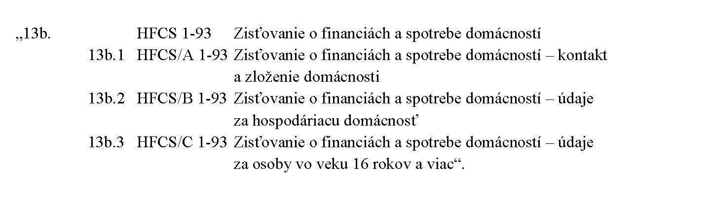

- 6. V prílohe č. 1 časti A sa vypúšťa štyridsiaty štvrtý bod.

- 7. V prílohe č. 1 časti B štvrtom bode písm. d) sa slová „posledný deň v mesiaci“ nahrádzajú slovami „do 15. dňa po sledovanom období“.

- 8. V prílohe č. 1 časti B siedmom bode písm. d) sa slovo „desiatich“ nahrádza číslom „30“.

- 9. V prílohe č. 1 časti B desiatom bode písm. d) sa slová „31. augusta“ nahrádzajú slovami „30. septembra“.

- 10. V prílohe č. 1 časti B dvanásty bod znie:

- „

- 12.

- Značka štátneho štatistického zisťovania: RÚ 1-01

- Názov štátneho štatistického zisťovania: Zisťovanie údajov pre štatistiku rodinných účtov

- Značka štatistického formulára a názov štatistického formulára:

- RÚ/A 1-01 | Prehľad o zložení a o príjmoch domácnosti

- RÚ/B 1-01 | Pravidelné výdavky domácnosti

- RÚ/C 1-01 | Denník bežných a retrospektívnych výdavkov domácnosti

- a) Účel a využitie výsledkov štátneho štatistického zisťovania

- Účelom štátneho štatistického zisťovania je získať informácie o výške, štruktúre a vývoji peňažných výdavkov a príjmov a nepeňažných výdavkov a príjmov fyzických osôb v rôznych typoch domácností. Výsledky štátneho štatistického zisťovania poskytujú informácie, ktoré sú potrebné na tvorbu a monitorovanie verejných politík orgánmi verejnej správy, na plnenie Európskeho štatistického programu a na plnenie záväzkov vyplývajúcich z členstva Slovenskej republiky v medzinárodných organizáciách.

- b) Vecná (obsahová) charakteristika a postupy realizácie štátneho štatistického zisťovania

- Použitá metóda štátneho štatistického zisťovania: výberové zisťovanie.

- Charakteristika premenných štátneho štatistického zisťovania: sociálne vzťahy medzi členmi domácnosti; demografické a ekonomické ukazovatele členov domácnosti; spotrebné výdavky na potraviny a nealkoholické nápoje, na alkoholické nápoje, tabak a narkotiká, na odevy a obuv, na bývanie, nájomné a údržbu obydlia, na bytové zariadenie, vybavenie a prevádzku domácnosti, na starostlivosť o zdravie, na dopravu, na informácie a komunikáciu, na rekreáciu, šport a kultúru, na vzdelávanie a služby s ním spojené, na verejné stravovanie a ubytovacie služby, na poistenie a finančné služby, na osobnú starostlivosť, sociálnu ochranu a rozličné výrobky a služby; ostatné výdavky; peňažné príjmy a naturálna osobná spotreba domácnosti.

- c) Vymedzenie spravodajských jednotiek

- Členovia domácnosti.

- d) Periodicita a lehoty na poskytovanie štatistických údajov

- Periodicita štátneho štatistického zisťovania: ročne.

- Lehota na poskytovanie štatistických údajov spravodajskou jednotkou: do 20 dní po sledovanom roku.

- e) Orgán vykonávajúci štátnu štatistiku príslušný na vykonanie štátneho štatistického zisťovania

- Štatistický úrad.“.

- 11. V prílohe č. 1 časti B sa za bod 13a vkladá bod 13b, ktorý znie:

- „

- 13b.

- Značka štátneho štatistického zisťovania: HFCS 1-93

- Názov štátneho štatistického zisťovania: Zisťovanie o financiách a spotrebe domácností

- Značka štatistického formulára a názov štatistického formulára:

- HFCS/A 1-93 | Zisťovanie o financiách a spotrebe domácností – kontakt a zloženie domácnosti

- HFCS/B 1-93 | Zisťovanie o financiách a spotrebe domácností – údaje za hospodáriacu domácnosť

- HFCS/C 1-93 | Zisťovanie o financiách a spotrebe domácností – údaje za osoby vo veku 16 rokov a viac

- a) Účel a využitie výsledkov štátneho štatistického zisťovania

- Účelom štátneho štatistického zisťovania je získať informácie na úrovni domácností o hlavných zložkách majetku, príjmov a spotreby, ktoré sú potrebné na identifikáciu trendov hospodárskej a finančnej situácie rôznych skupín domácností a ich členov. Tieto informácie sú potrebné na analýzu účinkov opatrení menovej politiky. Informácie na úrovni domácností o čistom majetku (aktívach a pasívach), ktoré sa zbierajú porovnateľným spôsobom vo väčšine krajín eurozóny, sú v súčasnosti dostupné len prostredníctvom tohto zisťovania.

- b) Vecná (obsahová) charakteristika a postupy realizácie štátneho štatistického zisťovania

- Použitá metóda štátneho štatistického zisťovania: výberové zisťovanie.

- Charakteristika premenných štátneho štatistického zisťovania: sociálne vzťahy medzi členmi domácnosti, demografické a ekonomické ukazovatele členov domácnosti, nehnuteľnosti a ich financovanie, ostatné záväzky a úverové prekážky, súkromné podnikanie a finančné aktíva, zamestnanie, dôchodky a zmluvy o životnom poistení, príjem, dary a dedičstvá, spotreba, technické premenné.

- c) Vymedzenie spravodajských jednotiek

- Členovia domácnosti.

- d) Periodicita a lehoty na poskytovanie štatistických údajov

- Periodicita štátneho štatistického zisťovania: raz za tri roky (rok zisťovania 2026).

- Lehota na poskytovanie štatistických údajov spravodajskou jednotkou: do 28. februára 2027.

- e) Orgán vykonávajúci štátnu štatistiku príslušný na vykonanie štátneho štatistického zisťovania

- Štatistický úrad.“.

- 12. V prílohe č. 1 časti B devätnástom bode písm. a) sa za slovami „alkoholických nápojov“ slovo „a“ nahrádza čiarkou a za slovo „výrobkov“ sa vkladajú slová „a drogistického tovaru (výrobky na čistenie a údržbu domácnosti, ostatný tovar krátkodobej spotreby pre domácnosť, ostatné spotrebiče, pomôcky a výrobky na osobnú starostlivosť)“.

- 13. V prílohe č. 1 časti B štyridsiatom prvom bode písm. b) sa vypúšťajú slová „a informácie potrebné na implementáciu Zoznamu vybraných priemyselných výrobkov PRODSLOV vytvoreného na základe štatistickej klasifikácie ekonomických činností v znení revidovanom podľa osobitného predpisu,6) ktorá sa v Európskej únii uplatňuje od roku 2025“.

  - Poznámka pod čiarou k odkazu 6 sa vypúšťa.

- 14. V prílohe č. 1 časti B štyridsiatom druhom bode písm. b) sa vypúšťajú slová „a informácie potrebné na implementáciu štatistickej klasifikácie ekonomických činností, ktorej znenie revidované podľa osobného predpisu,5) sa začne uplatňovať v Európskej únii od roku 2025“.

- 15. V prílohe č. 1 časti B sa vypúšťa štyridsiaty štvrtý bod.

- 16. V prílohe č. 1 časti B šesťdesiatom ôsmom bode písm. b) charakteristika premenných štátneho štatistického zisťovania znie:

- „Charakteristika premenných štátneho štatistického zisťovania: množstvo komunálneho odpadu podľa druhov komunálneho odpadu a spôsobu nakladania s komunálnym odpadom, miera triedenia komunálneho odpadu, spôsob zberu a poplatky za komunálny odpad, informácie o zbere biologicky rozložiteľného komunálneho odpadu, údaje o opätovnom použití výrobkov alebo časti výrobkov, ktoré nie sú odpadom, a vybrané finančné ukazovatele vynaložené obcami na ochranu životného prostredia podľa jednotlivých oblastí ochrany životného prostredia.“.

- 17. V prílohe č. 1 časti B osemdesiatom prvom bode písmeno c) znie:

- „c) Vymedzenie spravodajských jednotiek

- Subjekty vedené v registri organizácií štatistického úradu, ktoré patria do sektora finančných korporácií, nefinančných korporácií a sektora domácností v zmysle metodiky národných účtov s počtom zamestnancov desať a viac s hlavnou ekonomickou činnosťou podľa SK NACE:

- 10 až 33 | Priemyselná výroba,

- 35 | Dodávka elektriny, plynu, pary a studeného vzduchu,

- 36 až 39 | Dodávka vody; čistenie a odvod odpadových vôd, odpady a služby odstraňovania odpadov,

- 41 až 43 | Stavebníctvo,

- 45 až 47 | Veľkoobchod a maloobchod; oprava motorových vozidiel a motocyklov,

- 49 až 53 | Doprava a skladovanie,

- 55 a 56 | Ubytovacie a stravovacie služby,

- 58 až 63 | Informácie a komunikácia,

- 64 až 66 | Finančné a poisťovacie činnosti,

- 68 | Činnosti v oblasti nehnuteľností,

- 69 až 75 | Odborné, vedecké a technické činnosti,

- 77 až 82 | Administratívne a podporné služby a

- 95.1 | Oprava počítačov a komunikačných zariadení.“.

- “.

- 18. V prílohe č. 2 časti A sa vypúšťa tretí bod, stoštvrtý bod a stopiaty bod.

- 19. V prílohe č. 2 časti A sedemdesiaty siedmy bod znie:

- „77.

- Ryby (MPRV SR) 1-02 Polročný výkaz o spracovaní produktov rybolovu a akvakultúry“.

- 20. V prílohe č. 2 časti B prvý bod znie:

- „

- 1.

- Značka štátneho štatistického zisťovania a značka štatistického formulára: ISCP (MPSVR SR) 1-04

- Názov štátneho štatistického zisťovania a názov štatistického formulára: Štvrťročný výkaz o cene práce

- a) Účel a využitie výsledkov štátneho štatistického zisťovania

- Účelom štátneho štatistického zisťovania je získať informácie o priemerných hodinových zárobkoch zamestnancov, o cene práce, diferenciácii miezd zamestnancov a platov štátnych zamestnancov a zamestnancov pri výkone práce vo verejnom záujme v jednotlivých triedeniach podľa štatistickej klasifikácie zamestnaní (SK ISCO-08),4) pohlavia, veku a vzdelania zamestnancov a štátnych zamestnancov. Výsledky štátneho štatistického zisťovania sa využijú na vytvorenie porovnateľných štatistických údajov na regionálnej, vnútroštátnej, medzinárodnej úrovni a na úrovni Európskej únie, plnenie Európskeho štatistického programu a záväzkov vyplývajúcich z členstva Slovenskej republiky v medzinárodných organizáciách. Údaje o štruktúre a diferenciácii pracovných príjmov budú podkladom pre Európsku úniu na výpočet rozdielu v odmeňovaní žien a mužov a pre OECD na zhodnotenie mzdového vývoja a hospodárskeho vývoja v členských štátoch v súvislosti s jednotnou európskou menovou politikou.

- b) Vecná (obsahová) charakteristika a postupy realizácie štátneho štatistického zisťovania

- Použitá metóda štátneho štatistického zisťovania: kombinované zisťovanie.

- Charakteristika premenných štátneho štatistického zisťovania: vyplatené mzdy alebo platy podľa jednotlivých zložiek, základné tarifné mzdy alebo tarifné platy, mzdové zvýhodnenia, príplatky, doplatky, náhrady mzdy alebo platu, prémie a odmeny, poskytnuté plnenia zo zisku, náhrady za pracovnú pohotovosť, pohlavie a vek zamestnanca alebo štátneho zamestnanca, kódy zamestnania podľa štatistickej klasifikácie zamestnaní (SK ISCO-08), dosiahnuté vzdelanie a odbor vzdelania, týždenný fond pracovného času alebo služobného času, odpracovaný čas, pracovný úväzok, priemerný hodinový zárobok, okres pracoviska a bydliska.

- c) Vymedzenie spravodajských jednotiek

- Všetky subjekty vedené v registri organizácií štatistického úradu s počtom zamestnancov 100 a viac (vyčerpávajúce zisťovanie).

- Vybrané subjekty vedené v registri organizácií štatistického úradu s menej ako 100 zamestnancami (výberové zisťovanie).

- d) Periodicita a lehoty na poskytovanie štatistických údajov

- Periodicita štátneho štatistického zisťovania: štvrťročne.

- Lehota na poskytovanie štatistických údajov spravodajskou jednotkou: do 30 dní po sledovanom štvrťroku.

- e) Orgán vykonávajúci štátnu štatistiku príslušný na vykonanie štátneho štatistického zisťovania

- Ministerstvo práce, sociálnych vecí a rodiny Slovenskej republiky.“.

- 21. V prílohe č. 2 časti B sa vypúšťa tretí bod, stoštvrtý bod a stopiaty bod.

- 22. V prílohe č. 2 časti B sedemdesiatom siedmom bode značka štátneho štatistického zisťovania a značka štatistického formulára znie: „Ryby (MPRV SR) 1-02“.

- 23. V prílohe č. 2 časti B sedemdesiatom siedmom bode názov štátneho štatistického zisťovania a názov štatistického formulára znie: „Polročný výkaz o spracovaní produktov rybolovu a akvakultúry“.

- 24. V prílohe č. 2 časti B sedemdesiatom siedmom bode písmeno d) znie:

- „d)Periodicita a lehoty na poskytovanie štatistických údajov

- Periodicita štátneho štatistického zisťovania: polročne.

- Lehota na poskytovanie štatistických údajov spravodajskou jednotkou: do 18. kalendárneho dňa po sledovanom období.“.

- 25. V prílohe č. 2 časti B stoprvom bode, stodruhom bode a stotreťom bode písmeno c) znie:

- „c)Vymedzenie spravodajských jednotiek

- Všetky poštové podniky zapísané v registri poštových podnikov.“.

- 26. V prílohe č. 3 časti A I. kapitole sa za druhý bod vkladá bod 2a, ktorý znie:

- 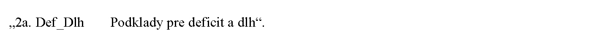

- 27. V prílohe č. 3 časti A I. kapitole dvadsiatom šiestom bode sa slová „ÚČ ZFOND 1-1“ nahrádzajú slovami „ÚČ ZFOND 1-01“.

- 28. V prílohe č. 3 časti A I. kapitole dvadsiatom siedmom bode sa slová „ÚČ ZFOND 2-1“ nahrádzajú slovami „ÚČ ZFOND 2-01“.

- 29. V prílohe č. 3 časti A I. kapitole štyridsiaty piaty bod znie:

- 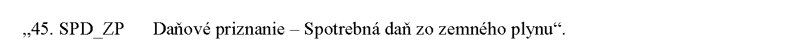

- 30. V prílohe č. 3 časti A I. kapitole sa za štyridsiaty piaty bod vkladajú body 45a a 45b, ktoré znejú:

- 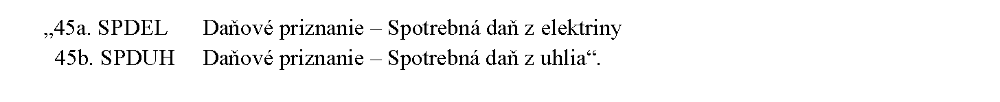

- 31. V prílohe č. 3 časti A I. kapitole nadpise nad päťdesiatym druhým bodom sa vypúšťajú slová „a analýzy rizík“.

- 32. V prílohe č. 3 časti A I. kapitole sa vypúšťa päťdesiaty piaty bod, deväťdesiaty prvý bod, deväťdesiaty druhý bod, stotretí bod, stosiedmy bod, stodvadsiaty druhý bod a dvestoštyridsiaty štvrtý bod.

- 33. V prílohe č. 3 časti A I. kapitole sa za bod 94c vkladá bod 94d, ktorý znie:

- 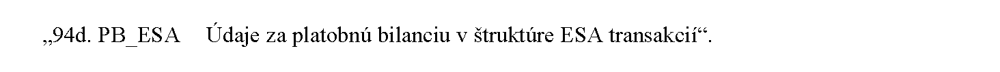

- 34. V prílohe č. 3 časti A I. kapitole deväťdesiatom šiestom bode a deväťdesiatom siedmom bode sa vypúšťa pomlčka a slová „sumár za doplnkové dôchodkové fondy“.

- 35. V prílohe č. 3 časti A I. kapitole stopätnásty bod znie:

- 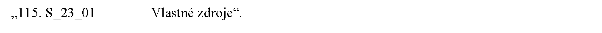

- 36. V prílohe č. 3 časti A I. kapitole stodvadsiaty deviaty bod znie:

- 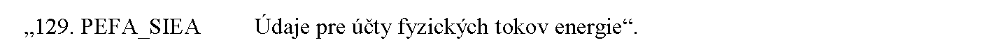

- 37. V prílohe č. 3 časti A I. kapitole sa za slová „Ministerstvo práce, sociálnych vecí a rodiny Slovenskej republiky“ vkladá bod 151a, ktorý znie:

- 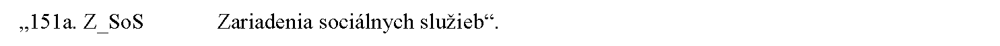

- 38. V prílohe č. 3 časti A I. kapitole stošesťdesiatom treťom bode sa slová „Sociálnoprávna ochrana detí a sociálna kuratela“ nahrádzajú slovami „Ročný výkaz o vykonávaní opatrení sociálnoprávnej ochrany detí a sociálnej kurately“.

- 39. V prílohe č. 3 časti A I. kapitole sa za stosedemdesiaty bod vkladá bod 170a, ktorý znie:

- 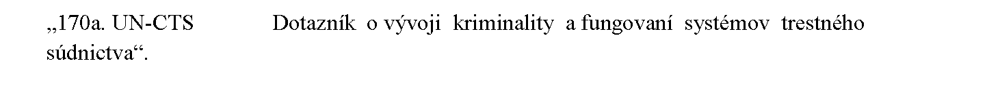

- 40. V prílohe č. 3 časti A I. kapitole stoosemdesiatom treťom bode sa slová „špeciálnymi výchovno-vzdelávacími potrebami“ nahrádzajú slovami „zdravotným znevýhodnením, nadaním“.

- 41. V prílohe č. 3 časti A I. kapitole sa za slová „Prezídium Policajného zboru“ vkladá bod 203a, ktorý znie:

- 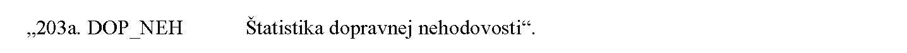

- 42. V prílohe č. 3 časti A I. kapitole sa za dvestoštvrtý bod vkladá bod 204a, ktorý znie:

- 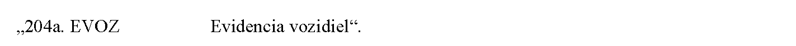

- 43. V prílohe č. 3 časti A I. kapitole dvestodvadsiaty piaty bod znie:

- 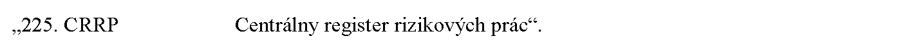

- 44. V prílohe č. 3 časti A I. kapitole sa za dvestodvadsiaty deviaty bod vkladajú tieto slová:

- „Správca administratívneho zdroja údajov:

- Úrad pre reguláciu sieťových odvetví“.

- 45. V prílohe č. 3 časti A I. kapitole sa za slová „Úrad pre reguláciu sieťových odvetví“ vkladá bod 229a, ktorý znie:

- 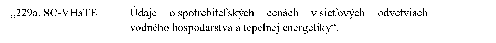

- 46. V prílohe č. 3 časti A I. kapitole sa za slová „Slovenský hydrometeorologický ústav“ vkladá bod 232a, ktorý znie:

- 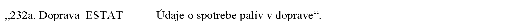

- 47. V prílohe č. 3 časti A I. kapitole dvestotridsiatom treťom bode sa za slovo „emisiách“ vkladajú slová „a palivách za veľké a stredné stacionárne zdroje znečisťovania ovzdušia“.

- 48. V prílohe č. 3 časti A I. kapitole sa za dvestotridsiaty piaty bod vkladá bod 235a, ktorý znie:

- 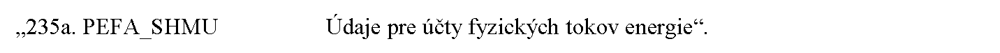

- 49. V prílohe č. 3 časti A IV. kapitole štvrtom bode sa slová „špeciálnymi výchovno-vzdelávacími potrebami“ nahrádzajú slovami „zdravotným znevýhodnením, nadaním“.

- 50. V prílohe č. 3 časti B I. kapitole sa za druhý bod vkladá bod 2a, ktorý znie:

- „

- 2a.

- Značka administratívneho zdroja údajov: Def_Dlh

- Názov administratívneho zdroja údajov: Podklady pre deficit a dlh

- a) Účel a využitie údajov z administratívneho zdroja údajov

- Administratívne údaje sa využijú na zostavovanie národných účtov.

- b) Charakteristika údajov poskytovaných z administratívneho zdroja údajov

- Údaje o akruálnych daniach a sociálnych príspevkoch, informácie o finančných prostriedkoch z Európskej únie a korekciách s nimi spojených, informácie o príjemcoch kapitálových injekcií a kapitálových grantov, akruálnych úrokoch, informácie o dlhu a derivátových obchodoch, informácie o špecifických transakciách a operáciách, schodok sektora verejnej správy a podklady pre maastrichtský dlh.

- c) Periodicita a lehoty na poskytovanie údajov z administratívneho zdroja údajov

- Periodicita poskytovania údajov z administratívneho zdroja údajov: štvrťročne a ročne.

- Lehota na poskytovanie údajov z administratívneho zdroja údajov: štvrťročne do 35 kalendárnych dní po referenčnom štvrťroku, ročne do 2 mesiacov po referenčnom roku a do 8 mesiacov po referenčnom roku.“.

- 51. V prílohe č. 3 časti B I. kapitole treťom bode písmeno c) znie:

- „c)Periodicita a lehoty na poskytovanie údajov z administratívneho zdroja údajov

- Periodicita poskytovania údajov z administratívneho zdroja údajov: mesačne a štvrťročne.

- Lehota na poskytovanie údajov z administratívneho zdroja údajov: mesačne do 35 dní po referenčnom období, ročne do 50 dní po referenčnom štvrťroku.“.

- 52. V prílohe č. 3 časti B I. kapitole deviatom bode písm. c) a desiatom bode písm. c) sa číslo „26“ nahrádza číslom „28“.

- 53. V prílohe č. 3 časti B I. kapitole jedenástom bode písm. c) a dvanástom bode písm. c) sa slová „6 mesiacov“ nahrádzajú slovami „5 mesiacov a 20 dní“ a za slová „8 mesiacov“ sa vkladajú slová „a 13 dní“.

- 54. V prílohe č. 3 časti B I. kapitole trinástom bode písm. c) sa slová „4 mesiacov a 20“ nahrádzajú slovami „3 mesiacov a 15“, za slovami „dní po referenčnom roku“ sa vypúšťa čiarka a slová „do 6 mesiacov po referenčnom roku, do 8 mesiacov po referenčnom roku, do 11 mesiacov po referenčnom roku“.

- 55. V prílohe č. 3 časti B I. kapitole štrnástom bode písm. c), devätnástom bode písm. c) a dvadsiatom bode písm. c) sa slová „4 mesiacov a 20“ nahrádzajú slovami „3 mesiacov a 15“, za slovami „dní po referenčnom roku“ sa vypúšťa čiarka a slová „do 5 mesiacov a 20 dní po referenčnom roku, do 8 mesiacov po referenčnom roku, do 11 mesiacov po referenčnom roku“.

- 56. V prílohe č. 3 časti B I. kapitole pätnástom bode písm. c), šestnástom bode písm. c), sedemnástom bode písm. c) a osemnástom bode písm. c) sa slová „8 mesiacov“ nahrádzajú slovami „7 mesiacov a 13 dní“, číslo „12“ sa nahrádza číslom „11“ a číslo „16“ sa nahrádza číslom „15“.

- 57. V prílohe č. 3 časti B I. kapitole dvadsiatom šiestom bode značka administratívneho zdroja údajov znie: „ÚČ ZFOND 1-01“ a v písmene c) sa číslo „26“ nahrádza číslom „28“.

- 58. V prílohe č. 3 časti B I. kapitole dvadsiatom siedmom bode značka administratívneho zdroja údajov znie: „ÚČ ZFOND 2-01“ a v písmene c) sa číslo „26“ nahrádza číslom „28“.

- 59. V prílohe č. 3 časti B I. kapitole dvadsiatom ôsmom bode písm. c) sa číslo „4“ nahrádza číslom „3“ a číslo „20“ sa nahrádza číslom „15“.

- 60. V prílohe č. 3 časti B I. kapitole dvadsiatom deviatom bode písm. c) sa vypúšťajú slová „predbežné údaje do 4 mesiacov a 20 dní po referenčnom roku; definitívne údaje“ a číslo „15“ sa nahrádza číslom „11“.

- 61. V prílohe č. 3 časti B I. kapitole tridsiaty siedmy bod znie:

- „

- 37.

- Značka administratívneho zdroja údajov: DPFO – Hlásenie

- Názov administratívneho zdroja údajov: Hlásenie o vyúčtovaní dane a o úhrne príjmov zo závislej činnosti poskytnutých jednotlivým zamestnancom bez ohľadu na to, či ide o peňažné alebo nepeňažné plnenie za uplynulé zdaňovacie obdobie, o vybraných príjmoch oslobodených od dane, o zrazených preddavkoch na daň o zamestnaneckej prémii, o daňovom bonuse a o daňovom bonuse na zaplatené úroky

- a) Účel a využitie údajov z administratívneho zdroja údajov

- Administratívne údaje sa využijú na účely sčítania obyvateľov, domov a bytov a zabezpečenie kontinuity poskytovania údajov pre postcenzus.

- b) Charakteristika údajov poskytovaných z administratívneho zdroja údajov

- Údaje o osobách, ktoré podávajú hlásenie o vyúčtovaní dane o úhrne z príjmov zo závislej činnosti.

- c) Periodicita a lehoty na poskytovanie údajov z administratívneho zdroja údajov

- Periodicita poskytovania údajov z administratívneho zdroja údajov: ročne.

- Lehota na poskytovanie údajov z administratívneho zdroja údajov: do 11 mesiacov po referenčnom roku.“.

- 62. V prílohe č. 3 časti B I. kapitole štyridsiatom druhom bode písm. c) sa číslo „20“ nahrádza číslom „18“.

- 63. V prílohe č. 3 časti B I. kapitole štyridsiatom treťom bode písm. c) sa číslo „25“ nahrádza číslom „13“ a za slovami „mesiacov po referenčnom roku“ sa čiarka nahrádza bodkočiarkou.

- 64. V prílohe č. 3 časti B I. kapitole štyridsiatom štvrtom bode písm. c) sa číslo „25“ nahrádza číslom „8“.

- 65. V prílohe č. 3 časti B I. kapitole štyridsiaty piaty bod znie:

- „

- 45.

- Značka administratívneho zdroja údajov: SPD_ZP

- Názov administratívneho zdroja údajov: Daňové priznanie – Spotrebná daň zo zemného plynu

- a) Účel a využitie údajov z administratívneho zdroja údajov

- Administratívne údaje sa využijú na zostavovanie národných účtov.

- b) Charakteristika údajov poskytovaných z administratívneho zdroja údajov

- Údaje v plnom rozsahu za Slovenskú republiku spolu a v triedení podľa inštitucionálnych sektorov a subsektorov európskeho systému národných účtov, v územnom členení podľa samosprávnych krajov a podľa SK NACE a podľa druhu spotrebnej dane, v členení podľa druhu daňového subjektu – fyzická osoba, právnická osoba, v členení podľa právnej formy daňového subjektu a v členení daní na spotrebné dane z domácej produkcie a spotrebné dane vyberané pri dovoze. Údaje o množstve stlačeného zemného plynu v kg, z ktorého vznikla daňová povinnosť dodaním a vlastnou spotrebou.

- c) Periodicita a lehoty na poskytovanie údajov z administratívneho zdroja údajov

- Periodicita poskytovania údajov z administratívneho zdroja údajov: ročne.

- Lehota na poskytovanie údajov z administratívneho zdroja údajov: do deviatich mesiacov po referenčnom roku.“.

- 66. V prílohe č. 3 časti B I. kapitole sa za štyridsiaty piaty bod vkladajú body 45a a 45b, ktoré znejú:

- „

- 45a.

- Značka administratívneho zdroja údajov: SPDEL

- Názov administratívneho zdroja údajov: Daňové priznanie – Spotrebná daň z elektriny

- a) Účel a využitie údajov z administratívneho zdroja údajov

- Administratívne údaje sa využijú na zostavovanie národných účtov.

- b) Charakteristika údajov poskytovaných z administratívneho zdroja údajov

- Údaje v plnom rozsahu za Slovenskú republiku spolu a v triedení podľa inštitucionálnych sektorov a subsektorov európskeho systému národných účtov, v územnom členení podľa samosprávnych krajov a podľa SK NACE a podľa druhu spotrebnej dane, v členení podľa druhu daňového subjektu – fyzická osoba, právnická osoba, v členení podľa právnej formy daňového subjektu a v členení daní na spotrebné dane z domácej produkcie a spotrebné dane vyberané pri dovoze.

- c) Periodicita a lehoty na poskytovanie údajov z administratívneho zdroja údajov

- Periodicita poskytovania údajov z administratívneho zdroja údajov: ročne.

- Lehota na poskytovanie údajov z administratívneho zdroja údajov: do deviatich mesiacov po referenčnom roku.

- 45b.

- Značka administratívneho zdroja údajov: SPDUH

- Názov administratívneho zdroja údajov: Daňové priznanie – Spotrebná daň z uhlia

- a) Účel a využitie údajov z administratívneho zdroja údajov

- Administratívne údaje sa využijú na zostavovanie národných účtov.

- b) Charakteristika údajov poskytovaných z administratívneho zdroja údajov

- Údaje v plnom rozsahu za Slovenskú republiku spolu a v triedení podľa inštitucionálnych sektorov a subsektorov európskeho systému národných účtov, v územnom členení podľa samosprávnych krajov a podľa SK NACE a podľa druhu spotrebnej dane, v členení podľa druhu daňového subjektu – fyzická osoba, právnická osoba, v členení podľa právnej formy daňového subjektu a v členení daní na spotrebné dane z domácej produkcie a spotrebné dane vyberané pri dovoze.

- c) Periodicita a lehoty na poskytovanie údajov z administratívneho zdroja údajov

- Periodicita poskytovania údajov z administratívneho zdroja údajov: ročne.

- Lehota na poskytovanie údajov z administratívneho zdroja údajov: do deviatich mesiacov po referenčnom roku.“.

- 67. V prílohe č. 3 časti B I. kapitole štyridsiatom šiestom bode písm. c), štyridsiatom siedmom bode písm. c), štyridsiatom ôsmom bode písm. c), štyridsiatom deviatom bode písm. c) a päťdesiatom bode písm. c) sa slovo „šiestich“ nahrádza slovom „deviatich“.

- 68. V prílohe č. 3 časti B I. kapitole štyridsiatom siedmom bode písm. b) sa na konci pripája táto veta: „Údaje o množstve minerálneho oleja, z ktorého sa platí daň.“.

- 69. V prílohe č. 3 časti B I. kapitole nadpise nad päťdesiatym druhým bodom sa vypúšťajú slová „a analýzy rizík“.

- 70. V prílohe č. 3 časti B I. kapitole bode 52a písm. c) sa slovo „deviatich“ nahrádza slovom „siedmich“.

- 71. V prílohe č. 3 časti B I. kapitole sa vypúšťa päťdesiaty piaty bod, deväťdesiaty prvý bod, deväťdesiaty druhý bod, stotretí bod, stosiedmy bod, stodvadsiaty druhý bod a dvestoštyridsiaty štvrtý bod.

- 72. V prílohe č. 3 časti B I. kapitole päťdesiatom siedmom bode písm. c) sa slovo „troch“ nahrádza slovom „deviatich“.

- 73. V prílohe č. 3 časti B I. kapitole sedemdesiatom druhom bode písm. c) sa číslo „5“ nahrádza číslom „6“.

- 74. V prílohe č. 3 časti B I. kapitole sedemdesiatom treťom bode písmeno c) znie:

- „c) Periodicita a lehoty na poskytovanie údajov z administratívneho zdroja údajov

- Periodicita poskytovania údajov z administratívneho zdroja údajov: štvrťročne.

- Lehota na poskytovanie údajov z administratívneho zdroja údajov: podľa termínu zaslania údajov do Európskej centrálnej banky, časový rad do posledného pracovného dňa prvého štvrťroka.“.

- 75. V prílohe č. 3 časti B I. kapitole sedemdesiatom štvrtom bode písm. c), sedemdesiatom piatom bode písm. c), sedemdesiatom šiestom bode písm. c), sedemdesiatom siedmom bode písm. c) a sedemdesiatom ôsmom bode písm. c) sa slovo „troch“ nahrádza slovom „deviatich“.

- 76. V prílohe č. 3 časti B I. kapitole osemdesiatom prvom bode písm. c) sa číslo „40“ nahrádza číslom „45“, pred slovom „definitívne“ sa čiarka nahrádza bodkočiarkou a vypúšťajú sa slová „ročne stav k 31. decembru predbežné údaje do 59 dní po referenčnom mesiaci,“.

- 77. V prílohe č. 3 časti B I. kapitole deväťdesiatom bode písm. c) sa číslo „30“ nahrádza číslom „35“.

- 78. V prílohe č. 3 časti B I. kapitole deväťdesiatom štvrtom bode písmeno c) znie:

- „c) Periodicita a lehoty na poskytovanie údajov z administratívneho zdroja údajov

- Periodicita poskytovania údajov z administratívneho zdroja údajov: štvrťročne.

- Lehota na poskytovanie údajov z administratívneho zdroja údajov: do 51 dní po referenčnom štvrťroku; revidované ročné údaje (za každý štvrťrok referenčného roka) do 9 mesiacov po referenčnom roku; vybrané položky do 8 mesiacov a 15 dní po referenčnom roku.“.

- 79. V prílohe č. 3 časti B I. kapitole sa za bod 94c vkladá bod 94d, ktorý znie:

- „

- 94d.

- Značka administratívneho zdroja údajov: PB_ESA

- Názov administratívneho zdroja údajov: Údaje za platobnú bilanciu v štruktúre ESA transakcií

- a) Účel a využitie údajov z administratívneho zdroja údajov

- Administratívne údaje sa využijú na zostavovanie národných účtov.

- b) Charakteristika údajov poskytovaných z administratívneho zdroja údajov

- Platobná bilancia v štruktúre ESA transakcií, sektorové rozdelenie údajov bežného účtu platobnej bilancie.

- c) Periodicita a lehoty na poskytovanie údajov z administratívneho zdroja údajov

- Periodicita poskytovania údajov z administratívneho zdroja údajov: štvrťročne.

- Lehota na poskytovanie údajov z administratívneho zdroja údajov: predbežné údaje do 45 dní po referenčnom roku, spresnené údaje do 60 dní po referenčnom roku.“.

- 80. V prílohe č. 3 časti B I. kapitole stoôsmom bode písmeno c) znie:

- „c) Periodicita a lehoty na poskytovanie údajov z administratívneho zdroja údajov

- Periodicita poskytovania údajov z administratívneho zdroja údajov: štvrťročne.

- Lehota na poskytovanie údajov z administratívneho zdroja údajov: do 40 dní po referenčnom štvrťroku.“.

- 81. V prílohe č. 3 časti B I. kapitole stopätnástom bode značka administratívneho zdroja údajov znie: „S_23_01“.

- 82. V prílohe č. 3 časti B I. kapitole stodvadsiatom bode písmeno c) znie:

- „c) Periodicita a lehoty na poskytovanie údajov z administratívneho zdroja údajov

- Periodicita poskytovania údajov z administratívneho zdroja údajov: štvrťročne.

- Lehota na poskytovanie údajov z administratívneho zdroja údajov: do 30 dní po referenčnom štvrťroku.“.

- 83. V prílohe č. 3 časti B I. kapitole stodvadsiatom šiestom bode písm. c) sa slovo „piatich“ nahrádza slovom „desiatich“.

- 84. V prílohe č. 3 časti B I. kapitole bode 126a písmeno c) znie:

- „c) Periodicita a lehoty na poskytovanie údajov z administratívneho zdroja údajov

- Periodicita poskytovania údajov z administratívneho zdroja údajov: mesačne.

- Lehota na poskytovanie údajov z administratívneho zdroja údajov: do desiatich dní po referenčnom mesiaci.“.

- 85. V prílohe č. 3 časti B I. kapitole stodvadsiatom deviatom bode značka a názov administratívneho zdroja údajov znejú:

- „Značka administratívneho zdroja údajov: PEFA_SIEA

- Názov administratívneho zdroja údajov: Údaje pre účty fyzických tokov energie“.

- 86. V prílohe č. 3 časti B I. kapitole stopäťdesiatom bode písm. c) sa za slovami „dvakrát ročne“ vypúšťajú slová „Lehota na poskytovanie údajov z administratívneho zdroja údajov:“.

- 87. V prílohe č. 3 časti B I. kapitole sa za stopäťdesiaty prvý bod vkladá bod 151a, ktorý znie:

- „

- 151a.

- Značka administratívneho zdroja údajov: Z_SoS

- Názov administratívneho zdroja údajov: Zariadenia sociálnych služieb

- a) Účel a využitie údajov z administratívneho zdroja údajov

- Administratívne údaje sa využijú najmä pre kalibráciu váh pri výberových zisťovaniach v domácnostiach, pre štatistiku sociálnej ochrany podľa metodiky Európskeho integrovaného systému štatistík sociálnej ochrany (ESSPROS) a pre štatistiku Systému zdravotných účtov.

- b) Charakteristika údajov poskytovaných z administratívneho zdroja údajov

- Sumárne údaje v členení za Slovenskú republiku a kraje za rok o počte zariadení sociálnych služieb a ich kapacite, o prijímateľoch sociálnych služieb v zariadeniach sociálnych služieb krízovej intervencie a v zariadeniach sociálnych služieb podmienených odkázanosťou, o príjmoch a výdavkoch zariadení sociálnych služieb, o výdavkoch zariadení sociálnych služieb podľa typu poskytovateľa a právnej formy, o počte prijímateľov sociálnych služieb v zariadeniach sociálnych služieb podmienených odkázanosťou podľa pohlavia a vekových skupín a o počte prijímateľov sociálnych služieb v zariadeniach sociálnych služieb krízovej intervencie podľa pohlavia a vekových skupín.

- c) Periodicita a lehoty na poskytovanie údajov z administratívneho zdroja údajov

- Periodicita poskytovania údajov z administratívneho zdroja údajov: ročne.

- Lehota na poskytovanie údajov z administratívneho zdroja údajov: do 31. augusta, 29. februára a 30. júna po referenčnom roku.“.

- 88. V prílohe č. 3 časti B I. kapitole stošesťdesiatom treťom bode názov administratívneho zdroja údajov znie: „Ročný výkaz o vykonávaní opatrení sociálnoprávnej ochrany detí a sociálnej kurately“.

- 89. V prílohe č. 3 časti B I. kapitole stošesťdesiatom treťom bode písm. c) sa slovo „troch“ nahrádza slovom „šiestich“.

- 90. V prílohe č. 3 časti B I. kapitole sa za stosedemdesiaty bod vkladá bod 170a, ktorý znie:

- „

- 170a.

- Značka administratívneho zdroja údajov: UN-CTS

- Názov administratívneho zdroja údajov: Dotazník o vývoji kriminality a fungovaní systémov trestného súdnictva

- a) Účel a využitie údajov z administratívneho zdroja údajov

- Administratívne údaje sa využijú na účely medzinárodného porovnania vývoja štatistík kriminality a pre štatistické produkty štatistického úradu.

- b) Charakteristika údajov poskytovaných z administratívneho zdroja údajov

- Údaje pre medzinárodný dotazník o vývoji kriminality a fungovaní systémov trestného súdnictva vrátane popisu metodiky.

- c) Periodicita a lehoty na poskytovanie údajov z administratívneho zdroja údajov

- Periodicita poskytovania údajov z administratívneho zdroja údajov: ročne.

- Lehota na poskytovanie údajov z administratívneho zdroja údajov: do 7 mesiacov a 15 dní po referenčnom roku.“.

- 91. V prílohe č. 3 časti B I. kapitole stosedemdesiatom prvom bode písm. c) sa slovo „deviatich“ nahrádza slovom „siedmich“.

- 92. V prílohe č. 3 časti B I. kapitole stosedemdesiatom druhom bode písmeno b) znie:

- „b) Charakteristika údajov poskytovaných z administratívneho zdroja údajov

- Ročné štruktúrované údaje Generálneho riaditeľstva Zboru väzenskej a justičnej stráže o počte väzenského personálu a o osobách väznených v ústavoch na výkon väzby a výkon trestu odňatia slobody v triedení podľa nasledujúcich ukazovateľov: počet obvinených, odsúdených a väzenského personálu, priemerný ročný stav obvinených a odsúdených, počet obvinených a odsúdených, počet osôb, ktoré nastúpili do výkonu trestu (z väzby a z občianskeho života), zloženie počtu odsúdených podľa pohlavia, veku, vzdelania, pracovnej kvalifikácie, výšky uloženého trestu odňatia slobody a stupňov stráženia za Slovenskú republiku podľa krajov, počet obvinených a odsúdených cudzincov, počet zadržaných a odsúdených detí.“.

- 93. V prílohe č. 3 časti B I. kapitole stosedemdesiatom druhom bode písm. c) druhá veta znie: „Lehota na poskytovanie údajov z administratívneho zdroja údajov: údaje o odsúdených v ústavoch na výkon väzby a v ústavoch na výkon trestu odňatia slobody za Slovenskú republiku podľa krajov, veku a pohlavia do dvoch mesiacov po referenčnom roku; ostatné údaje o obvinených a odsúdených podľa rôznych ukazovateľov do piatich mesiacov po referenčnom roku.“.

- 94. V prílohe č. 3 časti B I. kapitole stoosemdesiatom treťom bode názov administratívneho zdroja údajov znie: „Výkaz o materskej škole a základnej škole pre deti a žiakov so zdravotným znevýhodnením, nadaním“.

- 95. V prílohe č. 3 časti B I. kapitole stoosemdesiatom treťom bode písm. b) sa slová „špeciálnymi výchovno-vzdelávacími potrebami“ nahrádzajú slovami „zdravotným znevýhodnením a nadaním“.

- 96. V prílohe č. 3 časti B I. kapitole stodeväťdesiatom ôsmom bode písmená b) a c) znejú:

- „b) Charakteristika údajov poskytovaných z administratívneho zdroja údajov

- Štatistiky o počte žiadateľov o medzinárodnú ochranu v členení podľa veku, pohlavia, štátnej príslušnosti a statusu maloletého, prvostupňových rozhodnutí o udelení azylu v členení podľa štátnej príslušnosti, prvostupňových rozhodnutí o poskytnutí doplnkovej ochrany v členení podľa štátnej príslušnosti, negatívnych rozhodnutí v členení podľa štátnej príslušnosti a prvostupňových rozhodnutí o zastavení konania v členení podľa štátnej príslušnosti. Informácie o počte záchytných táborov a pobytových táborov.

- c) Periodicita a lehoty na poskytovanie údajov z administratívneho zdroja údajov

- Periodicita poskytovania údajov z administratívneho zdroja údajov: mesačne a ročne.

- Lehota na poskytovanie údajov z administratívneho zdroja údajov: mesačne do dvoch mesiacov po referenčnom mesiaci, ročne do troch mesiacov po referenčnom roku.“.

- 97. V prílohe č. 3 časti B I. kapitole sa za slová „Prezídium Policajného zboru“ vkladá bod 203a, ktorý znie:

- „

- 203a.

- Značka administratívneho zdroja údajov: DOP_NEH

- Názov administratívneho zdroja údajov: Štatistika dopravnej nehodovosti

- a) Účel a využitie údajov z administratívneho zdroja údajov

- Administratívne údaje sa využijú pre potreby zabezpečenia údajov pre medzinárodné organizácie a pre štatistické produkty štatistického úradu.

- b) Charakteristika údajov poskytovaných z administratívneho zdroja údajov

- Sumár o dopravných nehodách, o úmrtiach, ťažko zranených a ľahko zranených osobách a škodách na majetku.

- c) Periodicita a lehoty na poskytovanie údajov z administratívneho zdroja údajov

- Periodicita poskytovania údajov z administratívneho zdroja údajov: ročne.

- Lehota na poskytovanie údajov z administratívneho zdroja údajov: do 3 mesiacov a 30 dní v kalendárnom roku.“.

- 98. V prílohe č. 3 časti B I. kapitole dvestoštvrtom bode písm. a) sa na konci pripájajú tieto slová: „a pre potreby zabezpečenia údajov pre medzinárodné organizácie“.

- 99. V prílohe č. 3 časti B I. kapitole dvestoštvrtom bode písm. b) sa za slovo „činoch,“ vkladajú slová „o objasnenosti trestných činov a stíhaných osobách,“.

- 100. V prílohe č. 3 časti B I. kapitole dvestoštvrtom bode písm. c) sa slovo „troch“ nahrádza číslom „2“ a za slovo „mesiacov“ sa vkladajú slová „a 20 dní“.

- 101. V prílohe č. 3 časti B I. kapitole sa za dvestoštvrtý bod vkladá bod 204a, ktorý znie:

- „

- 204a.

- Značka administratívneho zdroja údajov: EVOZ

- Názov administratívneho zdroja údajov: Evidencia vozidiel

- a) Účel a využitie údajov z administratívneho zdroja údajov

- Administratívne údaje sa využijú na účely cenových štatistík, na zostavovanie národných účtov, štatistiky zahraničného obchodu, na tvorbu výberovej vzorky pre týždenné zisťovanie v cestnej nákladnej doprave, na zabezpečenie údajov pre medzinárodné organizácie a pre štatistické produkty štatistického úradu.

- b) Charakteristika údajov poskytovaných z administratívneho zdroja údajov

- Sumár a mikroúdaje zo systému evidencie vozidiel.

- c) Periodicita a lehoty na poskytovanie údajov z administratívneho zdroja údajov

- Periodicita poskytovania údajov z administratívneho zdroja údajov: štvrťročne a ročne.

- Lehota na poskytovanie údajov z administratívneho zdroja údajov: pre národné účty štvrťročne do 10 pracovných dní po sledovanom štvrťroku; pre cenové štatistiky a na tvorbu výberovej vzorky ročne do 10 mesiacov a 10 dní po sledovanom roku; pre medzinárodné organizácie a pre štatistické produkty štatistického úradu do 2 mesiacov a 20 dní po referenčnom roku.“.

- 102. V prílohe č. 3 časti B I. kapitole dvestodeviatom bode písm. b) sa za slová „dietetických potravín;“ vkladajú slová „údaje o uhradenej zdravotnej starostlivosti zo strany zdravotných poisťovní,“.

- 103. V prílohe č. 3 časti B I. kapitole dvestodesiatom bode písm. b) sa za slová „dietetické potraviny;“ vkladajú slová „údaje o uhradenej zdravotnej starostlivosti zo strany zdravotných poisťovní,“.

- 104. V prílohe č. 3 časti B I. kapitole dvestosedemnástom bode písm. c) sa číslo „15“ nahrádza číslom „29“.

- 105. V prílohe č. 3 časti B I. kapitole dvestodvadsiatom piatom bode značka administratívneho zdroja údajov znie „CRRP“ a názov administratívneho zdroja údajov znie: „Centrálny register rizikových prác“.

- 106. V prílohe č. 3 časti B I. kapitole sa za dvestodvadsiaty deviaty bod vkladajú slová:

- „Správca administratívneho zdroja údajov:

- Úrad pre reguláciu sieťových odvetví“.

- 107. V prílohe č. 3 časti B I. kapitole sa za slová „Úrad pre reguláciu sieťových odvetví“ vkladá bod 229a, ktorý znie:

- „

- 229a.

- Značka administratívneho zdroja údajov: SC-VHaTE

- Názov administratívneho zdroja údajov: Údaje o spotrebiteľských cenách v sieťových odvetviach vodného hospodárstva a tepelnej energetiky

- a) Účel a využitie údajov z administratívneho zdroja údajov

- Administratívne údaje sa využijú na účely výpočtu indexu spotrebiteľských cien pre domácnosti, údaje o spotrebiteľských cenách v sieťových odvetviach vodného hospodárstva a tepelnej energetiky schválených rozhodnutiami Úradu pre reguláciu sieťových odvetví.

- b) Charakteristika údajov poskytovaných z administratívneho zdroja údajov

- Údaje za subjekty v oblasti vodného hospodárstva v rámci celej Slovenskej republiky: spotrebiteľské ceny za pitnú vodu a odpadovú vodu.

- Údaje za subjekty v oblasti tepelnej energetiky v rámci celej Slovenskej republiky.

- c) Periodicita a lehoty na poskytovanie údajov z administratívneho zdroja údajov

- Periodicita poskytovania údajov z administratívneho zdroja údajov: mesačne.

- Lehota na poskytovanie údajov z administratívneho zdroja údajov: do 22 dní za oblasť vodného hospodárstva a do 30 dní za oblasť tepelnej energetiky po uplynutí referenčného roka.“.

- 108. V prílohe č. 3 časti B I. kapitole sa za slová „Slovenský hydrometeorologický ústav“ vkladá bod 232a, ktorý znie:

- „

- 232a.

- Značka administratívneho zdroja údajov: Doprava_ESTAT

- Názov administratívneho zdroja údajov: Údaje o spotrebe palív v doprave

- a) Účel a využitie údajov z administratívneho zdroja údajov

- Administratívne údaje sa využijú na tvorbu štatistických produktov a zvyšovanie kvality štátnej štatistiky.

- b) Charakteristika údajov poskytovaných z administratívneho zdroja údajov

- Sumár údajov o spotrebe a štruktúre spotreby pohonných látok v doprave.

- c) Periodicita a lehoty na poskytovanie údajov z administratívneho zdroja údajov

- Periodicita poskytovania údajov z administratívneho zdroja údajov: ročne.

- Lehota na poskytovanie údajov z administratívneho zdroja údajov: do 14 mesiacov a 16 dní po referenčnom roku.“.

- 109. V prílohe č. 3 časti B I. kapitole dvestotridsiatom treťom bode názov administratívneho zdroja údajov znie: „Údaje o emisiách a palivách za veľké a stredné stacionárne zdroje znečisťovania ovzdušia“.

- 110. V prílohe č. 3 časti B I. kapitole dvestotridsiatom treťom bode písm. c) sa za slovami „spotrebe tuhých palív“ bodkočiarka nahrádza slovom „a“ a vypúšťajú sa slová „do 14 mesiacov po referenčnom roku“.

- 111. V prílohe č. 3 časti B I. kapitole sa za dvestotridsiaty piaty bod vkladá bod 235a, ktorý znie:

- „

- 235a.

- Značka administratívneho zdroja údajov: PEFA_SHMU

- Názov administratívneho zdroja údajov: Údaje pre účty fyzických tokov energie

- a) Účel a využitie údajov z administratívneho zdroja údajov

- Administratívne údaje sa využijú na tvorbu štatistických produktov a zvyšovanie kvality štátnej štatistiky.

- b) Charakteristika údajov poskytovaných z administratívneho zdroja údajov

- Údaje o konečnej spotrebe pohonných hmôt podľa druhov za vybrané ekonomické činnosti vymedzené dvojmiestnymi kódmi SK NACE a za vybrané agregácie ekonomických činností podľa SK NACE.

- c) Periodicita a lehoty na poskytovanie údajov z administratívneho zdroja údajov

- Periodicita poskytovania údajov z administratívneho zdroja údajov: ročne.

- Lehota na poskytovanie údajov z administratívneho zdroja údajov: do 20 mesiacov a 10 dní po referenčnom roku.“.

- 112. V prílohe č. 3 časti B I. kapitole dvestotridsiatom šiestom bode písm. b) sa za slovo „vody“ vkladá čiarka a slová „údaje za produkované znečistenie odpadových vôd, priemerné ročné prietoky na vybraných riekach“.

- 113. V prílohe č. 3 časti B I. kapitole dvestotridsiatom šiestom bode písm. c) sa slová „do ôsmich mesiacov po referenčnom roku“ nahrádzajú slovami „údaje o kvalite povrchovej vody a o znečistení v odpadovej vode do ôsmich mesiacov po referenčnom roku; vybrané údaje o kvantite povrchových vôd z vybraných vodomerných staníc do 5. septembra po referenčnom roku.“.

- 114. V prílohe č. 3 časti B I. kapitole dvestotridsiatom siedmom bode písmeno b) znie:

- „b) Charakteristika údajov poskytovaných z administratívneho zdroja údajov

- Sumár a mikroúdaje o verejných vodovodoch a verejných kanalizáciách v správe obcí a vodárenských spoločností.“.

- 115. V prílohe č. 3 časti B I. kapitole dvestotridsiatom siedmom bode písm. c) sa slová „siedmich mesiacov“ nahrádzajú slovami „ôsmich mesiacov a piatich dní.“

- 116. V prílohe č. 3 časti B IV. kapitole štvrtom bode názov administratívneho zdroja údajov znie: „Výkaz o materskej škole a základnej škole pre deti a žiakov so zdravotným znevýhodnením, nadaním“.

- 117. V prílohe č. 3 časti B IV. kapitole štvrtom bode písm. b) sa slová „špeciálnymi výchovno-vzdelávacími potrebami“ nahrádzajú slovami „zdravotným znevýhodnením a nadaním“.

- 118. Vyhláška sa dopĺňa prílohou č. 4, ktorá vrátane nadpisu znie:

- „Príloha č. 4

- k vyhláške č. 425/2023 Z. z.

- ZOZNAM PREBERANÝCH PRÁVNE ZÁVÄZNÝCH AKTOV EURÓPSKEJ ÚNIE

- Smernica Európskeho parlamentu a Rady (EÚ) 2023/970 z 10. mája 2023, ktorou sa posilňuje uplatňovanie zásady rovnakej odmeny pre mužov a ženy za rovnakú prácu alebo prácu rovnakej hodnoty prostredníctvom transparentnosti odmeňovania a mechanizmov presadzovania (Ú. v. EÚ L 132, 17. 5. 2023).“.
