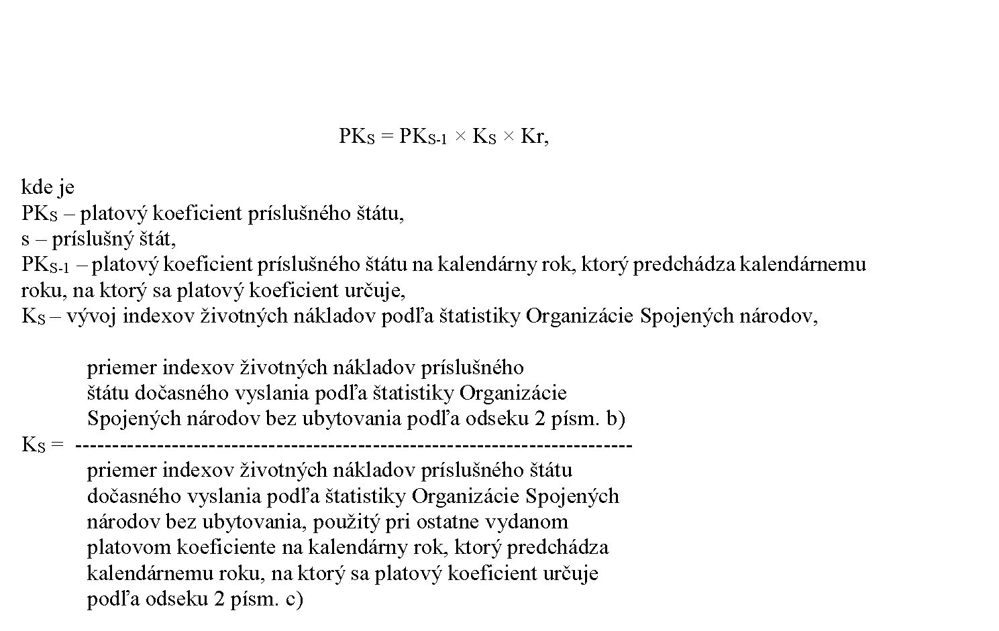

# § 1

(1) Platový koeficient príslušného štátu na kalendárny rok sa určí podľa vzorca

Kr – koeficient regulácie určený podľa § 149 ods. 1 písm. c) zákona; pri určovaní koeficientu regulácie sa zohľadní hodnota súčinu r1 × r2,

kde je

r1 – regulácia uplatnená pri zvýšení platových taríf o mieru medziročného rastu spotrebiteľských cien uplatňovanú v New Yorku za kalendárny rok, ktorý predchádza kalendárnemu roku, v ktorom sa platový koeficient určuje; ak miera medziročného rastu spotrebiteľských cien uplatňovaná v New Yorku je

- 1. menšia ako 0, potom sa r1 rovná 1,

- 2. rovná alebo väčšia ako 0, potom sa r1vypočíta takto: 1 / (1 + zvýšenie platových taríf o mieru medziročného rastu spotrebiteľských cien uplatňovanú v New Yorku za kalendárny rok, ktorý predchádza kalendárnemu roku, v ktorom sa platový koeficient určuje / 100),

r2 – regulácia finančného vyjadrenia indexov životných nákladov podľa štatistiky Organizácie Spojených národov; r2sa vypočíta takto:

- 1. 1 / index vývoja, ak index vývoja je väčší ako 1,

- 2. ak index vývoja je rovný alebo menší ako 1, potom sa r2 rovná 1.

(2) Na účely výpočtu platového koeficientu sa použije

- a) platový koeficient príslušného štátu na kalendárny rok, ktorý predchádza kalendárnemu roku, na ktorý sa platový koeficient určuje,

- b) priemer indexov životných nákladov príslušného štátu dočasného vyslania podľa štatistiky Organizácie Spojených národov bez ubytovania, ktorý sa zistí ako priemer indexov životných nákladov tohto štátu z posledných štyroch štatistík vydávaných štvrťročne alebo zo štatistík vydávaných v iných intervaloch za celé obdobie nasledujúce po poslednej použitej štatistike pri ostatne vydanom platovom koeficiente, ktoré sú zverejnené do 1. septembra kalendárneho roka, ktorý predchádza kalendárnemu roku, na ktorý sa platový koeficient určuje,

- c) priemer indexov životných nákladov príslušného štátu dočasného vyslania podľa štatistiky Organizácie Spojených národov bez ubytovania, použitý pri ostatne vydanom platovom koeficiente na kalendárny rok, ktorý predchádza kalendárnemu roku, na ktorý sa platový koeficient určuje,

- d) index vývoja, ktorý sa určí ako pomer

  - 1. súčtu súčinov platových taríf zamestnancov ministerstva zahraničných vecí v jednotlivých štátoch dočasného vyslania platných k 1. septembru kalendárneho roka, ktorý predchádza kalendárnemu roku, na ktorý sa platový koeficient určuje, a podielov priemerov indexov životných nákladov jednotlivých štátov dočasného vyslania podľa štatistiky Organizácie Spojených národov bez ubytovania zistených podľa písmena b) k priemeru indexov životných nákladov príslušného štátu dočasného vyslania podľa štatistiky Organizácie Spojených národov bez ubytovania, použitý pri ostatne vydanom platovom koeficiente na kalendárny rok, ktorý predchádza kalendárnemu roku, na ktorý sa platový koeficient určuje, zistených podľa písmena c) k

  - 2. súčtu súčinov platových taríf zamestnancov ministerstva zahraničných vecí v jednotlivých štátoch dočasného vyslania platných k 1. septembru kalendárneho roka, ktorý predchádza kalendárnemu roku, na ktorý sa platový koeficient určuje a podielov priemerov indexov životných nákladov jednotlivých štátov dočasného vyslania podľa štatistiky Organizácie Spojených národov bez ubytovania použitých pri ostatne vydanom platovom koeficiente na kalendárny rok, ktorý predchádza kalendárnemu roku, na ktorý sa platový koeficient určuje k priemeru indexov životných nákladov jednotlivých štátov dočasného vyslania podľa štatistiky Organizácie Spojených národov bez ubytovania použitých pri ostatne vydanom platovom koeficiente na kalendárny rok spred dvoch rokov predchádzajúcich kalendárnemu roku, na ktorý sa platový koeficient určuje.

(3) Koeficient regulácie sa určí do 31. októbra kalendárneho roka, ktorý predchádza kalendárnemu roku, na ktorý sa platový koeficient určuje, na základe podkladov ministerstva zahraničných vecí predložených Ministerstvu financií Slovenskej republiky do 15. októbra kalendárneho roka, ktorý predchádza kalendárnemu roku, na ktorý sa platový koeficient určuje.
