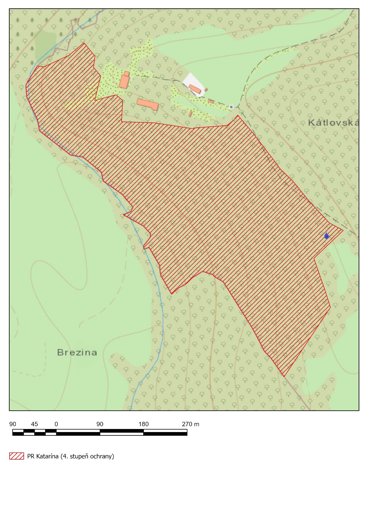

Príloha č. 1 k nariadeniu vlády č. 15/2026 Z. z.

- VYMEDZENIE HRANICE PRÍRODNEJ REZERVÁCIE

  - Popis hranice prírodnej rezervácie

  - Hranica prírodnej rezervácie začína v jej najjužnejšom cípe a pokračuje 170 m severovýchodným smerom popri hranici lesného porastu. Následne sa stáča severozápadným smerom v dĺžke 105 m popri lesnej ceste a láme sa severovýchodným smerom v dĺžke 80 m. V najvýchodnejšom bode hranica prírodnej rezervácie vedie popri lesnej ceste severozápadným smerom v dĺžke 320 m. Následne vedie západným smerom hranicou lesného porastu popri zrúcanine kláštora svätej Kataríny Alexandrijskej. Po 240 m sa stáča na sever k zrúcanine kostola svätej Kataríny Alexandrijskej a pokračuje 50 m západným smerom popri hranici lesa, kde znova smeruje dolu svahom na svoj najsevernejší bod, kde končí na lesnej ceste. Odtiaľ pokračuje juhozápadným smerom po lesnej ceste v dĺžke 120 m, kde pokračuje juhovýchodným smerom hranicou lesného porastu v blízkosti vodného toku v dĺžke 580 m. Následne sa stáča severovýchodným smerom, pričom pretína lesnú cestu, po 80 m sa znovu stáča juhovýchodným smerom hranicou lesného porastu a po 278 m sa dostane naspäť k jej najjužnejšiemu (začiatočnému) bodu.

  - Zoznam parciel prírodnej rezervácie

  - Okres Trnava

  - Katastrálne územie Dechtice:

  - 2883/2, 2889, 2951, 2952, 2953, 2954/1, 2954/2, 2955, 2956, 2957, 2958, 2959, 2964/8, 2965, 2974/4, 2979, 2980 (podľa registra „C“ katastra nehnuteľností so stavom k 19. novembru 2025).

  - Mapa hranice prírodnej rezervácie Katarína

- 

- Technickým podkladom na zápis priebehu hranice prírodnej rezervácie do katastra nehnuteľností je zjednodušený operát geometrického plánu.

- Mapa prírodnej rezervácie je uverejnená v Štátnom zozname osobitne chránených častí prírody a krajiny na webovom sídle Štátnej ochrany prírody Slovenskej republiky.

- https://data.sopsr.sk/chranene-objekty/chranene-uzemia/detail/72.
