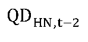
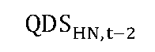

# Čl. I

Vyhláška Úradu pre reguláciu sieťových odvetví č. 154/2024 Z. z., ktorou sa ustanovuje cenová regulácia v elektroenergetike a niektoré podmienky vykonávania regulovaných činností v elektroenergetike v znení vyhlášky č. 402/2024 Z. z. a vyhlášky č. 333/2025 Z. z. sa mení a dopĺňa takto:

- 1. V § 1 písm. p) sa za slovo „výroba“ vkladajú slová „alebo spotreba“ a vypúšťajú sa slová „na výrobu elektriny“.

- 2. Poznámka pod čiarou k odkazu 21 znie: „21) Nariadenie Európskeho parlamentu a Rady (ES) č. 1893/2006 z 20. decembra 2006, ktorým sa zavádza štatistická klasifikácia ekonomických činností NACE Revision 2 a ktorým sa mení a dopĺňa nariadenie Rady (EHS) č. 3037/90 a niektoré nariadenia ES o osobitných oblastiach štatistiky (Ú. v. EÚ L 393, 30. 12. 2006) v platnom znení.“.

- 3. V § 16 ods. 1 písm. d) druhom bode vzorec znie:

- „PPSziskt–2 = (RABST,t–2 × WACCt–2) × (1 – SOOPROt–2) × (1 – daň z príjmovt–2)“.

- 4. V § 16 ods. 4 štvrtej vete sa za slová „priamo pripojeného do prenosovej sústavy“ vkladajú slová „alebo prevádzkovateľa miestnej distribučnej sústavy priamo pripojenej do prenosovej sústavy“.

- 5. V § 16 ods. 6 písmená a) a b) znejú:

- „a)

- rezervovaná kapacita na rok t v odbernom mieste koncového odberateľa elektriny priamo pripojeného do prenosovej sústavy je viac ako 130 MW a zároveň prenos elektriny pre koncového odberateľa elektriny priamo pripojeného do prenosovej sústavy v roku t-2, alebo na základe plánovaných údajov v roku t je viac ako 1,1 TWh, koncovým odberateľom elektriny priamo pripojeným do prenosovej sústavy v roku t sa uhrádzajú prevádzkovateľovi prenosovej sústavy platby za prístup do prenosovej sústavy a prenos elektriny, ktoré sa vypočítajú ako súčin hodnoty rezervovanej kapacity a 40 % z tarify za rezervovanú kapacitu a súčin hodnoty prenesenej elektriny a 40 % z tarify za prenesenú elektrinu,

- b)

- rezervovaná kapacita na rok t v odbernom mieste koncového odberateľa elektriny priamo pripojeného do prenosovej sústavy je viac ako 200 MW a zároveň prenos elektriny pre koncového odberateľa elektriny priamo pripojeného do prenosovej sústavy v roku t-2, alebo na základe plánovaných údajov v roku t je viac ako 1,7 TWh, koncovým odberateľom elektriny priamo pripojeným do prenosovej sústavy v roku t sa uhrádzajú prevádzkovateľovi prenosovej sústavy platby za prístup do prenosovej sústavy a prenos elektriny, ktoré sa vypočítajú ako súčin hodnoty rezervovanej kapacity a 20 % z tarify za rezervovanú kapacitu a súčin hodnoty prenesenej elektriny a 20 % z tarify za prenesenú elektrinu,“.

- 6. V § 17 ods. 1 písm. c) treťom bode sa slová „rok t“ nahrádzajú slovami „rok t-2“.

- 7. V § 17 ods. 1 písm. c) piatom bode sa vypúšťajú slová „i-tej štvrťhodine“.

- 9. V § 19 ods. 3 písmeno d) znie:

- „d)

- skupina 4, a to odberné miesta koncových odberateľov elektriny priamo pripojených do prenosovej sústavy, ktorých priemerná spotreba elektriny za posledné tri roky alebo plánovaná spotreba elektriny na rok t je najmenej 1 GWh, podiel nákladov na elektrickú energiu presahuje 10 % výrobných nákladov všetkých vyrobených výrobkov a pomerná odchýlka je podiel hodnoty priemeru absolútnych hodnôt odchýlky subjektu zúčtovania po zúčtovacích periódach a vyššej hodnoty z priemeru absolútnych hodnôt dohodnutých odberov a priemeru absolútnych hodnôt dohodnutých dodávok z registrovaného denného diagramu za obdobie roku t-1 s presnosťou na tri desatinné miesta alebo plánovaná pomerná odchýlka na rok t, pričom pomerná odchýlka alebo plánovaná pomerná odchýlka musí byť menšia ako 0,025; ak bola činnosť koncového odberateľa v priebehu posledných troch kalendárnych rokov prerušená dlhšie ako jeden kalendárny rok, použijú sa údaje o priemernej spotrebe elektriny, podielu nákladov na elektrickú energiu v konečnej cene výrobku a pomernej odchýlke za jeden z dvoch kalendárnych rokov predchádzajúcich kalendárnemu roku, v ktorom došlo k prerušeniu činnosti koncového odberateľa elektriny.“.

- 10. V § 22 ods. 2 sa vypúšťa písmeno f).

  - Doterajšie písmeno g) sa označuje ako písmeno f).

- 11. V § 22 ods. 8 písmeno g) znie:

- „g)

- D7 je viacpásmová sadzba s pevne určenými časmi uplatňovania jednotlivých pásiem, ktoré na rok t uvádza dodávateľ elektriny v návrhu ceny, pričom jednotlivé pásma nesmú byť kratšie ako dve hodiny a môžu sa počas dňa opakovať,“.

- 12. V § 22 ods. 10 písm. a) sa na konci pripájajú tieto slová: „pre všetky odberné miesta“.

- 13. V § 23 ods. 12 sa slová „piateho“ nahrádzajú slovami „siedmeho“ a na konci sa pripája táto veta: „Za užívateľa sústavy sa na účely neuhrádzania platby za prístup do sústavy podľa tohto odseku považuje prevádzkovateľ zariadenia na výrobu elektriny alebo elektroenergetického zariadenia alebo poskytovateľ podporných služieb alebo prevádzkovateľ miestnej distribučnej sústavy alebo agregátor, pričom neuhrádzanie platby za prístup do sústavy podľa tohto odseku sa uplatňuje na princípe nediskriminácie na všetkých úrovniach pripojenia do distribučných sústav bez ohľadu na spôsob pripojenia do sústavy.“.

- 14. V § 23 odsek 17 znie:

- „(17)

- Ak užívateľ sústavy v odovzdávacom mieste alebo v odbernom mieste a odovzdávacom mieste užívateľa sústavy prevádzkuje zariadenie na výrobu elektriny z vodnej energie s celkovým inštalovaným výkonom do 1 MW, alebo dodáva elektrinu do sústavy pri prevádzke dopravných prostriedkov elektrickej trakcie, alebo prevádzkuje prečerpávaciu vodnú elektráreň, alebo prevádzkuje certifikované zariadenie výlučne na poskytovanie podporných služieb prevádzkovateľovi prenosovej sústavy alebo výlučne na dodávku alebo odber regulačnej elektriny, a predloží prevádzkovateľovi regionálnej distribučnej sústavy potvrdenie od prevádzkovateľa prenosovej sústavy o poskytnutí podporných služieb za predchádzajúci mesiac, najneskôr do siedmeho pracovného dňa nasledujúceho mesiaca, platba za prístup do distribučnej sústavy za rezervovanú kapacitu v odovzdávacom mieste alebo v odbernom mieste a odovzdávacom mieste užívateľa sústavy v jednom mieste pripojenia určená podľa odseku 16 sa prevádzkovateľovi distribučnej sústavy, do ktorej je pripojený, neuhrádza. Platba za prístup do distribučnej sústavy za rezervovanú kapacitu sa neuhrádza ani prevádzkovateľom miestnej distribučnej sústavy, ak v miestnej distribučnej sústave je prevádzkované zariadenie na výrobu elektriny z vodnej energie s celkovým inštalovaným výkonom do 1 MW, alebo dodáva elektrinu do sústavy pri prevádzke dopravných prostriedkov elektrickej trakcie, alebo prevádzkuje prečerpávaciu vodnú elektráreň, alebo prevádzkuje certifikované zariadenie výlučne na poskytovanie podporných služieb prevádzkovateľovi prenosovej sústavy alebo výlučne na dodávku alebo odber regulačnej elektriny a ten predloží potvrdenie od prevádzkovateľa prenosovej sústavy o poskytnutí podporných služieb za predchádzajúci mesiac, najneskôr do siedmeho pracovného dňa nasledujúceho mesiaca a súčasne hodnota rezervovanej kapacity je zmluvne dohodnutá iba týmto užívateľom sústavy. Ak je do miestnej distribučnej sústavy okrem užívateľa sústavy podľa druhej vety pripojených viac užívateľov sústavy, platba za prístup do distribučnej sústavy vo výške rezervovanej kapacity sa uhrádza za celú rezervovanú kapacitu, ak prevádzkovateľ miestnej distribučnej sústavy nepreukáže zníženú hodnotu rezervovanej kapacity bez vplyvu užívateľa sústavy podľa druhej vety.“.

- 15. V § 23 ods. 20 sa slová „ktorý má“ nahrádzajú slovami „v ktorého distribučnej sústave je“ a za slová „typu B,“ sa vkladajú slová „vrátane odberných miest a odovzdávacích miest súčasne v jednom mieste pripojenia zariadení na výrobu elektriny alebo zariadení na uskladňovanie elektriny“, a na konci sa pripája čiarka a tieto slová: „pričom výnimka podľa tejto vety sa vzťahuje výlučne len na napájané dopravné prostriedky elektrickej trakcie“.

- 16. V § 23 ods. 21 štvrtá veta znie:

- „Na nedodržanie predpísaných hodnôt účinníka a dodávky jalovej elektriny do distribučnej sústavy za odberné miesta podľa odseku 20 sa § 17b použije primerane tak, že sa tieto hodnoty vyhodnocujú súhrnne za všetky odberné miesta podľa odseku 20, ktorých odber elektriny je prepojený vlastnou elektrickou sústavou a ktorými sú napájané dopravné prostriedky elektrickej trakcie.“.

- 18. V § 24 ods. 4 sa vypúšťa slovo „len“ a na konci sa pripája táto veta: „Na účely tohto odseku sa umožňuje dodávať do regionálnej distribučnej sústavy výkon maximálne do 50 MW.“.

- 19. V § 25 ods. 3 písm. e) druhom bode podbode 2a. a treťom bode podbode 3a. sa na konci pripája bodkočiarka a tieto slová: „pri predčasnom trvalom vypnutí dátovej siete pred uplynutím technickej doby životnosti inteligentných meracích systémov určených pre príslušnú dátovú sieť podľa prílohy č. 1, sa táto skutočnosť zohľadní pri vykonávaní cenovej regulácie,“.

- 20. V § 25 ods. 3 písm. h) prvý bod znie:

- „1.

- z uplatnenia ceny za pripojenie do distribučnej sústavy zohľadnia sa vo výške 100 %; to neplatí pre cenu za pripojenie, ktorá bola prevádzkovateľom distribučnej sústavy vrátená žiadateľovi o pripojenie podľa § 31 ods. 17 a 18 a časť ceny za pripojenie, ktorá bola prevádzkovateľom distribučnej sústavy vrátená žiadateľovi o pripojenie podľa § 31 ods. 19, zároveň sa výnos z uplatnenia ceny za pripojenie do distribučnej sústavy zníži o hodnotu majetku zaradeného do používania v roku t-2, ktorý presahuje výšku regulačných odpisov za rok t-2,“.

- 21. V § 25 ods. 3 písm. h) tretí bod znie:

- „3.

- z platieb za rezervovanú kapacitu a distribúciu jalovej elektriny za nedodržanie účinníka na príslušnej napäťovej úrovni účtované užívateľom sústavy na základe cenového rozhodnutia úradu sa zohľadnia vo výške, ktoré sa znížia o preukázateľne vynaložené náklady na nefrekvenčné podporné služby za rok t-2 a tento rozdiel sa zohľadní vo výške 100 %,“.

- 22. V § 25 ods. 3 písm. h) sa vypúšťa piaty bod.

  - Doterajší šiesty bod sa označuje ako piaty bod.

- 23. V § 25 ods. 3 sa písmeno h) dopĺňa šiestym bodom, ktorý znie:

- „6.

- z výnosov za komerčné využívanie technickej infraštruktúry slúžiacej na regulovanú činnosť tretími stranami.“.

- 24. V § 26 ods. 3 písmeno c) znie:

- „c)

- FDSHN,t je faktor strát pri distribúcii elektriny na jednotku množstva elektriny na príslušnej napäťovej úrovni na rok t v eurách, ktorý sa prvýkrát uplatní v roku t = 2026 a vypočíta podľa vzorca

- 

- kde

- 1.

- CSDHN,t–2 je tarifa za straty elektriny pri distribúcii elektriny v eurách na jednotku množstva elektriny príslušnej napäťovej úrovne v roku t-2,

- 2.

- VystEOHN,t–2 je plánované množstvo elektriny v jednotkách množstva elektriny distribuované na príslušnej napäťovej úrovni koncovým odberateľom elektriny v roku t-2,

- 3.

- SVystEOHN,t–2 je skutočné množstvo elektriny v jednotkách množstva elektriny distribuované na príslušnej napäťovej úrovni ku koncovým odberateľom elektriny v roku t-2,

- 4.

- PCSESt–2 je určená cena elektriny na krytie strát elektriny pri distribúcii elektriny v eurách na jednotku množstva elektriny na rok t-2,

- 5.

- PMSEHN,t–2 je povolené množstvo strát elektriny pri distribúcií elektriny v jednotkách množstva elektriny na príslušnej napäťovej úrovni v roku t-2,

- 6.

- PMSESHN,t–2 je skutočné množstvo strát elektriny pri distribúcií elektriny v jednotkách množstva elektriny na príslušnej napäťovej úrovni v roku t-2.“.

- 25. V § 26 odseky 4 a 5 znejú:

- „(4)

- Povolené množstvo strát elektriny pri distribúcii elektriny PMSEHN,t v jednotkách množstva elektriny na príslušnej napäťovej úrovni v roku t sa vypočíta podľa vzorca

- 

- kde

- a)

- VstEHN,tje celkové plánované množstvo elektriny v jednotkách množstva elektriny vstupujúce do príslušnej napäťovej úrovne v roku t cez transformáciu z vyššej napäťovej úrovne, zo všetkých zdrojov elektriny pripojených na príslušnú napäťovú úroveň, z prítokov elektriny zo susedných distribučných sústav, z dovozov elektriny zo susedných elektrizačných sústav a z prítokov elektriny prepravenej cez miestne distribučné sústavy pripojené do distribučnej sústavy regulovaného subjektu,

- b)

- PPSCHN je hodnota počiatočného percenta celkových strát pri distribúcii elektriny na príslušnej napäťovej úrovni určená podľa odseku 5,

- c)

- XSHN,nje faktor efektivity strát elektriny na príslušnej napäťovej úrovni; na rok t = 2027 sa určí podľa odseku 5.

- (5)

- Hodnota počiatočného percenta celkových strát pri distribúcii elektriny PPSCHN na príslušnej napäťovej úrovni a hodnota faktora efektívnosti strát XSHN,nsa určuje takto:

- | Regionálna distribučná sústava |

- | PPSCHN | XSHN,n

- VVN | 0,875 % | 0,01 %

- VN | 3,406 % | 1,0 %

- NN | 9,782 % | 2,0 %

- “.

- 26. V § 27 odsek 12 znie:

- „(12)

- Ak užívateľ miestnej distribučnej sústavy v odbernom mieste a odovzdávacom mieste súčasne v jednom mieste pripojenia do miestnej distribučnej sústavy odoberá elektrinu a dodáva elektrinu do sústavy pri prevádzke dopravných prostriedkov elektrickej trakcie, alebo prevádzkuje zariadenie na výrobu elektriny z vodnej energie s celkovým inštalovaným výkonom do 1 MW, alebo prevádzkuje certifikované zariadenia výlučne na poskytovanie podporných služieb prevádzkovateľovi prenosovej sústavy alebo výlučne na dodávku alebo odber regulačnej elektriny preukáže poskytovanie podporných služieb, a predloží prevádzkovateľovi miestnej distribučnej sústavy potvrdenie od prevádzkovateľa prenosovej sústavy o poskytnutí podporných služieb za predchádzajúci mesiac, najneskôr do siedmeho pracovného dňa nasledujúceho mesiac, platba za prístup do distribučnej sústavy podľa odseku 15 sa prevádzkovateľovi miestnej distribučnej sústavy, neuhrádza. Ak toto potvrdenie prevádzkovateľovi miestnej distribučnej sústavy užívateľ regionálnej distribučnej sústavy podľa predchádzajúcej vety nepredloží, uhrádza sa dohodnutá rezervovaná kapacita za príslušný mesiac.“.

- 27. V § 27 ods. 17 sa na konci pripájajú tieto slová: „pre všetky odberné miesta“.

- 28. V § 28 ods. 1 písm. g) prvom bode sa za slovo „hodnote“ vkladajú slová „vlastného majetku alebo prenajatého“.

- 29. V § 28 ods. 5 písm. b) druhom bode podbod 2b. znie:

- „2b.

- ak je sústava pripojená na napäťovej úrovni vysokého napätia, je

- 2ba.

- vo výške skutočného množstva strát elektriny v roku t-2, najviac 2 % na napäťovej úrovni vysokého napätia,

- 2bb.

- vo výške skutočného množstva strát elektriny v roku t-2, najviac 5 % na napäťovej úrovni nízkeho napätia,“.

- 30. V § 28 ods. 5 písmeno c) znie:

- „c)

- FDSHN,t je faktor strát pri distribúcii elektriny na jednotku množstva elektriny na príslušnej napäťovej úrovni na rok t v eurách, ktorý sa prvýkrát uplatní v roku t = 2026 a vypočíta podľa vzorca

- 

- kde

- 1.

- CSDHN,t–2 je tarifa za straty elektriny pri distribúcii elektriny CSDHN,t–2 v eurách na jednotku množstva elektriny príslušnej napäťovej úrovne v roku t-2,

- 2.

-  je plánované množstvo elektriny v jednotkách množstva elektriny v roku t-2, odobratej z distribučnej sústavy regulovaného subjektu koncovými odberateľmi elektriny,

- 3.

-  je skutočné množstvo elektriny v jednotkách množstva elektriny v roku t-2, odobratej z distribučnej sústavy regulovaného subjektu koncovými odberateľmi elektriny,

- 4.

- PCSESt–2 je určená cena elektriny na krytie strát elektriny pri distribúcii elektriny v eurách na jednotku množstva elektriny na rok t-2,

- 5.

- PMSEHN,t–2 je povolené množstvo strát elektriny pri distribúcií elektriny v jednotkách množstva elektriny na príslušnej napäťovej úrovni v roku t-2,

- 6.

- PMSESHN,t–2 je skutočné množstvo strát elektriny pri distribúcií elektriny v jednotkách množstva elektriny na príslušnej napäťovej úrovni v roku t-2.“.

- 31. V § 29 sa odsek 2 dopĺňa písmenom f), ktoré znie:

- „f)

- zoznam prevádzok, pre ktoré má platiť návrh cien za pripojenie pri pripojení do miestnej distribučnej sústavy, v súlade s povolením na podnikanie v energetike.“.

- 32. § 31 vrátane nadpisu znie:

- 㤠31

- Cenová regulácia pripojenia do distribučnej sústavy

- (1)

- Elektroenergetické zariadenie alebo odberné elektrické zariadenie žiadateľa o pripojenie je možné pripojiť do distribučnej sústavy po splnení technických podmienok a obchodných podmienok prevádzkovateľa distribučnej sústavy tak, že je zachovaná bezpečnosť, spoľahlivosť a stabilita prevádzky distribučnej sústavy. Deliace miesto medzi technologickými zariadeniami distribučnej sústavy a elektroenergetickými zariadeniami alebo odbernými elektrickými zariadeniami žiadateľa o pripojenie je určené prevádzkovateľom distribučnej sústavy.

- (2)

- Náklady prevádzkovateľa distribučnej sústavy na zabezpečenie maximálnej rezervovanej kapacity budovaním nových elektroenergetických zariadení alebo úpravou existujúcich elektroenergetických zariadení prevádzkovateľa distribučnej sústavy, vyvolané pripojením zariadení žiadateľa o pripojenie, sa zahrnú do výpočtu ceny za pripojenie uhrádzanej žiadateľom o pripojenie pre pripojenie na napäťovej úrovni

- a)

- od 52 kV vrátane do 110 kV vrátane podľa § 33 ods. 1,

- b)

- od 1 kV vrátane do 52 kV podľa § 34 ods. 1,

- c)

- do 1 kV podľa § 35 ods. 1.

- (3)

- Náklady prevádzkovateľa distribučnej sústavy na zabezpečenie požadovanej maximálnej rezervovanej kapacity na pripojenie elektroenergetického zariadenia alebo odberného elektrického zariadenia žiadateľa o pripojenie prostredníctvom odberného miesta alebo odovzdávacieho miesta do distribučnej sústavy zahŕňajú

- a)

- náklady súvisiace s obstaraním elektroenergetických zariadení prevádzkovateľa distribučnej sústavy potrebných pre pripojenie žiadateľa o pripojenie vrátane ich dopravy na určené miesto,

- b)

- náklady súvisiace s obstaraním automatických hasiacich zariadení,

- c)

- náklady súvisiace s obstaraním riadiaceho informačného systému, inteligentného meracieho systému, elektrických ochrán, telekomunikačných, distribučných, meracích a regulačných zariadení, monitorovacích a informačných systémov technológie a zariadení vlastnej spotreby,

- d)

- náklady na montáž,

- e)

- iné náklady súvisiace s prípravou, projektovaním, výstavbou a pripojením elektroenergetických zariadení prevádzkovateľa distribučnej sústavy vrátane súvisiacich stavebných objektov a náklady od prevádzkovateľa sústavy, do ktorej je regulovaný subjekt pripojený.

- (4)

- Ak žiadateľ o pripojenie požaduje zvýšenie existujúcej maximálnej rezervovanej kapacity v odbernom mieste alebo odovzdávacom mieste, cena za pripojenie za zvýšenie maximálnej rezervovanej kapacity v odbernom mieste alebo odovzdávacom mieste sa uplatňuje na rozdiel medzi požadovanou maximálnou rezervovanou kapacitou a existujúcou maximálnou rezervovanou kapacitou v odbernom mieste alebo odovzdávacom mieste.

- (5)

- Ak žiadateľ o pripojenie požiada prevádzkovateľa distribučnej sústavy o zníženie maximálnej rezervovanej kapacity, pri znížení maximálnej rezervovanej kapacity sa cena za pripojenie neuhrádza. Na základe žiadosti o zníženie maximálnej rezervovanej kapacity sa určia žiadateľovi o pripojenie technické podmienky pripojenia pre požadovanú výšku maximálnej rezervovanej kapacity, po splnení ktorých dôjde k požadovanému zníženiu maximálnej rezervovanej kapacity. Ak žiadateľ o pripojenie požiadal prevádzkovateľa distribučnej sústavy o zníženie maximálnej rezervovanej kapacity, pri žiadosti o jej opätovné zvýšenie sa uplatňuje cena za pripojenie za zvýšenie maximálnej rezervovanej kapacity.

- (6)

- Cena za pripojenie pre krátkodobý odber elektriny sa určuje prevádzkovateľom distribučnej sústavy vo výške skutočne vyvolaných nákladov prevádzkovateľa distribučnej sústavy pre takéto pripojenie odberateľa elektriny.

- (7)

- Elektroenergetické zariadenie patriace do distribučnej sústavy sa vybuduje prevádzkovateľom distribučnej sústavy alebo iným subjektom po dohode s prevádzkovateľom distribučnej sústavy v súlade s technickými podmienkami prevádzkovateľa distribučnej sústavy.

- (8)

- Cena za pripojenie sa neuplatní, ak je užívateľ sústavy už pripojený do distribučnej sústavy a táto distribučná sústava je prevzatá iným prevádzkovateľom distribučnej sústavy.

- (9)

- Nadštandardné pripojenie sa poskytuje iba z napäťovej úrovne vysokého napätia a veľmi vysokého napätia. Cena za nadštandardné pripojenia sa určí podľa spôsobu výpočtu pre štandardné pripojenie. Nadštandardné pripojenie užívateľa sústavy je pripojenie s osobitnými nárokmi na spôsob zabezpečenia distribúcie elektriny, napríklad cez ďalšie napájacie vedenie.

- (10)

- Za opätovné pripojenie odberného miesta alebo odovzdávacieho miesta po jeho odpojení od distribučnej sústavy po zániku zmluvy o pripojení do distribučnej sústavy sa uhrádza cena za pripojenie.

- (11)

- Pri zmene existujúceho užívateľa sústavy na pripojenom odbernom mieste alebo odovzdávacom mieste bez zvýšenia maximálnej rezervovanej kapacity sa cena za pripojenie neuhrádza. Pri zmene existujúceho užívateľa na pripojenom odbernom mieste alebo odovzdávacom mieste so zvýšením maximálnej rezervovanej kapacity sa cena za pripojenie uhrádza len na rozdiel medzi pôvodnou a požadovanou hodnotou maximálnej rezervovanej kapacity.

- (12)

- Pri pripojení do distribučnej sústavy v odbernom mieste a odovzdávacom mieste v spoločnom mieste pripojenia, sa cena za pripojenie uhrádza len na maximálnu rezervovanú kapacitu odberného miesta alebo maximálnu rezervovanú kapacitu odovzdávacieho miesta, a to na tú, ktorá z nich je vyššia. Ak sú maximálna rezervovaná kapacita odberného miesta a maximálna rezervovaná kapacita odovzdávacieho miesta rovnaké, cena za pripojenie sa uhrádza len na maximálnu rezervovanú kapacitu odberného miesta. Ak je pripojenie do distribučnej sústavy v odovzdávacom mieste bezplatné, cena za pripojenie sa uhrádza len na maximálnu rezervovanú kapacitu odberného miesta, a to aj ak je maximálna rezervovaná kapacita odberného miesta nižšia ako maximálna rezervovaná kapacita odovzdávacieho miesta.

- (13)

- Pri pripojení do distribučnej sústavy v odovzdávacom mieste v spoločnom mieste pripojenia s odberným miestom, sa cena za pripojenie v odovzdávacom mieste uhrádza len na rozdiel medzi maximálnou rezervovanou kapacitou odovzdávacieho miesta a maximálnou rezervovanou kapacitou odberného miesta. Ak je maximálna rezervovaná kapacita odovzdávacieho miesta nižšia alebo rovnaká ako maximálna rezervovaná kapacita odberného miesta, cena za pripojenie sa za pripojenie do distribučnej sústavy v odovzdávacom mieste neuhrádza.

- (14)

- Pri pripojení do distribučnej sústavy v odbernom mieste v spoločnom mieste pripojenia s odovzdávacím miestom sa cena za pripojenie v odbernom mieste uhrádza len na rozdiel medzi maximálnou rezervovanou kapacitou odberného miesta a maximálnou rezervovanou kapacitou odovzdávacieho miesta. Ak je maximálna rezervovaná kapacita odberného miesta nižšia alebo rovnaká ako maximálna rezervovaná kapacita odovzdávacieho miesta, cena za pripojenie do distribučnej sústavy v odbernom mieste sa neuhrádza. Ak bolo pripojenie do distribučnej sústavy v odovzdávacom mieste bezplatné, cena za pripojenie sa uhrádza na maximálnu rezervovanú kapacitu odberného miesta, a to aj ak je maximálna rezervovaná kapacita odberného miesta nižšia alebo rovnaká ako maximálna rezervovaná kapacita odovzdávacieho miesta.

- (15)

- Pri pripojení do distribučnej sústavy v odbernom mieste a odovzdávacom mieste v spoločnom mieste pripojenia sa pri zvýšení maximálnej rezervovanej kapacity odberného miesta cena za pripojenie sa uhrádza len na rozdiel medzi požadovanou maximálnou rezervovanou kapacitou odberného miesta a maximálnou rezervovanou kapacitou odovzdávacieho miesta. Ak je požadovaná maximálna rezervovaná kapacita odberného miesta nižšia alebo rovnaká ako maximálna rezervovaná kapacita odovzdávacieho miesta, cena za pripojenie sa pri zvýšení maximálnej rezervovanej kapacity odberného miesta neuhrádza. Ak bolo pripojenie v odovzdávacom mieste bezplatné, cena za pripojenie sa uhrádza na rozdiel medzi požadovanou maximálnou rezervovanou kapacitou odberného miesta a pôvodnou maximálnou rezervovanou kapacitou odberného miesta, a to aj ak je maximálna rezervovaná kapacita odberného miesta nižšia alebo rovnaká ako maximálna rezervovaná kapacita odovzdávacieho miesta.

- (16)

- Pri pripojení do distribučnej sústavy v odbernom mieste a odovzdávacom mieste v spoločnom mieste pripojenia sa pri zvýšení maximálnej rezervovanej kapacity odovzdávacieho miesta uhrádza cena za pripojenie len na rozdiel medzi požadovanou maximálnou rezervovanou kapacitou odovzdávacieho miesta a maximálnou rezervovanou kapacitou odberného miesta. Ak je požadovaná maximálna rezervovaná kapacita odovzdávacieho miesta nižšia alebo rovnaká ako maximálna rezervovaná kapacita odberného miesta, cena za pripojenie sa pri zvýšení maximálnej rezervovanej kapacity odovzdávacieho miesta neuhrádza.

- (17)

- Cena za pripojenie žiadateľa o pripojenie na napäťovej úrovni do 1 kV sa vráti, ak nedošlo k pripojeniu do distribučnej sústavy, v čase uzatvorenia zmluvy o pripojení do distribučnej sústavy nebola zo strany prevádzkovateľa distribučnej sústavy vytvorená možnosť pripojiť sa do distribučnej sústavy, pretože prevádzkovateľ distribučnej sústavy nemal vybudované potrebné zariadenia distribučnej sústavy a dostatočnú kapacitu v distribučnej sústave pre takéto pripojenie a prevádzkovateľ distribučnej sústavy nezačal so stavbou alebo uskutočňovaním prípravných prác na zabezpečenie takejto možnosti pripojenia do distribučnej sústavy. Ak zanikne zmluva o pripojení do distribučnej sústavy, cena za pripojenie sa vráti do 15 dní.

- (18)

- Časť ceny za pripojenie žiadateľa o pripojenie na napäťovej úrovni od 52 kV vrátane do 110 kV vrátane alebo žiadateľa o pripojenie na napäťovej úrovni od 1 kV vrátane do 52 kV sa vráti, ak nedošlo k pripojeniu do distribučnej sústavy a prevádzkovateľ distribučnej sústavy nezačal so stavbou alebo uskutočňovaním prípravných prác na zabezpečenie možnosti pripojenia do distribučnej sústavy. Časť ceny za pripojenie, ktorá sa vracia žiadateľovi o pripojenie, je vo výške minimálne 90 % z ceny za pripojenie, pričom maximálna výška časti ceny za pripojenie, ktorá sa nevracia, je 30 000 eur. Ak zanikne zmluva o pripojení do distribučnej sústavy, cena za pripojenie sa vráti do 15 dní. Ak zmluva o pripojení do distribučnej sústavy zanikne inak ako dohodou, žiadosť o pripojenie v príslušnom území alebo nadväzujúcom území sa podáva po 30 dňoch.

- (19)

- Časť ceny za pripojenie žiadateľa o pripojenie na napäťovej úrovni od 52 kV vrátane do 110 kV vrátane alebo žiadateľa o pripojenie na napäťovej úrovni od 1 kV vrátane do 52 kV sa vráti, ak nedošlo k pripojeniu do distribučnej sústavy, prevádzkovateľovi distribučnej sústavy bola doručená žiadosť o zníženie dohodnutej maximálnej rezervovanej kapacity, v čase uzatvorenia zmluvy o pripojení do distribučnej sústavy prevádzkovateľ distribučnej sústavy nezačal so stavbou alebo uskutočňovaním prípravných prác na zabezpečenie takejto možnosti pripojenia do distribučnej sústavy a uzavrie sa dohoda o požadovanom znížení dohodnutej maximálnej rezervovanej kapacity. Časť ceny za pripojenie žiadateľa, ktorá sa vráti do 15 dní, je vo výške minimálne 90 % z časti ceny za pripojenie, ktorá prislúcha k rozdielu medzi dohodnutou maximálnou rezervovanou kapacitou a požadovanou novou maximálnou rezervovanou kapacitou, pričom maximálna výška časti ceny za pripojenie, ktorá sa nevracia, je 30 000 eur.

- (20)

- Ak návrh zmluvy o pripojení do distribučnej sústavy nebol prijatý žiadateľom o pripojenie na napäťovej úrovni od 52 kV vrátane do 110 kV vrátane alebo žiadateľom o pripojenie na napäťovej úrovni od 1 kV vrátane do 52 kV v lehote na jeho prijatie, nová žiadosť žiadateľa, osoby zriadenej alebo ovládanej žiadateľom o pripojenie alebo osoby zriadená alebo ovládaná osobou, ktorá zriadila alebo ovláda žiadateľa o pripojenie žiadateľa o pripojenie akéhokoľvek zaradenia v rovnakom území alebo nadväzujúcom území, sa podáva po uplynutí 60 dní. Na žiadosť o pripojenie podanú pred uplynutím podľa prvej vety sa neprihliada. Po podaní žiadosti o pripojenie do distribučnej sústavy podľa prvej vety sa uhrádza suma preddavku na cenu za pripojenie. Suma preddavku na cenu za pripojenie je vo výške 10 % ceny za požadované pripojenie, najviac však 30 000 eur. Suma preddavku na cenu za pripojenie uvedená vo výzve prevádzkovateľa distribučnej sústavy sa uhrádza v lehote 14 dní. Suma preddavku sa započítava na úhradu ceny za pripojenie. Ak suma preddavku na cenu za pripojenie nie je zaplatená v lehote splatnosti, žiadosť o pripojenie možno odmietnuť. Ak je žiadosť o pripojenie odmietnutá, suma preddavku na cenu za pripojenie sa vráti žiadateľovi o pripojenie do 15 dní.

- (21)

- Ustanovenia odseku 20 sa nepoužijú, ak žiadateľ o pripojenie neprijme návrh zmluvy o pripojenie do distribučnej sústavy z dôvodu nesprávne určenej ceny za pripojenie, právnych nedostatkov alebo technických nedostatkov zmluvy podľa osobitného predpisu.35a) Dôvody neprijatia návrhu zmluvy o pripojení do distribučnej sústavy sa oznámia prevádzkovateľovi distribučnej sústavy v lehote na prijatie návrhu zmluvy. Ak sú dôvody neprijatia návrhu zmluvy o pripojení do distribučnej sústavy prevádzkovateľom distribučnej sústavy akceptované, vyhotoví sa nový návrh zmluvy o pripojení do distribučnej sústavy. Pri neakceptovaní dôvodov žiadateľa sa písomne potvrdzuje doterajší návrh zmluvy o pripojení do distribučnej sústavy s novou lehotou na jeho prijatie.

- (22)

- Ustanovenia odsekov 12 až 16 sa použijú aj pri pripojení zariadenia na výrobu elektriny alebo zariadenia na uskladňovanie elektriny v novom odbernom mieste a odovzdávacom mieste, ktoré sa pripája do miestnej distribučnej sústavy, ktorá je pripojená do regionálnej distribučnej sústavy priamo alebo prostredníctvom jednej alebo viacerých miestnych distribučných sústav, zo strany prevádzkovateľa regionálnej distribučnej sústavy voči odbernému miestu a odovzdávaciemu miestu prevádzkovateľa miestnej distribučnej sústavy, prostredníctvom ktorej je zariadenie na výrobu elektriny alebo zariadenie na uskladňovanie elektriny do regionálnej distribučnej sústavy pripojené.“.

  - Poznámka pod čiarou k odkazu 35a znie:

  - „35a) § 57 ods. 4 vyhlášky č. 207/2023 Z. z. v znení neskorších predpisov.“.

- 33. V § 33 ods. 1 písm. a) sa za slovo „žiadateľov“ vkladajú slová „o pripojenie“.

- 34. V § 33 ods. 4 sa za slovo „žiadateľa“ vkladajú slová „o pripojenie“ a za slovo „žiadateľom“ vkladajú slová „o pripojenie“.

- 35. V § 33 sa vypúšťa odsek 5.

  - Doterajšie odseky 6 až 9 sa označujú ako odseky 5 až 8.

- 36. V § 33 ods. 5 sa slová „môžu dohodnúť“ nahrádzajú slovom „dohodnú“.

- 37. V § 33 ods. 6 sa za slovo „žiadateľa“ vkladá slovo „o pripojenie“ a posledná veta znie: „Maximálna cena za pripojenie sa vypočíta podľa odseku 1 a § 31 ods. 22.“.

- 38. V § 33 sa vypúšťa odsek 8.

  - Doterajší odsek 9 sa označuje ako odsek 8.

- 39. V § 34 ods. 1 sa za slovo „žiadateľa“ vkladajú slová „o pripojenie“ a za slovo „žiadateľov“ vkladajú slová „o pripojenie“.

- 40. V § 34 sa vypúšťa odsek 4.

  - Doterajšie odseky 5 až 6 sa označujú ako odseky 4 až 5.

- 41. V § 34 ods. 4 sa slová „môžu dohodnúť“ nahrádzajú slovom „dohodnú“ a posledná veta znie: „Maximálna cena za pripojenie sa vypočíta podľa odseku 1 a § 31 ods. 22.“.

- 42. V § 34 sa vypúšťa odsek 5.

  - Doterajší odsek 6 sa označuje ako odsek 5.

- 43. § 36 znie:

- 㤠36

- (1)

- Ak správca bytového domu alebo spoločenstvo vlastníkov bytov a nebytových priestorov priamo prevádzkovateľovi distribučnej sústavy alebo prostredníctvom dodávateľa elektriny vyhlási, že užívanie spoločných častí a spoločných zariadení bytového domu je spojené výlučne s užívaním bytov, nebytových priestorov alebo spoločných častí a spoločných zariadení len zraniteľnými odberateľmi elektriny v domácnosti, distribúcia elektriny a dodávka elektriny do odberných miest spoločných častí a spoločných zariadení bytového domu sa považuje za distribúciu elektriny pre domácnosti a maximálna cena za elektrinu na účely dodávky elektriny sa vypočíta podľa § 38; pričom uvedený postup sa prvýkrát uplatní pri výpočte maximálnej ceny za elektrinu na účely dodávky elektriny na rok 2027 pre vybranú skupinu odberateľov uvedených v tomto odseku; rovnako sa postupuje aj v bytovom dome, v ktorom sa nachádzajú telekomunikačné zariadenia poskytovateľov elektronických komunikačných služieb poskytujúcich služby výlučne pre užívateľov bytového domu alebo technologické zariadenia na výrobu tepla.

- (2)

- Ak je časť nebytového priestoru alebo časť spoločných častí a spoločných zariadení bytového domu využívaná na podnikanie, pre ostatné časti spoločných častí a spoločných zariadení bytového domu sa maximálna cena za elektrinu na účely dodávky elektriny vypočíta podľa § 38, pričom uvedený postup sa prvýkrát uplatní pri výpočte maximálnej ceny za elektrinu na účely dodávky elektriny na rok 2027 pre vybranú skupinu odberateľov uvedených v odseku 1, ak časť nebytového priestoru alebo časť spoločných častí a spoločných zariadení bytového domu využívaná na podnikanie tvorí odberné miesto priamo pripojené do distribučnej sústavy, ktoré je vybavené určeným meradlom a s uzavretou samostatnou zmluvou o dodávke elektriny alebo združenej dodávke elektriny.“.

- 44. V § 37 ods. 4 prvej vete sa slovo „deväť“ nahrádza slovom „osem“ a písmená g) a h) znejú:

- „g)

- DD7 je štvorpásmová sadzba s nainštalovaným inteligentným meracím systémom s pevne určenými časmi uplatňovania jednotlivých pásiem, ktoré na rok t uvedie dodávateľ elektriny v návrhu ceny, pričom jednotlivé pásma nesmú byť kratšie ako dve hodiny a môžu sa počas dňa opakovať,

- h)

- DD8 je dynamická sadzba pre odberné miesto s nainštalovaným inteligentným meracím systémom na základe údajov z denného trhu s elektrinou v štvrťhodinových intervaloch alebo hodinových intervaloch zverejnených na webovom sídle organizátora krátkodobého trhu s elektrinou,“.

- 45. V § 37 ods. 4 sa vypúšťa písmeno i).

- 46. V § 37 odsek 5 znie:

- „(5)

- Ceny za dodávku elektriny pre zraniteľných odberateľov elektriny v domácnosti v jednotlivých zložkách sadzieb DD1 až DD6 sú maximálnymi cenami. Sadzby DD1 až DD6 sú zložené z mesačnej platby za jedno odberné miesto NDOt podľa § 38 ods. 7 a z ceny elektriny.“.

- 47. § 37 sa dopĺňa odsekmi 6 a 7, ktoré znejú:

- „(6)

- Sadzba DD7 je zložená z mesačnej platby za jedno odberné miesto NDOtpodľa § 38 ods. 7 a z ceny elektriny. Cena elektriny pri štvorpásmovej sadzbe DD7 sa dodávateľom elektriny uplatňuje tak, aby aritmetický priemer cien za elektrinu v jednotlivých pásmach na jednotku množstva elektriny neprekročil vo vyúčtovaní za dodávku elektriny maximálnu cenu v štvorpásmovej sadzbe za dodávku elektriny vypočítanú ako súčet maximálnej ceny elektriny podľa § 38 ods. 1 a najvyššej miery primeraného zisku podľa § 38 ods. 6.

- (7)

- V sadzbe DD8 sa hodinové sadzby určia ako aritmetický priemer štvrťhodinových intervalov za danú hodinu. Sadzba DD8 je zložená z mesačnej platby za jedno odberné miesto NDOt podľa § 38 ods. 7 a z ceny elektriny. Ceny elektriny pri dynamickej sadzbe DD8 pre odberné miesto s nainštalovaným inteligentným meracím systémom sa dodávateľom elektriny uplatňujú tak, že k cenám elektriny na dennom trhu s elektrinou v štvrťhodinových intervaloch alebo hodinových intervaloch zverejnených na webovom sídle organizátora krátkodobého trhu s elektrinou

- (https://okte.sk/sk/kratkodoby-trh/zverejnenie-udajov-dt/celkove-vysledky-dt/) môže dodávateľ elektriny pripočítať najvyššiu mieru primeraného zisku podľa § 38 ods. 6, pričom tieto ceny sú zverejnené na webovom sídle dodávateľa elektriny.“.

- 48. V § 43 ods. 8 písm. b) sa na konci pripájajú tieto slová: „a právoplatné stavebné povolenie alebo rozhodnutie o stavebnom zámere,“.

- 49. V § 43 ods. 9 písm. b) druhom bode sa slovo „pôvode“ nahrádza slovom „množstve“.

- 50. V § 43 sa odsek 10 dopĺňa písmenom g), ktoré znie:

- „g)

- právoplatné stavebné povolenie alebo rozhodnutie o stavebnom zámere.“.

- 51. V § 44 ods. 1 písm. b) sa vypúšťajú slová „podľa odseku 4 a“.

- 52. V § 44 odsek 2 znie:

- „(2)

- Cena elektriny podľa § 6 ods. 1 písm. d) zákona o podpore na rok t v eurách na jednotku množstva elektriny za elektrinu vyrobenú i-tou technológiou j-tého zariadenia výrobcu elektriny sa pre výrobcu elektriny vypočíta podľa vzorca

- 

- kde

- a)

- CEPSPzi.j je cena elektriny pre určenie príplatku na rok Z vyrobenej i-tou technológiou j-tého zariadenia výrobcu elektriny na základe roku uvedenia zariadenia výrobcu elektriny do prevádzky alebo poslednej uplatnenej rekonštrukcie alebo modernizácie technologickej časti zariadenia na výrobu elektriny alebo cena elektriny ponúknutá v roku vyhlásenia výberového konania v eurách na jednotku množstva elektriny,

- b)

- Pznit je korekcia v eurách na jednotku množstva elektriny na rok t uplatňovaná v hodnote na základe výpočtu podľa odseku 3,

- c)

- rok Z je rok uvedenia zariadenia výrobcu elektriny do prevádzky alebo rok poslednej uplatnenej rekonštrukcie alebo modernizácie technologickej časti zariadenia na výrobu elektriny alebo rok vyhlásenia výberového konania.“.

- 53. V § 44 ods. 3 úvodná veta znie:

- „Korekcia Pznitv eurách na jednotku množstva elektriny na rok t pre i-té technológie výroby elektriny s primárnymi palivami podľa odseku 5 zohľadňujúca zvýšenie alebo zníženie ceny vstupných surovín, ktoré sa použili na výrobu elektriny i-tou technológiou na výrobu elektriny z obnoviteľných zdrojov energie alebo zvýšenie alebo zníženie ceny vstupných surovín, ktoré sa použili na výrobu elektriny z neobnoviteľných zdrojov energie i-tou technológiou na výrobu elektriny vysoko účinnou kombinovanou výrobou a zohľadňujúca zvýšenie alebo zníženie ceny emisných kvót, ktoré sa použili na plnenie povinnosti podľa osobitného predpisu,44a) sa vypočíta podľa vzorca“.

  - Poznámka pod čiarou k odkazu 44a znie:

  - „44a) § 21 ods. 1 písm. b) zákona č. 414/2012 Z. z. o obchodovaní s emisnými kvótami a o zmene a doplnení niektorých zákonov v znení neskorších predpisov.“.

- 54. V § 44 ods. 3 písm. c) úvodnej vete sa na konci pripájajú tieto slová: „pre výrobcov, ktorí nie sú účastníkmi systému obchodovania s emisnými kvótami skleníkových plynov z dôvodu, že nevykonávajú činnosť podľa osobitného predpisu44b)“.

  - Poznámka pod čiarou k odkazu 44b znie:

  - „44b) Príloha č. 1 k zákonu č. 414/2012 Z. z. v znení neskorších predpisov.“.

- 55. V § 44 sa odsek 3 dopĺňa písmenom d), ktoré znie:

- „d)

- pre rok 2027 a nasledujúce roky pre výrobcov, ktorí sú účastníkmi systému obchodovania s emisnými kvótami skleníkových plynov a vykonávajú činnosť podľa osobitného predpisu,44b)

- 

- kde

- a)

- EPCELK, t–2 je energia v palive za rok t-2 v MWh,

- b)

- ACELK, t–2 je výroba elektriny za rok t-2 meraná na svorkách generátora zariadenia v MWh,

- c)

- EF je priemerný emisný faktor na rok 2024 v tonách CO2 na jednotku množstva energie pre palivá spaľované v zariadeniach zohľadňujúci priemerné hodnoty emisných faktorov a výhrevnosti vybraných palív za Slovenskú republiku použitých pri energetickej bilancii emisií skleníkových plynov určené metodikou zhora nadol, ktorý je zverejnený na webovom sídle Ministerstva životného prostredia Slovenskej republiky; emisný faktor sa na účely tejto vyhlášky prepočíta z hodnoty uvádzanej v tCO2/TJ na hodnotu v tCO2/MWh,

- d)

- QEB je aritmetický priemer objemu emisných kvót pridelených pre konkrétnu prevádzku na roky t-2 až t-6 bezplatne v tonách CO2,

- e)

- Et je cena povoleniek v eurách na tonu CO2 na rok t určená ako aritmetický priemer denných uzatváracích cien (settlement price) oficiálneho kurzového lístka zverejneného burzou EEX (European Energy Exchange) na jej webovom sídle za produkt EUA Future – December t v eurách na tonu CO2 za obdobie od 1. januára do 30. júna roku t-1,

- f)

- Et-n je cena povoleniek v eurách na tonu CO2 na rok t-n určená ako aritmetický priemer denných uzatváracích cien (settlement price) oficiálneho kurzového lístka zverejneného burzou EEX (European Energy Exchange) na jej webovom sídle za produkt EUA Future – December t-n v eurách na tonu CO2za obdobie od 1. januára do 30. júna roku t-n,

- g)

- k je koeficient celkovej účinnosti výroby elektriny, ktorý sa vypočíta podľa vzorca“.

- 

- 56. V § 44 sa vypúšťa odsek 4.

  - Doterajšie odseky 5 až 7 sa označujú ako odseky 4 až 6.

- 57. V § 45 ods. 3 písmeno b) znie:

- „b)

- k je koeficient zohľadňujúci rok vstupu zariadenia výrobcu elektriny do predĺženej podpory podľa § 3d zákona o podpore, ktorý pre roky 2021 a 2022 je vo výške 1,02, na rok 2023 a nasledujúce roky do roku 2026 je vo výške 1,00, na rok 2026 a nasledujúce roky je vo výške 0,00,“.

- 58. V § 45 ods. 3 písm. c) prvom bode podbod 1a. znie:

- „1a.

- S je hodnota vyjadrujúca percentuálny podiel investičných nákladov na obstaranie novej porovnateľnej technologickej časti zariadenia výrobcu elektriny vo výške každoročne zverejnenej na webovom sídle úradu do 20. augusta na nasledujúci kalendárny rok ,“.

- 59. Za § 50 sa vkladá § 50a, ktorý vrátane nadpisu znie:

- 㤠50a

- Prechodné ustanovenia k úpravám účinným od 1. júla 2026

- (1)

- Podľa úprav účinných od 1. júla 2026 uvedených v § 22 ods. 8 písm. g), § 26 ods. 3 písm. c) a ods. 4 a 5 a § 37 ods. 4 až 7 sa prvýkrát postupuje pri vykonávaní cenovej regulácie na rok 2027.

- (2)

- Podľa § 22 ods. 8 písm. g), § 26 ods. 3 písm. c) a ods. 4 a 5, § 37 ods. 4 a 5 v znení účinnom do 30. júna 2026 sa postupuje pri vykonávaní cenovej regulácie na rok 2026.“.

- 60. V prílohe č. 1 tabuľke riadku 18 Čistiace komory (najmä v rozvodoch plynu, tepla, vody a podobne – nie stavebné časti) stĺpci Životnosť (v rokoch) sa číslo „10“ nahrádza číslom „50“.

- 61. V prílohe č. 1 tabuľke riadku 33 Elektromery – inteligentné meracie systémy stĺpci Životnosť (v rokoch) sa číslo „12“ nahrádza číslom „10“.

- 62. V prílohe č. 1 tabuľke riadku 105 Odorizačná stanica stĺpci Životnosť (v rokoch) sa číslo „10“ nahrádza číslom „40“.

- 63. V prílohe č. 1 tabuľke riadku 118 Plynovody oceľové stĺpci Životnosť (v rokoch) sa číslo „30“ nahrádza číslom „40“.

- 64. V prílohe č. 1 tabuľke riadku 168 Technológia regulačných staníc stĺpci Životnosť (v rokoch) sa číslo „15“ nahrádza číslom „45“.

- 65. V prílohe č. 1 sa tabuľka dopĺňa riadkom 234, ktorý znie:

- „

- 234 | Vysokotlakové plynovody určené na prepravu plynu prepravnou sieťou | 80

- “.

- 66. V prílohe č. 2 bodu 4 tretej vete sa za slová „hodnôt referenčných skupín Power“ vkladajú slová „,Oil/Gas Distribution, Utility (Water)“.

- 67. V prílohe č. 3 sa slová „železa a ocele“ nahrádzajú slovami „železa, ocele“.

- 68. V prílohe č. 9 sa vypúšťa tabuľka č. 2.

- 69. Príloha č. 11 vrátane nadpisu znie:

- „[Príloha č. 11 k vyhláške č. 154/2024 Z. z.](assets/6c1877b9ae9b7f9c300d93bc8a4a0c22665686bb5147e797e4b75c187aee4033.pdf)

- “.
