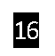
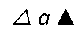
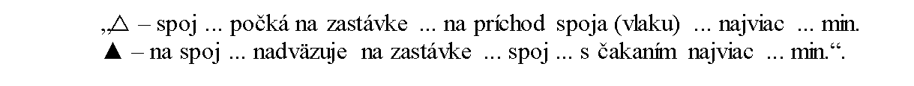
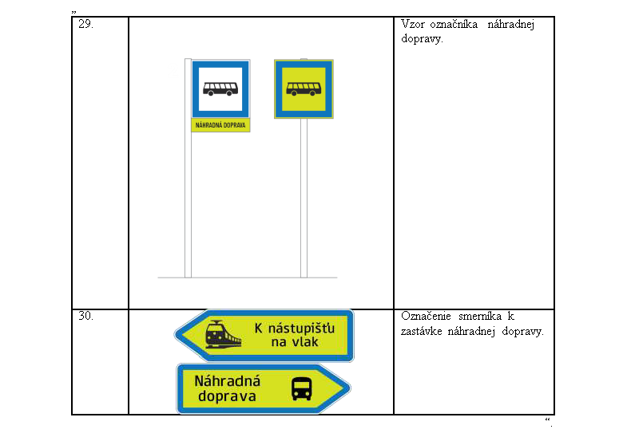

# Čl. I

Vyhláška Ministerstva dopravy Slovenskej republiky č. 269/2024 Z. z., ktorou sa vykonávajú niektoré ustanovenia zákona o verejnej osobnej doprave sa mení a dopĺňa takto:

- 1. V § 4 ods. 1 sa slovo „označenom“ nahrádza slovami „a zreteľne viditeľnom, alebo sa dané miesto označí“.

- 3. V § 6 ods. 1 prvá veta znie: „Na zastávke a na stanici sa umiestni na verejne prístupnom mieste informácia o plánovaných zmenách v železničnej doprave.“ a za prvú vetu sa vkladá nová druhá veta, ktorá znie: „Na zastávke a na stanici zabezpečujúcej predaj cestovných lístkov sa umiestnia aj prepravné podmienky a tarifa cestovného, ktoré sa na požiadanie cestujúcim poskytnú k nahliadnutiu.“.

- 4. V § 10 ods. 1 písm. a) sa pred slovo „môže“ vkladajú slová „ak je to vzhľadom na miestne pomery potrebné,“.

- 5. V § 10 ods. 2 sa na konci pripája táto veta: „Názov mesta sa môže nahradiť jeho skratkou podľa prílohy č. 3.“.

- 6. V § 10 ods. 3 písm. c) sa pred slovo „nácestnými“ vkladá slovo „dôležitými“.

- 7. V § 11 ods. 2 sa na konci pripája táto veta: „Ak sa na elektronickej tabuli zobrazujú súčasne cieľ a nácestné body, vizuálne sa odlíšia tak, aby boli informácie jednoducho a intuitívne rozoznateľné.“.

- 8. V § 11 sa za odsek 5 vkladá nový odsek 6, ktorý znie:

- „(6)

- Smerové a linkové označenie dopravného prostriedku podľa § 10 ods. 1 a 3 nesmie obsahovať reklamu. Na elektronickej tabuli nesmú byť informácie podľa § 10 ods. 5 prekryté reklamou. Za reklamu sa nepovažuje pomenovanie zastávky ani označenie cieľa názvom kultúrno-spoločenského podujatia, pre ktoré sa doprava zabezpečuje.“.

  - Doterajšie odseky 6 až 12 sa označujú ako odseky 7 až 13.

- 9. V § 11 ods. 12 sa slová „až 10“ nahrádzajú slovami „až 11“.

- 10. V § 11 ods. 13 sa slová „odseku 9“ nahrádzajú slovami „odseku 10“.

- 11. V 12 ods. 1 písm. b) druhom bode sa slová „ods. 8“ nahrádzajú slovami „ods. 9“.

- 12. V § 13 ods. 1 sa na konci prvej vety bodka nahrádza čiarkou a pripájajú sa tieto slová: „na ktorom je na bielom podklade s modrým lemovaním zobrazený všeobecne zrozumiteľný piktogram dopravného prostriedku pravidelnej dopravy, ktorý na zastávke alebo nástupišti zastavuje. Ak ide o obsluhu zastávky linky trolejbusom postačuje piktogram autobusu.“.

- 13. V § 13 sa za odsek 1 vkladajú nové odseky 2 až 4, ktoré znejú:

- „(2)

- Nástupište zastávky náhradnej dopravy sa označí označníkom. Ak je označník zriadený dočasne a iba pre náhradnú dopravu, vyhotoví sa podľa odseku 1, pričom biely podklad sa môže nahradiť neónovo žltým podkladom alebo neónovo žltým označením linky náhradnej dopravy, textom „Náhradná doprava“ alebo textom „Náhradná zastávka“. Označník sa vhodným spôsobom doplní informáciami o zastavovaní náhradnej dopravy, najmä cestovným poriadkom a označením náhradnej dopravy alebo označením linky náhradnej dopravy. Označiť podľa tretej vety možno aj nástupište, na ktorom zvyčajne zastavuje náhradná doprava za dráhovú dopravu alebo lodnú dopravu v prípade operatívnej zmeny v doprave alebo mimoriadneho obmedzenia alebo zastavenia dopravných služieb v dráhovej doprave; cestovný poriadok sa v takom prípade neumiestňuje.

- (3)

- Ak nie je nástupište náhradnej dopravy a nástupište dopravy, z ktorej sa prestupuje na náhradnú dopravu, vo vzájomnom zornom poli, označia sa minimálne obe nástupištia smerníkmi, ktoré informujú cestujúcich o smere prestupu; to neplatí pre operatívne zriadenú náhradnú dopravu. Smerník sa môže umiestniť aj na označníku a vyhotoví sa na neónovo žltom podklade. Ak smer pohybu medzi nástupišťami nie je jednoznačný, umiestnia sa medzi nástupište náhradnej dopravy a dopravy, z ktorej sa prestupuje na náhradnú dopravu, ďalšie smerníky. Označenie smeru podľa tretej vety možno nahradiť mapovým podkladom s vyznačením oboch nástupíšť a trasy, ktorou je možné sa bezpečne presúvať medzi nástupišťami; mapový podklad sa viditeľne umiestni na obe nástupištia.

- (4)

- Ak ide o náhradnú autobusovú dopravu za železničnú dopravu, označník zriadený dočasne v priestore pred staničnou budovou spolu s cestovným poriadkom náhradnej autobusovej dopravy sa spravidla osádza pri výluke s trvaním viac ako 48 hodín medzi časom začiatku a konca výluky.“.

  - Doterajšie odseky 2 až 7 sa označujú ako odseky 5 až 10.

- 14. V § 13 ods. 5 sa za tretiu vetu vkladá nová štvrtá veta a nová piata veta, ktoré znejú: „Názov železničnej stanice sa umiestňuje aj na oboch stranách koľajiska pod uhlom 45° voči pozdĺžnej osi krajnej koľaje v smere príchodu vlaku tak, aby bol názov železničnej stanice čitateľný z osobných vozňov približujúceho sa vlaku. Názov železničnej stanice sa umiestňuje vo vzdialenosti od pozdĺžnej osi krajnej koľaje a s veľkosťou písma tak, aby sa zabezpečila zreteľná čitateľnosť počas spomaľovania vlaku pred vjazdom do železničnej stanice.“.

- 15. V § 13 ods. 10 sa slová „až 6“ nahrádzajú slovami „až 9“.

- 16. V § 14 ods. 4 sa slová „mestskej autobusovej“ nahrádzajú slovom „autobusovej“ a slová „osobitného predpisu.3)“ sa nahrádzajú slovami „prílohy č. 2a.“.

  - Poznámka pod čiarou k odkazu 3 sa vypúšťa.

- 17. V § 14 ods. 5 sa slová „30 znakov vrátane čiarok a bodiek“ nahrádzajú slovami „35 znakov vrátane čiarok, bodiek a medzier“ a na konci sa pripája táto veta: „V železničnej doprave sa názov zastávky linky podľa odseku 2 uvádza bez čiarok.“.

- 18. V § 14 ods. 10 sa bodkočiarka nahrádza bodkou a časť vety za bodkočiarkou sa vypúšťa.

- 19. V § 17 ods. 10 písm. a) sa slová „5.30 hodiny do 22.30“ nahrádzajú slovami „5.00 hodiny do 23.00“.

- 20. V § 19 ods. 2 sa slová „sa určia v pláne dopravnej obslužnosti“ nahrádzajú slovami „sú uvedené v prílohe č. 4 tabuľke č. 3“.

- 21. § 20 sa dopĺňa odsekom 5, ktorý znie:

- „(5)

- Štandardizovaný časový interval medzi spojmi v

- a)

- mestskej električkovej doprave je uvedený v prílohe č. 4 tabuľke č. 4,

- b)

- mestskej autobusovej doprave a mestskej trolejbusovej doprave je uvedený v prílohe č. 4 tabuľke č. 5.“.

- 22. V nadpise § 21 a v § 21 ods. 5 sa slovo „Národnej“ nahrádza slovom „národnej“.

- 23. V § 23 ods. 4 sa za slová „denného štúdia“ vkladajú slová „študujúceho na škole so sídlom v členskom štáte Európskej únie (ďalej len „členský štát“)“.

- 24. § 23 sa dopĺňa odsekom 11, ktorý znie:

- „(11)

- Na účel posúdenia nároku na zľavnené cestovné podľa odseku 4 si dopravca v prepravnom poriadku môže upraviť podmienky, za ktorých sa prikladá úradný preklad preukazu, ktorý sa vydal v štátnom jazyku iného členského štátu okrem Českej republiky.“.

- 25. V § 24 ods. 2 sa písmeno b) dopĺňa piatym bodom, ktorý znie:

- „5.

- spôsob uznávania medzinárodných preukazov študentov denného štúdia vydaných na škole so sídlom v štáte mimo členského štátu,“.

- 26. V § 24 ods. 2 sa za písmeno j) vkladá nové písmeno k), ktoré znie:

- „k)

- podmienky súvisiace s využívaním národného integrovaného cestovného lístka,“.

  - Doterajšie písmeno k) sa označuje ako písmeno l).

- 27. Za § 26 sa vkladá § 26a, ktorý vrátane nadpisu znie:

- 㤠26a

- Minimálne štandardy vybavenia autobusových staníc

- Minimálne štandardy vybavenia autobusových staníc na účely poskytovania služieb autobusových staníc10) sú

- a)

- najmenej jedno od vozovky vyvýšené nástupište a ak to miestne podmienky umožňujú, kryté nástupište s najmenej troma stojiskami a s bezbariérovým prístupom, nástupom a výstupom,

- b)

- zreteľné označenie nástupišťa a vybavenie označníkom pri každom stojisku,

- c)

- každé stojisko vybavené najmenej jednou lavičkou a odpadkovým košom,

- d)

- interiérová čakáreň s reguláciou teploty, najmenej počtom 20 miest na sedenie, ktorá je vybavená elektronickým informačným systémom s hlásením alebo zobrazovaním najbližších odchodov, funkčnými toaletami a prístupná verejnosti najmenej v čase premávky autobusových spojov, s možnosťou výnimky v čase od 22:30 hodiny do 6:00 hodiny s prihliadnutím na odchody spojov pravidelnej dopravy; minimálny štandard interiérovej čakárne a funkčných toaliet sa považuje za splnený aj vtedy, ak je autobusová stanica súčasťou terminálu verejnej dopravy spoločného aj pre iné druhy dopravy, alebo ak je v dochádzkovej vzdialenosti do 100 m pešej chôdze od železničnej stanice alebo iného objektu, ktorý tieto služby zabezpečuje,

- e)

- počet miest na krátkodobé státie autobusov do 60 minút zodpovedajúcich počtu stojísk; minimálny štandard je splnený aj vtedy, ak sa miesto na krátkodobé státie nachádza vo vzdialenosti do 1 500 m od autobusovej stanice.“.

  - Poznámka pod čiarou k odkazu 10 znie:

  - „10) Opatrenie Ministerstva financií Slovenskej republiky z 9. decembra 2003 č. 01/R/2003, ktorým sa ustanovuje rozsah regulácie cien v pôsobnosti Ministerstva financií Slovenskej republiky v znení neskorších predpisov (oznámenie č. 566/2003 Z. z.).“.

- 28. V § 28 ods. 4 sa za slovo „prístaviská“ vkladajú slová „okrem železničných staníc a zastávok“.

- 29. Za § 28 sa vkladá § 28a, ktorý vrátane nadpisu znie:

- 㤠28a

- Prechodné ustanovenia k úpravám účinným od 1. júla 2026

- (1)

- Železničná stanica a zastávka, ktoré sú v prevádzke k 1. júlu 2026, sa označia podľa § 12 až 14 v znení účinnom od 1. júla 2026 pri najbližšej obnove alebo modernizácii zovňajšku staničnej budovy, budovy zastávky alebo stavebného objektu, na ktorom je umiestnené označenie.

- (2)

- Na železničnú stanicu a zastávku na dráhe, ktoré sa preklasifikovali na špeciálnu dráhu, sú označené podľa doterajších predpisov a sú v prevádzke k 1. júlu 2026, sa § 13 ods. 1 nevzťahuje; železničná stanica a zastávka na dráhe, ktoré sa preklasifikovali na špeciálnu dráhu, sa označujú podľa § 13 ods. 5.

- (3)

- Autobusová stanica, ktorá je v prevádzke k 1. júlu 2026, sa upraví podľa § 26a

- a)

- do 31. decembra 2026, ak na splnenie minimálneho štandardu nie je potrebné postupovať podľa Stavebného zákona,11)

- b)

- do 31. decembra 2027, ak splnenie minimálneho štandardu vyžaduje ohlásenie stavebných úprav alebo drobnej stavby,12)

- c)

- do 31. decembra 2028, ak splnenie minimálneho štandardu vyžaduje rozhodnutie o stavebnom zámere13) alebo stavebné povolenie.14)“.

  - Poznámky pod čiarou k odkazom 11 až 14 znejú:

  - „11) Zákon č. 25/2025 Z. z. Stavebný zákon a o zmene a doplnení niektorých zákonov (Stavebný zákon) v znení neskorších predpisov.

  - 12) § 63 Stavebného zákona.

  - 13) § 60 Stavebného zákona.

  - 14) § 84 ods. 4 až 7 Stavebného zákona.“.

- 30. V prílohe č. 1 prvom bode písm. b) sa slovo „Národnou“ nahrádza slovom „národnou“.

- 31. V prílohe č. 1 prvom bode písm. b) sa za označením negatívnej značky slovo „nepremáva“ nahrádza slovom „premáva“.

- 32. V prílohe č. 1 prvom bode písm. b) sa za označením negatívnej značky slovo „premáva“ nahrádza slovom „nepremáva“.

- 33. V prílohe č. 1 druhom bode vysvetlivky k informatívnym značkám  znejú:

- 

- 34. V prílohe č. 1 sa druhý bod dopĺňa informatívnou značkou cestovného poriadku výlukovej dopravy, ktorá znie:

- 

- 35. V prílohe č. 2 sa časť VII dopĺňa bodmi 29 a 30, ktoré znejú:

- 

- 36. Za prílohu č. 2 sa vkladá príloha č. 2a, ktorá vrátane nadpisu znie:

- „Príloha č. 2a

- k vyhláške č. 269/2024 Z. z.

- Zoznam skratiek okresov

- BB | Banská Bystrica | PK | Pezinok

- BS | Banská Štiavnica | PN | Piešťany

- BJ | Bardejov | PT | Poltár

- BN | Bánovce nad Bebravou | PP | Poprad

- BR | Brezno | PB | Považská Bystrica

- BA | Bratislava | PO | Prešov

- BY | Bytča | PD | Prievidza

- CA | Čadca | PU | Púchov

- DT | Detva | RA | Revúca

- DK | Dolný Kubín | RS | Rimavská Sobota

- DS | Dunajská Streda | RV | Rožňava

- GA | Galanta | RK | Ružomberok

- GL | Gelnica | SB | Sabinov

- HC | Hlohovec | SC | Senec

- HE | Humenné | SE | Senica

- IL | Ilava | SI | Skalica

- KK | Kežmarok | SV | Snina

- KN | Komárno | SO | Sobrance

- KE | Košice | SN | Spišská Nová Ves

- KS | Košice-okolie | SL | Stará Ľubovňa

- KA | Krupina | SP | Stropkov

- KM | Kysucké Nové Mesto | SK | Svidník

- LV | Levice | SA | Šaľa

- LE | Levoča | TO | Topoľčany

- LM | Liptovský Mikuláš | TV | Trebišov

- LC | Lučenec | TN | Trenčín

- MA | Malacky | TT | Trnava

- MT | Martin | TR | Turčianske Teplice

- ML | Medzilaborce | TS | Tvrdošín

- MI | Michalovce | VK | Veľký Krtíš

- MY | Myjava | VT | Vranov nad Topľou

- NO | Námestovo | ZM | Zlaté Moravce

- NR | Nitra | ZV | Zvolen

- NM | Nové Mesto nad Váhom | ZC | Žarnovica

- NZ | Nové Zámky | ZH | Žiar nad Hronom

- PE | Partizánske | ZA | Žilina

- “.

- 37. Príloha č. 3 sa dopĺňa siedmym bodom, ktorý znie:

- „7.

- Prívlastky vyjadrujúce geografickú polohu sídla v blízkosti vodného toku obsahujúce v názve slovo „nad“ možno skrátiť v podobe „n/(prvé veľké písmeno názvu vodného toku)“, napríklad „N. Mesto n/V.“.

- 38. Nadpis prílohy č. 4 znie: „Štandardizované časové intervaly medzi spojmi vo verejnej osobnej doprave“.

- 39. Pod nadpis prílohy č. 4 sa vkladá nová veta, ktorá znie: „Na účely zostavenia plánu dopravnej obslužnosti sa ustanovujú štandardizované časové intervaly medzi spojmi.“.

- 40. V prílohe č. 4 tabuľke č. 1 pásme 1 sa vypúšťa slovo „nad“ a za číslo „6 000“ sa vkladajú slová „a viac“.

- 41. V prílohe č. 4 tabuľke č. 2 pásme 5 sa vypúšťa slovo „min.“.

- 42. V prílohe č. 4 vysvetlivkách k tabuľke č. 2 druhý bod znie:

- „2.

- Ak je to technicky realizovateľné, uplatnia sa polovičné časové intervaly vo vzdialenosti najviac do 30 minút od spádového centra.“.

- 43. Príloha č. 4 sa dopĺňa tabuľkami č. 3 až 5, ktoré znejú:

- „[tabuľka č. 3](assets/93fe10392e926292de27ba118041566c0f96f442df9ef97669435ff5957d91c1.pdf)“.
