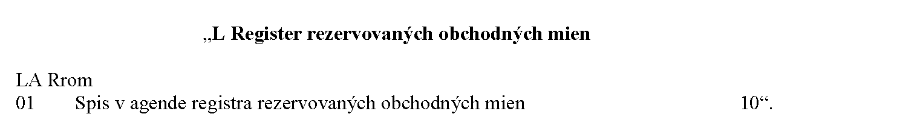

# Čl. I

Vyhláška Ministerstva spravodlivosti Slovenskej republiky č. 543/2005 Z. z. o Spravovacom a kancelárskom poriadku pre okresné súdy, krajské súdy, Špeciálny súd a vojenské súdy v znení vyhlášky č. 417/2006 Z. z., vyhlášky č. 120/2007 Z. z., vyhlášky č. 389/2008 Z. z., vyhlášky č. 11/2009 Z. z., vyhlášky č. 95/2009 Z. z., vyhlášky č. 450/2009 Z. z., vyhlášky č. 148/2011 Z. z., vyhlášky č. 94/2012 Z. z., vyhlášky č. 327/2012 Z. z., vyhlášky č. 105/2013 Z. z., vyhlášky č. 428/2013 Z. z., vyhlášky č. 334/2014 Z. z., vyhlášky č. 366/2014 Z. z., vyhlášky č. 84/2015 Z. z., vyhlášky č. 222/2015 Z. z., vyhlášky č. 449/2015 Z. z., vyhlášky č. 206/2016 Z. z., vyhlášky č. 8/2017 Z. z., vyhlášky č. 171/2017 Z. z., vyhlášky č. 407/2019 Z. z., vyhlášky č. 47/2020 Z. z., vyhlášky č. 108/2020 Z. z., vyhlášky č. 440/2020 Z. z., vyhlášky č. 106/2021 Z. z., vyhlášky č. 438/2021 Z. z., vyhlášky č. 466/2021 Z. z., vyhlášky č. 196/2022 Z. z., vyhlášky č. 305/2022 Z. z., vyhlášky č. 406/2022 Z. z., vyhlášky č. 163/2023 Z. z., vyhlášky č. 290/2023 Z. z., vyhlášky č. 384/2023 Z. z., vyhlášky č. 140/2024 Z. z., vyhlášky č. 207/2025 Z. z. a vyhlášky č. 248/2025 Z. z. sa mení a dopĺňa takto:

- 1. Poznámka pod čiarou k odkazu 2 znie:

- „2) § 4 zákona č. 29/2026 Z. z. o obchodnom registri a o zmene a doplnení niektorých zákonov (zákon o obchodnom registri).“.

- 2. V § 10 sa vypúšťajú slová „a osobitného predpisu“ a odkaz 5.

  - Poznámka pod čiarou k odkazu 5 sa vypúšťa.

- 3. § 113 sa dopĺňa odsekom 4, ktorý znie:

- „(4)

- Ak zdravotná poisťovňa mala titulom verejného zdravotného poistenia záväzok alebo pohľadávku voči poručiteľovi, právoplatné uznesenie o dedičstve sa doručí zdravotnej poisťovni, v ktorej bol poručiteľ ku dňu smrti verejne zdravotne poistený.“.

- 4. V § 163 ods. 1 písm. b) sa slovo „a“ nahrádza čiarkou a na konci sa pripájajú tieto slová: „a registra rezervovaných obchodných mien“.

- 5. V § 163 ods. 1 písm. c) sa za slovo „Tv“ vkladá čiarka a slovo „Ntok“ a za slovo „Nt“ sa vkladá čiarka a slová „Ntvt, Ntol“.

- 6. V § 163 ods. 2 písm. a) sa slová „Exre, Nsre“ nahrádzajú slovami „Nsre, Nkre, Exre, ReOs, Pozn“.

- 7. V § 163 sa odsek 2 dopĺňa písmenom d), ktoré znie:

- „d)

- registra rezervovaných obchodných mien súdny register Rrom.“.

- 8. V § 190 odsek 1 znie:

- „(1)

- Pre každú zapísanú osobu66) sa zakladá registrový spis, ktorého trvalou súčasťou sú súdne spisy týkajúce sa tejto zapísanej osoby.“.

  - Poznámka pod čiarou k odkazu 66 znie:

  - „66) § 8 zákona č. 29/2026 Z. z.“.

- 9. V § 190 ods. 2 písmeno b) znie:

- „b)

- obchodné meno alebo názov zapísanej osoby,“.

- 10. V § 190 odsek 3 znie:

- „(3)

- Ak registráciu vykonal registrátor, odseky 1 a 2 sa na registrovom súde použijú rovnako. Založenie registrového spisu zabezpečí súdne oddelenie obchodného registra bez zbytočného odkladu po vykonaní registrácie.“.

- 11. V § 199 ods. 2 sa slová „právoplatnosti rozhodnutia súdu o výmaze zapísanej osoby“ nahrádzajú slovami „výmazu zapísanej osoby“.

- 12. V § 214 písmeno b) znie:

- „b)

- návrhom na registráciu sa rozumie návrh na prvozápis, návrh na zmenu zápisu a návrh na výmaz,“.

- 13. V § 214 písm. d) a e), § 220 ods. 4 písm. b), v nadpise § 222, § 222 ods. 2 a 4, v nadpise § 223, § 223 ods. 2 a 5, v nadpise nad § 224, v nadpise nad § 225 a § 225 ods. 3 a 5 sa slovo „zápisu“ nahrádza slovom „registrácie“.

- 14. V § 214 písm. f) sa slovo „zápis“ nahrádza slovom „registrácia“ a slovo „zápisu“ sa nahrádza slovom „registrácie“.

- 15. V § 214 písmeno g) znie:

- „g)

- prieskumom návrhu na registráciu sa rozumie postup, pri ktorom sa skúma splnenie podmienok na vykonanie registrácie počas všeobecného prieskumu alebo osobitného prieskumu podľa osobitného predpisu,72)“.

  - Poznámka pod čiarou k odkazu 72 znie:

  - „72) § 49 až 57 zákona č. 29/2026 Z. z.“.

- 16. V § 214 sa vypúšťa písmeno j).

  - Doterajšie písmená k) a l) sa označujú ako písmená j) a k).

  - Poznámky pod čiarou k odkazom 73 a 74 sa vypúšťajú.

- 17. V § 214 písm. j) sa na konci čiarka nahrádza bodkou a vypúšťa sa písmeno k).

- 18. V § 215 sa slová „zápis údajov, návrh na zápis zmeny zapísaných údajov a návrh na výmaz zapísaných údajov“ nahrádzajú slovom „registráciu“.

- 19. V § 216 ods. 2 písm. b) sa za slovo „meno“ vkladajú slová „alebo názov“, slová „zapísaných údajov“ sa nahrádzajú slovom „zápisu“ a na konci sa pripájajú tieto slová: „alebo názvu“.

- 20. V § 216 ods. 3 sa slovo „číslo“ nahrádza slovami „spisovú značku“ a slovo „preverovanie“ sa nahrádza slovom „prieskum“.

- 21. V § 216 odsek 4 znie:

- „(4)

- Po pridelení návrhu na registráciu na prieskum vyššiemu súdnemu úradníkovi zamestnanec podateľne zabezpečí odovzdanie celého spisového materiálu týkajúceho sa návrhu na registráciu príslušnému vyššiemu súdnemu úradníkovi bez zbytočného odkladu.“.

- 22. V § 217 ods. 2 sa za slová „zápis návrhu“ vkladajú slová „na registráciu“.

- 23. V § 218 ods. 1 sa slovo „preverovanie“ nahrádza slovom „prieskum“, slová „zápis navrhovaných údajov“ sa nahrádzajú slovom „registráciu“ a slovo „zápisu“ sa nahrádza slovom „registrácie“.

- 24. Poznámky pod čiarou k odkazom 74a a 75 znejú:

- „74a) § 58 ods. 1 a 2 zákona č. 29/2026 Z. z.

- 75) § 119 zákona č. 29/2026 Z. z.“.

- 25. V § 218 ods. 2 sa slovo „preveruje“ nahrádza slovom „preskúmava“ a slová „preverovaní splnenia podmienky“ sa nahrádzajú slovami „prieskume splnenia podmienok“.

- 26. Poznámka pod čiarou k odkazu 76 znie:

- „76) § 51 ods. 1 a 2 zákona č. 29/2026 Z. z.“.

- 27. V § 218 ods. 3 sa slovo „preverení“ nahrádza slovom „preskúmaní“ a slovo „zápisu“ sa nahrádza slovom „registrácie“.

- 28. V nadpise § 218a sa vypúšťa slovo „elektronického“.

- 29. V § 218a ods. 1 sa vypúšťa slovo „elektronický“ a slovo „elektronickej“ a na konci sa pripájajú tieto slová: „organizácie (ďalej len „identifikačné číslo“)“.

- 30. Poznámka pod čiarou k odkazu 76b znie:

- „76b) § 50 ods. 3 zákona č. 29/2026 Z. z.“.

- 31. Za § 218a sa vkladá § 218b, ktorý vrátane nadpisu znie:

- 㤠218b

- Osobitné postupy pri spracovaní návrhu na registráciu

- Ak sa všeobecným prieskumom zistí, že v návrhu na registráciu nie je uvedené identifikačné číslo z dôvodu, že nebolo pridelené osobe, ktorá sa navrhuje zapísať, alebo organizačnej zložke podniku slovenskej právnickej osoby, postupuje sa podľa osobitného predpisu.76b)“.

- 32. § 219 vrátane nadpisu znie:

- 㤠219

- Prieskum obchodného mena alebo názvu

- (1)

- Ak ide o prvozápis alebo o zmenu zápisu pri zmene obchodného mena alebo názvu zapísanej osoby, vyšší súdny úradník preskúma, či obchodné meno alebo názov, ktorý sa navrhuje zapísať, je totožný s obchodným menom alebo názvom zapísanej osoby, a to bez ohľadu na právnu formu.

- (2)

- Ak ide o prvozápis alebo o zmenu zápisu pri zmene obchodného mena alebo názvu zapísanej osoby, vyšší súdny úradník preskúma aj to, či obchodné meno alebo názov, ktorý sa navrhuje zapísať, je totožný s obchodným menom alebo názvom rezervovaným v registri rezervovaných obchodných mien.

- (3)

- Na účely prieskumu podľa odsekov 1 a 2 vyšší súdny úradník využije funkciu „Lustrácia obchodného mena“.

- (4) Ak ide o návrh na prvozápis alebo o zmenu zápisu pri zmene obchodného mena alebo názvu zapísanej osoby, vyšší súdny úradník preskúma, či obchodné meno alebo názov, ktorý sa navrhuje zapísať, je totožný s obchodným menom alebo názvom, označením orgánu verejnej moci, označením registra alebo inej evidencie, a to bez ohľadu na právnu formu.

- (5) Vyšší súdny úradník odmietne vykonanie registrácie z dôvodov podľa osobitného predpisu,76) ak navrhované obchodné meno alebo názov sú totožné s

  - a) obchodným menom alebo názvom už zapísanej osoby,

  - b) rezervovaným obchodným menom alebo názvom a navrhovateľ nepreukáže oprávnenie na použitie rezervovaného obchodného mena alebo názvu,

  - c) obchodným menom alebo názvom, označením orgánu verejnej moci, označením registra alebo inej evidencie.“.

- 33. V § 220 ods. 1 sa slovo „preverovanie“ nahrádza slovom „prieskum“.

- 34. V § 220 ods. 3 sa vypúšťajú slová „kancelárii styku s verejnosťou obchodného registra, ktorá ho bez zbytočného odkladu predloží“.

- 35. V § 220 ods. 4 písm. a) sa slová „zápis navrhovaných údajov“ nahrádzajú slovom „registráciu“.

- 36. V § 220 ods. 5 sa vypúšťajú slová „prostredníctvom kancelárie styku s verejnosťou obchodného registra“.

- 37. V § 221 ods. 1 sa slovo „preverovanie“ nahrádza slovom „prieskum“ a slovo „zápisu“ sa nahrádza slovom „registrácie“.

- 38. V § 221 ods. 3 sa slová „jeden zápis“ nahrádzajú slovami „jedna registrácia“.

- 39. V § 221 ods. 4 sa slovo „zápisu“ nahrádza slovom „registrácie“ a odkaz „77)“ sa nahrádza odkazom „74a)“.

  - Poznámka pod čiarou k odkazu 77 sa vypúšťa.

- 40. V § 222 ods. 1 a § 225 ods. 1 a 4 sa slovo „zápis“ nahrádza slovom „registráciu“.

- 41. V § 222 odsek 3 znie:

- „(3)

- Vyšší súdny úradník v systéme skontroluje údaj o dni, ku ktorému sa registrácia navrhuje vykonať, ak tento údaj vyplýva z návrhu na registráciu. Ak údaj o dni, ku ktorému sa registrácia navrhuje vykonať, z návrhu na registráciu nevyplýva alebo predchádza dátumu vykonania registrácie, ako deň, ku ktorému sa registrácia vykonáva, sa automaticky určí deň nasledujúci po dni vykonania registrácie.“.

- 42. V § 222 sa vypúšťa odsek 5.

- 43. V § 223 ods. 1 sa slová „zápisu navrhovaných údajov“ nahrádzajú slovom „registrácie“.

- 44. V § 223 ods. 4 sa slovo „zápisu“ nahrádza slovom „registrácie“ a slovo „preskúmania“ sa nahrádza slovom „prieskumu“.

- 45. V § 223 sa vypúšťa odsek 6.

- 46. V § 224 ods. 1 sa slová „od vydania alebo“ nahrádzajú slovami „odo dňa“, slovo „zápisu“ sa nahrádza slovom „registrácie“ a slovo „zápis“ sa nahrádza slovom „registráciu“.

- 47. V § 224 ods. 2 sa slovo „zápisu“ nahrádza slovom „registrácie“ a slovo „zápis“ sa nahrádza slovom „registráciu“.

- 48. V § 225 ods. 2 sa slová „kancelária styku s verejnosťou obchodného registra“ nahrádzajú slovom „na rozhodnutie sudcovi asistent“.

- 49. V § 225 ods. 6 sa slová „uznesením rozhodne o zamietnutí námietok“ nahrádzajú slovami „rozhodne o opakovanom odmietnutí vykonania registrácie“.

- 50. Poznámka pod čiarou k odkazu 78 znie:

- „78) § 58 a 59 zákona č. 29/2026 Z. z.“.

- 51. Za § 225 sa vkladá § 225a, ktorý vrátane nadpisu znie:

- 㤠225a

- Postup sudcu po podaní kvalifikovaných námietok

- (1)

- Ak navrhovateľ v lehote 15 dní odo dňa doručenia oznámenia o odmietnutí vykonania registrácie vydaného registrátorom podal kvalifikované námietky, podateľňa vec zapíše do súdneho registra Nkre a bez zbytočného odkladu vec pridelí na rozhodnutie sudcovi.

- (2)

- Ak navrhovateľ v lehote 15 dní odo dňa doručenia oznámenia o opakovanom odmietnutí vykonania registrácie podal kvalifikované námietky, podateľňa vec zapíše do súdneho registra Nkre a bez zbytočného odkladu vec pridelí na rozhodnutie sudcovi. Vec sa pridelí sudcovi, ktorý nerozhodoval o opakovanom odmietnutí vykonania registrácie.

- (3)

- Po pridelení veci asistent bez zbytočného odkladu predloží celý spisový materiál týkajúci sa pridelenej veci sudcovi na rozhodnutie o kvalifikovaných námietkach.

- (4)

- Sudca preskúma odôvodnenosť odmietnutia vykonania registrácie registrátorom alebo opakovaného odmietnutia registrácie len z hľadiska splnenia podmienok podľa osobitného predpisu.72) Pri preskúmaní návrhu na registráciu na základe kvalifikovaných námietok sudca nie je viazaný dôvodmi odmietnutia vykonania registrácie, ktoré registrátor uviedol v odôvodnení oznámenia o odmietnutí vykonania registrácie, alebo ktoré sudca uviedol v oznámení o opakovanom odmietnutí vykonania registrácie.

- (5)

- Po preskúmaní kvalifikovaných námietok sudca v lehote desať pracovných dní odo dňa ich doručenia na registrový súd vykoná registráciu, ak sú splnené podmienky podľa osobitného predpisu.72) V tomto prípade sudca v závislosti od okolností prípadu môže vykonať registráciu na základe doplneného alebo opraveného návrhu na registráciu alebo na základe pôvodného návrhu na registráciu.

- (6)

- Na postup sudcu podľa odseku 5 sa primerane použijú ustanovenia tejto vyhlášky, ktoré upravujú postup vyššieho súdneho úradníka vedúci k vykonaniu registrácie.

- (7)

- Ak nie sú splnené podmienky na postup podľa odseku 5, sudca rozhodne o konečnom odmietnutí vykonania registrácie.

- (8)

- Na postup sudcu podľa odseku 7 sa použije osobitný predpis.78a)“.

  - Poznámka pod čiarou k odkazu 78a znie:

  - „78a) § 62 až 64 zákona č. 29/2026 Z. z.“.

- 52. V § 226 sa za slovami „§ 224 ods. 1“ vypúšťa čiarka a vkladajú sa slová „alebo § 225a ods. 1 alebo ods. 2, alebo ak sa navrhovateľ vzdal podania námietok alebo kvalifikovaných námietok,“.

- 53. § 227, § 228a a 228b vrátane nadpisov sa vypúšťajú.

- 54. § 228 vrátane nadpisu znie:

- 㤠228

- Postup pri vybavovaní žiadosti o vydanie výpisu z obchodného registra, úplného výpisu z obchodného registra alebo potvrdenia o tom, že v obchodnom registri určitý zápis nie je

- (1)

- Po splnení poplatkovej povinnosti78b) vydá kancelária styku s verejnosťou obchodného registra žiadateľovi výpis z obchodného registra, úplný výpis z obchodného registra alebo potvrdenie o tom, že v obchodnom registri určitý zápis nie je.78c)

- (2)

- Ak sa žiada elektronicky o vydanie listinnej podoby výpisu z obchodného registra, úplného výpisu z obchodného registra alebo potvrdenia o tom, že v obchodnom registri určitý zápis nie je, po splnení poplatkovej povinnosti78b) kancelária styku s verejnosťou obchodného registra zabezpečí tlač výpisu z obchodného registra, úplného výpisu z obchodného registra alebo potvrdenia o tom, že v obchodnom registri určitý zápis nie je, a jeho odoslanie poštou na žiadateľom určenú adresu.

- (3)

- Ak jedna elektronická žiadosť podľa odseku 2 obsahuje požiadavku na vydanie viacerých výpisov z obchodného registra, viacerých úplných výpisov z obchodného registra alebo viacerých potvrdení o tom, že v obchodnom registri určitý zápis nie je, zasielajú sa požadované potvrdenia žiadateľovi spoločne.

- (4)

- Elektronická žiadosť o vydanie elektronickej podoby výpisu z obchodného registra alebo elektronickej podoby úplného výpisu z obchodného registra sa v systéme spracúva a vybavuje automatizovaným spôsobom.

- (5)

- Ak sa žiada elektronicky o vydanie elektronickej podoby potvrdenia o tom, že v obchodnom registri určitý zápis nie je, po splnení poplatkovej povinnosti78b) kancelária styku s verejnosťou obchodného registra zabezpečí vydanie tohto potvrdenia a jeho doručenie žiadateľovi elektronickými prostriedkami.“.

  - Poznámky pod čiarou k odkazom 78b a 78c znejú:

  - „78b) Položka 24b písm. a), b) a d) sadzobníka súdnych poplatkov zákona Slovenskej národnej rady č. 71/1992 Zb. v znení neskorších predpisov.

  - 78c) § 105 ods. 1 písm. a), b) a e) zákona č. 29/2026 Z. z.“.

- 55. V nadpise § 230 sa za slovo „a“ vkladá slovo „všeobecná“.

- 56. V § 230 odsek 1 znie:

- „(1)

- V Obchodnom vestníku sa zverejňuje obsah výpisu z obchodného registra v rozsahu zverejňovaných údajov78d) a oznámenie o uložení do zbierky dokumentov.“.

  - Poznámka pod čiarou k odkazu 78d znie:

  - „78d) § 100 zákona č. 29/2026 Z. z.“.

- 57. V § 230 odsek 3 znie:

- „(3)

- Po zápise údajov do obchodného registra registrový súd sprístupní údaje obsiahnuté vo výpise z obchodného registra prostredníctvom dátovej pumpy subjektom podľa osobitného predpisu.79)“.

  - Poznámka pod čiarou k odkazu 79 znie:

  - „79) § 101 zákona č. 29/2026 Z. z.“.

- 58. § 231 a 232 vrátane nadpisov znejú:

- 㤠231

- Postup registrového súdu v konaní o všeobecnom zosúladení

- (1)

- Podateľňa po zaevidovaní kvalifikovaného podnetu v súdnom registri Exre vec pridelí sudcovi na konanie o všeobecnom zosúladení.

- (2)

- Ak vyšší súdny úradník alebo sudca zistí, že došlo ku skutočnosti odôvodňujúcej začatie konania o všeobecnom zosúladení, urobí v súdnom spise úradný záznam o tejto skutočnosti a postúpi do podateľne podnet na začatie konania o všeobecnom zosúladení. Podateľňa kvalifikovaný podnet zapíše do súdneho registra Exre a pridelí sudcovi na konanie o všeobecnom zosúladení.

- (3)

- Sudca preskúma, či sú dôvody na začatie konania o všeobecnom zosúladení, a to do 30 dní odo dňa doručenia kvalifikovaného podnetu. Ak podaný podnet nie je kvalifikovaným podnetom alebo ak nie sú splnené podmienky na začatie konania, sudca podnet uznesením odmietne a toto uznesenie doručí tomu, kto podnet podal.

- (4)

- Ak sú dôvody na začatie konania o všeobecnom zosúladení, sudca vydá uznesenie o upovedomení o začatí konania o všeobecnom zosúladení.

- (5)

- Po vydaní uznesenia o všeobecnom zosúladení sa na ďalší postup sudcu primerane použije § 220.

- § 232

- Postup registrového súdu pri osobitnom zosúladení

- (1)

- Osobitné zosúladenie vykoná vyšší súdny úradník súčasne s vykonaním registrácie.

- (2)

- Osobitné zosúladenie podľa osobitného predpisu80) sa v systéme spracúva a vybavuje automatizovaným spôsobom.“.

  - Poznámka pod čiarou k odkazu 80 znie:

  - „80) § 76 ods. 3 zákona č. 29/2026 Z. z.“.

- 59. Za § 232 sa vkladajú § 232a až 232e, ktoré vrátane nadpisov znejú:

- 㤠232a

- Postup registrového súdu pri oprave zapísaných údajov

- (1)

- Ak vyšší súdny úradník alebo sudca zistí, že došlo ku skutočnosti odôvodňujúcej opravu zapísaných údajov v čase, kedy bol vykonaný zápis údajov, ale k zverejneniu zápisu nedošlo, oprava údajov sa uskutoční na základe žiadosti predsedu registrového súdu v spolupráci s ministerstvom.

- (2)

- Ak vyšší súdny úradník alebo sudca zistí, že došlo ku skutočnosti odôvodňujúcej opravu zapísaných údajov v čase, kedy k zverejneniu zapísaných údajov došlo, urobí v súdnom spise úradný záznam o tejto skutočnosti a postúpi do podateľne podnet na opravu zapísaných údajov. Podateľňa podnet na opravu zapísaných údajov zapíše do súdneho registra Exre a pridelí sudcovi na konanie o oprave zapísaných údajov.

- (3)

- Po pridelení veci sudcovi na konanie o oprave zapísaných údajov sa na ďalší postup primerane použije § 220.

- § 232b

- Postup registrového súdu v konaní o zrušení zápisu údaja

- (1)

- Podateľňa po zaevidovaní návrhu na zrušenie zápisu údaja v súdnom registri Exre vec pridelí sudcovi na konanie o zrušení zápisu údaja.

- (2)

- Po vydaní uznesenia o zrušení zápisu údaja sa na ďalší postup sudcu primerane použije § 220.

- § 232c

- Postup registrového súdu v konaní o zmene alebo výmaze z osobitných dôvodov

- Podateľňa po zápise oznámenia zo systému prepojenia registrov alebo po zápise rozhodnutia podľa osobitného predpisu81) do súdneho registra ReOs vec pridelí vyššiemu súdnemu úradníkovi, ktorý na základe oznámenia vykoná zmenu zápisu alebo výmaz z obchodného registra.

- § 232d

- Postup registrového súdu pri výmaze zapísanej osoby

- (1)

- Podateľňa po zápise právoplatného rozhodnutia registrového súdu podľa osobitného predpisu81a) do súdneho registra Vym vec pridelí vyššiemu súdnemu úradníkovi. Vyšší súdny úradník na základe tohto právoplatného rozhodnutia vykoná výmaz zapísanej osoby z obchodného registra.

- (2)

- Potvrdenie o vykonaní výmazu podľa odseku 1 a výpis z obchodného registra po výmaze spoločnosti sa nevydávajú.

- § 232e

- Postup registrového súdu pri zápise a výmaze poznámky

- (1)

- Ak je súdu doručené rozhodnutie alebo upovedomenie podľa osobitného predpisu,81b) ktoré odôvodňuje zápis poznámky, podateľňa podnet zapíše do súdneho registra Pozn a vec pridelí vyššiemu súdnemu úradníkovi, ktorý poznámku zapíše do časti systému určenej na evidenciu skutočností a udalostí vo vzťahu k zapísanej osobe.

- (2)

- Výmaz poznámky vykoná vyšší súdny úradník bezodkladne po odpadnutí dôvodu, pre ktorý bola poznámka zapísaná.“.

  - Poznámky pod čiarou k odkazom 81 až 81b znejú:

  - „81) § 86 až 90 a 92 zákona č. 29/2026 Z. z.

  - 81a) § 91 zákona č. 29/2026 Z. z.

  - 81b) § 93 a 94 zákona č. 29/2026 Z. z.“.

- 60. Poznámka pod čiarou k odkazu 82 znie:

- „82) § 113 zákona č. 29/2026 Z. z.“.

- 61. V § 235 ods. 1, § 235 ods. 5 a § 237 ods. 5 sa slovo „listín“ nahrádza slovom „dokumentov“.

- 62. V § 235 ods. 3 písm. a), § 235 ods. 4 a § 238 ods. 2 a 4 sa slovo „listiny“ nahrádza slovom „dokumenty“.

- 63. V § 235 ods. 3 písm. b) a § 239 ods. 2 písm. c) sa za slovo „meno“ vkladajú slová „alebo názov“.

- 64. V § 235 ods. 3 písm. c) sa slovo „listín“ nahrádza slovom „dokumentov“ a slovo „listiny“ sa nahrádza slovom „dokumenty“.

- 65. V § 235 ods. 3 písm. d) sa slovo „listiny“ nahrádza slovom „dokumentu“ a vypúšťa sa slovo „jej“.

- 66. Poznámka pod čiarou k odkazu 83 znie:

- „83) § 34 až 38 zákona č. 29/2026 Z. z.“.

- 67. V § 237 ods. 2 sa slovo „listiny“ nahrádza slovom „dokumenty“ a za slovo „súdu“ sa vkladajú slová „alebo registrátorovi“.

- 68. V § 237 ods. 6 sa slovo „Listiny“ nahrádza slovom „Dokumenty“.

- 69. V § 238 ods. 1 sa slovo „listiny“ nahrádza slovom „dokumenty“ a na konci sa pripájajú tieto slová: „alebo registrátorovi“.

- 70. V § 238 ods. 3 sa slovo „listiny“ nahrádza slovom „dokumenty“ a slovo „listín“ sa nahrádza slovom „dokumentov“.

- 71. V § 239 ods. 2 písm. d) sa slovo „listiny“ nahrádza slovom „dokumentu“.

- 72. V § 240 ods. 1 sa slová „z listín uložených“ nahrádzajú slovami „dokumentu uloženého“.

- 73. Poznámka pod čiarou k odkazu 84 znie:

- „84) Položka 24b písm. c) a d) sadzobníka súdnych poplatkov zákona Slovenskej národnej rady č. 71/1992 Zb. v znení neskorších predpisov.“.

- 74. V § 240 ods. 2 sa slová „určitá listina“ nahrádzajú slovami „určitý dokument“.

- 75. Nadpis § 240a znie: „Postup pri vybavovaní elektronických žiadostí o vydanie listinnej podoby kópie dokumentu zo zbierky dokumentov alebo potvrdenia o tom, že určitý dokument nie je uložený v zbierke dokumentov“.

- 76. V § 240a sa vypúšťa odsek 1.

  - Doterajšie odseky 2 až 4 sa označujú ako odseky 1 až 3.

- 77. V § 240a ods. 1 sa slová „požadovanej listiny“ nahrádzajú slovami „požadovaného dokumentu“ a slovo „Listina“ sa nahrádza slovom „Dokument“.

- 78. V § 240a ods. 2 sa vypúšťajú slová „podľa odseku 1“ a slovo „listín“ sa nahrádza slovom „dokumentov“.

- 79. V § 240a ods. 3 sa slová „odsekov 2 a 3“ nahrádzajú slovami „odsekov 1 a 2“ a slová „určitá listina nie je uložená“ sa nahrádzajú slovami „určitý dokument nie je uložený“.

- 80. § 240b vrátane nadpisu znie:

- 㤠240b

- Postup pri vybavovaní elektronickej žiadosti o vydanie elektronickej podoby kópie dokumentu zo zbierky dokumentov alebo potvrdenia o tom, že určitý dokument nie je uložený v zbierke dokumentov

- (1)

- Elektronická žiadosť o vydanie elektronickej podoby kópie dokumentu zo zbierky dokumentov sa v systéme spracúva a vybavuje automatizovaným spôsobom. Ak je dokument uložený len v listinnej podobe, prevod z listinnej podoby do elektronickej podoby zabezpečí bezodkladne kancelária zbierky dokumentov.

- (2)

- Ak sa žiada elektronicky o vydanie elektronickej podoby potvrdenia o tom, že určitý dokument nie je uložený v zbierke dokumentov, po splnení poplatkovej povinnosti kancelária zbierky dokumentov zabezpečí vydanie potvrdenia a jeho doručenie žiadateľovi elektronickými prostriedkami.“.

- 81. V § 241 ods. 1 sa slovo „listín“ nahrádza slovom „dokumentov“ a slovo „výlučne“ sa vypúšťa.

- 82. V piatej časti sa za piatu hlavu vkladá šiesta hlava, ktorá vrátane nadpisu znie:

- „ŠIESTA HLAVA

- OSOBITNÉ USTANOVENIA O POSTUPE PRI VYBAVOVANÍ AGENDY REGISTRA REZERVOVANÝCH OBCHODNÝCH MIEN

- § 241m

- (1)

- Pri vybavovaní agendy registra rezervovaných obchodných mien sa primerane použijú ustanovenia prvej hlavy piatej časti.

- (2)

- Žiadosť o rezerváciu obchodného mena sa v systéme spracúva automatizovaným spôsobom.

- (3)

- Podateľňa po zaevidovaní podnetu na zrušenie rezervácie obchodného mena84aa) v súdnom registri Rrom vec pridelí vyššiemu súdnemu úradníkovi.

- (4)

- Ak vyšší súdny úradník zistí, že došlo ku skutočnosti odôvodňujúcej zrušenie rezervácie obchodného mena podľa osobitného predpisu,84aa) postúpi do podateľne podnet na zrušenie rezervácie obchodného mena. Podateľňa podnet na zrušenie rezervácie obchodného mena zapíše do súdneho registra Rrom a pridelí vec vyššiemu súdnemu úradníkovi na vybavenie.

- (5)

- Ak vyšší súdny úradník zruší rezerváciu obchodného mena, upovedomí o tom žiadateľa o rezerváciu obchodného mena. Ak vyšší súdny úradník rezerváciu nezruší, založí spis ad acta.“.

  - Poznámka pod čiarou k odkazu 84aa znie:

  - „84aa) § 111 ods. 6 zákona č. 29/2026 Z. z.“.

- 83. Za § 263q sa vkladá § 263r, ktorý vrátane nadpisu znie:

- 㤠263r

- Prechodné ustanovenia k úpravám účinným od 17. augusta 2026

- (1)

- Knihu zbierky listín podľa predpisov účinných do 16. augusta 2026 možno používať ako knihu zbierky dokumentov do 31. decembra 2026.

- (2)

- Veci zapísané do súdneho registra Nt do 16. augusta 2026, ktoré sa od 17. augusta 2026 zapisujú do súdnych registrov Ntok, Ntvt alebo Ntol, sa vedú v súdnom registri Nt aj od 17. augusta 2026.“.

- 84. V prílohe č. 1 časti I. Prehľad súdnych registrov a používané skratky súdnych registrov – Okresný súd v stĺpci „Obchodnoprávna agenda“ sa riadky s textom „Re, Nre, Exre, Nsre, Pok, Vym“ nahrádzajú riadkami s textom „Re, Nre, Nsre, Nkre, Exre, ReOs, Pozn, Pok, Vym“.

- 85. V prílohe č. 1 časti I. Prehľad súdnych registrov a používané skratky súdnych registrov – Okresný súd v stĺpci „Obchodnoprávna agenda“ sa na konci pripája riadok, ktorý znie: „Rrom“.

- 86. V prílohe č. 1 časti I. Prehľad súdnych registrov a používané skratky súdnych registrov – Okresný súd v stĺpci „Trestnoprávna agenda“ sa pod riadok „Tv“ vkladá riadok „Ntok“ a pod riadok „Nt“ sa vkladajú riadky „Ntvt“ a „Ntol“.

- 87. V prílohe č. 1 časti II. Zapisovanie do súdnych registrov okresného súdu písmene „B.“ „Súdne registre obchodnoprávnej agendy“ dvadsiaty tretí bod znie:

- „23.

- Do súdneho registra „Re“ sa zapisujú návrhy na registráciu, ak ide o

- a)

- prvozápis do obchodného registra,

- b)

- zmenu zápisu údajov v obchodnom registri,

- c)

- výmaz z obchodného registra.“.

- 88. V prílohe č. 1 časti II. Zapisovanie do súdnych registrov okresného súdu písmene „B.“ „Súdne registre obchodnoprávnej agendy“ dvadsiatom štvrtom bode sa slovo „zápisu“ nahrádza slovom „registrácie.“.

- 89. V prílohe č. 1 časti II. Zapisovanie do súdnych registrov okresného súdu písmene „B.“ „Súdne registre obchodnoprávnej agendy“ dvadsiaty piaty bod a dvadsiaty šiesty bod znejú:

- „25.

- Do súdneho registra „Nsre“ sa zapisujú tie námietky proti odmietnutiu vykonania registrácie zo súdneho registra Nre, ktorým vyšší súdny úradník v rámci postupu podľa § 60 zákona č. 29/2026 Z. z. o obchodnom registri a o zmene a doplnení niektorých zákonov (zákon o obchodnom registri) nevyhovel.

- 26.

- Do súdneho registra „Nkre“ sa zapisujú

- a)

- kvalifikované námietky proti odmietnutiu vykonania registrácie registrovým súdom,

- b)

- kvalifikované námietky proti odmietnutiu vykonania registrácie notárom.“.

- 90. V prílohe č. 1 časti II. Zapisovanie do súdnych registrov okresného súdu písmene „B.“ „Súdne registre obchodnoprávnej agendy“ sa za dvadsiaty šiesty bod vkladajú nový dvadsiaty siedmy bod až dvadsiaty deviaty bod, ktoré znejú:

- „27.

- Do súdneho registra „Exre“ sa zapisuje

- a)

- kvalifikovaný podnet na začatie konania o všeobecnom zosúladení,

- b)

- podnet na opravu zapísaných údajov,

- c)

- návrh na začatie konania o zrušení zápisu údajov.

- 28.

- Do súdneho registra „ReOs“ sa zapisuje

- a)

- oznámenie zo systému prepojenia registrov,

- b)

- právoplatné súdne rozhodnutie, ak bol na majetok zapísanej osoby vyhlásený konkurz, došlo k zmene správcu v konkurze, došlo ku skončeniu konkurzu bez zrušenia zapísanej osoby, bola povolená reštrukturalizácia zapísanej osoby, bola v spoločnosti zaistená majetková účasť, bola zavedená nútená správa nad zapísanou osobou,

- c)

- právoplatné rozhodnutie o vylúčení.

- 29.

- Do súdneho registra „Pozn“ sa zapisuje rozhodnutie, na základe ktorého sa zapisuje do obchodného registra pri zapísanej osobe poznámka.“.

  - Doterajší dvadsiaty siedmy bod až tridsiaty štvrtý bod sa označujú ako tridsiaty bod až tridsiaty siedmy bod.

- 91. V prílohe č. 1 časti II. Zapisovanie do súdnych registrov okresného súdu písmene „B.“ „Súdne registre obchodnoprávnej agendy“ sa v tridsiatom bode slová „530/2003 Z. z. o obchodnom registri a o zmene a doplnení niektorých zákonov v znení neskorších predpisov alebo podľa Civilného mimosporového poriadku“ nahrádzajú slovami „29/2026 Z. z. o obchodnom registri a o zmene a doplnení niektorých zákonov (zákon o obchodnom registri)“ a slová „§ 11 zákona č. 530/2003“ sa nahrádzajú slovami „§ 113 zákona č. 29/2026“.

- 92. V prílohe č. 1 časti II. Zapisovanie do súdnych registrov okresného súdu písmene „B.“ „Súdne registre obchodnoprávnej agendy“ tridsiaty prvý bod znie:

- „31.

- Do súdneho registra „Vym“ sa zapisujú

- a)

- právoplatné rozhodnutia súdov o zrušení konkurzu po splnení konečného rozvrhu výťažku alebo ak bol konkurz zrušený z dôvodu, že majetok úpadcu nestačí na úhradu výdavkov a odmenu správcu, alebo ak návrh na vyhlásenie konkurzu bol zamietnutý pre nedostatok majetku alebo ak bolo konkurzné konanie zastavené pre nedostatok majetku alebo ak bol konkurz zrušený pre nedostatok majetku,

- b)

- právoplatné rozhodnutia súdov o výmaze zapísanej osoby z obchodného registra bez likvidácie podľa § 68 ods. 2 Obchodného zákonníka alebo § 309h ods. 1 Civilného mimosporového poriadku,

- c)

- výmaz obchodnej spoločnosti na základe upovedomenia o zastavení exekúcie v Obchodnom vestníku.“.

- 93. Príloha č. 1 časť II. Zapisovanie do súdnych registrov okresného súdu písmeno „B.“ „Súdne registre obchodnoprávnej agendy“ sa dopĺňa tridsiatym ôsmym bodom, ktorý znie:

- „38.

- Do súdneho registra „Rrom“ sa zapisuje podnet, ktorý odôvodňuje postup podľa § 111 ods. 6 zákona č. 29/2026 Z. z.“.

- 94. V prílohe č. 1 časti II. Zapisovanie do súdnych registrov okresného súdu písmene „C.“ „Súdne registre trestnoprávnej agendy“ sa za tretí bod vkladá nový štvrtý bod, ktorý znie:

- „4.

- Do súdneho registra „Ntok“ sa zapisuje návrh na povolenie obnovy konania v trestných veciach vedených v súdnych registroch T, Tk a Tv.“.

  - Doterajší štvrtý bod až pätnásty bod sa označujú ako piaty bod až šestnásty bod.

- 95. V prílohe č. 1 časti II. Zapisovanie do súdnych registrov okresného súdu písmene „C.“ „Súdne registre trestnoprávnej agendy“ piaty bod znie:

- „5.

- Do súdneho registra „Nt“ sa zapisuje

- a)

- návrh vo veci zahladenia odsúdenia,

- b)

- návrh na uloženie ochranných opatrení, ak sa nezapisuje do súdneho registra Ntol alebo Ntd,

- c)

- návrh na prerušenie výkonu trestu, ak sa nezapisuje do súdneho registra Ntvt,

- d)

- návrh na upustenie od výkonu trestu, ak sa nezapisuje do súdneho registra Ntvt,

- e)

- návrh súvisiaci s ochranným opatrením, ak sa nezapisuje do súdneho registra Ntol alebo Ntd,

- f)

- rovnopis rozhodnutia, ktorým bol uložený trest povinnej práce, zaslaný na výkon trestu iným súdom,

- g)

- rovnopis rozhodnutia, ktorým bol uložený trest domáceho väzenia, zaslaný na výkon trestu iným súdom,

- h)

- návrh právneho nástupcu odsúdenej právnickej osoby či alebo v akom rozsahu sa nevykonaný trest vzťahuje aj na tohto právneho nástupcu,

- i)

- vec týkajúca sa pomerného skrátenia trestu odňatia slobody podľa § 438j Trestného zákona.“.

- 96. V prílohe č. 1 časti II. Zapisovanie do súdnych registrov okresného súdu písmene „C.“ „Súdne registre trestnoprávnej agendy“ sa za piaty bod vkladajú nový šiesty bod a siedmy bod, ktoré znejú:

- „6.

- Do súdneho registra „Ntvt“ sa zapisuje

- a)

- sťažnosť odsúdeného proti rozhodnutiu riaditeľa ústavu o určení spoločného spôsobu výkonu postupne uložených trestov,

- b)

- sťažnosť odsúdeného proti rozhodnutiu riaditeľa ústavu o zmene stupňa stráženia,

- c)

- žiadosť o odklad výkonu trestu odňatia slobody,

- d)

- návrh na prerušenie výkonu trestu odňatia slobody,

- e)

- návrh na upustenie od výkonu trestu odňatia slobody,

- f)

- návrh riaditeľa ústavu na premenu zvyšku trestu odňatia slobody na trest domáceho väzenia,

- g)

- iný návrh alebo rozhodnutie týkajúce sa výkonu trestu odňatia slobody, ak sa nezapisuje do súdneho registra Pp.

- 7.

- Do súdneho registra „Ntol“ sa zapisuje návrh na uloženie ochranného liečenia (všetky druhy) a návrh týkajúci sa ochranného liečenia.“.

  - Doterajší šiesty bod až šestnásty bod sa označujú ako ôsmy bod až osemnásty bod.

- 97. V prílohe č. 1 časti III. Zapisovanie do súdnych registrov krajského súdu Súdne registre odvolacej agendy písmene „B.“ „Súdne registre obchodnoprávnej agendy“ prvom bode sa vypúšťajú slová „Nre,“.

- 98. V prílohe č. 1 časti III Zapisovanie do súdnych registrov krajského súdu Súdne registre odvolacej agendy písmene „C.“ „Súdne registre trestnoprávnej agendy“ sa prvý bod dopĺňa písmenami g) a h), ktoré znejú:

- „g)

- o prijatí obžaloby,

- h)

- o odmietnutí obžaloby a vrátení veci prokurátorovi.“.

- 99. V prílohe č. 4 vzore č. 15 „Kniha zbierky listín“ sa v celom texte, vrátane nadpisu, slovo „listina“ vo všetkých tvaroch nahrádza slovom „dokument“ v príslušnom tvare.

- 100. V prílohe č. 4 vzore č. 25 „Diskvalifikačný list“ sa vypúšťa riadok „Spisová značka konania, v ktorom bolo vydané rozhodnutie o vylúčení“.

- 101. V prílohe č. 10 „Registratúrny plán“ vecnej skupine „E Trestnoprávna agenda“ písmene „EA“ sa za slovo „Tv“ vkladá čiarka a slovo „Ntok“ a za slovo „Nt“ sa vkladá čiarka a slová „Ntvt, Ntol,“.

- 102. V prílohe č. 10 „Registratúrny plán“ vecnej skupine „E Trestnoprávna agenda“ písmene „EA“ riadku 03 sa slová „Veci súdneho registra Nt“ nahrádzajú slovami „Veci súdneho registra Ntok, Nt, Ntol“.

- 103. V prílohe č. 10 „Registratúrny plán“ vecnej skupine „E Trestnoprávna agenda“ písmene „EA“ riadku 04 sa slová „Veci súdneho registra Pp“ nahrádzajú slovami „Veci súdneho registra Pp, Ntvt“.

- 104. V prílohe č. 10 „Registratúrny plán“ vecnej skupine „I Obchodný register“ písmene „IA“ sa slová „Exre, Nsre“ nahrádzajú slovami „Nsre, Nkre, Exre, ReOs, Pozn“.

- 105. V prílohe č. 10 „Registratúrny plán“ vecnej skupine „I Obchodný register“ písmene „IA“ riadku 02 a riadku 04 sa slová „zbierky listín“ nahrádzajú slovami „zbierky dokumentov“.

- 106. Príloha č. 10 „Registratúrny plán“ sa dopĺňa novou vecnou skupinou, ktorá vrátane nadpisu znie:

- 

- 107. Slová „zbierka listín“ vo všetkých tvaroch sa v celom texte vyhlášky nahrádzajú slovami „zbierka dokumentov“ v príslušnom tvare.

- 108. Slová „návrh na zápis“ a slová „návrh na zápis do obchodného registra“ vo všetkých tvaroch sa v celom texte vyhlášky nahrádzajú slovami „návrh na registráciu“ v príslušnom tvare.
