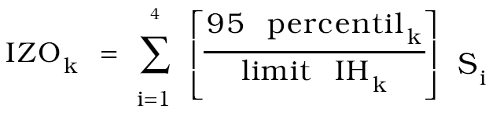
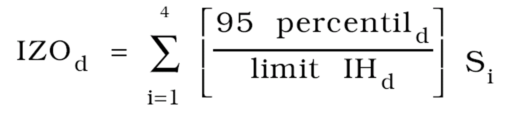

Príloha č. 1 vyhlášky č. 112/1993 Z. z.

- Index znečistenia ovzdušia a výpočet imisných hodnôt znečisťujúcich látok A. Index znečistenia ovzdušia

- 1. Na zistenie zaťaženia územia sa zavádza index znečistenia ovzdušia (IZO), ktorý berie do úvahy spravidla štyri, najmenej však tri znečisťujúce látky (S1 až S4), ktoré majú stanovený imisný limit.

- 2. Rozlišujú sa tri spôsoby vyjadrenia IZO:

- - index dlhodobého znečistenia IZOr

- - index krátkodobého znečistenia IZOk

- - index denného znečistenia IZOd

- 3. Indexy uvedené v bode 2 sú definované takto:

- 

- 

- 

- 4. Na vyhodnotenie znečistenia ovzdušia (IZOr, IZOk, IZOd) platí nasledujúca tabuľka

- Rozpätie IZO | znečistenie ovzdušia

- 0,0-0,4 | takmer žiadne

- 0,5-0,9 | slabé

- 1,0-1,4 | mierne

- 1,5-2,0 | stredné

- nad 2,0 | veľké

- B. Výpočet imisných hodnôt (charakteristík) znečisťujúcich látok na hodnotenie kvality ovzdušia

- 1. Ustanovuje sa postup a podmienky výpočtu IHk - priemernej polhodinovej koncentrácie, IH8h - priemernej osemhodinovej koncentrácie, IHd - priemernej dennej koncentrácie a IHr - priemernej ročnej koncentrácie znečisťujúcich látok v ovzduší. Výpočet imisných hodnôt (charakteristík) sa týka súboru verifikovaných dát získaných kontinuálnymi alebo diskontinuálnymi meracími postupmi.

- 2. Pri kontinuálnom postupe merania na zistenie IHktreba mať každých 30 sekúnd na integráciu aspoň jednu okamžitú hodnotu. Ak na výpočet IHkbolo použitých minimálne 90 % okamžitých hodnôt, je zistená hodnota platná. Pokiaľ je k dispozícii 50 až 90 % okamžitých hodnôt, je táto IHkoznačená, v ďalšom postupe spracovania verifikovaná a buď zahrnutá medzi platné, alebo zamietnutá. výpočet IHkz menej ako 50 % okamžitých hodnôt je neprípustný.

- 3. Pri diskontinuálnych postupoch merania pri nepretržitom odbere vzorky je na získanie IHk, IH8ha IHdnevyhnutná doba odberu najmenej 75 % a najviac 125 % celkovej doby.

- 4. Na výpočet IH8hmusí byť k dispozícii minimálne 8 platných IHka na výpočet IHd24 platných IHkrovnomerne rozložených v celom časovom úseku. Na výpočet IHrmusí byť k dispozícii aspoň 30 platných IHdza štvrťrok, resp. 120 platných IHdza rok. IHrstanovené z menšieho počtu hodnôt ako 30 za štvrťrok sa označia /*.

- Na výpočet imisných hodnôt (charakteristík) sa používajú len verifikované platné údaje. V prípade zaokrúhľovania sa postupuje podľa ČSN 01 1010.

- Všetky priemerné hodnoty sa počítajú ako aritmetické priemery.

- 5. Pri porovnávaní nameraných alebo vypočítaných imisných hodnôt (charakteristík) so zodpovedajúcimi imisnými limitmi musí byť chyba imisných hodnôt (charakteristík) v súlade s požadovanou spoľahlivosťou výpovede. Ak má byť imisná hodnota (charakteristika) významne väčšia ako zodpovedajúci imisný limit, musí byť rozdiel imisnej hodnoty (charakteristiky) a zodpovedajúceho limitu štatisticky významne väčší ako chyba stanovenia imisnej hodnoty (charakteristiky).

- Imisný limit slúži na posúdenie všeobecného stavu ovzdušia, predovšetkým z hygienického hľadiska. Vzhľadom na neurčitosť a šírku rozptylu vzťahu dávka - účinok, na základe ktorého sa odvodzujú imisné hodnoty, nie je požiadavka na štatistickú významnosť rozdielu zdôvodniteľná a platí, že imisný limit je prekročený, ak je charakteristická veličina väčšia ako imisný limit.
