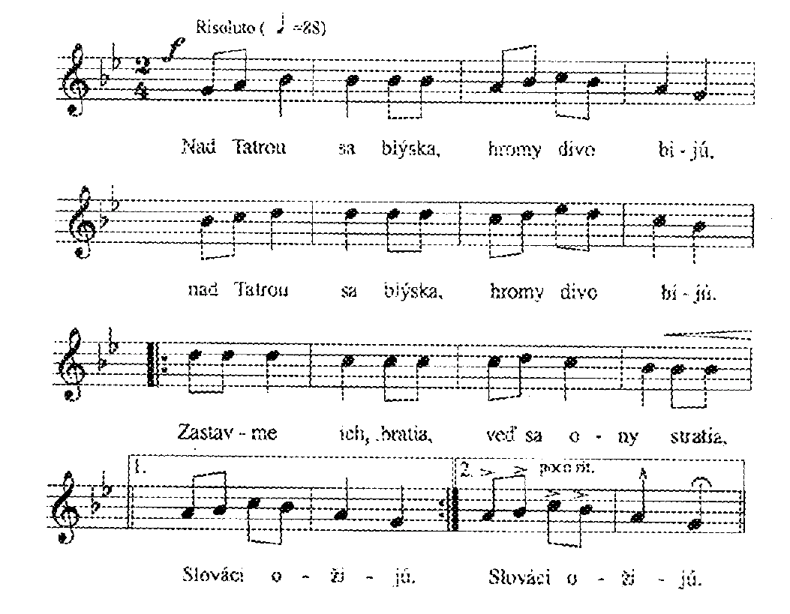

Príloha č. 5

- NAD TATROU SA BLÝSKA

- Text: Janko Matúška

- Nad Tatrou sa blýska, hromy divo bijú.

- Zastavme ich, bratia,

- veď sa ony stratia,

- Slováci ožijú.

- To Slovensko naše posiaľ tvrdo spalo

- ale blesky hromu

- vzbudzujú ho k tomu,

- aby sa prebralo.
