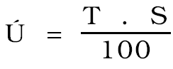
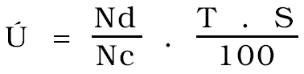

Príloha č. 1 nariadenia vlády Slovenskej republiky č. 155/1994 Z. z. SPÔSOB VÝPOČTU ÚHRADY ZA VYDOBYTÉ NERASTY VÝHRADNÉHO LOŽISKA

A. Spôsob výpočtu úhrady za vydobyté nerasty podľa § 3 ods. 1 nariadenia vlády:

Ú – úhrada za vydobyté nerasty (tis. Sk),

T – celkové tržby za vydobyté nerasty (tis. Sk),

S – sadzba úhrady (%).

B. Spôsob výpočtu úhrady za vydobyté nerasty podľa § 3 ods. 2 nariadenia vlády:

Ú – úhrada za vydobyté nerasty (tis. Sk),

Nd – náklady na dobývanie (tis. Sk),

Nc – celkové náklady na výrobky vyrobené z vydobytých nerastov (tis. Sk),

T – celkové tržby za vydobyté nerasty (tis. Sk),

S – sadzba úhrady (%).

Príloha č. 2 nariadenia vlády Slovenskej republiky č. 155/1994 Z. z.

VÝŠKA SADZBY ÚHRADY ZA VYDOBYTÉ NERASTY PODĽA DRUHOV NERASTOV

Druh nerastu | | Sadzba v %

a) | rádioaktívne nerasty | 10

b) | nerasty, z ktorých možno priemyselne vyrábať kovy s výnimkou rúd zlata a striebra | 2

c) | rudy zlata a striebra | 5

d) | magnezit | 3

e) | lignit a uhlie | 2

f) | ropa a horľavý zemný plyn | 5

g) | kamenná soľ, draselné, borové, brómové a jódové soli | 5

h) | nerasty, z ktorých možno priemyselne vyrábať fosfor, síru, fluór alebo ich zlúčeniny | 4

i) | tuha, azbest, sľuda, diatomit, minerálne farbivá, bentonit | 3

j) | baryt, mastenec | 4

k) | sklársky a zlievárenský piesok | 6

l) | kremeň, kremenec, vápenec, dolomit, slieň, čadič, znelec, trachyt, pokiaľ sú tieto nerasty vhodné na chemickotechnologické spracovanie alebo spracovanie tavením | 6

m) | granit, granodiorit, diorit, gabro, diabas, hadec, dolomit, vápenec, pokiaľ sú blokovo dobývateľné a leštiteľné, a travertín | 7

n) | technicky použiteľné kryštály nerastov a drahé kamene | 8

o) | nerasty, z ktorých možno priemyselne vyrábať prvky vzácnych zemín a prvky s vlastnosťou polovodičov | 6

p) | halloyzit, sadrovec, anhydrit, perlit, zeolit | 4

r) | keramické a žiaruvzdorné íly a ílovce | 4

s) | kaolín | 6

t) | živcové pegmatity | 2

u) | mineralizované vody, z ktorých možno priemyselne získať vyhradené nerasty | 4

v) | technicky využiteľné prírodné plyny, pokiaľ nepatria k plynom uvedeným pod písmenom f) | 5

| Nevyhradené nerasty výhradných ložísk (§ 32a ods. 9 banského zákona v znení zákona Slovenskej národnej rady č. 498/1991 Zb.) |

w) | štrkopiesky a piesky | 0,5

x) | kamenivo | 0,3

y) | tehliarske hliny, hliny, ílovce a ostatné korekčné nerasty na výrobu cementu | 0,4

z) | nerasty na výrobu abrazív | 1
