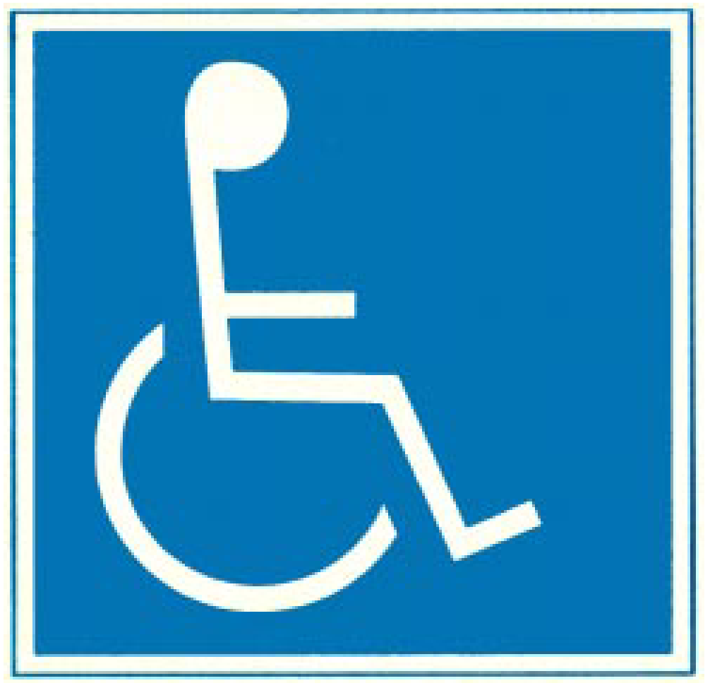
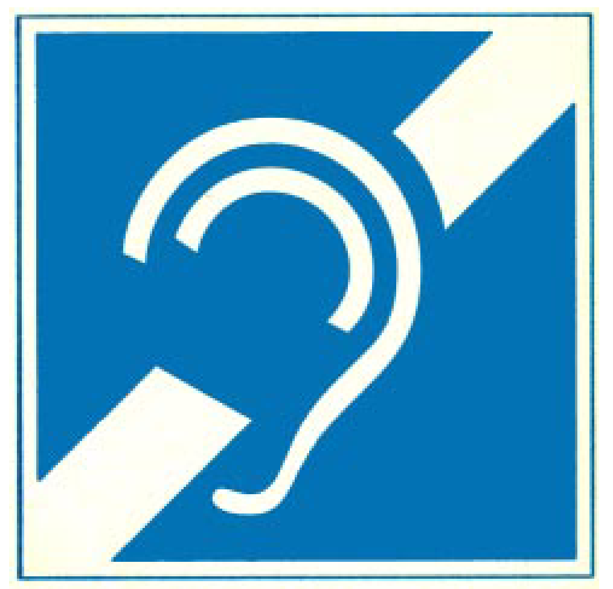

Príloha vyhlášky Ministerstva životného prostredia Slovenskej republiky č. 192/1994 Z. z.

VŠEOBECNÉ TECHNICKÉ POŽIADAVKY ZABEZPEČUJÚCE UŽÍVANIE STAVIEB OSOBAMI S OBMEDZENOU SCHOPNOSŤOU POHYBU

1. Komunikácie9)

1.1. Úprava povrchov

1.1.1. Povrch chodníkov, schodísk a rámp musí byť upravený proti šmyku.

1.1.2. Priechody musia mať zníženie obrubníkov výrazne vyznačené odlišnou štruktúrou a povahou povrchu v minimálnej šírke 300 mm.

1.1.3. Šírka priechodu musí byť najmenej 1 300 mm.

1.1.4. Sklony šikmých rovín musia spĺňať požiadavky na rampy (bod 1. 3.).

1.2. Výškové rozdiely

Výškové rozdiely pri priechodoch a vodorovných vnútorných komunikáciách musia byť znížené na 20 mm.

1.3. Schodiská a rampy vrátane schodísk a rámp v podchodoch

1.3.1. Schodiskové ramená a rampy musia byť po oboch stranách vybavené držadlami vo výške 900 mm. Odporúča sa vybudovať držadlá aj vo výške 750 mm.

1.3.2. Držadlá (madlá) musia presahovať prvý a posledný schod o 300 mm.

1.3.3. Tvar madla musí umožňovať pevné uchopenie rukou.

1.3.4. Schodiskové ramená musia byť priame.

1.3.5. Nástupná hrana schodiskových stupňov nesmie prečnievať cez podstupnicu.

1.3.6. Schodiská so stupňami bez podstupníc (horizontálne priehľadné stupne) sa nesmú navrhovať.

1.3.7. Prvý a posledný stupeň každého schodiskového ramena musí byť výrazne farebne a povrchovou úpravou rozoznateľný od okolia (napríklad reliéfnou dlažbou).

1.3.8. Schodiská a rampy vysunuté do priestoru musia byť upravené podľa bodu 1. 4. 4. tak, aby sa zabránilo možnosti vstupu zrakovo postihnutých osôb do priestoru s nižšou výškou ako 2 200 mm.

1.3.9. Rampy musia byť široké najmenej 1 300 mm a ich pozdĺžny sklon smie byť najviac 1:12.

1.3.10. Ak rampa nie je dlhšia ako 3 000 mm, smie mať výnimočne sklon najviac 1:8 [neplatí pri stavbách podľa § 2 ods. 1 písm. b) a d)].

1.3.11. Rampa musí mať po oboch stranách vodiacu tyč vo výške 300 mm.

1.3.12. Rampa dlhšia ako 9 000 mm musí byť prerušená odpočívadlami v dĺžke najmenej 2 000 mm.

1.3.13. Prechod rampy na chodník musí byť plynulý.

1.4. Chodníky

1.4.1. Chodníky musia byť široké najmenej 1 300 mm a môžu mať pozdĺžny sklon najviac 1:12 a priečny sklon najviac 1:50.

1.4.2. Na úsekoch dlhších ako 200 m musia byť vybudované odpočívadlá s pozdĺžnym a priečnym sklonom najviac 1:50.

1.4.3. Nad chodníkom, v priestore od 450 mm do 2 200 mm, nesmú byť umiestnené žiadne predmety a konštrukcie, ktoré by mohli ohroziť bezpečnosť zrakovo postihnutých osôb.

1.4.4. Komunikácie pre peších musia byť zabezpečené dôsledne dodržanou vodiacou líniou pre zrakovo postihnuté osoby a nesmú byť na nich umiestňované prekážky trvalého ani prechodného charakteru.

1.5. Priechody

1.5.1. Všetky priechody musia zabezpečovať plynulý prechod z pešej plochy na komunikáciu so sklonom maximálne 1:8, so zvislým prevýšením najviac 20 mm.

1.5.2. Priechody, kde je častejšia frekvencia občanov so zníženou schopnosťou pohybu (napríklad stavby občianskeho vybavenia), musia byť vybavené samoobslužným svetelným signalizačným zariadením s upravenou dĺžkou intervalu.

1.5.3. Priechody vybavené priechodovou signalizáciou musia byť vybavené aj zvukovou signalizáciou. Ovládanie signalizačných zariadení musí byť umiestnené vo výške 900 mm až 1 200 mm.

1.5.4. Nástupištia hromadnej dopravy musia mať pri svojom okraji úpravy pre nevidiacich a slabozrakých, ktoré sú vnímateľné zvyškom zraku (kontrast), nášľapom a slepeckou palicou. Úpravy sú závislé od druhu dopravného prostriedku

a) na nástupištiach autobusovej a električkovej dopravy pruh so šírkou 400 mm, vo vzdialenosti 500 mm od hrany nástupišťa,

b) na nástupištiach železničnej dopravy pruh so šírkou 400 mm, vo vzdialenosti 800 mm od hrany nástupišťa,

c) nástupištia metra musia spĺňať podmienky ako pri železničnej doprave. Doprava invalidného vozíka musí byť zabezpečená výťahom. Podrobnejšie podmienky upraví osobitný predpis.

1.5.5. Stavby občianskej vybavenosti musia byť vybavené vodiacimi líniami pre nevidiacich a slabozrakých.

1.6. Vstupy do objektov

1.6.1. Pred vstupom do objektu musí byť vodorovná plocha najmenej 1 500 mm x 1 500 mm, pri otváraní dverí smerom von najmenej 1 500 mm x 2 000 mm,

1.6.2. Vstupné dvere musia umožňovať otvorenie najmenej na šírku 900 mm. Môžu byť zasklené od výšky 400 mm alebo musia byť zasklené nerozbitným sklom (tvrdeným, s drôtenou vložkou a podobne).

1.6.3. Zámka dverí musí byť umiestnená vo výške najviac 1 000 mm, kľučka alebo držadlo vo výške najviac 1 100 mm.

1.6.4. Horná hrana zvončekového panela nesmie byť vyššie ako 1 400 mm.

1.6.5. Vstup musí byť osvetlený tak, aby nevznikol náhly a veľký kontrast medzi vonkajším a vnútorným osvetlením.

1.6.6. Stavby občianskej vybavenosti a stavby verejných budov musia mať zabudovaný akustický maják. Akustické navádzacie systémy v týchto stavbách je potrebné navrhovať na základe stanoviska príslušného orgánu pre nevidiacich a slabozrakých.

1.7. Výťahy

1.7.1. Pred vstupnými dverami výťahu musí byť voľný priestor najmenej 1 400 mm x 1 400 mm.

1.7.2. Vstupné dvere výťahu a výťahovej kabíny musia mať šírku najmenej 800 mm.

1.7.3. Šírka výťahovej kabíny musí byť najmenej 1 100 mm. Hĺbka výťahovej kabíny musí byť najmenej 1 400 mm.

1.7.4. Kabína výťahu musí byť vybavená

a) telefónnym alebo signálnym zariadením umiestneným najviac 1 200 mm nad podlahou,

b) sklopným malým sedadlom umiestneným v blízkosti ovládacieho panela,

c) ovládacím zariadením vo výške najviac 1 200 mm.

1.7.5. Podlaha kabíny musí byť rovná, nesmie byť textilná a musí mať protišmykovú úpravu.

1.7.6. Kabína výťahu musí mať na vnútornom obvode madlo vo výške 750 mm a 900 mm.

1.7.7. Kabína výťahu nesmie mať ručne otváracie dvere.

1.7.8. Ovládacie zariadenia musia byť čitateľné hmatom aspoň na vstupné podlažie, v stavbách občianskeho vybavenia na všetky podlažia.

1.7.9. Chodbové privolávače výťahu musia byť umiestnené vo výške 900 mm až 1 200 mm.

1.7.10. Po zastavení výťahu môže byť výškový rozdiel medzi podlahou výťahovej kabíny a podlahou chodby maximálne 20 mm.

1.7.11. Príjazd privolanej kabíny musí oznamovať zvukový signál.

2. Vnútorné priestory9)

2.1. Okná

2.1.1. Parapety v obytných miestnostiach nesmú byť vyššie ako 700 mm nad podlahou.

2.1.2. Okná v obytných miestnostiach musia byť otváracie.

2.1.3. Otvárací a ovládací mechanizmus okna musí byť vzdialený od podlahy minimálne 900 mm a maximálne 1 200 mm. V okennom otvore musí byť z vonkajšej strany ochranná tyč vo výške 1 100 mm nad úrovňou podlahy.

2.1.4. Okná a presklené steny s parapetom nižším ako 500 mm musia mať spodnú časť do výšky 400 mm chránenú ochranným plechom, mriežkou alebo iným podobným spôsobom. Vo výške 1 400 mm až 1 600 mm musia mať výrazný pás so šírkou najmenej 50 mm alebo pruh zo značiek s rozmermi 50 mm x 50 mm, vzdialenými od seba najviac 150 mm, zreteľne viditeľný oproti pozadiu. Vo výške 1 100 mm nad úrovňou podlahy musia byť zabezpečené ochrannou tyčou.

2.2. Dvere

2.2.1. Dvere musia mať svetlú šírku najmenej 800 mm.

2.2.2. Prahy môžu byť vysoké najviac 20 mm. Môžu byť oblé alebo so zaoblenými hranami.

2.2.3. Sklenené alebo presklené dvere, ktorých zasklenie zasahuje nižšie ako 800 mm nad podlahu, musia byť vo výške 1 400 mm až 1 600 mm označené výrazným pásom širokým najmenej 50 mm alebo pruhom zo značiek s rozmermi 50 mm x 50 mm vzdialenými od seba najviac 150 mm, zreteľne viditeľným oproti pozadiu. Spodná časť dverí musí byť upravená podobne ako presklené steny podľa bodu 2.1.4.

2.2.4. Farba dverí musí kontrastovať s farbou stien.

2.2.5. Dvere v stavbách občianskeho vybavenia podľa § 3 písm. a), b), d), e), f) a h) musia byť označené arabskými číslicami. Dvere zdravotechnických zariadení musia byť označené aj písmenami. Výška číslic alebo písmen je 100 mm, majú kontrastné a reliéfne vyhotovenie hrúbky 10 mm. Umiestnené sú vo výške 1 400 mm až 1 600 mm nad podlahou.

2.2.6. V prípade kríženia komunikačných osí chodieb musia byť v mieste najbližšom oproti vstupu umiestnené vyhovujúco osvetlené a vyhotovené podľa bodu 2.2.5. najmenšie a najväčšie čísla miestností so smerovým označením.

2.3. Zdravotnotechnické zariadenia

2.3.1. Záchodové kabíny navrhované pre osoby na vozíku musia mať najmenšie pôdorysné rozmery 1 400 mm x 1 800 mm. Výška hornej hrany záchodovej misy meraná od podlahy môže byť najviac 500 mm, záchodová misa musí byť jednostranne osadená najmenej 270 mm od bočnej steny, splachovacie zariadenie musí byť v dosahu osoby na vozíku, najviac však 1 200 mm nad podlahou. Na stene musia byť sklopné opierky. Dvere záchodovej kabíny sa musia otvárať smerom von a musia byť umiestnené oproti manipulačnej ploche.

2.3.2. Z jednej strany záchodovej misy musí byť 800 mm široká manipulačná plocha so zabezpečeným voľným príjazdom pre vozík.

2.3.3. V záchodovej kabíne musí byť umiestnený vešiak na odevy vo výške 1 200 mm a toaletný papier v dosahu zo záchodovej misy.

2.4. Manipulačné priestory a plochy

2.4.1. Najmenší manévrovací priestor pre vozík má rozmery 1 200 mm x 1 500 mm.

2.4.2. Miesto pre vozík v hľadisku musí mať pôdorysné rozmery najmenej 1 000 mm x 1 200 mm, musí byť na rovnej podlahe a prístupné zozadu.

2.4.3. Na vyhradených miestach stavieb občianskeho vybavenia [§ 3 písm. a), d)] a stavieb dopravy (hál, čakární, nástupíšť) mimo mestskej hromadnej dopravy musia byť určené miesta vybavené indukčnou slučkou pre osoby s chybami sluchu. Tieto miesta musia byť označené medzinárodným symbolom hluchoty.

2.4.4. Šírka stojísk v garážach a na parkoviskách musí byť najmenej 3 500 mm.

2.4.5. Zodpovedajúca výška na umiestnenie vybavenia a manipulačného zariadenia v bytoch je 600 mm až 1 400 mm.

2.4.6. Výška na umiestnenie vybavenia a manipulačného zariadenia pri stavbách pre výrobu je 600 mm až 1 200 mm.

2.4.7. Chodby, ktoré vedú k priestorom určeným pre verejnosť, musia sa navrhovať na možný prejazd invalidného vozíka a jednej osoby. Najmenšia šírka chodby je

a) 1 500 mm pri stretnutí idúcej osoby s vozíkom,

b) 1 800 mm pri stretnutí dvoch vozíkov.

2.4.8. Prekážky na vnútorných komunikáciách musia byť zabezpečené vo výške 1 200 mm ochranou (zábradlím, oplotením) a podstavcom vysokým najmenej 100 mm tvoriacim zarážku pri poklepávaní slepeckou palicou.

2.5. Informačné zariadenia

2.5.1. Základné informačné zariadenia pre pohyb verejnosti v stavbách občianskeho vybavenia podľa § 3 písm. a), b), e), f), g) a h) musia mať kontrastné a vyhovujúco osvetlené nápisy s výškou písma najmenej 50 mm umiestnené vo výške 1 200 mm až 2 000 mm nad podlahou.

2.5.2. Základné informačné zariadenia musia byť doplnené alternatívnym riešením poskytovania informácií nevidiacim osobám (informátorom, akustickým alebo taktilným systémom, telefónnou informačnou službou a podobne) a optickými systémami pre sluchovo postihnuté osoby.

3. Verejné plochy

3.1. Parkoviská a odstavné plochy

Šírka stojísk na odstavných plochách pre vozidlá osôb s obmedzenou schopnosťou pohybu musí byť najmenej 3 500 mm a smie mať sklon najviac 1:20.

3.1.1. Miesta na parkovisku určenom pre autá osôb s obmedzenou schopnosťou pohybu musia byť so systémom verejných peších plôch spojené zošikmeným obrubníkom širokým najmenej 1 000 mm, so sklonom najviac 1:8.

3.2. Telefónny automat

3.2.1. Priestor na umiestnenie telefónneho automatu musí mať pôdorysné rozmery najmenej 1 100 mm x 1 400 mm a musí byť vybavený sklopným malým sedadlom vo výške najmenej 500 mm. Telefónna kabína s telefónnym automatom musí mať vstupné dvere široké najmenej 800 mm, ktoré sa otvárajú smerom von.

3.2.2. Výška na umiestnenie manipulačného zariadenia telefónneho automatu je 600 mm až 1 200 mm. Odporúčaná výška je 1 000 mm.

3.2.3. Prístup k verejným telefónnym automatom nesmie obmedzovať nijaká prekážka.

- 3.2.4. Vo všetkých priestoroch na umiestnenie verejných telefónnych automatov podľa § 5 ods. 3 vyhlášky musí byť umiestnený najmenej jeden prístroj pre nedoslýchavých označený medzinárodným symbolom hluchoty.

3.3. Poštové schránky

Poštové schránky musia mať otvor na vkladanie vo výške 1 100 mm až 1 200 mm.

4. Medzinárodný symbol prístupnosti

Medzinárodný symbol prístupnosti je štvorec modrej farby, na ktorom je vyobrazená bielou čiarou štylizovaná postava hľadiaca vpravo a sediaca na vozíku pre invalidov.

5. Medzinárodný symbol hluchoty

Medzinárodný symbol hluchoty je štvorec modrej farby, na ktorom je vyobrazená bielou čiarou štylizovaná ušnica, ktorá prerušuje diagonálu vedenú z horného pravého rohu štvorca.
