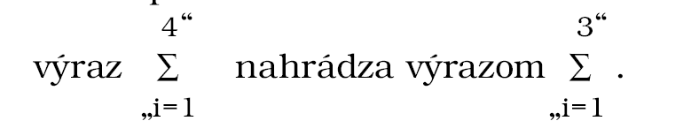

# Čl. I

Vyhláška Ministerstva životného prostredia Slovenskej republiky č. 112/1993 Z. z. o vymedzení oblastí vyžadujúcich osobitnú ochranu ovzdušia a o prevádzke smogových varovných a regulačných systémov sa mení a dopĺňa takto:

- 1. V § 3 písm. d) sa vypúšťajú slová „a najviac štyri“.

- 2. § 8 znie:

- 㤠8

- V oblastiach vyžadujúcich osobitnú ochranu ovzdušia môže príslušný orgán štátnej správy ochrany ovzdušia v súhlasoch vydávaných podľa § 4 ods. 1 písm. b), § 5 ods. 1 písm. a), c) a e) a § 6 písm. a) a f) zákona určiť podmienky ochrany ovzdušia v závislosti od imisnej koncentrácie znečisťujúcich látok v oblasti tak, aby bolo znečisťovanie čo možno najnižšie a aby boli v súlade s najnovšími možnosťami techniky.“.

- 3. V § 10 ods. 3 vrátane poznámky pod čiarou k odkazu 9) znie:

- „(3)

- Príslušný úrad životného prostredia9) na základe podkladov z ústavu vyhlási varovné a regulačné opatrenia signálom podľa odseku 1 písm. c), ak boli v dôsledku nepriaznivých rozptylových podmienok prekročené osobitné imisné limity10) ustanovené na vyhlásenie príslušného signálu upozornenia, prvého regulačného stupňa alebo druhého regulačného stupňa podľa prílohy č. 3 tejto vyhlášky a ak sa táto situácia predpovedá najmenej na osem nasledujúcich hodín.“.

- Poznámka pod čiarou k odkazu 9) znie:

- „9)

- § 4 ods. 1. písm. c) a § 5 ods. 2 písm. d) zákona Slovenskej národnej rady č. 134/1992 Zb. v znení zákona Národnej rady Slovenskej republiky č. 148/1994 Z. z.“.

- 4. V § 13 ods. 1 sa vypúšťa posledná veta a poznámka pod čiarou k odkazu 12) znie:

- „12)

- § 4 ods. 1 písm. c) zákona Slovenskej národnej rady č. 134/1992 Zb. v znení zákona Národnej rady Slovenskej republiky č. 148/1994 Z. z.“.

- 5. Za § 15 sa vkladá nový § 15a, ktorý vrátane nadpisu a poznámky pod čiarou k odkazu 19) znie:

- 㤠15a

- Ozónový smogový varovný systém

- (1)

- Pre prípady smogových situácií spôsobených zvýšenou koncentráciou ozónu sa vytvára ozónový smogový varovný systém, ktorý tvoria

- a)

- súbor informácií o znečistení ovzdušia ozónom získaný z údajov monitorovacej meracej siete,

- b)

- predpovede meteorologických podmienok a imisnej situácie,

- c)

- signály upozornenia a varovania.

- (2)

- Riadiacim strediskom ozónového smogového varovného systému je ústav, ktorý zabezpečuje získavanie, spracúvanie a vydávanie informácií, predpovedí a signálov podľa odseku 1.

- (3)

- Ústav vyhlási signály upozornenia a varovania podľa odseku 1 písm. c) prostredníctvom verejných oznamovacích prostriedkov,19) ak boli v dôsledku nepriaznivých meteorologických podmienok prekročené osobitné imisné limity10) ozónu ustanovené v prílohe č. 3 tejto vyhlášky a ak sa táto situácia predpovedá najmenej na 24 nasledujúcich hodín.

- (4)

- Ústav odvolá signály upozornenia a varovania podľa odseku 1 písm. c) prostredníctvom verejných oznamovacích prostriedkov,19) ak počas najmenej 24 hodín nebol osobitný imisný limit ozónu prekročený a ak sa nepredpovedá zhoršenie meteorologických podmienok.

- (5)

- V čase trvania ozónovej smogovej situácie ústav denne poskytuje masovokomunikačným prostriedkom informácie o úrovni nameraných koncentrácií a predpovedí imisnej situácie.“.

- Poznámka pod čiarou k odkazu 19) znie:

- „19)

- Napríklad § 4 ods. 2 zákona Slovenskej národnej rady č. 254/1991 Zb. o Slovenskej televízii, § 5 ods. 4 zákona Slovenskej národnej rady č. 255/1991 Zb. o Slovenskom rozhlase.“.

- 6. V prílohe č. 1 v časti A bod 1 znie:

- „1.

- Na zistenie zaťaženia územia sa zavádza index znečistenia ovzdušia (IZO), ktorý berie do úvahy tri znečisťujúce látky (S1až S3) s ustanoveným imisným limitom. V prípade monitorovania širšieho spektra škodlivín sa na určenie IZO berie do úvahy kombinácia tých látok, ktoré dávajú najvyššiu hodnotu IZO.“.

- 7. V prílohe č. 1 v časti A bode 3 sa

- 

- 8. V prílohe č. 1 v časti B bode 1 sa za slovo „polhodinovej“ vkladajú slová „alebo hodinovej“.

- 9. V prílohe č. 1 časť B sa dopĺňa bodom 6, ktorý znie:

- „6.

- 95 percentil na výpočet indexu krátkodobého alebo denného znečistenia sa vypočíta na základe platných hodnôt nameraných počas príslušného roka takto:

- a)

- namerané platné hodnoty sa zaokrúhľujú na celé čísla podľa STN 01 1010,

- b)

- všetky platné hodnoty sa zoradia vo vzostupnom poradí

- x1, x2, x3.......xk.....xn-1, xn,

- c)

- 95 percentil je tá platná hodnota xk, ktorá prislúcha k-temu poradiu vypočítanému podľa vzorca

- k = 0,95 x n,

- kde n je počet nameraných platných hodnôt. Hodnota k sa zaokrúhľuje na celé číslo podľa STN 01 1010.“.

- 10. Názov prílohy č. 3 znie:

- „Osobitné imisné limity na účely vyhlásenia signálov upozornenie, varovanie a regulácie“.

- 11. V prílohe č. 3 časť A sa dopĺňa bodom 3, ktorý znie:

- „3.

- hodinového priemeru koncentrácie ozónu 180 µg.m-3“.

- 12. Príloha č. 3 sa dopĺňa časťou D, ktorá znie:

- „D.

- Signál „varovanie“ nasleduje po prekročení:

- hodinového priemeru koncentrácie ozónu 360 µg.m-3“.
