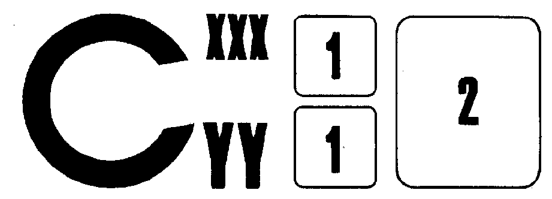
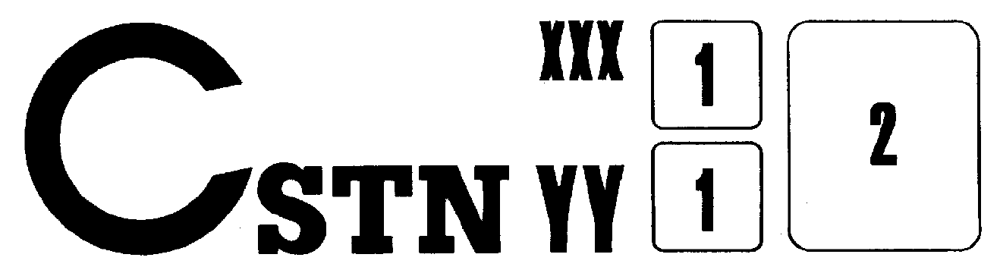
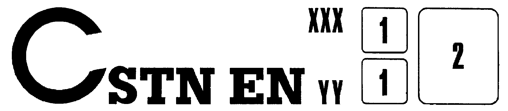

Príloha vyhlášky Úradu pre normalizáciu, metrológiu a skúšobníctvo Slovenskej republiky č. 246/1995 Z. z. 

- Slovenská všeobecná certifikačná značka s identifikačným údajom certifikačnej značky a ďalšími údajmi.

- Slovenská certifikačná značka zhody so slovenskou technickou normou s identifikačným údajom certifikačnej značky a ďalšími údajmi.

- Slovenská certifikačná značka európskej zhody s identifikačným údajom certifikačnej značky a ďalšími údajmi.

Legenda

- a) Identifikačný údaj certifikačnej značky:

  - XXX – trojciferné číslo štátnej skúšobne,

  - YY – posledné dvojciferné číslo roku vydania certifikátu.

- b) Ďalšie údaje:

  - 1 – grafické symboly – piktogramy,

  - 2 – ochranná známka štátnej skúšobne.
