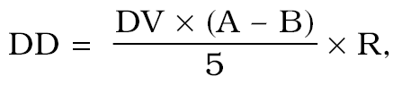

Príloha k zákonu Národnej rady Slovenskej republiky č. 289/1995 Z. z. v znení neskorších predpisov Postup pri úprave odpočítanej dane pri investičnom majetku

Pri úprave dane podľa § 21a postupuje platiteľ podľa vzorca

kde

DD je výsledok úpravy odpočítanej dane, ktorý v prípade záporného znamienka predstavuje dodatočne odpočítateľnú daň a v prípade kladného znamienka predstavuje dodatočne neodpočítateľnú daň,

DV je

a) daň na vstupe vzťahujúca sa na cenu obstarania investičného majetku (§ 21a ods. 4) alebo

b) súčet súm dane na vstupe vzťahujúcej sa na všetky prijaté zdaniteľné plnenia, ktoré sú súčasťou obstarávacej ceny stavby (§ 21a ods. 5), alebo

c) súčet súm dane na vstupe vzťahujúcej sa na prijaté stavebné práce, ktoré sú technickým zhodnotením stavby alebo nehnuteľnosti (§ 21a ods. 6),

A je číslo, ktoré predstavuje koeficient, ktorý bol platiteľ povinný použiť pri investičnom majetku po skončení kalendárneho roka, v ktorom odpočítal daň (§ 21 ods. 5); ak platiteľ odpočítal daň v plnej výške, uvedie číslo 1 (§ 20 ods. 1); ak platiteľ neodpočítal daň, uvedie číslo 0 (§ 20 ods. 2),

B je číslo, ktoré predstavuje koeficient vypočítaný po skončení kalendárneho roka, v ktorom platiteľ zmenil účel použitia investičného majetku, alebo číslo 0 alebo číslo 1, a to podľa zmeny účelu použitia podľa § 21a ods. 1,

R je počet kalendárnych rokov, ktoré zostávajú do skončenia obdobia piatich rokov od odpočítania dane vrátane roka, v ktorom došlo k zmene účelu použitia investičného majetku.
