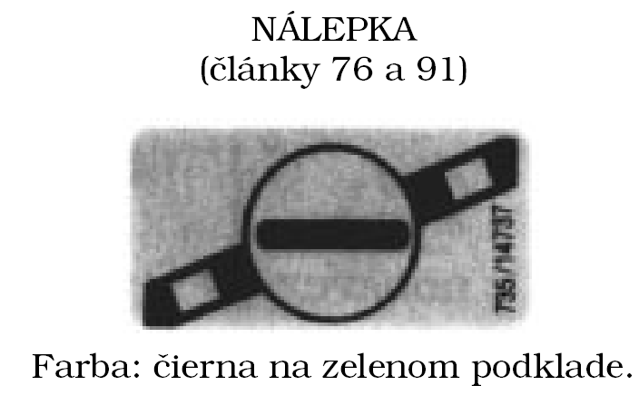
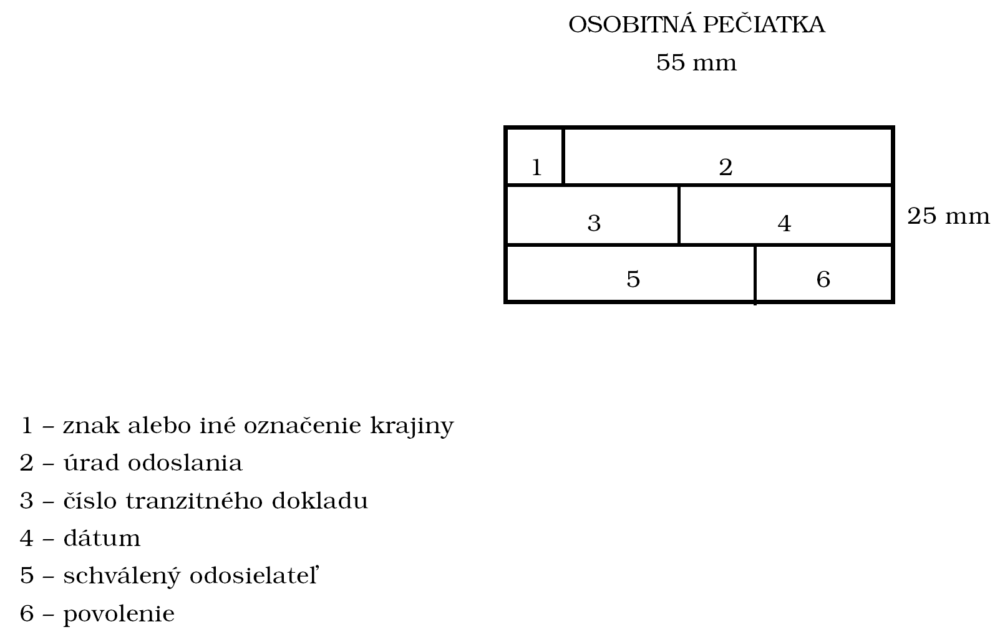

- PRÍLOHA II

- ČASŤ I VŠEOBECNÉ USTANOVENIA

  - Článok 1

    - Táto príloha stanovuje vykonávacie predpisy dohovoru a prílohy I dohovoru.

- ČASŤ II

  - Článok 2

    - (Táto príloha neobsahuje článok 2.)

- ČASŤ III ŠTATÚT TOVARU SPOLOČENSTVA

  - KAPITOLA I VŠEOBECNÉ USTANOVENIA

    - Článok 3

      - Dôkaz o štatúte tovaru Spoločenstva, ktorý nie je prepravovaný v režime T2, sa podáva na jednom z dokladov uvedených v kapitole II alebo kapitole III tejto časti.

    - Rozsah platnosti

      - Článok 4

        - (1) Doklady alebo formality uvedené v článkoch 6 až 11 nesmú sa použiť, prípadne vyplniť na tovar,

          - a) ktorý je určený na vývoz z územia zmluvných strán, alebo

          - b) ktorý je zabalený v obaloch, ktoré nemajú štatút Spoločenstva, alebo

          - c) ktorý sa prepravuje v režime medzinárodnej prepravy na podklade karnetu TIR; to neplatí, ak

          - - tovar, ktorý má byť vyložený v niektorej zmluvnej strane, je prepravovaný spoločne s tovarom určeným do tretej krajiny, alebo

          - - tovar je prepravovaný z územia jednej zmluvnej strany cez tretiu krajinu na územie druhej zmluvnej strany.

        - (2) Tranzitné doklady uvedené v kapitole II tejto časti možno vyhotoviť na poštové zásielky (vrátane balíkov), ktoré sú zasielané z poštového úradu na území jednej zmluvnej strany na poštový úrad na území druhej zmluvnej strany.

    - Podmienka priamej dopravy

      - Článok 5

        - Doklady alebo formality podľa článkov 6 až 11 môžu slúžiť ako dôkaz o štatúte tovaru Spoločenstva, ak sa tento tovar prepravuje priamo z územia jednej zmluvnej strany na územie druhej zmluvnej strany.

        - Za priamo prepravovaný tovar z územia jednej zmluvnej strany na územie druhej zmluvnej strany sa považuje

        - a) tovar, ktorý počas prepravy nevstúpi na územie tretej krajiny,

        - b) tovar, ktorý pri preprave vstúpi na územie jednej tretej krajiny alebo na územie viacerých tretích krajín s podmienkou, že preprava cez tieto územia sa uskutočňuje na jeden prepravný doklad vyhotovený v jednej zo zmluvných strán.

  - KAPITOLA II POUŽITIE DOKLADOV

    - Článok 6

      - Dôkaz o štatúte tovaru Spoločenstva sa podáva predložením tranzitného dokladu T2L za ďalej uvedených podmienok.

    - Článok 7

      - (1) Tranzitný doklad T2L sa vyhotovuje na tlačive, ktoré zodpovedá výtlačku č. 4 tlačiva, ktorého vzor je uvedený v dodatku I prílohy III, alebo výtlačku č. 4/5 tlačiva, ktorého vzor je uvedený v dodatku II tej istej prílohy.

      - Uvedené tlačivo sa podľa potreby doplní jedným alebo viacerými tlačivami, ktoré zodpovedajú výtlačku č. 4 alebo č. 4/5, ktorých vzor je uvedený v dodatkoch III a IV prílohy III.

      - V prípadoch, keď sa na vyhotovenie vyhlásenia používa výpočtová technika a nepoužijú sa doplnkové tlačivá uvedené v dodatkoch III a IV prílohy III, doklad T2L sa doplní jedným alebo viacerými výtlačkami č. 4 alebo č. 4/5 vzoru tlačiva uvedeného v dodatkoch I a II prílohy III.

      - (2) V pravej časti odseku 1 tlačiva uvedie deklarant skratku „T2L“, prípadne skratku „T2L bis“ v pravej časti odseku 1 použitého doplnkového tlačiva alebo tlačív.

      - (3) Ak sa vyhotovuje tranzitný doklad T2L na zásielku, ktorá obsahuje viac ako jeden druh tovaru, môžu byť údaje o tovare uvedené na jednom alebo na viacerých ložných listoch podľa článku 17 odseku 2 a článkov 23 až 26 namiesto vyplnenia odsekov 31 „Nákladové kusy a popis tovaru“, 32 „Číslo položky“, 35 „Hrubá hmotnosť (kg)“, prípadne 33 „Kód tovaru“, 38 „Vlastná hmotnosť (kg), 44 „Osobitné poznámky/predložené doklady/ /osvedčenia a povolenia" na tlačive použitom na vyhotovenie tranzitného dokladu T2L.

      - Ak sa použijú ložné listy, uvedené odseky na tlačive použitom na vyhotovenie tranzitného dokladu T2L sa musia prečiarknuť.

      - (4) Horná časť odseku uvedeného v článku 24 písmene b) je určená na zapísanie skratky „T2L", spodná časť je určená na zápis príslušného úradu, ako je stanovené v článku 8 odseku 2 písmene b).

      - Stĺpec „krajina odoslania/vývozu" na ložnom liste sa nemusí vyplniť.

      - (5) Ložný list sa musí predložiť v rovnakom počte priepisov ako tranzitný doklad T2L, ku ktorému patrí.

      - (6) Ak k jednému tranzitnému dokladu T2L bude priložených viac ložných listov, musí ich deklarant označiť poradovými číslami; počet priložených ložných listov sa zapíše do odseku 4 „Ložné listy" na tlačive použitom na vyhotovenie tranzitného dokladu T2L.

    - Článok 8

      - (1) Bez dotknutia článku 123 sa tranzitný doklad T2L predkladá v jednom vyhotovení.

      - (2) Na žiadosť deklaranta príslušné úrady krajiny odoslania potvrdia tranzitný doklad T2L, prípadne doplnkové tlačivá T2L bis svojím zápisom. Zápis, ktorý sa uvádza podľa možnosti do odseku C (Colnica odoslania), musí obsahovať tieto údaje:

        - a) v tranzitnom doklade T2L názov a pečiatku úradu odoslania, podpis príslušného úradníka, dátum zápisu a číslo zápisu alebo vyhlásenia na tranzit alebo vývoz, ak sa vyžaduje,

        - b) v doplnkovom doklade T2L bis číslo, ktoré je uvedené v tranzitnom doklade T2L. Toto číslo sa uvedie pečiatkou, ktorá obsahuje aj názov úradu krajiny odoslania, alebo rukou. V druhom prípade sa pripojí aj odtlačok služobnej pečiatky úradu.

        - Tieto doklady sa odovzdajú deklarantovi, ak sú splnené všetky formality na prepravu tovaru do krajiny určenia.

    - Článok 9

      - (1) Bez dotknutia ustanovení článkov 6 až 8 dôkaz o štatúte tovaru Spoločenstva sa môže podať na predloženej faktúre alebo prepravnom doklade za podmienok uvedených v tomto článku.

      - (2) Na faktúre alebo prepravnom doklade podľa odseku 1 musí byť uvedené minimálne meno a úplná adresa odosielateľa/vývozcu alebo deklaranta, ak deklarant nie je odosielateľom/vývozcom, počet, druh, značky a čísla nákladových kusov, názov tovaru, ako aj hrubá hmotnosť v kilogramoch a prípadne čísla kontajnerov.

      - Deklarant musí zreteľne a viditeľným spôsobom zapísať do uvedeného dokladu skratku „T2L" a vlastnoručne sa podpísať.

      - (3) Ak sa na splnenie formalít použijú verejné alebo súkromné počítačové systémy, príslušné úrady na základe žiadosti povolia, aby deklarant v odseku 2 požadovaný podpis nahradil iným porovnateľným spôsobom, ktorým môže byť uvedenie kódu, ktorý má také isté právne dôsledky ako vlastnoručný podpis.

      - Toto zjednodušenie sa povolí iba vtedy, ak sú splnené technické a administratívne požiadavky, ktoré vyžadujú príslušné úrady.

      - (4) Faktúru alebo prepravný doklad musí deklarant riadne vyplniť, podpísať a na požiadanie musí potvrdiť príslušný úrad krajiny odoslania. Toto potvrdenie musí obsahovať názov a pečiatku úradu odoslania, podpis príslušného úradníka, dátum zápisu a číslo zápisu alebo vyhlásenia na tranzit alebo vývoz, ak sa to vyžaduje.

      - (5) Tento článok sa uplatní len vtedy, ak na faktúre alebo prepravnom doklade je uvedený iba tovar Spoločenstva.

      - (6) V zmysle tohto dohovoru faktúra alebo prepravný doklad sa za doklad T2L považujú vtedy, ak sú splnené podmienky uvedené v odsekoch 2 až 5.

      - (7) Podľa ustanovenia článku 9 odseku 4 dohovoru môže príslušný úrad štátu EZVO na tovar, ktorý bol na colné územie dopravený na základe faktúry alebo prepravného dokladu slúžiaceho ako tranzitný doklad T2L, priložiť k tranzitnému dokladu T2 alebo T2L vyhotovenému na tovar overenú kópiu alebo fotokópiu tejto faktúry alebo prepravného dokladu.

    - Dodatočné vyhotovenie dokladov

      - Článok 10

        - Ak je doklad na tovar, ktorým sa preukazuje štatút Spoločenstva, vyhotovený dodatočne, zapíše sa v ňom červeným písmom jedna z týchto poznámok:

      - – Vystavené dodatočne

      - – Expedido a posteriori

      - – Udstedt efterfolgende

      - – Nachträglich ausgestellt

      - – Issued retroactively

      - – Délivré a posteriori

      - – Rilasciato a posteriori

      - – Achteraf afgegeven

      - – Emitido a posterioir

      - – Annettu jäklkikäteen

      - – Útgefió eftir á

      - – Utstedt i etterhand

      - – Utfärdat i efterhand

  - KAPITOLA III OSOBITNÉ FORMALITY PRI URČITÝCH TRANZITNÝCH SYSTÉMOCH ALEBO PRI URČITÝCH DRUHOCH TOVARU

    - Preprava na podklade karnetov TIR alebo ATA

      - Článok 11

        - (1) Pri preprave tovaru na podklade karnetu TIR len v prípade uvedenom v článku 4 odseku 1 písmene a) tejto prílohy alebo na podklade karnetu ATA môže deklarant bez dotknutia článkov 4 a 5 na preukázanie štatútu tovaru Spoločenstva zapísať zreteľne skratku „T2L" potvrdenú svojím podpisom do odsekov vyhradených na popis tovaru v príslušných častiach použitých karnetov pred ich predložením úradu odoslania na potvrdenie. Skratka „T2L" musí byť overená odtlačkom služobnej pečiatky úradu odoslania a podpisom príslušného úradníka na všetkých častiach, na ktorých bola uvedená.

        - (2) Ak sa prepravuje tovar zo Spoločenstva spolu s tovarom, ktorý nie je zo Spoločenstva, na podklade toho istého karnetu TIR alebo karnetu ATA, musia byť obidva druhy tovaru uvedené osobitne; skratka „T2L" sa zapíše tak, aby jednoznačne označovala tovar Spoločenstva.

      - Články 12 až 14

        - (Táto príloha neobsahuje články 12 až 14.)

        - Tovar prepravovaný cestujúcimi alebo v ich batožine

      - Článok 15

        - (1) Režim T1 alebo T2 nie je povinný pri preprave tovaru, ktorý vezú cestujúci alebo ho majú vo svojej cestovnej batožine a ak je to tovar, ktorý nemá obchodný charakter.

        - (2) Ak treba preukázať, že tovar, ktorý nemá obchodný charakter a prepravujú ho cestujúci alebo ho majú vo svojej batožine, má štatút Spoločenstva, považuje sa za tovar Spoločenstva,

          - a) ak sa pri deklarovaní vyhlási, že je to tovar Spoločenstva a nie sú pochybnosti o pravdivosti tohto vyhlásenia,

          - b) v iných prípadoch podľa ustanovení kapitol II a III tejto prílohy.

  - KAPITOLA IV VZÁJOMNÁ POMOC

    - Článok 16

      - Príslušné úrady krajín si navzájom poskytujú pomoc pri overovaní pravosti a správnosti dokladov, ako aj správnosti vyplnenia formalít, ktorými sa podľa kapitol II a III tejto časti preukazuje štatút tovaru Spoločenstva.

- ČASŤ IV PREDPISY REŽIMOV T1 A T2

  - KAPITOLA I REŽIM

    - Oddiel 1 Tlačivá

      - Článok 17

        - (1) Vyhlásenia T1 alebo T2 sa podávajú na tlačive podľa vzoru uvedeného v dodatkoch I až IV prílohy III.

        - Vyhlásenia sa vyhotovujú podľa pravidiel tohto dohovoru.

        - (2) Podľa článkov 25 až 29 sa môžu ložné listy podľa vzoru uvedeného v dodatku I tejto prílohy použiť ako popisná časť tranzitných vyhlásení. Ich použitím nie sú dotknuté povinnosti týkajúce sa formalít pri každom odoslaní/vývoze alebo každom režime v krajine určenia a používania tlačív.

    - Oddiel 2 Vyhlásenia T1 a T2

      - Úprava a použitie

        - Článok 18

          - (1) Ak má byť tovar prepravený v režime T1, zapíše hlavný zodpovedný v pravej časti odseku 1 použitého tlačiva skratku „T1". Pri použití doplnkových tlačív zapíše v pravej časti odseku 1 doplnkového tlačiva alebo tlačív skratku „T1 bis".

          - Ak sa na vyplňovanie vyhlásenia používa výpočtová technika a ako doplnkové tlačivo sa použije tlačivo podľa vzoru v dodatku I alebo II prílohy III, zapíše sa v pravej časti odseku 1 uvedeného tlačiva skratka „T1 bis".

          - (2) Ak má byť tovar prepravený v režime T2, zapíše hlavný zodpovedný v pravej časti odseku 1 použitého tlačiva skratku „T2". Pri použití doplnkových tlačív zapíše v pravej časti odseku 1 doplnkového tlačiva alebo tlačív skratku „T2 bis".

          - Ak sa na vyplňovanie vyhlásenia používa výpočtová technika a ako doplnkové tlačivo sa použije tlačivo podľa vzoru v dodatku I alebo II prílohy III, zapíše sa v pravej časti odseku 1 uvedeného tlačiva skratka „T2 bis".

        - Zásielky v režime T1 a T2

          - Článok 19

            - (1) Ak zásielky obsahujú súčasne tovar, ktorý má byť prepravený v režime T1, a tovar, ktorý má byť prepravený v režime T2, môžu sa doplnkové tlačivá podľa vzorov uvedených v dodatkoch III a IV, prípadne v dodatkoch I a II prílohy III, ktoré majú označenie „T1 bis", prípadne „T2 bis", priložiť k tlačivu podľa vzorov uvedených v dodatkoch I a II prílohy III.

            - V takom prípade sa v pravej časti odseku 1 uvedeného tlačiva zapíše skratka „T". Voľný priestor za skratkou „T" sa prečiarkne; okrem toho treba prečiarknuť odseky 32 „Číslo položky", 33 „Kód tovaru", 35 „Hrubá hmotnosť (kg)", 38 „Vlastná hmotnosť (kg)" a 44 „Osobitné záznamy/predložené doklady/osvedčenia a povolenia". Poradové čísla doplnkových tlačív s označením „T1 bis" a „T2 bis" sa musia zapísať do odseku 31 „Nákladové kusy a popis tovaru" použitého tlačiva podľa vzorov uvedených v dodatkoch I a II prílohy III.

            - (2) Ak sa v pravej časti odseku 1 použitého tlačiva neuviedlo žiadne označenie uvedené v článku 18 alebo ak sa pri zásielkach, ktoré obsahujú súčasne tovar prepravovaný v režime T1 a tovar prepravovaný v režime T2, neprihliadlo na odsek 1 alebo článok 28, takto prepravovaný tovar sa považuje za tovar prepravovaný v režime T1.

        - Súčasné predkladanie vyhlásenia na vývoz/odoslanie a vyhlásenia na tranzit

          - Článok 20 Bez dotknutia opatrení týkajúcich sa zjednodušeného postupu musí sa jednotný doklad na vývoz alebo spätný vývoz tovaru alebo každý iný doklad s rovnakým účinkom predložiť úradu odoslania spolu s vyhlásením na režim tranzitu.

          - Bez dotknutia článku 7 odseku 3 dohovoru možno na tieto účely vyhlásenie na vývoz alebo spätný vývoz a vyhlásenie na režim tranzitu podať na jednom tlačive.

        - Podávanie vyhlásení T1 a T2

          - Článok 21

            - (1) Vyhlásenie sa musí podať príslušnému úradu v pracovnom čase.

            - Príslušný úrad môže na žiadosť deklaranta a na jeho náklady povoliť, aby sa vyhlásenie podalo aj po pracovnom čase.

            - (2) Rovnaké účinky má aj podanie vyhlásenia úradníkovi tohto úradu na inom mieste, ktoré bolo dohodnuté medzi príslušným úradom a deklarantom.

        - Kontrola tovaru

          - Článok 22

            - (1) Kontrola tovaru sa vykonáva na určenom mieste a v určenom čase.

            - (2) Príslušný úrad môže na žiadosť deklaranta vykonať kontrolu aj na inom mieste alebo v inom čase, ako je uvedené v odseku 1.

          - Náklady s tým spojené hradí deklarant.

    - Oddiel 3 Ložné listy

      - Vymedzenie pojmov

        - Článok 23

          - Za ložný list v zmysle článku 17 odseku 2 sa považuje každý obchodný doklad, ak spĺňa podmienky uvedené v článkoch 24 až 29, ako aj v článkoch 60 až 63.

      - Forma ložných listov

        - Článok 24

          - Ložné listy musia obsahovať

            - a) názov „Ložný list",

            - b) odsek s rozmermi 70 x 55 mm rozdelený na dve časti, horná časť s rozmermi 70 x 15 mm je určená na zápis skratky „T", ako aj niektorého z údajov uvedených v článku 18 odsekoch 1 a 2, spodná časť s rozmermi 70 x 40 mm je určená na zapísanie údajov uvedených v článku 27 odseku 3,

            - c) stĺpce s názvami v tomto poradí:

            - – poradové číslo,

            - – znaky, čísla, počet a druh nákladových kusov, názov tovaru,

            - – krajina odoslania/vývozu,

            - – hrubá hmotnosť (kg),

            - – miesto pre úradné záznamy.

          - Šírku stĺpcov možno prispôsobiť potrebám deklaranta; stĺpec s názvom „miesto pre úradné záznamy" musí mať šírku minimálne 30 mm. Okrem toho môžu deklaranti použiť voľný priestor s výnimkou častí uvedených pod písmenami a), b) a c).

      - Vyplňovanie ložných listov

        - Článok 25

          - (1) Ako ložný list môže byť použitá iba predná strana tlačiva.

          - (2) Každá položka tovaru uvedeného v ložnom liste musí byť označená poradovým číslom.

          - (3) (Tento článok neobsahuje odsek 3.)

          - (4) Pod posledným záznamom sa musí urobiť vodorovná čiara. Prázdne stĺpce musia byť prečiarknuté, aby sa neumožnil dodatočný zápis.

      - Zjednodušené používanie ložných listov

        - Článok 26

          - (1) Príslušné úrady každej krajiny môžu povoliť, aby sa ako ložný list podľa článku 17 odseku 2 používali doklady, ktoré nespĺňajú všetky podmienky uvedené v článkoch 23, 24 a 60 až 63.

          - Také doklady možno schváliť iba vtedy, keď

            - a) ich vyhotovili firmy, ktoré vyhotovujú obchodné doklady elektronickým alebo automatickým spracovaním dát,

            - b) ich vytvorili a vyplnili tak, že ich môžu bez ťažkostí použiť príslušné úrady a štatistické úrady,

            - c) pre každú položku tovaru majú údaje o počte, druhu, znakoch a číslach nákladových kusov, názve tovaru, krajine odoslania/vývozu, ako aj hrubej hmotnosti v kilogramoch.

          - (2) Ako ložné listy podľa odseku 1 možno použiť aj doklady, v ktorých je popísaný tovar a ktoré boli vyhotovené s cieľom splniť vývozné formality, aj keď tieto doklady vyhotovili firmy, ktoré obchodné doklady nevyhotovujú elektronickým alebo automatickým spracovaním údajov.

      - Používanie ložných listov

        - Článok 27

          - (1) Ak hlavný zodpovedný predkladá ložný list na zásielku, ktorá obsahuje viac položiek tovaru, musia sa odseky 15 „Krajina odoslania/vývozu", 33 „Kód tovaru", 35 „Hrubá hmotnosť (kg)", 38 „Vlastná hmotnosť", prípadne 44 „Osobitné záznamy/predložené doklady/osvedčenia a povolenia" na tlačive použitom na režim T1 alebo T2 prečiarknuť a v odseku 31 „Nákladové kusy a popis tovaru" tohto tlačiva sa nesmú uviesť údaje o znakoch, číslach, počte a druhu nákladových kusov a názve tovaru. Uvedené tlačivo nesmie byť doplnené doplnkovým tlačivom.

          - (2) Ložný list sa musí predložiť v rovnakom počte priepisov ako tlačivo použité na tranzitný režim, ku ktorému patrí.

          - (3) Pri zapísaní vyhlásenia do evidencie sa ložné listy označia takým istým evidenčným číslom ako tlačivo použité na tranzitný režim, ku ktorému patria. Toto číslo sa uvedie pečiatkou, ktorá obsahuje aj názov úradu krajiny odoslania, alebo rukou. V druhom prípade sa pripojí aj odtlačok služobnej pečiatky úradu.

          - (4) Ak k jednému použitému tlačivu na režim T1 alebo T2 bude priložených viac ložných listov, musí ich deklarant označiť poradovými číslami; počet priložených ložných listov sa zapíše do odseku 4 „Ložné listy" uvedeného tlačiva.

          - (5) Vyhlásenie podané na tlačive podľa vzorov uvedených v dodatkoch I a II prílohy III s označením „T1" alebo „T2" v pravej časti odseku 1, ku ktorému je priložený jeden alebo viac ložných listov, sa považuje za vyhlásenie T1 alebo T2 v zmysle článku 10 alebo článku 37 prílohy I.

      - Zberné zásielky

        - Článok 28

          - (1) Ak zásielky obsahujú súčasne tovar, ktorý má byť prepravený v režime T1, a tovar, ktorý má byť prepravený v režime T2, musia sa ložné listy vyhotoviť osobitne; tie možno priložiť k jednému tranzitnému vyhláseniu T1 alebo T2.

          - V takom prípade sa v pravej časti odseku 1 uvedeného tlačiva zapíše skratka „T"; voľný priestor za skratkou „T" sa prečiarkne; okrem toho sa musia prečiarknuť odseky 15 „Krajina odoslania/ vývozu", 32 „Číslo položky", 33 „Kód tovaru", 35 „Hrubá hmotnosť (kg)", 38 „Vlastná hmotnosť (kg)", prípadne 44 „Osobitné záznamy/predložené doklady/osvedčenia a povolenia". Poradové čísla ložných listov, ktoré sa týkajú obidvoch druhov tovaru, sa musia zapísať do odseku 31 „Nákladové kusy a popis tovaru" použitého tlačiva.

      - Zásielky, ktoré obsahujú iba jeden druh tovaru

        - Článok 29

          - Príslušné úrady každej krajiny môžu povoliť, aby firmy, ktorých obchodné doklady sa vyhotovujú elektronicky alebo automaticky a ktorým sa povolilo v zmysle článku 26 používanie dokladov podľa osobitného vzoru, používali tieto doklady aj na režim T1 alebo T2 vzťahujúci sa iba na jeden druh tovaru, ak to systém spracovania údajov tejto firmy vyžaduje.

    - Oddiel 4 Formality na úrade odoslania

      - Lehota na dodanie tovaru

        - Článok 30

          - Lehota určená úradom odoslania, v ktorej sa má tovar dodať úradu určenia, je pre úrady krajín, cez ktorých územia sa uskutočňuje preprava v režime T1 alebo T2, záväzná a nesmú ju tieto úrady meniť.

    - Oddiel 5 Formality na hraničnom colnom úrade

      - Článok 31

        - Tlačivo potvrdzujúce prestup hranice podľa článku 18 prílohy I musí byť rovnaké ako vzor uvedený v dodatku II.

    - Oddiel 6 Formality na úrade určenia

      - Potvrdenie o dodaní

        - Článok 32

          - (1) Na žiadosť osoby, ktorá dodá úradu určenia zásielku tovaru spolu s príslušným tranzitným vyhlásením T1 alebo T2, sa vyhotoví potvrdenie o dodaní.

          - (2) Tlačivo potvrdzujúce dodanie, ktorým sa preukazuje, že sa tranzitné vyhlásenie T1 alebo T2 predložilo úradu určenia a súčasne s ním sa predložila zásielka tovaru, musí byť rovnaké ako vzor uvedený v dodatku III. Pri tranzitných vyhláseniach T1 alebo T2 možno použiť predtlač na zadnej strane spätného listu.

          - (3) Potvrdenie o dodaní vyplní deklarant vopred. Potvrdenie môže obsahovať okrem časti vyhradenej úradu určenia aj iné údaje týkajúce sa zásielky; záväznosť potvrdenia úradom určenia sa týka len údajov, ktoré sú uvedené v časti vyhradenej úradu určenia.

      - Spätné zaslanie tranzitných dokladov, centrálne úrady

        - Článok 33

          - Každá krajina môže určiť úrady, ktorým sa majú z príslušného úradu krajiny určenia tranzitné doklady zasielať späť. Určenie centrálnych úradov krajiny oznámia Komisii Európskych spoločenstiev a zároveň oznámia druhy dokladov, ktoré sa majú týmto úradom zasielať. Komisia to oznámi ostatným krajinám.

  - KAPITOLA II ZABEZPEČENIE

    - Oddiel 1 Záručné listiny

      - Článok 34

        - Záručná listina podľa článku 25 odseku 1 prílohy I musí byť rovnaká ako vzor uvedený

      - – v dodatku IV na celkovú záruku,

      - – v dodatku V na jednotlivú záruku,

      - – v dodatku VI na paušálnu záruku.

    - Oddiel 2 Celková záruka

      - Zákaz celkovej záruky

        - Článok 34a

          - Ak s režimom T1 alebo T2 sú pri určitých druhoch tovaru spojené mimoriadne vysoké riziká podvodu, môže sa na žiadosť jednej alebo viacerých zmluvných strán rozhodnutím zmiešaného výboru prijímanie celkovej záruky dočasne pozastaviť.

          - Rozhodnutie zmiešaného výboru pozastaviť prijímanie celkovej záruky sa vykonáva zrýchleným písomným konaním a je právoplatné, ak najneskôr do piateho pracovného dňa po doručení návrhu rozhodnutia niektorá zo zmluvných strán nepodá námietku.

          - Zmluvné strany prijmú od začiatku uvedeného písomného konania potrebné opatrenia s cieľom dosiahnuť rozhodnutím sledovaný účel.

          - Vyňatie tovarov zo systému celkovej záruky je obmedzené na dobu šiestich mesiacov, ak zmiešaný výbor nerozhodne o predĺžení.

      - Výška celkovej záruky

        - Článok 34b

          - Bez porušenia článku 34a tejto prílohy výška celkovej záruky sa určuje takto:

          - 1. celková záruka sa určí podľa metódy uvedenej v odseku 4 alebo iným spôsobom výpočtu, ktorý vedie k rovnakému výsledku, najmenej vo výške 30 % požadovaného cla a iných platieb,

          - 2. celková záruka sa určí podľa pravidiel uvedených v odseku 4 alebo inou metódou výpočtu, ktorá vedie k rovnakému výsledku, na sumu zodpovedajúcu výške požadovaného cla a iných platieb, ak sa má použiť na režim T1 alebo T2 s tovarmi, ktoré boli predmetom rozhodnutia zmiešaného výboru prijatého v zrýchlenom písomnom konaní, na ktorého základe sa zmluvné strany dohodli, že tieto druhy tovarov v režime tranzitu predstavujú zvýšené riziko podvodu.

          - Zmluvné strany prijmú od začiatku uvedeného písomného konania potrebné opatrenia s cieľom dosiahnuť rozhodnutím sledovaný účel.

          - Príslušné úrady jednotlivých krajín však môžu výšku celkovej záruky určiť na 50 % požadovaného cla a iných platieb osobám

          - - so sídlom v krajine, v ktorej sa záruka poskytuje,

          - - ktoré používajú spoločný tranzitný režim pravidelne,

          - – ktorých finančná situácia je taká dobrá, že sú schopné splniť svoje záväzky a

          - – ktoré neporušili závažným spôsobom colné ani daňové predpisy.

          - V prípadoch uvedených v tomto pododseku zapíše úrad prijímania záruk v odseku 7 potvrdenia o záruke v súlade s článkom 35 jednu z týchto poznámok:

          - – Uplatnenie článku 34b odseku 2 druhého pododseku prílohy II dohovoru z 20. mája 1987

          - – Aplicación del segundo apartado del punto 2 del articulo 34 ter del Apendice del Conventio de 20 de mayo de 1987

          - – Anvendelse af artikel 34b, stk. 2, andet afsnit af tillaeg II til konventionen af 20. maj 1987

          - – Anwendung von Artikel 34b, Absatz 2, zweiter Unterabsatz der Anlage II des Übereinkommens vom 20. Mai 1987

          - – Application of the second subparagraph of Article 34B (2) of Appendix of the Convention of 20 May 1987

          - – Application article 34 ter, paragraphe 2, deuxiéme alinéa de ľappendice II de la Convention du 20 mai 1987

          - – Applicazione delľarticolo 34 ter, paragrafo 2, secondo comma delľappendice II della Convenzione del 20 maggio 1987

          - – Toepassing artikel 34 ter, lid 2, tweede alinea van aanhangsel II bij ereenkomst van 20 mei 1987

          - – Aplicacáo do ponto 2, segundo parágrafó, do artigo 34-B do apéndice II da Convencáo de 20 Maio de 1987

          - – 20. äivänä toukokuuta 1987 tehdyn ylessopimuksen II liiteen 34b artiklan 2 kohdan toista alakohtaa sovellettu

          - – Beiting b-lióar 2. mgr. 2. tölul. 34. gr. II vióbaetis vió samninginn frá 20. mai 1987

          - – Anvendelse av Artikkel 34b, paragraf 2, andre avsnitt av vedlegg II til konvensjonen av 20. mai 1987

          - – Tillämpning av artikel 34b, punkten 2, andra stycket, i bilaga II til konventionen av 20. mai 1987

          - 3. Ak vo vyhlásení na spoločný tranzitný režim je okrem tovaru, na ktorý sa vzťahuje postup podľa odseku 2, uvedený aj iný tovar, ustanovenia o výške celkovej záruky sa použijú tak, ako keby obidve kategórie tovaru boli zapísané v samostatných vyhláseniach.

          - Neberie sa do úvahy tovar jedného druhu, ktorého množstvo alebo hodnota je nepatrná.

          - 4. Úrad prijímania záruk na účely tohto článku odhadne na obdobie jedného týždňa

          - – počet vykonaných prepráv,

          - – výšku požadovaného cla a iných platieb, pričom berie do úvahy najvyššie sadzby uplatňované v dotknutých krajinách.

          - Odhad sa vykoná na základe obchodných a účtovných podkladov deklaranta vzťahujúcich sa na prepravy z predchádzajúceho roku; výsledok sa vydelí číslom 52.

          - Ak ide o deklarantov, ktorí svoju obchodnú činnosť začali iba nedávno, úrad prijímania záruk v súčinnosti s deklarantom odhadne množstvá, hodnoty a platby za tovar, ktorý bude prepravovaný v určitom časovom období; pritom prihliada na už známe údaje. Úrad prijímania záruk súčtom určí predbežnú hodnotu a predpokladané platby na tovar, ktorý sa má prepravovať v priebehu jedného týždňa.

          - Úrad prijímania záruk každoročne preverí výšku celkovej záruky; berie do úvahy informácie z úradov odoslania a v prípade potreby určí znovu výšku záruky.

          - 5. Najmenej jedenkrát ročne posúdi, či opatrenia prijaté podľa odseku 2 budú aj naďalej platné.

      - Potvrdenie o záruke

        - Článok 35 Potvrdenie o záruke podľa článku 26 odseku 3 prílohy I musí byť rovnaké ako vzor uvedený v dodatku VII. Potvrdenie o záruke sa vyhotovuje a používa v súlade s článkami 36 až 39.

      - Splnomocnené osoby

        - Článok 36

          - (1) Hlavný zodpovedný na vlastnú zodpovednosť uvedie pri vyhotovení potvrdenia alebo neskôr v čase jeho platnosti na zadnej strane osoby, ktoré sú splnomocnené v jeho mene podpisovať tranzitné vyhlásenia T1 alebo T2. Údaje o splnomocnených osobách musia obsahovať meno a priezvisko splnomocnenej osoby a jej podpisový vzor. Každý údaj o splnomocnenej osobe musí hlavný zodpovedný potvrdiť podpisom. Hlavný zodpovedný posúdi, či odseky, ktoré ostali voľné, prečiarkne.

          - (2) Hlavný zodpovedný môže údaje o ktorejkoľvek splnomocnenej osobe kedykoľvek vyhlásiť za neplatné.

      - Splnomocnený zástupca

        - Článok 37

          - Osoby uvedené na zadnej strane potvrdenia o záruke predloženého na úrade odoslania sa považujú za splnomocnených zástupcov hlavného zodpovedného.

      - Doba platnosti, predĺženie

        - Článok 38

          - Doba platnosti potvrdenia o záruke nesmie byť dlhšia ako dva roky. Úrad prijímania záruk môže jeho platnosť predĺžiť jedenkrát najviac na dobu dvoch rokov.

      - Vypovedanie

        - Článok 39

          - V prípade vypovedania záručnej zmluvy je hlavný zodpovedný povinný bezodkladne vrátiť úradu prijímania záruk všetky platné potvrdenia o záruke.

          - Každá krajina oznámi Komisii Európskych spoločenstiev rozpoznávacie znaky nevrátených a platných potvrdení o záruke. Komisia o tom informuje ostatné krajiny.

    - Oddiel 3 Paušálna záruka

      - Výška záruky

        - Článok 40

          - Bez dotknutia článku 41 odsekov 2 a 3 výška záručnej sumy, do ktorej ručiteľ v zmysle článku 28 odseku 1 prílohy I vo vzťahu ku každému vyhláseniu T1 alebo T2 ručí, je 7 000 ECU.

      - Zvýšenie paušálnej záruky

        - Článok 41

          - (1) Bez ohľadu na prípady uvedené v odsekoch 2 a 3 úrad odoslania nesmie na každé vyhlásenie T1 alebo T2 žiadať vyššiu paušálnu sumu ako 7 000 ECU nezávisle od toho, aká je celková výška cla a iných platieb na tovar prepravovaný na podklade tohto vyhlásenia.

          - (2) Ak v jednotlivých prípadoch preprava tovaru je spojená so zvýšeným rizikom, a preto je paušálna suma 7 000 ECU nedostatočná, bude úrad odoslania žiadať vyššie zabezpečenie zodpovedajúce násobku paušálnej sumy 7 000 ECU, ktoré pokryje clo a platby na všetok prepravovaný tovar.

          - Za prepravu spojenú so zvýšeným rizikom sa považuje najmä preprava tovaru, pri ktorej sa majú použiť v rámci celkovej záruky ustanovenia článkov 34a alebo 34b odseku 2.

          - (3) Ak prepravované množstvo tovaru uvedeného v zozname v dodatku VIII je vyššie ako množstvo zodpovedajúce paušálnej sume 7 000 ECU, požaduje sa zvýšenie zabezpečenia.

          - V takom prípade sa určí výška zabezpečenia ako násobok sumy 7 000 ECU zodpovedajúci množstvu prepravovaného tovaru.

          - (4) Hlavný zodpovedný v prípadoch uvedených v odsekoch 2 a 3 odovzdá úradu odoslania taký počet záručných dokladov, ktorý zodpovedá násobkom paušálnej sumy 7 000 ECU.

      - Zásielky obsahujúce citlivý a necitlivý tovar

        - Článok 42

          - (1) Ak vo vyhlásení T1 alebo T2 je okrem tovaru uvedeného v zozname podľa článku 41 odseku 3 deklarovaný aj iný tovar, uplatňujú sa ustanovenia o paušálnej záruke tak, ako keby každý druh tovaru bol deklarovaný v samostatnom vyhlásení.

          - (2) Ustanovenie odseku 1 sa neuplatňuje na tovar jedného druhu, ktorého množstvo alebo hodnota je nepatrná.

      - Záručný doklad

        - Článok 43

          - (1) Prijatím záručného vyhlásenia úradom prijímania záruk je ručiteľ splnomocnený podľa podmienok určených v záručnom vyhlásení a v jeho rámci vydávať požadované záručné doklady osobám, ktoré v postavení hlavného zodpovedného budú v režime T1 alebo T2 prepravovať tovar z príslušného úradu odoslania.

          - (2) Záručným dokladom na paušálnu záruku je tlačivo, ktoré musí zodpovedať vzoru uvedenému v dodatku IX. Údaje na zadnej strane vzoru môžu byť uvedené aj na prednej strane v hornej časti pred údajmi o vydávajúcom; ostatné časti textu zostanú nezmenené.

          - (3) Ručiteľ ručí za každý záručný doklad do sumy 7 000 ECU.

          - (4) Bez dotknutia článkov 41 a 44 hlavný zodpovedný môže na každý záručný doklad uplatniť režim T1 alebo T2. Doklad sa odovzdá úradu odoslania, kde sa uloží.

      - Záručný doklad s obmedzenou platnosťou

        - Článok 44

          - Ručiteľ môže vydať záručný doklad, ktorý

        - – neplatí na režim T1 alebo T2 týkajúci sa tovaru uvedeného v dodatku VIII,

        - – možno použiť na iný tovar, ako je uvedený v prvej zarážke, iba v maximálnom počte sedem exemplárov na jeden dopravný prostriedok podľa článku 12 odseku 2 prílohy I.

        - Z uvedených dôvodov uvedie osoba poskytujúca ručenie v záručnom doklade alebo v dokladoch s poukazom na tento článok priečne veľkými písmenami jednu z týchto poznámok:

        - – OBMEDZENÁ PLATNOSŤ

        - – BEGRAENSET GYLDIGHED

        - – BESCHRÄNKTE GELTUNG

        - – LIMITED VALIDITY

        - – VALIDITE LIMITEE

        - – VALIDITA LIMITATA

        - – BEPERKTE GELDIGHEID

        - – VALIDADE LIMITADE

        - – VOIMASSA RAJOITETUSTI

        - – TAKMARKAD GILNISSVID

        - – BEGRENSET GYLDIGHET

        - – BEGRÄNSAD GILTIGHET

      - Vypovedanie

        - Článok 45

          - O vypovedaní záručnej zmluvy krajina, v ktorej má sídlo úrad prijímania záruk, bezodkladne informuje ostatné krajiny.

    - Oddiel 4 Jednotlivá záruka

      - Výška poskytnutej záruky

        - Článok 45a

          - Výška jednotlivej záruky, ktorá sa má poskytnúť na tovar prepravovaný v režime T1, ktorý je podľa článku 34a vylúčený z celkovej záruky a ktorý je uvedený v zozname v dodatku VIII tejto prílohy, sa vypočíta v súlade s týmto dodatkom.

  - KAPITOLA III Články 46 až 48

    - (Táto príloha neobsahuje články 46 až 48.)

  - KAPITOLA IV PROTIPRÁVNE KONANIA

    - Zásielky, ktoré neboli dodané úradu určenia

      - Článok 49 (Táto príloha neobsahuje článok 49.)

        - Dôkaz o riadnom uplatnení režimu T1 a T2

      - Článok 50

        - Dôkaz o riadnom uplatnení režimu T1 a T2 v prípadoch uvedených v článku 34 odseku 2 písmene d) prílohy I sa predkladá príslušným úradom

          - a) predložením dokladu potvrdeného jedným z príslušných úradov, z ktorého vyplýva, že predmetný tovar bol dodaný úradu určenia, alebo v prípadoch uvedených v článku 111 schválenému príjemcovi. Tento doklad musí obsahovať údaje potrebné na stotožnenie tovaru, alebo

          - b) predložením colného dokladu o prepustení do voľného obehu alebo odpisu alebo fotokópie tohto dokladu vyhotovenej v tretej krajine; tento odpis alebo fotokópia musia byť overené úradom, ktorý ich vyhotovil na základe originálu, úradom príslušnej tretej krajiny alebo úradom krajiny. Tieto doklady musia obsahovať údaje potrebné na stotožnenie tovaru.

- ČASŤ V OSOBITNÉ PREDPISY O PROTIHODNOTE ECU

  - Článok 51

    - (1) Sumy ECU uvedené v tejto prílohe sa na meny jednotlivých krajín prepočítavajú podľa kurzu platného prvý pracovný deň mesiaca október s účinnosťou od 1. januára nasledujúceho roka.

    - Ak nie je známy kurz národnej meny, platí kurz z prvého dňa nasledujúceho po prvom pracovnom dni októbra, v ktorom bol zverejnený. Ak po prvom pracovnom dni októbra nebol kurz zverejnený, platí kurz posledného dňa pred týmto okamihom, ktorý bol zverejnený.

    - (2) Pre použitie prvého pododseku je rozhodujúca tá protihodnota ECU, ktorá platí v momente zapísania tranzitného vyhlásenia T1 alebo T2 do evidencie, s ktorým sa predkladá záručný doklad alebo doklady podľa článku 41.

- ČASŤ VI OSOBITNÉ PREDPISY PRE URČITÉ DRUHY DOPRAVY

  - KAPITOLA I LETECKÁ DOPRAVA

    - Článok 52

      - (1) Ak sa podľa článku 39 odseku 1 prílohy I v režime T1 alebo T2 prepravuje tovar letecky z letiska niektorej zmluvnej strany, manifest, ktorého obsah zodpovedá dodatku 3 prílohy 9 Dohody o medzinárodnej civilnej leteckej doprave, je platný pre tento tovar ako vyhlásenie T1 alebo T2.

      - (2) Pri spoločnej preprave tovaru v režime T1 a T2 deklaruje sa tovar v samostatných manifestoch.

      - (3) Manifest (manifesty) podľa odsekov 1 a 2 musí potvrdiť letecká spoločnosť s uvedením dátumu a podpisu, a tým sa považuje za vyhlásenie T1 alebo T2. Predpísaným spôsobom vyplnené a podpísané manifesty sa považujú podľa okolností za vyhlásenie T1 alebo T2.

        - Manifesty podľa odsekov 1 a 2 musia obsahovať tieto údaje:

      - – názov leteckej spoločnosti, ktorá prevzala tovar na prepravu,

      - – číslo letu,

      - – dátum letu,

      - – názov letiska nakládky (letisko odoslania) a vykládky (letisko určenia)

      - a pre každú zásielku uvedenú v manifeste sa musí uviesť

      - – číslo leteckého nákladného listu,

      - – počet nákladových kusov,

      - – všeobecný popis tovaru alebo v prípade potreby údaj „consolidated", prípadne v skrátenej forme (znamená „zberná zásielka"),

      - – hrubá hmotnosť.

      - (4) Letecká spoločnosť, ktorá tovar uvedený v manifestoch podľa odsekov 1, 2 a 3 prevezme, stáva sa hlavným zodpovedným za túto prepravu.

      - (5) S výnimkou prípadov, keď je letecká spoločnosť schváleným odosielateľom podľa článku 103, predkladajú sa manifesty uvedené v odsekoch 1, 2 a 3 príslušným úradom na letisku odoslania najmenej v dvoch vyhotoveniach; tie ich potvrdia a jedno vyhotovenie si ponechajú.

        - Tieto úrady môžu na účely kontroly požadovať predloženie všetkých leteckých nákladných listov týkajúcich sa zásielok tovaru uvedených v manifeste.

      - (6) Letecká spoločnosť, ktorá tovar prepravuje, informuje príslušné úrady na letisku určenia o názve (názvoch) letiska (letísk) odoslania.

        - Príslušné úrady letiska určenia to nemusia od leteckej spoločnosti vyžadovať, ak vzhľadom na geografickú polohu vykonávaných leteckých spojení nie sú pochybnosti o letisku (letiskách) odoslania.

      - (7) Jedno vyhotovenie manifestu uvedeného v odsekoch 1 až 5 sa odovzdá príslušným úradom na letisku určenia.

      - (8) Bez ohľadu na ustanovenie odseku 7 môžu príslušné úrady na letisku určenia na účely kontroly požadovať predloženie manifestov týkajúcich sa všetkého tovaru vyloženého na letisku.

        - Tieto úrady môžu na účely kontroly žiadať aj predloženie všetkých leteckých nákladných listov týkajúcich sa zásielok tovaru uvedených v manifeste.

      - (9) Príslušné úrady na letisku určenia zasielajú mesačne príslušným úradom na každom letisku odoslania leteckou spoločnosťou vyhotovený zoznam manifestov uvedených v odsekoch 1, 2 a 3, ktoré im boli predložené v predchádzajúcom mesiaci. Tento zoznam musia príslušné úrady na letisku určenia potvrdiť.

        - Pri každom manifeste uvedenom v zozname sa musí uviesť

      - – číslo manifestu,

      - – názov leteckej spoločnosti (prípadne v skrátenej forme), ktorá tovar prepravila,

      - – číslo letu,

      - – dátum letu.

      - Príslušné úrady môžu leteckým spoločnostiam v súlade s dvojstrannými a mnohostrannými dohodami povoliť, aby odosielali informácie uvedené v pododseku 1 príslušným úradom na letisku odoslania. Vydanie takého povolenia oznámia všetkým zmluvným stranám.

      - Úrad určenia informuje úrad odoslania o nezrovnalostiach v manifestoch uvedených v zozname s prihliadnutím na údaje uvedené o tovare v leteckom nákladnom liste (air waybill), ktorého sa nezrovnalosti týkajú.

      - (10) Namiesto manifestu uvedeného v odseku 1 môžu príslušné úrady krajín na žiadosť zainteresovaných leteckých spoločností, ktoré medzi sebou používajú systém výmeny údajov, povoliť na základe dvojstranných alebo mnohostranných dohôd zjednodušený postup spoločného tranzitného režimu.

        - (11)

        - a) V prospech medzinárodných leteckých spoločností, ktoré majú sídlo alebo zastúpenie na území zmluvných strán, a

        - – používajú systémy výmeny údajov na výmenu informácií medzi letiskami odoslania a letiskami určenia na území zmluvných strán a

        - – spĺňajú predpoklady uvedené pod písmenom b), režim T1 alebo T2 uvedený v odsekoch 1 až 9 môže byť na základe žiadosti zjednodušený.

        - Príslušné úrady krajiny, v ktorej má letecká spoločnosť sídlo, oznámia doručenie žiadosti krajinám, v ktorých sú letiská odoslania a letiská určenia prepojené systémami prenosu údajov.

        - Ak v lehote 60 dní od dátumu oznámenia nebudú žiadne námietky, povolia príslušné úrady bez dotknutia článku 6 dohovoru zjednodušený režim uvedený pod písmenom c).

        - Povolenie platí vo všetkých dotknutých krajinách na režimy T1 a T2, ktoré sa uplatnia medzi letiskami uvedenými v povolení;

        - b) zjednodušený režim uvedený pod písmenom c) sa povolí iba leteckým spoločnostiam, ktoré

        - – vykonávajú značný počet letov medzi krajinami,

        - – často odosielajú a prijímajú tovar,

        - – manuálne alebo systémom spracovania údajov vedú zápisy, ktoré umožňujú príslušným úradom preveriť postupy pri odosielaní a dodaní,

        - – neporušili závažným spôsobom alebo opakovane colné a daňové predpisy,

        - – príslušným úradom umožňujú nahliadať do všetkých evidencií,

        - – vyhlásili, že zodpovedajú príslušným úradom v rámci svojich povinností za zisťovanie a objasňovanie všetkých odchýlok a nezrovnalostí;

        - c) zjednodušený režim sa vykonáva takto:

        - – letecká spoločnosť musí zaznamenať vo svojej obchodnej evidencii štatút všetkých zásielok,

        - – manifest na letisku odoslania zasielaný prostredníctvom prenosu údajov je takisto manifestom na letisku určenia,

        - – v manifeste ku každej položke tovaru letecká spoločnosť uvedie štatút T1, T2, TE (znamená T2ES), TP (znamená T2PT) a C (znamená T2L),

        - – režim T1 alebo T2 je skončený (uvoľnený), keď manifest odoslaný prenosom údajov a tovar boli predložené príslušným úradom na letisku určenia,

        - – na požiadanie jeden výtlačok manifestu odoslaného prenosom údajov sa predloží príslušným úradom na letisku odoslania a letisku určenia,

        - – príslušné úrady na letisku odoslania vykonávajú kontrolu účtovných dokladov na základe analýzy možných rizík,

        - – príslušné úrady na letisku určenia vykonávajú kontrolu účtovných dokladov na základe analýzy možných rizík a v prípade potreby doručia príslušným úradom na letisku odoslania podrobné údaje týkajúce sa manifestov odoslaných prenosom údajov na preverenie,

        - – letecká spoločnosť je zodpovedná za zisťovanie a informovanie príslušných úradov o všetkých odchýlkach a nezrovnalostiach zistených na letisku určenia,

        - – príslušné úrady na letisku určenia oznamujú príslušným úradom na letisku odoslania v primeranej lehote všetky zistené odchýlky a porušenia predpisov,

        - – tieto odchýlky a nezrovnalosti sa môžu usporiadať po dohode s leteckou spoločnosťou a s príslušnými úradmi v mieste odoslania a mieste určenia.

    - Článok 53

      - Ak sa tovar prepravuje letecky v režime T1 alebo T2 podľa článku 39 odseku 1 prílohy I z letiska niektorej zmluvnej strany, článok 52 nevylučuje, aby deklarant použil režim T1 alebo T2 uvedený v prílohe I. V tomto prípade neplatí postup uvedený v článku 52.

  - KAPITOLA II NÁMORNÁ DOPRAVA

    - Články 54 a 55

      - (Táto príloha neobsahuje články 54 a 55.)

    - Článok 56

      - (1) Ak podľa článku 40 prílohy I režim T1 alebo T2 sa použije na tovar prepravovaný námornou cestou odoslaný z prístavu niektorej krajiny, môžu príslušné úrady na žiadosť dotknutých plavebných spoločností režim T1 alebo T2 uvedený v prílohe I s podmienkami uvedenými v odsekoch 2 až 10 zjednodušiť tým, že povolia použitie manifestov na tovar ako vyhlásenie T1 alebo T2.

      - (2) Príslušné úrady krajiny, v ktorej má plavebná spoločnosť sídlo, oznámia doručenie žiadosti krajinám, v ktorých sú predpokladané prístavy odoslania a určenia.

        - Ak v lehote 60 dní od dátumu oznámenia nebudú žiadne námietky, vydajú príslušné úrady plavebnej spoločnosti žiadané povolenie.

        - Povolenie je platné vo všetkých dotknutých krajinách ako dvojstranná alebo mnohostranná dohoda podľa ustanovenia článku 6 dohovoru.

        - Ak nie je také povolenie, uplatňuje sa režim T1 alebo T2 uvedený v prílohe I.

        - Ustanovenia tohto článku nevylučujú možnosť, aby každá osoba uplatňovala režim T1 alebo T2 uvedený v prílohe I vrátane tých plavebných spoločností, ktorým možno takéto povolenie vydať.

      - (3) Povolenie uvedené v odseku 1 sa vydá iba plavebným spoločnostiam,

      - – ktorých evidencie umožňujú príslušným úradom kontrolovať pohyby tovaru,

      - – ktoré neporušili vážnym spôsobom alebo opakovane colné a daňové predpisy,

      - – ktoré používajú manifesty,

      - – ktoré obsahujú minimálne názov a úplnú adresu plavebnej spoločnosti, totožnosť lode, prístav nakládky, prístav vykládky, odvolávku na zoznam nákladu (konosament), pre každú zásielku značky, čísla, počet a druh nákladových kusov, názov tovaru, hrubú hmotnosť (kg) a prípadne čísla kontajnerov,

      - – ktoré môžu byť bez ťažkostí vyhodnotené a skontrolované príslušnými úradmi,

      - – ktoré riadne vyplnené a podpísané môžu byť pred vyplávaním príslušných lodí predložené príslušným úradom.

      - (4) V povolení uvedenom v odseku 1 sa uvedie, že pri spoločnej preprave tovaru, ktorý musí byť prepravovaný v režime T1, a tovaru, ktorý musí byť prepravovaný v režime T2, sa tieto tovary uvedú v samostatných manifestoch.

      - (5) Manifesty uvedené v odsekoch 1 a 3 musí potvrdiť plavebná spoločnosť s uvedením dátumu a podpisu, a tým sa považujú za vyhlásenie T1 alebo T2. Predpísaným spôsobom vyplnené a podpísané manifesty sa považujú podľa okolností za vyhlásenie T1 alebo T2.

      - (6) Plavebná spoločnosť, ktorá vykonáva prepravu na základe manifestov podľa odsekov 1 až 4, stáva sa hlavným zodpovedným pre tieto prepravy.

      - (7) S výnimkou prípadov, keď je plavebná spoločnosť schváleným odosielateľom v zmysle článku 103, predkladajú sa manifesty uvedené v odsekoch 1 až 4 príslušnému úradu v prístave odoslania v dvoch vyhotoveniach; ten ich potvrdí a jedno vyhotovenie si ponechá.

      - (8) Manifesty uvedené v odsekoch 1 až 4 sa musia predložiť príslušným úradom v prístave určenia na potvrdenie. Tieto úrady si v prípade potreby ponechajú jedno vyhotovenie pre potreby colného dohľadu nad tovarom.

      - (9) Bez dotknutia odseku 8 môžu príslušné úrady v prístave určenia na účely kontroly požadovať predloženie manifestov a zoznamov nákladu (konosament) týkajúcich sa všetkého tovaru vyloženého v prístave.

      - (10) Príslušné úrady v prístave určenia zasielajú mesačne príslušným úradom v každom prístave odoslania plavebnými spoločnosťami alebo ich zástupcami vyhotovený zoznam manifestov uvedených v odsekoch 1 až 4, ktoré im boli predložené v predchádzajúcom mesiaci. Tento zoznam musia príslušné úrady v prístave určenia potvrdiť.

        - Pri každom manifeste uvedenom v zozname sa musí uviesť

      - – číslo manifestu,

      - – názov plavebnej spoločnosti (prípadne v skrátenej forme), ktorá tovar prepravila,

      - – dátum prepravy.

      - Úrad určenia informuje úrad odoslania o nezrovnalostiach v manifestoch uvedených v zozname s prihliadnutím na údaje uvedené o tovare v zozname nákladu (konosament), ktorého sa nezrovnalosti týkajú.

      - (11)

      - a)

      - V prospech medzinárodných plavebných spoločností, ktoré majú sídlo alebo svoje zastúpenie na území zmluvných strán a ktoré zodpovedajú podmienkam písmena b), režim T1 alebo T2 uvedený v odsekoch 1 až 10 môže byť na základe žiadosti zjednodušený.

      - Príslušné úrady krajiny, v ktorej má plavebná spoločnosť sídlo, oznámia doručenie žiadosti krajinám, v ktorých sú prístavy odoslania a určenia.

      - Ak v lehote 60 dní od dátumu oznámenia nebudú žiadne námietky, povolia príslušné úrady bez dotknutia článku 6 dohovoru zjednodušený režim uvedený pod písmenom c).

      - Povolenie platí vo všetkých dotknutých krajinách na režimy T1 a T2, ktoré sa uplatnia medzi prístavmi uvedenými v povolení,

      - b)

      - zjednodušený režim uvedený pod písmenom c) sa povolí iba plavebným spoločnostiam, ktoré

      - – sú schválené na používanie manifestu uvedeného v tomto článku,

      - – vykonávajú značný počet pravidelných plavieb medzi krajinami po uznávaných trasách,

      - – často odosielajú a prijímajú tovar,

      - – príslušným úradom umožňujú nahliadať do všetkých evidencií,

      - – vyhlásili, že zodpovedajú príslušným úradom v rámci svojich povinností za zisťovanie a objasňovanie všetkých odchýlok a nezrovnalostí,

      - c)

      - zjednodušený režim sa uskutočňuje takto:

      - – plavebná spoločnosť musí zaznamenať vo svojej obchodnej evidencii a v manifestoch štatút všetkých zásielok,

      - – plavebná spoločnosť môže použiť jediný manifest na všetok prepravovaný tovar; v takom prípade uvedie ku každej položke tovaru v manifeste štatút T1, T2, TE (znamená T2ES), TP (znamená T2PT) a C (znamená T2L),

      - – režim T1 alebo T2 je skončený (uvoľnený), keď manifest a tovar boli predložené príslušným úradom v prístave určenia; príslušné úrady prístavu odoslania vykonávajú kontrolu účtovných dokladov na základe analýzy možných rizík,

      - – príslušné úrady v prístave určenia vykonávajú kontrolu účtovných dokladov na základe analýzy možných rizík a v prípade potreby doručia príslušným úradom v prístave odoslania podrobné údaje týkajúce sa manifestov,

      - – plavebná spoločnosť je zodpovedná za zisťovanie a informovanie príslušných úradov o všetkých odchýlkach a nezrovnalostiach zistených v prístave určenia,

      - – príslušné úrady v prístave určenia oznamujú príslušným úradom v prístave odoslania všetky porušenia predpisov, odchýlky a nezrovnalosti.

    - Článok 57

      - (Táto príloha neobsahuje článok 57.)

  - KAPITOLA III PREPRAVA POTRUBÍM

    - Článok 58

      - (1) Ak sa použije režim T1 alebo T2 podľa článku 39 odseku 2 prílohy I, budú sa formality tohto režimu pri preprave tovaru potrubím uplatňovať podľa ustanovení odsekov 2 až 5.

      - (2) Preprava tovaru potrubím sa považuje za vykonanú v režime T1 alebo T2

      - – prepravením na colné územie zmluvnej strany, ak tovar vstupuje na toto územie potrubím,

      - – napustením do potrubia, ak sa už tovar nachádza na území zmluvnej strany.

      - To, že tovar má štatút Spoločenstva, sa musí preukázať podľa ustanovení časti III.

      - (3) Pre tovar uvedený v odseku 2 je hlavným zodpovedným prevádzkovateľ potrubia so sídlom v tej krajine, cez ktorej územie je tovar do zmluvnej strany dopravený alebo v ktorej sa preprava začína.

      - (4) Na účely článku 11 odseku 2 prílohy I sa prevádzkovateľ potrubia so sídlom v tej krajine, cez ktorej územie je tovar prepravovaný, považuje za dopravcu tovaru.

      - (5) Bez dotknutia ustanovení odseku 8 sa režim T1 alebo T2 považuje za skončený dopravením tovaru potrubím do zariadení príjemcu alebo do rozvodnej siete príjemcu a zapísaním do jeho obchodných dokladov.

      - (6) Ak sa vykoná preprava tovaru potrubím medzi dvoma zmluvnými stranami v režime T1 alebo T2 podľa ustanovení odseku 2 cez územie zmluvnej strany, ktorá režim T1 alebo T2 neuplatní, režim T1 alebo T2 sa počas prepravy týmto územím preruší.

      - (7) Ak sa tovar prepravuje zo zmluvnej strany, ktorá režim T1 alebo T2 neuplatní, potrubím smerujúcim na územie zmluvnej strany, ktorá tento režim uplatní, uvedený režim sa začne v okamihu prepravenia tovaru na územie tejto poslednej zmluvnej strany.

      - (8) Ak sa tovar prepravuje zo zmluvnej strany, ktorá režim T1 alebo T2 uplatní, potrubím smerujúcim na územie zmluvnej strany, ktorá tento režim neuplatní, uvedený režim sa skončí v okamihu, keď tovar opustí územie zmluvnej strany, ktorá režim T1 alebo T2 uplatnila.

      - (9) Podniky zaoberajúce sa prepravou tovaru musia viesť záznamy a svoje obchodné doklady v rámci režimu T1 alebo T2 uvedeného v odsekoch 2 až 4 sprístupniť príslušným úradom na účely kontroly.

      - (10) Zmluvná strana, ktorá režim T1 alebo T2 na prepravu tovaru potrubím neuplatňuje, oznámi to Komisii Európskych spoločenstiev.

- ČASŤ VII

  - Článok 59

    - (Táto príloha neobsahuje článok 59.)

- ČASŤ VIII PREDPISY O TLAČIVÁCH POUŽÍVANÝCH S JEDNOTNÝM DOKLADOM

  - Druh a farba papiera

    - Článok 60

      - (1) Na tlačivá ložných listov (dodatok I), potvrdení o prestupe hranice (dodatok II) a potvrdení o dodaní (dodatok III) sa používa písací papier s hmotnosťou minimálne 40 g/m2, ktorý musí byť taký pevný, aby sa pri normálnom použití netrhal ani nekrčil.

      - (2) Na tlačivá záručných dokladov (dodatok IX) sa používa bezdrevný papier s hmotnosťou minimálne 55 g/m2. Papier musí mať červenú gilošovanú potlač, na ktorej sa každé chemické alebo mechanické falšovanie stáva viditeľným.

      - (3) Na tlačivá potvrdení o záruke (dodatok VII) sa používa bezdrevný papier s hmotnosťou minimálne 100 g/m2. Papier musí mať obojstrannú zelenú gilošovanú potlač, na ktorej sa každé chemické alebo mechanické falšovanie stáva viditeľným.

      - (4) Papier používaný podľa odsekov 1, 2 a 3 je biely s výnimkou papiera používaného na ložné listy podľa článku 17 odseku 2, pri ktorých voľba farby papiera zostáva na deklarantoch.

  - Rozmery tlačív

    - Článok 61

      - Tlačivá majú tieto rozmery:

      - a) 210 x 297 mm pre ložné listy, pričom v dĺžke sú možné odchýlky od -5 do +8 mm,

      - b) 210 x 148 mm pre potvrdenia o prestupe hranice a potvrdenia o záruke,

      - c) 148 x 105 mm pre potvrdenia o dodaní a záručné doklady.

  - Používané jazyky

    - Článok 62

      - Vyhlásenia a doklady sa vyhotovujú v jednom z úradných jazykov zmluvnej strany, ktorý je povolený príslušnými úradmi krajiny odoslania. Uvedené sa netýka záručných dokladov.

      - Príslušné úrady inej krajiny, v ktorej sa majú vyhlásenia alebo doklady predložiť, môžu v prípade potreby požadovať ich preklad do úradného jazyka alebo do jedného z úradných jazykov tejto krajiny.

      - V potvrdeniach o záruke sa používa jazyk, ktorý určia príslušné úrady krajiny, kde sa nachádza úrad prijímania záruk.

  - Tlač a vyplňovanie tlačív

    - Článok 63

      - (1) V tlačivách záručných dokladov v rámci paušálnej záruky musí byť uvedené meno a adresa alebo značka tlačiarne; na záručnom doklade musí byť okrem toho z dôvodu rozlíšenia uvedené sériové číslo.

      - (2) Tlač potvrdení o zárukách zabezpečujú zmluvné strany. Každý doklad musí byť z dôvodu rozlíšenia označený číslom.

      - (3) Tlačivá potvrdení o zárukách, ako aj záručné doklady sa vyplňujú písacím strojom, mechanograficky alebo podobným spôsobom.

      - (4) Tlačivá ložných listov, potvrdení o prestupe hranice a potvrdení o dodaní sa môžu vyplňovať písacím strojom alebo mechanograficky a podobne alebo čitateľne tlačeným písmom atramentom alebo guľočkovým perom.

      - (5) V tlačivách sa nemôže gumovať ani prepisovať. Opravy sa vykonávajú tak, že nesprávne údaje sa prečiarknu a doplnia sa správne údaje. Každú takúto opravu musí potvrdiť ten, kto opravu vykonal, a príslušné úrady.

- ČASŤ IX Články 64 až 71

  - (Táto príloha neobsahuje články 64 až 71.)

- ČASŤ X ZJEDNODUŠENÉ POSTUPY

  - KAPITOLA I TRANZITNÝ REŽIM NA PREPRAVU TOVARU V ŽELEZNIČNEJ DOPRAVE

    - Oddiel 1 Všeobecné ustanovenia na prepravu v železničnej doprave

      - Rozsah uplatňovania

        - Článok 72

          - Formality na prepravy tovaru uskutočňované železničnými spoločnosťami na podklade „nákladného listu (CIM) a expresného tovaru" (ďalej len „nákladný list CIM") sa zjednodušia podľa ustanovení článkov 73 až 84, 100 a 101.

      - Právna sila použitých dokladov

        - Článok 73

          - Nákladný list CIM sa považuje podľa potreby za vyhlásenie alebo tranzitný doklad T1 alebo T2.

      - Kontrola záznamov

        - Článok 74

          - Železničná spoločnosť každej krajiny vedie v centrálnom zúčtovacom mieste alebo v centrálnych zúčtovacích miestach evidencie, ktoré predkladá na kontrolné účely príslušným úradom svojej krajiny.

      - Hlavný zodpovedný

        - Článok 75

          - (1) Železničná spoločnosť, ktorá prevezme tovar s nákladným listom CIM, ktorý sa považuje za vyhlásenie alebo za tranzitný doklad T1 alebo T2, je v tomto režime hlavným zodpovedným.

          - (2) Železničná spoločnosť krajiny, cez ktorej územie zásielka vstupuje na územie zmluvnej strany, stáva sa pre tranzitný režim na tovar prevzatý na prepravu železničnou spoločnosťou tretej krajiny hlavným zodpovedným.

      - Nálepky

        - Článok 76

          - Železničné spoločnosti zabezpečia, aby prepravy vykonané v režime T1 alebo T2 boli označené nálepkami s piktogramom podľa vzoru uvedeného v dodatku XIV.

          - Nálepkami sa označia nákladné listy CIM, ako aj vagóny celovagónových zásielok, v ostatných prípadoch nákladové kusy.

      - Zmeny prepravnej zmluvy

        - Článok 77

          - Pri zmene prepravnej zmluvy, ktorej následkom preprava,

        - – ktorá mala byť ukončená mimo územia zmluvných strán, sa končí na území zmluvných strán,

        - – ktorá mala byť ukončená na území zmluvných strán, sa končí mimo územia zmluvných strán,

        - môžu železničné spoločnosti takúto zmenu prepravnej zmluvy urobiť iba s predchádzajúcim súhlasom úradu odoslania.

        - Vo všetkých ostatných prípadoch môžu železničné spoločnosti zmenu prepravnej zmluvy urobiť; o vykonanej zmene bezodkladne informujú úrad odoslania.

    - PREPRAVA TOVARU MEDZI ZMLUVNÝMI STRANAMI

      - Colný štatút tovaru, použitie nákladného listu CIM

        - Článok 78

          - (1) Ak sa preprava v režime T1 alebo T2 začína na území zmluvných strán a tam sa má aj ukončiť, predloží sa úradu odoslania nákladný list CIM.

          - (2) Ak sa tovar prepravuje zo Spoločenstva do niektorého štátu EZVO alebo z jedného miesta v Spoločenstve na iné miesto v Spoločenstve cez územie jedného alebo viacerých štátov EZVO, uvedie úrad odoslania do príslušného odseku určeného na záznamy colných orgánov v listoch 1, 2 a 3 nákladného listu CIM viditeľne

          - – skratku „T1", ak sa bude tovar prepravovať v režime T1,

          - – skratku „T2" alebo „T2ES", alebo „T2PT" podľa potreby, ak sa bude tovar prepravovať podľa pravidiel Spoločenstva, ktoré uvádzanie týchto skratiek predpisujú.

          - Skratku „T2" alebo „T2ES", alebo „T2PT" potvrdí odtlačkom pečiatky úrad odoslania.

          - (3) Ak sa tovar prepravuje zo Spoločenstva do niektorého štátu EZVO, uvedie úrad odoslania do príslušného odseku určeného pre záznamy colných orgánov v listoch 1, 2 a 3 nákladného listu CIM viditeľne

          - – skratku „T1", ak sa bude tovar prepravovať v režime T1,

          - – skratku „T2ES" alebo „T2PT" podľa potreby, ak sa bude tovar prepravovať v režime T2ES alebo T2PT.

          - Skratku „T2ES" alebo „T2PT" potvrdí odtlačkom pečiatky úrad odoslania.

          - (4) Odhliadnuc od prípadov uvedených v odsekoch 2 a 3, bude sa tovar prepravovaný zo Spoločenstva do niektorého štátu EZVO alebo z jedného miesta v Spoločenstve na iné miesto v Spoločenstve cez územie jedného alebo viacerých štátov EZVO prepravovať za podmienok stanovených členskými štátmi pre režim T2 pre celistvosť trasy od stanice odoslania po stanicu určenia bez toho, aby sa na tento účel vyhotovený nákladný list CIM musel predložiť úradu odoslania. Ak sa tovar prepravuje z jedného miesta v Spoločenstve na iné miesto v Spoločenstve cez územie jedného alebo viacerých štátov EZVO, upustí sa od označenia nálepkami podľa článku 76.

          - (5) Tovar, ktorého preprava sa začína v niektorom štáte EZVO, sa považuje za tovar prepravovaný v režime T1. Ak má byť tovar prepravovaný podľa ustanovení článku 2 odseku 3 písmena b) dohovoru v režime T2, úrad odoslania vyznačí v liste 3 nákladného listu CIM, že tovar, ktorý sa prepravuje na tento nákladný list, sa prepravuje v režime T2; v súlade s tým sa v odseku 35 viditeľne uvedie skratka „T2" potvrdená odtlačkom pečiatky úradu odoslania a podpisom príslušného úradníka. Pri preprave tovaru v režime T1 netreba skratku „T1" v nákladnom liste vyznačovať.

          - (6) Všetky listy nákladného listu CIM sa vrátia deklarantovi.

          - (7) Každý štát EZVO môže určiť, aby tovar prepravovaný v režime T1 bol do tohto režimu prepustený bez toho, aby musel byť úradu odoslania predložený nákladný list CIM.

          - (8) Príslušný úrad, v ktorého obvode sa nachádza stanica určenia, je úradom určenia pre tovar uvedený v odsekoch 2, 3 a 5. Ak bude tovar v niektorej medzistanici prepustený do voľného obehu alebo do iného režimu, úradom určenia je príslušný úrad, v ktorého obvode sa táto stanica nachádza.

          - Na tovar prepravovaný z jedného miesta Spoločenstva na iné miesto v Spoločenstve cez územie jedného alebo viacerých štátov EZVO za podmienok uvedených v odseku 4 sa na úrade určenia neuplatňujú žiadne formality.

      - Zabezpečenie totožnosti

        - Článok 79

          - S prihliadnutím na opatrenia prijaté železničnými spoločnosťami na zabezpečenie totožnosti úrad odoslania na dopravné prostriedky alebo nákladové kusy colné uzávery zásadne neprikladá.

      - Použitie jednotlivých listov nákladného listu CIM

        - Článok 80

          - (1) Bez ohľadu na prípady, keď sa tovar prepravuje z jedného miesta Spoločenstva na iné miesto v Spoločenstve cez územie jedného alebo viacerých štátov EZVO, železničná spoločnosť krajiny určenia predkladá úradu určenia listy č. 2 a 3 nákladného listu CIM.

          - (2) Úrad určenia vráti železničnej spoločnosti potvrdený list č. 2 a list č. 3 si ponechá.

    - PREPRAVA DO TRETÍCH KRAJÍN A Z TRETÍCH KRAJÍN

      - Preprava do tretích krajín

        - Článok 81

          - (1) Na prepravu, ktorá sa začína na území zmluvných strán a má sa ukončiť mimo územia zmluvných strán, platia články 78 a 79.

          - (2) Colný úrad, v ktorého obvode je hraničná stanica, cez ktorú zásielka vystupuje z územia zmluvných strán, je úradom určenia.

          - (3) Na tomto úrade určenia sa neuplatňujú žiadne formality.

      - Preprava z tretích krajín

        - Článok 82

          - (1) Ak sa preprava začína mimo územia zmluvných strán a má sa ukončiť na území zmluvných strán, colný úrad, v ktorého obvode sa nachádza hraničná stanica, cez ktorú zásielka vstupuje na územie zmluvných strán, je úradom odoslania.

          - Na tomto úrade odoslania sa neuplatňujú žiadne formality.

          - (2) Colný úrad, v ktorého obvode sa nachádza stanica určenia, je úradom určenia. Ak bude tovar v niektorej medzistanici prepustený do voľného obehu alebo do iného režimu, úradom určenia je príslušný úrad, v ktorého obvode sa táto stanica nachádza.

        - Na úrade určenia sa vykonávajú formality určené v článku 80.

      - Preprava cez územie zmluvných strán

        - Článok 83

          - (1) Ak sa preprava začína mimo územia zmluvných strán a má sa aj ukončiť mimo územia zmluvných strán, colné úrady uvedené v článku 82 odseku 1 a v článku 81 odseku 2 sú úradom odoslania a úradom určenia.

          - (2) Na úrade odoslania a úrade určenia sa neuplatňujú žiadne formality.

      - Colný štatút tovaru prepravovaného v priamom tranzite a tovaru z tretích krajín

        - Článok 84

          - Tovar, ktorý sa prepravuje podľa ustanovení článku 82 odseku 1 alebo článku 83 odseku 1, sa považuje za tovar prepravovaný v režime T1, ak sa nepreukáže, že tovar má štatút Spoločenstva podľa ustanovení časti III.

    - Oddiel 2 Ustanovenia o preprave tovaru vo veľkotonážnych kontajneroch

      - Rozsah uplatňovania

        - Článok 85

          - Predpísané formality platné pre režim T1 alebo T2 sa zjednodušia podľa článkov 86 až 101 pri preprave tovaru vo veľkotonážnych kontajneroch. Prepravou poverujú železničné spoločnosti prepravné firmy na základe dodacieho listu označeného v tejto prílohe ako „Dodací list TR". Tieto prepravy zahŕňajú prípadne aj iné druhy dopravy, ako je doprava železničná, k stanici odoslania krajiny odoslania alebo od stanice určenia krajiny určenia; tieto prepravy môžu zahrnovať aj prepravy vykonané medzi uvedenými stanicami námornou dopravou.

      - Vymedzenie pojmov

        - Článok 86 Na účely článkov 85 až 101 sa rozumie

          - 1. „prepravná firma" – firma založená železničnou spoločnosťou ako spoločnosť, ktorej je spoločníkom, na prepravu tovaru vo veľkotonážnych kontajneroch na podklade dodacích listov,

          - 2. „kontajner" – veľkotonážny prepravný prostriedok, ktorý

          - – je trvanlivý,

          - – je vyrobený najmä na uľahčenie prepravy tovaru viacerými dopravnými prostriedkami bez prekladania obsahu,

          - – je skonštruovaný tak, aby sa dal pripevniť a ľahko prekladať,

          - – je skonštruovaný tak, aby bolo možné účinne priložiť uzávery; to platí len vtedy, keď sa uzávera podľa článku 94 prikladá,

          - – má také rozmery, že štyri vonkajšie rohy dna ohraničujú plochu minimálne 7 m2,

          - 3. „dodací list TR" – doklad vyhotovený pri uzatvorení prepravnej zmluvy, na ktorého podklade prepravná firma prepravuje jeden alebo viac kontajnerov cez hranice od jedného odosielateľa jednému príjemcovi. Každý dodací list TR má v pravom hornom rohu z dôvodu rozlíšenia sériové číslo. Číslo sa skladá z ôsmich číslic, pred ktorými sú písmená TR. Dodací list TR sa skladá z nasledujúcich listov v tomto číselnom poradí:

            - č. 1 – výtlačok pre generálne riaditeľstvo prepravnej firmy,

            - č. 2 – výtlačok pre národného zástupcu prepravnej firmy v stanici určenia,

            - č. 3A – výtlačok pre colný úrad,

            - č. 3B – výtlačok pre príjemcu,

            - č. 4 – výtlačok pre generálne riaditeľstvo prepravnej firmy,

            - č. 5 – výtlačok pre národného zástupcu prepravnej firmy v stanici odoslania,

            - č. 6 – výtlačok pre odosielateľa.

            - Všetky výtlačky dodacieho listu TR s výnimkou listu č. 3A sú na pravej strane označené zeleným okrajom so šírkou asi 4 cm,

          - 4. „výkaz kontajnerov" (ďalej len „výkaz") – doklad pripojený k dodaciemu listu TR, tvoriaci jeho súčasť; na jeho podklade sa prepravuje viac kontajnerov z jednej stanice odoslania do jednej stanice určenia, kde sa majú uplatniť colné formality.

          - Výkaz sa vyhotovuje v rovnakom počte ako dodací list TR, na ktorý sa vzťahuje.

          - Počet výkazov sa uvedie v pravom hornom rohu dodacieho listu TR v odseku pre údaj o počte výkazov. Okrem toho sa musí uviesť v pravom hornom rohu každého výkazu sériové číslo príslušného dodacieho listu TR.

      - Právna sila používaných dokladov

        - Článok 87

          - Dodací list TR použitý prepravnou firmou sa považuje podľa potreby za vyhlásenie alebo za tranzitný doklad T1 alebo T2.

      - Kontrola záznamov, podávanie vysvetlení

        - Článok 88

          - (1) V každej zmluvnej strane vedie prepravná firma prostredníctvom svojho alebo svojich národných zástupcov pri centrálnom zúčtovacom mieste (miestach) alebo u svojho alebo svojich národných zástupcov evidencie, ktoré predkladá na kontrolné účely príslušným úradom svojej krajiny.

          - (2) Prepravná firma alebo jej národný zástupca predložia príslušným úradom na ich žiadosť bezodkladne všetky doklady, záznamy alebo informácie, ktoré sa týkajú prepravených alebo prepravovaných zásielok, o ktorých tieto úrady musia byť informované.

          - (3) V tých prípadoch, keď sa podľa článku 87 dodacie listy TR použijú ako tranzitné vyhlásenia alebo tranzitné doklady T1 alebo T2, prepravná firma alebo jej národný zástupca informujú

            - a) úrad určenia, ak jej bol doručený výtlačok č. 1 dodacieho listu TR bez potvrdenia colného orgánu,

            - b) úrad odoslania, ak sa jej nevrátil výtlačok č. 1 dodacieho listu a ak prepravná firma nemôže zistiť, či príslušná zásielka bola riadne dodaná úradu určenia alebo či zásielka v prípadoch uvedených v článku 96 opustila územie zmluvnej strany s určením do tretej krajiny.

      - Hlavný zodpovedný

        - Článok 89

          - (1) Železničná spoločnosť krajiny, ktorá od prepravnej firmy prevzala na prepravu zásielku uvedenú v článku 85, je hlavným zodpovedným.

          - (2) Železničná spoločnosť krajiny, cez ktorej územie zásielka vstupuje na územie zmluvnej strany, je pre prepravu zásielky uvedenej v článku 85, ktorú prevzala prepravná firma v tretej krajine, hlavným zodpovedným.

      - Colné formality v priebehu prepravy, ktorá sa neuskutočnila železničnou dopravou

        - Článok 90

          - Ak musia byť splnené colné formality v priebehu prepravy, ktorá sa neuskutočňuje železničnou dopravou po stanicu odoslania alebo od stanice určenia, do dodacieho listu TR sa zapíše vždy len jeden prepravovaný kontajner.

      - Nálepky

        - Článok 91

          - Prepravná firma zabezpečí, aby prepravy vykonané v režime T1 alebo T2 boli označené nálepkami s piktogramom podľa vzoru uvedeného v dodatku XIV. Nálepkami sa označia dodacie listy TR, ako aj kontajnery.

      - Zmeny prepravnej zmluvy

        - Článok 92

          - Zmenu prepravnej zmluvy, pri ktorej

        - – preprava, ktorá mala byť ukončená mimo územia zmluvných strán, sa končí na území zmluvných strán,

        - – preprava, ktorá mala byť ukončená na území zmluvných strán, sa končí mimo územia zmluvných strán,

        - môže prepravná firma urobiť iba s predchádzajúcim súhlasom úradu odoslania. Vo všetkých ostatných prípadoch môže prepravná firma zmenu prepravnej zmluvy urobiť; o vykonanej zmene bezodkladne informuje úrad odoslania.

    - PREPRAVA TOVARU MEDZI ZMLUVNÝMI STRANAMI

      - Colný štatút tovaru, preukazovanie

        - Článok 93

          - (1) Ak sa preprava v režime T1 alebo T2 začína na území zmluvných strán a tam sa má aj ukončiť, predloží sa úradu odoslania dodací list TR.

          - (2) Ak sa tovar prepravuje z jedného miesta v Spoločenstve na iné miesto v Spoločenstve cez územie jedného alebo viacerých štátov EZVO, uvedie úrad odoslania do príslušného odseku určeného na záznamy colných orgánov v listoch 1, 2, 3A a 3B dodacieho listu TR viditeľne

          - – skratku „T1", ak sa bude tovar prepravovať v režime T1,

          - – skratku „T2" alebo „T2ES", alebo „T2PT" podľa potreby, ak sa bude tovar prepravovať podľa pravidiel Spoločenstva, ktoré uvádzanie týchto skratiek predpisujú.

          - Skratku „T2" alebo „T2ES", alebo „2PT"potvrdí odtlačkom pečiatky úrad odoslania.

          - (3) Ak sa tovar prepravuje zo Spoločenstva do niektorého štátu EZVO, uvedie úrad odoslania do príslušného odseku určeného na záznamy colných orgánov v listoch 1, 2, 3A a 3B dodacieho listu TR viditeľne

          - – skratku „T1", ak sa bude tovar prepravovať v režime T1,

          - – skratku „T2ES" alebo „T2PT" podľa potreby, ak sa bude tovar prepravovať v režime T2ES alebo T2PT.

          - Skratku „T2ES" alebo „T2PT" potvrdí odtlačkom pečiatky úrad odoslania.

          - (4) Odhliadnuc od prípadov uvedených v odsekoch 2 a 3, bude sa tovar prepravovaný zo Spoločenstva do niektorého štátu EZVO alebo z jedného miesta v Spoločenstve na iné miesto v Spoločenstve cez územie jedného alebo viacerých štátov EZVO prepravovať za podmienok stanovených členskými štátmi pre režim T2 pre celistvosť trasy od stanice odoslania po stanicu určenia bez toho, aby sa na tento účel vyhotovený dodací list TR musel predložiť úradu odoslania. Ak sa tovar prepravuje z jedného miesta v Spoločenstve na iné miesto v Spoločenstve cez územie jedného alebo viacerých štátov EZVO, upustí sa od označenia nálepkami podľa článku 91.

          - (5) Tovar, ktorého preprava sa začína v niektorom štáte EZVO, sa považuje za tovar prepravovaný v režime T1. Ak má byť tovar prepravovaný podľa ustanovení článku 2 odseku 3 písmena b) dohovoru v režime T2, úrad odoslania vyznačí v liste 3A dodacieho listu TR, že tovar, ktorý sa prepravuje na tento dodací list TR, sa prepravuje v režime T2; v súlade s tým sa v odseku pre colné záznamy listu 3A dodacieho listu TR viditeľne uvedie skratka „T2" potvrdená odtlačkom pečiatky úradu odoslania a podpisom príslušného úradníka. Pri preprave tovaru v režime T1 netreba skratku „T1" v dodacom liste TR uvádzať.

          - (6) Ak sa dodací list TR vzťahuje súčasne na kontajnery s tovarom prepravovaným v režime T1 a na kontajnery s tovarom prepravovaným v režime T2, uvedie úrad odoslania v odseku pre záznamy colných orgánov listov č.1, 2, 3A a 3B dodacích listov TR pre príslušné kontajnery podľa kategórie tovaru rozdielne odkazy a uvedie vždy skratku „T1" alebo „T2", alebo „T2ES", alebo „T2PT".

          - (7) Ak sa v prípadoch uvedených v odseku 3 použijú výkazy, vyhotovia sa pre každý druh kontajnerov osobitné výkazy; v odseku pre záznamy colných orgánov listov č. 1, 2, 3A a 3B dodacieho listu TR budú ako odkaz na tieto výkazy uvedené ich sériové čísla. Vedľa sériového čísla výkazu bude podľa druhu kontajnera, na ktorý sa vzťahuje, uvedená skratka „T1" alebo „T2ES", alebo „T2PT".

          - (8) Všetky listy dodacieho listu TR sa vrátia deklarantovi.

          - (9) Každý štát EZVO môže určiť, aby tovar prepravovaný v režime T1 bol do tohto režimu prepustený bez toho, aby sa musel úradu odoslania predložiť dodací list TR.

          - (10) Na tovar uvedený v odsekoch 2, 3 a 5 sa musí dodací list TR predložiť úradu určenia, kde má byť tovar prepustený do voľného obehu alebo do iného režimu. Ak bude tovar prepravovaný z jedného miesta Spoločenstva na iné miesto v Spoločenstve cez územie jedného alebo viacerých štátov EZVO za podmienok uvedených v odseku 4, na úrade určenia sa neuplatňujú žiadne formality.

      - Zabezpečenie totožnosti

        - Článok 94

          - Totožnosť tovaru sa zabezpečuje podľa ustanovení článku 11 dohovoru. S ohľadom na opatrenia prijaté železničnými spoločnosťami na zabezpečenie totožnosti úrad odoslania zásadne na kontajnery colné uzávery neprikladá. Ak budú colné uzávery priložené, poznačia sa do odseku pre záznamy colných orgánov listov 3A a 3B dodacieho listu TR.

      - Použitie jednotlivých listov dodacieho listu

        - Článok 95

          - (1) Bez ohľadu na prípady, keď sa tovar prepravuje z jedného miesta Spoločenstva na iné miesto v Spoločenstve cez územie jedného alebo viacerých štátov EZVO, prepravná firma predkladá úradu určenia listy č. 1, 2 a 3A dodacieho listu TR.

          - (2) Úrad určenia vráti bezodkladne prepravnej firme potvrdené listy č.1 a 2 a list č. 3A si ponechá.

    - PREPRAVA DO TRETÍCH KRAJÍN A Z TRETÍCH KRAJÍN

      - Preprava do tretích krajín

        - Článok 96

          - (1) Na prepravu, ktorá sa začína na území zmluvných strán a má sa ukončiť mimo územia zmluvných strán, platia články 93 odseky 1 až 9 a 94.

          - (2) Colný úrad, v ktorého obvode je hraničná stanica, cez ktorú zásielka vystupuje z územia zmluvných strán, je úradom určenia.

          - (3) Na tomto úrade určenia sa neuplatňujú žiadne formality.

      - Preprava z tretích krajín

        - Článok 97

          - (1) Ak sa preprava začína mimo územia zmluvných strán a má sa ukončiť na území zmluvných strán, colný úrad, v ktorého obvode sa nachádza hraničná stanica, cez ktorú zásielka vstupuje na územie zmluvných strán, je úradom odoslania. V tomto mieste odoslania sa neuplatňujú žiadne formality.

          - (2) Colný úrad, v ktorého obvode sa nachádza stanica určenia, je úradom určenia.

          - Na tomto úrade určenia sa vykonávajú formality podľa článku 95.

      - Preprava cez územie zmluvných strán

        - Článok 98

          - (1) Ak sa preprava začína mimo územia zmluvných strán a má sa aj ukončiť mimo územia zmluvných strán, úrady uvedené v článku 97 odseku 1 a v článku 96 odseku 2 sú úradom odoslania a úradom určenia.

          - (2) Na úrade odoslania a úrade určenia sa neuplatňujú žiadne formality.

        - Colný štatút tovaru prepravovaného v priamom tranzite a tovaru z tretích krajín

      - Článok 99

        - Tovar, ktorý sa prepravuje podľa ustanovení článku 97 odseku 1 alebo článku 98 odseku 1, sa považuje za tovar prepravovaný v režime T1, ak sa nepreukáže, že tovar má štatút Spoločenstva podľa ustanovení časti III.

    - Oddiel 3 Iné ustanovenia

      - Ložné listy

        - Článok 100

          - (1) Články 23 až 26 sa týkajú ložných listov, ktoré sa prípadne prikladajú k nákladnému listu CIM alebo k dodaciemu listu TR. Počet priložených listov sa uvedie v odseku vyhradenom pre údaje o prílohách nákladného listu CIM alebo dodacieho listu TR.

          - Do ložného listu sa okrem toho uvedie číslo vagóna, ku ktorému sa nákladný list CIM vzťahuje, prípadne číslo kontajnera, v ktorom sa tovar nachádza.

          - (2) Ak sa preprava, ktorá sa vzťahuje na tovar prepravovaný v režime T1, ako aj v režime T2, začína na území zmluvných strán, použijú sa samostatné ložné listy; pri prepravách v kontajneroch s dodacím listom TR použijú sa ložné listy samostatne na každý z kontajnerov, v ktorých sa nachádzajú obidve kategórie tovaru.

          - Poradové čísla ložných listov, ktoré sa týkajú každej z obidvoch kategórií tovaru, musia byť vyznačené v odseku vyhradenom pre označenie tovaru nákladného listu CIM alebo dodacieho listu TR.

          - (3) V prípadoch uvedených v odsekoch 1 a 2 ložné listy, ktoré sú pripojené k nákladnému listu CIM alebo k dodaciemu listu TR s prihliadnutím na režim uvedený v článkoch 72 až 101, sú súčasťou uvedených dokladov a majú rovnakú právnu silu.

        - Originály týchto ložných listov musia byť potvrdené stanicou odoslania.

    - Oddiel 4 Rozsah platnosti riadnych režimov a zjednodušených režimov, kombinovaná doprava železnica – cesta

      - Článok 101

        - (1) Ustanovenia článkov 72 až 100 nevylučujú možnosť použitia režimov určených v prílohe I, články 74 a 76 alebo 88 a 91 však zostávajú v platnosti.

        - (2) V prípade uvedenom v odseku 1 sa pri vyplňovaní nákladného listu CIM alebo dodacieho listu TR v odseku určenom pre údaje o prílohách týchto dokladov viditeľne uvedie odkaz na použité vyhlásenia T1 alebo T2. Tento odkaz musí obsahovať druh, vyhotovujúci úrad, dátum a evidenčné číslo každého priloženého tranzitného dokladu.

        - Výtlačky č. 2 nákladného listu CIM alebo výtlačky č. 1 a 2 dodacieho listu TR musia byť potvrdené železničnou spoločnosťou, v ktorej obvode sa nachádza posledná stanica poverená uplatňovaním režimu T1 alebo T2. Táto železničná spoločnosť doklady potvrdí po tom, čo sa ubezpečila, že preprava tovaru sa uskutočňuje na jeden alebo na viac uvedených tranzitných dokladov.

        - Ak režim T1 alebo T2 uvedený v odseku 1 a v prvom pododseku tohto odseku sa končí v niektorom štáte EZVO, môže tento štát určiť, aby sa výtlačok č. 2 nákladného listu CIM alebo výtlačky č. 1 a 2 dodacieho listu TR predkladali colnému úradu, v ktorého obvode sa nachádza posledná stanica poverená uplatňovaním režimu T1 alebo T2. Tento colný úrad doklady potvrdí až vtedy, keď sa ubezpečí, že preprava tovaru sa uskutočňuje na jeden alebo na viac uvedených tranzitných dokladov.

        - (3) Ak režim T1 alebo T2 sa uskutočňuje podľa článkov 85 až 99 na dodací list TR, na použitý nákladný list sa články 72 až 84 a 101 odseky 1 a 2 neuplatňujú. V nákladnom liste CIM sa v odseku vyhradenom na údaje o prílohách musí viditeľne uviesť odkaz na dodací list TR. Tento odkaz musí obsahovať poznámku „dodací list TR" a za ňou sériové číslo.

        - (4) Ak zásielka tovaru prepravovaná v kombinovanej doprave železnica – cesta na jedno alebo viac tranzitných vyhlásení bude železnicou v niektorej stanici prevzatá a ďalej prepravovaná po železnici, ručia železničné správy za zaplatenie cla a iných platieb, ak budú v priebehu prepravy po železnici porušené predpisy, ak pre krajinu, kde boli alebo mali byť porušené predpisy, nie je zabezpečenie platné a ak tieto sumy nemôžu byť požadované od hlavného zodpovedného alebo od jeho ručiteľa.

  - KAPITOLA II ZJEDNODUŠENIE FORMALÍT NA ÚRADOCH ODOSLANIA A URČENIA

    - Všeobecné ustanovenia

      - Článok 102

        - Príslušné formality v režime T1 alebo T2 sa zjednodušujú podľa pravidiel tejto kapitoly.

    - FORMALITY NA ÚRADE ODOSLANIA Schválený odosielateľ

      - Článok 103

        - Príslušné úrady každej krajiny môžu povoliť osobe, ktorá spĺňa podmienky uvedené v článku 104 a chce prepravovať tovar v režime T1 alebo T2 (ďalej len „schválený odosielateľ"), aby nemusela úradu odoslania predkladať tovar, ani vyhlásenie na režim T1 alebo T2.

    - Podmienky povolenia

      - Článok 104

        - (1) Povolenie podľa článku 103 sa vydáva iba osobám,

          - a) ktoré často odosielajú tovar,

          - b) ktorých zápisy umožňujú príslušným úradom kontrolovať pohyby tovaru,

          - c) ktoré, ak je podľa predpisov o režime T1 alebo T2 potrebné zabezpečenie, zabezpečia colný dlh celkovou zárukou,

          - d) ktoré závažným spôsobom alebo opakovane neporušili colné ani daňové predpisy.

        - (2) Príslušné úrady môžu povolenie odobrať, ak schválený odosielateľ už nespĺňa podmienky uvedené v odseku 1 alebo podmienky uvedené v tejto kapitole, alebo v povolení.

    - Obsah povolenia

      - Článok 105

        - V povolení vydanom úradmi sa určia

          - a) príslušné úrady odoslania na tranzit,

          - b) lehota, ako aj iné podrobnosti oznamovania zásielok určených na tranzit schváleným odosielateľom úradu odoslania, aby ten prípadne pred odoslaním tovaru mohol vykonať kontrolu,

          - c) lehota, v ktorej musí byť tovar dodaný úradu určenia,

          - d) prijaté opatrenia na zabezpečenie totožnosti. Príslušné úrady môžu určiť, aby boli dopravné prostriedky alebo nákladové kusy zabezpečené schváleným odosielateľom osobitnými uzáverami, schválenými príslušnými úradmi.

    - Predbežné prerokovanie

      - Článok 106

        - (1) V rozhodnutí sa uvedie, že odsek určený na potvrdenie vyhlásenia na prednej strane tlačiva vyhlásenia T1 alebo T2

          - a) sa vopred potvrdí odtlačkom pečiatky úradu odoslania a podpisom úradníka tohto úradu alebo

          - b) potvrdí schválený odosielateľ odtlačkom osobitnej kovovej pečiatky, schválenej príslušnými úradmi, ktorej vzor je uvedený v dodatku XV; tento odtlačok pečiatky môže byť na tlačivách predtlačený, ak sa tlač vykoná v tlačiarni schválenej na tento účel.

          - Schválený odosielateľ musí tento odsek doplniť údajom o dni odoslania a tranzitné vyhlásenie doplniť číslom podľa pravidiel uvedených v povolení.

        - (2) Príslušné úrady môžu nariadiť používanie tlačív, ktoré majú rozlišovacie znaky.

    - Formality pri odoslaní tovaru

      - Článok 107

        - (1) Najneskôr pri odoslaní tovaru doplní schválený odosielateľ riadne vyplnené vyhlásenie T1 alebo T2, v ktorom na prednej strane listov č. 1 a 4 v odseku „Kontrola colnicou odoslania" uvedie lehotu na dodanie tovaru úradu určenia, opatrenia na zabezpečenie totožnosti, ako aj jednu z týchto poznámok:

        - – Zjednodušený režim

        - – Procedimiento simplificado

        - – Forenklet procedure

        - – Vereinfachtes Vervahren

        - – Simplified procedure

        - – Procédure simplifiée

        - – Procedura semplificata

        - – Vereenvoudigde regeling

        - – Procediment simplificado

        - – Yksinkertaistettu menttely

        - – Einrolduó afgreiósla

        - – Forenklet prosedyre

        - – Förenklat förfarande

        - (2) Po odoslaní bude list č. 1 bezodkladne odovzdaný úradu odoslania. Príslušné úrady môžu v povolení určiť, že list č. 1 bude úradu odoslania odovzdaný ihneď po vyplnení vyhlásenia T1 alebo T2. Ostatné výtlačky sprevádzajú tovar podľa ustanovení uvedených v prílohe I.

        - (3) Ak príslušné úrady krajiny odoslania pred odoslaním zásielky vykonajú kontrolu, potvrdia odsek “Kontrola colnicou odoslania„ na prednej strane listov č. 1 a 4 vyhlásenia T1 alebo T2.

    - Hlavný zodpovedný

      - Článok 108

        - Vyhlásenie T1 alebo T2 správne vyplnené a doplnené podľa článku 107 odseku 1 sa považuje za doklad T1 alebo T2; schválený odosielateľ, ktorý vyhlásenie podpísal, je hlavným zodpovedným.

    - Oslobodenie od podpisu

      - Článok 109

        - (1) Príslušné úrady môžu schválenému odosielateľovi povoliť, aby vyhlásenie T1 alebo T2 vyhotovené elektronickým alebo automatickým spracovaním údajov nemusel podpisovať, ak bude toto vyhlásenie potvrdené odtlačkom osobitnej pečiatky, ktorej vzor je uvedený v dodatku XV. Povolenie sa vydá, ak sa schválený odosielateľ príslušným úradom písomne zaviaže, že bude pri všetkých režimoch T1 alebo T2 vykonaných na podklade dokladov T1 alebo T2 potvrdených osobitnou pečiatkou hlavným zodpovedným.

        - (2) Doklady T1 alebo T2 vyhotovené podľa odseku 1 musia v odseku určenom pre podpis hlavného zodpovedného obsahovať jednu z týchto poznámok:

        - – Oslobodenie od podpisu

        - – Dispensa de firma

        - – Fritaget for underskrift

        - – Freistellung von der Unterschriftsleistung

        - – Signature Waived

        - – Dispense de signature

        - – Dispensa dalla firma

        - – Van ondertekening vrijgesteld

        - – Dispensada a assinatura

        - – Vapautettu allekirjoituksesta

        - – Undanpegió undirskrift

        - – Fritatt for underskrift

        - – Befriad fran underskrift

    - Ručenie schváleného odosielateľa

      - Článok 110

        - (1) Schválený odosielateľ musí

          - a) dodržiavať ustanovenia tejto kapitoly a podmienky povolenia,

          - b) bezpečne uschovať osobitnú pečiatku alebo tlačivá potvrdené odtlačkom pečiatky úradu odoslania alebo osobitnou pečiatkou.

        - (2) Pri zneužití tlačív potvrdených odtlačkom pečiatky úradu odoslania alebo osobitnej pečiatky ručí schválený odosielateľ – nezávisle od toho, kto ich zneužil a bez dotknutia trestnoprávnej zodpovednosti – za zaplatenie vymeraného cla a iných platieb v niektorej krajine za tovar prepravovaný na tieto doklady, ak príslušným úradom, ktoré ho schválili, nepreukáže, že boli prijaté všetky opatrenia uvedené v odseku 1 písmene b).

  - FORMALITY NA ÚRADE URČENIA

    - Schválený príjemca

      - Článok 111

        - (1) Príslušné úrady každej krajiny môžu povoliť, aby tovar prepravovaný v režime T1 alebo T2 nebol predkladaný úradu určenia, ak je určený osobe, ktorá spĺňa podmienky uvedené v článku 112 (ďalej „schválený príjemca") a ktorej bolo príslušnými úradmi krajiny úradu určenia vydané povolenie.

        - (2) V prípadoch uvedených v odseku 1 musí hlavný zodpovedný splniť podmienky uvedené v článku 11 písmena a) prílohy I, keď výtlačky dokladu T1 alebo T2 sprevádzajúce zásielku, ako aj tovar boli v nezmenenom stave a v určenej lehote dodané schválenému príjemcovi alebo na miesto určené v povolení a opatrenia na zabezpečenie totožnosti tovaru boli dodržané.

        - (3) Schválený príjemca vyhotoví na každú zásielku, ktorá mu bola za podmienok uvedených v odseku 2 odovzdaná, na žiadosť dopravcu potvrdenie o dodaní tovaru, v ktorom vyhlási, že mu bol tovar a tranzitný doklad odovzdaný.

    - Podmienky povolenia

      - Článok 112

        - (1) Povolenie podľa článku 111 sa vydáva iba osobám,

          - a) ktoré často prijímajú tovar v režime T1 alebo T2,

          - b) ktorých zápisy umožňujú príslušným úradom kontrolovať pohyby tovaru,

          - c) ktoré závažným spôsobom alebo opakovane neporušili colné ani daňové predpisy.

        - (2) Príslušné úrady môžu povolenie odobrať, ak schválený príjemca už nespĺňa podmienky uvedené v odseku 1 alebo podmienky uvedené v tejto kapitole, alebo v povolení.

    - Obsah povolenia

      - Článok 113

        - (1) V povolení vydanom úradmi sa určia

          - a) príslušné úrady určenia na zásielky, ktoré dostane schválený príjemca,

          - b) lehota, ako aj iné podrobnosti oznamovania dodania zásielok schváleným príjemcom úradu určenia, aby ten prípadne pri dodaní tovaru mohol vykonať kontrolu.

        - (2) Bez dotknutia článku 116 príslušné úrady v povolení určia, či schválený príjemca môže s tovarom nakladať po jeho prevzatí bez prítomnosti úradu určenia.

    - Povinnosti schváleného príjemcu

      - Článok 114

        - (1) Schválený príjemca pri zásielkach dopravených do jeho závodu alebo na miesta určené v povolení musí

          - a) informovať úrad určenia podľa pravidiel určených v povolení o prípadnom nadbytočnom alebo chýbajúcom množstve tovaru, o jeho zámene a o iných nezrovnalostiach, ako je porušenie uzávery,

          - b) úradu určenia bezodkladne zaslať listy tranzitného dokladu T1 alebo T2, ktoré sprevádzali zásielku, a zároveň oznámiť dátum dodania a prípadne stav priložených uzáver.

        - (2) Úrad určenia zapíše do predložených listov dokladu T1 alebo T2 príslušný záznam.

  - OSOBITNÉ USTANOVENIA

    - Kontroly

      - Článok 115

        - Príslušné úrady môžu vykonať u schválených odosielateľov a schválených príjemcov kontrolu, ak to považujú za potrebné. Tí sú povinní pri kontrole poskytnúť požadovanú súčinnosť a podať vysvetlenie.

    - Vylúčenie určitého tovaru

      - Článok 116

        - Príslušné úrady krajiny odoslania alebo určenia môžu niektoré druhy tovaru zo zjednodušených postupov podľa ustanovení článkov 103 a 111 vylúčiť.

    - Osobitný prípad prepravy železničnou dopravou

      - Článok 117

        - (1) V prípadoch, keď sa nemusí na režim T1 alebo T2 predkladať vyhlásenie na úrade odoslania na tovar, ktorý v zmysle článkov 72 až 101 sa bude prepravovať na podklade nákladného listu CIM alebo dodacieho listu TR, príslušné úrady prijmú také opatrenia, aby v listoch č. 1, 2 a 3 nákladného listu CIM alebo v listoch 1, 2, 3A a 3B dodacieho listu TR bola uvedená skratka T1 alebo T2.

        - (2) Ak je tovar prepravovaný podľa ustanovení článkov 72 až 101 určený pre schváleného príjemcu, môžu úrady odlišne od ustanovení článku 111 odseku 2 a článku 114 odseku 1 písmena b) určiť, aby listy č. 2 a 3 nákladného listu CIM alebo listy č. 1, 2 a 3A dodacieho listu TR boli bezodkladne predložené železničnou spoločnosťou alebo prepravnou firmou úradu určenia.

  - KAPITOLA III ZJEDNODUŠENÝ POSTUP PRI VYSTAVOVANÍ DOKLADU NA DÔKAZ ŠTATÚTU TOVARU SPOLOČENSTVA

    - Článok 118

      - Príslušné úrady každej krajiny môžu povoliť každej osobe (ďalej len „schválený odosielateľ"), ktorá splní podmienky uvedené v článku 119 a chce preukazovať štatút tovaru Spoločenstva tranzitným dokladom T2L podľa článku 6 na niektorom z dokladov uvedených v článku 9 (ďalej len „obchodné doklady"), tieto doklady používať, a to bez povinnosti predkladať ich príslušným úradom krajiny odoslania na potvrdenie.

    - Podmienky povolenia

      - Článok 119

        - (1) Povolenie podľa článku 118 sa vydáva iba osobám,

          - a) ktoré často odosielajú tovar,

          - b) ktorých zápisy umožňujú príslušným úradom kontrolovať pohyby tovaru a

          - c) ktoré závažným spôsobom alebo opakovane neporušili colné ani daňové predpisy.

        - (2) Príslušné úrady môžu povolenie odobrať, ak schválený odosielateľ už nespĺňa podmienky uvedené v odseku 1 alebo podmienky uvedené v tejto kapitole, alebo v povolení.

    - Obsah povolenia

      - Článok 120

        - (1) V povolení vydanom príslušnými úradmi sa určí najmä

          - a) úrad, ktorý podľa ustanovenia článku 121 odseku 1 písmena a) bude predbežne potvrdzovať tlačivá používané na vyhotovenie príslušných dokladov,

          - b) druh a spôsob, akým bude schválený odosielateľ tieto tlačivá používať.

        - (2) Príslušné úrady určia, v akej lehote a akým spôsobom schválený odosielateľ bude informovať príslušný úrad, aby ten prípadne pred odoslaním tovaru mohol vykonať kontrolu.

    - Predbežné prerokovanie a formality pri odoslaní tovaru

      - Článok 121

        - (1) V povolení sa určí, že odsek C „Colnica odoslania" na prednej strane tlačív použitých na vyhotovenie potvrdenia o štatúte tovaru Spoločenstva T2L, prípadne doplnkových tlačív T2L bis, alebo na prednej strane použitého obchodného dokladu

          - a) sa vopred potvrdí odtlačkom pečiatky úradu uvedeného v článku 120 odseku 1 písmena a) a podpisom úradníka tohto úradu alebo

          - b) potvrdí schválený odosielateľ odtlačkom osobitnej kovovej pečiatky, schválenej príslušnými úradmi, ktorej vzor je uvedený v dodatku XV; tento odtlačok pečiatky môže byť na tlačivách predtlačený, ak sa tlač vykoná v tlačiarni schválenej na tento účel.

        - (2) Schválený odosielateľ musí tlačivo najneskôr pri odoslaní tovaru vyplniť a podpísať. Zároveň v odseku určenom na kontrolu úradom odoslania tranzitného dokladu T2L alebo na inom dobre viditeľnom mieste použitého obchodného dokladu uvedie príslušný úrad, dátum vystavenia, ako aj jednu z týchto poznámok:

        - – Zjednodušený režim

        - – Procedimiento simplificado

        - – Forenklet procedure

        - – Vereinfachtes Vervahren

        - – Simplified procedure

        - – Procédure simplifiée

        - – Procedura semplificata

        - – Vereenvoudigde regeling

        - – Procediment simplificado

        - – Yksinkertaistettu menttely

        - – Einrolduó afgreiósla

        - – Forenklet prosedyre

        - – Förenklat förfarande

        - (3) Vyplnené, údajmi podľa odseku 2 doplnené a schváleným odosielateľom podpísané tlačivo je dôkazom o tom, že tovar má štatút Spoločenstva.

      - Článok 122

        - (1) Príslušné úrady môžu schválenému odosielateľovi povoliť, aby tranzitné doklady T2L alebo elektronicky vyhotovené obchodné doklady nemusel podpisovať, ak budú potvrdené odtlačkom pečiatky podľa vzoru uvedeného v dodatku XV. Povolenie bude vydané za predpokladu, že schválený odosielateľ sa týmto úradom vopred písomne zaviaže, že zodpovedá za právne následky súvisiace s vyhotovením všetkých obchodných dokladov alebo tranzitných dokladov T2L potvrdených odtlačkom osobitnej pečiatky.

        - (2) Tranzitné doklady T2L alebo obchodné doklady vyhotovené podľa odseku 1 musia v odseku určenom na podpis schváleného odosielateľa obsahovať jednu z týchto poznámok:

        - – Oslobodenie od podpisu

        - – Dispensa de firma

        - – Fritaget for underskrift

        - – Freistellung von der Unterschriftsleistung

        - – Signature Waived

        - – Dispense de signature

        - – Dispensa dalla firma

        - – Van ondertekening vrijgesteld

        - – Dispensada a assinatura

        - – Vapautettu allekirjoituksesta

        - – Undanpegió undirskrift

        - – Fritatt for underskrift

        - – Befriad fran underskrift

    - Povinnosť vyhotovovať druhopis

      - Článok 123

        - Schválený odosielateľ je povinný vyhotoviť druhopis každého tranzitného dokladu T2L alebo každého obchodného dokladu vyhotoveného podľa tejto kapitoly. Príslušné úrady určia podrobnosti, podľa ktorých sa bude druhopis predkladať na kontrolu, a minimálne dvojročnú dobu úschovy.

    - Kontroly u schváleného odosielateľa

      - Článok 124

        - Príslušné úrady môžu vykonať u schválených odosielateľov kontrolu, ak to považujú za potrebné. Tí sú povinní pri kontrole poskytnúť požadovanú súčinnosť a podať vysvetlenie.

    - Ručenie schváleného odosielateľa

      - Článok 125

        - (1) Schválený odosielateľ je povinný

          - a) dodržiavať ustanovenia tejto kapitoly a povolenia,

          - b) prijať všetky potrebné opatrenia na bezpečné uschovanie osobitnej pečiatky alebo tlačív potvrdených odtlačkom pečiatky úradu uvedeného v článku 120 odseku 1 písmene a) alebo odtlačku osobitnej pečiatky.

        - (2) Pri zneužití tlačív na vyhotovenie tranzitných dokladov T2L alebo obchodných dokladov potvrdených odtlačkom pečiatky úradu uvedeného v článku 120 odseku 1 písmene a) alebo osobitnej pečiatky ručí schválený odosielateľ nezávisle od toho, kto sa zneužitia dopustil a bez dotknutia trestnoprávnej zodpovednosti, za zaplatenie následkom toho vymeraného cla a iných platieb v niektorej krajine, ak príslušným úradom, ktoré ho schválili, nepreukáže, že boli prijaté všetky opatrenia uvedené v odseku 1 písmene b).

    - Vylúčenie určitého tovaru

      - Článok 126

        - Príslušné úrady krajiny odoslania môžu niektoré kategórie tovaru a určité spôsoby nakladania s tovarom zo zjednodušení podľa ustanovení tejto kapitoly vylúčiť.

- ČASŤ XI Články 127 až 131

  - (Táto príloha neobsahuje články 127 až 131.)

  - DODATOK I

- [Príloha 02-1](../assets/d164682402290a66f4bd9bdff0030874ca2b1d55e1ed4d07d44bd9b78e8ab495.pdf)

  - DODATOK II

- [Príloha 02-2](../assets/66e7918747c97bdc72707d3b5ad871c379ba7d2b88973ffa4dd1ec1dff843ba5.pdf)

  - DODATOK III

- [Príloha 02-3](../assets/0e58f50db908f6e99754de5759d7fc3c2f0f37a9ee7a590c1cee9e63023d9825.pdf)

  - DODATOK IV

- [Príloha 02-4](../assets/120e1d5d5d67b62136f59b6caf9d62ea7f7f04c9c58f066a3d5e51b473222f92.pdf)

  - DODATOK V

  - SPOLOČNÝ TRANZITNÝ REŽIM/TRANZITNÝ REŽIM SPOLOČENSTVA

- [Príloha 02-5](../assets/d8c1b05adf18c35127cb6ed3b9d97504ebac787fe77eb70f3a5c92d59508ba72.pdf)

  - DODATOK VI

  - SPOLOČNÝ TRANZITNÝ REŽIM/TRANZITNÝ REŽIM SPOLOČENSTVA

- [Príloha 02-6](../assets/5084accb7eb3491ff5bf78a6ea65903e41636785902b5080dd0bb9fd8a413355.pdf)

  - DODATOK VII

- [Príloha 02-7](../assets/6e9d168ce9bd5d56f7e947df26ade7fd9b926d491de0bc99b6ffc71146b3c414.pdf)

  - DODATOK VIII

  - ZOZNAM TOVARU, PRI KTORÉHO TRANZITE MÔŽE PRÍSŤ DO ÚVAHY ZVÝŠENIE SUMY PAUŠÁLNEJ ZÁRUKY

- 1 | 2 | 3

- Číslo HS | Názov tovaru | Množstvo zodpovedajúce paušálnej sume 7 000 ECU

- ex 01 02 | Živý hovädzí dobytok, iný než plemenné čistokrvné zvieratá | 4 000 kg

- ex 01 03 | Živý bravčový dobytok, iný než plemenné čistokrvné zvieratá | 5 000 kg

- ex 01 04 | Živé ovce a kozy, iné než čistokrvné plemenné zvieratá | 6 000 kg

- 02 01 | Hovädzie mäso čerstvé alebo chladené | 2 000 kg

- 02 02 | Hovädzie mäso mrazené | 3 000 kg

- 02 03 | Bravčové mäso čerstvé, chladené alebo mrazené | 4 000 kg

- 02 04 | Baranie alebo kozie mäso čerstvé, chladené alebo mrazené | 3 000 kg

- ex 02 10 | Hovädzie mäso nasolené, v slanom náleve, sušené alebo údené | 3 000 kg

- 04 02 | Mlieko a smotana zahustené alebo obsahujúce prídavok cukru alebo |

- | iných sladidiel | 5 000 kg

- 04 05 | Maslo a iné tuky z mlieka | 3 000 kg

- 04 06 | Syry a tvaroh | 3 500 kg

- ex 09 01 | Káva nepražená, aj dekofeínovaná | 3 000 kg

- ex 09 01 | Káva pražená, aj dekofeínovaná | 2 000 kg

- 09 02 | Čaj | 3 000 kg

- 10 01 | Pšenica a súraž | 900 kg

- 10 02 | Raž | 1 000 kg

- 10 03 | Jačmeň | 1 000 kg

- 10 04 | Ovos | 850 kg

- ex 16 01 | Párky, salámy a podobné výrobky z mäsa, drobov alebo krvi |

- | z domácich ošípaných | 4 000 kg

- ex 16 02 | Mäso, droby alebo krv z domácich ošípaných, ináč pripravené alebo |

- | trvanlivé | 4 000 kg

- ex 16 02 | Mäso, droby alebo krv z hovädzieho dobytka, ináč pripravené alebo |

- | trvanlivé | 3 000 kg

- ex 21 01 | Výťažky, esencie a koncentráty z kávy | 1 000 kg

- ex 21 01 | Výťažky, esencie a koncentráty z čaju | 1 000 kg

- ex 21 06 | Potravinové prípravky inde neuvedené ani nezahrnuté, obsahujúce |

- | mliečny tuk 18 % hmotnosti alebo viac | 3 000 kg

- 22 04 | Víno z čerstvého hrozna vrátane vína obohateného alkoholom, vínny |

- | mušt iný ako čísla 20 09 | 15 hl

- 22 05 | Vermút alebo iné vína, aromatizované bylinami alebo inými látkami | 15 hl

- ex 22 07 | Etylalkohol nedenaturovaný s obsahom alkoholu 80 % vôl alebo viac | 3 hl

- ex 22 08 | Etylalkohol nedenaturovaný s obsahom alkoholu menej ako 80 % vôl | 3 hl

- ex 22 08 | Destiláty, likéry a ostatné liehové nápoje | 5 hl

- ex 24 02 | Cigarety | 70 000 ks

- ex 24 02 | Cigarky (cigarillos) | 60 000 ks

- ex 24 02 | Cigary | 25 000 ks

- ex 24 03 | Tabak na fajčenie | 100 kg

- ex 27 10 | Ľahké a stredné minerálne oleje a plynový olej | 200 hl

- 33 03 | Parfumy a toaletné vody | 5 hl

  - DODATOK IX

- [Príloha 02-8](../assets/f51da7a44bef12688f61363348bb2b0d9f2fb0a874ddfa1bddd021dd5460c3c5.pdf)

  - DODATOK X

  - (Táto príloha neobsahuje dodatok X.)

  - DODATOK XI

  - (Táto príloha neobsahuje dodatok XI.)

  - DODATOK XII

  - (Táto príloha neobsahuje dodatok XII.)

  - DODATOK XIII

  - (Táto príloha neobsahuje dodatok XIII.)

  - DODATOK XIV

- 

  - DODATOK XV

- 

  - DODATOK XVI

  - POROVNÁVACIA TABUĽKA

- ZMENENÁ PRÍLOHA | PREDCHÁDZAJÚCA PRÍLOHA

- 1 | 7, 17, 31, 32, 35 a 43

- 2 | 60, 61, 62 a 63

- 3 | 18 a 19

- 4 | 20

- 5 | 23, 27 a 28

- 6 | 24

- 7 | 25

- 8 | 26

- 8(a) | 29

- 9 | 100

- 9(a) | 30

- 10 | 32

- 11 | 33

- 11(b) | 50

- 12 | 36

- 13 | 37

- 14 | 38

- 15 | 39

- 16 | -

- 17 | 43, 44 a 45

- 18 | 41 a 51

- 19 | 42

- 28 | -

- 29 | 72

- 30 | 73

- 31 | 74

- 32 | 75

- 33 | 76

- 34 | 77

- 35 | 78

- 36 | 79

- 37 | 80

- 38 | 81

- 39 | 82

- 40 | 83

- 41 | 84

- 42 | -

- 43 | -

- 44 | 85

- 45 | 86

- 46 | 87

- 47 | 88

- 48 | 89

- 49 | 90

- 50 | 91

- 51 | 92

- 52 | 93

- 53 | 94

- 54 | 95

- 55 | 96

- 56 | 97

- [Príloha 03](../assets/46ea004c9fe36b1fc9b66a40846b42f309d42b903a9525207a689199abadcb8b.pdf)

  - PRÍLOHA III

  - Článok 1

    - (1) Tlačivá tranzitných vyhlásení T1 alebo T2 musia byť vyhotovené podľa vzorov uvedených v dodatkoch I až IV tejto prílohy.

    - (2) Údaje na tlačivách sa musia prepisovať na nasledujúce výtlačky:

      - a) pri dodatkoch I a III na výtlačkoch uvedených v dodatku V,

      - b) pri dodatkoch II a IV na výtlačkoch uvedených v dodatku VI.

    - (3) Tlačivá sa vypĺňajú a používajú

      - a) ako tranzitné vyhlásenie T1 alebo T2 podľa ustanovení uvedených v dodatku VII,

      - b) ako tranzitný doklad T2L podľa ustanovení uvedených v dodatku VIII.

      - V obidvoch prípadoch treba prihliadať na poznámky uvedené v dodatku IX.

  - Článok 2

    - (1) Tlačivá musia byť vytlačené na samoprepisovacom papieri s hmotnosťou minimálne 40 g/m2. Tento papier musí mať takú kvalitu, aby údaje na prednej strane nesťažovali čitateľnosť údajov na zadnej strane, a pri bežnom použití sa nesmie trhať, ani krčiť. Všetky výtlačky musia byť na bielom papieri. Výtlačky na tranzit (1, 4, 5 a 7) majú odseky 1 (s výnimkou strednej časti), 2, 3, 4, 5, 6, 8, 15, 17, 18, 19, 21, 25, 27, 31, 32, 33 (ľavá časť), 35, 38, 40, 44, 50, 51, 52, 53, 55 a 56 so zeleným podkladom. Tlačivá sú vytlačené v zelenej farbe.

    - (1a) Jednotlivé výtlačky sú takto farebne označené:

      - a) v tlačivách podľa vzorov v dodatkoch I a III sú

      - – výtlačky č. 1, 2, 3 a 5 na pravej strane označené červeným, zeleným, žltým, prípadne modrým pásom,

      - – výtlačky č. 4, 6, 7 a 8 na pravej strane označené modrým, červeným, zeleným, prípadne žltým prerušovaným pásom,

      - b) v tlačivách podľa vzorov v dodatkoch II a IV sú výtlačky č. 1/6, 2/7, 3/8 a 4/5 na pravej strane označené pásom a vpravo od neho prerušovaným pásom červenej, zelenej, žltej a modrej farby.

      - Tieto pásy sú široké asi 3 mm. Prerušovaný pás pozostáva zo štvorcov s rozmerom strany 3 mm a medzier 3 mm.

    - (2) Tlačivá majú formát 210 x 297 mm, pričom v ich dĺžke sú prípustné odchýlky od -5 do +8 mm.

    - (3) Zmluvné strany môžu určiť, aby na tlačivách bol uvedený názov, adresa alebo značka tlačiarne.

    - (4) V ľavom hornom rohu tlačiva môžu zmluvné strany vytlačiť skrátený názov zmluvnej strany. Okrem toho môžu slová „tranzitný režim Spoločenstva“ nahradiť slovami „spoločný tranzitný režim“. Doklady s týmto skráteným označením alebo jedným z týchto údajov musia byť uznané ostatnými zmluvnými stranami.

  - Článok 3

    - (1) Ak sa na splnenie formalít použijú verejné alebo súkromné počítačové systémy, príslušné úrady na základe žiadosti povolia, aby deklaranti nahradili podpis rukou porovnateľným technickým spôsobom, založeným prípadne na kóde, ktorý má rovnaké právne dôsledky ako vlastnoručný podpis.

    - DODATOK I

    - VZORY TLAČÍV NA TRANZITNÉ VYHLÁSENIE T1 ALEBO T2

  - [Príloha 03-1-1](../assets/1f3110e06d6dad7d5a238d8c345c59de59af01d6e0da5a1c05ab4693568dd316.pdf)

    - DODATOK II

    - VZORY ALTERNATÍVNE POUŽÍVANÝCH TLAČÍV NA TRANZITNÉ VYHLÁSENIE T1 ALEBO T2

  - [Príloha 03-2-1](../assets/d11c4eb93e0788a5de39082fba683158a2a72f05a5b0d4e73ea900dc9551d78e.pdf)

    - DODATOK III

    - VZORY DOPLNKOVÝCH TLAČÍV K TLAČIVÁM PODĽA VZOROV V DODATKU 1

  - [Príloha 03-3-1](../assets/af10fd702d19f3caf92d092412837158ad60f2eac1c48296662caaa4d4017f28.pdf)

    - DODATOK IV

    - VZORY DOPLNKOVÝCH TLAČÍV K TLAČIVÁM PODĽA VZOROV V DODATKU II

  - [Príloha 03-4-1](../assets/0384c3139206b18ea6b08e4eac915518f3842696ed928d5120da7a8fb7228206.pdf)

    - DODATOK V

    - OZNAČENIE VÝTLAČKOV TLAČÍV PODĽA DODATKOV I A III, NA KTORÉ SA ÚDAJE MUSIA PREPÍSAŤ (vrátane výtlačku č. 1)

  - Odsek číslo | Číslo výtlačku | Odsek číslo | Číslo výtlačku

  - I. Odseky pre deklarantov | | |

  - 1 | 1 až 8 | 31 | 1 až 8

  - | s výnimkou strednej | 32 | 1 až 8

  - | časti: 1 až 3 | 33 | ľavá časť: 1 až 8

  - 2 | 1 až 5 1) | | ostatné: 1 až 3

  - 3 | 1 až 8 | 35 | 1 až 8

  - 4 | 1 až 8 | 38 | 1 až 8

  - 5 | 1 až 8 | 40 | 1 až 5 1)

  - 6 | 1 až 8 | 44 | 1 až 5 1)

  - 8 | 1 až 5 1) | |

  - 15 | 1 až 8 | 50 | 1 až 8

  - 17 | 1 až 8 | 51 | 1 až 8

  - 18 | 1 až 5 1) | 52 | 1 až 8

  - 19 | 1 až 5 1) | 53 | 1 až 8

  - 21 | 1 až 5 1) | 54 | 1 až 4

  - 25 | 1 až 5 1) | 55 | -

  - 27 | 1 až 5 1) | 56 | -

  - II. Odseky pre colný úrad | | |

  - C | 1 až 5 2) | G | -

  - D | 1 až 4 | H | -

  - E | - | I | -

  - F | - | |

    - DODATOK VI

    - OZNAČENIE VÝTLAČKOV TLAČÍV PODĽA DODATKOV II A IV, NA KTORÉ SA ÚDAJE MUSIA PREPÍSAŤ

    - (vrátane výtlačku č. 1)

  - Odsek číslo | Číslo výtlačku | Odsek číslo | Číslo výtlačku

  - I. Odseky pre deklarantov | | |

  - 1 | 1 až 4 | 31 | 1 až 4

  - | s výnimkou strednej | 32 | 1 až 4

  - | časti: 1 až 3 | 33 | ľavá časť: 1 až 4

  - 2 | 1 až 4 | | ostatné: 1 až 3

  - 3 | 1 až 4 | 35 | 1 až 4

  - 4 | 1 až 4 | 38 | 1 až 4

  - 5 | 1 až 4 | 40 | 1 až 4

  - 6 | 1 až 4 | 44 | 1 až 4

  - 8 | 1 až 4 | |

  - 15 | 1 až 4 | 50 | 1 až 4

  - 17 | 1 až 4 | 51 | 1 až 4

  - 18 | 1 až 4 | 52 | 1 až 4

  - 19 | 1 až 4 | 53 | 1 až 4

  - 21 | 1 až 4 | 54 | 1 až 4

  - 25 | 1 až 4 | 55 | -

  - 27 | 1 až 4 | 56 | -

  - II. Odseky pre colný úrad | | |

  - C | 1 až 4 | G | -

  - D/J | 1 až 4 | H | -

  - E/J | - | I | -

  - F | - | |

    - DODATOK VII

    - SPÔSOB VYPLŇOVANIA TLAČÍV POUŽÍVANÝCH NA TRANZITNÉ VYHLÁSENIA T1 A T2

- ČASŤ I VŠEOBECNÉ USTANOVENIA

  - A. Skladba tlačív

    - Tlačivá uvedené v dodatkoch I až IV tejto prílohy sa používajú pri preprave tovaru v režime T1 alebo T2 medzi zmluvnými stranami (s výnimkou prípadov zjednodušení tranzitného režimu pre určité druhy prepráv).

    - Z tlačív uvedených v dodatkoch I a III tejto prílohy sa môžu použiť iba výtlačky č. 1, 4, 5 a 7:

  - – výtlačok č. 1 je určený pre úrady krajiny odoslania/vývozu (formality vývozu a tranzitného režimu),

  - – výtlačok č. 4 je určený pre úrad určenia (formality tranzitného režimu a dôkaz o štatúte tovaru Spoločenstva),

  - – výtlačok č. 5 sa používa ako spätný list v režime tranzitu,

  - – výtlačok č. 7 je určený pre štatistické účely krajiny určenia (formality tranzitného režimu a v krajine určenia/dovozu).

  - (Výtlačok č. 7 môžu zmluvné strany použiť podľa potreby na iné administratívne účely.)

  - Tlačivá uvedené v dodatkoch II a IV tejto prílohy môžu byť taktiež použité hlavne v prípadoch, keď sa vyhlásenia vyhotovujú počítačovou technikou. V týchto prípadoch sa musia použiť dva zväzky tlačív, ktoré obsahujú vždy minimálne výtlačky č. 1/6, 2/7 a 4/5; prvý zväzok s prihliadnutím na požadované údaje zodpovedá uvedeným výtlačkom č. 1 a 4 a druhý zväzok výtlačkom č. 5 a 7.

  - V takýchto prípadoch sa musí v každom použitom zväzku tlačív zvýrazniť číslovanie príslušných výtlačkov tak, že čísla na okraji nepoužitých výtlačkov sa prečiarknu.

  - Každý zväzok tlačív je vyhotovený tak, aby údaje požadované na rôznych výtlačkoch sa pomocou chemického náteru objavili v priepise.

  - Sú prípady, keď na mieste určenia treba preukázať, že tovar má štatút Spoločenstva bez toho, aby bol použitý režim T1 alebo T2. V týchto prípadoch sa použijú tlačivá, ktoré zodpovedajú výtlačku č. 4 vzoru uvedeného v dodatku I alebo výtlačku č. 4/5 vzoru uvedeného v dodatku II. Tieto tlačivá sa prípadne doplnia jedným alebo viacerými tlačivami, ako je výtlačok č. 4 alebo výtlačok č. 4/5 vzoru tlačív uvedených v dodatkoch III, prípadne IV, alebo vzoru tlačív uvedených v dodatkoch I, prípadne II, ak sa na vyhotovenie použije počítačová technika, a v tom prípade sa nepoužijú doplnkové tlačivá podľa vzoru v dodatkoch III a IV.

  - Deklaranti môžu pre svoje potreby vytlačiť aj zväzky tlačív podľa ich voľby, ak tlačivá sú rovnaké ako úradný vzor.

  - B. Požadované údaje

    - Tlačivá obsahujú všetky údaje, ktoré môžu rôzne krajiny požadovať. Niektoré odseky musia byť vyplnené vždy a niektoré treba vyplniť iba vtedy, ak ich vyplnenie krajina, v ktorej sa uplatňujú formality, požaduje. Na tento účel treba venovať osobitnú pozornosť tej časti týchto pokynov, ktorá sa týka vyplňovania jednotlivých odsekov.

    - V každom prípade maximálny zoznam odsekov, ktoré sa vyplňujú, je takýto:

  - – odseky 1 (s výnimkou strednej časti), 2, 3, 4, 5, 6, 8, 15, 17, 18, 19, 21, 25, 27, 31, 32, 33 (ľavá časť), 35, 38, 40, 44, 50, 51, 52, 53, 55 a 56 (odseky so zeleným podkladom).

  - C. Spôsob vypisovania tlačiva

    - Tlačivá sa vypisujú písacím strojom alebo mechanograficky alebo iným podobným spôsobom. Môžu byť čitateľne vyplnené aj plniacim alebo guľôčkovým perom tlačenými písmenami. Na uľahčenie vypisovania písacím strojom je potrebné tlačivo nastaviť tak, aby sa prvé písmeno údajov v odseku 2 zapísalo do nastavovacieho okienka v jeho ľavom hornom rohu.

    - V tlačivách sa nesmie gumovať ani prepisovať. Prípadné opravy sa vykonajú tak, že sa pôvodný údaj prečiarkne a vedľa neho sa napíše správny údaj. Každá takáto oprava musí byť tým, kto ju vykonal, potvrdená a overená príslušnými úradmi. Tieto úrady môžu prípadne požadovať predloženie nového vyhlásenia.

    - Okrem toho môžu byť tlačivá namiesto uvedených spôsobov vyhotovené a vyplnené reprodukčnou technikou; to však za predpokladu, že predpisy týkajúce sa vzoru tlačív, papiera a formátu, použitého jazyka, čitateľnosti, zákazu gumovania a prepisovania, ako aj opráv sa dodržia.

    - Vyplniť sa musia iba odseky označené číslami. Ostatné odseky označené veľkými písmenami sú určené výlučne na úradné záznamy.

    - Výtlačok, ktorý má zostať v úrade odoslania, musí vlastnoručne podpísať hlavný zodpovedný. Hlavný zodpovedný alebo jeho splnomocnený zástupca preberá svojím podpisom v zmysle prílohy I dohovoru zodpovednosť za všetky údaje požadované v bode B súvisiace s tranzitným režimom.

- ČASŤ II POZNÁMKY K JEDNOTLIVÝM ODSEKOM

  - I. Formality v krajine odoslania

  - Odsek 1: Deklarácia

    - V pravej časti tohto odseku sa uvádzajú tieto údaje:

    - 1. tovar odosielaný v režime T2 z jedného členského štátu Spoločenstva do iného alebo odosielaný ďalej: T2,

    - 2. tovar odosielaný v režime T2 z jedného členského štátu Spoločenstva do štátu EZVO alebo z neho odosielaný ďalej: T2,

    - 3. tovar odosielaný alebo vyvážaný v režime T1:T1,

    - 4. zásielka pozostávajúca z tovaru Spoločenstva a z tovaru, ktorý nemá štatút Spoločenstva, pri ktorej sú na každý druh tovaru použité osobitné doplnkové tlačivá alebo ložné listy: T,

    - 5. odosielanie alebo ďalšie odosielanie/spätný vývoz tovaru bez použitia režimu T2, avšak pri použití dokladu na preukázanie štatútu Spoločenstva: T2L.

    - Odsek 2: Odosielateľ/Vývozca

    - Použitie tohto odseku závisí od posúdenia každej zmluvnej strany.

    - Tu sa uvádza priezvisko a meno, prípadne firma a úplná adresa. Čo sa týka čísla, môžu ho zmluvné strany požadovať (číslom je identifikačné číslo pridelené príslušnými úradmi na daňové, štatistické alebo iné účely).

    - Pri zberných zásielkach môžu zmluvné strany požadovať uvedenie zápisu „rôzne“ a pripojenie zoznamu všetkých odosielateľov k vyhláseniu.

    - Odsek 3: Tlačivá

    - Uvedie sa poradové číslo v spojení s celkovým počtom použitých zväzkov tlačív a doplnkových tlačív (napr. ak je predložené jedno tlačivo s dvoma doplnkovými tlačivami, označí sa tlačivo číslom 1/3, prvé doplnkové tlačivo číslom 2/3 a druhé doplnkové tlačivo číslom 3/3).

    - Ak sa vyhlásenie týka iba jednej položky tovaru (vyplnený je iba jeden odsek „popis tovaru“), v odseku 5 sa uvedie číslo 1 a odsek 3 sa nevyplní.

    - Ak sa namiesto jedného zväzku tlačív s 8 výtlačkami použijú dva zväzky so 4 výtlačkami, obidva spolu sa považujú za jeden zväzok tlačív.

    - Odsek 4: Ložné listy

    - Uvádza sa počet priložených ložných listov alebo príslušnými úradmi schválených obvyklých obchodných dokladov, v ktorých je tovar popísaný (číslom).

    - Odsek 5: Položky

    - Uvádza sa celkový počet deklarantom prihlásených položiek tovaru na všetkých použitých tlačivách a doplnkových tlačivách (alebo ložných listoch alebo obvyklých obchodných dokladoch). Počet položiek tovaru je rovnaký ako počet odsekov „popis tovaru“, ktoré musia byť vyplnené.

    - Odsek 6: Nákladové kusy spolu

    - Použitie tohto odseku závisí od posúdenia každej zmluvnej strany. Uvádza sa celkový počet nákladových kusov v príslušnej zásielke.

    - Odsek 8: Príjemca

    - Uvádza sa priezvisko a meno, prípadne firma a úplná adresa osoby (osôb) alebo firmy (firiem), ktorej (ktorým) má byť tovar dodaný. Zmluvné strany však môžu povoliť, aby sa tento odsek nevyplnil, ak príjemca má sídlo mimo územia zmluvných strán.

    - Uvádzanie identifikačného čísla v tomto prípade závisí od posúdenia každej zmluvnej strany.

    - Odsek 15: Krajina odoslania/vývozu

    - Uvádza sa krajina, z ktorej sa tovar odosiela/vyváža.

    - Odsek 17: Krajina určenia

    - Uvádza sa príslušná krajina.

    - Odsek 18: Poznávacia značka a štátna príslušnosť dopravného prostriedku pri odchode

    - Uvádza sa poznávacia značka alebo názov (názvy) dopravného prostriedku (prostriedkov) (nákladné auto, loď, vagón, lietadlo), na ktorom je tovar naložený v čase jeho predloženia colnému úradu, na ktorom sa plnia formality vývozu alebo tranzitu, ako aj štátna príslušnosť tohto dopravného prostriedku (alebo – pri viacerých dopravných prostriedkoch – štátna príslušnosť ťahajúceho alebo posúvajúceho dopravného prostriedku) podľa kódov na to určených (napr. ak majú ťahač a náves rozdielne poznávacie značky, uvedú sa poznávacie značky ťahača a návesu a štátna príslušnosť ťahača).

    - V prípade poštovej prepravy a prepravy pevne zabudovaným potrubím alebo vedením údaje o poznávacej značke a štátnej príslušnosti sa neuvádzajú.

    - V iných prípadoch závisí od posúdenia každej zmluvnej strany, či bude údaj o štátnej príslušnosti požadovať.

    - Odsek 19: Kontajnery

    - Použitie tohto odseku závisí od posúdenia každej zmluvnej strany.

    - Uvádzajú sa údaje s použitím kódov uvedených v dodatku IX tejto prílohy a podľa vedomosti v čase uplatňovania vývozných alebo tranzitných formalít, ktoré zodpovedajú predpokladaným údajom pri prekročení hranice vývoznej krajiny.

    - Odsek 21: Poznávacia značka a štátna príslušnosť aktívneho dopravného prostriedku prekračujúceho hranice

    - Uvádzanie poznávacej značky závisí od posúdenia každej zmluvnej strany.

    - Uvádzanie štátnej príslušnosti je povinné.

    - Pri poštovej preprave, železničnej preprave alebo pri preprave pevne zabudovaným potrubím alebo vedením údaje o poznávacej značke a štátnej príslušnosti sa neuvádzajú.

    - Uvádza sa druh dopravného prostriedku s použitím na to určeného kódu (nákladné auto, loď, vagón, lietadlo), ďalej poznávacia značka, napr. uvedením ŠPZ alebo názvu predpokladaného aktívneho dopravného prostriedku (hnacieho), ktorý sa použije pri prekročení hranice krajiny odoslania/vývozu, a štátna príslušnosť tohto aktívneho dopravného prostriedku, ak je pri uplatňovaní vývozných alebo tranzitných formalít známa.

    - V prípade kombinovanej dopravy alebo ak sa použije viac druhov dopravných prostriedkov, aktívnym dopravným prostriedkom sa rozumie ten, ktorý zabezpečuje pohyb súpravy (napr. v prípade nákladného auta na námornej lodi je aktívnym dopravným prostriedkom loď; v prípade ťahača s návesom je aktívnym dopravným prostriedkom ťahač).

    - Odsek 25: Druh dopravy na hranici

    - Použitie tohto odseku závisí od posúdenia každej zmluvnej strany.

    - Príslušným kódom uvedeným v dodatku IX sa uvedie predpokladaný aktívny dopravný prostriedok, na ktorom bude tovar prepravovaný pri výstupe z krajiny odoslania/vývozu.

    - Odsek 27: Miesto naloženia

    - Použitie tohto odseku závisí od posúdenia každej zmluvnej strany.

    - Uvádza sa miesto, kde bude tovar pri plnení vývozných alebo tranzitných formalít naložený na aktívny dopravný prostriedok, na ktorom prekročí hranice krajiny vývozu/odoslania podľa kódu na to určeného.

    - Odsek 31: Nákladové kusy a popis tovaru, značky a čísla – č. kontajnera – počet a druh

    - Uvedú sa údaje o značkách, číslach a druhu nákladových kusov alebo obalov, v prípade voľne loženého tovaru počet kusov tovaru, prípadne údaj „voľne“ a vždy obvyklé obchodné označenie tovaru. Ak sa vyplňuje odsek 33 „Kód tovaru“, musí byť označenie tovaru také presné, aby bolo možné jeho zaradenie do príslušnej podpoložky colného sadzobníka. Tento odsek musí ďalej obsahovať údaje potrebné na prípadné osobitné úpravy (spotrebné dane a pod.). V prípade prepravy tovaru kontajnermi sa musia uviesť evidenčné čísla všetkých kontajnerov.

    - Odsek 32: Číslo položky

    - Uvedie sa poradové číslo príslušnej položky tovaru v súvislosti s počtom použitých tlačív a prepravovaných položiek tovaru – porovnaj poznámku k odseku 5.

    - Ak sa vyhlásenie týka iba jednej položky tovaru, zmluvné strany môžu rozhodnúť, aby sa tento odsek nevyplnil, pretože v odseku 5 musí byť uvedené číslo 1.

    - Odsek 33: Kód tovaru

    - Použitie tohto odseku závisí od posúdenia každej zmluvnej strany. Uvádza sa príslušné číslo podľa dodatku IX.

    - Pri vyplňovaní tranzitných vyhlásení T2 v niektorom štáte EZVO sa tento odsek musí vyplniť iba vtedy, ak je na predchádzajúcom doklade T2 tento kód uvedený; v takom prípade sa uvedie ten istý kód, ako je na predchádzajúcom doklade T2.

    - Odsek 35: Hrubá hmotnosť

    - Uvádza sa hrubá hmotnosť tovaru deklarovaného v odseku 31 vyjadrená v kilogramoch. Hrubou hmotnosťou sa rozumie hmotnosť tovaru s obalom potrebným na jeho prepravu s výnimkou cisterien a iných prepravných zariadení.

    - Ak jedno vyhlásenie obsahuje viac položiek tovaru, stačí údaj o hrubej hmotnosti uviesť v prvom odseku 35, ostatné odseky 35 sa v tomto prípade nevyplňujú.

    - Odsek 38: Vlastná hmotnosť

    - Použitie tohto odseku závisí od posúdenia každej zmluvnej strany. Uvádza sa vlastná hmotnosť tovaru deklarovaného v odseku 31 vyjadrená v kilogramoch. Vlastnou hmotnosťou sa rozumie hmotnosť tovaru bez akýchkoľvek obalov.

    - Pri vyplňovaní tranzitných vyhlásení T2 v niektorom štáte EZVO sa tento odsek musí vyplniť iba vtedy, ak je na predchádzajúcom doklade T2 tento údaj uvedený.

    - Odsek 40: Súhrnná deklarácia/predchádzajúci doklad

    - Použitie tohto odseku závisí od posúdenia každej zmluvnej strany. (Odkaz na doklady colného konania, ktoré predchádzalo odoslaniu/vývozu.)

    - Odsek 44: Osobitné záznamy – predložené doklady – osvedčenia a povolenia

    - Uvádzajú sa údaje, ktoré sa prípadne v krajine odoslania/vývozu požadujú na základe osobitných predpisov, ako aj odkaz na čísla dokladov predložených spolu s vyhlásením (poradové čísla kontrolných výtlačkov T5, čísla vývozných licencií alebo povolení, údaje o veterinárnych alebo fytokaranténnych opatreniach, čísla konosamentov atď.). V časti „kód osobitných záznamov“ (O.Z.) sa prípadne uvedie kód pre osobitné záznamy, ktorý sa môže v rámci tranzitného režimu požadovať. Táto časť odseku sa vyplní len v prípade, ak sa na vyhotovenie vyhlásenia použije výpočtová technika.

    - Odsek 50: Hlavný zodpovedný (splnomocnený zástupca, miesto a dátum, podpis)

    - Uvádza sa priezvisko a meno, prípadne firma a úplná adresa hlavného zodpovedného a číslo, ktoré mu príslušné úrady pridelili. Prípadne sa uvádza priezvisko a meno alebo firma splnomocneného zástupcu, ktorý sa podpisuje za hlavného zodpovedného.

    - Bez dotknutia osobitných predpisov o používaní výpočtovej techniky musí byť výtlačok, ktorý zostáva v mieste odoslania, podpísaný deklarantom vlastnoručne. Ak je deklarantom právnická osoba, musí podpisujúca osoba k svojmu podpisu uviesť aj svoje meno a priezvisko a postavenie vo firme.

    - Odsek 51: Predpokladané hraničné colnice (a krajina)

    - Uvádza sa vstupný colný úrad každej zmluvnej strany, cez ktorej územie má byť zásielka prepravovaná, alebo ak bude prepravovaná cez iné územie ako územie zmluvnej strany, výstupný colný úrad, ktorým bude zásielka z územia zmluvných strán vystupovať. Hraničné colné úrady sú uvedené v „zozname úradov príslušných pre tranzitný režim“. Za údaj o príslušnom úrade sa uvedie kód príslušnej krajiny.

    - Odsek 52: Zabezpečenie

    - Uvádza sa spôsob zabezpečenia pre daný režim podľa kódu na to určeného, prípadne doplnený číslom potvrdenia o záruke alebo záručného dokladu a údajom o úrade prijímania záruk.

    - Ak celková alebo jednotlivá záruka nie je platná vo všetkých zmluvných stranách alebo ak hlavný zodpovedný niektoré zmluvné strany z platnosti celkovej záruky vylúči, uvedú sa v časti „neplatí pre“ príslušné zmluvné strany podľa kódov na to určených.

    - Odsek 53: Colnica určenia (a krajina)

    - Uvádza sa príslušný úrad, ktorému sa má tovar pri ukončení tranzitného režimu predložiť. Úrady určenia sú uvedené v „zozname úradov príslušných pre tranzitný režim“.

    - Za údaj o príslušnom úrade sa uvedie kód príslušnej krajiny.

      - II. Formality počas prepravy

      - Môže sa stať, že od odoslania tovaru z miesta odoslania a časom jeho dodania na miesto určenia sa musia uviesť určité údaje do výtlačkov tranzitného dokladu sprevádzajúcich tovar. Tieto údaje sa týkajú prepravy a počas tranzitného režimu ich uvádza dopravca, ktorý je zodpovedný za dopravný prostriedok, na ktorom je tovar bezprostredne naložený. Tieto údaje môžu byť uvedené rukou tak, aby boli čitateľné. V takom prípade sa tlačivá vyplňujú atramentom alebo guľôčkovým perom paličkovým písmom.

      - Tieto údaje, ktoré sú iba na výtlačkoch č. 4 a 5, sa vzťahujú na tieto prípady:

      - – Prekládky – vyplní sa odsek 55.

      - Odsek 55: Prekládky

      - Prvé tri riadky tohto odseku vyplní dopravca v prípade, keď je tovar počas tranzitu preložený z jedného dopravného prostriedku na druhý alebo z jedného kontajnera do druhého.

      - Upozorňuje sa na to, že dopravca sa v prípade prekládky musí spojiť s príslušnými úradmi, najmä ak sa vyžaduje priloženie nových uzáver, alebo na účely úradného potvrdenia tranzitného dokladu.

      - Ak colný úrad povolil prekládku bez priameho dohľadu, dopravca musí do tranzitného dokladu uviesť príslušný záznam a na účely úradného potvrdenia vyrozumieť najbližší colný úrad, ktorému sa musí tovar predložiť.

      - – Iné udalosti – vyplní sa odsek 56.

      - Odsek 56: Iné udalosti počas prepravy - situácia a prijaté opatrenia

      - Tento odsek sa vyplňuje podľa miery zodpovednosti v rámci tranzitného režimu.

      - Ak je tovar naložený na návese a počas prepravy je potrebná iba výmena ťahača (s čím nie je spojená prekládka tovaru), uvedie sa v tomto odseku poznávacia značka a štátna príslušnosť nového ťahača. V týchto prípadoch sa potvrdenie príslušných úradov nevyžaduje.

- ČASŤ III POZNÁMKY K DOPLNKOVÝM TLAČIVÁM

  - A. Doplnkové tlačivá možno použiť iba vtedy, keď treba uviesť viac položiek tovaru (porovnaj odsek 5). Možno ich použiť len s tlačivom podľa dodatku I alebo II.

  - B. Poznámky v častiach I a II platia aj pre doplnkové tlačivá, ale s tým, že

  - – v pravej časti odseku 1 sa uvedú skratky T1 bis alebo T2 bis,

  - – použitie odsekov 2 a 8 doplnkového tlačiva podľa vzoru uvedeného v dodatku III, ako aj odseku 2/8 doplnkového tlačiva podľa vzoru uvedeného v dodatku IV závisí od posúdenia každej zmluvnej strany; v tomto odseku môže byť uvedené iba priezvisko a meno, prípadne jeho číslo.

  - C. Pri použití doplnkových tlačív sa musia nevyplnené odseky „popis tovaru“ prečiarknuť, aby bolo ich neskoršie vyplnenie vylúčené.

    - DODATOK VIII

    - SPÔSOB VYPLŇOVANIA TLAČÍV NA VYHOTOVENIE DOKLADU O ŠTATÚTE TOVARU SPOLOČENSTVA, KTORÝ NIE JE PREPRAVOVANÝ V REŽIME T2

    - (tranzitný doklad č. T2L)

  - A. Skladba tlačív

    - 1. Tranzitný doklad T2L, ktorým sa preukazuje, že tovar má štatút Spoločenstva, sa vyhotovuje podľa ustanovení článkov 7 a 8 prílohy II.

    - 2. Deklarant je povinný vyplniť iba odseky, ktoré sú uvedené v hornej časti tlačiva pod nadpisom „Dôležité upozornenie“.

    - 3. Tlačivá sa vyplňujú písacím strojom alebo mechanograficky alebo iným podobným spôsobom. Môžu byť čitateľne vyplnené aj plniacim alebo guľôčkovým perom tlačeným písmom.

    - 4. V tlačivách sa nesmie gumovať ani prepisovať. Prípadné opravy sa vykonajú tak, že sa pôvodný údaj prečiarkne a vedľa neho sa uvedie správny údaj. Každá takáto oprava musí byť tým, kto ju vykonal, potvrdená a overená príslušnými úradmi. Tieto úrady môžu prípadne požadovať predloženie nového vyhlásenia.

    - 5. Tranzitné doklady T2L sa vyplňujú v jazyku povolenom príslušnými úradmi krajiny odoslania.

    - 6. Voľný priestor nevyplnených odsekov, ktoré má vyplniť deklarant, sa musia prečiarknuť tak, aby sa zabránilo neskoršiemu dopisovaniu údajov.

    - 7. Tranzitné doklady T2L sa používajú podľa časti III prílohy II.

  - B. Údaje k jednotlivým odsekom

  - Odsek 1: Deklarácia

  - V pravej časti sa uvedie skratka „T2L“.

  - Pri použití doplnkových tlačív sa v pravej časti ich odsekov 1 uvedie skratka „T2L bis“.

  - Odsek 2: Odosielateľ/Vývozca

  - Použitie tohto odseku závisí od posúdenia každej zmluvnej strany. Uvádza sa tu priezvisko a meno, príp. firma a úplná adresa. Čo sa týka čísla, môžu ho zmluvné strany požadovať (číslom sa rozumie identifikačné číslo pridelené príslušnými úradmi na daňové, štatistické alebo iné účely). Pri zberných zásielkach môžu zmluvné strany požadovať uvedenie zápisu „rôzne“ a pripojenie zoznamu všetkých odosielateľov.

  - Odsek 3: Tlačivá

  - Uvedie sa poradové číslo v spojení s celkovým počtom použitých tlačív.

  - Príklady: Ak bude tranzitný doklad T2L vyhotovený iba na jednom tlačive, uvedie sa č. 1/1; ak bude predložený tranzitný doklad T2L s jedným doplnkovým tlačivom T2L bis, doklad T2L sa označí č. 1/2 a doplnkové tlačivo č. 2/2; ak bude predložený tranzitný doklad T2L s dvoma doplnkovými tlačivami T2L bis, doklad T2L sa označí č. 1/3, prvé doplnkové tlačivo č. 2/3 a druhé doplnkové tlačivo č. 3/3.

  - Odsek 4: Ložné listy

  - Uvedie sa počet ložných listov pripojených k tranzitnému dokladu T2L.

  - Odsek 5: Položky

  - Uvádza sa celkový počet položiek tovaru prihlásených deklarantom na všetkých použitých tlačivách (T2L a doplnkových tlačivách alebo ložných listoch). Počet položiek tovaru je rovnaký ako počet odsekov „popis tovaru“, ktoré musia byť vyplnené.

  - Odsek 14: Deklarant/zástupca

  - Uvádza sa priezvisko a meno, príp. firma a úplná adresa deklaranta podľa pravidiel príslušných ustanovení. Ak deklarant a odosielateľ je tá istá osoba, uvedie sa údaj „odosielateľ“. Čo sa týka čísla, môžu ho zmluvné strany požadovať (číslom sa rozumie identifikačné číslo pridelené príslušnými úradmi na daňové, štatistické alebo iné účely).

  - Odsek 31: Nákladové kusy a popis tovaru, značky a čísla – č. kontajnera – počet a druh

  - Uvedú sa značky, čísla a druh nákladových kusov alebo – v prípade voľne loženého tovaru – počet predmetov uvedených v tranzitnom doklade, prípadne údaj „voľne“, ako aj údaje potrebné na stotožnenie tovaru; ako popis tovaru slúži obvyklé obchodné označenie tovaru; ak sa vyplňuje odsek 33 „Kód tovaru“, musí byť označenie tovaru také presné, aby bolo možné jeho zaradenie do príslušnej podpoložky colného sadzobníka. Tento odsek musí ďalej obsahovať údaje potrebné na prípadné osobitné úpravy (spotrebné dane a pod.). V prípade prepravy tovaru kontajnermi sa musia uviesť evidenčné čísla všetkých kontajnerov.

  - Odsek 32: Číslo položky

  - Uvedie sa poradové číslo príslušnej položky tovaru v súvislosti s počtom položiek tovaru uvedených na všetkých tlačivách T2L a na pripojených tlačivách (porovnaj poznámku k odseku 5).

  - Odsek 33: Kód tovaru

  - V štáte EZVO sa tento odsek musí vyplniť iba vtedy, ak je na predchádzajúcom doklade T2 tento kód uvedený; v tomto odseku sa uvedie ten istý kód ako na predchádzajúcom doklade T2.

  - Odsek 35: Hrubá hmotnosť

  - Uvádza sa hrubá hmotnosť tovaru deklarovaného v odseku 31 vyjadrená v kilogramoch. Hrubou hmotnosťou sa rozumie hmotnosť tovaru s obalom potrebným na jeho prepravu s výnimkou cisterien a iných prepravných zariadení.

  - Ak jedno vyhlásenie obsahuje viac položiek tovaru, stačí údaj o hrubej hmotnosti uviesť v prvom odseku 35, ostatné odseky 35 sa v tomto prípade nevyplňujú.

  - Odsek 38: Vlastná hmotnosť

  - V štáte EZVO sa tento odsek musí vyplniť iba vtedy, ak je na predchádzajúcom doklade T2 tento údaj uvedený.

  - Uvádza sa vlastná hmotnosť tovaru deklarovaného v odseku 31 vyjadrená v kilogramoch. Vlastnou hmotnosťou sa rozumie hmotnosť tovaru bez akéhokoľvek obalu.

  - Odsek 40: Súhrnná deklarácia/predchádzajúci doklad

  - Pri preprave tovaru na podklade karnetu TIR, v lodnej doprave na podklade Rýnskeho manifestu alebo na podklade karnetu ATA sa podľa okolností uvedie skratka „TIR“, „Rýnsky manifest“ alebo „ATA“, ako aj číslo a dátum vyhotovenia príslušného dokladu.

  - Odsek 44: Osobitné záznamy – predložené doklady – osvedčenia a povolenia

  - V štáte EZVO sa tento odsek musí vyplniť iba vtedy, ak predchádzajúci doklad T2L tento údaj obsahuje; v tomto prípade sa uvedú rovnaké údaje ako v predchádzajúcom doklade T2.

  - Odsek 54: Miesto a dátum, podpis a meno deklaranta/zástupcu

  - Bez dotknutia osobitných predpisov o používaní výpočtovej techniky musí tranzitný doklad T2L podpísať deklarant s uvedením svojho mena a priezviska. Ak je deklarant právnická osoba, musí podpisujúca osoba k svojmu podpisu uviesť aj svoje meno, priezvisko a postavenie vo firme.

    - DODATOK IX

    - KÓDY POUŽÍVANÉ PRI VYPLŇOVANÍ TLAČÍV NA VYHOTOVENIE TRANZITNÝCH VYHLÁSENÍ T1 A T2

  - Odsek 1: Deklarácia

  - (Pozri dodatok VII.)

  - Odsek 19: Kontajnery

  - 0 - Tovar nie je prepravovaný v kontajneroch

  - 1 - Tovar je prepravovaný v kontajneroch

  - Odsek 25: Druh dopravy na hranici

  - Kódy sú uvedené v nasledujúcom zozname:

  - Kódy dopravných odvetví, pošta a iné druhy prepráv

  - A. Jednomiestny kód (povinný)

  - B. Dvojmiestny kód (druhé číslo závisí od posúdenia zmluvných strán)

  - 1 | A | B | Označenie

  - | 1 | 10 | námorná doprava

  - | | 12 | vagón na námornej lodi

  - | | 16 | cestné vozidlo s vlastným pohonom

  - | | | na námornej lodi

  - | | 17 | príves alebo náves na námornej lodi

  - | | 18 | riečna loď na námornej lodi

  - | 2 | 20 | železničná doprava

  - | | 23 | cestné vozidlo na železničnom vagóne

  - | 3 | 30 | cestná doprava

  - | 4 | 40 | letecká doprava

  - | 5 | 50 | poštové zásielky

  - | 7 | 70 | pevne zabudované dopravné zariadenia

  - | 8 | 80 | vnútrozemská lodná doprava

  - | 9 | 90 | vlastný pohon

  - Odsek 27: Miesto naloženia/vyloženia

  - Kódy určia zmluvné strany.

  - Odsek 33: Kód tovaru

  - Ľavá časť

  - V Spoločenstve sa uvádza osem čísel kombinovanej nomenklatúry. V štátoch EZVO sa v ľavej časti uvádza šesť čísel harmonizovaného systému popisu a označovania tovaru; pri dokladoch T2 alebo T2L možno prípadne požadovať ďalšie údaje.

  - Ostatné časti

  - Treba vyplniť s použitím osobitných kódov zmluvných strán (údaj by sa mal začínať bezprostredne za ľavou časťou).

  - Odsek 51: Predpokladané hraničné colnice

  - Označenie krajín

  - Uvádzajú sa tieto kódy:

  - Belgicko | B alebo BE

  - Spojené kráľovstvo | GB

  - Dánsko | DK

  - Švajčiarsko | CH

  - Nemecko | D alebo DE

  - Rakúsko | A alebo AT

  - Grécko | EL alebo GR

  - Španielsko | ES

  - Francúzsko | FR

  - Portugalsko | PT

  - Írsko | IRL alebo IE

  - Nórsko | NO

  - Taliansko | IT

  - Švédsko | SE

  - Luxembursko | LU

  - Fínsko | FI

  - Holandsko | NL

  - Island | IS

  - Odsek 52: Zabezpečenie

  - Údaj o spôsobe zabezpečenia. Uvádzajú sa tieto kódy:

  - Vecný údaj | Kód | Iné požadované údaje

  - Celková záruka | 1 | - číslo potvrdenia o záruke

  - | | - úrad prijímania záruk

  - Jednotlivá záruka. | 2 |

  - Zloženie hotovosti | 3 |

  - Paušálna záruka. | 4 |

  - Oslobodenie od zabezpečenia (časť IV príl. I) | 6 |

  - Oslobodenie od zabezpečenia na ceste medzi miestom odoslania a prvou hraničnou colnicou [čl. 10 ods. 2 písm. b) dohovoru] | 7 |

  - Oslobodenie od zabezpečenia pre určité verejné zariadenia | 8 |

  - Údaje krajín

  - Uvádzajú sa kódy určené pre odsek 51.

  - Odsek 53: Colnica určenia (a krajina)

  - Uvádzajú sa kódy určené pre odsek 51.

  - [Příloha 04](../assets/2a81aff82f2433de022418bd7cae5054a9a99da78f2123fc4acf394637a8d209.pdf)
