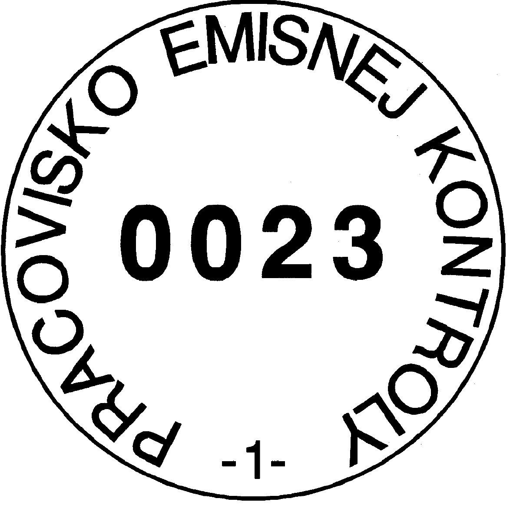

Príloha č. 9 vyhlášky Ministerstva dopravy, pôšt a telekomunikácií Slovenskej republiky č. 265/1996 Z. z.

- Vzor odtlačku pečiatky oprávnenej osoby (pracoviska emisnej kontroly) a jej náležitosti (v mierke 5:1) 

  - Odtlačok pečiatky má priemer 20 mm.

  - V odtlačku pečiatky je uvedené:

- – nápis „PRACOVISKO EMISNEJ KONTROLY“,

- – číslo pracoviska,

- – poradové číslo pečiatky.

- Číslo pracoviska emisnej kontroly je poradové číslo, ktoré ministerstvo pridelilo oprávnenej osobe (pracovisku emisnej kontroly).

- Poradové číslo pečiatky je číslo odborne spôsobilej osoby na pracovisku emisnej kontroly.

- Vyhotovenie pečiatky:

- – výška písmen nápisu „PRACOVISKO EMISNEJ KONTROLY“ je 2 mm,

- – výška číslic čísla pracoviska je 3 mm,

- – výška číslice poradového čísla pečiatky je 1,5 mm.

- Vedenie evidencie a úschova pečiatok

- Oprávnená osoba

- Oprávnená osoba vedie evidenciu pridelených a odobraných pečiatok v knihe príjmu a výdaja pečiatok (ďalej len „kniha pečiatok“). Do knihy pečiatok zapisuje

- a)

- dátum pridelenia pečiatky, počet pridelených pečiatok s uvedením čísla oprávnenej osoby (pracoviska emisnej kontroly) a poradového čísla pečiatky, meno a podpis zodpovednej osoby poverenej organizácie, ktorá pečiatku pridelila, a odborne spôsobilej osoby, ktorej bola pečiatka pridelená; kniha pečiatok musí obsahovať aj odtlačok pridelenej pečiatky;

- b)

- dátum odobratia pečiatky, počet odobraných pečiatok s uvedením čísla oprávnenej osoby (pracoviska emisnej kontroly) a poradového čísla pečiatky, meno a podpis zodpovednej osoby poverenej organizácie, ktorá pečiatku odobrala, a odborne spôsobilej osoby, ktorej bola pečiatka odobraná.

- Kniha pečiatok musí obsahovať názov a sídlo oprávnenej osoby (pracoviska emisnej kontroly), podpis jej štatutárneho zástupcu, odtlačok pečiatky oprávnenej osoby, dátum založenia knihy pečiatok, počet listov a mená odborne spôsobilých osôb. Po jej zapísaní sa uvedie dátum skončenia zápisov, ktorý osvedčí svojím podpisom odborne spôsobilá osoba.

- Knihu pečiatok oprávnená osoba (pracovisko emisnej kontroly) archivuje 5 rokov.

- Oprávnená osoba a odborne spôsobilá osoba, ktorej oprávnenie alebo osvedčenie zaniklo alebo bolo zrušené, odovzdá bezodkladne knihu pečiatok a pečiatky poverenej organizácii, ktorá ju archivuje 5 rokov.

- Oprávnená osoba a odborne spôsobilá osoba zabezpečia takú úschovu prijatých pečiatok, aby ich nebolo možné odcudziť alebo zneužiť.

- Poverená organizácia

- Poverená organizácia vedie evidenciu vyrobených pečiatok v knihe príjmu a výdaja pečiatok. Do knihy pečiatok zapisuje

- a)

- dátum príjmu pečiatky, počet prijatých pečiatok s uvedením čísla oprávnenej osoby (pracoviska emisnej kontroly) a poradového čísla pečiatky, meno a podpis zodpovednej osoby, ktorá pečiatky prijala,

- b)

- dátum výdaja pečiatky, počet vydaných pečiatok s uvedením čísla oprávnenej osoby (pracoviska emisnej kontroly) a poradového čísla pečiatky, meno a podpis zodpovednej osoby, ktorá pečiatku vydala, a štatutárneho orgánu oprávnenej osoby, ktorá pečiatku (pečiatky) prevzala.

- Kniha pečiatok musí obsahovať obdobné údaje ako kniha pečiatok oprávnenej osoby (pracoviska emisnej kontroly).
