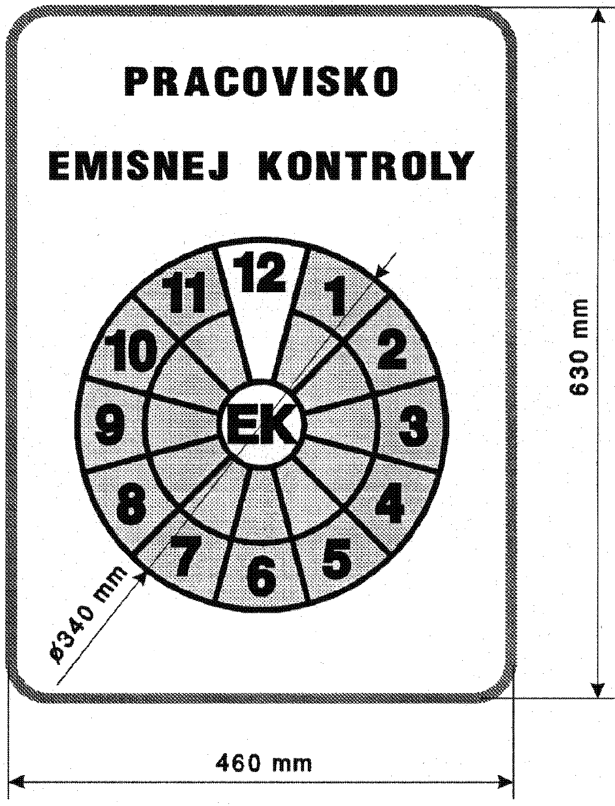

Príloha č. 10 vyhlášky Ministerstva dopravy, pôšt a telekomunikácií Slovenskej republiky č. 265/1996 Z. z.

- Vzor označenia oprávnenej osoby (pracoviska emisnej kontroly) (v mierke 1:5)

- 

  - Tabuľka je kovová s bielym podkladom.

  - Okraj a písmo sú čiernej farby.

  - Písmo je vysoké najmenej 25 mm.

  - Farebné vyhotovenie a rozmerové proporcie symbolu kontrolnej nálepky zodpovedajú prílohe č. 4.
