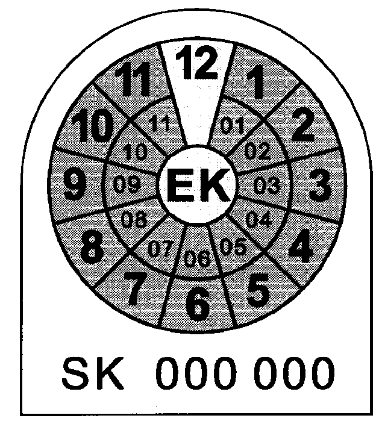

- KONTROLNÁ NÁLEPKA, VYHOTOVENIE, VYZNAČOVANIE A UMIESTŇOVANIE (mierka 1,5:1)

- 

  - Kontrolná nálepka je označená sériou, ktorá sa skladá z označenia „SK“ a šesťmiestneho evidenčného čísla, ktoré sú zhodné so sériou a číslom Osvedčenia o emisnej kontrole. Po naplnení série „SK“ nasledujú série „SKA“ až „SKZ“.

  - Rozmery: výška kontrolnej nálepky 37 mm,

  - šírka kontrolnej nálepky 32 mm,

  - priemery kružníc: 27 mm, 17 mm, 7 mm,

  - výška číslic 1 až 12 (označenie mesiaca) 3 mm,

  - výška dvojčíslic (označenie roku) 1,5 mm,

  - výška symbolu (písmen) „EK“ 3 mm,

  - výška písmen a číslic označenia série a evidenčného čísla 3 mm.

  - Farby: podklad (okraj) označenia biely,

  - pole nálepky zelené,

  - stredový kruh a veľký kruhový výsek žlté,

  - kružnice, úsečky, číslice, dvojčíslice a symbol (písmená) „EK“ čierne.

  - Vyznačovanie

  - Vyznačovanie lehoty platnosti emisnej kontroly vozidla: na vonkajšom medzikruží sa dierkovacími kliešťami vyznačuje mesiac a na vnútornom medzikruží rok.

  - Umiestňovanie

  - Kontrolná nálepka sa lepí na zadnú tabuľku s evidenčným číslom vozidla, ak je

  - a) tabuľka jednoriadková, do dolnej polovice medzery za prvou skupinou písmen,

  - b) tabuľka dvojriadková, v hornom riadku do pravej polovice medzery za prvou skupinou písmen.
