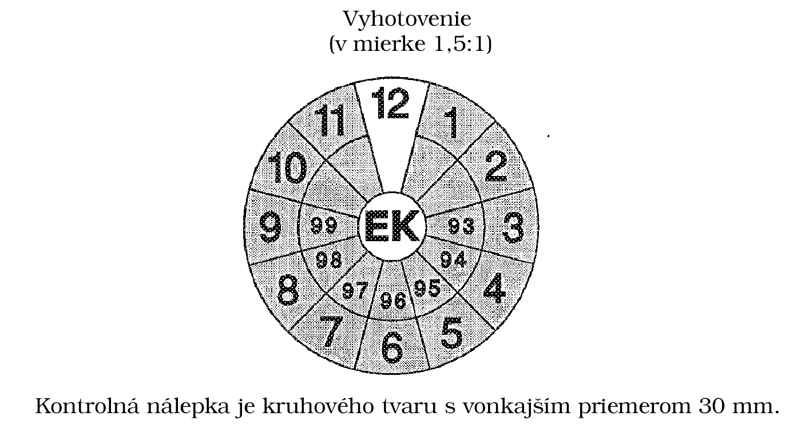

Príloha č. 4 vyhlášky Ministerstva dopravy, pôšt a telekomunikácií Slovenskej republiky č. 265/1996 Z. z.

- Kontrolná nálepka, vyhotovenie, vyznačovanie a nalepovanie 

  - Opis vyhotovenia poľa kontrolnej nálepky:

  - – dve sústredné kružnice s priemerom 27 mm a 7 mm a sústredný kružnicový oblúk s priemerom 17 mm čiernej farby,

  - – dvanásť stredovo symetrických radiálnych úsečiek čiernej farby,

  - – vo veľkom kruhovom výseku v hornej časti nálepky je umiestnené číslo 12 (označenie mesiaca) čiernej farby s výškou číslic 3 mm,

  - – vo vonkajších medzikruhových výsekoch sú umiestnené čísla od 1 do 11 (označenia mesiacov) čiernej farby s výškou číslic 3 mm, ktoré sú orientované súhlasne s číslom 12,

  - – vo vnútorných medzikruhových výsekoch stredovo zodpovedajúcich výsekom s číslicami 3 až 9 sú umiestnené dvojčísla (označenia rokov) orientované súhlasne s číslom 12, čiernej farby, s výškou číslic 1,5 mm,

  - – v stredovom kruhu je umiestnený symbol „EK“ čiernej farby, s výškou písmen 3 mm,

  - – okraj nálepky je bielej farby, stredový kruh a veľký kruhový výsek sú žltej farby, pole nálepky je zelenej farby.

  - Vyznačovanie

  - Vyznačovanie času platnosti emisnej kontroly:

  - – na vonkajšom medzikruží sa dierkovacími kliešťami vyznačuje mesiac,

  - – na vnútornom medzikruží sa dierkovacími kliešťami vyznačuje rok.

  - Nalepovanie

  - Kontrolná nálepka sa lepí na zadnú tabuľku štátnej poznávacej značky

  - – ak je jednoriadková tabuľka, do spodnej polovice medzery medzi skupinou písmen a prvým dvojčíslím alebo medzi prvou skupinou čísiel a ďalšími číslami na vyhotovení pre vojenské vozidlá,

  - – ak je dvojriadková tabuľka vo vyhotovení so žltým podkladom, vpravo od písmena alebo skupiny písmen, alebo vpravo od vrchnej skupiny čísiel na vyhotovení pre vojenské vozidlá (starom vyhotovení tabuľky),

  - – ak je dvojriadková tabuľka vo vyhotovení s bielym alebo so žltým podkladom, vľavo dolu vedľa skupiny písmen alebo vedľa vrchnej skupiny čísiel na vyhotovení pre vojenské vozidlá, ak os symetrie písmen alebo vrchnej skupiny čísiel je vpravo od zvislej osi symetrie tabuľky (novom vyhotovení tabuľky).
