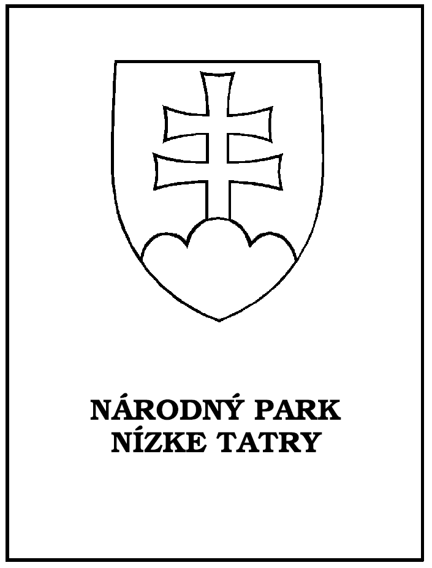
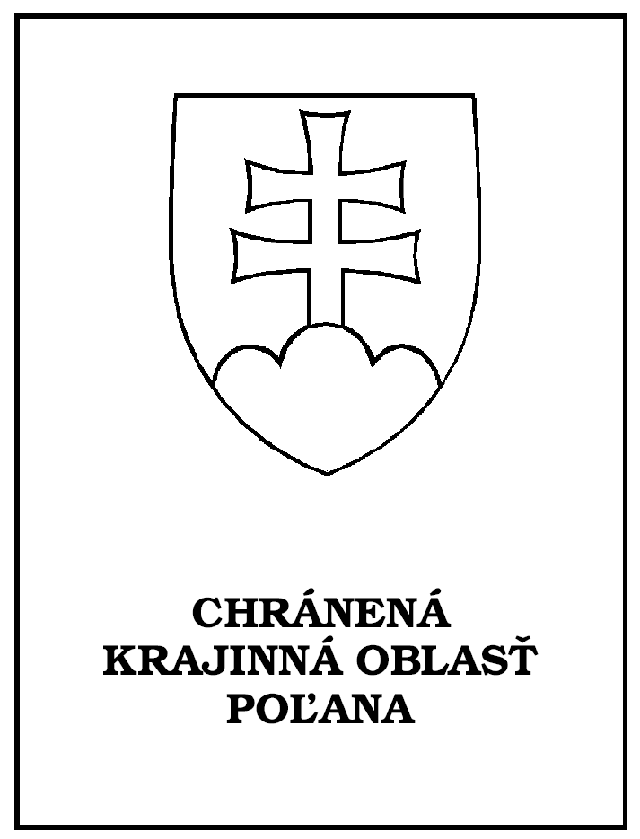
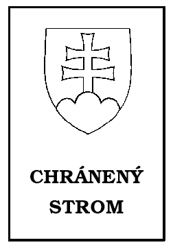

Príloha č. 2 vyhlášky Ministerstva životného prostredia Slovenskej republiky č. 295/1996 Z. z.

- VZORY TABÚĽ NA OZNAČENIE OSOBITNE CHRÁNENÝCH ČASTÍ PRÍRODY A KRAJINY A. Označenie chránených území a ich ochranných pásiem

- Tabule sú tmavozelené, písmo je biele

- Rozmery tabule: 40 x 30 cm

- 

- 

- B. Označenie chránených stromov

- Rozmery tabule: 15 x 10 cm

- 
