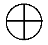

Príloha č. 2 vyhlášky Ministerstva vnútra Slovenskej republiky č. 300/1996 Z. z.

- ČLENENIE OBLASTI OHROZENIA A OBLASTI PREDPOKLADANÉHO OHROZENIA A SPÔSOB ICH ZAKRESĽOVANIA

  - A. Chemické látky

    - 1. Oblasť ohrozenia sa člení na

      - a) pásmo, v ktorom sa pôsobenie nebezpečných látok prejaví ohrozením života, zdravia alebo majetku (ďalej len „pásmo smrteľného ohrozenia“),

      - b) pásmo, v ktorom sa pôsobenie nebezpečných látok prejaví ohrozením života, zdravia alebo majetku (ďalej len „pásmo ohrozenia zdravia“).

    - 2. Oblasť predpokladaného ohrozenia sa člení na

      - a) pásmo priameho ohrozenia nebezpečnými látkami, ktorého vonkajšia hranica je minimálne 50 metrov od zdroja ohrozenia daná stredovým uhlom 360o,

      - b) ochranné pásmo, ktorého vonkajšia hranica je minimálne 100 metrov od zdroja ohrozenia daná stredovým uhlom 360O,

      - c) pásmo ohrozenia výparmi nebezpečnej látky, ktoré je na účely predbežného vyhodnotenia dané 40ovýsečou, pričom jej stred je orientovaný v smere prízemného vetra,

      - d) bezpečný priestor, v ktorom sa výskyt nebezpečnej látky nepredpokladá a ktorý je vzdialený najmenej 100 metrov od miesta výskytu nebezpečnej látky.

    - 3. Na účely spracovania plánu ochrany obyvateľov sa na vyhodnotenie oblasti ohrozenia pri mimoriadnej udalosti s únikom chemickej látky používa stredový uhol 360o. Miesto výskytu nebezpečnej látky sa označuje typovou značkou

    -  100 x,

    - kde

    - „" je značka miesta výskytu nebezpečnej látky,

    - „100“ je množstvo nebezpečnej látky v tonách,

    - „x“ je druh nebezpečnej látky vyznačený chemickou značkou.

    - 4. Hranica pásma smrteľného ohrozenia sa zakresľuje dvojitou modrou čiarou, hranica ohrozenia zdravia jednoduchou modrou prerušovanou čiarou a typová značka modrou farbou vyfarbená žltou farbou.

    - 5. Pri zakresľovaní jednotlivých pásiem ohrozenia bezprostredne po vzniku mimoriadnej udalosti sa na účely predbežného vyhodnotenia používa stredový uhol 40O, pričom stred pásiem je orientovaný v smere prízemného vetra.

    - 6. Hranica pásma priameho ohrozenia sa zakresľuje plnou červenou čiarou, hranica ochranného pásma a pásma ohrozenia výparmi sa zakresľuje dvojitou prerušovanou modrou čiarou.

  - B. Rádioaktívne látky

    - 1. Oblasť ohrozenia sa v prípade jadrovej havárie člení

      - a) na územie

    - 1. vymedzené 30-kilometrovým okruhom okolo jadrového zariadenia v Jaslovských Bohuniciach,

    - 2. vymedzené 20-kilometrovým okruhom okolo jadrového zariadenia v Mochovciach,

      - b) na pásmo

    - 1. vymedzené 5-kilometrovou, 10-kilometrovou a 30-kilometrovou vzdialenosťou od zdroja v Jaslovských Bohuniciach,

    - 2. vymedzené 5-kilometrovou, 10-kilometrovou a 20-kilometrovou vzdialenosťou od zdroja v Mochovciach,

      - c) na 16 sektorov s veľkosťou stredového uhla 22,5o, pričom stred prvého sektora je orientovaný na sever.

    - 2. Z oblasti ohrozenia sa v prípade jadrovej havárie a na základe skutočnej meteorologickej situácie vyčleňuje aj

      - a) bližšie ohrozené územie, ktoré predstavuje 5-kilometrové pásmo a 5 sektorov v 10-kilometrovom pásme, pričom stred prostredného z nich je orientovaný v smere prízemného vetra,

      - b) ohrozené územia, ktoré predstavuje 5 sektorov od 10-kilometrového pásma do 30-kilometrového pásma pri zdroji v Jaslovských Bohuniciach alebo od 10-kilometrového pásma do 20-kilometrového pásma pri zdroji v Mochovciach, pričom stred prostredného z nich je orientovaný v smere prízemného vetra.

    - 3. Pri preprave nebezpečných látok s možnosťou úniku rádioaktívnych látok sa oblasť ohrozenia neplánuje.

    - 4. V plánovacej dokumentácii sa hranica pásma vymedzená vzdialenosťou

      - a) 5 km od zdroja ohrozenia označuje písmenom A a zakresľuje sa prerušovanou čiarou čiernej farby,

      - b) 10 km od zdroja ohrozenia označuje písmenom B a zakresľuje sa plnou čiarou hnedej farby,

      - c) 20 km a 30 km od zdroja ohrozenia označuje písmenom C a zakresľuje sa prerušovanou čiarou červenej farby.

    - 5. Pri vzniku jadrovej havárie na jadrových zariadeniach1) sa hranica bližšie ohrozeného a hranica ohrozeného územia zakresľuje plnou čiernou čiarou.

  - C. Biologické látky

    - 1. Oblasť predpokladaného ohrozenia sa člení na

      - a) pásmo bezprostredného ohrozenia, v ktorom je možnosť ohrozenia života a zdravia,

      - b) ochranné pásmo, v ktorom je možnosť vzniku ochorenia pri nasledujúcom prenose prirodzenými cestami prenosu.

    - 2. Hranica pásma bezprostredného ohrozenia sa zakresľuje plnou červenou čiarou a hranica ochranného pásma sa zakresľuje dvojitou hnedou čiarou.
