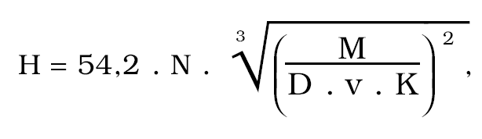
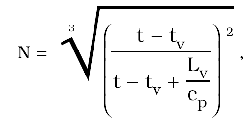
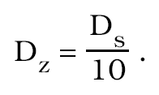
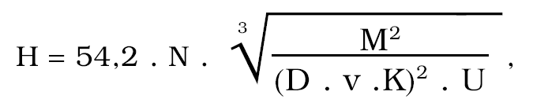
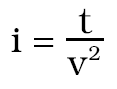

Príloha č. 3 vyhlášky Ministerstva vnútra Slovenskej republiky č. 300/1996 Z. z.

- POSTUP URČOVANIA OBLASTI OHROZENIA A OBLASTI PREDPOKLADANÉHO OHROZENIA

  - A. Chemické látky

    - 1. Na určenie polomeru pásma smrteľného ohrozenia a pásma ohrozenia zdravia v odkrytom rovinatom teréne za predpokladu, že nebezpečná škodlivina nepodlieha samovoľnému chemickému rozkladu,

      - 

      - kde

      - „H“ je polomer (hĺbka) pásma smrteľného alebo pásma zraniteľného zamorenia udaný v metroch (m),

      - „M“ je hmotnosť uvoľnenej nebezpečnej škodliviny udaná v kilogramoch,

      - „D“ je smrtiaci alebo zraňujúci expozičný súčin udaný v miligramoch na liter vzduchu pri minútovej inhalačnej expozícii,

      - „v“ je rýchlosť prízemného vetra udaná v m.s-1,

      - „K“ je koeficient vertikálnej stálosti atmosféry, ktorý sa rovná pri

      - a) inverzii číslu 2,

      - b) izotermii číslu 3,

      - c) konvekcii číslu 4,

        - „N“ je teplotne závislý korekčný faktor okamihového odparu nebezpečnej škodliviny.

        - Hodnota korekčného faktora sa vypočíta zo vzťahu

        - 

        - kde

        - „t“ je teplota v mieste úniku nebezpečnej škodliviny,

        - „tv“ je teplota varu nebezpečnej škodliviny za normálneho atmosferického tlaku,

        - „Lv“ je merné výparné teplo nebezpečnej škodliviny,

        - „cp“ je merné teplo nebezpečnej škodliviny v plynnej fáze.

    - 2. Na určenie polomeru pásma smrteľného ohrozenia a pásma ohrozenia zdravia pre potreby spracovania havarijných plánov a plánov ochrany hodnota

      - „v“ = 1 m.s-1 ,

      - „K“ = 2,

      - „N“ = 0,13.

    - 3. Pre škodliviny, ktorých teplota varu je nad teplotou okolia, nemožno na výpočet faktora „N“ použiť uvedený vzorec, a preto je pre ne taxatívne určený faktor

      - „N“ = 0,13.

    - 4. Smrteľný expozičný súčin sa vypočíta podľa vzťahu

      - Ds= 0,025 . RrCL(x) . X mg.min./1,

      - kde

      - „RrCL(x)“ je inhalačná smrteľná koncentrácia pre krysu v mg.m-3 s časom pôsobenia v hodinách,

      - „X“ je čas pôsobenia škodliviny v hodinách.

      - Vo výpočte sa uvažuje s hodnotou RrCL(x), pričom (x) = 4; potom základný vzťah pre výpočet smrteľného expozičného súčinu je

      - Ds = 0,1 . RrCL(4) mg . min . 1.

    - 5. Zraňujúci expozičný súčin sa vypočíta podľa vzťahu

      - 

    - 6. Bezprostredne po havárii sa na vyhodnotenie na účel bližšej špecifikácie pásma ohrozenia použije vzorec upravený na základe faktora času

      - 

      - kde

      - „U“ je čas trvania úniku nebezpečnej škodliviny pri havárii v minútach.

    - 7. Vertikálna stálosť atmosféry sa určuje podľa vzťahu

      - t = t50– t200 ,

      - kde

      - „t“ je teplotný gradient,

      - „t50“ je teplota vzduchu vo výške 50 cm nad terénom,

      - „t200“ je teplota vzduchu vo výške 200 cm nad terénom.

      - Teplotný gradient sa vydelí štvorcom rýchlosti prízemného vetra

      - 

      - a vypočíta sa index i, podľa ktorého sa určí vertikálna stálosť atmosféry. Inverzia je, ak i ≤ -0,1; izotermia je, ak i ≤ +0,1 alebo i > -0,1; konvekcia je, ak i ≥ +0,1.

      - Orientačne možno uvažovať, že

      - a) inverzia vzniká asi hodinu pred západom slnka a zaniká v priebehu jednej hodiny po východe slnka,

      - b) konvekcia vzniká asi dve hodiny po východe slnka a zaniká dve až dve a pol hodiny pred západom slnka.

    - 8. Vypočítané hodnoty polomerov pásma smrteľného ohrozenia a pásma ohrozenia zdravia platia pre rovinatý a odkrytý terén. Na účely predbežného vyhodnotenia 1 km mestskej zástavby alebo zalesneného terénu zodpovedá cca 3,5 km odkrytého terénu.

    - 9. Oblasť ohrozenia sa určuje, ak ide o látky

      - a) horľavé, zápalné a oxidujúce podľa STN,1)

      - b) výbušné na základe množstva látky a maximálneho výbuchového tlaku.

  - B. Rádioaktívne látky

    - Vymedzenie oblasti je v pôsobnosti Úradu jadrového dozoru Slovenskej republiky pre každé novozriadené jadrovoenergetické zariadenie.

  - C. Biologické látky

    - Určenie hraníc jednotlivých pásiem je v pôsobnosti Ministerstva zdravotníctva Slovenskej republiky2) a Ministerstva pôdohospodárstva Slovenskej republiky.3)
