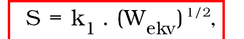
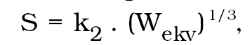
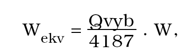
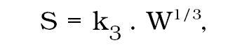

Príloha č. 2 vyhlášky Ministerstva hospodárstva Slovenskej republiky č. 77/1996 Z z.

- URČENIE BEZPEČNOSTNÝCH VZDIALENOSTÍ SKLADOV VÝBUŠNÍN NA POVRCHU OD OHROZENÝCH OBJEKTOV

  - 1. Bezpečnostná vzdialenosť skladov S (m) triedy nebezpečenstva A sa vypočíta,

    - a) ak je obloženie menšie ako 2 000 kg, podľa vzorca

      - 

    - b) ak je obloženie 2 000 kg a väčšie, podľa vzorca

      - 

      - kde k1, k2 - koeficienty zvolené podľa charakteru ohrozeného objektu a dovoleného stupňa jeho poškodenia a ich hodnoty sú uvedené v tabuľke č. 1,

      - Wekv - ekvivalentné obloženie skladu (kg).

      - Ekvivalentné obloženie skladu sa vypočíta podľa vzorca

      - 

      - kde Qvyb - výbuchové teplo skladovanej výbušniny (kJ . kg-1) udané výrobcom,

      - W - obloženie skladu výbušnín (kg).

  - 2. Ak ide o sklady triedy nebezpečenstva A umiestnené vo vale a o ohrozené objekty, pri ktorých sa počíta bezpečnostná vzdialenosť s koeficientom k1až do hodnoty 2,5 alebo k2až do hodnoty 8, môže sa vypočítaná bezpečnostná vzdialenosť podľa bodu 1 skrátiť až o 50 %.

  - 3. Ak ide o obloženie väčšie ako 10 000 kg, je potrebné doplniť bezpečnostnú vzdialenosť rozborom ďalších možných nežiaducich účinkov na širšie okolie.

  - 4. Bezpečnostná vzdialenosť skladov S (m) tried nebezpečenstva B a C sa vypočíta podľa vzorca

    - 

    - kde k3 - koeficient zvolený podľa charakteru objektu uvedený v tabuľke č. 2,

    - W - obloženie skladu (kg).

  - 5. Ak ide o sklady tried nebezpečenstva B alebo C v stavebnom vyhotovení, ktoré zvyšuje ochranu ohrozených objektov, alebo sklady umiestnené vo valoch s požiarnou stenou bez otvoru smerujúcou k ohrozenému objektu a s výfukovou plochou smerujúcou do voľného priestoru, možno bezpečnostnú vzdialenosť vypočítanú podľa bodu 4 skrátiť až o 25 %.

  - 6. Ak leží ohrozený objekt v smere výfukovej plochy skladu triedy nebezpečenstva B alebo C, je potrebné dodržať bezpečnostné vzdialenosti vypočítané podľa bodu 4, najmenej však

    - a) 60 m, ak ide o výrobné objekty v prevádzkach výrobní výbušnín s nebezpečenstvom výbuchu,

    - b) 100 m, ak ide o výrobné objekty bez nebezpečenstva výbuchu (správne, sociálne, energetické a iné objekty),

    - c) 240 m, ak ide o obytné budovy mimo územia výrobného závodu (cesty, železnice).

  - 7. Najmenšia vzdialenosť skladu výbušnín triedy nebezpečenstva B od skladu výbušnín triedy nebezpečenstva A je 28 m, od skladov výbušnín tried nebezpečenstva B a C je 25 m. Najmenšia vzdialenosť skladov výbušnín triedy nebezpečenstva C od skladov výbušnín tried nebezpečenstva A a C je 21 m. Tieto najmenšie vzdialenosti sa vzťahujú na sklady výbušnín tried nebezpečenstva B a C bez vonkajších stavebných úprav podľa bodu 5 a sklady výbušnín triedy nebezpečenstva A bez valu.

  - 8. Pri určovaní bezpečnostnej vzdialenosti medzi dvoma skladmi výbušnín sa určí bezpečnostná vzdialenosť pre každý sklad výbušnín osobitne, ale uvažuje sa väčšia z nich.

  - 9. Pri rôznom stavebnom vyhotovení a umiestnení skladov výbušnín nebezpečných výbuchom sa určujú bezpečnostné vzdialenosti podľa týchto zásad:

    - a) ak nie je okolo objektu uzavretý val, tak v smere otvorených strán sa bezpečnostná vzdialenosť vypočíta ako pri objekte bez ochranných valov,

    - b) ak sú dva susedné objekty obrátené k sebe otvorenými stranami, bezpečnostná vzdialenosť medzi nimi sa vypočíta ako pri objektoch bez valov,

    - c) ak majú dva objekty spoločný val, považuje sa pri výpočtoch každý za objekt s jedným valom a rieši sa podľa bodu 8,

    - d) ak sú sklady výbušnín situované tak, že ich vzdialenosti sú kratšie ako vypočítané bezpečnostné vzdialenosti, musia sa tieto sklady výbušnín považovať za súbor skladov. Bezpečnostné vzdialenosti sa vypočítajú podľa celkového obloženia všetkých skladov súboru,

    - e) v osobitných prípadoch možno vypočítané bezpečnostné vzdialenosti zmeniť len na základe odborného posudku.

- Tabuľka č. 1: Koeficienty na určenie bezpečnostných vzdialeností od skladov výbušnín triedy nebezpečenstva A

- Ohrozený objekt | Stupeň poškodenia objektu. Stupeň ohrozenia zdravia. | k | k

- Sklad výbušnín | Deštrukcia objektu, prelomenie muriva. Nedôjde k prenosu detonácie. Žiadna ochrana obsluhy skladu. | 0,5 | 2 až 4

- Nevýznamné objekty bez trvalej obsluhy | Úplné rozrušenie budov, prevrátenie železničných vozňov, poškodenie elektrickej siete a podobne. Nedostatočná ochrana osôb, ťažké ujmy na zdraví a smrť. | 0,5 až 1 | 2 až 4

- Výrobné objekty v prevádzkach výrobní výbušnín s nebezpečenstvom výbuchu | Rozrušenie menej odolných budov, vnútorných drevených priečok, rámov okien a dverí. Ťažké zranenia osôb spôsobené padajúcimi troskami. Vážne poškodenie ušných bubienkov a pľúc tlakovou vlnou. | 1 až 2,5 | 4 až 8

- Výrobné objekty bez nebezpečenstva výbuchu, správne, sociálne, energetické objekty | Poškodenie rámu okien a dverí, porušenie omietky, vnútorných drevených priečok. Dočasná strata sluchu, ťažké a smrteľné zranenia sú málo pravdepodobné. | 2,5 až 4,5 | 8 až 15

- Obytné budovy mimo územia výrobného závodu, cesty, železnice | Úplné zničenie zasklených okien. Ľahké zranenia, trauma. | 4,5 až 6 | 15 až 22

- Objekty celoštátneho významu, obce bez súvislej výškovej zástavby | Nepatrné poškodenie budov, čiastočné zničenie zasklených okien. | 6 až 17 | 22 až 60

- Zvlášť dôležité objekty celoštátneho významu s výškovou zástavbou, nemocnice | Náhodné poškodenie zasklených okien. | nad 17 | nad 60

- Tabuľka č. 2: Koeficienty na určenie bezpečnostných vzdialeností od skladov výbušnín triedy nebezpečenstva B a C

- Ohrozený objekt | k3

- Sklady výbušnín, nevýznamné objekty bez trvalej obsluhy, výrobné objekty prevádzok výrobní výbušnín s nebezpečenstvom výbuchu. | 1 až 3,5

- Výrobné objekty bez nebezpečenstva výbuchu. | 3, 5 až 6, 5

- Správne, sociálne, energetické a iné objekty nesúvisiace s výrobou výbušnín. | 6,5 až 10

- Ostatné budovy mimo územia výrobného závodu, cesty, železnice. | 10
