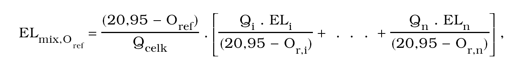

Príloha č. 4 nariadenia vlády Slovenskej republiky č. 92/1996 Z. z.

- EMISNÉ LIMITY PRE VYBRANÉ ZNEČISŤUJÚCE LÁTKY PRI VYBRANÝCH TECHNOLÓGIÁCH A ZARIADENIACH A VŠEOBECNÉ PODMIENKY PREVÁDZKOVANIA ZDROJOV ZNEČISŤOVANIA

  - I. PALIVOVO-ENERGETICKÝ PRIEMYSEL

    - 1. TECHNOLOGICKÉ CELKY OBSAHUJÚCE STACIONÁRNE ZARIADENIA NA SPAĽOVANIE PALÍV (TEPLÁRNE, ELEKTRÁRNE, VÝHREVNE A ZARIADENIA NA PROCESNÉ SPAĽOVANIE) SO SÚHRNNÝM TEPELNÝM VÝKONOM 0,2 MW A VÄČŠÍM

    - 1.1 Zariadenie pre nové zdroje

      - Za zariadenie sa v zmysle tohto nariadenia považuje kotlová jednotka alebo skupina kotlových jednotiek (prípadne procesných ohrevov), ktoré vypúšťajú alebo môžu vypúšťať odpadové plyny cez spoločný komín.

      - Na priradenie emisného limitu podľa výkonu sa spočítavajú výkony kotlov spaľujúcich palivo rovnakého typu (pevné, kvapalné, plynné). V prípade dvojpalivového systému, keď podiel privedeného tepla druhým palivom neprekročí 30 %, sa z hľadiska priradenia emisného limitu berie kotol, ako keby spaľoval len palivo privádzajúce prevažujúci tepelný príkon. Ak kotol spaľuje prídavné palivo vo väčšom podiele ako 30 % privedeného tepla, výkon tohto kotla sa k výkonom kotlov spaľujúcich len jedno palivo (alebo považovaných za také) nepripočítava a pre priradenie emisného limitu sa počíta výkon každého takéhoto kotla samostatne.

      - Osobitne sa spočítavajú výkony kotlov s cirkulujúcou fluidnou alebo pretlakovou vrstvou a osobitne sa spočítavajú výkony kotlov s výtavným ohniskom.

    - 1.2 Zariadenie pre jestvujúce zdroje s platnosťou do 31. 12. 2009

      - Za zariadenia sa považujú skupiny kotlov alebo zariadení na procesné spaľovanie v danej technologickej jednotke, ktorých jednotlivé tepelné výkony sú nižšie ako 50 MW alebo jednotlivé kotly a zariadenia na procesné spaľovanie s tepelným výkonom 50 MW a vyšším.

      - Pre jestvujúce zdroje platí po 1. 1. 2010 definícia zariadenia podľa bodu 1.1.

    - 1.3 Zariadenie pre procesné spaľovanie

      - Pod zariadením pre procesné spaľovanie sa rozumejú iné technologické zariadenia spaľujúce palivá, ako sú elektrárne, teplárne a výhrevne, pri ktorých je množstvo a zloženie emisií závislé len od množstva a zloženia paliva, pričom spalinový prúd je od ďalšej technológie oddelený pevnou teplovýmennou plochou.

    - 1.4 Palivá

      - V zariadeniach na spaľovanie palív sa môžu spaľovať len fosílne palivá a palivá z nich vyrobené (hnedé a čierne palivové uhlie, lignit, rašelina, koks, brikety, nafta, vykurovacie oleje a ťažké ropné frakcie štandardizovanej kvality spaľované v rafinériách ako vlastná produkcia), drevo, drevný odpad a iná hmota rastlinného pôvodu, prípadne opotrebované oleje, pokiaľ neobsahujú chlór v množstve väčšom ako 0,5 % hmot. a PCB a PCT väčšom ako 10 mg.kg-1, zemný plyn naftový, prípadne priemyselné plyny osobitne uvedené v ďalšej časti tejto prílohy.

      - Pri spaľovaní drevného odpadu sa rozumie drevná hmota, ktorá nebola ošetrená ochranným moridlom (napr. proti hmyzu, hubám, zápalnosti) alebo neobsahuje vrstvu organických zlúčenín s obsahom chlóru.

    - 1.5 Emisné limity pre spaľovanie tuhých palív

    - 1.5.1 Podmienky stanovenia emisných limitov

      - Všetky emisné limity uvedené v bode 1.5 platia pre koncentrácie prepočítané na suchý plyn pri štandardných podmienkach 101,325 kPa a 0 oC a pre obsah kyslíka v odpadových plynoch vo výške 6 % obj. Odchylne od tohto ustanovenia sa pri spaľovaní dreva a inej hmoty rastlinného pôvodu koncentrácie prepočítavajú na obsah kyslíka v spalinách vo výške 11 % obj.

    - 1.5.2 Emisný limit pre tuhé znečisťujúce látky

    - 1.5.2.1 Emisný limit pre nové zdroje znečisťovania

      - a) Pri zariadeniach na spaľovanie tuhých palív s menovitým tepelným výkonom 400 MW a vyšším nesmie koncentrácia tuhých znečisťujúcich látok v spalinách prekročiť hodnotu 50 mg.m-3.

      - b) Pri zariadeniach na spaľovanie tuhých palív s menovitým tepelným výkonom 50 MW a vyšším až do 400 MW nesmie koncentrácia tuhých znečisťujúcich látok v spalinách prekročiť hodnotu 100 mg.m-3.

      - c) Pri zariadeniach na spaľovanie tuhých palív s menovitým tepelným výkonom vyšším ako 2 MW až do 50 MW nesmie koncentrácia tuhých znečisťujúcich látok v spalinách prekročiť hodnotu 150 mg.m-3.

      - d) Odchylne od ustanovenia v písmene c) pri zariadeniach na fluidné spaľovanie tuhých palív s cirkulujúcou alebo pretlakovou fluidnou vrstvou s menovitým tepelným výkonom vyšším ako 2 MW do 400 MW nesmie koncentrácia tuhých znečisťujúcich látok v spalinách prekročiť hodnotu 100 mg.m-3.

      - e) Pri zariadeniach na spaľovanie tuhých palív s menovitým tepelným výkonom 0,2 MW a vyšším až do 2 MW vrátane nesmie koncentrácia tuhých znečisťujúcich látok v spalinách prekročiť hodnotu 250 mg.m-3.

    - 1.5.2.2 Emisný limit pre jestvujúce zdroje znečisťovania s platnosťou do 31. 12. 2009

      - a) Pri zariadeniach na spaľovanie tuhých palív s menovitým tepelným výkonom 50 MW a vyšším nesmie koncentrácia tuhých znečisťujúcich látok v spalinách prekročiť hodnotu 100 mg.m-3.

      - b) Pri zariadeniach na spaľovanie tuhých palív s menovitým tepelným výkonom vyšším ako 2 MW do 50 MW nesmie koncentrácia tuhých znečisťujúcich látok v spalinách prekročiť hodnotu 150 mg.m-3.

      - c) Pri zariadeniach na spaľovanie tuhých palív s menovitým tepelným výkonom 0,2 MW a vyšším až do 2 MW vrátane sa emisný limit pre tuhé znečisťujúce látky neurčuje a neplatia ani všeobecne platné emisné limity.

      - d) Odchylne od ustanovenia v písmene b) pri zariadeniach na fluidné spaľovanie tuhých palív s cirkulujúcou alebo s pretlakovou fluidnou vrstvou s menovitým tepelným výkonom vyšším ako 2 MW nesmie koncentrácia tuhých znečisťujúcich látok v spalinách prekročiť hodnotu 100 mg.m-3.

    - 1.5.3 Emisný limit pre oxidy síry

    - 1.5.3.1 Emisný limit pre nové zdroje znečisťovania

      - a) Pri zariadeniach na spaľovanie tuhých palív s menovitým tepelným výkonom 400 MW a vyšším nesmie koncentrácia oxidov síry vyjadrená ako oxid siričitý v spalinách prekročiť hodnotu 400 mg.m-3. Ak pre vysoký obsah síry v domácom palive nemožno dosiahnuť túto hodnotu, nesmie byť emisný stupeň oxidov síry vyšší ako 10 %.

      - b) Pri zariadeniach na spaľovanie tuhých palív s menovitým tepelným výkonom 140 MW a vyšším až do 400 MW nesmie koncentrácia oxidov síry vyjadrená ako oxid siričitý v spalinách prekročiť hodnotu vypočítanú podľa vzťahu

        - EL = 2 400 - 5 x MTV,

        - kde EL je emisný limit [mg.m-3],

        - MTV je menovitý tepelný výkon [MWt].

        - Ak pre vysoký obsah síry v domácom palive nemožno dosiahnuť túto hodnotu, nesmie byť emisný stupeň vyšší ako hodnota vypočítaná podľa vzťahu

        - ES = 84 - 0,185 x MTV,

        - kde ES je emisný stupeň [%].

        - V takom prípade koncentrácia oxidov síry vyjadrená ako oxid siričitý v spalinách nesmie zároveň prekročiť hodnotu 2 500 mg.m-3.

      - c) Pri zariadeniach na spaľovanie tuhých palív s menovitým tepelným výkonom 40 MW a vyšším až do 140 MW nesmie koncentrácia oxidov síry vyjadrená ako oxid siričitý v spalinách prekročiť hodnotu 1 700 mg.m-3. Ak pre vysoký obsah síry v domácom palive nemožno dosiahnuť túto hodnotu, nesmie byť emisný stupeň vyšší ako 60 %. V takom prípade koncentrácia oxidov síry vyjadrená ako oxid siričitý v spalinách nesmie zároveň prekročiť hodnotu 2 500 mg.m-3.

      - d) Pri zariadeniach na spaľovanie tuhých palív s menovitým tepelným výkonom 0,2 MW a vyšším až do 40 MW pri hmotnostnom toku vyššom ako 10 kg.h-1 nesmie koncentrácia oxidov síry vyjadrená ako oxid siričitý v spalinách prekročiť hodnotu 2 500 mg.m-3.

      - e) Odchylne od ustanovení v písmenách a) až d) pri zariadeniach na fluidné spaľovanie tuhých palív s cirkulujúcou fluidnou vrstvou alebo pretlakovou fluidnou vrstvou s menovitým tepelným výkonom vyšším ako 2 MW nesmie koncentrácia oxidov síry vyjadrená ako oxid siričitý v spalinách prekročiť hodnotu 400 mg.m-3 alebo emisný stupeň nesmie byť vyšší ako 15 %.

    - 1.5.3.2 Emisný limit pre jestvujúce zdroje znečisťovania s platnosťou do 31. 12. 2009

      - a) Pri zariadeniach na spaľovanie tuhých palív s menovitým tepelným výkonom vyšším ako 300 MW nesmie koncentrácia oxidov síry vyjadrená ako oxid siričitý v spalinách prekročiť hodnotu 500 mg.m-3. Ak nemožno túto hodnotu dosiahnuť bez odsírenia spalín, nesmie byť emisný stupeň oxidov síry vyšší ako 15 %.

      - b) Pri zariadeniach na spaľovanie tuhých palív s menovitým tepelným výkonom 50 MW a vyšším až do 300 MW vrátane nesmie koncentrácia oxidov síry vyjadrená ako oxid siričitý v spalinách prekročiť hodnotu 1 700 mg.m-3. Ak pre vysoký obsah síry v domácom palive nemožno dosiahnuť túto hodnotu bez odsírenia, nesmie byť emisný stupeň oxidov síry vyšší ako 60 %. V takom prípade koncentrácia oxidov síry vyjadrená ako oxid siričitý v spalinách nesmie zároveň prekročiť hodnotu 2 500 mg.m-3.

      - c) Pri zariadeniach na spaľovanie tuhých palív s menovitým tepelným výkonom vyšším ako 5 MW až do 50 MW nesmie koncentrácia oxidov síry vyjadrená ako oxid siričitý v spalinách prekročiť hodnotu 2 500 mg.m-3.

      - d) Pri zariadeniach na spaľovanie tuhých palív s menovitým tepelným výkonom 0,2 MW a vyšším až do 5 MW vrátane pri hmotnostnom toku oxidu siričitého vyššom ako 20 kg.h-1 nesmie koncentrácia oxidov síry vyjadrená ako oxid siričitý v spalinách prekročiť hodnotu 2 500 mg.m-3.

      - e) Odchylne od ustanovení v písmenách a) až d) pri zariadeniach na fluidné spaľovanie tuhých palív s cirkulujúcou fluidnou vrstvou alebo pretlakovou fluidnou vrstvou s menovitým tepelným výkonom vyšším ako 2 MW nesmie koncentrácia oxidov síry vyjadrená ako oxid siričitý v spalinách prekročiť hodnotu 400 mg.m-3 alebo emisný stupeň nesmie byť vyšší ako 15 % .

    - 1.5.3.3 Emisné limity pre jestvujúce zdroje znečisťovania s platnosťou po 1. 1. 2010

      - a) Pri zariadeniach na spaľovanie tuhých palív s menovitým tepelným výkonom 400 MW a vyšším nesmie koncentrácia oxidov síry vyjadrená ako oxid siričitý v spalinách prekročiť hodnotu 400 mg.m-3. Ak pre vysoký obsah síry v domácom palive nemožno dosiahnuť túto hodnotu bez odsírenia, nesmie byť emisný stupeň oxidov síry vyšší ako 10 %.

      - b) Pri zariadeniach na spaľovanie tuhých palív s menovitým tepelným výkonom 50 MW a vyšším až do 400 MW nesmie koncentrácia oxidov síry vyjadrená ako oxid siričitý v spalinách prekročiť hodnotu 1 700 mg.m-3. Ak pre vysoký obsah síry v domácom palive nemožno dosiahnuť túto hodnotu bez odsírenia, nesmie byť emisný stupeň oxidov síry vyšší ako 60 %. V takom prípade koncentrácia oxidov síry vyjadrená ako oxid siričitý v spalinách nesmie zároveň prekročiť hodnotu 2 500 mg.m-3.

      - c) Pri zariadeniach na spaľovanie tuhých palív s menovitým tepelným výkonom vyšším ako 5 MW až do 50 MW nesmie koncentrácia oxidov síry vyjadrená ako oxid siričitý v spalinách prekročiť hodnotu 2 500 mg.m-3.

      - d) Pri zariadeniach na spaľovanie tuhých palív s menovitým tepelným výkonom 0,2 MW až do 5 MW vrátane pri hmotnostnom toku oxidu siričitého vyššom ako 20 kg.h-1 nesmie koncentrácia oxidov síry vyjadrená ako oxid siričitý v spalinách prekročiť hodnotu 2 500 mg.m-3.

      - e) Odchylne od ustanovení v písmenách a) až d) pri zariadeniach na fluidné spaľovanie tuhých palív s cirkulujúcou fluidnou vrstvou alebo s pretlakovou fluidnou vrstvou s menovitým tepelným výkonom vyšším ako 2 MW nesmie koncentrácia oxidov síry vyjadrená ako oxid siričitý v spalinách prekročiť hodnotu 400 mg.m-3 alebo emisný stupeň nesmie byť vyšší ako 15 %.

    - 1.5.3.4 Podmienky dodržania emisného limitu

    - Spaľovacie zariadenie možno prevádzkovať aj pri výpadku zariadenia na obmedzovanie emisií oxidu siričitého, ak doba výpadku neprekročí 96 po sebe nasledujúcich hodín a počas kalendárneho roka spolu 360 hodín.

    - 1.5.4 Emisný limit pre oxidy dusíka

      - a) Pri zariadeniach na spaľovanie tuhých palív s menovitým tepelným výkonom vyšším ako 50 MW nesmie koncentrácia oxidov dusíka vyjadrená ako oxid dusičitý v spalinách prekročiť hodnotu 550 mg.m-3.

      - b) Pri zariadeniach na spaľovanie tuhých palív s menovitým tepelným výkonom 0,2 MW a vyšším až do 50 MW vrátane nesmie koncentrácia oxidov dusíka vyjadrená ako oxid dusičitý v spalinách prekročiť hodnotu 650 mg.m-3.

      - c) Odchylne od ustanovenia v písmenách a) a b) pri spaľovaní tuhých palív vo výtavných kotloch nesmie koncentrácia oxidov dusíka vyjadrená ako oxid dusičitý v spalinách prekročiť hodnotu 1 100 mg.m-3.

      - d) Odchylne od ustanovení v písmenách a) a b) pri zariadeniach pre fluidné spaľovanie s cirkulujúcou fluidnou vrstvou alebo pretlakovou fluidnou vrstvou s menovitým tepelným výkonom vyšším ako 2 MW nesmie koncentrácia oxidov dusíka vyjadrená ako oxid dusičitý v spalinách prekročiť hodnotu 400 mg.m-3.

    - 1.5.5 Emisný limit pre oxid uhoľnatý

    - 1.5.5.1 Emisný limit pre nové zdroje znečisťovania

      - a) Pri zariadeniach na spaľovanie tuhých palív s menovitým tepelným výkonom vyšším ako 5 MW nesmie koncentrácia oxidu uhoľnatého v spalinách prekročiť hodnotu 250 mg.m-3.

      - b) Pri zariadeniach na spaľovanie tuhých palív s menovitým tepelným výkonom 0,2 MW a vyšším až do 5 MW vrátane pri hmotnostnom toku väčšom ako 5 kg.h-1 nesmie koncentrácia oxidu uhoľnatého v spalinách prekročiť hodnotu 850 mg.m-3.

    - 1.5.5.2 Emisný limit pre jestvujúce zdroje znečisťovania s platnosťou do 31. 12. 2009

      - a) Pri zariadeniach na spaľovanie tuhých palív s roštovým kúreniskom všetkých typov s menovitým tepelným výkonom 0,2 MW a vyšším až do 2 MW vrátane sa emisný limit pre oxid uhoľnatý neurčuje.

      - b) Pri zariadeniach na spaľovanie tuhých palív s roštovým kúreniskom s pohadzovačom s menovitým tepelným výkonom vyšším ako 2 MW nesmie koncentrácia oxidu uhoľnatého v spalinách prekročiť hodnotu 1 100 mg.m-3.

      - c) V ostatných zariadeniach na spaľovanie tuhých palív, ktoré nie sú uvedené v písmenách a) a b), s menovitým tepelným výkonom 0,2 MW a vyšším až do 5 MW vrátane pri hmotnostnom toku 5 kg.h-1 a väčšom, nesmie koncentrácia oxidu uhoľnatého v spalinách prekročiť hodnotu 850 mg.m-3.

      - d) V ostatných zariadeniach na spaľovanie tuhých palív, ktoré nie sú uvedené v písmene b), s menovitým tepelným výkonom vyšším ako 5 MW, nesmie koncentrácia oxidu uhoľnatého v odpadových plynoch prekročiť hodnotu 250 mg.m-3.

    - 1.5.6 Emisný limit pre organické látky

    - 1.5.6.1. Emisný limit pre nové zdroje

    - Pri spaľovaní dreva, kôry, drevného odpadu a inej hmoty rastlinného pôvodu v zariadeniach s menovitým tepelným výkonom 0,2 MW a vyšším nesmie koncentrácia organických látok vyjadrená ako celkový organický uhlík v spalinách prekročiť hodnotu 50 mg.m-3.

    - 1.5.6.2 Emisný limit pre jestvujúce zdroje

    - Pri spaľovaní dreva, kôry, drevného odpadu a inej hmoty rastlinného pôvodu v zariadeniach s menovitým tepelným výkonom vyšším ako 5 MW nesmie koncentrácia organických látok vyjadrená ako celkový organický uhlík v spalinách prekročiť hodnotu 50 mg.m-3.

    - 1.5.7 Emisné limity pre ostatné znečisťujúce látky uvedené v prílohe č. 1

    - Emisné limity pre ostatné znečisťujúce látky sa neurčujú a neuplatňujú sa ani všeobecne platné emisné limity. Pritom však treba využiť dostupné opatrenia s prihliadnutím na primeranosť nákladov na obmedzenie ich emisií (napr. technika spaľovania, voľba kvality palív).

    - 1.6 Emisné limity pre spaľovanie kvapalných palív

    - 1.6.1 Podmienky stanovenia emisných limitov

    - Všetky emisné limity uvedené v bode 1.6 platia pre koncentrácie prepočítané na suchý plyn pri štandardných podmienkach 101,325 kPa a 0 oC a pre obsah kyslíka v spalinách vo výške 3 % obj.

    - 1.6.2 Emisný limit pre tuhé znečisťujúce látky

      - a) Pri zariadeniach na spaľovanie kvapalných palív s menovitým tepelným výkonom 50 MW a vyšším nesmie koncentrácia tuhých znečisťujúcich látok v spalinách prekročiť hodnotu 50 mg.m-3.

      - b) Pri zariadeniach na spaľovanie kvapalných palív s menovitým tepelným výkonom 0,2 MW a vyšším až do 50 MW nesmie koncentrácia tuhých znečisťujúcich látok v spalinách prekročiť hodnotu 100 mg.m-3.

      - c) V prípade, že emisné limity pre tuhé znečisťujúce látky uvedené v písmenách a) a b) sa dosahujú bez odlučovania, všeobecne platné emisné limity pre druhú skupinu znečisťujúcich látok (príloha č. 3 časť II bod 2) sa neuplatňujú.

    - 1.6.3 Emisný limit pre oxidy síry

    - 1.6.3.1 Emisný limit pre nové zdroje znečisťovania

      - a) Pri zariadeniach na spaľovanie kvapalných palív s menovitým tepelným výkonom 435 MW a vyšším nesmie koncentrácia oxidov síry vyjadrená ako oxid siričitý v spalinách prekročiť hodnotu 400 mg.m-3. Ak pre vysoký obsah síry v domácom palive nemožno dosiahnuť túto hodnotu, nesmie byť emisný stupeň oxidov síry vyšší ako 10 %.

      - b) Pri zariadeniach na spaľovanie kvapalných palív s menovitým tepelným výkonom 260 MW a vyšším až do 435 MW nesmie koncentrácia oxidov síry vyjadrená ako oxid siričitý v spalinách prekročiť hodnotu vypočítanú podľa vzťahu

        - EL = 3 630 - 7,425 x MTV,

        - kde EL je emisný limit [mg.m-3],

        - MTV je menovitý tepelný výkon [MWt].

        - Ak pre vysoký obsah síry v domácom palive nemožno dosiahnuť túto hodnotu bez odsírenia, nesmie byť emisný stupeň oxidov síry vyšší ako 10 %.

      - c) Pri zariadeniach na spaľovanie kvapalných palív s menovitým tepelným výkonom vyšším ako 5 MW až do 260 MW nesmie koncentrácia oxidov síry vyjadrená ako oxid siričitý v spalinách prekročiť hodnotu 1 700 mg.m-3.

    - 1.6.3.2 Emisný limit pre jestvujúce zdroje znečisťovania s platnosťou do 31. 12. 2009

      - a) Pri zariadeniach na spaľovanie kvapalných palív s menovitým tepelným výkonom vyšším ako 300 MW nesmie koncentrácia oxidov síry vyjadrená ako oxid siričitý v odpadových plynoch prekročiť hodnotu 500 mg.m-3. Ak nemožno túto hodnotu dosiahnuť bez odsírenia, nesmie byť emisný stupeň oxidov síry vyšší ako 15 %.

      - b) Pri zariadeniach na spaľovanie kvapalných palív s menovitým tepelným výkonom vyšším ako 5 MW až do 300 MW vrátane nesmie koncentrácia oxidov síry vyjadrená ako oxid siričitý v spalinách prekročiť hodnotu 1 700 mg.m-3.

    - 1.6.3.3 Emisný limit pre jestvujúce zdroje znečisťovania s platnosťou od 1. 1. 2010

      - a) Pri zariadeniach na spaľovanie kvapalných palív s menovitým tepelným výkonom 435 MW a vyšším nesmie koncentrácia oxidov síry vyjadrená ako oxid siričitý v spalinách prekročiť hodnotu 400 mg.m-3. Ak pre vysoký obsah síry v domácom palive nemožno dosiahnuť túto hodnotu bez odsírenia, nesmie byť emisný stupeň oxidov síry vyšší ako 10 %.

      - b) Pri zariadeniach na spaľovanie kvapalných palív s menovitým tepelným výkonom vyšším ako 5 MW až do 435 MW nesmie koncentrácia oxidov síry vyjadrená ako oxid siričitý v spalinách prekročiť hodnotu 1 700 mg.m-3.

    - 1.6.3.4 Podmienky dodržania emisného limitu

    - Spaľovacie zariadenie možno prevádzkovať aj pri výpadku zariadenia na obmedzovanie emisií oxidu siričitého, ak doba výpadku neprekročí 96 po sebe nasledujúcich hodín a počas kalendárneho roka spolu 360 hodín.

    - 1.6.3.5 Všeobecné podmienky prevádzkovania – obmedzenie obsahu síry v palive

    - V zariadeniach na spaľovanie kvapalných palív s tepelným výkonom 0,2 MW a vyšším až do 5 MW vrátane sa nesmie spaľovať palivo s obsahom síry vyšším ako 1 % hmot. Toto obmedzenie neplatí pri spaľovaní vlastných technologických olejov, pritom však koncentrácia oxidov síry v spalinách nesmie prekročiť hodnotu 1 700 mg.m-3.

    - 1.6.4 Emisný limit pre oxidy dusíka

      - a) Pri zariadeniach na spaľovanie kvapalných palív s menovitým tepelným výkonom vyšším ako 5 MW nesmie koncentrácia oxidov dusíka vyjadrená ako oxid dusičitý v spalinách prekročiť hodnotu 450 mg.m-3.

      - b) Pri zariadeniach na spaľovanie kvapalných palív s menovitým tepelným výkonom 0,2 MW a vyšším až do 5 MW vrátane nesmie koncentrácia oxidov dusíka vyjadrená ako oxid dusičitý v spalinách prekročiť hodnotu 500 mg.m-3.

    - 1.6.5 Emisný limit pre oxid uhoľnatý

    - Pri zariadeniach na spaľovanie kvapalných palív s menovitým tepelným výkonom 0,2 MW a vyšším nesmie koncentrácia oxidu uhoľnatého v spalinách prekročiť hodnotu 175 mg.m-3.

    - 1.6.6 Emisné limity pri spaľovaní opotrebovaných olejov

    - Pri spaľovaní opotrebovaných olejov podľa bodu 1.4 platia emisné limity pre základné znečisťujúce látky podľa bodov 1.6.1 až 1.6.5 okrem bodu 1.6.2 písm. c), ktorý sa pri spaľovaní opotrebovaných olejov neuplatňuje. Ďalšie podmienky spaľovania opotrebovaných olejov určí orgán ochrany ovzdušia.

    - 1.7 Emisné limity pre spaľovanie plynných palív

    - 1.7.1 Podmienky stanovenia emisných limitov

    - Všetky emisné limity v bode 1.7 platia pre koncentrácie prepočítané na suchý plyn pri štandardných podmienkach 101, 325 kPa a 0 oC a pre obsah kyslíka v spalinách vo výške 3 % obj.

    - 1.7.2 Emisný limit pre tuhé znečisťujúce látky

      - a) Pri zariadeniach na spaľovanie plynných palív s menovitým tepelným výkonom 0,2 MW a vyšším nesmie koncentrácia tuhých znečisťujúcich látok v spalinách prekročiť hodnotu 10 mg.m-3.

      - b) Odchylne od ustanovení v písmene a) pri spaľovaní priemyselných plynov z výroby ocele nesmie koncentrácia tuhých znečisťujúcich látok v spalinách prekročiť hodnotu 50 mg.m-3.

    - 1.7.3 Emisný limit pre oxidy síry

    - Pri zariadeniach na spaľovanie plynných palív s menovitým tepelným výkonom 0,2 MW a vyšším nesmie koncentrácia oxidov síry vyjadrená ako oxid siričitý v spalinách prekročiť

      - a) pri spaľovaní priemyselných plynov z rafinérií hodnotu 100 mg.m-3,

      - b) pri spaľovaní nízkovýhrevných priemyselných plynov (napr. vysokopecný plyn, koksárenský plyn, kalový plyn) a ich zmesí hodnotu 800 mg.m-3,

      - c) pri spaľovaní ostatných plynov hodnotu 35 mg.m-3.

    - 1.7.4 Emisný limit pre oxidy dusíka

    - Pri zariadeniach na spaľovanie plynných palív s menovitým tepelným výkonom 0,2 MW a vyšším nesmie koncentrácia oxidov dusíka vyjadrená ako oxid dusičitý v spalinách prekročiť hodnotu 200 mg.m-3.

    - 1.7.5 Emisný limit pre oxid uhoľnatý

    - Pri zariadeniach na spaľovanie plynných palív s menovitým tepelným výkonom 0,2 MW a vyšším nesmie koncentrácia oxidu uhoľnatého v spalinách prekročiť hodnotu 100 mg.m-3.

    - 1.8 Spaľovanie viacerých druhov palív

    - 1.8.1 Spaľovanie viacerých druhov palív v jednom zariadení postupne

    - Pri spaľovaní viacerých druhov palív v jednom spaľovacom zariadení tak, že je spaľovaný vždy len jeden druh paliva, platí emisný limit pre spaľovaný druh paliva.

    - 1.8.2. Spaľovanie viacerých druhov palív súčasne v jednom zariadení

    - 1.8.2.1 Pre nové zdroje znečisťovania

      - a) Pri spaľovaní viacerých druhov palív súčasne v jednom spaľovacom zariadení sa emisný limit určí ako modifikovaný vážený priemer emisných limitov používaných palív podľa vzťahu

        - 

        - kde

        - Qije tepelný príkon v i-tom palive,

        - Qcelkje celkový tepelný príkon,

        - ELi je emisný limit pre dané palivo a ref. kyslík,

        - EL mix, oref je celkový emisný limit,

        - Oref je referenčný kyslík pre prevládajúce palivo podľa príkonu v obj. %,

        - Or,i je referenčný kyslík pre i-te palivo v obj. %,

      - b) v prípade, že podiel tepelného príkonu jedného paliva je 70 % a viac, platí emisný limit podľa tohto paliva.

    - 1.8.2.2 Pre jestvujúce zdroje znečisťovania s platnosťou do 31. 12. 2009

    - Pri spaľovaní viacerých druhov palív súčasne v jednom zariadení je emisný limit určený tým druhom paliva, ktorého podiel na tepelnom príkone je najväčší; za zariadenie sa v tomto prípade považuje každý jednotlivý kotol.

    - 1.8.3 Súčasné spaľovanie viacerých druhov palív v rôznych typoch stacionárnych zariadení na spaľovanie palív

    - Ak sú v rámci jedného zdroja spaliny z viacerých zariadení alebo skupín zariadení odvádzané spoločným komínom a pre jednotlivé zariadenia alebo skupiny sú týmto nariadením určené rôzne emisné limity, môže sa na účely preukázania podmienok dodržania emisných limitov (§ 9) použiť vzťah uvedený v bode 1.8.2.1 písm. a).

    - 2. PLYNOVÉ TURBÍNY

    - 2.1 Podmienky stanovenia emisného limitu

    - Emisné limity uvedené v bode 2 platia pre koncentrácie prepočítané na suchý plyn pri štandardných podmienkach 101,32 kPa a 0 oC a pri obsahu kyslíka 15 %.

    - 2.2 Emisný limit pre tuhé znečisťujúce látky

    - Prevádzka plynovej turbíny sa musí viesť tak, aby tvorba tuhých znečisťujúcich látok (sadzí) nebola

      - a) pri objeme spalín 60 000 m3.h-1 a väčšom pri nábehu vyššia ako tretí stupeň Bacharachovej stupnice a pri trvalej prevádzke vyššia ako druhý stupeň Bacharachovej stupnice,

      - b) pri objeme spalín do 60 000 m3.h-3 pri všetkých stavoch prevádzky vyššia ako štvrtý stupeň podľa Bacharachovej stupnice.

    - 2.3 Emisný limit pre oxid siričitý

    - 2.3.1 Emisný limit pre nové zdroje znečisťovania

    - Pri použití kvapalného paliva s obsahom síry koncentrácia oxidu siričitého v spalinách nesmie prekročiť hodnotu 600 mg.m-3.

    - 2.3.2 Emisný limit pre jestvujúce zdroje znečisťovania

    - Pri použití kvapalného paliva s obsahom síry koncentrácia oxidu siričitého v spalinách nesmie prekročiť hodnotu 1 700 mg.m-3.

    - 2.4 Emisný limit pre oxidy dusíka

    - Koncentrácia oxidov dusíka v spalinách vyjadrená ako oxid dusičitý nesmie prekročiť hodnotu

      - a) pri objeme spalín 60 000 m3.h-1 a väčšom 300 mg.m-3,

      - b) pri objeme spalín do 60 000 m3.h-1 350 mg.mÄ3.

    - 2.5 Emisný limit pre oxid uhoľnatý

    - Koncentrácia oxidu uhoľnatého v spalinách pri trvalej prevádzke nesmie prekročiť hodnotu 100 mg.m-3.

    - 2.6 Integrácia kotla s plynovou turbínou – nové zdroje

    - V prípade zaradenia spalinového kotla za plynovou turbínou platia emisné limity a podmienky ich stanovenia ako pre plynové turbíny. V prípade prikurovania spalinového kotla s príkonom väčším ako 30 % príkonu plynovej turbíny sa počíta emisný limit ako vážený priemer emisného limitu pre plynovú turbínu a spalinový kotol podľa vzťahu uvedeného v bode 1.8.2.1 písm. a).

    - 3. VŠEOBECNÉ PODMIENKY PREVÁDZKOVANIA PRE ZARIADENIA NA SUŠENIE ALEBO NA INÉ TEPELNÉ ÚPRAVY, PRI KTORÝCH DOCHÁDZA K PRIAMEMU STYKU SPALÍN ALEBO PLAMEŇA S OHRIEVANÝM MÉDIOM – OBMEDZENIE DRUHU PALIVA PRE NOVÉ ZDROJE

    - V zariadeniach na sušenie alebo na iné tepelné úpravy je možné spaľovať len plynné palivá, kvapalné palivá s obsahom síry najviac 1 % hm alebo pevné palivá s mernou sírnatosťou najviac 0,5 g.MJ-1.

    - 4. STACIONÁRNE PIESTOVÉ SPAĽOVACIE MOTORY – NOVÉ ZDROJE

    - 4.1 Podmienky stanovenia emisného limitu

    - Emisné limity platia pri štandardných podmienkach 101,32 kPa, teplote 0 oC a pri obsahu kyslíka 5 % obj. Emisné limity neplatia pre agregáty používané výlučne na núdzovú prevádzku.

    - 4.2 Emisný limit pre tuhé znečisťujúce látky

    - Koncentrácia tuhých znečisťujúcich látok v spalinách zo vznetových spaľovacích motorov pri spaľovaní kvapalných palív nesmie prekročiť hodnotu 130 mg.m-3.

    - 4.3 Emisný limit pre oxidy dusíka

    - Koncentrácia oxidov dusíka vyjadrená ako oxid dusičitý nesmie prekročiť hodnotu

      - a) pri vznetových motoroch s výkonom

      - 0,2 MW a vyšším do 3 MW 4 000 mg.m-3,

      - 3 MW a vyšším 2 000 mg.m-3,

      - b) pri ostatných motoroch

      - štvortaktných 500 mg.m-3,

      - dvojtaktných 800 mg.m-3.

    - 4.4 Emisný limit pre oxid uhoľnatý

    - Koncentrácia oxidu uhoľnatého v spalinách nesmie prekročiť hodnotu 650 mg.m-3.

    - 4.5 Všeobecné podmienky prevádzkovania – obmedzenie obsahu síry v palive

    - V stacionárnych spaľovacích motoroch je možné spaľovať len plynné palivá a kvapalné palivá s obsahom síry najviac 1 % hm.

    - 5. LIMIT PRE STUPEŇ ZNEČISŤOVANIA OVZDUŠIA (TMAVOSŤ DYMU) PRE ZDROJE S MENOVITÝM TEPELNÝM VÝKONOM NIŽŠÍM AKO 0,2 MW – NOVÉ ZDROJE

      - a) Pri spaľovaní tuhých palív v zariadeniach s tepelným výkonom nižším ako 0,2 MW (malé zdroje) nesmie byť vypúšťaný dym tmavší ako druhý stupeň Ringelmannovej stupnice alebo hodnota opacity pri meraní optickým prístrojom nesmie byť väčšia ako 40 %. Výnimočne môže byť dym tmavší ako uvedené hodnoty počas rozkurovania zo studeného stavu alebo pri odstavovaní zariadenia po dobu, ktorú stanoví výrobca spaľovacieho zariadenia, najviac však 3 hodiny pri nábehu a 30 minút pri odstavovaní zariadenia. Ani vtedy však nesmie byť dym tmavší ako tretí stupeň Ringelmannovej stupnice alebo hodnota opacity väčšia ako 60 %.

      - b) Pri spaľovaní kvapalných palív v zariadeniach s tepelným výkonom nižším ako 0,2 MW (malé zdroje) okrem podmienok podľa predchádzajúceho odseku nesmie byť tvorba sadzí vyššia ako štvrtý stupeň podľa Bacharachovej stupnice pri žiadnom z troch po sebe idúcich testoch, pričom aspoň dva z troch po sebe idúcich testov nesmú mať hodnotu vyššiu ako tretí stupeň podľa Bacharacha. Pri rozkurovaní sa Bacharachov test nerobí.

    - 6. VÝROBA KOKSU

    - 6.1 Vykurovanie koksárenských batérií

    - 6.1.1 Emisný limit pre tuhé znečisťujúce látky

    - Dym vypúšťaný z komína koksárenskej batérie nesmie byť tmavší ako druhý stupeň Ringelmannovej stupnice.

    - 6.1.2 Emisný limit pre oxidy dusíka

    - Koncentrácia oxidov dusíka v spalinách vykurovacieho plynu vyjadrená ako oxid dusičitý nesmie prekročiť hodnotu 500 mg.m-3. Uvedený emisný limit platí pre obsah kyslíka v spalinách vo výške 5 %.

    - 6.1.3 Obmedzenie obsahu sulfánu (sírovodíka) vo vykurovacom plyne

    - Koncentrácia sulfánu vo vykurovacom plyne nesmie prekročiť hodnotu 500 mg.m-3.

    - 6.2 Príprava koksárenskej vsádzky

    - 6.2.1 Všeobecné podmienky prevádzkovania pre nové zdroje

    - Emisie tuhých znečisťujúcich látok zo všetkých zariadení a miest vzniku sa musia podľa technických možností s prihliadnutím na primeranosť výdavkov obmedziť (napr. odsávaním, odprašovaním, hermetizáciou).

    - 6.2.2 Emisný limit pre tuhé znečisťujúce látky

    - 6.2.2.1 Emisný limit pre nové zdroje znečisťovania

    - Koncentrácia tuhých znečisťujúcich látok v odpadovom plyne nesmie prekročiť hodnotu 50 mg.m-3.

    - 6.2.2.2 Emisný limit pre jestvujúce zdroje znečisťovania

    - Koncentrácia tuhých znečisťujúcich látok v odpadovom plyne nesmie prekročiť hodnotu 100 mg.m-3.

    - 6.3 Plnenie koksovacích komôr

    - 6.3.1 Všeobecné podmienky prevádzkovania pre nové zdroje znečisťovania

    - Plniace plyny je potrebné zaviesť do technologického plynu alebo do inej koksovacej komory, ak je takýto odvod s ohľadom na ďalšie spracovanie surového dechtu možný. V opačnom prípade sa musia spaľovať.

    - Všetky otvory koksárenských batérií musia byť utesnené tak, aby v uzavretom stave pri vizuálnej kontrole podiel dymiacich otvorov oproti celkovému počtu otvorov na koksovacej batérii nebol vyšší ako 10 %.

    - 6.3.2 Emisný limit pre tuhé znečisťujúce látky

    - Koncentrácia tuhých znečisťujúcich látok v odpadových plynoch zo spaľovania plniacich plynov nesmie prekročiť hodnotu 50 mg.m-3.

    - 6.4 Vytlačovanie koksu

    - 6.4.1 Všeobecné podmienky prevádzkovania pre nové zdroje znečisťovania

    - Vytlačovaná môže byť len úplne skoksovaná vsádzka. Pri vytlačovaní koksu sa musia odpadové plyny odviesť do odprašovacieho zariadenia.

    - 6.4.2 Emisný limit pre tuhé znečisťujúce látky

    - Celkové emisie tuhých znečisťujúcich látok nesmú byť väčšie ako 0,035 kg na tonu koksu v mesačnom priemere.

    - 6.5 Chladenie koksu

    - 6.5.1 Všeobecné podmienky prevádzkovania pre nové zdroje znečisťovania

    - Pri chladení koksu je potrebné zaviesť procesy s nízkymi emisiami tuhých znečisťujúcich látok, ako napr. suché chladenie koksu.

    - 6.5.2 Emisný limit pre tuhé znečisťujúce látky pre nové zdroje znečisťovania

    - Pri suchom chladení koksu nesmú celkové emisie tuhých znečisťujúcich látok prekročiť hodnotu 0,02 kg na tonu koksu v mesačnom priemere.

    - 6.5.3 Všeobecné podmienky prevádzkovania a emisný limit pre tuhé znečisťujúce látky pre jestvujúce zdroje znečisťovania

    - Všeobecné podmienky prevádzkovania a emisný limit pre tuhé znečisťujúce látky podľa bodov 6.5.1 a 6.5.2 sa vzťahujú na jestvujúce zdroje s účinnosťou od 1. 1. 2015.

    - 6.6 Triediarne koksu

    - 6.6.1 Všeobecné podmienky prevádzkovania pre nové zdroje znečisťovania

    - Zariadenia na drvenie a triedenie koksu sa musia odsávať a odprašovať.

    - 6.6.2 Emisný limit pre tuhé znečisťujúce látky

    - 6.6.2.1 Emisný limit pre nové zdroje znečisťovania

    - Koncentrácia tuhých znečisťujúcich látok v odpadovom plyne nesmie prekročiť hodnotu 50 mg.m-3.

    - 6.6.2.2 Emisný limit pre jestvujúce zdroje znečisťovania

    - Koncentrácia tuhých znečisťujúcich látok v odpadovom plyne nesmie prekročiť hodnotu 100 mg.m-3.

    - 6.7 Chemické prevádzky koksární

    - 6.7.1 Všeobecné podmienky prevádzkovania pre nové zdroje znečisťovania

      - a) Zariadenia chemických prevádzok musia byť zabezpečené proti únikom prchavých látok do ovzdušia.

      - b) Závadné vody z priameho chladenia plynu nesmú byť v priamom styku s ovzduším.

      - c) Koksárenský plyn na výstupe z chemických prevádzok môže obsahovať max. 500 mg.m-3 sulfánu (sírovodíka).

      - d) Koksárenský plyn sa nesmie priamo vypúšťať do ovzdušia.

        - II. VÝROBA A SPRACOVANIE KOVOV

    - 1. ÚPRAVA ŽELEZNEJ RUDY

    - 1.1 Príprava vsádzky pre aglomeráciu

    - 1.1.1 Všeobecné podmienky prevádzkovania pre nové zdroje znečisťovania

    - Emisie tuhých znečisťujúcich látok zo všetkých zariadení a miest vzniku sa musia podľa technických možností s prihliadnutím na primeranosť výdavkov obmedziť (napr. odsávaním, odprašovaním, hermetizáciou).

    - 1.1.2 Emisný limit pre tuhé znečisťujúce látky

    - 1.1.2.1 Emisný limit pre nové zdroje znečisťovania

    - Koncentrácia tuhých znečisťujúcich látok v odpadovom plyne nesmie prekročiť hodnotu 50 mg.m-3.

    - 1.1.2.2 Emisný limit pre jestvujúce zdroje znečisťovania

    - Koncentrácia tuhých znečisťujúcich látok v odpadovom plyne nesmie prekročiť hodnotu 100 mg.m-3.

    - 1.2 Aglomerácia

    - 1.2.1 Emisné limity pre jednotlivé znečisťujúce látky

      - Koncentrácie jednotlivých znečisťujúcich látok v odpadovom plyne zo spekacích pásov nesmú prekročiť hodnotu pre

      - tuhé znečisťujúce látky 100 mg.m-3,

      - oxidy síry vyjadrené ako oxid siričitý 400 mg.m-3,

      - oxidy síry pri spracovaní sulfidických rúd 1 000 mg.m-3 ,

      - oxidy dusíka vyjadrené ako oxid dusičitý 400 mg.m-3,

      - oxid uhoľnatý 6 000 mg.m-3,

      - oxid uhoľnatý pri spracovaní karbonátových rúd 8 000 mg.m-3,

      - ortuť v plynnom skupenstve 1 mg.m-3.

      - Uvedené emisné limity platia pre obsah kyslíka v odpadových plynoch 19 % obj.

    - 1.3 Magnetizačné praženie rúd a ich peletizácia v rotačných peciach

    - 1.3.1 Emisný limit pre tuhé znečisťujúce látky

    - Koncentrácia tuhých znečisťujúcich látok v odpadovom plyne nesmie prekročiť hodnotu 100 mg.m-3.

    - 1.3.2 Emisný limit pre oxidy síry

    - 1.3.2.1 Emisný limit pre nové zdroje

    - Koncentrácia oxidov síry vyjadrená ako oxid siričitý v odpadovom plyne pri pražení sulfidických rúd nesmie prekročiť hodnotu 2 500 mg.m-3, ak nie je možné túto hodnotu dosiahnuť bez odsírenia, nesmie byť emisný stupeň oxidov síry vyšší ako 60 %.

    - 1.3.2.2 Emisný limit pre jestvujúce zdroje

    - Koncentrácia oxidov síry vyjadrená ako oxid siričitý v odpadovom plyne pri pražení sulfidických rúd nesmie prekročiť hodnotu 3 500 mg.m-3.

    - 1.4 Chladenie, drvenie, triedenie a manipulácia s pražencom

    - 1.4.1 Všeobecné podmienky prevádzkovania pre nové zdroje znečisťovania

    - Emisie tuhých znečisťujúcich látok zo všetkých zariadení a miest vzniku sa musia podľa technických možností s prihliadnutím na primeranosť výdavkov obmedziť (napr. odsávaním, odprašovaním, hermetizáciou zariadenia).

    - 1.4.2 Emisné limity pre tuhé znečisťujúce látky

      - a) Koncentrácia tuhých znečisťujúcich látok v odpadových plynoch z drvenia, triedenia a manipulácie so vsádzkou nesmie prekročiť hodnotu 50 mg.m-3.

      - b) Koncentrácia tuhých znečisťujúcich látok v odpadových plynoch z chladenia nesmie prekročiť hodnotu 100 mg.m-3.

    - 2. VÝROBA SUROVÉHO ŽELEZA, VYSOKÉ PECE

    - 2.1 Doprava a manipulácia s vysokopecnou vsádzkou

    - 2.1.1 Všeobecné podmienky prevádzkovania pre nové zdroje znečisťovania

    - Emisie tuhých znečisťujúcich látok zo všetkých zariadení a miest vzniku sa musia podľa technických možností s prihliadnutím na primeranosť výdavkov obmedziť (napr. odsávaním, odprašovaním, hermetizáciou zariadenia).

    - 2.1.2 Emisný limit pre tuhé znečisťujúce látky

    - 2.1.2.1 Emisný limit pre nové zdroje znečisťovania

    - Koncentrácia tuhých znečisťujúcich látok v odpadovom plyne nesmie prekročiť hodnotu 50 mg.m-3.

    - 2.1.2.2 Emisný limit pre jestvujúce zdroje znečisťovania

    - Koncentrácia tuhých znečisťujúcich látok v odpadovom plyne nesmie prekročiť hodnotu 100 mg.m-3.

    - 2.2 Odlievanie

    - 2.2.1 Všeobecné podmienky prevádzkovania pre nové zdroje znečisťovania

    - Emisie tuhých znečisťujúcich látok zo všetkých zariadení a miest vzniku sa musia podľa technických možností s prihliadnutím na primeranosť výdavkov obmedziť (napr. odsávaním, odprašovaním, hermetizáciou zariadenia).

    - 2.2.2 Emisný limit pre tuhé znečisťujúce látky

    - Koncentrácia tuhých znečisťujúcich látok v odpadovom plyne nesmie prekročiť hodnotu 100 mg.m-3.

    - 3. VÝROBA OCELE

    - 3.1 Kyslíkové konvertory

    - 3.1.1 Všeobecné podmienky prevádzkovania pre nové zdroje znečisťovania

      - a) Emisie tuhých znečisťujúcich látok zo všetkých zariadení a miest vzniku sa musia podľa technických možností s prihliadnutím na primeranosť výdavkov obmedziť (napr. odsávaním, odprašovaním, hermetizáciou zariadenia).

      - b) Konvertorový plyn je potrebné zachytávať na ďalšie využitie.

    - 3.1.2 Emisný limit pre tuhé znečisťujúce látky

    - 3.1.2.1 Emisný limit pre nové zdroje znečisťovania

    - Koncentrácia tuhých znečisťujúcich látok nesmie prekročiť hodnotu

      - a) v odpadových plynoch z konvertora 50 mg.m-3,

      - b) v odpadových plynoch z odsávania z dopravy a manipulácie so vsádzkou 50 mg.m-3.

    - 3.1.2.2 Emisný limit pre jestvujúce zdroje znečisťovania

      - a) v odpadových plynoch z konvertora 50 mg.m-3,

      - b) v odpadových plynoch z odsávania z dopravy a manipulácie so vsádzkou 100 mg.m-3.

    - 3.2 Elektrické oblúkové pece, indukčné pece a vákuovacie zariadenia

    - 3.2.1 Všeobecné podmienky prevádzkovania pre nové zdroje znečisťovania

      - a) Emisie tuhých znečisťujúcich látok zo všetkých zariadení a miest vzniku sa musia podľa technických možností s prihliadnutím na primeranosť výdavkov obmedziť (napr. odsávaním, odprašovaním, hermetizáciou zariadenia).

      - b) Pri delení ťažkého kovového odpadu pre vsádzku rezaním kyslíkom je potrebné podľa technických možností s prihliadnutím na primeranosť výdavkov zabezpečiť odsávanie a odprášenie odpadových plynov.

    - 3.2.2 Emisné limity pre jednotlivé znečisťujúce látky v odpadových plynoch z pecí

      - a) Koncentrácia znečisťujúcich látok v spalinách z pecí s hmotnosťou vsádzky do 20 t nesmie prekročiť hodnotu

        - pre tuhé znečisťujúce látky 75 mg.m-3,

        - pre oxid uhoľnatý 1 000 mg.m-3,

        - pre oxidy dusíka vyjadrené ako oxid dusičitý 400 mg.m-3,

      - b) Koncentrácia znečisťujúcich látok v spalinách z pecí s hmotnosťou vsádzky 20 t a vyššou nesmie prekročiť hodnotu

        - pre tuhé znečisťujúce látky 50 mg.m-3,

        - pre oxid uhoľnatý 1 000 mg.m-3,

        - pre oxidy dusíka vyjadrené ako oxid dusičitý 400 mg.m-3.

    - 3.2.3 Emisný limit z odsávania z dopravy a manipulácie

    - 3.2.3.1 Emisný limit pre nové zdroje znečisťovania

    - Koncentrácia tuhých znečisťujúcich látok v odpadových plynoch z odsávania z dopravy a manipulácie so vsádzkou a z delenia ťažkého kovového odpadu rezaním kyslíkom nesmie prekročiť hodnotu 50 mg.m-3.

    - 3.2.3.2 Emisný limit pre jestvujúce zdroje znečisťovania

    - Koncentrácia tuhých znečisťujúcich látok v odpadových plynoch z odsávania z dopravy a manipulácie so vsádzkou a z delenia ťažkého kovového odpadu rezaním kyslíkom nesmie prekročiť hodnotu 100 mg.m-3.

    - 4. ZLIEVÁRENSKÉ TECHNOLÓGIE

    - 4.1 Všeobecné podmienky prevádzkovania pre nové zdroje znečisťovania

      - a) Emisie tuhých znečisťujúcich látok zo všetkých zariadení a miest vzniku sa musia podľa technických možností s prihliadnutím na primeranosť výdavkov obmedziť (napr. odsávaním, odprašovaním, hermetizáciou zariadenia).

      - b) Pri výrobe jadier a foriem je potrebné vznikajúce organické znečisťujúce látky odsávať a zachytávať.

    - 5. VÝROBA LIATINY – KUPLOVÉ PECE

    - 5.1 Všeobecné podmienky prevádzkovania pre nové zdroje znečisťovania

    - Emisie znečisťujúcich látok zo všetkých zariadení a miest vzniku sa musia podľa technických možností s prihliadnutím na primeranosť výdavkov obmedziť (napr. odsávaním, odprašovaním, hermetizáciou zariadenia, využívaním alebo spaľovaním CO).

    - 5.2 Emisné limity pre jednotlivé znečisťujúce látky z kuplových pecí

      - a) Koncentrácia znečisťujúcich látok v spalinách z pecí s taviacim výkonom do 10 t.h-1 nesmie prekročiť hodnotu pre

        - tuhé znečisťujúce látky 100 mg.m-3,

        - oxid uhoľnatý pre horúcoveterné kuplové pece s rekuperátorom 1 000 mg.m-3.

      - b) Koncentrácia znečisťujúcich látok v spalinách z pecí s taviacim výkonom 10 t.h-1 a vyšším nesmie prekročiť hodnotu pre

        - tuhé znečisťujúce látky 75 mg.m-3,

        - oxid uhoľnatý pre horúcoveterné kuplové pece s rekuperátorom 1 000 mg.m-3.

    - 5.3 Emisný limit z odsávania z dopravy a manipulácie

    - 5.3.1 Emisný limit pre nové zdroje znečisťovania

    - Koncentrácia tuhých znečisťujúcich látok v odpadových plynoch z odsávania z dopravy, manipulácie so vsádzkou a z ostatných zariadení nesmie prekročiť hodnotu 50 mg.m-3.

    - 5.3.2. Emisný limit pre jestvujúce zdroje znečisťovania

    - Koncentrácia tuhých znečisťujúcich látok v odpadových plynoch z odsávania z dopravy, manipulácie so vsádzkou a z ostatných zariadení nesmie prekročiť hodnotu 100 mg.m-3.

    - 6. HUTNÍCKA DRUHOVÝROBA (napr. valcovne, drôtovne, kováčovne a iná tepelná úprava)

    - 6.1 Emisný limit pre tuhé znečisťujúce látky

    - 6.1.1 Emisný limit pre nové zdroje znečisťovania

    - Koncentrácia tuhých znečisťujúcich látok v odpadovom plyne zo všetkých zariadení nesmie prekročiť hodnotu 50 mg.m-3.

    - 6.1.2 Emisný limit pre jestvujúce zdroje znečisťovania

    - Koncentrácia tuhých znečisťujúcich látok v odpadovom plyne zo všetkých zariadení nesmie prekročiť hodnotu 100 mg.m-3.

    - 6.2 Emisný limit pre oxidy síry

    - Koncentrácia oxidov síry vyjadrená ako oxid siričitý pri použití vykurovacieho plynu ako zmesi vysokopecného a koksárenského plynu nesmie prekročiť hodnotu 800 mg.m-3.

    - 6.3 Emisný limit pre oxidy dusíka

    - Koncentrácia oxidov dusíka vyjadrená ako oxid dusičitý v odpadových plynoch z ohrievacích pecí

      - a) bez predhrievača vzduchu nesmie prekročiť hodnotu 400 mg.m-3,

      - b) s predhrievačom vzduchu nesmie prekročiť hodnotu 800 mg.m-3.

    - 6.4 Podmienky dodržania emisného limitu

    - Emisné limity platia pre obsah kyslíka v odpadových plynoch 5 % obj.

    - 6.5 Emisný limit pre zinok

    - Pri žiarových úpravách povrchu nesmie prekročiť koncentrácia zinku v odpadových plynoch hodnotu 20 mg.m-3 pri obsahu kyslíka 19 % obj.

    - 7. VÝROBA A SPRACÚVANIE NEŽELEZNÝCH KOVOV A FEROZLIATIN

    - 7.1 Všeobecné podmienky prevádzkovania pre nové zdroje

    - Emisie tuhých znečisťujúcich látok zo všetkých zariadení a miest vzniku sa musia podľa technických možností s prihliadnutím na primeranosť výdavkov obmedziť (napr. odsávaním, odprašovaním, hermetizáciou zariadenia).

    - 7.2 Emisný limit pre tuhé znečisťujúce látky

    - 7.2.1 Emisný limit pre nové zdroje znečisťovania

      - a) Koncentrácia tuhých znečisťujúcich látok v spalinách z pecných agregátov nesmie prekročiť hodnotu 50 mg.m-3.

      - b) Koncentrácia tuhých znečisťujúcich látok v odpadových plynoch z odsávania z dopravy, manipulácie so vsádzkou a z ostatných zariadení nesmie prekročiť hodnotu 50 mg.m-3.

    - 7.2.2 Emisný limit pre jestvujúce zdroje znečisťovania

      - a) Koncentrácia tuhých znečisťujúcich látok v spalinách z pecných agregátov nesmie prekročiť hodnotu 50 mg.m-3.

      - b) Koncentrácia tuhých znečisťujúcich látok v odpadových plynoch z odsávania z dopravy, manipulácie so vsádzkou a z ostatných zariadení nesmie prekročiť hodnotu 100 mg.m-3.

    - 7.3 Emisný limit pre oxidy síry pri výrobe medi

    - 7.3.1 Emisný limit pre nové zdroje znečisťovania

    - Koncentrácia oxidov síry vyjadrená ako oxid siričitý pri spracúvaní odpadových sírnych plynov na kyselinu sírovú nesmie prekročiť hodnotu 1 500 mg.m-3 pri zabezpečení opatrení na minimalizáciu emisií SO3.

    - 7.3.2 Emisný limit pre jestvujúce zdroje znečisťovania

    - Platí všeobecne platný emisný limit pre jestvujúce zdroje.

    - 7.4 Spoločné ustanovenie

    - Ustanovenia uvedené v bode 7 sa netýkajú výroby a spracúvania ortuti a hliníka.

    - 8. VÝROBA ORTUTI NA BÁZE TETRAEDRITOVÝCH KONCENTRÁTOV

    - 8.1 Emisné limity pre jednotlivé znečisťujúce látky

      - a) Koncentrácia tuhých znečisťujúcich látok v odpadovom plyne nesmie prekročiť hodnotu 50 mg.m-3.

      - b) Koncentrácia kovov nesmie prekročiť hodnotu pre

      - ba) arzén a jeho zlúčeniny vyjadrené ako As 4 mg.m-3,

      - bb) ortuť a jej zlúčeniny vyjadrené ako Hg 7 mg.m-3,

      - bc) antimón a meď a ich zlúčeniny vyjadrené ako suma Sb+Cu 19 mg.m-3.

    - 9. VÝROBA HLINÍKA

    - 9.1 Elektrolýza

    - 9.1.1 Emisné limity pre jednotlivé znečisťujúce látky

      - a) Koncentrácia tuhých znečisťujúcich látok v plyne odsávanom z elektrolyzérov nesmie prekročiť hodnotu 30 mg.m-3.

      - b) Celkové emisie tuhých znečisťujúcich látok vrátane odsávania výrobných priestorov elektrolýzy nesmú prekročiť v dennom priemere hodnotu 5 kg na tonu hliníka.

      - c) Koncentrácia zlúčenín fluóru vyjadrená ako fluorovodík v plyne odsávanom z elektrolyzérov nesmie prekročiť hodnotu 2 mg.m-3 a emisie zlúčenín fluóru vyjadrené ako fluorovodík nesmú prekročiť v dennom priemere hodnotu 0,5 kg na tonu hliníka.

      - d) Koncentrácia zlúčenín fluóru vyjadrená ako fluorovodík v odpadových plynoch z odsávania výrobných priestorov elektrolýzy nesmie prekročiť hodnotu 1 mg.m-3 a ich emisia nesmie prekročiť v dennom priemere hodnotu 0,5 kg na tonu hliníka.

    - 9.2 Výroba oxidu hlinitého a uhlíkatých elektród

    - 9.2.1 Emisné limity pre jednotlivé znečisťujúce látky

      - a) Pri všetkých operáciách, kde vznikajú tuhé emisie, nesmie prekročiť ich koncentrácia v odpadovom plyne hodnotu 50 mg.m-3.

      - b) Koncentrácia oxidov síry vyjadrená ako oxid siričitý v spalinách nesmie prekročiť hodnotu 400 mg.m-3.

      - c) Koncentrácia oxidov dusíka vyjadrená ako oxid dusičitý v spalinách z rotačných pecí

      - ca) s využitím tepla spalín nesmie prekročiť hodnotu 1 300 mg.m-3,

      - cb) bez využitia tepla spalín nesmie prekročiť hodnotu 1 800 mg.m-3.

  - III. VÝROBA NEKOVOVÝCH MINERÁLNYCH PRODUKTOV

    - 1. VÝROBA CEMENTU

    - 1.1 Podmienky určenia emisných limitov pre nové zdroje znečisťovania

    - Emisné limity pre znečisťujúce látky v odpadových plynoch z rotačných cementárskych pecí platia pre koncentrácie prepočítané na obsah kyslíka 11 % obj.

    - 1.2 Emisný limit pre tuhé znečisťujúce látky

      - a) Pri všetkých operáciách, kde vznikajú tuhé znečisťujúce látky, nesmie prekročiť ich koncentrácia v odpadovom plyne hodnotu 50 mg.m-3.

      - b) Celkové emisie tuhých znečisťujúcich látok nesmú prekročiť hodnotu 1,5 kg na tonu vypáleného slinku v mesačnom priemere.

    - 1.3 Emisný limit pre oxidy síry

    - Koncentrácia oxidov síry vyjadrená ako oxid siričitý v spalinách z výpalu slinku nesmie prekročiť hodnotu 400 mg.m-3.

    - 1.4 Emisný limit pre oxidy dusíka

    - 1.4.1 Emisný limit pre nové zdroje

    - Koncentrácia oxidov dusíka vyjadrená ako oxid dusičitý nesmie prekročiť hodnotu

      - a) pri rotačných peciach s disperzným predhrievačom suroviny a využitím tepla spalín 1 300 mg.m-3,

      - b) pri ostatných peciach 1 500 mg.m-3.

    - 1.4.2 Emisný limit pre jestvujúce zdroje znečisťovania

    - Koncentrácia oxidov dusíka vyjadrená ako oxid dusičitý v spalinách nesmie prekročiť hodnotu

      - a) z rotačných pecí pri využití tepla spalín 1 300 mg.m-3,

      - b) z rotačných pecí bez využitia tepla spalín 1 800 mg.m-3,

      - c) zo šachtových pecí 1 500 mg.m-3.

    - 2. VÝROBA VÁPNA

    - 2.1 Podmienky určenia emisných limitov pre nové zdroje znečisťovania

    - Emisné limity pre znečisťujúce látky v odpadových plynoch z rotačných vápenných pecí platia pre koncentrácie prepočítané na obsah kyslíka 11 % obj.

    - 2.2 Emisný limit pre tuhé znečisťujúce látky

    - 2.2.1 Emisný limit pre nové zdroje znečisťovania

      - a) Pri všetkých operáciách, kde vznikajú tuhé znečisťujúce látky s výnimkou hydrátora vápna, nesmie prekročiť ich koncentrácia v odpadových plynoch hodnotu 50 mg.m-3.

      - b) Celkové emisie tuhých znečisťujúcich látok nesmú prekročiť hodnotu 1,5 kg na tonu vypáleného vápna v mesačnom priemere.

    - 2.2.2 Emisný limit pre jestvujúce zdroje znečisťovania

    - Pri všetkých operáciách, kde vznikajú tuhé znečisťujúce látky s výnimkou hydrátora vápna, nesmie prekročiť ich koncentrácia v odpadových plynoch hodnotu 50 mg.m-3.

    - 2.3 Emisný limit pre oxidy dusíka

    - 2.3.1 Emisný limit pre nové zdroje znečisťovania

    - Koncentrácia oxidov dusíka v odpadových plynoch z vypaľovacích pecí vyjadrená ako oxid dusičitý nesmie prekročiť hodnotu 1 500 mg.m-3.

    - 2.3.2 Emisný limit pre jestvujúce zdroje znečisťovania

    - Koncentrácia oxidov dusíka vyjadrená ako oxid dusičitý nesmie prekročiť hodnotu:

      - a) pri rotačných peciach 1 800 mg.m-3,

      - b) pri ostatných peciach 1 500 mg.m-3.

    - 3. OBAĽOVNE BITÚMENOVÝCH ZMESÍ A MIEŠIARNE BITÚMENOV

    - 3.1 Podmienky určenia emisného limitu pre nové zdroje znečisťovania

    - Emisné limity platia prepočítané na koncentrácie pre obsah kyslíka v spalinách 17 % obj.

    - 3.2 Emisný limit pre tuhé znečisťujúce látky

    - 3.2.1 Emisný limit pre nové zdroje znečisťovania

    - Koncentrácia emisií tuhých znečisťujúcich látok nesmie pri všetkých operáciách prekročiť hodnotu 30 mg.m-3.

    - 3.2.2 Emisný limit pre jestvujúce zdroje znečisťovania

    - Koncentrácia emisií tuhých znečisťujúcich látok nesmie pri všetkých operáciách prekročiť hodnotu 50 mg.m-3.

    - 3.3 Tmavosť dymu

    - Dym odchádzajúci z obaľovne nesmie byť tmavší ako prvý stupeň Ringelmannovej stupnice alebo hodnota opacity väčšia ako 20 % s výnimkou prvých 10 minút pri nabiehaní spaľovacieho procesu. Počas týchto 10 minút dym nesmie byť tmavší ako tretí stupeň Ringelmannovej stupnice alebo hodnota opacity väčšia ako 60 %.

    - 3.4 Všeobecné podmienky prevádzkovania – obmedzenie obsahu síry v palive pre nové zdroje znečisťovania

    - Pri výrobe bitúmenových zmesí sa nesmie používať kvapalné palivo s obsahom síry vyšším ako 1 % alebo pevné palivo s merným obsahom síry vyšším ako 0,5 g.MJ-1.

    - 4. VÝROBA MAGNEZITU

    - 4.1 Podmienky určenia emisných limitov pre nové zdroje znečisťovania

    - Emisné limity pre znečisťujúce látky v odpadových plynoch z rotačných vypaľovacích pecí platia pre koncentrácie prepočítané na obsah kyslíka 11 % obj.

    - 4.2 Emisný limit pre tuhé znečisťujúce látky

    - 4.2.1 Emisný limit pre nové zdroje znečisťovania

      - a) Pri všetkých operáciách, kde vznikajú emisie tuhých znečisťujúcich látok, nesmie prekročiť ich koncentrácia v odpadovom plyne hodnotu 50 mg.m-3.

      - b) Celkové emisie tuhých znečisťujúcich látok nesmú prekročiť hodnotu 1,5 kg na tonu vypáleného magnezitu v mesačnom priemere.

    - 4.2.2 Emisný limit pre jestvujúce zdroje znečisťovania

    - Pri všetkých operáciách, kde vznikajú emisie tuhých znečisťujúcich látok, nesmie prekročiť ich koncentrácia v odpadovom plyne hodnotu 50 mg.m-3.

    - 4.3 Emisný limit pre oxidy síry

    - Koncentrácia oxidov síry vyjadrená ako oxid siričitý pri výpale magnezitového slinku nesmie prekročiť hodnotu 400 mg.m-3.

    - 4.4 Emisný limit pre oxidy dusíka

    - 4.4.1 Emisný limit pre nové zdroje znečisťovania

    - Koncentrácia oxidov dusíka vyjadrená ako oxid dusičitý v odpadových plynoch z vypaľovacích pecí nesmie prekročiť hodnotu 1 500 mg.m-3.

    - 4.4.2 Emisný limit pre jestvujúce zdroje znečisťovania

    - Koncentrácia oxidov dusíka vyjadrená ako oxid dusičitý nesmie prekročiť hodnotu

      - a) pri šachtových peciach 1 500 mg.m-3,

      - b) pri rotačných peciach 1 800 mg.m-3.

    - 5. VÝROBA SKLA A SKLÁRSKYCH VÝROBKOV A SKLENENÝCH VLÁKEN

    - 5.1 Podmienky stanovenia emisných limitov

    - Emisné limity uvedené v bodoch 5.1 až 5.5 sa vzťahujú na suché spaliny pri štandardných stavových podmienkach pri tlaku 101, 325 kPa a teplote 0 oC. Pre taviace agregáty platia emisné limity pri obsahu kyslíka v odpadových plynoch 13 % obj. pre kontinuálne taviace agregáty a 17 % obj. pre diskontinuálne taviace agregáty.

    - 5.2 Emisný limit pre tuhé znečisťujúce látky

    - 5.2.1 Emisný limit pre nové zdroje znečisťovania

      - a) Pri všetkých operáciách, kde vznikajú emisie tuhých znečisťujúcich látok, nesmie prekročiť ich koncentrácia v odpadových plynoch hodnotu 50 mg.m-3.

      - b) Súčet koncentrácií tuhých znečisťujúcich látok nesmie prekročiť pre

      - ba) arzén

      - chróm

      - kadmium

      - kobalt

      - nikel

      - selén

      - pri hmotnostnom toku 0,005 kg.h-1 a vyššom hodnotu 1 mg.m-3,

      - bb) antimón

      - cín

      - mangán

      - meď

      - olovo

      - vanád

      - pri hmotnostnom toku 0,025 kg.h-1 a vyššom hodnotu 5 mg.m-3.

    - 5.2.2 Emisný limit pre jestvujúce zdroje znečisťovania

      - a) Pri všetkých operáciách, kde vznikajú emisie tuhých znečisťujúcich látok, nesmie prekročiť ich koncentrácia v odpadových plynoch hodnotu

      - aa) pri hmotnostnom toku nižšom ako

      - 2,5 kg.h-1 100 mg.m-3,

      - ab) pri hmotnostnom toku

      - 2,5 kg.h-1 a vyššom 50 mg.m-3.

      - b) Súčet koncentrácií tuhých znečisťujúcich látok nesmie prekročiť pre

      - ba) arzén

      - chróm

      - kadmium

      - kobalt

      - nikel

      - selén

      - pri hmotnostnom toku 0,01 kg.h-1 a vyššom hodnotu 2 mg.m-3,

      - bb) antimón

      - cín

      - mangán

      - meď

      - olovo

      - vanád

      - pri hmotnostnom toku 0,05 kg.h-1 a vyššom hodnotu 5 mg.m-3.

    - 5.3 Emisný limit pre oxidy síry

    - Koncentrácia oxidov síry vyjadrená ako oxid siričitý nesmie prekročiť hodnotu

      - a) pri palive zemný plyn 500 mg.m-3,

      - b) pri palive generátorový plyn 1 750 mg.m-3.

    - 5.4 Emisný limit pre oxidy dusíka

    - Koncentrácia oxidov dusíka vyjadrená ako oxid dusičitý nesmie prekročiť v spalinách hodnotu

      - a) pre rekuperatívne kontinuálne taviace agregáty 1 600 mg.m-3,

      - b) pre regeneratívne kontinuálne taviace agregáty 2 500 mg.m-3,

      - c) pre diskontinuálne taviace agregáty 1 100 mg.m-3.

      - Ak je z dôvodu kvality výrobku nutné nitrátové čerenie, nesmie koncentrácia oxidov dusíka vyjadrená ako oxid dusičitý prekročiť dvojnásobok hodnôt uvedených v písmenách a), b) a c).

    - 5.5 Emisný limit pre zlúčeniny fluóru

    - 5.5.1 Emisný limit pre nové zdroje znečisťovania

    - Koncentrácia zlúčenín fluóru vyjadrená ako fluorovodík nesmie prekročiť pri hmotnostnom toku 0,05 kg.h-1 a vyššom hodnotu 7 mg.m-3.

    - 5.5.2 Emisný limit pre jestvujúce zdroje znečisťovania

    - Koncentrácia zlúčenín fluóru vyjadrená ako fluorovodík nesmie prekročiť pri hmotnostnom toku 0,1 kg.h-1 a vyššom hodnotu 10 mg.m-3.

    - 5.6 Emisný limit pre zlúčeniny chlóru

    - 5.6.1 Emisný limit pre nové zdroje znečisťovania

    - Koncentrácia zlúčenín chlóru vyjadrená ako chlorovodík nesmie prekročiť pri hmotnostnom toku 0,3 kg.h-1 a vyššom hodnotu 30 mg.m-3.

    - 5.6.2 Emisný limit pre jestvujúce zdroje znečisťovania

    - Koncentrácia zlúčenín chlóru vyjadrená ako chlorovodík nesmie prekročiť pri hmotnostnom toku 0,5 kg.h-1 a vyššom hodnotu 50 mg.m-3.

    - 6. VÝROBA MINERÁLNYCH VLÁKEN S ORGANICKÝMI SPÁJADLAMI

    - 6.1 Emisný limit pre tuhé znečisťujúce látky

    - Koncentrácia tuhých znečisťujúcich látok v odpadových plynoch z odsávania z dopravy, manipulácie so vsádzkou a z ostatných zariadení, ktoré emitujú tuhé znečisťujúce látky, nesmie prekročiť hodnotu 50 mg.m-3.

    - 6.2 Emisné limity pre kuplové pece

    - Koncentrácia znečisťujúcich látok pri tavení čadiča v kuplových peciach nesmie prekročiť hodnotu

      - a) v odpadových plynoch z pecí s taviacim výkonom do 10 t.h-1 pre

      - tuhé znečisťujúce látky 100 mg.m-3,

      - oxid uhoľnatý 1 000 mg.m-3,

      - b) v odpadových plynoch z pecí s taviacim výkonom 10 t.h-1 a vyšším pre

      - tuhé znečisťujúce látky 75 mg.m-3,

      - oxid uhoľnatý 1 000 mg.m-3.

    - 6.3 Emisné limity pre tuhé znečisťujúce látky z usadzovania, vytvrdzovania a sušenia minerálnych vláken s organickými spájadlami

    - Pri usadzovaní, vytvrdzovaní a sušení minerálnych vláken s organickými spájadlami nesmie koncentrácia tuhých znečisťujúcich látok v odpadových plynoch prekročiť hodnotu 75 mg.m-3.

    - 7. OSTATNÉ ZDROJE PRIEMYSLU VÝROBY NEKOVOVÝCH MINERÁLNYCH PRODUKTOV

    - 7.1 Všeobecné podmienky prevádzkovania pre nové zdroje znečisťovania

    - Emisie tuhých znečisťujúcich látok zo všetkých zariadení a miest vzniku sa musia podľa technických možností s prihliadnutím na primeranosť výdavkov obmedziť (napr. odsávaním, odprašovaním, hermetizáciou).

    - 7.2 Emisný limit pre tuhé znečisťujúce látky

    - 7.2.1 Emisný limit pre nové zdroje znečisťovania

    - Pri všetkých operáciách, kde vznikajú tuhé znečisťujúce látky, nesmie prekročiť ich koncentrácia v odpadových plynoch hodnotu 50 mg.m-3.

    - 7.2.2 Emisný limit pre jestvujúce zdroje znečisťovania

    - Platí všeobecne platný emisný limit pre jestvujúce zdroje.

    - 8. ZARIADENIA NA VYPAĽOVANIE KERAMICKÝCH VÝROBKOV PRI POUŽITÍ HLINY AKO SUROVINY (napr. výroba tehál)

    - 8.1 Podmienky určenia emisných limitov pre nové zdroje

    - Emisné limity platia prepočítané na obsah kyslíka v odpadových plynoch 18 % obj.

    - 8.2 Emisný limit pre oxidy síry

    - 8.2.1 Emisný limit pre nové zdroje znečisťovania

      - a) Pri obsahu síry vo vstupných surovinách menej ako 0,12 % nesmie koncentrácia oxidov síry v odpadových plynoch vyjadrená ako oxid siričitý pri hmotnostnom toku 10 kg.h-1 a vyššom prekročiť hodnotu 500 mg.m-3.

      - b) Pri obsahu síry vo vstupných surovinách 0,12 % a vyššom nesmie koncentrácia oxidov síry v odpadových plynoch vyjadrená ako oxid siričitý pri hmotnostnom toku 10 kg.h-1 a vyššom prekročiť hodnotu 1 500 mg.m-3.

    - 8.2.2 Emisný limit pre jestvujúce zdroje znečisťovania

    - Platí všeobecne platný emisný limit pre jestvujúce zdroje.

      - IV. CHEMICKÝ PRIEMYSEL

    - 1. VÝROBA CHLÓRU

    - 1.1 Všeobecné podmienky prevádzkovania pre nové zdroje znečisťovania

      - a) Všetky druhy koncových, technologických a iných odpadových plynov obsahujúcich chlór sa musia zaviesť do vhodného zariadenia na odstránenie chlóru.

      - b) Z pracovného priestoru elektrolýzy je potrebné zabezpečiť centrálne odsávanie a odvádzanie odpadových plynov.

    - 1.2 Emisný limit pre chlór

    - Koncentrácia chlóru v odpadovom plyne opúšťajúcom odchlórovacie zariadenie nesmie prekročiť hodnotu 6 mg.m-3.

    - 1.3 Emisný limit pre ortuť

    - Emisie ortuti v odpadovom plyne odsávanom z priestoru elektrolýzy nesmú prekročiť hodnotu 1,5 g ortuti na tonu vyrobeného chlóru v ročnom priemere.

    - 2. VÝROBA CHLOROVODÍKA A KYSELINY CHLOROVODÍKOVEJ

    - 2.1 Emisný limit pre chlorovodík

      - a) Koncentrácia chlorovodíka v odpadových plynoch odchádzajúcich z čistenia odpadového plynu nesmie prekročiť hodnotu 25 mg.m-3. Súčasne emisie chlorovodíka pri výrobe kyseliny chlorovodíkovej nesmú prekročiť 0,05 kg chlorovodíka na tonu vyrobenej 36 %-nej kyseliny chlorovodíkovej v mesačnom priemere.

      - b) Emisné limity uvedené v písmene a) platia pre tieto procesy:

      - ba) spaľovanie chloru vo vodíku,

      - bb) reakcie solí s kyselinou sírovou (Mannheimov proces, sulfátový proces),

      - bc) chlorácia organických zlúčenín.

    - 3. VÝROBA KYSELINY SÍROVEJ

    - 3.1 Emisný limit pre oxidy síry

    - Emisie oxidov síry vyjadrené ako oxid siričitý vo vypúšťanom plyne nesmú prekročiť hodnotu 2,2 kg na tonu vyrobenej kyseliny sírovej v ročnom priemere (prepočítané na 100 %-nú kyselinu sírovú).

    - 4. VÝROBA AMONIAKU A MOČOVINY

    - 4.1 Emisný limit pre amoniak

    - Emisie amoniaku vo vypúšťanom plyne nesmú prekročiť hodnotu 0,2 kg na jednu tonu vyrobeného amoniaku v mesačnom priemere. Emisia amoniaku sa sleduje pred spálením vypúšťaných plynov v technologickom ohreve alebo v poľnom horáku.

    - 5. VÝROBA KYSELINY DUSIČNEJ

    - 5.1 Emisný limit pre oxidy dusíka

    - Koncentrácia oxidov dusíka vyjadrená ako oxid dusičitý nesmie prekročiť v odpadovom plyne hodnotu 300 mg.m-3.

    - 5.2 Emisný limit pre amoniak

    - Ak sa použije na znižovanie emisií oxidov dusíka katalytická redukcia oxidov dusíka amoniakom, nesmie prekročiť koncentrácia amoniaku v odpadovom plyne hodnotu 300 mg.m-3.

    - 6. VÝROBA SÍRY (CLAUSOV PROCES)

    - 6.1 Všeobecné podmienky prevádzkovania pre nové zdroje

    - Odpadové plyny s obsahom sulfánu (sírovodíka) sa musia dodatočne spaľovať.

    - 6.2 Emisný limit pre sulfán

    - Koncentrácia sulfánu v odpadovom plyne po spaľovaní nesmie prekročiť hodnotu 10 mg.m-3.

    - 6.3 Emisný limit pre zlúčeniny síry

      - a) Emisný stupeň síry zo zariadení s dennou kapacitou do 10 ton síry vrátane nesmie prekročiť 6 %.

      - b) Emisný stupeň síry zo zariadení s dennou kapacitou väčšou ako 10 ton do 20 ton síry vrátane nesmie prekročiť 3 %.

      - c) Emisný stupeň síry zo zariadení s dennou kapacitou väčšou ako 20 ton do 50 ton síry vrátane nesmie prekročiť 2 %.

      - d) Emisný stupeň síry zo zariadení s dennou kapacitou nad 50 ton síry nesmie prekročiť 1 %.

    - 7. VÝROBA A SPRACOVANIE VISKÓZY

    - 7.1 Všeobecné podmienky prevádzkovania pre nové zdroje znečisťovania

      - a) Odpadové plyny z výroby viskózy, prípravy zvlákňovacieho kúpeľa a podľa technických možností aj z ďalších operácií sa musia odvádzať do zariadenia na zachytávanie alebo na zneškodňovanie odpadových plynov. Pritom je potrebné využiť najlepšie technicky dosiahnuteľné možnosti regenerácie alebo zneškodňovania emitovaných znečisťujúcich látok s prihliadnutím na primeranosť nákladov na zriadenie a prevádzku.

      - b) Zvlákňovacie stroje pri kontinuálnom spôsobe zvlákňovania musia byť zakapotované, s odvodom odsávaných odpadových plynov na čistenie.

      - c) Pri odvádzaní odpadových vôd s obsahom sulfánu a sírouhlíka je potrebné vykonať podľa technických možností a s prihliadnutím na primeranosť nákladov opatrenia, aby sa obmedzil ich únik do ovzdušia.

    - 7.2 Emisné limity pre jednotlivé znečisťujúce látky

      - a) V odpadovom plyne odchádzajúcom zo zneškodňovania nesmie koncentrácia prekročiť hodnotu pre

      - aa) sulfán (sírovodík) 10 mg.m-3,

      - ab) sírouhlík 100 mg.m-3.

      - b) Celkové emisie vrátane odsávania výrobných priestorov a prídavného odsávania zvlákňovacích strojov nesmú prekročiť hodnotu pre

      - ba) sulfán (sírovodík) 50 mg.m-3,

      - bb) sírouhlík z výroby striže, textilného hodvábu a fólie 150 mg.m-3,

      - bc) sírouhlík z výroby kordového hodvábu 400 mg.m-3.

    - 7.3. Všeobecné podmienky prevádzkovania pre jestvujúce zdroje znečisťovania

    - Všeobecné podmienky prevádzkovania podľa bodu 7.1 písm. a) a b) sa vzťahujú na jestvujúce zdroje s účinnosťou od 1. 1. 1999.

    - 8. VÝROBA POLYVINYLCHLORIDU (PVC)

    - 8.1 Všeobecné podmienky prevádzkovania pre nové zdroje znečisťovania

    - Odpadové plyny s obsahom vinylchloridu je potrebné odvádzať na čistenie alebo na termickú likvidáciu.

    - 8.2 Emisný limit pre vinylchlorid

      - a) Koncentrácia vinylchloridu v odpadovom plyne z čistenia alebo z likvidácie nesmie prekročiť hodnotu 5 mg.m-3.

      - b) Na mieste prechodu z uzatvoreného systému na úpravu alebo na sušenie v otvorenom systéme nesmie zvyškový obsah vinylchloridu prekročiť v mesačnom priemere

      - ba) v hotovom výrobku 10 mg VC na kg PVC,

      - bb) v suspenzii homopolyméru 100 mg VC na kg PVC,

      - bc) v suspenzii kopolyméru 400 mg VC na kg kopolyméru,

      - bd) v suspenzii mikropolyméru a emulzii polyméru 1 500 mg VC na kg PVC.

    - 9. RAFINÉRIE ROPY, PETROCHEMICKÉ SPRACOVANIE ROPY A DISTRIBUČNÉ SKLADY RAFINÉRSKYCH A PETROCHEMICKÝCH PRODUKTOV

    - 9.1 Všeobecné podmienky prevádzkovania pre nové zdroje znečisťovania

    - 9.1.1 Skladovanie a prečerpávanie

      - a) Pri skladovaní surovín, medziproduktov a produktov s tlakom pár vyšším ako 1,32 kPa (13 mbar) pri teplote 20 oC do 76 kPa pri pracovnej teplote je potrebné

      - – používať skladové nádrže s plávajúcou strechou vybavené účinným tesnením okrajov strechy,

      - – nádrže s pevnou strechou vybaviť vnútornou plávajúcou membránou s tesnením,

      - – zabezpečiť odvod pár z nádrží s pevnou strechou na spätné získavanie alebo na zneškodňovanie,

      - – vykonať iné opatrenia, ktoré sa uvedeným metódam vyrovnajú.

      - Tieto opatrenia musia zabezpečiť zníženie emisií aspoň o 90 % v porovnaní s nádržou s pevnou strechou bez plávajúceho zakrytia hladiny. V prípade odvádzania pár na zneškodňovanie alebo na spätné získavanie nesmie byť emisný stupeň vyšší ako 5 % (účinnosť zariadenia min. 95 %).

      - Pre benzíny a obdobné ropné produkty s tlakom pár 15,4 kPa a vyšším pri teplote 20 ŢC (podľa Reida 27,6 kPa a vyšším) nesmie koncentrácia uhľovodíkov z jednotky spätného získavania pár prekročiť 35 g.m-3.

      - b) Pri prečerpávaní kvapalín podľa písmena a), ako napr. pri stáčaní z automobilových alebo zo železničných cisterien, pri plnení cisterien zo skladových nádrží alebo pri inom prečerpávaní je potrebné použiť zvláštne opatrenia, ako napr. recirkuláciu plynnej fázy alebo viesť vytlačované plyny do zneškodňovacieho zariadenia. Emisný stupeň uhľovodíkov zo zariadenia na ich zneškodňovanie alebo na spätné získavanie nesmie byť vyšší ako 5 % (účinnosť zariadenia 95 %). Pre benzíny a obdobné ropné produkty s tlakom pár 15,4 kPa a vyšším pri teplote 20 oC (podľa Reida 27,6 kPa a vyšším) nesmie koncentrácia uhľovodíkov z jednotky spätného získavania pár prekročiť 35 g.m-3 .

      - c) Opatrenia v písmenách a) a b) na skladovanie a prečerpávanie platia pre každú skladovú nádrž s objemom 1 000 m3 a vyšším alebo pre ročný obrat čerpania 10 000 m3 a viac.

      - d) Dýchanie nádrží eliminovať na čo najmenšiu mieru, napr. znížením teplotných výkyvov obsahu nádrže jej vhodnou izoláciou alebo reflexným náterom s celkovou odrazovosťou sálavého tepla 70 %.

      - e) Na prečerpávanie používať tesné čerpadlá bez odkvapov, napr. čerpadlá s mechanickou upchávkou.

      - f) Pri skladovaní kvapalín, ktoré obsahujú látky 1. podskupiny 1. skupiny z prílohy č. 1 vo väčšom množstve ako 10 mg.kg-1 alebo látky 2. a 3. podskupiny 1. skupiny a látky 1. podskupiny 4. skupiny podľa prílohy č. 1 vo väčšom množstve ako 5 %, je potrebné počítať s nádržami s pevnou strechou s núteným dýchaním a odvádzané plyny a pary zaviesť do zberného systému plynov alebo na spaľovanie, ak očakávané hodnoty emisných tokov prekročia hodnoty uvedené v prílohe č. 3 o všeobecne platných emisných limitoch.

    - 9.1.2 Armatúry na odľahčenie tlaku a vyprázdňovacie zariadenia

    - Plyny a pary, ktoré vystupujú zo zariadení na odľahčenie tlaku a z vyprázdňovacích zariadení, je potrebné odvádzať do zberného systému plynov. To neplatí pre prípady havárií a požiarov alebo pre prípady, keď môže nastať zvýšenie tlaku následkom polymerizácie alebo z iných obdobných dôvodov.

    - Zachytené plyny je potrebné spaľovať v procesných peciach; ak to nie je možné, treba ich odviesť na poľný horák.

    - 9.1.3 Odvádzanie odpadových plynov

    - Odpadové plyny z procesných zariadení, ktoré odchádzajú pri bežnej prevádzke, ako aj odpadové plyny vznikajúce pri regenerácii katalyzátorov, je potrebné odviesť na koncové spaľovanie alebo realizovať obdobné účinné opatrenie na zníženie emisií.

    - 9.1.4 Spustenie a odstavenie výroby

    - Plyny, ktoré odchádzajú pri spustení a odstavení výroby, je potrebné zaviesť do zberného systému plynov. Ak to nie je možné, je potrebné ich odviesť na poľný horák.

    - 9.1.5 Sulfán (sírovodík)

      - a) Plyny z odsírovacích zariadení alebo z iných zdrojov s obsahom sulfánu väčším ako 0,4 % obj. a pri hmotnostnom toku sulfánu väčšom ako 2 t za deň je potrebné spracovať.

      - Plyny, ktoré sa nebudú ďalej spracovávať, je potrebné zaviesť na koncové spaľovanie, pričom koncentrácia sulfánu nesmie prekročiť hodnotu 10 mg.m-3.

      - Odpadové a procesné vody s obsahom sulfánu sa musia odvádzať tak, aby sa zabránilo úniku sulfánu do ovzdušia.

      - b) Plyny z vákuotvorných systémov, ktoré obsahujú okrem sulfánu aj zapáchajúce heterocyklické zlúčeniny síry a dusíka, sa môžu spaľovať v technologických peciach. Koncentrácia oxidov síry vyjadrená ako oxid siričitý v odpadových plynoch zo spaľovania nesmie prekročiť hodnotu 800 mg.m-3.

    - 9.1.6 Chemicky znečistené odpadové vody

    - Čistiarne odpadových vôd, do ktorých sú odvedené chemicky znečistené odpadové vody, je potrebné zakryť a odsávané plyny odvádzať na čistenie. Opatrenie platí pre kapacitu čistiarne 200 m3.h-1 a väčšiu. Emisný stupeň organických látok nesmie byť vyšší ako 20 % (účinnosť zariadenia na čistenie plynov musí byť najmenej 80 %).

    - 9.1.7 Kontrola úniku pár organických látok

    - V technologických prevádzkach je potrebné vykonávať pravidelnú kontrolu únikov prchavých organických látok najmä z čerpadiel a armatúr a pri zistení únikov operatívne vykonať nápravu.

    - 9.2 Všeobecné podmienky prevádzkovania pre jestvujúce zdroje:

      - a) Ustanovenia bodu 9.1.1. písm. a) až c) platia pre jestvujúce zdroje od 1. 1. 2010.

      - b) Ustanovenia bodu 9.1.5. písm. b) platia pre jestvujúce zdroje od 1. 4. 1996.

    - 9.3 Emisný limit pre jednotlivé znečisťujúce látky a technologické procesy

    - 9.3.1 Emisný limit pre organické zlúčeniny

    - Pri spaľovaní plynov na poľnom horáku pri nabiehaní a odstavovaní výroby emisný stupeň organických zlúčenín vyjadrený ako celkový organický uhlík nesmie prekročiť 1 %.

    - 9.3.2 Emisný limit pre sulfán (sírovodík)

    - Koncentrácia sulfánu v odpadových plynoch zo spaľovania plynov s obsahom sulfánu nesmie prekročiť hodnotu 10 mg.m-3.

    - 9.3.3 Emisný limit pre katalytické štiepenie – pre nové zdroje znečisťovania

    - Emisie jednotlivých znečisťujúcich látok v odpadových plynoch zo zariadenia na regeneráciu katalyzátora z katalytického štiepenia procesom fluidného lôžka nesmú prekročiť hodnotu

      - a) pre tuhé znečisťujúce látky 50 mg.m-3,

      - b) pre oxidy dusíka vyjadrené ako oxid dusičitý 700 mg.m-3,

      - c) pre oxidy síry vyjadrené ako oxid siričitý 1 700 mg.m-3.

    - 10. ČERPACIE STANICE POHONNÝCH LÁTOK

    - 10.1 Všeobecné podmienky prevádzkovania pre nové zdroje

    - 10.1.1 Vymedzenie platnosti podmienok prevádzkovania

    - Uvedené všeobecné podmienky prevádzkovania platia pre zriadenia a prevádzku čerpacích staníc a ich zariadení s kapacitou 1 000 m3 a väčšou benzínu za rok.

    - 10.1.2 Plnenie skladových nádrží motorovými benzínmi

    - Prívod kvapaliny do nádrže treba situovať na dno nádrže alebo vykonať obdobné opatrenie. Pary vytláčané z nádrží pri plnení treba vracať do zariadenia, z ktorého sa nádrž plní pri zabezpečení bezpečnej prevádzky. Ak vracanie vytláčaných pár pri plnení nádrží nie je možné, je potrebné ich viesť do zariadenia na spätné získavanie alebo zneškodňovanie, pričom emisný stupeň uhľovodíkov zo zariadenia na zneškodňovanie alebo na spätné získavanie nesmie byť vyšší ako 5 % (účinnosť zariadenia min. 95 %) alebo iným ekvivalentným spôsobom dosiahnuť tento stupeň vyčistenia pri primeranosti nákladov.

    - 10.1.3 Plnenie palivových nádrží vozidiel benzínmi

    - Stojany na plnenie palivových nádrží vozidiel je potrebné zriadiť a prevádzkovať tak, aby vytláčané pary uhľovodíkov boli podľa stavu techniky a primeranosti nákladov vedené späť do skladovacích nádrží.

    - Ak sa na spätné vedenie pár použije podtlak, nesmie objemový pomer zmesi vrátených pár uhľovodíkov so vzduchom k množstvu načerpaného paliva prekročiť hodnotu 1,05.

    - 10.2 Všeobecné podmienky prevádzkovania pre jestvujúce zdroje

    - Všeobecné podmienky prevádzkovania podľa bodov 10.1.1. až 10.1.3. platia pre jestvujúce zdroje od 1. 1. 2010.

    - 11. VÝROBA CELULÓZY

    - 11.1 Všeobecné podmienky prevádzkovania pre nové zdroje znečisťovania

    - Pri výrobe celulózy je potrebné využiť dostupné technické možnosti s prihliadnutím na primeranosť nákladov na zachytávanie a likvidáciu zapáchajúcich látok (zlúčeniny obsahujúce redukovanú síru) z jednotlivých zdrojov (napr. z varne, odparky, vyvarovacej kolóny) lokálnym alebo centrálnym odsávaním do zariadení na ich zachytávanie a likvidáciu.

    - 11.2 Emisné limity pre jednotlivé znečisťujúce látky zo spaľovania lúhov z výroby buničiny

    - 11.2.1 Sulfitový spôsob a neutrálsulfitový spôsob výroby:

    - tuhé znečisťujúce látky 100 mg.m-3,

    - oxid siričitý 700 mg.m-3,

    - oxidy dusíka vyjadrené ako oxid dusičitý 400 mg.m-3,

    - sulfán (sírovodík) 40 mg.m-3.

    - 11.2.2 Sulfátový spôsob výroby:

    - tuhé znečisťujúce látky 100 mg.m-3,

    - oxid siričitý 450 mg.m-3,

    - oxidy dusíka vyjadrené ako oxid dusičitý 300 mg.m-3,

    - zlúčeniny obsahujúce redukovanú síru vyjadrené ako H2S 20 mg.m-3.

    - 11.2.3 Podmienky určenia emisných limitov

    - Emisné limity uvedené v bodoch 11.2.1 a 11.2.2 platia pri obsahu kyslíka 11 % obj.

    - 12. VÝROBA PRÍPRAVKOV NA OCHRANU RASTLÍN

    - 12.1 Emisný limit pre tuhé znečisťujúce látky

    - 12.1.1 Emisný limit pre nové zdroje znečisťovania

    - Koncentrácia tuhých znečisťujúcich látok s obsahom účinných látok v odpadových plynoch nesmie pri hmotnostnom toku 25 g.h-1 a vyššom prekročiť hodnotu 5 mg.m-3.

    - 12.1.2 Emisný limit pre jestvujúce zdroje znečisťovania

    - Platí všeobecne platný emisný limit pre jestvujúce zdroje.

    - 13. VÝROBA PRIEMYSELNÝCH HNOJÍV

    - 13.1 Emisný limit pre tuhé znečisťujúce látky

    - 13.1.1 Emisný limit pre nové zdroje znečisťovania

    - Koncentrácia tuhých znečisťujúcich látok v odpadovom plyne zo všetkých technologických operácií nesmie prekročiť hodnotu 75 mg.m-3.

    - 13.1.2 Emisný limit pre jestvujúce zdroje znečisťovania

    - Platí všeobecne platný emisný limit pre jestvujúce zdroje.

    - 14. ZARIADENIA NA VÝROBU A SPRACÚVANIE UHLÍKATÝCH MATERIÁLOV

    - 14.1 Všeobecné podmienky prevádzkovania pre nové zdroje znečisťovania

    - Emisie organických znečisťujúcich látok z tepelných procesov pri výrobe uhlíkatých materiálov je potrebné podľa technických možností s prihliadnutím na primeranosť výdavkov obmedzovať (napr. odsávať a zneškodňovať).

    - 14.2 Emisné limity pre tuhé znečisťujúce látky

    - 14.2.1 Emisný limit pre nové zdroje znečisťovania

    - Pri všetkých operáciách, kde vznikajú tuhé znečisťujúce látky, nesmie prekročiť ich koncentrácia v odpadových plynoch hodnotu 50 mg.m-3.

    - 14.2.2 Emisný limit pre jestvujúce zdroje znečisťovania

    - Platí všeobecne platný emisný limit pre jestvujúce zdroje znečisťovania.

    - 14.3 Emisné limity pre plynné organické látky pri výrobe uhlíkatých materiálov vypaľovaním

    - 14.3.1 Emisný limit pre nové zdroje znečisťovania

    - 14.3.1.1 Miešanie a tvarovanie

    - Koncentrácia organických látok vyjadrená ako celkový organický uhlík v odpadových plynoch zo zariadení na miešanie a tvarovanie s použitím smoly, dechtov a podobných organických prchavých látok ako spájadla nesmie prekročiť hodnotu 100 mg.m-3.

    - 14.3.1.2 Vypaľovanie

      - a) koncentrácia organických látok vyjadrená ako celkový organický uhlík v spalinách z komorových a tunelových pecí nesmie prekročiť hodnotu 50 mg.m-3,

      - b) koncentrácia organických látok vyjadrená ako celkový organický uhlík v spalinách z kruhových pecí na vypaľovanie grafitových a uhlíkatých elektród nesmie prekročiť hodnotu 200 mg.m-3.

    - 14.3.1.3 Impregnácia

    - Koncentrácia organických látok vyjadrená ako celkový organický uhlík v odpadových plynoch z impregnačných zariadení nesmie prekročiť hodnotu 50 mg.m-3.

    - 14.3.2 Emisný limit pre jestvujúce zdroje znečisťovania

    - Platí všeobecne platný emisný limit pre jestvujúce zdroje.

      - V. SPRACOVANIE A ZNEŠKODŇOVANIE ODPADU

    - 1. SPAĽOVANE KOMUNÁLNEHO ODPADU

    - 1.1 Všeobecné podmienky prevádzkovania pre nové zdroje znečisťovania

      - a) Pri všetkých zariadeniach na spaľovanie komunálneho odpadu musí byť zásobník odpadov vyhotovený tak, aby v ňom bolo možné trvalo udržiavať podtlak a odsávaný vzduch bol privádzaný do ohniska. Ak je spaľovacie zariadenie mimo prevádzky, musí sa vzduch zo zásobníka odpadov odvádzať do výduchu určeného orgánom ochrany ovzdušia.

      - b) Všetky zariadenia na spaľovanie komunálneho odpadu musia v spaľovacom priestore za posledným prívodom vzduchu zabezpečiť dodržanie teploty najmenej 850 oC po dobu najmenej 2 sekúnd, a to pri obsahu kyslíka v spalinách najmenej 6 % obj. V prípade špeciálnych spaľovacích zariadení, napr. typu pyrolýznych pecí alebo iných, určia podmienky spaľovania individuálne orgány ochrany ovzdušia.

      - c) Zariadenie musí byť vyhotovené tak, aby sa zabezpečilo dostatočné zdržanie spaľovaného odpadu v spaľovacom priestore na dokonalé vyhorenie.

      - d) Odpad možno pridávať do ohniska postupne vtedy a v takom množstve, aby sa vždy dodržali podmienky podľa písmena b).

    - 1.2 Emisné limity pre spaľovanie komunálneho odpadu

    - 1.2.1 Podmienky stanovenia emisných limitov

    - Emisné limity pre zariadenia na spaľovanie komunálneho odpadu platia pre koncentrácie prepočítané na suchý plyn pri štandardných podmienkach 101,32 kPa a 0 oC a pri obsahu kyslíka v spalinách pri zariadeniach s kapacitou 1 tony a menšou za hodinu 17 % obj. a pri zariadeniach s kapacitou vyššou ako 1 tona za hodinu 11 % obj.

    - 1.2.2 Emisné limity pre zariadenia na spaľovanie komunálneho odpadu s kapacitou 1 tona a menšou spaľovaného odpadu za hodinu

    - Pri zariadeniach na spaľovanie odpadov s kapacitou 1 tona za hodinu a menšou nesmie koncentrácia jednotlivých znečisťujúcich látok v spalinách prekročiť hodnotu

      - a) pre tuhé znečisťujúce látky 50 mg.m-3,

      - b) pre oxid uhoľnatý 100 mg.m-3,

      - c) pre organické zlúčeniny vyjadrené ako celkový organický uhlík 20 mg.m-3,

      - d) pre chlorovodík 30 mg.m-3.

    - 1.2.3 Emisné limity pre zariadenia na spaľovanie komunálneho odpadu s kapacitou vyššou ako 1 tona za hodinu

    - Pri zariadeniach na spaľovanie komunálneho odpadu s kapacitou vyššou ako 1 tona nesmie koncentrácia jednotlivých znečisťujúcich látok v spalinách prekročiť hodnotu

      - a) pre tuhé znečisťujúce látky 30 mg.m-3,

      - b) pre oxid uhoľnatý 100 mg.m-3,

      - c) pre organické zlúčeniny vyjadrené ako celkový organický uhlík 20 mg.m-3,

      - d) pre oxidy síry vyjadrené ako SO2 300 mg.m-3,

      - ak nemožno túto hodnotu dosiahnuť bez odsírenia, nesmie emisný stupeň oxidov síry prekročiť hodnotu 30 %,

      - e) pre oxidy dusíka vyjadrené ako NO2 350 mg.m-3,

      - f) pre plynné zlúčeniny chlóru vyjadrené ako chlorovodík 30 mg.m-3,

      - g) pre plynné zlúčeniny fluóru vyjadrené ako fluorovodík 2 mg.m-3,

      - h) pre kovy vyskytujúce sa v spalinách v plynnej, kvapalnej a pevnej fáze

      - ha) pre nové zdroje znečisťovania

      - – ortuť, tálium, kadmium spolu 0,2 mg.m-3,

      - – arzén, nikel, chróm, kobalt spolu 1,0 mg.m-3,

      - – olovo, meď, mangán spolu 5,0 mg.m-3,

      - hb) pre jestvujúce zdroje znečisťovania

      - – ortuť, tálium, kadmium spolu 0,2 mg.m-3,

      - – arzén, nikel, chróm, kobalt spolu 2,0 mg.m-3,

      - – olovo, meď, mangán spolu 5,0 mg.m-3.

    - 1.2.4 Emisné limity pre zariadenie na spaľovanie komunálneho odpadu s kapacitou vyššou ako 3 tony odpadu za hodinu

    - Odchylne od ustanovení uvedených v bode 1.2.3 písm. a), d), f) a g) pri zariadeniach na spaľovanie komunálneho odpadu s kapacitou vyššou ako 3 tony odpadu za hodinu nesmie koncentrácia znečisťujúcich látok v spalinách prekročiť hodnotu

      - a) pre tuhé znečisťujúce látky 20 mg.m-3,

      - b) pre oxidy síry vyjadrené ako SO2 100 mg.m-3,

      - ak nemožno túto hodnotu dosiahnuť bez odsírenia, nesmie emisný stupeň oxidu siričitého prekročiť hodnotu 10 %,

      - c) pre plynné zlúčeniny chlóru vyjadrené ako chlorovodík 15 mg.m-3,

      - d) pre plynné zlúčeniny fluóru vyjadrené ako fluorovodík 1 mg.m-3.

    - 2. SPAĽOVNE ZVLÁŠTNEHO A NEBEZPEČNÉHO ODPADU

    - 2.1 Všeobecné podmienky prevádzkovania pre nové zdroje znečisťovania

      - a) Pri všetkých zariadeniach na spaľovanie zvláštneho a nebezpečného odpadu musí byť zásobník tuhého odpadu vyhotovený tak, aby sa v ňom mohol trvale udržiavať podtlak a odsávaný vzduch sa privádzal do ohniska. V prípade kvapalných odpadov vzdušnina odsávaná z miesta odčerpávania a odvzdušnenia nádrží musí byť zavedená do spaľovacieho priestoru. Ak je spaľovacie zariadenie mimo prevádzky, musí sa odsávaný vzduch rozptyľovať vo výške určenej orgánom ochrany ovzdušia.

      - b) Všetky zariadenia na spaľovanie zvláštneho a nebezpečného odpadu musia byť vybavené dodatočným spaľovaním. V spaľovacom priestore sa za posledným prívodom vzduchu musí udržiavať taká teplota, ktorá zabezpečuje termickú a oxidačnú deštrukciu všetkých odchádzajúcich nebezpečných látok a ktorá bude najmenej 900 oC po dobu najmenej 2 sekúnd a pri obsahu kyslíka najmenej 6 % obj., pri spaľovaní kvapalných odpadov najmenej 3 % obj. V prípade špeciálnych spaľovacích zariadení, napr. typu pyrolýznych pecí alebo iných, podmienky spaľovania určia osobitne orgány ochrany ovzdušia.

      - c) V prípade spaľovania zvláštneho a nebezpečného odpadu obsahujúceho vysokostabilné organické látky, napr. typu polychlórovaných bifenylov (PCB), musí sa v spaľovacom priestore za posledným prívodom vzduchu udržiavať teplota najmenej 1 200 oC pri dobe zotrvania spalín v tomto priestore najmenej 2 sekundy a pri obsahu kyslíka najmenej 6 % obj., pri spaľovaní kvapalných odpadov 3 % obj.

    - 2.2 Emisné limity pre spaľovanie zvláštnych a nebezpečných odpadov

    - 2.2.1 Podmienky stanovenia emisných limitov

    - Emisné limity pre zariadenia na spaľovanie zvláštneho a nebezpečného odpadu platia pre koncentrácie prepočítané na suchý plyn pri štandardných podmienkach 101,32 kPa a 0 oC a pri obsahu kyslíka v spalinách 11 % obj.

    - 2.2.2 Emisné limity pre jednotlivé znečisťujúce látky

    - Pri zariadeniach na spaľovanie zvláštneho a nebezpečného odpadu nesmie koncentrácia znečisťujúcich látok v spalinách prekročiť hodnotu

      - a) pre tuhé znečisťujúce látky 30 mg.m-3,

      - b) pre oxid uhoľnatý 100 mg.m-3,

      - c) pre organické znečisťujúce látky vyjadrené ako celkový organický uhlík 20 mg.m-3,

      - d) pre oxid siričitý 300 mg.m-3,

      - ak nemožno túto hodnotu dosiahnuť bez odsírenia (napr. pri spaľovaní zvláštnych odpadov s vysokým obsahom síry), emisný stupeň oxidov síry nesmie prekročiť hodnotu 10 %,

      - e) pre oxidy dusíka vyjadrené ako oxid dusičitý 500 mg.m-3,

      - f) pre plynné zlúčeniny chlóru vyjadrené ako chlorovodík 30 mg.m-3,

      - g) pre plynné zlúčeniny fluóru vyjadrené ako fluorovodík 2 mg.m-3,

      - h) pre kovy vyskytujúce sa v spalinách v plynnej, kvapalnej a pevnej fáze

      - ha) pre nové zdroje

      - – ortuť, tálium, kadmium spolu 0,2 mg.m-3,

      - – arzén, nikel, chróm, kobalt spolu 1,0 mg.m-3,

      - – olovo, meď, mangán spolu 5,0 mg.m-3,

      - hb) pre jestvujúce zdroje

      - – ortuť, tálium, kadmium spolu 0,2 mg.m-3,

      - – arzén, nikel, chróm, kobalt spolu 2,0 mg.m-3,

      - – olovo, meď, mangán spolu 5,0 mg.m-3.

    - 2.2.3 Emisné limity zariadenia na spaľovanie zvláštnych a nebezpečných odpadov s kapacitou vyššou ako 3 tony spaľovaného odpadu za hodinu

    - Odchylne od ustanovení uvedených v bode 2.2.2 písm. a), d), f) a g) pri zariadeniach na spaľovanie zvláštneho a nebezpečného odpadu s kapacitou vyššou ako 3 tony odpadu za hodinu nesmie koncentrácia znečisťujúcich látok v spalinách prekročiť hodnotu

      - a) pre tuhé znečisťujúce látky 20 mg.m-3,

      - b) pre oxidy síry vyjadrené ako SO2100 mg.m-3,

      - ak nemožno túto hodnotu dosiahnuť bez odsírenia (napr. pri spaľovaní zvláštnych odpadov s vysokým obsahom síry), emisný stupeň oxidov síry nesmie prekročiť hodnotu 10 %

      - c) pre plynné zlúčeniny chlóru vyjadrené ako chlorovodík 15 mg.m-3,

      - d) pre plynné zlúčeniny fluóru vyjadrené ako fluorovodík 1 mg.m-3.

    - 3. SPAĽOVANIE ODPADOV V INÝCH ZARIADENIACH, AKO SÚ SPAĽOVNE ODPADOV

      - Pri spaľovaní odpadov v iných zariadeniach, ako sú spaľovne odpadov, platia pre vybrané znečisťujúce látky emisné limity pre danú technológiu alebo zariadenie, ktoré sú určené v prílohe č. 4.

      - Pre znečisťujúce látky, ktoré sa v spalinách vyskytujú len v dôsledku spaľovania odpadov, platia emisné limity pre spaľovne odpadov podľa druhu a množstva odpadov (vrátane referenčného kyslíka).

      - Pre znečisťujúce látky, ktoré sú vnášané súčasne palivom alebo surovinou a spaľovaným odpadom alebo vznikajú pri danom technologickom procese aj bez spaľovania odpadu, platia emisné limity pre spaľovne odpadov (vrátane referenčného kyslíka), ak podiel odpadom vnášanej alebo pri spaľovaní odpadu vznikajúcej znečisťujúcej látky z celkového hmotnostného toku danej znečisťujúcej látky odvádzanej spalinami je vyšší ako 30 % . Hmotnostný tok danej znečisťujúcej látky odvádzanej spalinami sa zistí ako rozdiel hmotnostného toku pri spaľovaní odpadu a bez spaľovania odpadu. Ak je hmotnostný podiel 30 % a menší, platia všeobecne platné emisné limity (bez prepočtu na referenčný kyslík), ak v prílohe č. 4 nie je pre danú technológiu a znečisťujúcu látku určené inak.

      - Pre ostatné znečisťujúce látky platia všeobecne platné emisné limity. Emisné limity platia pre koncentrácie prepočítané na suchý plyn pri štandardných podmienkach. Emisné limity pre vybrané znečisťujúce látky pri vybraných technológiách alebo zariadeniach platia pre referenčný obsah kyslíka, ktorý je určený v prílohe č. 4. Prírastok hmotnostného toku jednotlivých znečisťujúcich látok odvádzaných spalinami (okrem tuhých znečisťujúcich látok, NOx, SO2a CO) zistený ako rozdiel hmotnostných tokov pri spaľovaní a bez spaľovania odpadov nesmie byť vyšší ako 1,2-násobok hmotnostného toku znečisťujúcich látok odvádzaných spalinami z technologicky a výkonovo zodpovedajúcej spaľovne odpadov (hmotnostné toky zodpovedajúce príslušným koncentračným limitom pre spaľovne).

      - Pre rotačné cementárske pece je možné považovať za palivo aj opotrebované ropné oleje, ak neobsahujú chlór vo väčšom množstve ako 0,5 % a PCB a PCT vo väčšom množstve ako 50 mg.kg-1.

      - Podmienky spaľovania odpadov z hľadiska ochrany ovzdušia v iných zariadeniach, ako sú spaľovne, určí orgán ochrany ovzdušia. Všeobecné podmienky prevádzkovania (body 1.1 a 2.1) sa uplatňujú primerane v závislosti od charakteru, množstva a doby spaľovania.

      - VI. OSTATNÝ PRIEMYSEL A ZARIADENIA

    - 1. SPRACOVANIE DREVA

    - 1.1 Mechanické spracovanie dreva

      - a) Pri všetkých technologických operáciách, pri ktorých vznikajú emisie tuhých znečisťujúcich látok, nesmie ich koncentrácia prekročiť hodnotu 50 mg.m-3.

      - b) Pri brúsení vo výrobe dýh, preglejok, dosiek a nábytku nesmie koncentrácia tuhých znečisťujúcich látok prekročiť hodnotu 10 mg.m-3.

    - 1.2 Povrchové úpravy nanášaním látok obsahujúcich organické rozpúšťadlá

    - Platia emisné limity a všeobecné podmienky prevádzkovania podľa časti VI bodu 2.2 tejto prílohy (ostatné zariadenia na lakovanie).

    - 2. LAKOVNE

    - 2.1 Sériové (strojové) lakovanie automobilových karosérií a iných obdobných predmetov s výnimkou autobusov a nástavieb nákladných automobilov

    - 2.1.1. Všeobecné podmienky prevádzkovania pre nové zdroje

    - V zariadeniach na sériové lakovanie je potrebné vykonať dostupné opatrenia s prihliadnutím na vynaložené náklady na obmedzovanie emisií, ako napr. používanie lakovacích systémov s nízkym alebo so žiadnym obsahom organických riedidiel, nanášanie lakovacích vrstiev s vysokou účinnosťou, odsávaním a čistením odpadových plynov.

    - 2.1.2 Emisný limit pre tuhé znečisťujúce látky

    - 2.1.2.1 Emisný limit pre nové zdroje

    - Koncentrácia tuhých znečisťujúcich látok (čiastočky laku) v odpadových plynoch nesmie prekročiť hodnotu 3 mg.m-3.

    - 2.1.2.2 Emisný limit pre jestvujúce zdroje

    - Koncentrácia tuhých znečisťujúcich látok (čiastočky laku) v odpadových plynoch odsávaných zo sušiarne nesmie prekročiť hodnotu 3 mg.-3.

    - 2.1.3 Emisný limit pre organické zlúčeniny z celého zariadenia

    - Emisie organických riedidiel v odpadových plynoch z celého zariadenia vrátane konzervácie nesmú prekročiť hodnotu v mesačnom priemere pri

      - a) jednofarebnom lakovaní 60 g.m-2 lakovanej plochy,

      - b) metalizačnom a viacfarebnom lakovaní 120 g.m-2 lakovanej plochy.

    - 2.1.4 Emisný limit organických zlúčenín pre striekacie kabíny (striekacie zóny)

    - Pre odpadové plyny zo striekacích kabín neplatia všeobecne platné emisné limity podľa prílohy č. 3 časti II bodov 4.2 a 4.3.

    - 2.1.5 Emisný limit organických zlúčenín pre sušenie

    - Emisie prchavých organických látok vyjadrené ako celkový organický uhlík v odpadových plynoch zo sušiarne nesmú prekročiť hodnotu 50 mg.m-3. Ak sa odpadové plyny privádzajú na dodatočné spaľovanie, určí orgán ochrany ovzdušia podmienky spaľovania, ako napr. koncentráciu oxidu uhoľnatého, teplotu spaľovania a potrebnú zádrž.

    - 2.2 Ostatné zariadenia na lakovanie

    - 2.2.1 Všeobecné podmienky prevádzkovania pre nové zdroje znečisťovania

    - V zariadeniach na lakovanie je potrebné vykonať dostupné opatrenia s prihliadnutím na vynaložené náklady, na obmedzovanie emisií, ako napr. používanie lakovacích systémov s nízkym alebo so žiadnym obsahom organických riedidiel, nanášanie lakovacích vrstiev s vysokou účinnosťou alebo čistenie odpadových plynov s cieľom dosiahnuť úroveň emisných limitov podľa prílohy č. 3 časti II bodov 4.2 a 4.3.

    - 2.2.2 Emisný limit pre tuhé znečisťujúce látky

    - 2.2.2.1 Emisný limit pre nové zdroje

    - Koncentrácia tuhých znečisťujúcich látok (čiastočky laku) v odpadovom plyne nesmie prekročiť hodnotu 3 mg.m-3.

    - 2.2.2.2 Emisný limit pre jestvujúce zdroje

    - Koncentrácia tuhých znečisťujúcich látok (čiastočky laku) v odpadových plynoch odsávaných zo sušiarne nesmie prekročiť hodnotu 3 mg.m-3.

    - 2.2.3 Emisný limit organických zlúčenín pre striekacie kabíny (striekacie zóny)

    - Pre odpadové plyny zo striekacích kabín neplatia všeobecne platné emisné limity podľa prílohy č. 3 časti II bodov 4.2 a 4.3.

    - 2.2.4 Emisný limit organických zlúčenín pre sušenie

    - Emisie prchavých organických látok vyjadrené ako celkový organický uhlík v odpadových plynoch zo sušiarne nesmú prekročiť hodnotu 50 mg.m-3. Ak sa odpadové plyny privádzajú na dodatočné spaľovanie, určí orgán ochrany ovzdušia podmienky spaľovania, ako napr. koncentráciu oxidu uhoľnatého, teplotu spaľovania a potrebnú zádrž.

    - 3. ZARIADENIA NA ČISTENIE TEXTÍLIÍ

    - 3.1 Všeobecné podmienky prevádzkovania pre nové zdroje

    - V prevádzkach na čistenie textílií pomocou chlórovaných uhľovodíkov sa musia koncentrované pary uhľovodíkov z čistiacich strojov zachytávať.

    - 3.2 Emisný limit pre organické zlúčeniny

    - 3.2.1 Čistenie pomocou chlórovaných uhľovodíkov

    - V prevádzkach na čistenie textílií pomocou chlórovaných uhľovodíkov koncentrácia pár rozpúšťadla v plynoch odsávaných zo sušiarní a z pracovného prostredia nesmie prekročiť pri hmotnosti jednej dávky textílií

      - a) do 30 kg 150 mg.m-3,

      - b) 30 kg a viac 100 mg.m-3.

      - Celkový emisný faktor nesmie prekročiť hodnotu 30 g rozpúšťadla na 1 kg čistených textílií v mesačnom priemere.

    - 3.2.2 Čistenie pomocou technického benzínu

    - V prevádzkach na čistenie textílií pomocou technického benzínu 150/200 nesmie prekročiť koncentrácia benzínu v odpadovom plyne hodnotu 6 000 mg.m-3.

    - Celkový emisný faktor nesmie prekročiť hodnotu 150 g na 1 kg čistených textílií v mesačnom priemere.

    - 4. ODMASŤOVANIE KOVOVÝCH SÚČIASTOK

    - 4.1 Všeobecné podmienky prevádzkovania pre nové zdroje znečisťovania

    - Pri zariadeniach na odmasťovanie kovových súčiastok pomocou chlórovaných uhľovodíkov je potrebné podľa technických možností a s prihliadnutím na primeranosť výdavkov pary rozpúšťadiel odsávať a zneškodňovať.

    - 4.2 Emisný limit pre organické zlúčeniny

    - V plynoch zo strojov na odmasťovanie kovových súčiastok pomocou chlórovaných uhľovodíkov koncentrácia pár rozpúšťadla nesmie prekročiť pri hmotnostnom toku 0,5 kg.h-1 a vyššom hodnotu 100 mg.m-3.

    - 5. VÝROBA A RAFINÁCIA CUKRU

    - 5.1 Emisný limit pre tuhé znečisťujúce látky

    - 5.1.1 Emisný limit pre nové zdroje znečisťovania

    - Koncentrácia tuhých znečisťujúcich látok v odpadových plynoch nesmie prekročiť hodnotu 75 mg.m-3 počítanú vo vlhkom plyne.

    - 5.1.2 Emisný limit pre jestvujúce zdroje znečisťovania

    - Platí všeobecne platný emisný limit pre jestvujúce zdroje znečisťovania.

    - 6. SUŠIARNE ZELENÝCH KRMÍV

    - 6.1 Emisný limit pre tuhé znečisťujúce látky

    - 6.1.1 Emisný limit pre nové zdroje znečisťovania

    - Koncentrácia tuhých znečisťujúcich látok v odpadových plynoch nesmie prekročiť hodnotu 150 mg.m-3 počítanú vo vlhkom plyne.

    - 6.1.2 Emisný limit pre jestvujúce zdroje znečisťovania

    - Platí všeobecne platný emisný limit pre jestvujúce zdroje.

    - 6.2 Všeobecné podmienky prevádzkovania – obmedzenie druhu paliva pre nové zdroje znečisťovania

    - V zariadeniach na sušenie je možné spaľovať len zemný plyn naftový, kvapalné palivá s obsahom síry najviac 1 % a pevné palivá s merným obsahom síry najviac 0,5 g S.MJ-1.
