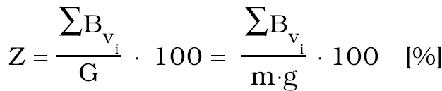

Príloha č. 4 k vyhláške č. 116/1997 Z. z.

Najmenšie hodnoty zbrzdenia vozidiel v premávke

Vozidlá | Kategória | Konštrukčná | Zmin[%] | | Prípustná

| | rýchlosť | Prevádzková | Parkovacia | ovládacia sila

schválené | vozidiel | | | |

| | [km.h-1] | | | [N]

| | | brzda | brzda |

do 1. 1. 1953 | všetky | nad 30 | 30 | 13 | -

od 1. 1. 1953 | všetky | 30 až 100 | 45 | 18 | 685

do 1. 7. 1972 | | nad 100 | 59 | 18 | 590

| L1 | | 45 | - | -

od 1. 7. 1972 | L3 | | 51 | - | -

| M1 | | 59 | 18 | 490

| M2, M3 | nad 25 | 51 | 18 | 685

do 1. 1. 1985 | N | | 45 | 18 | 685

| O | | 45 | 18 | -

od 1. 1. 1985 | L1,L2 | | 45 | - | -

| L3 | | 51 | - | -

| L4 | | 55 | - | -

| L5 | | 51 | - | -

| Ml | | 59 | 18 | 490

| M2, M3 | nad 25 | 51 | 18 | 685

| N | | 51 | 18* 12** | 685

| O prívesy | | 50 | 18* 12** | -

| O návesy | | 45 | 18* 12** | -

* Pre parkovacie brzdenie prípojných vozidiel odpojených od ťažného vozidla.

** Pre prípojné vozidlá v súprave s ťažným vozidlom.

Vozidlo v prevádzke sa z hľadiska účinku bŕzd (§ 14) hodnotí ako spôsobilé, ak hodnota zbrzdenia (Z) vozidla nie je menšia ako najmenšia prípustná hodnota zbrzdenia. Zbrzdenie (v %) sa vyjadruje ako podiel súčtu dosiahnutých brzdných síl (Bv) pri použití konkrétneho druhu brzdenia (prevádzkového, parkovacieho a pod.) a tiaže skúšaného vozidla (G) podľa vzťahu

,

kde

Σ Bv1– súčet brzdných síl na obvode všetkých kolies vozidla zistených na valcovej alebo v inej skúšobni bŕzd [N]

G – tiaž skúšaného vozidla [N], ktorá sa rovná súčtu tlakových síl náprav G = m.g,

m – hmotnosť skúšaného vozidla [kg],

g – tiažové zrýchlenie [9,80665 m.s-1 10 m.s-1].
