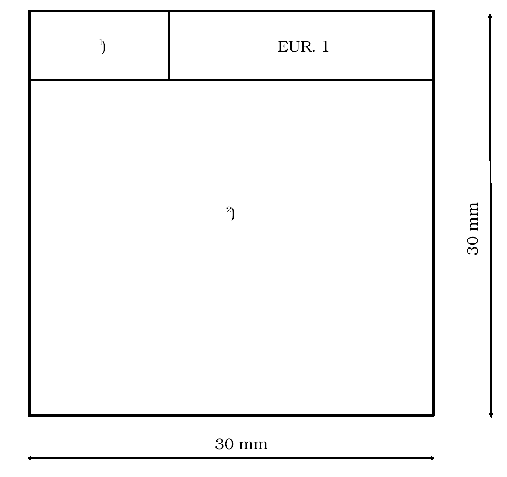

„NACHTRÄGLICH AUSGESTELLT“,

„DELIVRE A POSTERIORI“,

„RILASCIATO A POSTERIORI“,

„AFGEGEVEN A POSTERIORI“,

„ISSUED RETROSPECTIVELY“,

„UDSTEDT EFTERFoLGENDE“,

„EKΔOΘN EK TΩN YΣTEPΩN“,

„EXPEDIDO A POSTERIORI“,

„EMITIDO A POSTERIORI“,

„WYSTAWIONE RETROSPEKTYWNIE“,

„KIADVA VISSZAMENÖLEGES HATÁLLYAL“,

„VYSTAVENO DODATEČNĚ“,

„VYSTAVENÉ DODATOČNE“.

4. Potvrdenie spomínané v odseku 3 treba uviesť na sprievodnom osvedčení EUR. 1 do rubriky s názvom „Poznámky“.

Článok 15

Vystavenie duplikátu EUR. 1

1. V prípade krádeže, straty alebo zničenia sprievodného osvedčenia EUR. 1 môže vývozca písomne požiadať colné orgány, ktoré sprievodné osvedčenie vystavili, o duplikát vyhotovený na základe vývozných dokladov, ktoré majú v držbe.

2. Duplikát vystavený týmto spôsobom musí obsahovať jedno z týchto slov:

„DUPLIKAT“,

„DUPLICATA“,

„DUPLICATO“,

„DUPLICAAT“,

„DUPLICATE“,

„ANTIГPAФO“,

„DUPLICADO“,

„SEGUNDA VIA“,

„DUPLIKÁT“,

„MÁSOLAT“.

3. Potvrdenie uvedené v odseku 2 treba na sprievodnom osvedčení EUR. 1 uviesť do rubriky „Poznámky“.

4. Duplikát, ktorý musí obsahovať dátum vystavenia originálneho sprievodného osvedčenia, bude platiť od tohto dátumu.

Článok 16

Zjednodušený postup vydania osvedčení

1. Čiastočným zrušením článkov 12, 14 a 15 tohto protokolu možno pri vystavení sprievodného osvedčenia EUR. 1 použiť aj zjednodušený postup v súlade s nasledujúcimi ustanoveniami.

2. Colné orgány vyvážajúceho štátu môžu oprávniť hociktorého vývozcu (ďalej len „schválený vývozca“), ktorý robí časté zásielky, na ktoré sa môžu vystavovať sprievodné osvedčenia EUR. 1, a ktorý ponúka na spokojnosť kompetentných orgánov všetky záruky potrebné na overenie stavu pôvodu výrobkov, na to, aby nepredkladal colnici vyvážajúceho štátu v čase vývozu ani tovar, ani žiadosť o sprievodné osvedčenie EUR. 1, ktoré sa týka tohto tovaru podľa podmienok ustanovených v článku 12 tohto protokolu.

3. Oprávnenie uvedené v odseku 2 určuje podľa uváženia kompetentných orgánov, že rubrika 11 „Colná indosácia“ na sprievodnom osvedčení EUR. 1 musí byť buď

a) (...) indosovaná vopred pečiatkou kompetentnej colnice vyvážajúceho štátu a podpisom alebo faksimile podpisu úradníka tejto colnice, alebo

b) indosovaná schváleným vývozcom špeciálnou pečiatkou, ktorú schválili colné orgány vyvážajúceho štátu a ktorá je zhodná so vzorom uvedeným v prílohe V tohto protokolu. Táto pečiatka môže byť na formulároch predtlačená.

4. V prípadoch uvádzaných v odseku 3 písm. a) sa musí na sprievodnom osvedčení EUR. 1 do rubriky 7 „Poznámky“ uviesť jedna z týchto viet:

„PROCEDIMIENTO SIMPLIFICADO“,

„FORENKLET PROCEDURE“,

„VEREINFACHTES VERFAHREN“,

„AΠΛOYΣTEYMENH ΔIAΔIKAΣIA“,

„SIMPLIFIED PROCEDURE“,

„PROCEDURE SIMPLIFIEE“,

„PROCEDURA SEMPLIFICATA“,

„VEREENVOUDIGDE PROCEDURE“,

„PROCEDIMENTO SIMPLIFICADO“,

„UPROSZCZONA PROCEDURA“,

„EGYSZERŹSÍTETT ELJÁRÁS“,

„ZJEDNODUŠENÉ ŘÍZENÍ“,

„ZJEDNODUŠENÉ KONANIE“.

5. Rubriku 11 „Colná indosácia“ musí na sprievodnom osvedčení EUR. 1 v prípade potreby vyplniť schválený vývozca.

6. V prípade potreby musí schválený vývozca uviesť do rubriky 13 osvedčenia EUR. 1 „Žiadosť o overenie“ názov a adresu orgánu, ktorý je kompetentný také osvedčenie overiť.

7. Ak sa použije zjednodušený postup, colné orgány vyvážajúceho štátu môžu nariadiť použitie osvedčenia EUR. 1, ktoré má odlišovací znak, podľa ktorého ho možno identifikovať.

8. V oprávnení uvedenom v odseku 2 určia kompetentné orgány najmä

a) podmienky, na základe ktorých sa vypracujú žiadosti o osvedčenie EUR. 1,

b) podmienky, v rámci ktorých sa majú tieto žiadosti uchovávať aspoň dva roky,

c) v prípadoch uvedených v odseku 3 písm. b) orgán kompetentný vykonať overenie uvedené v článku 28 tohto protokolu.

9. Colné orgány vyvážajúceho štátu môžu určiť niektoré kategórie tovaru ako tie, ktoré neprichádzajú do úvahy na špeciálne zaobchádzanie podľa odseku 2.

10. Colné orgány odmietnu vydať oprávnenie uvedené v odseku 2 tým vývozcom, ktorí neposkytnú všetky záruky, ktoré považujú za potrebné. Tieto kompetentné orgány môžu kedykoľvek oprávnenie zrušiť. Musia to urobiť, len čo schválený vývozca nespĺňa podmienky alebo už viac neposkytuje požadované záruky.

11. Schváleného vývozcu možno vyzvať, aby informoval kompetentné orgány v súlade s predpismi, ktoré tieto orgány ustanovia, o tovare, ktorý má odoslať, aby orgány mohli vykonať overenie, ktoré považujú za potrebné, ešte pred odoslaním tovaru.

12. Colné orgány vyvážajúceho štátu môžu u schválených vývozcov urobiť akúkoľvek kontrolu, ktorú považujú za potrebnú. Schválení vývozcovia im takú kontrolu musia umožniť.

13. Ustanovenia tohto článku budú platiť bez ohľadu na aplikáciu predpisov Spoločenstva, členských štátov a Slovenskej republiky týkajúcich sa colných formalít a colných dokumentov.

Článok 17

Výmena osvedčení

1. Kedykoľvek sa musí dať vymeniť jedno alebo viac sprievodných osvedčení EUR. 1 za jedno alebo za viac iných osvedčení vtedy, ak to urobí colnica alebo iný kompetentný orgán zodpovedný za kontrolu tovaru.

2. Keď výrobky, ktoré majú pôvod v Spoločenstve, v Českej republike, v Slovenskej republike, v Poľsku alebo v Maďarsku, dovezené do voľnej zóny pod záštitou osvedčenia EUR. 1 prejdú úpravou alebo spracovaním, musia príslušné orgány vystaviť nové osvedčenie EUR. 1 na žiadosť vývozcu, ak je úprava alebo spracovanie vykonané v súlade s ustanoveniami tohto protokolu.

3. Náhradné osvedčenie sa považuje za definitívne sprievodné osvedčenie EUR. 1 na účel aplikácie tohto protokolu vrátane ustanovení tohto článku.

4. Náhradné osvedčenie sa vydáva na základe žiadosti opätovného vývozcu, keď príslušné orgány preveria dodané informácie uvedené v žiadosti žiadateľa. Dátum a poradové číslo pôvodného sprievodného osvedčenia EUR. 1 treba uviesť do rubriky 7.

Článok 18

Platnosť osvedčení

1. Sprievodné osvedčenie EUR. 1 sa musí predložiť do štyroch mesiacov odo dňa vydania colnými orgánmi vyvážajúceho štátu colným orgánom dovážajúceho štátu, do ktorého výrobky vstupujú.

2. Sprievodné osvedčenia EUR. 1, ktoré sa predkladajú colným orgánom dovážajúceho štátu po konečnom dátume predloženia špecificky uvedenom v odseku 1, môžu byť prijaté s cieľom uplatňovať preferenčné zaobchádzania v tých prípadoch, keď nepredloženie týchto osvedčení do určeného konečného termínu spôsobila vyššia moc alebo mimoriadne okolnosti.

3. V iných prípadoch oneskoreného predloženia môžu colné orgány dovážajúceho štátu akceptovať tieto osvedčenia v prípadoch, ak im boli výrobky predložené pred spomínaným konečným termínom.

Článok 19

Výstavy

1. Výrobky zaslané zo Spoločenstva alebo zo Slovenskej republiky na výstavu do inej krajiny, ako je Slovenská republika alebo ktorýkoľvek členský štát Spoločenstva, a predané na výstave na dovoz do Slovenskej republiky alebo do Spoločenstva môžu mať pri dovoze výhody na základe ustanovení Dohody pod podmienkou, že tieto výrobky spĺňajú požiadavky tohto protokolu, ktorý ich oprávňuje na to, aby sa považovali za výrobky, ktoré majú pôvod v Spoločenstve alebo v Slovenskej republike, za predpokladu, že sa na spokojnosť colných orgánov dokáže, že

a) vývozca odoslal tieto výrobky zo Spoločenstva alebo zo Slovenskej republiky do krajiny, kde sa konala výstava a kde ich vystavoval,

b) tento vývozca tieto výrobky predal alebo iným spôsobom prenechal niekomu v Spoločenstve alebo v Slovenskej republike,

c) výrobky boli počas výstavy alebo ihneď po jej skončení odoslané do Spoločenstva alebo do Slovenskej republiky v takom istom stave, v akom boli zaslané na výstavu,

d) výrobky neboli použité, keďže boli odoslané na výstavu len na vystavenie.

2. Sprievodné osvedčenie EUR. 1 sa musí predložiť colným orgánom bežným spôsobom. Musí na ňom byť uvedený názov a adresa výstavy. V prípade potreby si možno vyžiadať aj ďalšie písomné doklady o povahe výrobkov a o podmienkach, na základe ktorých boli vystavované.

3. Odsek l platí pre akúkoľvek obchodnú, priemyselnú, poľnohospodársku výstavu alebo pre výstavu remeselných výrobkov, pre veľtrh, alebo pre podobnú verejnú prehliadku, alebo ukážku, ktorá nie je usporiadaná na súkromné účely v obchodoch alebo v podnikateľských priestoroch s úmyslom predať zahraničné výrobky a počas ktorej zostávajú výrobky pod colnou kontrolou.

Článok 20

Predkladanie osvedčení

Sprievodné osvedčenia EUR. 1 sa predkladajú colným orgánom v dovážajúcom štáte v súlade s postupmi ustanovenými týmto štátom. Spomínané orgány môžu žiadať preklad osvedčenia. Môžu tiež žiadať, aby bolo k dovoznému vyhláseniu priložené aj vyhlásenie dovozcu o tom, že výrobky spĺňajú podmienky požadované na realizáciu Dohody.

Článok 21

Dovoz po častiach

Bez obmedzenia ustanovení článku 5 ods. 3 tohto protokolu, v prípade, ak na žiadosť osoby, ktorá tovar deklaruje na colnici a ktorá tento tovar dováža po častiach vo forme výrobku v rozobratom alebo v nezloženom stave v súlade s kapitolou 84 alebo 85 Harmonizovaného systému za podmienok ustanovených kompetentnými orgánmi, sa takýto tovar považuje za jeden výrobok a sprievodné osvedčenie sa môže predkladať na celý výrobok pri dovoze prvej časti.

Článok 22

Uchovávanie osvedčení

Sprievodné osvedčenia EUR. 1 musia colné orgány dovážajúceho štátu uchovávať v súlade so zodpovedajúcimi platnými predpismi v tom štáte.

Článok 23

Tlačivo EUR. 2

1. Bez ohľadu na článok 11 sa v zmysle tohto protokolu dôkaz o stave pôvodu zásielok, ktoré obsahujú len výrobky s pôvodom (v daných krajinách), ktorých hodnota nepresahuje 5 110 ECU na jednu zásielku, môže predkladať na tlačive EUR. 2, ktorého vzor je uvedený v prílohe IV tohto protokolu.

2. Tlačivo EUR. 2 vypĺňa a podpisuje vývozca alebo na zodpovednosť vývozcu ním poverený zástupca v súlade s týmto protokolom.

3. Tlačivo EUR. 2 sa vypĺňa pri každej zásielke.

4. Vývozca, ktorý vystavil tlačivo EUR. 2, predkladá na žiadosť colných orgánov vyvážajúceho štátu všetky podporné doklady týkajúce sa použitia tohto tlačiva.

5. Pre tlačivo EUR. 2 platia mutatis mutandis články 18, 20 a 22.

Článok 24

Nezrovnalosti

Zistenie malých nezrovnalostí medzi vyhláseniami v sprievodnom osvedčení EUR. 1 alebo v tlačive EUR. 2 a tými, ktoré sú uvedené v dokladoch predložených colnému orgánu na vykonanie formalít na dovoz výrobkov, nezbavujú doklad ipso facto platnosti a účinnosti, ak sa náležite zistí, že zodpovedá predloženým výrobkom.

Článok 25

Výnimky dôkazu pôvodu

1. Výrobky posielané ako malé balíky súkromnými osobami súkromným osobám alebo tie, ktoré sú súčasťou osobnej batožiny cestujúceho, sa považujú za výrobky s pôvodom a nevyžaduje sa pri nich predloženie sprievodného osvedčenia EUR. 1 alebo vyplnenie tlačiva EUR. 2 pod podmienkou, že sa tieto výrobky nedovážajú na obchodný účel, boli deklarované ako výrobky spĺňajúce podmienky požadované na aplikáciu Dohody a že neexistujú nijaké pochybnosti o pravdivosti takého vyhlásenia.

2. Dovozy, ktoré sú príležitostné a skladajú sa výlučne z výrobkov osobnej spotreby prijímateľov alebo cestujúcich, či ich rodín, sa nepovažujú za dovoz na obchodný účel, ak je z povahy a množstva výrobkov jasné, že nejde o dovoz na obchodné účely.

Okrem toho celková hodnota týchto výrobkov nesmie prekročiť 365 ECU v prípade malých balíkov a 1 025 ECU v prípade osobnej batožiny cestujúceho (cestujúcich).

Článok 26

Sumy vyjadrené v ECU

1. Sumy v národnej mene vyvážajúceho štátu, ktoré sa rovnajú sumám vyjadreným v ECU, určuje vyvážajúci štát a oznámi ich ostatným stranám tejto Dohody a dohôd medzi Spoločenstvom a Poľskom, Maďarskom a Českou republikou. Ak tieto sumy presiahnu zodpovedajúce sumy ustanovené dovážajúcim štátom, bude ich dovážajúci štát akceptovať, ak je tovar fakturovaný v mene vyvážajúceho štátu.

Ak je tovar fakturovaný v mene iného členského štátu Spoločenstva alebo Českej republiky, Slovenskej republiky, Poľska alebo Maďarska, potom dovážajúci štát uzná sumu, ktorú príslušný štát oznámi.

2. Do 30. apríla 1993 vrátane je európska menová jednotka (ECU), ktorá sa má používať v ktorejkoľvek danej národnej mene, ekvivalentom tejto národnej meny podľa európskej menovej jednotky (ECU) z 3. októbra 1990. Pre každé nasledujúce dvojročné obdobie je ekvivalentom tej národnej meny podľa európskej menovej jednotky (ECU) platnej v prvý pracovný deň mesiaca októbra toho roku, ktorý bezprostredne predchádzal tomuto dvojročnému obdobiu.

ODDIEL III

OPATRENIA TÝKAJÚCE SA ADMINISTRATÍVNEJ SPOLUPRÁCE

Článok 27

Pečiatky a adresy

Colné orgány členských štátov a Slovenskej republiky si navzájom prostredníctom Komisie Európskych spoločenstiev odovzdajú vzory odtlačkov pečiatok používaných na svojich colniciach pri vystavovaní osvedčení EUR. 1 a adresy colných úradov zodpovedných za vystavovanie sprievodných osvedčení EUR. 1 a za overovanie týchto osvedčení a tlačív EUR. 2.

Článok 28

Overenie sprievodných osvedčení EUR. 1 a tlačív EUR. 2

1. Nasledujúce overovanie sprievodných osvedčení EUR. 1 a tlačív EUR. 2 sa robí príležitostne alebo kedykoľvek, keď majú colné orgány dovážajúceho štátu oprávnené pochybnosti o pravosti daného dokladu alebo o presnosti informácií týkajúcich sa skutočného pôvodu príslušných výrobkov.

2. Na účel nasledujúceho overenia sprievodných osvedčení EUR. 1 musia colné orgány vyvážajúceho štátu uchovávať najmenej dva roky kópie osvedčení a takisto akékoľvek vývozné doklady, ktoré sa ich týkajú.

3. Na zabezpečenie príslušnej aplikácie tohto protokolu si Slovenská republika a členské štáty Spoločenstva navzájom pomáhajú prostredníctvom svojich príslušných colných orgánov pri kontrole pravosti sprievodných osvedčení EUR. 1 vrátane tých, ktoré boli vydané podľa článku 12 ods. 5, tlačív EUR. 2 a presnosti informácií týkajúcich sa skutočného pôvodu príslušných výrobkov.

4. Na účel realizácie odseku l colné orgány dovážajúceho štátu vrátia sprievodné osvedčenie EUR. 1 alebo tlačivo EUR. 2, alebo ich fotokópie colným orgánom vyvážajúceho štátu, pričom uvedú tam, kde je to vhodné, dôvody formy alebo podstaty prešetrovania.

K osvedčeniu EUR. 1 alebo k tlačivu EUR. 2 treba pripojiť príslušné obchodné dokumenty alebo ich kópie. Colné orgány pošlú všetky informácie, ktoré získali a ktoré naznačujú, že konkrétne údaje uvedené v danom osvedčení alebo tlačive sú nepresné.

5. Ak sa colné orgány dovážajúceho štátu rozhodnú pozastaviť plnenie ustanovení Dohody až do výsledkov overenia, ponúknu dovozcovi, že výrobky pustia do obehu pod podmienkou splnenia preventívnych opatrení, ktoré považujú za nevyhnutné.

6. Colné orgány dovážajúceho štátu musia byť informované o výsledkoch overovania čo najskôr. Výsledky musia byť také, aby umožnili určiť, či sa sporné sprievodné osvedčenie EUR. 1 alebo tlačivo EUR. 2 týkajú príslušných výrobkov a či tieto výrobky spĺňajú podmienky na uplatnenie preferenčného systému zaobchádzania.

Ak v prípade opodstatnených pochybností nepríde na žiadosť o overenie odpoveď do desiatich mesiacov alebo ak odpoveď neobsahuje dostatočné informácie na určenie pravosti daného dokumentu alebo skutočného pôvodu výrobkov, požadujúce orgány odmietnu, s výnimkou prípadu vyššej moci alebo mimoriadnych okolností, akékoľvek výhody z preferenčného zaobchádzania ustanoveného v príslušnej Dohode.

7. Spory, ktoré nebudú môcť vyriešiť ani colné orgány dovážajúceho štátu, ani colné orgány vyvážajúceho štátu, alebo také spory, ktoré vyvolajú otázku výkladu tohto protokolu, sa predložia Výboru pre colnú spoluprácu.

8. Vo všetkých prípadoch urovnanie sporov medzi dovozcom a colnými orgánmi dovážajúceho štátu podlieha legislatíve spomínaného štátu.

9. Ak sa zdá, že postup overovania alebo akékoľvek iné dostupné informácie naznačujú, že sa porušujú ustanovenia tohto protokolu, Spoločenstvo alebo Slovenská republika vykoná z vlastnej iniciatívy alebo na žiadosť druhej strany príslušné prešetrenie alebo zariadi, aby sa také prešetrenie vykonalo s príslušnou naliehavosťou, aby sa odhalili porušenia a aby sa im zabránilo. Na tento účel môže Spoločenstvo alebo Slovenská republika vyzvať ďalšiu stranu, aby sa na týchto prešetreniach zúčastnila.

10. Ak sa zdá, že postup overovania alebo akékoľvek iné dostupné informácie naznačujú, že sa porušujú ustanovenia tohto protokolu, výrobky budú prijaté ako výrobky s pôvodom (v daných krajinách) podľa tohto protokolu iba po skončení príslušných procedúr administratívnej spolupráce ustanovených týmto protokolom, ktoré môžu byť iniciované, najmä pokiaľ ide o postup overovania.

Podobne bude výrobkom zamietnuté zaobchádzanie ako s výrobkami s pôvodom (v daných krajinách) len po skončení postupu overovania.

Článok 29

Pokuty

Pokuty sa uložia každej osobe, ktorá vypracuje alebo zabezpečí vypracovanie dokladu obsahujúceho nesprávne konkrétne údaje s cieľom získať preferenčné zaobchádzanie pre výrobky.

Článok 30

Voľné colné zóny

Členské štáty a Slovenská republika podniknú všetky potrebné kroky na to, aby zabezpečili, že výrobky, s ktorými sa obchoduje pod hlavičkou sprievodného osvedčenia EUR. 1 a ktoré využívajú počas dopravy voľnú colnú zónu, ktorá je na ich území, nebudú nahradené iným tovarom a že sa voči nim prijmú bežné opatrenia s cieľom zabrániť zhoršeniu ich stavu.

ODDIEL IV

CEUTA A MELILLA

Článok 31

Používanie protokolu

1. Výraz „Spoločenstvo“ používaný v tomto protokole nezahŕňa Ceutu ani Melillu. Výraz „výrobky s pôvodom v Spoločenstve“ nezahŕňa výrobky, ktoré majú pôvod v týchto zónach.

2. Tento protokol platí mutatis mutandis pre výrobky majúce pôvod v Ceute a Melille podľa zvláštnych podmienok ustanovených v článku 32.

Článok 32

Zvláštne podmienky

1. Nasledujúce ustanovenia platia namiesto článku 1 a odkazy na ten článok platia mutatis mutandis o tomto článku.

2. Za predpokladu, že výrobky boli priamo dopravené v súlade s ustanoveniami článku 9, výrobky sa budú považovať za

1. výrobky s pôvodom v Ceute a Melille:

a) výrobky úplne získané v Ceute a Melille,

b) výrobky získané v Ceute a Melille, obsahujúce materiály, ktoré tam neboli úplne získané, za predpokladu, že

i) tieto materiály boli dostatočne opracované alebo spracované v zmysle článku 5 tohto protokolu alebo že

ii) tieto materiály majú pôvod v Slovenskej republike alebo v Spoločenstva v zmysle tohto protokolu, ale pod podmienkou, že boli opracované alebo väčšmi spracované, ako sa uvádza v článku 5 ods. 3 tohto protokolu,

2. výrobky s pôvodom v Slovenskej republike:

a) výrobky úplne získané v Slovenskej republike,

b) výrobky získané v Slovenskej republike, ktoré obsahujú materiály, ktoré tam neboli úplne získané, pod podmienkou, že

i) tieto materiály boli dostatočne opracované alebo spracované v zmysle článku 5 tohto protokolu alebo že

ii) tieto materiály majú pôvod v Ceute a Melille alebo v Spoločenstva v zmysle tohto protokolu pod podmienkou, že boli opracované alebo väčšmi spracované, ako sa uvádza v článku 5 ods. 3 tohto protokolu.

3. Ceuta a Melilla sa považujú za jedno územie.

4. Vývozca alebo jeho oprávnený zástupca vpíše „Slovenská republika“ a „Ceuta a Melilla“ do rubriky 2 sprievodného osvedčenia EUR. 1. Navyše v prípade výrobkov s pôvodom v Ceute a Melille sa tieto výrobky uvedú v rubrike 4 sprievodného osvedčenia EUR. 1.

5. Za správnu aplikáciu tohto protokolu v Ceute a Melille sú zodpovedné španielske colné orgány.

ODDIEL V

ZÁVEREČNÉ USTANOVENIA

Článok 33

Zmeny protokolu

Asociačná rada preskúma v dvojročnom časovom intervale alebo kedykoľvek, keď o to požiada Slovenská republika alebo Spoločenstvo, aplikáciu ustanovení tohto protokolu s tým, aby sa urobili akékoľvek potrebné zmeny alebo úpravy.

Pri takom skúmaní sa bude brať do úvahy najmä účasť zmluvných strán vo voľných zónach obchodu alebo colné únie s tretími krajinami.

Článok 34

Výbor pre colnú spoluprácu

1. Zriadi sa Výbor pre colnú spoluprácu poverený vykonávaním administratívnej spolupráce s cieľom správnej a jednotnej aplikácie tohto protokolu a vykonávaním akýchkoľvek iných úloh v oblasti colníctva, ktorými bude poverený.

2. Na jednej strane bude výbor pozostávať z odborníkov členských štátov a funkcionárov oddelení Komisie európskych spoločenstiev, ktorí sú zodpovední za colné záležitosti, a na druhej strane z odborníkov vymenovaných Slovenskou republikou.

Článok 35

Ropné produkty

Z rozsahu tohto protokolu sú dočasne vylúčené výrobky uvedené v prílohe VI. Napriek tomu opatrenia týkajúce sa administratívnej spolupráce platia mutatis mutandis pre tieto výrobky.

Článok 36

Prílohy

Prílohy tohto protokolu sú jeho nedeliteľnou súčasťou.

Článok 37

Realizácia protokolu

Spoločenstvo a práve tak aj Slovenská republika podniknú kroky potrebné na realizáciu tohto protokolu.

Článok 38

Dohody s Poľskom, Maďarskom a Českou republikou

Zmluvné strany prijmú všetky opatrenia potrebné na uzavretie dohôd s Poľskom, Maďarskom a Českou republikou, ktoré umožnia realizáciu tohto protokolu. Zmluvné strany sa budú navzájom informovať o týchto opatreniach.

Článok 39

Skladovaný tovar alebo tovar v tranzite

Ustanovenia Dohody sa môžu uplatňovať na tovar, ktorý vyhovuje ustanoveniam tohto protokolu a ktorý je ku dňu nadobudnutia platnosti Dohody buď v tranzite, alebo v Spoločenstve, alebo v Slovenskej republike dočasne skladovaný v colných konsignačných skladoch alebo vo voľných colných zónach pod podmienkou, že do štyroch mesiacov od tohto dňa sa colným orgánom dovážajúceho štátu predloží osvedčenie EUR. 1 indosované so spätnou platnosťou kompetentnými orgánmi vyvážajúceho štátu spolu s dokladmi, ktoré potvrdzujú, že tovar bol dopravený priamo.

[Příloha 27](../assets/12b49ab91f388058d53e709c9d3b6b383f582981d82bce8149f636709d5716ae.pdf)

Príloha I

POZNÁMKY

Predslov

Tieto poznámky sa týkajú, kde je to náležité, všetkých vyrábaných výrobkov, v ktorých sa použili materiály bez pôvodu (v daných krajinách), aj keď pre ne neplatia zvláštne podmienky obsiahnuté v zozname v prílohe II, ale namiesto toho sa na nich vzťahuje pravidlo o zmene čísla ustanovené v článku 5 ods. 1.

Poznámka 1

1.1 Prvé dva stĺpce zoznamu opisujú získaný výrobok. Prvý stĺpec obsahuje číslo alebo kapitolu používanú v Harmonizovanom systéme a v druhom stĺpci je opis tovaru použitého v tomto systéme pre dané číslo alebo pre kapitolu. Pre každý zápis v prvých dvoch stĺpcoch je v stĺpci 3 určené pravidlo. Ak je v niektorých prípadoch pred zápisom v prvom stĺpci uvedené „ex“, znamená to, že pravidlo v stĺpci 3 sa týka iba tej časti čísla alebo kapitoly, ktorá je opísaná v stĺpci 2.

1.2. Ak je niekoľko čísel zoskupených v stĺpci 1 alebo ak sa uvádza číslo kapitoly, potom sa v stĺpci 2 opis výrobkov uvádza všeobecne. V stĺpci 3 platí príslušné pravidlo na všetky výrobky, ktoré sú podľa Harmonizovaného systému zaradené pod číslami tejto kapitoly alebo pod niektorými číslami zoskupenými v stĺpci 1.

1.3. Ak sú v zozname týkajúcom sa rôznych výrobkov v rámci jedného čísla rozličné pravidlá, obsahuje každý odsek opis tej časti čísla, ktorej zodpovedá príslušné pravidlo v stĺpci 3.

Poznámka 2

2.1. Výraz „výroba“ zahŕňa akékoľvek opracovanie alebo spracovanie vrátane „montáže“ alebo špecifických operácií. Pozri však poznámku 3.5.

2.2 Výraz „materiál“ zahŕňa akúkoľvek prísadu, surovinu, zložku (komponent) alebo dielec atď., ktoré sa použili pri výrobe daného výrobku.

2.3 Výraz „výrobok (produkt)“ sa vzťahuje na práve vyrábaný výrobok, aj keď sa uvažuje o jeho neskoršom použití pri inej výrobnej operácii.

2.4 Výraz „tovar“ zahŕňa materiály aj výrobky.

Poznámka 3

3.1 V prípade, že niektoré číslo alebo hociktorá časť čísla nie je v zozname, platí pravidlo „zmeny čísla“ ustanovené v článku 5 ods. 1. Ak platí zmena čísla pre zápis v zozname, potom musí byť obsiahnutá aj v pravidle v stĺpci 3.

3.2 Opracovanie alebo spracovanie, ktoré vyžaduje pravidlo v stĺpci 3, sa robí iba na použitých materiáloch, ktoré nemajú pôvod (v danej krajine). Obmedzenia obsiahnuté v pravidle v stĺpci 3 platia podobne len pre materiály, ktoré nemajú pôvod (v danej krajine).

3.3 Ak pravidlo uvádza, že sa môžu použiť „materiály akéhokoľvek čísla“, potom možno použiť materiály rovnakého čísla ako výrobok pod podmienkou, že platia aj akékoľvek špecifické obmedzenia, ktoré môže toto pravidlo obsahovať. Výraz „výroba z materiálov akéhokoľvek čísla vrátane materiálov iného čísla ...“ však znamená, že sa môžu použiť len materiály zaradené pod rovnaké číslo ako výrobok, ktorého opis sa líši od opisu výrobku uvedeného v stĺpci 2.

3.4 Ak je výrobok vyhotovený z nepôvodných materiálov, ktorým bol pridelený štatút pôvodu počas výroby na základe pravidla o zmene čísla alebo ktorý sa podľa vlastného pravidla uvedeného v zozname používa ako materiál v procese výroby iného výrobku, potom sa naň nevzťahuje pravidlo platné na výrobok, ktorého je súčasťou.

Napríklad:

Motor s číslom 8407, pre ktorý pravidlo ustanovuje, že hodnota materiálov, ktoré nemajú pôvod a ktoré možno použiť, nesmie byť vyššia ako 40 % ceny franko závod, sa vyrába z „inej legovanej ocele zhruba tvárnenej kovaním“ s číslom 7224.

Ak by bol tento výrobok kovaný v danej krajine z ingotov, ktoré nemajú pôvod (v danej krajine), potom by získal pôvod na základe pravidla pre číslo ex 7224 v zozname. Pri výpočte hodnoty motora sa potom môže považovať za výrobok s pôvodom ( v danej krajine) bez ohľadu na to, či bol vyrobený v tom istom závode, alebo v inom. Hodnota ingotu, ktorý nemá pôvod (v danej krajine), sa teda neberie do úvahy, ak sa zratúva hodnota použitých materiálov, ktoré nemajú pôvod (v danej krajine).

3.5 Aj keď sa splní pravidlo o zmene čísla alebo iné pravidlá v tomto zozname, výrobok nezíska štatút pôvodu, ak vykonané spracovanie považované za celok je nedostatočné v zmysle článku 4 ods. 3.

3.6 Jednotkou kvalifikácie uplatnenia pravidiel o pôvode je konkrétny výrobok, ktorý sa považuje za základnú jednotku pri určovaní zaradenia podľa nomenklatúry Harmonizovaného systému. Ak ide o súbor výrobkov klasifikovaných podľa všeobecného pravidla 3 pre výklad Harmonizovaného systému, jednotka kvalifikácie sa určuje s ohľadom na každú položku v súbore: toto ustanovenie platí rovnako na súbory s číslami 6308, 8206 a 9605.

Z uvedeného vyplýva, že

– ak výrobok pozostáva zo skupiny alebo zo zostavy predmetov, zaraďuje sa podľa podmienok Harmonizovaného systému pod jedno číslo, pričom tento celok predstavuje jednotku kvalifikácie,

– ak zásielka pozostáva z celého radu identických výrobkov zaradených pod rovnaké číslo Harmonizovaného systému, každý výrobok sa musí individuálne zohľadňovať pri aplikácii pravidiel o pôvode,

– ak sa do Harmonizovaného systému podľa jeho všeobecného pravidla 5 zaraďuje obal spolu s výrobkom, potom sa obal berie do úvahy aj pri určovaní pôvodu.

Poznámka 4

4.1 Pravidlo v zozname predstavuje minimálne opracovanie alebo spracovanie, ktoré je nevyhnutné. Aj opracovanie alebo spracovanie vyššieho stupňa dáva štatút pôvodu, a naopak; opracovanie alebo spracovanie nižšieho stupňa nemôže dať výrobku štatút pôvodu. Ak teda pravidlo ustanovuje, že možno použiť materiál, ktorý nemá pôvod (v danej krajine), na určitej úrovni výroby, môže sa taký materiál použiť v počiatočnej fáze (štádiu) výroby, ale v ďalšej fáze výroby už takýto materiál použiť nemožno.

4.2 Ak pravidlo v zozname určuje, že výrobok možno vyrobiť z viac ako jedného materiálu, značí to, že možno použiť ktorýkoľvek matriál alebo viac materiálov. Nevyžaduje sa, aby sa použili všetky materiály.

Napríklad:

Pravidlo pre textilné látky určuje, že možno použiť prírodné vlákna a že okrem iných materiálov možno použiť aj chemické materiály. To neznamená, že sa musia použiť obidva materiály – možno použiť jeden alebo druhý, alebo obidva. Ak ale platí obmedzenie na jeden materiál a iné obmedzenia v tom istom pravidle platia na iné materiály, potom sa tieto obmedzenia týkajú len skutočne použitých materiálov.

Napríklad:

Pravidlo pre šijacie stroje určuje, že mechanizmus napínania nite, ako aj mechanizmus haditého stehu, ktoré sa použijú, musia mať pôvod (v danej krajine); tieto dve obmedzenia platia len vtedy, ak sa tieto mechanizmy do šijacieho stroja skutočne zaradia.

4.3 Ak pravidlo v zozname určuje, že sa výrobok musí vyhotoviť z nejakého konkrétneho materiálu, potom táto podmienka nebráni použiť ani iné materiály, ktoré na základe svojich prirodzených vlastností nemôžu spĺňať dané pravidlo.

Napríklad:

Pravidlo pre číslo 1904, ktoré špecificky vylučuje použiť obilniny alebo ich deriváty, však nebráni použiť minerálne soli, chemikálie a iné prísady, ktoré nie sú vyrobené z obilnín.

Napríklad:

V prípade výrobku vyhotoveného z netkaných materiálov, keď je dovolené použiť pre túto triedu výrobkov iba priadzu, ktorá nemá pôvod (v danej krajine), nemožno vychádzať z netkanej látky, aj keď sa netkané látky normálne z priadze vyhotoviť nedajú. V takých prípadoch by bol východiskový materiál za normálnych okolností v štádiu, ktoré je pred priadzou – t. j. v štádiu vlákna.

Pokiaľ ide o textílie, pozri aj poznámku 7.3.

4.4 Ak sa v pravidle v zozname uvádzajú pre maximálnu hodnotu materiálov, ktoré nemajú pôvod (v danej krajine) a ktoré možno použiť, dve alebo viaceré percentuálne sadzby, potom sa tieto percentuálne sadzby nesmú sčítať. Maximálna hodnota všetkých použitých materiálov, ktoré nemajú pôvod (v danej krajine), nesmie nikdy prekročiť najvyššiu z daných percentuálnych sadzieb. Okrem toho jednotlivé percentuálne sadzby sa vo vzťahu ku konkrétnym materiálom, pre ktoré platia, nesmú prekročiť.

Poznámka 5

5.1 Výraz „prírodné vlákna“ používaný v zozname sa týka iných vláken než umelých alebo syntetických a obmedzuje sa na fázy pred spriadaním vrátane odpadu, a pokiaľ to nie je špecifikované inak, termín „prírodné vládna“ zahŕňa vlákna, ktoré boli mykané, česané alebo inak spracované, nie však spriadané.

5.2 Výraz „prírodné vlákna“ zahŕňa vlásie čísla 0503, hodváb čísel 5002 a 5003 a práve tak aj vlnené vlákna, jemné zvieracie štetiny (chlpy) alebo drsné (hrubé) štetiny čísel 5101 až 5105, bavlnené vlákna čísel 5201 až 5203 a iné rastlinné vlákna čísel 5301 až 5305.

5.3 Výrazy „textilná vláknina“, „chemické materiály“ a „papierenské materiály“ sa v zozname používajú na opis materiálov nezaradených v kapitolách 50 až 63, ktoré sa môžu použiť na výrobu umelých, syntetických alebo papierových vláken, či priadzí.

5.4 Výraz „syntetické alebo umelé strižné vlákna“ sa v zozname používa na syntetický alebo na umelý hodvábny kábel (z vláken), strižné vlákna alebo odpad čísel 5501 až 5507.

Poznámka 6

6.1 V prípade výrobkov zaradených v tých číslach zoznamu, na ktoré odkazuje táto poznámka, neplatia podmienky ustanovené v stĺpci 3 zoznamu pre ktorékoľvek základné textilné materiály používané pri ich výrobe, ktoré, ak sa berú spolu, predstavujú 10 % alebo menej celkovej hmotnosti všetkých použitých základných textilných materiálov (pozri však aj poznámky 6.3 a 6.4).

6.2 Túto toleranciu možno však uplatniť len na zmesové výrobky, ktoré boli vyrobené z dvoch alebo z viacerých základných textilných materiálov.

Základné textilné materiály sú tieto:

- hodváb,

- vlna,

- drsné (hrubé) zvieracie štetiny,

- jemné zvieracie štetiny (chlpy),

- vlásie,

- bavlna,

- materiály, z ktorých sa vyrába papier,

- ľan,

- pravé konope,

- jutové a iné textilné lykové vlákna,

- sisalové a iné textilné vlákna z rodu Agáve,

- kokosové vlákna, vlákna manilských konopí,

vlákna ramie a iné rastlinné textilné vlákna,

- syntetický chemický hodváb,

- umelý chemický hodváb,

- syntetická chemická striž,

- umelá chemická striž.

Napríklad:

Priadza pod číslom 5205 vyrobená z bavlnených vláken čísla 5203 a syntetická striž čísla 5506 sú zmesovou priadzou. Preto syntetická striž, ktorá nemá pôvod (v danej krajine) a nespĺňa pravidlá týkajúce sa pôvodu (ktoré si vyžadujú výrobu z chemických materiálov alebo z textilnej vlákniny), sa môže používať až do hmotnosti 10 % látky.

Napríklad:

Vlnená látka čísla 5112 vyrobená z vlnenej priadze čísla 5107 a syntetickej priadze zo striže čísla 5509 je zmesovou látkou. Preto syntetická priadza, ktorá nespĺňa pravidlá týkajúce sa pôvodu (ktoré vyžadujú výrobu z chemických materiálov alebo z textilnej vlákniny), alebo vlnená priadza, ktorá nespĺňa pravidlá týkajúce sa pôvodu (ktoré si vyžadujú výrobu z prírodných vláken, nemykaných alebo nečesaných, alebo inak pripravovaných na spriadanie), alebo kombinácia týchto dvoch sa môže používať až do hmotnosti 10 % látky.

Napríklad:

Všívaná textilná látka čísla 5802 vyrobená z bavlnenej priadze čísla 5205 a bavlnená látka čísla 5210 je len zmesovým výrobkom, ak je bavlnená látka sama zmesovou látkou vyrobenou z priadze zaradenej pod dvoma zvláštnymi číslami alebo ak použité bavlnené priadze sú zmesami.

Napríklad:

Ak bola daná všívaná textilná látka vyrobená z bavlnenej priadze čísla 5205 a syntetickej látky čísla 5407, potom sú použité priadze zjavne dvoma odlišnými základnými textilnými materiálmi a všívané textilná látka je správne zmesovým výrobkom.

Napríklad:

Koberec so strapcami vyhotovenými z umelých aj z bavlnených priadzí a s jutovou podložkou je zmesovým výrobkom, pretože sa použili tri základné textilné materiály. Preto možno použiť aj akékoľvek materiály, ktoré nemajú pôvod (v danej krajine), ktoré sú z neskoršieho stupňa výroby, ako pripúšťa pravidlo, pod podmienkou, že ich celková hmotnosť spolu nepresahuje 10 % hmotnosti textilných materiálov v tomto koberci. A takto by sa mohla jutová podložka a/alebo umelé priadze dovážať vo fáze výroby, ak sú splnené podmienky hmotnosti.

6.3 V prípade látok, ktoré obsahujú polyuretánovú priadzu s pružnými polyéterovými segmentmi, či už opletenú hodvábom (gimpou), alebo nie, je táto tolerancia vo vzťahu k priadzi 20 %.

6.4 V prípade látok, ktoré obsahujú pás, ktorého základom je hliníková fólia alebo jadro z vrstvičky plastu, buď s povlakom z hliníkového prášku, alebo bez neho, so šírkou nepresahujúcou 5 mm, pričom je táto vrstvička stlačená medzi dvoma vrstvami z plastu prostredníctvom lepidla, je tolerancia vo vzťahu k tomuto pásu 30 %.

Poznámka 7

7.1 V prípade textilných výrobkov, ktoré majú v zozname poznámku pod čiarou s odkazom na túto poznámku, možno použiť textilné materiály okrem podšívok a medzipodšívok, ktoré nespĺňajú pravidlo ustanovené v zozname v stĺpci 3 pre príslušné vyhotovené výrobky, pod podmienkou, že sú zaradené pod iným číslom, ako je číslo výrobku, a za predpokladu, že ich hodnota neprevyšuje 8 % ceny výrobku franko závod.

7.2 Akékoľvek použité netextilné ozdoby a doplnky alebo iné materiály, ktoré obsahujú textil, nemusia spĺňať podmienky ustanovené v stĺpci 3, aj keď sú mimo rozsahu poznámky 4.3.

7.3 V súlade s poznámkou 4.3 sa môžu akékoľvek netextilné ozdoby a doplnky alebo iné výrobky, ktoré nemajú pôvod (v danej krajine) a ktoré neobsahujú nijaký textil, aj tak voľne používať tam, kde nemôžu byť vyrobené z materiálov uvedených v stĺpci 3.

Napríklad:

Ak nejaké pravidlo v zozname určuje, že sa musí použiť priadza pre nejakú konkrétnu textilnú položku, ako je napríklad blúzka, toto pravidlo nebráni použiť kovové predmety, ako sú napríklad gombíky, pretože sa nedajú vyhotoviť z textilných materiálov.

7.4 Tam, kde sa uplatňuje percentuálne pravidlo, musí sa brať do úvahy hodnota ozdôb a doplnkov, keď sa vypočítava hodnota použitých zahrnutých materiálov, ktoré nemajú pôvod (v danej krajine).

Príloha II

Opracovanie alebo spracovanie nepôvodných materiálov, ktoré treba vykonať, aby vyrobený výrobok získal charakter výrobku s pôvodom (v danej krajine)

[Príloha II](../assets/38d2e3cbffd1d7d7e6d104819acae669d336748a350b2284caed625d59750fdc.pdf)

[Příloha 29](../assets/aa1f004adccb6684807503050c56164d3c9f7ca60a1ae38746a5517e833787d6.pdf)

Príloha III

SPRIEVODNÉ OSVEDČENIE EUR. 1

1. Sprievodné osvedčenie EUR. 1 musí byť vyhotovené na tlačive, ktorého vzor je v tejto prílohe. Toto tlačivo musí byť vytlačené v jednom alebo vo viacerých jazykoch, v ktorých je vypracovaná dohoda. Osvedčenie musí byť vyhotovené v jednom z týchto jazykov v zhode s tuzemským právom vyvážajúcej krajiny. Ak sa vypĺňa rukou, musí byť vyplnené atramentom a tlačenými veľkými písmenami.

2. Každé osvedčenie musí mať rozmery 210 x 297 mm s dovolenou toleranciou do -5 mm alebo +8 mm dĺžky. Papier použitý na tento účel musí byť biely bez obsahu buničiny a nesmie vážiť menej ako 25 g/m2. Na pozadí musí byť vytlačený zelený gilošovaný vzor, aby sa dalo voľným okom rozpoznať akékoľvek sfalšovanie mechanickými alebo chemickými prostriedkami.

3. Kompetentné úrady členských krajín Spoločenstva a Slovenskej republiky si môžu ponechať právo vlastného vytlačenia osvedčení alebo si ich môžu dať vytlačiť v schválených tlačiarňach. V druhom prípade každé osvedčenie musí obsahovať zmienku o takomto schválení. Každé osvedčenie musí obsahovať meno a adresu tlačiarne alebo znak, ktorého pomocou možno tlačiareň identifikovať. Taktiež musí obsahovať poradové číslo, vytlačené alebo uvedené inak, podľa ktorého ho možno identifikovať.

[Vzor III-01 k protokolu č. 4](../assets/9b1478593562e26f69fde98c9759d69f27db315deb9b3bbdb0c8a729833be98a.pdf)

[Vzor III-02 k protokolu č. 4](../assets/ce1c3a59cfa8c5599909bd0aed1dd3449e4184e5a67a57bef8ced6fa3f89ab71.pdf)

[Vzor III-03 k protokolu č. 4](../assets/429701482b8bd82838ca881979d97b584e7707bdf72b0b68a961007bc4d1630c.pdf)

[Příloha 30](../assets/cc20035ae08dee7f69f0a037a53066856746fbd083ced15461aafd65b754ab10.pdf)

Príloha IV

VZOR TLAČIVA EUR. 2

1. Tlačivo EUR. 2 má formu, ktorej vzor je v tejto prílohe. Tlačivo je vytlačené v jednom alebo vo viacerých jazykoch, v ktorých je vypracovaná Dohoda. Tlačivá sa vystavujú v jednom z týchto jazykov a v súlade s ustanoveniami zákona vyvážajúcej krajiny. Ak sa vypĺňajú rukou, majú byť vyplnené atramentom a veľkými tlačenými písmenami.

2. Každé tlačivo EUR. 2 má rozmery 210 x 148 mm; možná maximálna tolerancia je -5 mm alebo +8 mm na dĺžku. Použitý papier musí byť biely, glejovaný, na písanie a nesmie obsahovať drevinu a vážiť menej ako 64 g/m2.

3. Príslušné úrady členských krajín Spoločenstva a Slovenskej republiky si môžu vyhradiť právo tlačiť tlačivá samy alebo ich nechať tlačiť v schválených tlačiarňach. V druhom prípade musí každé tlačivo obsahovať odkaz na takéto schválenie. Každé tlačivo musí obsahovať meno a adresu tlačiarne alebo značku, podľa ktorej možno tlačiareň identifikovať. Musí tiež obsahovať vytlačené poradové číslo alebo uvedené inak, podľa ktorého ho možno identifikovať.

[Príloha IV k protokolu č. 4](../assets/e6152326699d581b993d4ab9d0867f495f1c95f3f50a4785c8beee32d58d63aa.pdf)

[Příloha 31](../assets/edc61a1a4f0ad176a071b673cf8c93d7a4a6d2cd3f63a161b53d76c3ac35daa9.pdf)

Príloha V

Vzorový odtlačok pečiatky uvedenej v článku 16 ods. 3 písm. b)

[Příloha 32](../assets/c2deaef96a72b18f18f6bf9f0bde70e5a1dea6274efb470d3f428ac4ddf83dfd.pdf)

Príloha VI

Zoznam výrobkov uvedených v článku 35, ktoré sú dočasne vyradené z obsahu tohto protokolu

Číslo HS | Opis výrobku

ex 2707 | Oleje, v ktorých hmotnosť aromatických zložiek presahuje hmotnosť zložiek nearomatických,

| pričom tieto oleje sú podobné olejom minerálnym získaným destiláciou vysokoteplotného

| kamenouhoľného dechtu, ktorého viac ako 65 % objemu destiluje pri teplote 250 °C (vrátane

| zmesi lakového benzínu a surového benzénu), na energetické účely alebo na použitie ako

| vykurovacie palivo

2709 až | Minerálne oleje a produkty, ich destiláty, živičné látky, minerálne vosky

2715 |

ex 2901 | Acyklické uhľovodíky na energetické účely alebo na použitie ako vykurovacie palivo

ex 2902 | Cyklany a cyklény (iné ako azulény), benzén, toluén, xylény na energetické použitie alebo na

| použitie ako vykurovacie palivo

ex 3403 | Mazacie prípravky obsahujúce ropné oleje alebo oleje získané zo živičných nerastov za

| predpokladu, že predstavujú menej ako 70 % hmotnosti

ex 3404 | Umelé vosky a pripravené vosky s parafínovým základom, ropné vosky, vosky získané zo živičných

| nerastov, parafínový gáč alebo bridličný vosk

ex 3811 | Pripravené prísady do mazacieho oleja obsahujúceho ropné oleje alebo oleje získané zo živičných

| nerastov

PROTOKOL č. 5

k Európskej dohode („Dohoda“)

Kapitola I

Osobitné ustanovenia týkajúce sa obchodu medzi Španielskom a Slovenskou republikou

Článok 1

Ustanovenia Dohody týkajúce sa obchodu v oddiele III budú upravené so zreteľom na opatrenia a záväzky uvedené v Dokumente o prijatí Španielskeho kráľovstva a Portugalskej republiky do Európskych spoločenstiev (ďalej len „Dokument o prijatí“).

Článok 2

Podľa Dokumentu o prijatí Španielsko nebude poskytovať výrobkom pochádzajúcim zo Slovenskej republiky priaznivejšie podmienky ako poskytuje na dovoz tých, ktoré pochádzajú z iných členských krajín alebo sú v nich vo voľnom obehu.

Článok 3

Kvantitatívne obmedzenia na dovoz výrobkov do Španielska pochádzajúcich zo Slovenskej republiky môžu sa uplatňovať do 31. decembra 1995, ak ide o výrobky uvedené v prílohe A.

Článok 4

Používanie ustanovení tohto protokolu nespôsobí ujmu Nariadeniu Rady (EHS) č. 1911/91 z 26. júna 1991 o používaní ustanovení zákonov Spoločenstva voči Kanárskym ostrovom alebo Rozhodnutiu Rady č. 91/314/EHS (EEC) z 26. júna 1991, ktoré stanovilo program opcií (možností výberu) špecifických vzhľadom na vzdialenosť a ostrovný charakter Kanárskych ostrovov (Poseican).

Kapitola II

Osobitné ustanovenia týkajúce sa obchodu medzi Portugalskom a Slovenskou republikou

Článok 5

Ustanovenia Dohody týkajúce sa obchodu v oddiele III budú upravené so zreteľom na opatrenia a záväzky uvedené v Dokumente o prijatí.

Článok 6

Podľa Dokumentu o prijatí Portugalsko nebude poskytovať Slovenskej republike priaznivejšie podmienky ako poskytuje na dovoz, ktorý pochádza z iných členských krajín.

Článok 7

Kvantitatívne obmedzenia na dovoz výrobkov pochádzajúcich zo Slovenskej republiky do Portugalska môžu sa uplatňovať do 31. decembra 1995, ak ide o výrobky uvedené v prílohe B.

[Příloha 33](../assets/34bac0b2c6cd8b0a0fcd968d8188ecc6cb6493a1b2e50ae2b31baef8f6e9b601.pdf)

Príloha A

Kód KN | Poznámka | Termín liberalizácie

ex0102 90 10 | 1) | 31. 12. 1995

ex0102 90 31 | 1) | 31. 12. 1995

ex0102 90 33 | 1) | 31. 12. 1995

ex0102 90 35 | 1) | 31. 12. 1995

ex0102 90 37 | 1) | 31. 12. 1995

0103 91 10 | | 31. 12. 1995

0103 92 11 | | 31. 12. 1995

0103 92 19 | | 31. 12. 1995

0201 | | 31. 12. 1995

0203 11 10 | | 31. 12. 1995

0203 12 11 | | 31. 12. 1995

0203 12 19 | | 31. 12. 1995

0203 19 11 | | 31. 12. 1995

0203 19 13 | | 31. 12. 1995

0203 19 15 | | 31. 12. 1995

0203 19 55 | | 31. 12. 1995

0203 19 59 | | 31. 12. 1995

0203 21 10 | | 31. 12. 1995

0203 22 11 | | 31. 12. 1995

0203 22 19 | | 31. 12. 1995

0203 29 11 | | 31. 12. 1995

0203 29 13 | | 31. 12. 1995

0203 29 15 | | 31. 12. 1995

0203 29 55 | | 31. 12. 1995

0203 29 59 | | 31. 12. 1995

0206 30 21 | | 31. 12. 1995

0206 30 31 | | 31. 12. 1995

0206 41 91 | | 31. 12. 1995

0206 49 91 | | 31. 12. 1995

0208 10 10 | | 31. 12. 1995

0209 00 11 | | 31. 12. 1995

0209 00 19 | | 31. 12. 1995

0209 00 30 | | 31. 12. 1995

0210 11 11 | | 31. 12. 1995

0210 11 19 | | 31. 12. 1995

0210 11 31 | | 31. 12. 1995

0210 11 39 | | 31. 12. 1995

0210 12 11 | | 31. 12. 1995

0210 12 19 | | 31. 12. 1995

0210 19 10 | | 31. 12. 1995

0210 19 20 | | 31. 12. 1995

0210 19 30 | | 31. 12. 1995

0210 19 40 | | 31. 12. 1995

0210 19 51 | | 31. 12. 1995

0210 19 60 | | 31. 12. 1995

0210 19 70 | | 31. 12. 1995

0210 19 81 | | 31. 12. 1995

0210 20 | | 31. 12. 1995

0210 90 | | 31. 12. 1995

0210 90 39 | | 31. 12. 1995

ex0210 90 90 | 2) | 31. 12. 1995

0401 | | 31. 12. 1995

0210 90 | | 31. 12. 1995

0210 90 39 | | 31. 12. 1995

ex0210 90 90 | 2) | 31. 12. 1995

0401 | | 31. 12. 1995

0403 10 22 | | 31. 12. 1995

0403 10 24 | | 31. 12. 1995

0403 10 26 | | 31. 12. 1995

ex0403 90 51 | 3) | 31. 12. 1995

ex0403 90 53 | 3) | 31. 12. 1995

ex0403 90 59 | 3) | 31. 12. 1995

0404 10 91 | | 31. 12. 1995

0404 90 11 | | 31. 12. 1995

0404 90 13 | | 31. 12. 1995

0404 90 19 | | 31. 12. 1995

0404 90 31 | | 31. 12. 1995

0404 90 33 | | 31. 12. 1995

0404 90 39 | | 31. 12. 1995

0405 | | 31. 12. 1995

ex0406 | 4) | 31. 12. 1995

ex1001 90 99 | 5) | 31. 12. 1995

ex1004 00 90 | 6) | 31. 12. 1995

1101 | | 31. 12. 1995

1103 11 10 | | 31. 12. 1995

1103 11 90 | | 31. 12. 1995

1103 12 00 | | 31. 12. 1995

1103 13 10 | | 31. 12. 1995

1103 13 90 | | 31. 12. 1995

1103 14 00 | | 31. 12. 1995

1103 19 10 | | 31. 12. 1995

1103 19 30 | | 31. 12. 1995

1103 19 90 | | 31. 12. 1995

1104 11 10 | | 31. 12. 1995

1104 12 10 | | 31. 12. 1995

ex1104 19 10 | 7) | 31. 12. 1995

ex1104 19 30 | 7) | 31. 12. 1995

ex1104 19 50 | 7) | 31. 12. 1995

ex1104 19 99 | 7) | 31. 12. 1995

1104 21 10 | | 31. 12. 1995

1104 21 30 | | 31. 12. 1995

1104 21 50 | | 31. 12. 1995

1104 21 90 | | 31. 12. 1995

1104 22 10 | | 31. 12. 1995

1104 22 30 | | 31. 12. 1995

1104 22 50 | | 31. 12. 1995

1104 22 90 | | 31. 12. 1995

110423 10 | | 31. 12. 1995

1104 23 30 | | 31. 12. 1995

1104 23 90 | | 31. 12. 1995

1104 29 11 | | 31. 12. 1995

1104 29 15 | | 31. 12. 1995

1104 29 19 | | 31. 12. 1995

1104 29 31 | | 31. 12. 1995

1104 29 35 | | 31. 12. 1995

1104 29 39 | | 31. 12. 1995

1104 29 91 | | 31. 12. 1995

1104 29 95 | | 31. 12. 1995

1104 29 99 | | 31. 12. 1995

1104 30 10 | | 31. 12. 1995

1104 30 90 | | 31. 12. 1995

1108 11 00 | | 31. 12. 1995

1109 | | 31. 12. 1995

1501 00 11 | | 31. 12. 1995

1501 00 19 | | 31. 12. 1995

ex1501 00 90 | 8) | 31. 12. 1995

ex1601 | 9) | 31. 12. 1995

ex1602 10 00 | 9) | 31. 12. 1995

ex1602 20 90 | 9) | 31. 12. 1995

1602 41 10 | | 31. 12. 1995

1602 42 10 | | 31. 12. 1995

1602 49 11 | | 31. 12. 1995

1602 49 13 | | 31. 12. 1995

1602 49 15 | | 31. 12. 1995

1602 49 19 | | 31. 12. 1995

1602 49 30 | | 31. 12. 1995

1602 49 50 | | 31. 12. 1995

ex1602 90 10 | 10) | 31. 12. 1995

1602 90 51 | | 31. 12. 1995

ex1902 20 30 | 11) | 31. 12. 1995

2009 60 11 | | 31. 12. 1995

2009 60 19 | | 31. 12. 1995

2009 60 51 | | 31. 12. 1995

2009 60 59 | | 31. 12. 1995

2009 60 71 | | 31. 12. 1995

2009 60 79 | | 31. 12. 1995

2009 60 90 | | 31. 12. 1995

ex2204 10 11 | 12) | 31. 12. 1995

ex2204 10 19 | 12) | 31. 12. 1995

ex2204 10 90 | 12) | 31. 12. 1995

ex2204 21 10 | 12) | 31. 12. 1995

2204 21 25 | | 31. 12. 1995

2204 21 29 | | 31. 12. 1995

2204 21 35 | | 31. 12. 1995

2204 21 39 | | 31. 12. 1995

ex2204 21 49 | 12) | 31. 12. 1995

ex2204 21 59 | 12) | 31. 12. 1995

ex2204 21 90 | 12) | 31. 12. 1995

ex2204 29 10 | 12) | 31. 12. 1995

2204 29 25 | | 31. 12. 1995

2204 29 29 | | 31. 12. 1995

2204 29 35 | | 31. 12. 1995

2204 29 39 | | 31. 12. 1995

ex2204 29 49 | 12) | 31. 12. 1995

ex2204 29 59 | 12) | 31. 12. 1995

ex2204 29 90 | 12) | 31. 12. 1995

2204 30 10 | | 31. 12. 1995

2204 30 91 | | 31. 12. 1995

2204 30 99 | | 31. 12. 1995

Vysvetľujúce poznámky čiastočných obmedzení, ktoré bude uplatňovať Španielsko až do konca prechodného obdobia

Poznámka:

Obmedzenia pre položku 0803 uplatňované voči štátom, ktoré sú členmi EHS, a voči krajinám s preferenciami sú prechodné a sú účinné až do utvorenia organizácie spoločného trhu pre banány. Z toho dôvodu majú byť tieto produkty zahrnuté do tohto protokolu.

[Příloha 34](../assets/c6a818d19010ee06df2ccb34eff61fc51608af5ab6dc7eb3f821ede9a0d8b5cc.pdf)

Príloha B

0103 10 00 | 2204 21 10

0103 91 10 | 2204 21 21

0103 92 11 | 2204 21 23

0103 92 19 | 2204 21 25

&nbsp | 2204 21 29

&nbsp | 2204 21 31

0701 10 00 | 2204 21 33

0701 90 10 | 2204 21 35

0701 90 51 | 2204 29 10

0701 90 59 | 2204 29 21

&nbsp | 2204 29 23

&nbsp | 2204 29 25

0803 00 10 | 2204 29 29

0803 00 90 | 2204 29 31

&nbsp | 2204 29 33

&nbsp | 2204 29 35

0804 30 00 | 2204 29 39

PROTOKOL č. 6

o vzájomnej pomoci v otázkach colníctva

Článok 1

Definície

Na účely tohto protokolu sa rozumie

a) „colným zákonodarstvom“ ustanovenie uplatňované na území zmluvných strán upravujúce dovoz, vývoz, tranzit tovaru a jeho zaradenie do niektorého iného colného režimu vrátane opatrení o zákaze obmedzenia a kontrole, prijaté uvedenými stranami,

b) „clom“ všetky clá, dane, dávky alebo iné poplatky, ktoré sú vymeriavané a vyberané na území zmluvných strán pri realizácii colného zákonodarstva s výnimkou dávok a poplatkov, ktorých výška je vymedzená sumou zodpovedajúcou približným nákladom za poskytnuté služby,

c) „žiadajúcim orgánom“ príslušný úradný orgán, ktorý bol určený zmluvnou stranou na takýto účel a ktorý žiada o pomoc v colných otázkach,

d) „žiadaným orgánom“ príslušný úradný orgán, ktorý bol určený zmluvnou stranou na takýto účel a ktorý dostane žiadosť o pomoc v colných otázkach,

e) „deliktom“ akékoľvek porušenie colného zákonodarstva, ako aj pokus o porušenie takého zákonodarstva.

Článok 2

Rozsah

1. Zmluvné strany si navzájom pomôžu spôsobom a za podmienok ustanovených v tomto protokole pri zabezpečovaní správneho realizovania colného zákonodarstva, najmä zabraňovaním, odhaľovaním a skúmaním porušovania tohto zákonodarstva.

2. Pomoc v colných záležitostiach poskytovaná na základe tohto protokolu sa vzťahuje na akýkoľvek úradný orgán zmluvnej strany, ktorý je kompetentný aplikovať tento protokol. Nebude na ujmu pravidiel, ktoré upravujú vzájomnú pomoc v trestných záležitostiach. Nebude sa týkať ani informácií získaných na základe splnomocnenia uskutočneného na žiadosť súdneho orgánu, ibaže by s tým tieto orgány súhlasili.

Článok 3

Pomoc na základe žiadosti

1. Na základe žiadosti žiadajúceho orgánu žiadaný orgán mu poskytne všetky príslušné informácie, aby mu umožnil zabezpečiť riadne uskutočňovanie colného zákonodarstva vrátane informácií týkajúcich sa zabezpečených alebo plánovaných operácií, ktoré porušujú alebo by porušili také zákonodarstvo.

2. Na základe žiadosti žiadajúceho orgánu bude ho žiadaný orgán informovať o tom, či tovar vyvezený z územia jednej zo zmluvných strán bol riadne dovezený na územie druhej zmluvnej strany s eventuálnym uvedením colného režimu použitého na tovar.

3. Na základe žiadosti žiadajúceho orgánu uskutoční žiadaný orgán nevyhnutné kroky na zabezpečenie dozoru nad

a) fyzickými a právnickými osobami, u ktorých existujú závažné dôvody domnievať sa, že porušujú alebo porušili colné zákonodarstvo,

b) pohybmi tovaru, o ktorom je známe, že by mohli spôsobiť podstatné porušenie colného zákonodarstva,

c) dopravnými prostriedkami, pri ktorých existujú závažné dôvody domnievať sa, že boli, sú alebo môžu byť použité pri porušení colného zákonodarstva.

Článok 4

Spontánna pomoc

Zmluvné strany si poskytnú v rámci svojej právomoci vzájomnú pomoc, ak to považujú za potrebné pre správne uplatňovanie colného zákonodarstva, najmä ak získali informáciu týkajúcu sa

– operácií, ktoré porušili, porušujú alebo by mohli porušiť také zákonodarstvo a ktoré môžu byť predmetom záujmu inej zmluvnej strany,

– nových prostriedkov alebo metód použitých pri uskutočňovaní takých operácií,

– tovaru, o ktorom je známe, že je predmetom závažného porušovania colného zákonodarstva o dovoze, vývoze, tranzite alebo iného colného režimu.

Článok 5

Doručenie/oznámenie

Na základe žiadosti žiadajúceho orgánu urobí žiadaný orgán v zhode so svojím právnym poriadkom všetky nevyhnutné opatrenia na

– doručenie všetkých dokumentov,

– oznámenie všetkých rozhodnutí patriacich do rozsahu použitia tohto protokolu adresátovi, ktorý býva alebo sídli na jeho území. V takom prípade sa použijú ustanovenia odseku 3 článku 6.

Článok 6

Forma a obsah žiadostí o pomoc

1. Žiadosti podľa tohto protokolu budú vyhotovené písomne. K žiadosti budú pripojené doklady potrebné na vybavenie takých žiadostí. V prípade naliehavosti situácie môže byť prijatá ústna žiadosť, musí byť však bezprostredne potvrdená písomne.

2. Žiadosti podľa odseku l tohto článku budú obsahovať tieto informácie:

a) orgán, ktorý podáva žiadosť,

b) požadované opatrenia,

c) predmet a dôvod žiadosti,

d) príslušné zákony, pravidlá, predpisy a iné právne normy,

e) čo najpresnejšie a najobsiahlejšie údaje o fyzických osobách alebo právnických osobách, ktorých sa vyšetrovanie týka,

f) prehľad príslušných skutočností okrem prípadov, ktorých sa týka článok 5.

3. Žiadosti sa predkladajú v úradnom jazyku žiadaného orgánu alebo v jazyku prijateľnom pre taký orgán.

4. Ak žiadosť nespĺňa formálne požiadavky, môže sa vyžiadať jej oprava alebo doplnenie, môžu sa však uskutočniť aj preventívne opatrenia.

Článok 7

Vybavovanie žiadostí

1. Aby bolo vyhovené žiadosti o pomoc, žiadaný orgán, alebo ak nemôže konať sám, úradný orgán, ktorému tento orgán žiadosť odovzdal, bude v rámci svojej právomoci a dosiahnuteľných prostriedkov pri poskytovaní vlastných informácií, pri uskutočňovaní vhodných vyšetrovaní alebo pri zariaďovaní, aby tieto boli uskutočnené, postupovať tak, akoby konal sám od seba alebo na žiadosť iných orgánov tej istej zmluvnej strany.

2. Žiadosti o pomoc budú vybavované v súlade so zákonmi, pravidlami, predpismi alebo s inými právnymi normami žiadanej zmluvnej strany.

3. Náležite splnomocnení úradníci jednej zmluvnej strany môžu so súhlasom druhej zmluvnej strany a za podmienok stanovených touto stranou získať od úradov žiadaného orgánu alebo od iného orgánu, za ktorý je žiadaný orgán zodpovedný, informácie týkajúce sa porušenia colného zákonodarstva, ktoré žiadajúci orgán potrebuje na účely tohto protokolu.

4. Úradníci jednej zmluvnej strany môžu byť so súhlasom druhej zmluvnej strany prítomní pri vyšetrovaní vedenom na ich území.

Článok 8

Forma, akou má byť informácia oznámená

1. Žiadaný orgán oznámi žiadajúcemu orgánu výsledky vyšetrovania vo forme dokumentov, overených kópií dokumentov, správ a pod.

2. Dokumenty uvedené v odseku l môžu byť nahradené informáciou zhotovenou prostredníctvom výpočtovej techniky, spracovanou v akejkoľvek forme na ten istý účel.

Článok 9

Výnimky z povinnosti poskytnúť pomoc

1. Zmluvné strany môžu odmietnuť poskytnutie pomoci podľa tohto protokolu, ak by to

a) mohlo byť na prekážku suverenite, verejného poriadku, bezpečnosti alebo iných závažných záujmov, alebo

b) malo vplyv na menové alebo daňové predpisy, nie však na predpisy týkajúce sa ciel, alebo

c) porušilo priemyselné, obchodné alebo služobné tajomstvo.

2. Ak žiadajúci orgán žiada o pomoc, ktorú by sám nebol schopný poskytnúť, ak by bol o ňu požiadaný, upozorní na túto skutočnosť vo svojej žiadosti. Potom žiadaný orgán rozhodne, ako na takú žiadosť odpovie.

3. Ak bola žiadosť odopretá alebo zamietnutá, musí byť rozhodnutie o tom spolu s odôvodnením oznámené žiadajúcemu orgánu bez meškania.

Článok 10

Povinnosť utajenia

1. Každá informácia oznámená v akejkoľvek forme podľa tohto protokolu bude utajená. Bude sa na ňu vzťahovať predpis o utajovaní skutočností a bude chránená podľa príslušných zákonov platných v zmluvnej krajine, ktorá ju získala, a podľa zodpovedajúcich predpisov týkajúcich sa orgánov Spoločenstva.

2. Menné údaje nebudú odovzdané, ak bude závažný dôvod domnievať sa, že odovzdanie alebo použitie odovzdaných údajov by odporovalo základnému právnemu princípu jednej zo zmluvných strán, a najmä v takom prípade, ak by dotknutá strana utrpela škodu. Strana, ktorá informáciu získala, bude informovať stranu, ktorá informáciu poskytla, a to na jej žiadosť, o spôsobe použitia dodaných informácií a o získaných výsledkoch.

3. Menné údaje môžu byť odovzdané len colným orgánom, prípadne na súdne účely, na účely verejnej žaloby a súdnym orgánom. Ostatné osoby a orgány môžu získať také informácie len na základe predbežného súhlasu strany, ktorá ju poskytla.

4. Strana poskytujúca informácie si overí správnosť odovzdaných informácií. Len čo zistí, že poskytnuté informácie boli nesprávne alebo majú byť zrušené, bude o tom strana, ktorá ich získala, bez meškania vyrozumená. Naposledy uvedená strana bude povinná uskutočniť ich úpravy alebo vyradenie.

5. S výnimkou prípadov, v ktorých prevláda verejný záujem, môže príslušná osoba získať na žiadosť informácie o uchovávaných údajoch a dôvodoch ich uchovávania.

Článok 11

Použitie informácií

1. Získané informácie budú použité len na účely tohto protokolu a na iné účely môžu byť použité v každej zmluvnej krajine len na základe predchádzajúceho písomného súhlasu úradného orgánu, ktorý ich poskytol a budú podliehať všetkým obmedzeniam určeným týmto orgánom. Tieto opatrenia sa nepoužijú na informácie týkajúce sa deliktov v oblasti omamných a psychotropných látok. Také informácie môžu byť odovzdané iným orgánom priamo zúčastneným v boji proti nezákonnému obchodu s omamnými látkami za podmienok uvedených v článku 2.

2. Odsek 1 nebude brániť použitiu informácií v akomkoľvek súdnom alebo úradnom konaní vedenom neskôr pre nerešpektovanie colného zákonodarstva.

3. Zmluvné strany môžu vo svojich svedeckých výpovediach, protokoloch a zápisniciach, ako aj v konaní a žalobách podaných súdom použiť získané informácie a dokumenty ako dôkaz v súlade s ustanoveniami tohto protokolu.

Článok 12

Experti a svedkovia

Úradník žiadaného orgánu môže byť splnomocnený v rozsahu poskytnutého splnomocnenia vystúpiť ako expert alebo svedok v súdnom alebo úradnom konaní týkajúcom sa záležitostí, na ktoré sa vzťahuje tento protokol a ktoré sú v súdnej právomoci inej zmluvnej strany, a predložiť také predmety, dokumenty alebo ich overené kópie, ktoré môžu byť potrebné pre konanie. Žiadosť o vystúpenie musí výslovne uvádzať, o akú záležitosť a o akú hodnosť alebo kvalifikáciu úradníka ide.

Článok 13

Náklady na pomoc

Zmluvné strany upustia od všetkých nárokov voči ktorejkoľvek druhej strane na úhradu nákladov vzniknutých podľa tohto protokolu s výnimkou nákladov na expertov, svedkov, tlmočníkov a prekladateľov, ktorí nepatria do verejných služieb, ak je to vhodné.

Článok 14

Vykonávanie

1. Vykonávaním tohto protokolu budú poverené ústredné colné orgány Slovenskej republiky na jednej strane a príslušné orgány Komisie na strane druhej. Tieto orgány budú rozhodovať o všetkých praktických opatreniach a úpravách nevyhnutných na jeho plnenie, pričom budú brať do úvahy pravidlá ochrany údajov. Môžu odporúčať príslušným orgánom doplnky, o ktorých sa domnievajú, že by mali byť do tohto protokolu zapracované.

2. Zmluvné strany budú navzájom konzultovať a následne sa informovať o podrobných spôsoboch vykonávania tohto protokolu, ktoré sa prijímajú na základe tohto článku.

Článok 15

Doplnenie

1. Tento protokol bude dopĺňať iné dohody o vzájomnej pomoci, ktoré boli alebo budú uzavreté medzi jednotlivými alebo niekoľkými členskými krajinami Európskych spoločenstiev a Slovenskou republikou a nebude brániť ich plneniu. Nebude brániť širšej vzájomnej pomoci, ktorá sa bude poskytovať v rámci týchto dohôd.

2. S výnimkou článku 11 nebránia takéto dohody uskutočňovaniu opatrení Spoločenstiev, ktorými sa riadi oznamovanie akýchkoľvek získaných informácií v colných otázkach medzi príslušnými úradmi Komisie a colnými orgánmi členských krajín, ktoré by mohli Spoločenstvá zaujímať.

PROTOKOL č. 7

o obchodných výhodách s ročnými limitmi

Zmluvné strany súhlasia s tým, že ak Dohoda nadobudne platnosť po 1. januári ktoréhokoľvek roku, akékoľvek obchodné výhody poskytované v rámci ročných kvantitatívnych limitov budú alikvotne upravené vo vzťahu k výrobkom dovážaným počas roka do Slovenskej republiky v súlade s ustanoveniami protokolu č. 4 Dočasnej dohody podpísanej medzi Spoločenstvom a Českou a Slovenskou Federatívnou Republikou 16. decembra 1991, pozmeneného dodatkovými protokolmi podpísanými medzi Spoločenstvom a Slovenskou republikou a Spoločenstvom a Českou republikou.

PROTOKOL č. 8

o nástupníctve Slovenskej republiky v súvislosti s výmenou listov medzi Európskym hospodárskym spoločenstvom (Spoločenstvo) a Českou a Slovenskou Federatívnou Republikou týkajúcich sa tranzitu a pozemnej dopravnej infraštruktúry

Keďže bola 16. decembra 1991 podpísaná Európska dohoda a Dočasná dohoda medzi Európskymi spoločenstvami a jeho členskými štátmi na jednej strane a Českou a Slovenskou Federatívnou Republikou na strane druhej, prebehla výmena listov, ktoré boli podpísané medzi Európskym hospodárskym spoločenstvom a Českou a Slovenskou Federatívnou Republikou v takej forme, aká je v prílohe,

keďže bola výmena listov doplnená výmenou listov podpísaných 19. februára 1992 medzi Európskym hospodárskym spoločenstvom a Českou a Slovenskou Federatívnou Republikou, ktoré sú v prílohe,

keďže Slovenská republika deklarovala v liste z 15. decembra 1992 predsedovi Komisie Európskych spoločenstiev, že „preberá na seba všetky záväzky vyplývajúce zo všetkých dohôd medzi Českou a Slovenskou Federatívnou Republikou a Európskymi spoločenstvami“,

keďže sa stala Slovenská republika od 1. januára l993 nástupníckym štátom po bývalej Českej a Slovenskej Federatívnej Republike,

keďže sa Slovenská republika zaväzuje nezhoršovať podmienky územného tranzitu v porovnaní so stavom, aký prevažoval v období výmeny listov v Českej a Slovenskej Federatívnej Republike,

Slovenská republika a Spoločenstvo sa dohodli takto:

Článok 1

Spoločenstvo na jednej strane a Slovenská republika na strane druhej preberajú všetky práva a záväzky Spoločenstva na jednej strane a bývalej Českej a Slovenskej Federatívnej Republiky na strane druhej, ktoré sú obsiahnuté vo vzájomne vymenených listoch.

Článok 2

Slovenská republika sa podoberá vydať také množstvo povolení, aké sa uvádza vo vymenených listoch týkajúcich sa uvedeného tranzitu. Povolenia budú platné (od r. 1994) len na území Slovenskej republiky. Slovenská republika bude pravidelne vydávať povolenia držiteľom povolenia vydaného Českou republikou, ako to bolo dohodnuté vo vymenených listoch, pričom ich počet bude limitovaný maximálnym počtom, s ktorým sa ráta v uvedených listoch.

Článok 3

Výška administratívnych poplatkov, daní a iných možných poplatkov uvalených Slovenskou republikou na zdaniteľné povolenia na základe uvedených vymenených listov nepresiahne sumu 9 250 slovenských korún.

Článok 4

Slovenská republika vyhlasuje, že na zabránenie vzniku menej priaznivých podmienok na tranzit prepravcov Spoločenstva ako boli tie, ktoré prevládali v čase uvedených vymenených listov, prijme všetky možné opatrenia, aby zabránila neželateľnému zdržovaniu prepravcov Spoločenstva v dôsledku kontrol na hraniciach medzi Českou republikou a Slovenskou republikou.

[Příloha 35](../assets/0dff3c12688617973fc579768e43e98dce837759e538f4cab918a0aabd5213aa.pdf)

Príloha I

VÝMENA LISTOV

medzi Európskym hospodárskym spoločenstvom a Českou a Slovenskou Federatívnou Republikou týkajúcich sa tranzitu

A. List Českej a Slovenskej Federatívnej Republiky

Pane,

počas rokovaní o Európskej dohode medzi Spoločenstvom, jeho členskými štátmi a Českou a Slovenskou Federatívnou Republikou (ČSFR) sa dosiahla táto dohoda:

1. Strany Európskej dohody neprijmú nijaké opatrenia, ktoré by boli na ujmu vzniknutému stavu v dôsledku používania existujúcich bilaterálnych dohôd medzi členskými štátmi Spoločenstva a ČSFR.

2. Najmä v rámci globálneho riešenia problémov tranzitu cez ČSFR pre tie členské štáty Spoločenstva, ktorých sa to priamo dotýka, ČSFR zaručuje 2 000 dodatočných zdaniteľných povolení v roku 1991 nad existujúcu kvótu zaručenú na základe bilaterálnych dohôd na rok 1991. Ďalej ČSFR poskytne v rokoch 1992, l993 a l994 povolenia ako dodatok k existujúcej kvóte určenej bilaterálnymi dohodami z roku 1991 vrátane už spomínaných 2 000 povolení takýmto spôsobom:

| 1992 | 1993 | 1994 |

nezdanené | 1 300 | 1 300 | 1 440 | 1)

zdaniteľné | 1 000 | 1 000 | 1 332 | 1)

tretia krajina | — | — | — |

kombinovaná doprava | 4 000 | 4 000 | 4 680 | 2)

Povolenia týkajúce sa kombinovanej dopravy by mali využívať nákladné autá, ktoré prechádzajú cez územie ČSFR po železnici vo forme „pohyblivých ciest“, za predpokladu, že náklady a čas vynaložené na tento druh dopravy budú porovnateľné s tými, ktoré sa týkajú zdaniteľnej cestnej tranzitnej prevádzky. Pre tie povolenia, ktoré nezodpovedajú týmto požiadavkám, vydá ČSFR zdaniteľné tranzitné povolenia. Všetky uvedené tranzitné povolenia majú charakter jednej cesty tam a späť.

V roku 1995 a v nasledujúcich rokoch, kým nenadobudne účinnosť bilaterálna zmluva o doprave medzi Spoločenstvom a ČSFR, ČSFR zvýši počet nezdaňovaných povolení a zdaniteľných povolení na kombinovanú dopravu s tou istou výškou poplatkov ako v roku 1994.

Bol by som Vám zaviazaný, keby ste potvrdili súhlas Európskeho hospodárskeho spoločenstva s obsahom tohto listu.

Prijmite, prosím, pane, ubezpečenie o mojej najhlbšej úcte.

Za vládu Českej a Slovenskej Federatívnej Republiky

B. List Spoločenstva

Pane,

mám česť potvrdiť Vám príjem Vášho dnešného listu, ktorý znie takto:

„Počas rokovaní o Európskej dohode medzi Spoločenstvom, jeho členskými štátmi a Českou a Slovenskou Federatívnou Republikou (ČSFR) sa dosiahla táto dohoda:

1. Strany Európskej dohody neprijmú nijaké opatrenia, ktoré by boli na ujmu stavu vzniknutému v dôsledku používania existujúcich bilaterálnych dohôd medzi členskými štátmi Spoločenstva a ČSFR.

2. Najmä v rámci globálneho riešenia problémov tranzitu cez ČSFR pre tie členské štáty Spoločenstva, ktorých sa to priamo dotýka, ČSFR zaručuje 2 000 dodatočných zdaniteľných povolení v roku 1991 nad existujúcu kvótu zaručenú na základe bilaterálnych dohôd na rok 1991. Ďalej ČSFR poskytne v rokoch 1992, 1993 a 1994 povolenia ako dodatok k existujúcej kvóte určenej bilaterálnymi dohodami z roku 1991 vrátane už spomínaných 2 000 povolení takýmto spôsobom:

| 1992 | 1993 | 1994 |

nezdanené | 1 300 | 1 300 | 1 440 | 1)

zdaniteľné | 1 000 | 1 000 | 1 332 | 1)

tretia krajina | — | — | — |

kombinovaná doprava | 4 000 | 4 000 | 4 680 | 2)

Povolenia týkajúce sa kombinovanej dopravy by mali využívať nákladné autá, ktoré prechádzajú cez územie ČSFR po železnici vo forme „pohyblivých ciest", za predpokladu, že náklady a čas vynaložené na tento druh dopravy budú porovnateľné s tými, ktoré sa týkajú zdaniteľnej cestnej tranzitnej prevádzky. Pre tie povolenia, ktoré nezodpovedajú týmto požiadavkám, vydá ČSFR zdaniteľné tranzitné povolenia. Všetky uvedené tranzitné povolenia majú charakter jednej cesty tam a späť.

V roku l995 a v nasledujúcich rokoch, kým nenadobudne účinnosť bilaterálna zmluva o doprave medzi Spoločenstvom a ČSFR, ČSFR zvýši počet nezdaňovaných povolení a zdaniteľných povolení na kombinovanú dopravu s tou istou výškou poplatkov ako v roku l994.

Bol by som Vám zaviazaný, keby ste potvrdili súhlas Európskeho hospodárskeho spoločenstva s obsahom tohto listu.

Prijmite, prosím, pane, ubezpečenie o mojej najhlbšej úcte.“

Mám česť potvrdiť Vám súhlas Európskeho hospodárskeho spoločenstva s obsahom tohto listu.

Prijmite, prosím, pane, ubezpečenie o mojej najhlbšej úcte.

Za Radu Európskych spoločenstiev

VÝMENA LISTOV

medzi Európskym hospodárskym spoločenstvom a Slovenskou republikou týkajúcich sa pozemnej dopravnej infraštruktúry

A. List Spoločenstva

Pane,

mám česť potvrdiť Vám stanovisko Európskeho spoločenstva vyjadrené počas rokovaní o Európskej dohode medzi Spoločenstvom, jeho členskými štátmi a Slovenskou republikou s tým, že Spoločenstvo v rámci finančných mechanizmov zabezpečovaných na základe Dohody bude vhodným spôsobom financovať zlepšenie pozemnej dopravnej infraštruktúry vrátane kombinovanej dopravy.

Bol by som Vám zaviazaný, keby ste potvrdili súhlas Slovenskej republiky s obsahom tohto listu.

Prijmite, prosím, pane, ubezpečenie o mojej najhlbšej úcte.

Za Radu Európskych spoločenstiev

B. List Slovenskej republiky

Pane,

mám česť potvrdiť Vám príjem Vášho dnešného listu, ktorý znie takto:

„Mám česť potvrdiť Vám stanovisko Európskeho spoločenstva vyjadrené počas rokovaní o Európskej dohode medzi Spoločenstvom, jeho členskými štátmi a Slovenskou republikou s tým, že Spoločenstvo v rámci finančných mechanizmov zabezpečovaných na základe Dohody bude vhodným spôsobom financovať zlepšenie pozemnej dopravnej infraštruktúry vrátane kombinovanej dopravy.

Bol by som Vám zaviazaný, keby ste potvrdili súhlas Slovenskej republiky s obsahom tohto listu.“

Mám česť Vám potvrdiť, že naša vláda súhlasí s obsahom Vášho listu.

Prijmite, prosím, pane, ubezpečenie o mojej najhlbšej úcte.

Za vládu Slovenskej republiky

[Příloha 36](../assets/77d6295b6a46194fca0330f61b96c5e6b78b4463c5deae86e084471639e0b97b.pdf)

Príloha II

DOHODA

vo forme výmeny listov dopĺňajúca výmenu listov medzi Spoločenstvom a Českou a Slovenskou Federatívnou Republikou týkajúcich sa tranzitu, podpísaných 16. decembra 1991 v Bruseli

A. List Spoločenstva

Vážený pane,

pri príležitosti podpísania Európskej dohody zo 16. decembra 1991 medzi Spoločenstvami, ich členskými štátmi a Českou a Slovenskou Federatívnou Republikou a Dočasnej dohody o obchode a o otázkach súvisiacich s obchodom medzi Európskym hospodárskym spoločenstvom (Spoločenstvo) a Európskym združením uhlia a ocele na jednej strane a Českou a Slovenskou Federatívnou Republikou na strane druhej boli podpísané dohody o tranzite vo forme výmeny listov medzi Spoločenstvom a Česko-Slovenskom. Európska dohoda ešte nenadobudla platnosť. Dočasná dohoda nadobudla platnosť 1. marca l992.

Od podpísania uvedených listov zvýšila Česká a Slovenská Federatívna Republika poplatky za zdaniteľné tranzitné povolenia. Toto rozhodnutie malo za následok úpravu týkajúcu sa tranzitu, ku ktorej sa dospelo v decembri, a zmluvné strany považujú v súčasnosti za nutné zmeniť príslušné ustanovenia v uvedených listoch podpísaných 16. decembra 1991 prostredníctvom výmeny listov.

Preto navrhujem, aby uvedené listy podpísané 16. decembra 1991 boli pozmenené takto:

V odseku 2 má byť po prvej vete v prvom pododseku vložená táto veta: „Poplatok za zdaniteľné povolenie je 18 500 korún československých.“

Nasledujúci pododsek sa má pripojiť k druhému pododseku odseku 2: „Obe zmluvné strany súhlasia, že v prípade, ak tranzitná situácia na teritóriu bývalej Juhoslávie nebude normalizovaná, do konca roka spoločnými silami preskúmajú možnosti týkajúce sa uvedených opatrení. Zmeny v uvedených ustanoveniach sa môžu uskutočniť medzi zmluvnými stranami.“

Ak je pre Českú a Slovenskú Federatívnu Republiku predchádzajúci návrh prijateľný, mám česť Vám navrhnúť, aby tento list spolu s odpoveďou Vašej Excelencie slúžil ako zmena textu uvedených listov podpísaných 16. decembra 1991.

Túto Dohodu týmto schvaľujú zmluvné strany v súlade s ich príslušnými postupmi.

Táto Dohoda nadobudne účinnosť prvý deň po tom, ako si zmluvné strany navzájom oznámia, že postupy uvedené v predchádzajúcom pododseku sú zavŕšené. To platí od 15. marca l992.

Bol by som Vám zaviazaný, keby ste potvrdili súhlas vlády Českej a Slovenskej Federatívnej Republiky s obsahom tohto listu.

Prijmite, prosím, pane, ubezpečenie o mojej najhlbšej úcte.

Za Radu Európskych spoločenstiev

B. List Českej a Slovenskej Federatívnej Republiky

Vážený pane,

mám česť potvrdiť Vám príjem Vášho dnešného listu, ktorý znie takto:

„Pri príležitosti podpísania Európskej dohody zo 16. decembra 1991 medzi Spoločenstvami, ich členskými štátmi a Českou a Slovenskou Federatívnou Republikou a Dočasnej dohody o obchode a o otázkach súvisiacich s obchodom medzi Európskym hospodárskym spoločenstvom (Spoločenstvo) a Európskym združením uhlia a ocele na jednej strane a Českou a Slovenskou Federatívnou Republikou na strane druhej boli podpísané dohody o tranzite vo forme výmeny listov medzi Spoločenstvom a Česko-Slovenskom. Európska dohoda ešte nenadobudla platnosť. Dočasná dohoda nadobudla platnosť 1. marca 1992.

Od podpísania uvedených listov zvýšila Česká a Slovenská Federatívna Republika poplatky za zdaniteľné tranzitné povolenia. Toto rozhodnutie malo za následok úpravu týkajúcu sa tranzitu, ku ktorej sa dospelo v decembri, a zmluvné strany považujú v súčasnosti za nutné zmeniť príslušné ustanovenia v uvedených listoch podpísaných 16. decembra 1991 prostredníctvom výmeny listov.

Preto navrhujem, aby uvedené listy podpísané 16. decembra 1991 boli pozmenené takto:

V odseku 2 má byť po prvej vete v prvom pododseku vložená táto veta: ,Poplatok za zdaniteľné povolenie je 18 500 korún československých.'

Nasledujúci pododsek sa má pripojiť k druhému pododseku odseku 2: ,Obe zmluvné strany súhlasia, že v prípade, ak tranzitná situácia na teritóriu bývalej Juhoslávie nebude normalizovaná, do konca roka spoločnými silami preskúmajú možnosti týkajúce sa uvedených opatrení. Zmeny v uvedených ustanoveniach sa môžu uskutočniť medzi zmluvnými stranami.'

Ak je pre Českú a Slovenskú Federatívnu Republiku predchádzajúci návrh prijateľný, mám česť Vám navrhnúť, aby tento list spolu s odpoveďou Vašej Excelencie slúžil ako zmena textu uvedených listov podpísaných 16. decembra 1991.

Túto Dohodu týmto schvaľujú zmluvné strany v súlade s ich príslušnými postupmi.

Táto Dohoda nadobudne účinnosť prvý deň po tom, ako si zmluvné strany navzájom oznámia, že postupy uvedené v predchádzajúcom pododseku sú zavŕšené. To platí od 15. marca 1992.

Bol by som Vám zaviazaný, keby ste potvrdili súhlas vlády Českej a Slovenskej Federatívnej Republiky s obsahom tohto listu.“

Mám česť Vám potvrdiť, že moja vláda súhlasí s obsahom tohto listu.

Prijmite, prosím, pane, ubezpečenie o mojej najhlbšej úcte.

Za Českú a Slovenskú Federatívnu Republiku

DOHODA

vo forme výmeny listov nahrádzajúca výmenu listov medzi Spoločenstvom a Českou a Slovenskou Federatívnou Republikou týkajúcich sa pozemnej dopravnej infraštruktúry, podpísaných 16. decembra 1991 v Bruseli

A. List Spoločenstva

Vážený pane,

pri príležitosti podpísania Dočasnej dohody o obchode a o otázkach súvisiacich s obchodom 16. decembra 1991 medzi Európskym hospodárskym spoločenstvom (Spoločenstvo) a Európskym spoločenstvom uhlia a ocele na jednej strane a Českou a Slovenskou Federatívnou Republikou na strane druhej bola podpísaná Dohoda o pozemnej dopravnej infraštruktúre vo forme výmeny listov medzi Spoločenstvom a Česko-Slovenskom. Dočasná dohoda nadobudla platnosť 1. marca 1992.

Od podpísania Dohody formou výmeny listov zvýšila Česká a Slovenská Federatívna Republika poplatky za zdaniteľné tranzitné povolenia. Tento zákon mal vplyv na opatrenia týkajúce sa tranzitu, ktoré boli prijaté v decembri, a zúčastnené zmluvné strany, berúc tento fakt do úvahy, považovali za nutné uzavrieť dohodu prostredníctvom tejto výmeny listov s cieľom novelizovať zodpovedajúce ustanovenia Dohody uzavretej formou výmeny listov 16. decembra 1991.

Preto navrhujem, aby sa text výmeny listov podpísaných 16. decembra 1991 nahradil týmto textom:

„Mám česť Vám týmto potvrdiť, že Spoločenstvo plne chápe problémy s infraštruktúrou a so životným prostredím, ktorým Česká a Slovenská Federatívna Republika čelí v oblasti dopravy, a v rámci svojich finančných mechanizmov bude podľa potreby poskytovať financie na zdokonalenie pozemnej infraštruktúry vrátane kombinovanej dopravy.

V tejto súvislosti beriem na vedomie vysvetlenie Českej a Slovenskej Federatívnej Republiky týkajúce sa neodkladnej potreby finančnej pomoci, ktorá by umožnila jej pozemnej dopravnej infraštruktúre vyrovnať sa so zvýšenou tranzitnou dopravou na svojom území.

Zmluvné strany sa zhodli na tom, že v kontexte existujúcej Dohody o obchode a spolupráci treba hľadať možné spôsoby a prostriedky prispievajúce k zlepšeniu takej infraštruktúry v Českej a Slovenskej Federatívnej Republike s osobitným zreteľom na hraničné priechody a priľahlé oblasti, kombinovanú dopravu, tranzitné diaľnice, dopravu vodnými cestami a na environmentálne aspekty bez ohľadu na hodnotenie projektov podľa existujúcich postupov.

Zmluvné strany ďalej súhlasia s tým, že pri najbližšej vhodnej príležitosti začnú rozhovory o prípadnej finančnej pomoci Spoločenstva.

Česká a Slovenská Federatívna Republika zváži ďalšie znižovanie počtu zdaniteľných povolení pre prepravcov Spoločenstva v zhode s dosiahnutými výsledkami v uvedených rozhovoroch.“

Ak je uvedené prijateľné pre Českú a Slovenskú Federatívnu Republiku, mám česť Vám navrhnúť, aby tento list spolu s odpoveďou Vašej Excelencie v tomto zmysle predstavoval náhradu za výmenu listov podpísaných 16. decembra 1991.

Túto Dohodu týmto zmluvné strany odsúhlasili v súlade s ich príslušnými postupmi.

Táto Dohoda nadobudne platnosť prvý deň po tom, čo si zmluvné strany oznámia, že postupy uvedené v predchádzajúcom pododseku boli zavŕšené. Bude platiť od 15. marca 1992.

Bol by som Vám zaviazaný, keby ste potvrdili súhlas vlády Českej a Slovenskej Federatívnej Republiky s obsahom tohto listu.

Prijmite, prosím, pane, ubezpečenie o mojej najhlbšej úcte.

Za Radu Európskych spoločenstiev

B. List Českej a Slovenskej Federatívnej Republiky

Vážený pane,

mám česť potvrdiť príjem Vášho dnešného listu, ktorý znie takto:

„Pri príležitosti podpísania Dočasnej dohody o obchode a o otázkach súvisiacich s obchodom 16. decembra 1991 medzi Európskym hospodárskym spoločenstvom (Spoločenstvo) a Európskym spoločenstvom uhlia a ocele na jednej strane a Českou a Slovenskou Federatívnou Republikou na strane druhej bola podpísaná Dohoda o pozemnej dopravnej infraštruktúre vo forme výmeny listov medzi Spoločenstvom a Česko-Slovenskom. Dočasná dohoda nadobudla platnosť 1. marca l992.

Od podpísania Dohody formou výmeny listov zvýšila Česká a Slovenská Federatívna Republika poplatky za zdaniteľné tranzitné povolenia. Tento zákon mal vplyv na opatrenia týkajúce sa tranzitu, ktoré boli prijaté v decembri, a zúčastnené zmluvné strany, berúc tento fakt do úvahy, považovali za nutné uzavrieť dohodu prostredníctvom tejto výmeny listov s cieľom novelizovať zodpovedajúce ustanovenia Dohody uzavretej formou výmeny listov 16. decembra 1991.

Preto navrhujem, aby sa text výmeny listov podpísaných 16. decembra 1991 nahradil týmto textom:

,Mám česť Vám týmto potvrdiť, že Spoločenstvo plne chápe problémy s infraštruktúrou a so životným prostredím, ktorým Česká a Slovenská Federatívna Republika čelí v oblasti dopravy, a v rámci svojich finančných mechanizmov bude podľa potreby poskytovať financie na zdokonalenie pozemnej infraštruktúry vrátane kombinovanej dopravy.

V tejto súvislosti beriem na vedomie vysvetlenie Českej a Slovenskej Federatívnej Republiky týkajúce sa neodkladnej potreby finančnej pomoci, ktorá by umožnila jej pozemnej dopravnej infraštruktúre vyrovnať sa so zvýšenou tranzitnou dopravou na svojom území.

Zmluvné strany sa zhodli na tom, že v kontexte existujúcej Dohody o obchode a spolupráci treba hľadať možné spôsoby a prostriedky prispievajúce k zlepšeniu takej infraštruktúry v Českej a Slovenskej Federatívnej Republike s osobitným zreteľom na hraničné priechody a priľahlé oblasti, kombinovanú dopravu, tranzitné diaľnice, dopravu vodnými cestami a na environmentálne aspekty bez ohľadu na hodnotenie projektov podľa existujúcich postupov.

Zmluvné strany ďalej súhlasia s tým, že pri najbližšej vhodnej príležitosti začnú rozhovory o prípadnej finančnej pomoci Spoločenstva.

Česká a Slovenská Federatívna Republika zváži ďalšie znižovanie počtu zdaniteľných povolení pre prepravcov Spoločenstva v zhode s dosiahnutými výsledkami v uvedených rozhovoroch.'

Ak je uvedené prijateľné pre Českú a Slovenskú Federatívnu Republiku, mám česť Vám navrhnúť, aby tento list spolu s odpoveďou Vašej Excelencie v tomto zmysle predstavoval náhradu za výmenu listov podpísaných 16. decembra 1991.

Túto Dohodu týmto zmluvné strany odsúhlasili v súlade s ich príslušnými postupmi.

Táto Dohoda nadobudne platnosť prvý deň po tom, čo si zmluvné strany navzájom oznámia, že postupy uvedené v predchádzajúcom pododseku boli zavŕšené. Bude platiť od 15. marca l992.

Bol by som Vám zaviazaný, keby ste potvrdili súhlas vlády Českej a Slovenskej Federatívnej Republiky s obsahom tohto listu.“

Mám česť potvrdiť Vám súhlas našej vlády s obsahom tohto listu.

Prijmite, prosím, pane, ubezpečenie o mojej najhlbšej úcte.

Za Českú a Slovenskú Federatívnu Republiku

DOHODA

vo forme výmeny listov medzi Spoločenstvom a Českou a Slovenskou Federatívnou Republikou nahrádzajúca výmenu listov o pozemnej dopravnej infraštruktúre, podpísaných 16. decembra 1991 v Bruseli

A. List Spoločenstva

Vážený pane,

pri príležitosti podpísania Európskej dohody 16. decembra 1991 medzi Spoločenstvami a ich členskými štátmi a Českou a Slovenskou Federatívnou Republikou bola podpísaná Dohoda vo forme výmeny listov medzi Spoločenstvom a Česko-Slovenskom týkajúca sa pozemnej dopravnej infraštruktúry. Európska dohoda ešte nenadobudla platnosť.

Od podpísania výmeny listov zvýšila Česká a Slovenská Federatívna Republika poplatky za zdaniteľné tranzitné povolenia. Tento zákon mal vplyv na opatrenia týkajúce sa tranzitu, ktoré boli prijaté v decembri, a zúčastnené zmluvné strany, berúc tento fakt do úvahy, považovali za nutné uzavrieť dohodu prostredníctvom tejto výmeny listov s cieľom novelizovať zodpovedajúce ustanovenia Dohody uzavretej formou výmeny listov zo 16. decembra 1991.

Preto navrhujem, aby sa text výmeny listov podpísaných 16. decembra 1991 nahradil týmto textom:

„Mám česť Vám týmto potvrdiť, že Spoločenstvo plne chápe problémy s infraštruktúrou a so životným prostredím, ktorým Česká a Slovenská Federatívna Republika čelí v oblasti dopravy, a v rámci svojich finančných mechanizmov podľa potreby bude poskytovať financie na zdokonalenie pozemnej infraštruktúry vrátane kombinovanej dopravy.

V tejto súvislosti beriem na vedomie vysvetlenie Českej a Slovenskej Federatívnej Republiky týkajúce sa neodkladnej potreby finančnej pomoci, ktorá by umožnila jej pozemnej dopravnej infraštruktúre vyrovnať sa so zvýšenou tranzitnou dopravou na svojom území.

Zmluvné strany sa zhodli na tom, že na základe tejto výmeny listov a s odkazom na článok 81 Európskej dohody budú hľadať možné spôsoby a prostriedky, ktorými by prispeli k zdokonaleniu takej infraštruktúry v Českej a Slovenskej Federatívnej Republike s osobitným zreteľom na hraničné priechody a priľahlé oblasti, kombinovanú dopravu, tranzitné diaľnice, dopravu vodnými cestami a na environmentálne aspekty bez ohľadu na hodnotenie projektov podľa existujúcich postupov.

Zmluvné strany ďalej súhlasia s tým, že pri najbližšej vhodnej príležitosti začnú rozhovory o prípadnej finančnej pomoci Spoločenstva.

Česká a Slovenská Federatívna Republika zváži ďalšie znižovanie počtu zdaniteľných povolení pre prepravcov Spoločenstva v zhode s dosiahnutými výsledkami v uvedených rozhovoroch.“

Ak je uvedené prijateľné pre Českú a Slovenskú Federatívnu Republiku, mám česť Vám navrhnúť, aby tento list spolu s odpoveďou Vašej Excelencie v tomto zmysle predstavoval náhradu za výmenu listov podpísaných 16. decembra 1991.

Túto Dohodu týmto zmluvné strany odsúhlasili v súlade s ich príslušnými postupmi.

Táto Dohoda nadobudne platnosť prvý deň po tom, čo si zmluvné strany navzájom oznámia, že postupy uvedené v predchádzajúcom pododseku boli zavŕšené. Bude platiť od 15. marca l992.

Bol by som Vám zaviazaný, keby ste potvrdili súhlas vlády Českej a Slovenskej Federatívnej Republiky s obsahom tohto listu.

Prijmite, prosím, pane, ubezpečenie o mojej najhlbšej úcte.

Za Radu Európskych spoločenstiev

B. List Českej a Slovenskej Federatívnej Republiky

Vážený pane,

mám česť potvrdiť príjem Vášho dnešného listu, ktorý znie takto:

„Pri príležitosti podpísania Európskej dohody 16. decembra 1991 medzi Spoločenstvami a ich členskými štátmi a Českou a Slovenskou Federatívnou Republikou bola podpísaná Dohoda vo forme výmeny listov medzi Spoločenstvom a Česko-Slovenskom týkajúca sa pozemnej dopravnej infraštruktúry. Európska dohoda ešte nenadobudla platnosť.

Od podpísania výmeny listov zvýšila Česká a Slovenská Federatívna Republika poplatky za zdaniteľné tranzitné povolenia. Tento zákon mal vplyv na opatrenia týkajúce sa tranzitu, ktoré boli prijaté v decembri, a zúčastnené zmluvné strany, berúc tento fakt do úvahy, považovali za nutné uzavrieť dohodu prostredníctvom tejto výmeny listov s cieľom novelizovať zodpovedajúce ustanovenia Dohody uzavretej formou výmeny listov zo 16. decembra 1991.

Preto navrhujem, aby sa text výmeny listov podpísaných 16. decembra 1991 nahradil týmtom textom:

,Mám česť Vám týmto potvrdiť, že Spoločenstvo plne chápe problémy s infraštruktúrou a so životným prostredím, ktorým Česká a Slovenská Federatívna Republika čelí v oblasti dopravy, a v rámci svojich finančných mechanizmov podľa potreby bude poskytovať financie na zdokonalenie pozemnej infraštruktúry vrátane kombinovanej dopravy.

V tejto súvislosti beriem na vedomie vysvetlenie Českej a Slovenskej Federatívnej Republiky týkajúce sa neodkladnej potreby finančnej pomoci, ktorá by umožnila jej pozemnej dopravnej infraštruktúre vyrovnať sa so zvýšenou tranzitnou dopravou na svojom území.

Zmluvné strany sa zhodli na tom, že na základe tejto výmeny listov a s odkazom na článok 81 Európskej dohody budú hľadať možné spôsoby a prostriedky, ktorými by prispeli k zdokonaleniu takej infraštruktúry v Českej a Slovenskej Federatívnej Republike s osobitným zreteľom na hraničné priechody a priľahlé oblasti, kombinovanú dopravu, tranzitné diaľnice, dopravu vodnými cestami a na environmentálne aspekty bez ohľadu na hodnotenie projektov podľa existujúcich postupov.

Zmluvné strany ďalej súhlasia s tým, že pri najbližšej vhodnej príležitosti začnú rozhovory o prípadnej finančnej pomoci Spoločenstva.

Česká a Slovenská Federatívna Republika zváži ďalšie znižovanie počtu zdaniteľných povolení pre prepravcov Spoločenstva v zhode s dosiahnutými výsledkami v uvedených rozhovoroch.'

Ak je uvedené prijateľné pre Českú a Slovenskú Federatívnu Republiku, mám česť Vám navrhnúť, aby tento list spolu s odpoveďou Vašej Excelencie v tomto zmysle predstavoval náhradu za výmenu listov podpísaných 16. decembra 1991.

Túto Dohodu týmto zmluvné strany odsúhlasili v súlade s ich príslušnými postupmi.

Táto Dohoda nadobudne platnosť prvý deň po tom, čo si zmluvné strany navzájom oznámia, že postupy uvedené v predchádzajúcom pododseku boli zavŕšené. Bude platiť od 15. marca l992.

Bol by som Vám zaviazaný, keby ste potvrdili súhlas vlády Českej a Slovenskej Federatívnej Republiky s obsahom tohto listu.“

Mám česť potvrdiť Vám súhlas našej vlády s obsahom tohto listu.

Prijmite, prosím, pane, ubezpečenie o mojej najhlbšej úcte.

Za Českú a Slovenskú Federatívnu Republiku

Informácia o nadobudnutí platnosti pozmenených dohôd

o tranzite medzi Maďarskom a Českou a Slovenskou Federatívnou Republikou

Dohody vo forme výmeny listov medzi Maďarskom a Českou a Slovenskou Federatívnou Republikou pozmeňujúce alebo nahrádzajúce výmeny listov zo 16. decembra 19911) o tranzitnej a cestnej infraštruktúre, ktoré sa Rada rozhodla uzavrieť 7. decembra 1992, nadobudli platnosť 10. decembra 1992, pričom oficiálne oznámenie o skončení procedúr požadovaných na tento účel bolo predložené 9. decembra 1992.

ZÁVEREČNÝ AKT

Splnomocnenec SLOVENSKEJ REPUBLIKY

na strane jednej

a

splnomocnenci

BELGICKÉHO KRÁĽOVSTVA,

DÁNSKEHO KRÁĽOVSTVA,

SPOLKOVEJ REPUBLIKY NEMECKO,

GRÉCKEJ REPUBLIKY,

ŠPANIELSKEHO KRÁĽOVSTVA,

FRANCÚZSKEJ REPUBLIKY,

ÍRSKA,

TALIANSKEJ REPUBLIKY,

LUXEMBURSKÉHO VEĽKOVOJVODSTVA,

HOLANDSKÉHO KRÁĽOVSTVA,

PORTUGALSKEJ REPUBLIKY,

SPOJENÉHO KRÁĽOVSTVA VEĽKEJ BRITÁNIE A SEVERNÉHO ÍRSKA,

zmluvné strany Zmluvy zakladajúcej Európske hospodárske spoločenstvo, Zmluvy zakladajúcej Európske spoločenstvo uhlia a ocele a Zmluvy zakladajúcej Európske spoločenstvo pre atómovú energiu (ďalej len „členské štáty“) a

EURÓPSKE HOSPODÁRSKE SPOLOČENSTVO, EURÓPSKE SPOLOČENSTVO UHLIA A OCELE a EURÓPSKE SPOLOČENSTVO PRE ATÓMOVÚ ENERGIU (ďalej len „Spoločenstvo“)

na strane druhej,

ktorí sa stretli v Luxemburgu štvrtého októbra roku tisíc deväťsto deväťdesiattri na podpis Európskej dohody, ktorou sa zakladá pridruženie medzi Európskymi spoločenstvami a ich členskými štátmi na jednej strane a Slovenskou republikou na strane druhej („Európska dohoda“),

prijali Európsku dohodu a tieto protokoly:

PROTOKOL č. 1 | O TEXTILNÝCH A ODEVNÝCH VÝROBKOCH

PROTOKOL č. 2 | O VÝROBKOCH UVEDENÝCH V ZMLUVE ZAKLADAJÚCEJ EURÓPSKE SPOLOČENSTVO

&nbsp | UHLIA A OCELE (ESUO)

PROTOKOL č. 3 | O OBCHODE MEDZI SLOVENSKOU REPUBLIKOU A EURÓPSKYM SPOLOČENSTVOM (SPO-

&nbsp | LOČENSTVO) SO SPRACOVANÝMI POĽNOHOSPODÁRSKYMI VÝROBKAMI NEZAHRNUTÝMI

&nbsp | DO PRÍLOHY II ZMLUVY O EURÓPSKOM HOSPODÁRSKOM SPOLOČENSTVE

PROTOKOL č. 4 | TÝKAJÚCI SA DEFINÍCIE KONCEPCIE „VÝROBKOV S PÔVODOM" A METÓD ADMINIS-

&nbsp | TRATÍVNEJ SPOLUPRÁCE

PROTOKOL č. 5 | O OSOBITNÝCH USTANOVENIACH TÝKAJÚCICH SA OBCHODU MEDZI SLOVENSKOU RE-

&nbsp | PUBLIKOU A ŠPANIELSKOM A PORTUGALSKOM

PROTOKOL č. 6 | O VZÁJOMNEJ POMOCI V OTÁZKACH COLNÍCTVA

PROTOKOL č. 7 | O OBCHODNÝCH VÝHODÁCH S ROČNÝMI LIMITMI

PROTOKOL č. 8 | O NÁSTUPNÍCTVE SLOVENSKEJ REPUBLIKY V SÚVISLOSTI S VÝMENOU LISTOV MEDZI

&nbsp | EURÓPSKYM HOSPODÁRSKYM SPOLOČENSTVOM (SPOLOČENSTVO) A ČESKOU A SLO-

&nbsp | VENSKOU FEDERATÍVNOU REPUBLIKOU TÝKAJÚCICH SA TRANZITU A POZEMNEJ

&nbsp | DOPRAVNEJ INFRAŠTRUKTÚRY

Splnomocnenci členských štátov a Spoločenstva a splnomocnenec Slovenskej republiky prijali texty spoločných vyhlásení uvedených ďalej a pripojených k tomuto Záverečnému aktu:

Spoločné vyhlásenie k článku 8 ods. 4 Dohody

Spoločné vyhlásenie k článku 38 ods. 1 Dohody

Spoločné vyhlásenie k článku 38 Dohody

Spoločné vyhlásenie k článku 39 Dohody

Spoločné vyhlásenie ku kapitole II oddielu IV Dohody

Spoločné vyhlásenie ku kapitole III oddielu IV Dohody

Spoločné vyhlásenie k článku 57 ods. 3 Dohody

Spoločné vyhlásenie k článku 59 Dohody

Spoločné vyhlásenie k článku 60 Dohody

Spoločné vyhlásenie k článku 64 Dohody

Spoločné vyhlásenie k článku 67 Dohody

Spoločné vyhlásenie k článku 109 Dohody

Spoločné vyhlásenie k článku 117 ods. 2 Dohody

Spoločné vyhlásenie k článku 5 Protokolu č. 6

Splnomocnenci členských štátov a Spoločenstva a splnomocnenec Slovenskej republiky vzali na vedomie aj tieto výmeny listov pripojených k tomuto Záverečnému aktu:

Výmenu listov týkajúcich sa určitých úprav obchodu so živým hovädzím dobytkom

Výmenu listov týkajúcich sa článku 68 Dohody

Výmenu listov týkajúcich sa špecifikácie oblastí spoločného záujmu vhodných na finančnú pomoc

Splnomocnenci členských štátov a Spoločenstva a splnomocnenec Slovenskej republiky vzali na vedomie aj vyhlásenie francúzskej vlády pripojené k tomuto Záverečnému aktu:

Vyhlásenie francúzskej vlády o jej zámorských krajinách a územiach

Splnomocnenci členských štátov a Spoločenstva a splnomocnenec Slovenskej republiky vzali na vedomie vyhlásenia uvedené ďalej a pripojené k tomuto Záverečnému aktu:

Vyhlásenie Spoločenstva k článkom 6 a 117 Dohody

Vyhlásenie Spoločenstva ku kapitole I oddielu IV Dohody

Vyhlásenie Spoločenstva k článku 8 ods. 4 Protokolu č. 2 o výrobkoch ESUO

Splnomocnenci členských štátov a Spoločenstva vzali na vedomie vyhlásenie uvedené ďalej a pripojené k tomuto Záverečnému aktu:

List vlády Slovenskej republiky Spoločenstvu týkajúci sa Protokolu č. 2

Dané v Luxemburgu štvrtého októbra tisíc deväťsto deväťdesiattri.
