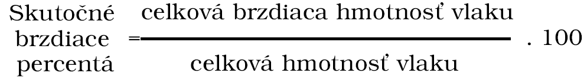

# § 43 Brzdenie vlaku

(1) Vlak, ktorého určená rýchlosť je vyššia než 40 km.h-1, musí byť brzdený samočinnou priebežnou brzdou.

(2) Vlak musí byť brzdený tak, aby jeho brzdiaci účinok zaistil bezpečné zastavenie vlaku na zábrzdnú vzdialenosť. Brzdiaci účinok musí byť takto určený pomocou tabuliek brzdiacich percent, ktoré vydá prevádzkovateľ dráhy svojím záväzným pokynom pre dopravcov.

(3) Tabuľky brzdiacich percent musia určiť požadovaný brzdiaci účinok vlaku, vyjadrený brzdiacim percentom vlaku, v závislosti od dovolenej rýchlosti vlaku, jeho druhu a dĺžky, rozhodného spádu trate a zábrzdnej vzdialenosti na tejto trati.

(4) Skutočné brzdiace percentá každého vlaku sa zistia výpočtom podľa vzorca

- 

- Celková brzdiaca hmotnosť vlaku brzdeného priebežnou brzdou sa rovná súčtu všetkých brzdiacich hmotností jednotlivých dráhových vozidiel vlaku s účinkujúcou priebežnou brzdou a pri vlaku s ručne brzdenými dráhovými vozidlami súčtu brzdiacich hmotností jednotlivých vozidiel s obsluhovanou ručnou brzdou. Celková hmotnosť vlaku sa rovná súčtu hmotností jednotlivých dráhových vozidiel vlaku a súčtu hmotností nákladu na dráhových vozidlách.

(5) Skutočné brzdiace percentá vlaku musia byť vyššie alebo sa aspoň rovnať potrebným brzdiacim percentám, ktoré vychádzajú z tabuliek brdziacich percent vydaných prevádzkovateľom dráhy a pre konkrétne traťové úseky a pre konkrétne vlaky sa uvádzajú v zošitovom cestovnom poriadku podľa § 41 ods. 2 písm. e).

(6) Činnosť priebežnej brzdy musí overovať dopravca skúškou brzdy, ktorú môžu vykonávať iba osoby na to určené. Skúška brzdy sa vykonáva pred odchodom vlaku z východiskovej dopravne. Skúška brzdy sa vykoná aj vtedy, ak

- a) sa zmení stanovišťe, z ktorého sa vlak riadi, s výnimkou vlakov používaných ako ucelená samostatná jednotka,

- b) bol vlak rozpojený, s výnimkou odvesenia vozidiel na konci vlaku.

(7) O vykonanej skúške brzdy pri vlakoch uvedených v § 23 ods. 2 písm. b), c), d), e) a f) sa vykoná zápis. V zápise sa uvedie aj

- a) režim brzdenia,

- b) číslo vlaku a názov dopravne, v ktorej bola skúška vykonaná,

- c) hmotnosť vozidiel, brzdiaca hmotnosť a počet dvojkolesí alebo dĺžka vlaku,

- d) počet a druh bŕzd zapojených vo vlaku,

- e) požadované brzdiace percentá,

- f) skutočné brzdiace percentá,

- g) podpisy určených osôb, ktoré vykonali skúšku.

(8) Na zabezpečenie vlaku v prípade poruchy priebežnej brzdy tak, aby mohol byť vlak spoľahlivo zabezpečený proti ujdeniu na najnepriaznivejšom spáde prechádzaného traťového úseku a dopravený do najbližšej dopravne, platia technologické postupy dopravcu.
