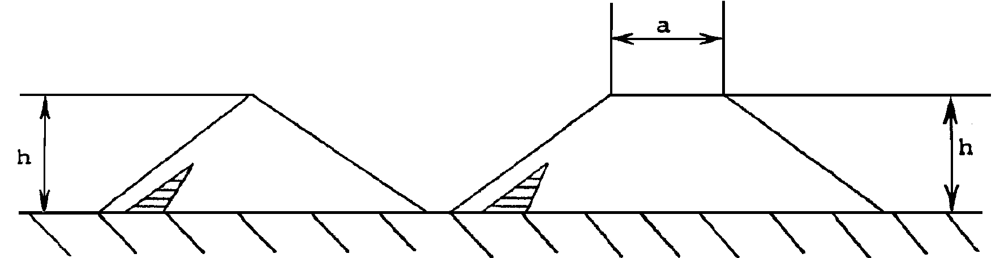

Príloha č. 3 k vyhláške č. 300/1997 Z. z. SPÔSOB URČOVANIA VÝŠKY HROMADY A DOVOLENÁ VÝŠKA VOĽNE SYPANÝCH HROMÁD TUHÝCH PALÍV

1. Výška hromady voľne sypaných hromád tuhých palív sa určuje pri

a) hromade, ktorá má trojuholníkový prierez, výškou trojuholníka,

b) hromade, ktorá má lichobežníkový prierez, vzdialenosťou medzi základňou a hornou základňou hromady.

a – šírka hornej základne

h – výška hromady

2. Výška voľne sypanej hromady tuhého paliva je najviac

a) 6 m pre čierne uhlie triedené a prané,

b) 4 m pre hnedé uhlie prachové, triedené, netriedené a prané, pre lignit a pre čierne uhlie prachové a ťažné,

c) 3 m pre brikety po vytriedení briketových úlomkov,

d) 1,5 m pre brikety a briketové úlomky.
