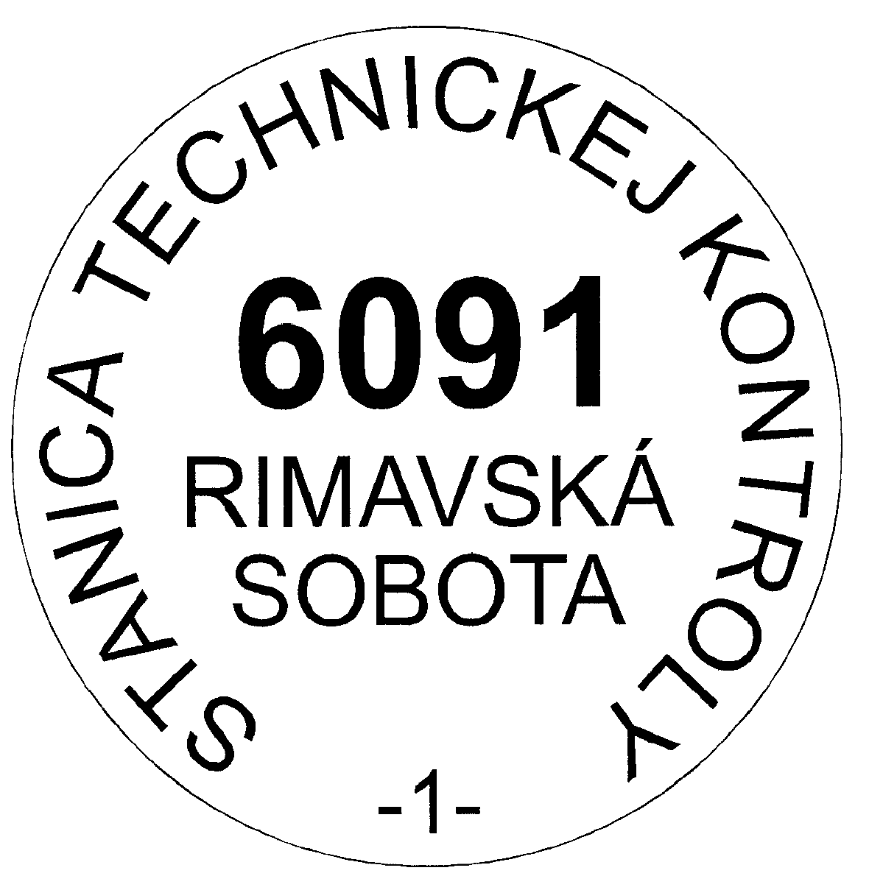
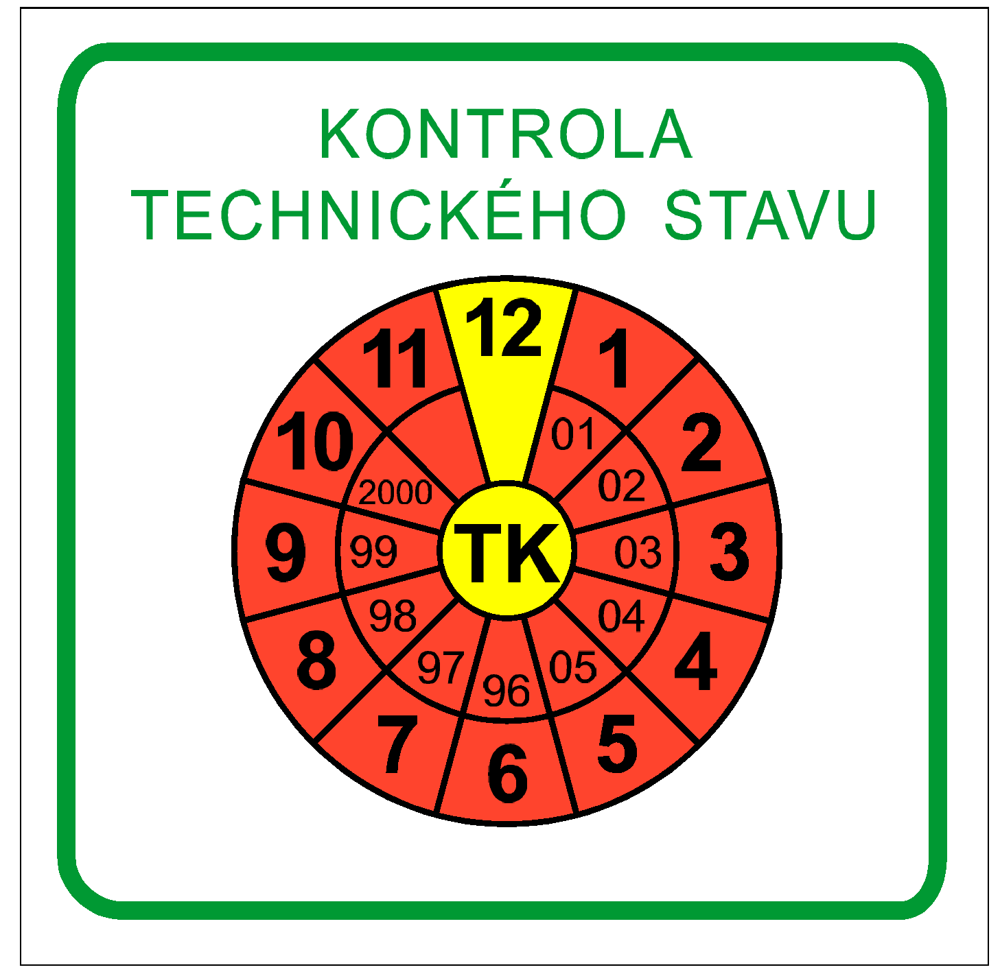

Príloha č. 1 k vyhláške č. 327/1997 Z. z. INFORMAČNÝ SYSTÉM

1. Príjem a výdaj tlačív Protokol o kontrole technického stavu vozidla, Osvedčenie o kontrole technického stavu vozidla a kontrolných nálepiek

Oprávnená osoba (stanica technickej kontroly)

Oprávnená osoba (stanica technickej kontroly) vedie Knihu príjmu a výdaja tlačív Protokol o kontrole technického stavu vozidla, Osvedčenie o kontrole technického stavu vozidla a kontrolných nálepiek. Do Knihy príjmu a výdaja tlačív zapisuje

a) počet prijatých tlačív Protokol o kontrole technického stavu vozidla, Osvedčenie o kontrole technického stavu vozidla a kontrolných nálepiek s uvedením ich série a evidenčných čísiel, dátum príjmu, meno a podpis osoby určenej oprávnenou osobou,

b) počet vydaných tlačív Protokol o kontrole technického stavu vozidla, Osvedčenie o kontrole technického stavu vozidla a nalepených kontrolných nálepiek počas jednej pracovnej zmeny s uvedením ich série a evidenčných čísiel, dátum a podpis kontrolného technika, ktorý vydal tlačivá a nalepil kontrolnú nálepku, a kontrolného technika vykonávajúceho funkciu vedúceho alebo zástupcu vedúceho stanice technickej kontroly, ktorý vykonal uzávierku po skončení pracovnej zmeny.

Oprávnená osoba (stanica technickej kontroly) vykonáva v Knihe príjmu a výdaja tlačív polročne (v bežnom kalendárnom roku) uzávierku príjmu a výdaja tlačív Protokol o kontrole technického stavu vozidla, Osvedčenie o kontrole technického stavu vozidla a kontrolných nálepiek. V uzávierke uvedie počty prijatých a vydaných tlačív a kontrolných nálepiek s uvedením ich série a evidenčných čísiel v sledovanom polroku. Polročnú uzávierku vykonáva osoba určená oprávnenou osobou, ktorá osvedčí správnosť údajov svojím podpisom. Zostatok nevydaných tlačív a nenalepených kontrolných nálepiek po uzávierke tvorí prenos do príjmu nasledujúceho polroka.

Kniha príjmu a výdaja tlačív musí obsahovať názov a sídlo oprávnenej osoby (stanice technickej kontroly), podpis jej štatutárneho orgánu, odtlačok pečiatky oprávnenej osoby (stanice technickej kontroly), dátum jej založenia, počet listov a mená kontrolných technikov. Po zapísaní celej knihy sa uvedie dátum skončenia zápisov. Na skončenie zápisov platia obdobné podmienky ako na vykonávanie polročnej uzávierky. Knihu príjmu a výdaja tlačív oprávnená osoba (stanica technickej kontroly) archivuje päť rokov.

Ak sa manipuláciou tlačivo alebo kontrolná nálepka poškodí alebo znehodnotí, kontrolný technik alebo osoba určená oprávnenou osobou na vedenie Knihy príjmu a výdaja tlačív o tom vykoná zápis do Knihy príjmu a výdaja tlačív. V zápise uvedie predmet, dôvod poškodenia alebo znehodnotenia, dátum a podpis. Poškodené tlačivo Protokol o kontrole technického stavu vozidla, Osvedčenie o kontrole technického stavu vozidla alebo kontrolnú nálepku uschová. Oprávnená osoba (stanica technickej kontroly) vždy polročne odovzdá poškodené alebo znehodnotené tlačivá a kontrolné nálepky s uvedením dôvodu a dátumu ich poškodenia alebo znehodnotenia poverenej organizácii, ktorá vykoná ich skartáciu.

Osoby určené oprávnenou osobou na vedenie Knihy príjmu a výdaja tlačív a kontrolných nálepiek musia zabezpečiť ich úschovu tak, aby ich nebolo možné ukradnúť alebo zneužiť.

Poverená organizácia

Poverená organizácia vedie Knihu príjmu a výdaja tlačív Protokol o kontrole technického stavu vozidla, Osvedčenie o kontrole technického stavu vozidla a kontrolných nálepiek v rámci celej siete staníc technickej kontroly. Do Knihy príjmu a výdaja tlačív zapisuje

a) počet prijatých tlačív a kontrolných nálepiek s uvedením ich série a evidenčných čísiel, dátum príjmu a podpis osoby určenej štatutárnym zástupcom poverenej organizácie,

b) počet vydaných tlačív a kontrolných nálepiek s uvedením ich série a evidenčných čísiel, dátum výdaja, názov, sídlo a označenie oprávnenej osoby (stanice technickej kontroly), ktorá ich prijala, s podpisom osoby určenej na ich prevzatie oprávnenou osobou.

Poverená organizácia vykonáva v Knihe príjmu a výdaja tlačív polročne (v bežnom kalendárnom roku) uzávierky príjmu a výdaja tlačív a kontrolných nálepiek obdobným spôsobom ako oprávnená osoba (stanica technickej kontroly).

Kniha príjmu a výdaja tlačív musí obsahovať obdobné údaje ako Kniha príjmu a výdaja tlačív vedená oprávnenou osobou. Založenie Knihy príjmu a výdaja tlačív, skončenie záznamov v nej a jej archiváciu poverená organizácia vykonáva obdobným spôsobom ako oprávnená osoba.

2. Zhromažďovanie a spracovávanie údajov o kontrolách technického stavu vozidiel

Oprávnená osoba (stanica technickej kontroly)

Oprávnená osoba (stanica technickej kontroly) po vykonaní kontroly technického stavu vozidla vyznačenú kópiu Protokolu o kontrole technického stavu vozidla archivuje štyri roky po vykonaní kontroly technického stavu vozidla. O kontrolách technického stavu vozidiel vedie oprávnená osoba Evidenčnú knihu kontrol technického stavu vozidiel (ďalej len „evidenčná kniha“), ktorá musí obsahovať

a) poradové číslo,

b) číslo protokolu,

c) druh kontroly technického stavu vozidla,

d) evidenčné číslo vozidla,

e) továrenskú značku a typ vozidla,

f) dátum vykonania kontroly technického stavu vozidla,

g) číslo protokolu z predchádzajúcej kontroly, ak ide o opakovanú kontrolu,

h) hodnotenie kontroly technického stavu vozidla (spôsobilé, dočasne spôsobilé, nespôsobilé),

i) identifikačné údaje kontrolného technika,

j) spôsob platby,

k) sériu a evidenčné číslo Osvedčenia o kontrole technického stavu vozidla,

l) sériu a evidenčné číslo kontrolnej nálepky,

m) rok výroby vozidla,

n) meno a priezvisko alebo názov držiteľa vozidla, jeho trvalý pobyt alebo sídlo.

Evidenčná kniha musí ďalej obsahovať dátum jej založenia, počet listov, názov a sídlo oprávnenej osoby (stanice technickej kontroly), podpis štatutárneho orgánu a odtlačok pečiatky, mená a priezviská kontrolných technikov. Po vypísaní evidenčnej knihy sa uvedie dátum skončenia záznamov. Evidenčnú knihu archivuje oprávnená osoba päť rokov.

Oprávnená osoba mesačne spracováva súhrn údajov uvedených v evidenčnej knihe pod písmenami b) až f), h), m) a n), ktorý zasiela do 15. dňa nasledujúceho mesiaca okresnému úradu príslušnému podľa miesta trvalého pobytu alebo sídla držiteľa vozidla.

Oprávnená osoba zároveň mesačne spracováva súhrn údajov v rozsahu uvedenom na vzore tlačiva Štatistický prehľad o kontrolách technického stavu vozidiel, ktorý je súčasťou tejto prílohy, a do 15. dňa nasledujúceho mesiaca ho zasiela poverenej organizácii.

Poverená organizácia

Poverená organizácia vyhodnocuje prijaté štatistické údaje o kontrolách technického stavu vozidiel a spracuje súhrn údajov získaných z celej siete staníc technickej kontroly, ktorý polročne zasiela ministerstvu na účely výkonu štátneho dozoru nad činnosťou staníc technickej kontroly v Slovenskej republike.

VZOR

[Štatistický prehľad o kontrolách technického stavu vozidiel](../assets/39bf5da34ecb27e2c508398d71edaf436b01347c610aa70ba216ca295dcec984.pdf)

Príloha č. 2 k vyhláške č. 327/1997 Z. z.

AUTOMATIZOVANÝ INFORMAČNÝ SYSTÉM

Automatizovaný informačný systém siete staníc technickej kontroly je decentralizovaný viacstupňový informačný systém. Pracovisko stanice technickej kontroly musí byť vybavené aspoň jedným personálnym počítačom PC AT s takouto minimálnou konfiguráciou:

a) | procesor | 486 alebo výkonnejší typ procesora,

b) | operačná pamäť | minimálne 4 MB (v sieťovom zapojení 8 MB),

c) | disketová jednotka | 3,5" - 1,44 MB,

d) | operačný systém | MS DOS 6.2 (prípadne W 3.1, W 95),

e) | pevný disk | minimálne 200 MB voľných pre túto aplikáciu.

Konfigurácia a softwarové vybavenie staníc technickej kontroly sa musí prekonzultovať s poverenou organizáciou. Počítač musí byť vo vyhotovení pre prostredie, v ktorom sa bude používať. V blízkosti jeho inštalácie nesmie byť prevádzka s otrasmi, so zdrojmi intenzívnych magnetických polí a vysokofrekvenčného žiarenia. V prípade, že sieťový rozvod kolíše mimo prípustných medzí, odporúča sa doplniť počítač o stabilizátor napätia.

Údaje pre automatizovaný informačný systém staníc technickej kontroly sa čerpajú z uložených protokolov o kontrole technického stavu vozidla. V rámci tohto systému sa pracuje s týmito údajmi:

a) číslo protokolu,

b) číslo stanice technickej kontroly,

c) dátum kontroly technického stavu vozidla,

d) druh kontroly technického stavu vozidla,

e) druh a kategória vozidla,

f) značka a typ vozidla,

g) číslo podvozku a motora vozidla,

h) evidenčné číslo vozidla,

i) rok výroby vozidla,

j) súbor zistených chýb (A, B, C),

k) hodnotenie výsledku technickej kontroly z hľadiska spôsobilosti vozidla na ďalšiu premávku,

l) záznam o vydaní kontrolnej nálepky, jej séria a evidenčné číslo,

m) termín nasledujúcej kontroly technického stavu vozidla,

n) evidenčné číslo technika, ktorý kontrolu technického stavu vozidla vykonal,

o) séria a evidenčné číslo Osvedčenia o kontrole technického stavu vozidla,

p) ďalšie technické údaje potrebné na štatistické spracovanie výsledkov kontrol technického stavu vozidla (napr. kód motora, namerané hodnoty).

Údaje potrebné pre automatizovaný informačný systém sa musia z jednotlivých staníc technickej kontroly zasielať poverenej organizácii v jednotnom formáte a štruktúre na disketách alebo pomocou modemu do 10 dní nasledujúceho mesiaca po vykazovanom období.

Počas nábehu automatizovaného informačného systému v celej sieti staníc technickej kontroly, ktorú určí ministerstvo, sa poverenej organizácii zasiela Štatistický prehľad o kontrolách technického stavu vozidiel uvedený v prílohe č. 1. V prípade, že stanica technickej kontroly je už vybavená funkčným automatizovaným informačným systémom, zasiela sa poverenej organizáci Štatistický prehľad o kontrolách technického stavu vozidiel uvedený v tejto prílohe.

Automatizovaný informačný systém na úrovni pracoviska stanice technickej kontroly musí obsahovať všetky údaje uvedené v evidenčnej knihe podľa prílohy č. 1 a umožňovať automatické spracovanie údajov zasielaných okresným úradom podľa prílohy č. 1.

Poverená organizácia vyhodnocuje štatistické údaje o kontrolách technického stavu vozidiel a spracováva ich súhrn v rámci celej siete staníc technickej kontroly, ktorý polročne zasiela ministerstvu. Vyhodnotené údaje zo siete staníc technickej kontroly centrálne využívajú orgány štátnej správy na analytickú činnosť, štatistické účely a výkon štátneho dozoru nad technickým stavom vozidiel.

V Z O R

[Štatistický prehľad o kontrolách technického stavu vozidiel - list 1 a 2](../assets/696379e774649ea2b5284da57de9aa347f9087896093f031bf8c0541c01b35c5.pdf)

Príloha č. 3 k vyhláške č. 327/1997 Z. z.

VZOR

[Protokol o kontrole technického stavu vozidla - príloha č. 3](../assets/e2e64fdf2a30c6b88aef740d8816d535083f957b445751bb50a2b8809ea91623.pdf)

Príloha č. 4 k vyhláške č. 327/1997 Z. z.

VZOR

[Protokol o kontrole technického stavu vozidla - príloha č. 4](../assets/2b19017e72b16401d864271a60073a095c9e9de6c97da3aa66c1ab75e5d97eaf.pdf)

Príloha č. 5 k vyhláške č. 327/1997 Z. z.

VZOR

[Osvedčenie o kontrole technického stavu vozidla](../assets/4066babe2a1452391beab26d8ed96150f5608ec16cc05a38a486696d2b1deb54.pdf)

Príloha č. 6 k vyhláške č. 327/1997 Z. z.

VZOR

KONTROLNÁ NÁLEPKA, VYHOTOVENIE, VYZNAČOVANIE A NALEPOVANIE

Vyhotovenie kontrolnej nálepky

mierka 1,5 : 1

Kontrolná nálepka je označená sériou, ktorá sa skladá z označenia „SKA" a šesťmiestneho evidenčného čísla. Po naplnení série „SKA" nasledujú série „SKB" až „SKZ".

Rozmery: výška kontrolnej nálepky 37 mm,

šírka kontrolnej nálepky 32 mm

priemery kružníc 27 mm, 17 mm, 7 mm,

výška číslic 1 až 12 (označenie mesiaca) 3 mm,

výška číslic (označenie roku) 1,5 mm,

výška symbolu (písmen) „TK" 3 mm,

výška písmen a číslic označenia série a evidenčného čísla 3 mm.

Farby: podklad (okraj) označenia biely,

pole nálepky červené,

stredový kruh a veľký kruhový výsek žlté,

kružnice, úsečky, číslice a symbol (písmená) „TK" čierne.

Vyznačovanie

Vyznačovanie lehoty platnosti kontroly technického stavu vozidla: na vonkajšom medzikruží sa dierkovacími kliešťami vyznačuje mesiac a na vnútornom medzikruží rok.

Nalepovanie

Kontrolná nálepka sa lepí na zadnú tabuľku s evidenčným číslom vozidla, ak je

- jednoriadková tabuľka, do hornej polovice medzery za prvou skupinou písmen,

- dvojriadková tabuľka, v hornom riadku, do ľavej polovice medzery za prvou skupinou písmen.

Platnosť

1. Kontrolné nálepky majú platnosť po dobu na nich vyznačenú.

2. Doterajšie kontrolné nálepky ostávajú v platnosti do doby na nich vyznačenej.

Príloha č. 7 k vyhláške č. 327/1997 Z. z.

VZOR

[Protokol o kontrole vozidla pred schválením technickej spôsobilosti na premávku na pozemných komunikáciách](../assets/e6936541f87eaf05ab1d22b571a8508d0d82b0e8a85f85f848c4c15841bb4a06.pdf)

Príloha č. 8 k vyhláške č. 327/1997 Z. z.

VZOR

[Vzor 08-1](../assets/f4e240f856a49ff97dd572ded8e6575ede0b280f3a33f95a10ec20569595bd2e.pdf)

Príloha č. 9 k vyhláške č. 327/1997 Z. z.

[Vzor 09-1](../assets/8661239fe9de72cb156cf48f9b89e2d770a321d4a74038a7affa2a2257677046.pdf)

Potvrdenie sa musí vydať v anglickom alebo v nemeckom jazyku.

Príloha č. 10 k vyhláške č. 327/1997 Z. z.

VZOR

[Zápisnica o skúške](../assets/18c35e047798195546c4e0ee196f01fad16bc21ba411b69677f1dd41c8417751.pdf)

Príloha č. 11 k vyhláške č. 327/1997 Z. z.

V Z O R

[Správa o overení splnenia podmienok na udelenie oprávnenia](../assets/f593760c441368037ee2660976988b5fac4ca7100a196923985977eb983e25f8.pdf)

Príloha č. 12 k vyhláške č. 327/1997 Z. z.

VZOR

[Oprávnenie na vykonávanie kontrol technického stavu vozidiel](../assets/8e40e44ce4e923df2856733a3f28039df63d4dc74f74ee38412d7cd57647b523.pdf)

Príloha č. 13 k vyhláške č. 327/1997 Z. z.

VZOR

[Osvedčenie o odbornej spôsobilosti na vykonávanie kontrol technického stavu vozidiel](../assets/3d76a38a11818d853c5d9d3268fcf6e1b66f225dc251fb0c10abbe9029bf4dfc.pdf)

Príloha č. 14 k vyhláške č. 327/1997 Z. z.

VZOR

Vzor odtlačku pečiatky oprávnenej osoby (stanice technickej kontroly)

Príloha č. 15 k vyhláške č. 327/1997 Z. z.

VZOR

Vzor označenia oprávnenej osoby (stanice technickej kontroly)

Označenie oprávnenej osoby (pracoviska stanice technickej kontroly) má rozmer 600 x 600 mm, farby zodpovedajú farebnému vyhotoveniu kontrolnej nálepky rozšírenému o rámik a nápis vyhotovený v zelenej farbe.

Príloha č. 16 k vyhláške č. 327/1997 Z. z.

VZOR

SPRÁVA O CESTNEJ KONTROLE TECHNICKEJ SPÔSOBILOSTI

[Vzor 16-1](../assets/9097e235b81c217676d803ef0e2e87d8305fec71e8a158760d0a18604b661460.pdf)

Príloha č. 17 k vyhláške č. 327/1997 Z. z.

Touto vyhláškou sa transponujú tieto právne akty Európskych spoločenstiev:

1. Smernica Európskeho parlamentu a Rady 2000/30/ES zo 6. júna 2000 o cestnej technickej kontrole spôsobilosti úžitkových automobilov pre premávku na pozemných komunikáciách Spoločenstva, Ú. v. ES, L 203, uverejnená dňa 10. augusta 2000, s. 0001 - 0008.

2. Smernica Komisie 2003/26/ES z 3. apríla 2003, ktorou sa prispôsobuje technickému pokroku Smernica Európskeho parlamentu a Rady 2000/30/ES z hľadiska obmedzovačov rýchlosti a výfukových emisií úžitkových vozidiel, Ú. v. EÚ, L 90, uverejnená dňa 8. apríla 2003, s. 0037 – 0040.

Revidované preklady týchto smerníc sa nachádzajú v databáze prekladov Centrálnej prekladateľskej jednotky sekcie Inštitút pre aproximáciu práva Úradu vlády Slovenskej republiky.
