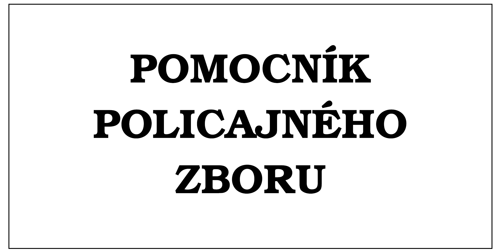

Príloha č. 1 k zákonu č. 382/1997 Z. z. (V z o r)

Rukávová páska pomocníka Policajného zboru

Podklad zelený ako pás v preukaze pomocníka PZ,

biele reflexné písmená – výška písma 25 mm,

šírka rukávovej pásky 120 mm.
