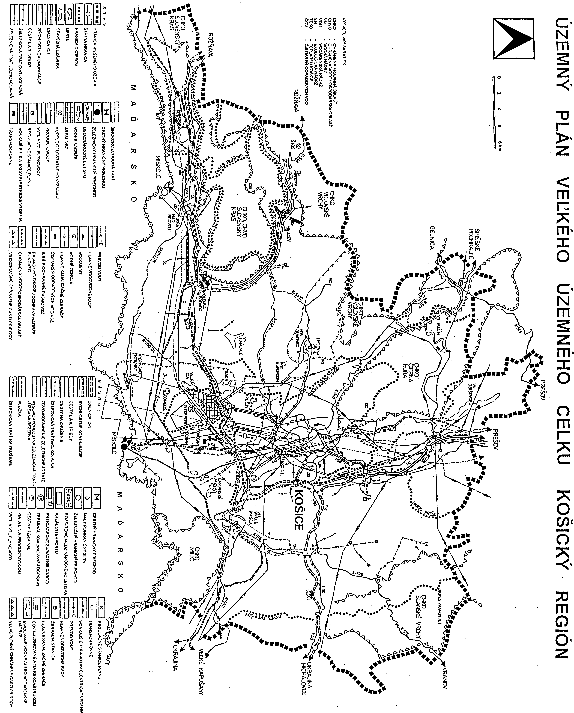

Príloha č. 1 nariadenia vlády Slovenskej republiky č. 46/1997 Z. z. 

Príloha č. 2 nariadenia vlády Slovenskej republiky č. 46/1997 Z. z.

ZÁVÄZNÁ ČASŤ ÚZEMNÉHO PLÁNU VEĽKÉHO ÚZEMNÉHO CELKU KOŠICKÝ REGIÓN

I. Záväzné regulatívy funkčného a priestorového usporiadania územia

Pri riadení využitia a usporiadania územia a osídlenia regiónu treba dodržať tieto záväzné regulatívy:

1. V oblasti usporiadania územia, osídlenia a životného prostredia

1.1. predpokladať výrazné spomalenie tempa koncentrácie obyvateľstva do mesta Košíc a vytvoriť podmienky na územný rozvoj stredného typu mestského osídlenia regiónu (Moldava nad Bodvou, Turňa nad Bodvou, Medzev) a aglomerácií vidieckych sídel v južnej, severnej a západnej časti regiónu,

1.2. postupne vytvoriť podmienky na vysunutie obytnej a výrobnej funkcie do suburbánneho pásma Košíc a na udržanie a oživenie vidieckeho osídlenia regiónu v oblasti dopravy a technickej infraštruktúry,

1.3. vytvoriť územno-technické podmienky na rozvoj osídlenia v

a) nadregionálnych rozvojových osiach

1. západným smerom v priestore Turňa nad Bodvou – Čečejovce – Košice,

2. severným smerom v priestore obcí medzi Košicami a Prešovom,

3. východným smerom v priestore Košické Oľšany – Ďurďošík – Bidovce – Svinica – Dargov,

b) regionálnych rozvojových osiach

1. južným smerom v priestore Valaliky – Čaňa – Seňa – Kechnec – Milhosť,

2. juhovýchodným smerom v priestore Nižná Myšľa a Vyšná Myšľa – Bohdanovce – Ruskov – Slanec – Slanské Nové Mesto,

1.4. vytvoriť územno-technické podmienky na rozvoj bývania a výroby v

a) suburbánnom priestore mesta Košíc,

b) rozvojových osiach regiónu,

c) priestoroch stagnujúceho a regresného vývoja regiónu (severovýchodná časť – oblasť Keceroviec, severozápadná časť Jasov – Medzev – Štós),

1.5. vytvoriť podmienky na rozvoj hospodársko-sídelnej aglomerácie Košíc v oblasti aktivít bývania, pracovných príležitostí a vybavenosti; Košice rozvíjať ako centrum východného Slovenska a Košického regiónu a druhého najväčšieho mesta Slovenskej republiky vo väzbe na postavenie mesta v osídlení Slovenskej republiky; predpokladať v prognóznom výhľade medzi mestami Košice a Prešov postupné zosilnenie regionálnych aglomeračných väzieb,

1.6. využiť výhodnú strategickú dopravnú polohu Košíc v smeroch východ–západ a sever–juh a v priestore Východoslovenských železiarní – Bočiar vytvoriť územno-technické podmienky na rozvoj pracovných príležitostí, prekládkovej činnosti a voľnej hospodárskej zóny; postupne realizovať suchozemský prístav INTERPORT Košice – Bočiar,

1.7. ponechať stavebnú uzáveru z dôvodov extrémne znečisteného a narušeného životného prostredia v okolí Východoslovenských železiarní v Košiciach v sídlach Veľká Ida, Sokoľany, Bočiar, v južnej časti mestskej časti Košice-Šaca a v mestskej časti Poľov; ponechať stavebnú uzáveru z dôvodov ochrany vodárenskej nádrže Bukovec v sídle Hýľov,

1.8. vytvoriť podmienky na plnší rozvoj regiónu zabezpečením nového vodného zdroja Tichý Potok pre oblasť Prešova a Košíc,

1.9. rezervovať územie pre plánované a evidované vodné nádrže Obišovce na Svinke, Vyšná Myšľa na Olšave, Paňovce na Slanom potoku a ekologickú nádrž Medzev na Bodve v zmysle príslušných smerníc o hospodárskom využívaní záujmových území výhľadových vodohospodárskych diel,

1.10. chrániť zásoby podzemných vôd v západnej časti regiónu v priestore chránenej vodohospodárskej oblasti Slovenský kras,

1.11. rešpektovať poľnohospodársky a lesný pôdny fond ako faktor limitujúci urbanistický rozvoj a zabezpečiť funkčnosť nadregionálnych a regionálnych biocentier a biokoridorov pri ďalšom funkčnom využití a usporiadaní územia,

1.12. postupne odstrániť environmentálne dlhy regiónu, najmä v priestoroch Východoslovenských železiarní v Košiciach, spaľovne v Košiciach, Mestskej čistiarne odpadových vôd v Kokšove-Bakši, teplárne TEKO, Košického magnezitu, bane Bankov a Cementárne v Turni nad Bodvou,

1.13. chrániť najcennejšie časti prírodného potenciálu regiónu chránenej krajinnej oblasti Slovenský kras – biosférickú rezerváciu a najcennejšie časti Slanských vrchov, Veľkého Miliča, Čiernej hory a Volovských vrchov,

1.14. podporovať výsadbu plošnej a líniovej zelene, prirodzený spôsob obnovy a revitalizáciu krajiny v nadregionálnych biocentrách a biokoridoroch,

1.15. uprednostniť realizáciu ekologických premostení regionálnych biokoridorov a biocentier pri výstavbe líniových stavieb; prispôsobiť vedenie trás dopravnej a technickej infraštruktúry tak, aby sa netrieštil komplex lesov,

1.16. vytvoriť podmienky na rozvoj turistiky v rekreačných priestoroch Kojšovej hole, Ružína, Slovenského krasu, Slanských vrchov, vodných plôch Čane – Geče – Milhosti pri zásadnom rešpektovaní podmienok ochrany prírody a krajiny,

1.17. vytvoriť územno-technické a dopravné podmienky na rekreačné využitie priestoru Kojšovej hole – Zlatej Idky s cieľom dodržať určený hygienický režim v povodí vodárenskej nádrže Bukovec,

1.18. dobudovať a zmodernizovať celoštátne klimatické Štós-kúpele v severozápadnej časti regiónu,

1.19. chrániť najcennejšie územia a objekty z hľadiska pamiatkovej starostlivosti, a to hlavne národné kultúrne pamiatky, mestskú pamiatkovú rezerváciu Košice a územia navrhované alebo vyhlásené za pamiatkové zóny,

1.20. rešpektovať ústredným orgánom štátnej správy odsúhlasené zábery poľnohospodárskeho pôdneho fondu v zmysle zákona Slovenskej národnej rady č. 307/1992 Zb. o ochrane poľnohospodárskeho pôdneho fondu a lesného pôdneho fondu v zmysle zákona č. 61/1977 Zb. o lesoch v znení neskorších predpisov.

2. V oblasti dopravy pri využití územia chrániť

2.1. koridory hlavných ciest a ich uzlov európskej cestnej siete, ktoré sa stretávajú v území

a) cestný ťah E 50 na trase cesty I/18 Žilina – Prešov, cesty I/68 Prešov – Košice a cesty I/50 Košice – Michalovce – hranica s Ukrajinou v kategórii diaľnice D-1,

b) cestný ťah E 71 na trase cesty I/68 Košice – Seňa – štátna hranica s Maďarskou republikou ako súčasť severojužného rýchlostného ťahu „R“ (s prepojením na európsku cestu E 371 na trase ciest I/18 a I/73 Prešov – Lipníky – Svidník – štátna hranica s Poľskou republikou),

c) cestný ťah E 571 na trase cesty I/50 Zvolen – Rožňava – Košice s prepojením na diaľnicu D-1 v kategórii „R“ rýchlostnej komunikácie,

2.2. koridory preložiek a úprav ciest I. a II. triedy vrátane základnej komunikačnej siete mesta Košíc (ZÁKOS) pre

a) cestu I/50 v úseku Jablonov nad Turňou – Moldava nad Bodvou – Šaca – Košice-mesto – Moldavská ulica – križovatka Červený Rak – prepojenie na križovatku Alejovej ulice – I/68 – Južné nábrežie – Prešovská cesta (križovatka Sečovská cesta) ako rýchlostný prieťah mestom vrátane plánovaných mimoúrovňových dopravných uzlov,

b) preložku cesty II/552 južne od obce Krásna nad Hornádom,

c) prestavbu Štúrovej ulice, Námestia osloboditeľov a Palackého ulice,

d) výstavbu komunikačného prepojenia Masarykovej ulice – Triedy L. Svobodu (Furča) s mimoúrovňovým krížením železničného uzla a Prešovskej cesty,

e) výstavbu druhého „východného“ diaľničného privádzača v úseku Košické Oľšany – Sady nad Torysou (koridor cesty III/050196) – križovatka Prešovská cesta, Sečovská cesta mimo mestskej časti Košická Nová Ves,

2.3. koridory preložiek ciest I. a II. triedy v okrese Košice-okolie pre

a) cestu II/547 Košice – Margecany – smer Spišské Podhradie,

b) cestu II/548 Košice (Pereš) – Jasov – Smolník,

c) cestu II/576 Bohdanovce (križovatka s cestou II/552) – Bidovce – Herľany – smer Vranov nad Topľou,

d) cestu II/546 Prešov – Margecany (križovatka s cestou II/547) – Gelnica – Mníšek nad Hnilcom,

e) cestu II/552 Košice (Krásna) – Nižná Hutka – Bohdanovce – Slanec – smer Veľké Kapušany,

2.4. priestor na nové komunikačné prepojenie strediska turistiky Kojšovská hoľa – Zlatá Idka v úseku Rudník – Zlatá Idka; zrušiť jestvujúce komunikačné prepojenie v úseku Zlatá Idka – Hýľov z dôvodu kolízie s pásmami hygienickej ochrany vodného zdroja Bukovec,

2.5. priestory na rozvoj existujúcich a výstavbu nových cestných hraničných priechodov

a) Milhosť – Hidasnémeti pre všetky štáty sveta s neobmedzenou osobnou a nákladnou dopravou,

b) Hosťovce – Tornanádaska pre všetky štáty sveta s obmedzením nákladnej dopravy do 3,5 tony,

c) Buzica – Kany, Perín – Hernádpetri, Janík – Perecse, Trstené pri Hornáde – Kéked a Skároš – Hollóháza pre malý pohraničný styk s obmedzením nákladnej dopravy,

2.6. priestory pre

a) terminál nákladnej cestnej dopravy v Milhosti a v novom hospodárskom dvore Východoslovenských železiarní v Košiciach,

b) terminál kombinovanej dopravy vo výrobnom okrsku Košice-Krásna a dopravno-prekládkovom páse Východoslovenských železiarní v Bočiari; jestvujúci malý nákladný obvod a prekladisko kontajnerov v centrálnej časti mesta zrušiť a priestor uvoľniť pre celomestské funkcie,

2.7. priestory pre

a) železničný dopravný koridor hlavného tranzitného ťahu Žilina – Košice – Čierna nad Tisou na modernizáciu železničnej trate na rýchlosť 120 a 160 km,

b) zdvojkoľajnenie a elektrifikáciu železničnej trate v úsekoch

1. Rožňava – Moldava nad Bodvou – Haniska pri Košiciach,

2. Barca – Čaňa – hranica s Maďarskou republikou,

c) železničný dopravný koridor severojužného ťahu v úseku hranica s Poľskou republikou – Plaveč – Prešov – Kysak na modernizáciu trate na rýchlosť 120 km,

2.8. územnú rezervu pre trasu vysokorýchlostnej trate Žilina – Prešov – Košice – hranica s Ukrajinou a alternatívnu trasu Bratislava – Zvolen – Košice až do výberu definitívnej trasy,

2.9. priestor na modernizáciu a dostavbu železničných uzlov Kysak a Košice; v súvislosti s dostavbou železničného uzla Košice predpokladať vymiestnenie nákladnej dopravy z úseku železničná stanica Košice-Barca a výhľadovo ju zrušiť; po zavedení intervalovej osobnej dopravy prehodnotiť vyťaženie uvedenej železničnej trate,

2.10. priestor na zariadenie na prevádzkové ošetrenie a čistenie osobných vozňov na nových plochách v južnej časti uzla,

2.11. priestor na prebudovanie železničných mostov na Palackého ulici vrátane mimoúrovňového napojenia autobusovej stanice v Košiciach,

2.12. koridor na vlečkový systém normálneho a širokého rozchodu do suchozemského prístavu Bočiar – Košice a centra nákladnej dopravy s prevádzkou CARGO na letisku v Košiciach,

2.13. priestory na

a) dobudovanie, modernizáciu a rozšírenie existujúcej vzletovej a pristávacej dráhy medzinárodného letiska Košice,

b) územnú rezervu na výstavbu centra nákladnej dopravy s prevádzkou CARGO na letisku v Košiciach s osobitným cestným aj vlečkovým napojením.

3. V oblasti nadradenej technickej infraštruktúry

3.1. zásobovať územie regiónu elektrickou energiou zo zdrojov inštalovaných mimo regiónu prostredníctvom nadradených prenosových sústav 400 kV, 220 kV a 110 kV,

3.2. zásobovať územie regiónu zemným plynom z medzištátneho veľmi vysokotlakového plynovodu (MŠP I. VVTL Družba) prechádzajúceho južnou časťou regiónu,

3.3. chrániť územie na rozvoj nadradenej technickej infraštruktúry na

a) výstavbu transformovne z veľmi vysokého napätia na vysoké napätie (VVN/VN 110/22 kV) v lokalite Košice-Myslava a Košice-centrum,

b) výstavbu

1. 400 kV elektrického vedenia Lemešany – Svidník – Poľská republika (Krosno),

2. 2 x 110 kV elektrického vedenia na trase transformovňa (VVN/VN) Východoslovenské železiarne v Košiciach – transformovňa v Moldave nad Bodvou,

3. 2 x 110 kV elektrického vedenia na trase elektrické vedenie č. 6730 – nová transformovňa v Košiciach-Myslave,

4. 110 kV káblového elektrického vedenia na trase transformovňa Košice-Juh a nová transformovňa Košice-centrum,

c) koridor na výstavbu piatej línie tranzitného plynovodu súbežne s jestvujúcou trasou tranzitných plynovodov územím okresu Košice-okolie,

d) koridory na výstavbu veľmi vysokotlakových a vysokotlakových plynových rozvodov na trasách

1. Haniska pri Košiciach – Drienovská Nová Ves súbežne s jestvujúcim vysokotlakovým plynovodom Haniska – Drienovská Nová Ves – Štrba,

2. Vyšná Myšľa – Ruskov – Bidovce – Čakanovce – Boliarov,

3. Čakanovce – Herľany,

4. Moldava nad Bodvou – Jasov – Medzev,

e) koridory na výstavbu strednotlakových plynových rozvodov na trasách

1. Kecerovské Pekľany – Boliarov,

2. Trsťany – Bidovce – Košický Klečenov,

3. Ďurkov – Olšovany,

4. Vyšný Čaj – Bohdanovce – Rákoš – Nižná Myšľa,

5. Košice – Nižný Klátov – Vyšný Klátov – Hýľov,

6. Chrastné – Čižatice,

7. Kráľovce – Vajkovce – Beniakovce,

8. Malá Ida – Šemša – Hodkovce – Nováčany – Paňovce,

9. Medzev – Štós – Štós-kúpele,

10. Moldava nad Bodvou – Budulov – Peder – Janík,

11. Turňa nad Bodvou – Žarnov – Hosťovce,

12. Turňa nad Bodvou – Háj,

13. Dvorníky – Zádiel,

14. Lemešany – Obišovce – Kysak – Trebejov,

15. Drienov – Šarišské Bohdanovce – Brestov – Mirkovce – Dúbrava,

16. na území mesta Košíc koridory na výstavbu strednotlakových plynovodov vrátane koridorov na plynofikáciu mestských častí Barca, Pereš a Šebastovce,

f) koridor na výstavbu prevodu vody z Hornádu do Bodvy na trase Trstená pri Hornáde – Gombošský kanál vrátane územia pre hať na Hornáde,

g) koridory pre líniové stavby vodovodov v meste Košice na trasách

1. ústredná čerpacia stanica – vodojem Kalvária – vodojem Terasa a predĺženie prepojovacieho potrubia v úseku Základná škola na Trebišovskej ulici po vodojem Terasa,

2. vodojem Červený Rak – Alejová ulica – Rastislavova ulica,

3. Budimír – Košické Oľšany – vodojem Heringeš a južným smerom do mestskej časti Košice-Krásna,

4. zaokruhovanie vodovodu po Moyzesovej ulici na úseku od Alžbetinej ulice po Štúrovu ulicu,

5. Hlavná ulica, Alžbetina ulica, ulice v centrálnej mestskej zóne,

h) koridory pre líniové stavby vodovodov v okrese Košice-okolie na trasách

1. Moldava nad Bodvou – Košice a prípojných trasách do Šebastoviec – Valalikov – Geče – Čani, do Paňoviec, do Budulova, do Cestíc a do Komároviec,

2. Bukovec – Východoslovenské železiarne a na prípojnej trase do Malej Idy – Šemše – Hodkoviec – Nováčan,

3. Medzev – Moldava nad Bodvou a na prípojných trasách do Poproča a do Rudníka,

4. z Košickej Novej Vsi do Bystera – Košickej Polianky,

5. z Bukovca do Nižného Klátova a Bašky s možnosťou prepojenia do Hýľova,

i) koridory na rozšírenie skupinových vodovodov v okrese Košice-okolie na trasách

1. Belža – Seňa – Kechnec – Milhosť,

2. Vyšná Myšľa – Bohdanovce do Blažíc – Nižného Čaju,

3. Trsťany – Ďurďošík, Bidovce – Svinica – Košický Klečenov, Ďurkov – Ruskov – Olšovany – Vyšný Čaj,

4. Kráľovce – Chrastné, Kráľovce – Budimír – Vajkovce – Beniakovce – Rozhanovce – Hrašovík, Kráľovce – Ploské – Nová Polhora,

5. Kecerovce – Kecerovský Lipovec – Opiná, Kecerovce – Rankovce – Herľany – Bunetice – Vtáčkovce,

6. Perín-Chym – Nižný Lánec – Vyšný Lánec – Buzica – Rešica,

j) koridory pre líniové stavby kanalizácie v meste Košice na trasách

1. Námestie osloboditeľov – Jantárová ulica (zberač A VI s napojením na zberač A),

2. Alejová ulica – Barčianska ulica – Barca s napojením na zberač D,

3. Podhradová – areál Anička s napojením na zberač B a A V,

4. Družstevná pri Hornáde – Ťahanovce,

5. Nižný Klátov – Myslava,

6. Valaliky – ústredná čistiareň odpadových vôd Kokšov-Bakša,

3.4. vytvoriť územno-technické podmienky na modernizáciu jestvujúcich tranzitných produktovodov v južnej časti regiónu vrátane rekonštrukcie ropovodu DRUŽBA,

3.5. zásobovať územie regiónu a mesto Košice teplom zo zdrojov na báze zemného plynu; na zabezpečenie mesta Košíc teplom

a) vytvoriť podmienky na modernizáciu zdroja tepla – tepláreň TEKO I-II v Košiciach,

b) realizovať geotermálny vrt vo východnej časti regiónu v obvode Bidoviec,

c) chrániť koridor na prívod tepla z geotermálneho zdroja na trase Ďurďošík – tepláreň TEKO I-II v Košiciach,

3.6. predpokladať postupne výstavbu čistiarní odpadových vôd v návrhovom období v každom sídle alebo v skupinách sídel regiónu; prednostne realizovať čistiarne odpadových vôd v

a) sídlach Zlatá Idka, Hýľov, Vyšný Klátov, nachádzajúcich sa v pásmach hygienickej ochrany vodárenskej nádrže Bukovec,

b) sídlach na území chránenej vodohospodárskej oblasti Slovenský kras,

c) sídlach s vybudovaným vodovodom,

d) sídlach nachádzajúcich sa v ochranných pásmach vodných zdrojov regiónu a v alúviách vodných tokov Medzev, Hornád a Torysa,

e) mestskom osídlení okresu Košice-okolie (Medzev, Turňa nad Bodvou, Moldava nad Bodvou),

3.7. prednostne dobudovať mestskú čistiareň odpadových vôd v Kokšove-Bakši (3. stavba) a čistiareň odpadových vôd v Košiciach-Šaci, vybudovať čistiareň odpadových vôd pre mestskú časť Kavečany vrátane zoologickej záhrady a Košickú Novú Ves,

3.8. zabezpečiť ochranu mesta Košíc pred povodňami rekonštrukciou pravobrežnej hrádze Hornádu a rekonštrukciou úprav Myslavského potoka.

4. V oblasti odpadov

na odstraňovanie a likvidáciu odpadov všetkých druhov zabezpečiť územnú rezervu pre

4.1. navrhované regionálne skládky tuhého komunálneho odpadu v okresoch Košice I – IV a Košice-okolie,

4.2. navrhované regionálne priemyselné skládky vo všetkých okresoch,

4.3. dobudovanie spaľovne v Košiciach na lokalite Kokšov-Bakša.

II. VEREJNOPROSPEŠNÉ STAVBY

Stavby spojené s realizáciou záväzných regulatívov uvedených v bode I sú verejnoprospešné. Na ich uskutočnenie možno podľa § 108 zákona č. 50/1976 Zb. o územnom plánovaní a stavebnom poriadku (stavebný zákon) v znení zákona č. 262/1992 Zb. a zákona Národnej rady Slovenskej republiky č. 199/1995 Z. z. pozemky, stavby a práva k nim vyvlastniť alebo vlastnícke práva k pozemkom a stavbám obmedziť.
