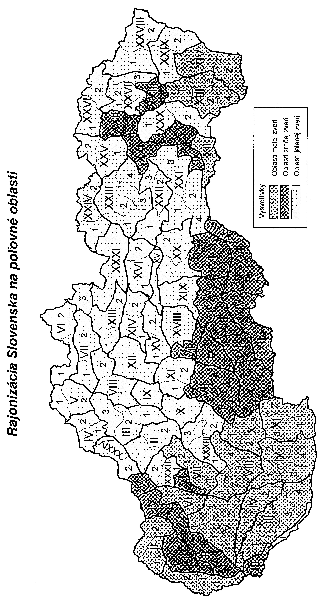
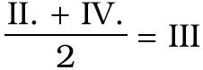

Príloha č. 1 k vyhláške č. 91/1997 Z. z.

POĽOVNÉ OBLASTI PRE JELENIU ZVER (J)

POĽOVNÉ OBLASTI PRE JELENIU ZVER SÚ:

J I. Podunajská poľovná oblasť

Východiskový bod – sútok potôčika s Dunajom juhozápadne od obce Klížska Nemá. Odtiaľ pokračuje proti prúdu tohto potôčika okrajom lesa po štátnu cestu Klížska Nemá – Trávnik. Ďalej touto cestou pokračuje cez obce Trávnik, Číčov, Kľúčovec, Medveďov, Sap, pri obci Ňárad prechádza na sútok prívodného kanála s korytom Dunaja, odtiaľ pokračuje pravou stranou hrádze proti prúdu prívodným kanálom až po cestu Báč – Dobrohošť, ďalej pokračuje štátnou hranicou s Maďarskom do východiskového bodu.

J II. Poľovná oblasť Bebrava

1. Trenčianska poľovná podoblasť

Východiskový bod – mesto Bánovce nad Bebravou. Odtiaľ pokračuje severným smerom štátnou cestou cez obce Podlužany, Timoradza, Krásna Ves, Slatinka nad Bebravou, Šípkov, Čierna Lehota, ďalej štátnou cestou po križovatku Valaská Belá – Horná Poruba a štátnou cestou Valaská Belá, osada Stanáková. Odtiaľ pokračuje štátnou cestou na západ cez osadu Stanáková, obec Horná Poruba až do Ilavy po Vážsky kanál. Vážskym kanálom pokračuje na juh popri Dubnici nad Váhom, Trenčíne po križovatku tohto kanála so štátnou cestou juhozápadne od obce Opatovce, odtiaľ pokračuje touto štátnou cestou juhovýchodným smerom cez obec Svinná do východiskového bodu.

2. Poľovná podoblasť Rokoš

Východiskový bod – mesto Bánovce nad Bebravou. Odtiaľ pokračuje severným smerom východnou hranicou Trenčianskej poľovnej podoblasti (J II/l) po križovatku so štátnou cestou Valaská Belá – osada Stanáková, ďalej pokračuje na východ štátnou cestou cez Valaskú Belú, ďalej cez osadu Matušíková a obce Liešťany, Nitrianske Rudno, Diviaky nad Nitricou až po križovatku so štátnou cestou Nováky – Horné Vestenice, odtiaľ štátnou cestou do Novák. Z Novák pokračuje južným smerom štátnou cestou cez obce Zemianske Kostoľany, Bystričany, Čereňany, Oslany, Malé Uherce, Partizánske. Odtiaľ pokračuje štátnou cestou severným smerom cez obec Hradište po križovatku so štátnou cestou, odtiaľ na západ po štátnej ceste cez Bánovce nad Bebravou do východiskového bodu.

J III. Poľovná oblasť Strážovská hornatina

1. Poľovná podoblasť Tužina

Východiskový bod – križovatka štátnej cesty Valaská Belá so štátnou cestou Liešťany – Zliechov. Odtiaľ pokračuje štátnou cestou na sever cez Čičmany až po križovatku so štátnou cestou Fačkov – Kľačno, ďalej štátnou cestou južným smerom cez Kľačno, Nitrianske Pravno, Nedožery–Brezany, Prievidzu, Koš do Novák. Odtiaľ pokračuje na západ severnou hranicou podoblasti Rokoš (J II/2) a jej východnou hranicou do východiskového bodu.

2. Poľovná podoblasť Strážov (kóta 1214)

Východiskový bod – križovatka štátnej cesty Valaská Belá so štátnou cestou Liešťany – Zliechov. Odtiaľ pokračuje na západ severnou hranicou poľovnej podoblasti Rokoš (J II/2) a Trenčianskej poľovnej podoblasti (J II/1) po Vážsky kanál pri Ilave. Ďalej pokračuje Vážskym kanálom na sever po Belušu a štátnou cestou na východ cez obce Visolaje, Dolný Lieskov, Pružina, Sádočné, Domaniža, Malé Lednice, Veľká Čierna, Rajec, ďalej štátnou cestou na juh cez obce Rajecká Lesná, Fačkov do východiskového bodu.

3. Poľovná podoblasť Súľov

Východiskový bod – obec Rajec. Odtiaľ pokračuje na západ severnou hranicou poľovnej podoblasti Strážov (J III/2) po Vážsky kanál pri Beluši. Ďalej pokračuje na sever Vážskym kanálom cez Priehradu mládeže a potom proti prúdu Váhu do Žiliny. Zo Žiliny pokračuje ďalej na juh štátnou cestou cez obce Lietavská Lúčka, Rajecké Teplice do východiskového bodu.

J IV. Poľovná oblasť Javorníky I

1. Poľovná podoblasť Mariková

Východiskový bod – Vážsky kanál pri Púchove. Odtiaľ pokračuje na severozápad štátnou cestou cez Púchov, Dohňany, Záriečie, Lysú pod Makytou po štátnu hranicu Slovenskej republiky s Českou republikou. Odtiaľ pokračuje na sever krajinskou hranicou po kótu 1019 – Malý Javorník. Od tejto kóty smeruje na východ po prameň riečky Papradnianka a touto riečkou pokračuje cez osadu Podjavorník, obce Papradno, Brvnište, Jasenica až po ústie do Vážskeho kanála. Odtiaľ pokračuje severozápadnou hranicou poľovnej podoblasti Súľov (J III/3) do východiskového bodu.

2. Poľovná podoblasť Veľký Javorník (kóta 1071)

Východiskový bod – ústie riečky Papradnianka do Vážskeho kanála. Odtiaľ pokračuje na severovýchod hranicou poľovnej podoblasti Mariková (J IV/l) po kótu 1019 – Malý Javorník po štátnej hranici Slovenskej republiky s Českou republikou. Ďalej touto hranicou pokračuje na sever po osadu Bumbalka, odtiaľ na východ štátnou cestou cez obce Makov, Kolárovice, mesto Bytča po rieku Váh a tokom Váhu a Vážskym kanálom do východiskového bodu.

J V. Poľovná oblasť Javorníky II

1. Poľovná podoblasť Klokočov

Východiskový bod – mesto Čadca. Odtiaľ pokračuje štátnou cestou smerom na juhozápad cez obce Raková, Turzovka, Makov po osadu Bumbalka po štátnej hranici Slovenskej republiky s Českou republikou, ďalej štátnou hranicou na sever po štátnu cestu Čadca – Mosty pri Jablůnkove, odtiaľ na juh štátnou cestou do východiskového bodu.

2. Poľovná podoblasť Čierťaž (kóta 844)

Východiskový bod – mesto Čadca. Odtiaľ pokračuje smerom na juh riekou Kysuca do Žiliny, zo Žiliny severnou hranicou poľovnej podoblasti Súľov (J III/3) po Váh pri Bytči, ďalej severozápadnou hranicou poľovnej podoblasti Veľký Javorník (J IV/2) po obec Makov a odtiaľ juhovýchodnou hranicou poľovnej podoblasti Klokočov (J V/l) do východiskového bodu.

J VI. Poľovná oblasť Slovenské Beskydy

1. Poľovná podoblasť Veľká Rača (kóta 1236)

Východiskový bod – obec Zákamenné. Odtiaľ pokračuje smerom na západ štátnou cestou cez obce Oravská Lesná, vodnou nádržou Nová Bystrica, Stará Bystrica, Klubina, Zborov nad Bystricou po križovatku so štátnou cestou Krásno nad Kysucou – Čadca, odtiaľ pokračuje východnou hranicou poľovnej podoblasti Čierťaž (J V/2) po Čadcu a východnou hranicou poľovnej podoblasti Klokočov (J V/l) po štátnu hranicu Slovenskej republiky s Českou republikou; touto hranicou pokračuje smerom na východ po štátnu hranicu Slovenskej republiky s Poľskom a smerom na východ po štátnu cestu Novoť, Glinka (Poľsko), odtiaľ štátnou cestou cez obec Novoť do východiskového bodu.

2. Poľovná podoblasť Pilsko (kóta 1557)

Východiskový bod – obec Zákamenné. Odtiaľ pokračuje severovýchodnou hranicou poľovnej podoblasti Veľká Rača (J VI/1) po štátnu hranicu Slovenskej republiky s Poľskom, touto štátnou hranicou pokračuje na sever, ďalej sa lomí súbežne so smerom štátnej hranice na juhovýchod po stred Oravskej priehrady, kde presahuje do Poľska, odtiaľ Oravskou priehradou po ústie Bielej Oravy do Oravskej priehrady, ďalej na západ štátnou cestou cez obce Breza, Krušetnica do východiskového bodu.

J VII. Poľovná oblasť Oravská Magura

1. Poľovná podoblasť Kysuca

Východiskový bod – obec Terchová. Odtiaľ pokračuje na juhozápad štátnou cestou cez obce Belá, Stráža, Krasňany, Varín, pod Varínom riečkou Varínka po jej ústie do Váhu. Ďalej pokračuje na západ riekou Váh do Žiliny, odtiaľ na sever východnou hranicou poľovnej podoblasti Čierťaž (J V/2) po križovatku ciest vyše mesta Krásno nad Kysucou, ďalej pokračuje na východ južnou hranicou poľovnej podoblasti Veľká Rača (J VI/1) až po križovatku, kde odbočuje štátna cesta na juh a touto cestou cez obec Dolná Tižina do východiskového bodu.

2. Poľovná podoblasť Minčol (kóta 1396)

Východiskový bod – obec Terchová. Odtiaľ pokračuje na sever východnou hranicou poľovnej podoblasti Kysuca (J VII/1) po križovatku na štátnej ceste Nová Bystrica – Harvelka, odtiaľ pokračuje na východ južnou hranicou poľovnej podoblasti Veľká Rača (J VI/1) a poľovnej podoblasti Pilsko (J VI/2) po ústie Bielej Oravy do Oravskej priehrady, ďalej pokračuje Oravskou priehradou až do bodu, kde rieka Orava opúšťa Oravskú priehradu, odtiaľ na juh riekou Orava po most na ceste Žaškov – Párnica. Ďalej touto štátnou cestou pokračuje na sever smerom na Zázrivú po križovatku pod Zázrivou, odtiaľ pokračuje po ceste na západ cez osadu Demkovská do východiskového bodu.

J VIII. Poľovná oblasť Malá Fatra

1. Poľovná podoblasť Veľká Lúka (kóta 1476)

Východiskový bod – rieka Váh na východnom okraji intravilánu mesta Vrútky. Odtiaľ pokračuje riekou Váh po prúde do Žiliny, ďalej na juh východnou hranicou poľovnej podoblasti Súľov (J III/2) a poľovnej podoblasti Tužina (J III/l) po obec Kľačno, odtiaľ pokračuje na severovýchod štátnou cestou smerom na Kláštor pod Znievom, popri obci Socovce cez obec Laskár po križovatku na štátnej ceste Mošovce – Martin, odtiaľ touto cestou cez Martin do východiskového bodu.

2. Poľovná podoblasť Rozsutec (kóta 1610)

Východiskový bod – rieka Váh na východnom okraji intravilánu mesta Vrútky. Odtiaľ pokračuje na severozápad riekou Váh po vtok riečky Varínka do Váhu, ďalej pokračuje južnou hranicou poľovnej podoblasti Kysuca (J VII/1) a poľovnej podoblasti Minčol (J VII/2) po most nad riekou Orava na ceste Párnica – Žaškov, odtiaľ riekou Orava po vtok do Váhu a ďalej Váhom po prúde do východiskového bodu.

J IX. Poľovná oblasť Žiar

Východiskový bod – mesto Prievidza. Odtiaľ pokračuje smerom na sever východnou hranicou poľovnej podoblasti Tužina (J III/1), južnou hranicou poľovnej podoblasti Veľká Lúka (J VIII/1) po križovatku na štátnej ceste Turčianske Teplice – Martin smerom na Mošovce, odtiaľ pokračuje touto cestou na juh cez Mošovce, Turčianske Teplice po križovatku, kde štátna cesta odbočuje do obce Sklené, ďalej pokračuje touto štátnou cestou cez obec Sklené do obce Ráztočno, odtiaľ cestou na západ do východiskového bodu.

J X. Poľovná oblasť Vtáčnik

Východiskový bod – mesto Prievidza. Odtiaľ pokračuje na juh hranicou poľovnej podoblasti Tužina (J III/1) a poľovnej podoblasti Rokoš (J II/2) po križovatku so štátnou cestou Malé Uherce – Horná Ves. Odtiaľ pokračuje štátnou cestou smerom na juhovýchod cez obce Horná Ves, Radobica, Veľké Pole, Žarnovica, ďalej riekou Hron proti prúdu do Hliníka nad Hronom a odtiaľ na sever hranicou srnčej poľovnej podoblasti Žiarska kotlina (S VII/5) po križovatku ciest Handlová – Žiar nad Hronom s odbočkou do Janovej Lehoty, ďalej pokračuje na sever štátnou cestou cez Handlovú do východiskového bodu.

J XI. Poľovná oblasť Kremnické pohorie

1. Poľovná podoblasť Slaská

Východiskový bod – mesto Kremnica. Ďalej pokračuje cez Turček po križovatku, kde odbočuje štátna cesta do obce Sklené, potom pokračuje južnou hranicou poľovnej oblasti Žiar (J IX) po obec Ráztočno, odtiaľ južne východnou hranicou poľovnej oblasti Vtáčnik (J X), štátnou cestou Handlová – Žiar nad Hronom po križovatku s odbočkou do Janovej Lehoty, potom hranicou srnčej poľovnej podoblasti Žiarska kotlina (S VII/5) po Hron pri križovatke ciest Žiar nad Hronom – Kremnica.

2. Poľovná podoblasť Skalka

Východiskový bod – rieka Hron pri Trnavej Hore. Odtiaľ pokračuje riekou Hron proti prúdu po horné železničné rampy pri obci Hronská Breznica, ďalej smeruje na štátnu cestu a tou pokračuje cez obce Budča, Kováčová, Sliač, cez mesto Banská Bystrica, odtiaľ pokračuje na sever štátnou cestou cez Harmanec po križovatku na štátnej ceste Horná Štubňa – Turčianske Teplice, ďalej pokračuje štátnou cestou na juh cez Turček, Kremnicu do východiskového bodu.

J XII. Poľovná oblasť Veľká Fatra

Východiskový bod – križovatka ciest medzi obcami Dolná Štubňa a Horná Štubňa. Odtiaľ pokračuje na východ štátnou cestou smerom na Banskú Bystricu až po vrchol tejto cesty (nad najdlhším tunelom). Ďalej pokračuje na sever cez obec Motyčky a po štátnej ceste na sever cez obce Liptovská Revúca, Liptovská Osada, Ružomberok po rieku Váh, ďalej pokračuje riekou Váh po prúde po východný okraj intravilánu mesta Vrútky, odtiaľ pokračuje na juh východnou hranicou poľovnej podoblasti Veľká Lúka (J VIII/1) a poľovnej oblasti Žiar (J IX) do východiskového bodu.

J XIII. Poľovná oblasť Orava

1. Poľovná podoblasť Choč (kóta 1611)

Východiskový bod – most nad Váhom na ceste Liptovská Teplá – Ivachnová. Odtiaľ pokračuje na západ riekou Váh cez Ružomberok po vtok rieky Orava do Váhu. Ďalej pokračuje smerom na severovýchod riekou Orava proti prúdu až po ohyb štátnej cesty nad obcou Medzibrodie nad Oravou, odtiaľ pokračuje štátnou cestou na juh cez obce Pokryváč, Lúčky-kúpele, Lúčky do východiskového bodu.

2. Poľovná podoblasť Prosečné (kóta 1372)

Východiskový bod – most nad Váhom na ceste Liptovská Teplá – Ivachnová. Odtiaľ pokračuje na sever východnou hranicou poľovnej podoblasti Choč (J XIII/1) po rieku Orava, odtiaľ riekou Orava proti prúdu po most nad Oravou pri obci Podbiel, odtiaľ štátnou cestou na východ cez obec Oravský Biely Potok do Habovky, odkiaľ pokračuje smerom na juh hranicou ochranného pásma TANAP-u po rieku Belá pri obci Pribylina, ďalej riekou Belá až po vtok do Váhu (pri Liptovskom Hrádku) a potom na západ riekou Váh a priehradou Liptovská Mara do východiskového bodu.

3. Poľovná podoblasť Skorušina (kóta 1314)

Východiskový bod – výtok rieky Orava z Oravskej priehrady. Odtiaľ pokračuje na sever Oravskou priehradou po štátnu hranicu Slovenskej republiky s Poľskom, odtiaľ smerom na východ touto štátnou hranicou po bod, kde sa začína hranica ochranného pásma TANAP-u, odkiaľ pokračuje na západ hranicou ochranného pásma TANAP-u do obce Habovka a ďalej severnou hranicou poľovnej podoblasti Prosečné (J XIII/2) po rieku Orava a pokračuje riekou Orava proti prúdu do východiskového bodu.

J XIV. Poľovná oblasť Nízke Tatry – sever I

1. Poľovná podoblasť Železnô

Východiskový bod – rieka Váh pri Liptovskom Mikuláši. Odtiaľ pokračuje na juh štátnou cestou cez obec Demänovská Dolina po začiatok lanovky, odtiaľ trasou lanovky po Chopok (kóta 2024), ďalej pokračuje na západ hrebeňom Nízkych Tatier po vrchol cesty Liptovská Osada – osada Donovaly a ďalej na západ hrebeňom nad osadou Donovaly po cestu Liptovská Revúca – Motyčky, odtiaľ na sever východnou hranicou poľovnej oblasti Veľká Fatra (J XII) po Váh pri Ružomberku a ďalej na východ touto riekou proti prúdu (resp. priehradou Liptovská Mara) do východiskového bodu.

2. Poľovná podoblasť Jasná

Východiskový bod – rieka Váh pri Liptovskom Mikuláši. Odtiaľ pokračuje na juh východnou hranicou poľovnej podoblasti Železnô (J XIV/1) po Chopok (kóta 2024) a ďalej na východ hrebeňom Nízkych Tatier po cestu na Čertovici, ďalej na sever touto štátnou cestou cez obce Vyšná Boca, Malužiná po most nad železničnou traťou pri Kráľovej Lehote a odtiaľ železničnou traťou po Liptovský Hrádok a ďalej riekou Váh po prúde do východiskového bodu.

J XV. Poľovná oblasť Nízke Tatry – juh I

1. Poľovná podoblasť Staré Hory

Východiskový bod – rieka Hron pri križovatke ciest Lučatín – Medzibrod a Hiadeľ – Ľubietová. Odtiaľ pokračuje na západ riekou Hron po prúde do Banskej Bystrice, ďalej na severozápad severnou hranicou poľovnej podoblasti Skalka (J XI/2), južnou hranicou poľovnej oblasti Veľká Fatra (J XII) a poľovnej podoblasti Železnô (J XIV/l) po štátnu cestu Korytnica-kúpele – Hiadeľ po hrebeni Nízkych Tatier a odtiaľ štátnou cestou na juh do východiskového bodu.

2. Poľovná podoblasť Jasenie

Východiskový bod – rieka Hron pri križovatke ciest Lučatín – Medzibrod a Hiadeľ – Ľubietová. Odtiaľ pokračuje na sever východnou hranicou poľovnej podoblasti Staré Hory (J XV/l) po hrebeň Nízkych Tatier, ďalej pokračuje na východ hrebeňom Nízkych Tatier po štátnu cestu na Čertovici, odtiaľ pokračuje touto cestou na juh cez Mýto pod Ďumbierom, Bystrú po Hron pri Podbrezovej a odtiaľ riekou Hron po prúde do východiskového bodu.

J XVI. Poľovná oblasť Nízke Tatry – sever II

1. Poľovná podoblasť Čierny Váh

Východiskový bod – železničná stanica Štrba. Odtiaľ pokračuje na západ hranicou ochranného pásma TANAP-u (železničnou traťou) po most nad železničnou traťou pri Kráľovej Lehote. Pokračuje štátnou cestou na juh po hrebeň Nízkych Tatier na Čertovici, ďalej na východ hrebeňom Nízkych Tatier po lesnú cestu do obce Liptovská Teplička a odtiaľ na sever štátnou cestou cez Šuňavu, Štrbu do východiskového bodu.

2. Poľovná podoblasť Vikartovce

Východiskový bod – železničná stanica Štrba. Odtiaľ pokračuje smerom na juh východnou hranicou poľovnej podoblasti Čierny Váh (J XVI/1) po hrebeň Nízkych Tatier, ďalej na východ hrebeňom Nízkych Tatier po štátnu cestu Telgárt – Vernár, odtiaľ touto cestou na sever cez obce Vernár, Hranovnica do Popradu po železničnú trať a ďalej na západ železničnou traťou (hranica ochranného pásma TANAP-u) do východiskového bodu.

J XVII. Poľovná oblasť Nízke Tatry – juh II

Východiskový bod – štátna cesta na Čertovici (hrebeň Nízkych Tatier). Odtiaľ pokračuje na východ hrebeňom Nízkych Tatier po štátnu cestu Vernár (Popová), ktorou pokračuje na juh do Telgártu, odtiaľ na západ riekou Hron po Štiavničku, ďalej na sever štátnou cestou cez obce Bystrá, Mýto pod Ďumbierom do východiskového bodu.

J XVIII. Poľovná oblasť Poľana

Východiskový bod – most nad Hronom. Odtiaľ pokračuje štátnou cestou cez obce Poniky, Dúbravica, Čerín do obce Hrochoť. Ďalej pokračuje na juh poľnou cestou k potoku Hučava a týmto potokom do Očovej, ďalej na východ cestou cez obec Dúbravy až po most nad potokom Suchohradná, týmto potokom pokračuje proti prúdu až po hranicu Chránenej poľovnej oblasti Poľana, odtiaľ hranicou tejto oblasti až po cestu Lom nad Rimavicou – Čierny Balog. Touto cestou pokračuje na sever cez Čierny Balog po Hron pri Brezne, odtiaľ pokračuje riekou Hron po prúde do východiskového bodu.

J XIX. Poľovná oblasť Klenovský Vepor

Východiskový bod – rieka Hron v Brezne. Odtiaľ pokračuje na juh východnou hranicou poľovnej oblasti Poľana (J XVIII), potom východnou hranicou Chránenej poľovnej oblasti Poľana a štátnou cestou po križovatku ciest pri osade Slanec, ďalej pokračuje štátnou cestou na východ cez obce Detvianska Huta, Látky, Kokava nad Rimavicou, Klenovec, Hnúšťa, potom na sever štátnou cestou na Tisovec. Za Tisovcom pokračuje lesnou cestou smerujúcou pod Fabovu hoľu (kóta 1430) a od konca tejto cesty priamo na Fabovu hoľu, odtiaľ vpravo potokom Hronec po jeho ústie do Hrona nad obcou Závadka nad Hronom a pokračuje na západ po prúde rieky Hron do východiskového bodu.

J XX. Poľovná oblasť Muráň

1. Poľovná podoblasť Kľak (kóta 1409)

Východiskový bod – obec Hnúšťa. Odtiaľ pokračuje na sever východnou hranicou poľovnej oblasti Klenovský Vepor (J XIX) po ústie potoka Hronec do Hrona. Ďalej pokračuje na východ riekou Hron proti prúdu po odbočku štátnej cesty pri osade Červená Skala do Muráňa a touto cestou cez obce Muránska Huta, Muráň, Revúca po križovatku nad obcou Lubeník, odtiaľ štátnou cestou na juhozápad cez obce Turčok, Sirk, Ploské, Ratková do východiskového bodu.

2. Poľovná podoblasť Stolica (kóta 1477)

Východiskový bod – mesto Rožňava. Odtiaľ pokračuje na západ štátnou cestou cez obce Rudná, Štítnik, Gočaltovo, Jelšava, Lubeník a potom na sever východnou hranicou poľovnej podoblasti Kľak (J XX/1) po Hron pri Červenej Skale, ďalej pokračuje východnou hranicou poľovnej oblasti Nízke Tatry – juh II (J XVII) po osadu Pusté Pole, odtiaľ pokračuje štátnou cestou na východ cez obce Stratená, Dobšiná, Nižná Slaná do východiskového bodu.

J XXI. Poľovná oblasť Smolník

1. Poľovná podoblasť Volovec (kóta 1284)

Východiskový bod – obec Smolník. Odtiaľ pokračuje na juh štátnou cestou cez Úhornú, Pačanský vrch, Krásnohorské Podhradie do Rožňavy. Ďalej pokračuje hranicou poľovnej podoblasti Stolica (J XX/2) po odbočku cesty na Dobšinú a touto cestou po rieku Hnilec pod priehradou, potom riekou Hnilec na východ po Mníšek nad Hnilcom, odtiaľ na juh štátnou cestou do východiskového bodu.

2. Poľovná podoblasť Pipitka (kóta 1225)

Východiskový bod – obec Smolník. Odtiaľ pokračuje na juh štátnou cestou do Krásnohorského Podhradia, na východ cestou cez obce Drnava, Kováčová, Bôrka, Dvorníky-Včeláre, Drienovec, Moldava nad Bodvou. Odtiaľ pokračuje na sever štátnou cestou cez Jasov, Medzev, Štós do východiskového bodu.

3. Poľovná podoblasť Kojšovská hoľa (kóta 1246)

Východiskový bod – obec Smolník. Odtiaľ pokračuje na sever hranicou poľovnej podoblasti Volovec (J XXI/1) po rieku Hnilec, ďalej riekou Hnilec po prúde po Jaklovce, Margecany, Klenov, Kvačany, Sedlice, Ľubovec, Obišovce, Družstevná pri Hornáde. Ďalej pokračuje severnou hranicou srnčej Torysskej poľovnej oblasti (S XX) do Jasova a severnou hranicou poľovnej podoblasti Pipitka (J XXI/2) na západ do východiskového bodu.

4. Poľovná podoblasť Slovenský kras

Východiskový bod – obec Štítnik. Ďalej pokračuje cez Plešivec a Ardovo do Silice. Zo Silice pokračuje štátnou cestou na Silickú Jablonicu po tranzitný plynovod, ďalej na štátnu hranicu Slovenskej republiky s Maďarskom, touto štátnou hranicou na východ po katastrálnu hranicu Hrhov, touto katastrálnou hranicou na štátnu cestu Rožňava – Košice a východným smerom na križovatku pri obci Dvorníky-Včeláre. Odtiaľ pokračuje južnou hranicou poľovnej podoblasti Pipitka (J XXI/2) a poľovnej podoblasti Volovec (J XXI/1) do Rožňavy a odtiaľ južnou hranicou poľovnej podoblasti Stolica (J XX/2) do východiskového bodu.

J XXII. Poľovná oblasť Slovenský Raj

1. Poľovná podoblasť Hrabušice

Východiskový bod – obec Nálepkovo. Odtiaľ pokračuje na západ severnou hranicou poľovnej podoblasti Volovec (J XXI/1) a poľovnej podoblasti Stolica (J XX/2) po križovatku štátnych ciest Telgárt – Vernár – Dobšiná, ďalej na sever východnou hranicou poľovnej podoblasti Vikartovce (J XVI/2) do Popradu po železničnej trati. Odtiaľ pokračuje na východ štátnou cestou cez Švábovce, Jánovce, Spišskú Novú Ves. Zo Spišskej Novej Vsi pokračuje riekou Hornád po prúde po ústie potoka vytekajúceho z Markušovskej priehrady, ďalej týmto potokom proti prúdu a brehom priehrady. Na konci priehrady pokračuje potokom proti prúdu na juhozápad po osadu Bindt, kde prechádza na cestu, ktorá sa napája na štátnu cestu, a pokračuje cez Hnilčík do východiskového bodu.

2. Poľovná podoblasť Bukovec (kóta 1127)

Východiskový bod – obec Nálepkovo. Odtiaľ pokračuje na sever východnou hranicou poľovnej podoblasti Hrabušice (J XXII/1) po most nad Hornádom pod Spišskými Vlachmi, ďalej pokračuje na sever východnou hranicou poľovnej podoblasti Jablonov (J XXIII/3) po križovatku štátnych ciest Spišské Podhradie – Široké – Bijacovce, odtiaľ štátnou cestou na východ cez obec Korytné do obce Široké, potom pokračuje na juhovýchod cez obce Víťaz, Ovčie, Hrabkov, Klenov, Margecany, Gelnica, Prakovce, Mníšek nad Hnilcom, Švedlár do východiskového bodu.

J XXIII. Poľovná oblasť Levočské pohorie

1. Poľovná podoblasť Ľubica

Východiskový bod – mesto Spišská Nová Ves. Odtiaľ pokračuje na západ severnou hranicou poľovnej podoblasti Hrabušice (J XXII/1) po Poprad, ďalej na sever hranicou ochranného pásma TANAP-u po Spišskú Belú, odtiaľ pokračuje riekou Poprad po križovatku ciest pri železničnej stanici Toporec, potom na juh štátnou cestou cez obce Holumnica, Ihľany do Levoče a ďalej štátnou cestou do východiskového bodu.

2. Poľovná podoblasť Čierna hora (kóta 1290)

Východiskový bod – križovatka ciest pri železničnej stanici Toporec. Odtiaľ pokračuje na severovýchod riekou Poprad po osadu Podpíla pri Orlove, potom na juhovýchod štátnou cestou cez Ľubotín do Lipian. Ďalej pokračuje štátnou cestou na západ cez obce Krivany, Torysa, Brezovica, Tichý Potok, Nižné Repaše, Torysky, odkiaľ pokračuje východnou hranicou poľovnej podoblasti Ľubica (J XXIII/1) do východiskového bodu.

3. Poľovná podoblasť Jablonov

Východiskový bod – mesto Spišská Nová Ves. Odtiaľ pokračuje na sever východnou hranicou poľovnej podoblasti Ľubica (J XXIII/1), ďalej pokračuje južnou hranicou poľovnej podoblasti Čierna Hora (J XXIII/2) po Brezovicu, potom na juh štátnou cestou cez obce Brezovička, Nižný Slavkov, Bijacovce, Spišské Podhradie, Spišské Vlachy po rieku Hornád, odtiaľ sa vracia severnou hranicou poľovnej podoblasti Bukovec (J XXII/2) a poľovnej podoblasti Hrabušice (J XXII/1) do východiskového bodu.

4. Poľovná podoblasť Bachureň

Východiskový bod – obec Chminianska Nová Ves. Odtiaľ pokračuje na západ severnou hranicou poľovnej podoblasti Žipov (S XXI/1) a poľovnej podoblasti Bukovec (J XXII/2) po križovatku ciest pred Spišským Podhradím, ďalej pokračuje na severovýchod východnou hranicou poľovnej podoblasti Jablonov (J XXIII/3) a južnou hranicou poľovnej podoblasti Čierna hora (J XXIII/2) a poľovnej podoblasti Minčol (J XXV/1) po Sabinov, odtiaľ pokračuje na juh štátnou cestou cez obce Ražňany, Jarovnice, Daletice do východiskového bodu.

J XXIV. Poľovná oblasť Spišská Magura

1. Poľovná podoblasť Smrečiny (kóta 1158)

Východiskový bod – križovatka ciest pri železničnej stanici Toporec. Odtiaľ pokračuje na sever štátnou cestou cez obce Toporec, Veľká Lesná, Haligovce, Červený Kláštor-kúpele po štátnu hranicu s Poľskom, ktorou pokračuje na západ po bod na štátnej hranici, kde sa pripája hranica TANAP-u. Odtiaľ pokračuje hranicou TANAP-u a hranicou ochranného pásma TANAP-u po rieku Poprad do Spišskej Belej a riekou Poprad do východiskového bodu.

2. Poľovná podoblasť Grúň (kóta 1039)

Východiskový bod – križovatka ciest pri železničnej stanici Toporec. Odtiaľ pokračuje na sever východnou hranicou poľovnej podoblasti Smrečiny (J XXIV/1) po štátnu hranicu s Poľskom, ktorou pokračuje na východ až po križovatku ciest pri obci Čirč, ďalej pokračuje smerom na juhozápad štátnou cestou do Starej Ľubovne až k mostu cez rieku Poprad v Starej Ľubovni, odtiaľ pokračuje smerom na juhozápad proti prúdu rieky Poprad po osadu Podpíla, ďalej na západ severnou hranicou poľovnej podoblasti Čierna hora (J XXIII/2) do východiskového bodu.

J XXV. Poľovná oblasť Čergov

1. Poľovná podoblasť Minčol (kóta 1157)

Východiskový bod – mesto Bardejov. Odtiaľ pokračuje na juh štátnou cestou cez obce Hertník, Osikov, Raslavice, Demjata, Mošurov, Terňa, Uzovce, Šarišské Sokolovce, Sabinov po Lipany. Z Lipian pokračuje na sever východnou hranicou poľovnej podoblasti Čierna hora (J XXIII/2) a poľovnej podoblasti Grúň (J XXIV/2) po štátnu hranicu s Poľskom, odtiaľ smeruje na východ štátnou hranicou po obec Obručné a ďalej pokračuje štátnou cestou cez obce Lenartov, Gerlachov, Tarnov, Mokroluh do východiskového bodu.

2. Poľovná podoblasť Busov (kóta 1002)

Východiskový bod – mesto Bardejov. Odtiaľ pokračuje na západ severnou hranicou poľovnej podoblasti Minčol (J XXV/1) po štátnu hranicu s Poľskom, ktorá pokračuje smerom na severovýchod po štátnu cestu Becherov – Konieczna (Poľsko) a touto cestou ďalej na juh cez obce Becherov, Zborov do východiskového bodu.

J XXVI. Poľovná oblasť Nízke Beskydy

1. Poľovná podoblasť Vyšný Mirošov

Východiskový bod – mesto Svidník. Odtiaľ pokračuje na západ štátnou cestou cez obce Hrabovčík, Rovné, Kurimka, ďalej priamkou do obce Hažlín, odtiaľ štátnou cestou cez Belovežu do Bardejova. Z Bardejova pokračuje na sever východnou hranicou poľovnej podoblasti Busov (J XXV/2) po štátnu hranicu s Poľskom a touto hranicou pokračuje na východ po Dukliansky priesmyk, odtiaľ na juh štátnou cestou cez obce Krajná Poľana, Hunkovce, Ladomírová do východiskového bodu.

2. Poľovná podoblasť Habura

Východiskový bod – mesto Svidník. Odtiaľ pokračuje na juh riekou Ondava po Stropkov, ďalej na severovýchod štátnou cestou cez obce Bukovce, Makovce, Bystrá, Krásny Brod, Medzilaborce, Palota po štátnu hranicu s Poľskom a touto hranicou pokračuje na západ po Dukliansky priesmyk, ďalej na juh východnou hranicou poľovnej podoblasti Vyšný Mirošov (J XXVI/1) do východiskového bodu.

J XXVII. Poľovná oblasť Humenné

1. Poľovná podoblasť Stropkov

Východiskový bod – obec Nižná Sitnica. Odtiaľ pokračuje na sever štátnou cestou cez obce Pakostov, Ruská Kajňa, Oľka, Repejov, Verechovce do Havaja, ďalej pokračuje na západ južnou hranicou poľovnej podoblasti Habura (J XXVI/2) po Stropkov, odtiaľ na juh východnou hranicou Ondavskej poľovnej podoblasti (J XXVII/3) do východiskového bodu.

2. Poľovná podoblasť Hrubov

Východiskový bod – obec Nižná Sitnica. Odtiaľ pokračuje na sever východnou hranicou poľovnej podoblasti Stropkov (J XXVII/1) po obec Havaj, potom na východ južnou hranicou poľovnej podoblasti Habura (J XXVI/2) po rieku Laborec pri Krásnom Brode, odtiaľ smeruje na juh západnou hranicou poľovnej podoblasti Čierniny (J XXVIII/1) po Humenné a ďalej na sever po obce Ohradzany, Baškovce, Černina, Jankovce do východiskového bodu.

3. Ondavská poľovná podoblasť

Východiskový bod – obec Rovné. Odtiaľ pokračuje južným smerom po štátnej ceste Mlynárovce – Šarišský Štiavnik – Okrúhle – Giraltovce – Hanušovce nad Topľou, ďalej pokračuje po štátnej ceste Remeniny – Matiaška, Detrik až do obce Malá Domaša. Odtiaľ pokračuje po štátnej ceste cez Žalobín, Jasenovce, ďalej západnou hranicou poľovnej podoblasti Stropkov (J XXVII/1) na sever po mesto Stropkov, potom štátnou cestou na Svidník do východiskového bodu.

J XXVIII. Poľovná oblasť Poloninské Karpaty

1. Poľovná podoblasť Čierniny (kóta 671)

Východiskový bod – mesto Snina. Odtiaľ pokračuje na západ štátnou cestou cez obce Belá nad Cirochou, Kamenica nad Cirochou do Humenného, ďalej na sever riekou Laborec proti prúdu do Krásneho Brodu, potom východnou hranicou poľovnej podoblasti Habura (J XXVI/2) po štátnu hranicu a touto hranicou po prameň rieky Udava, potom pokračuje po prúde tejto rieky do obce Osadné a ďalej na juh štátnou cestou cez obce Hostovice a Pčoliné do východiskového bodu.

2. Poľovná podoblasť Kučalata (kóta 917)

Východiskový bod – mesto Snina. Odtiaľ pokračuje na východ štátnou cestou cez obce Stakčín, Klenová, Ubľa po štátnu hranicu Slovenskej republiky s Ukrajinou, touto hranicou pokračuje na sever po bod, kde sa napája štátna hranica s Poľskom, ďalej pokračuje touto hranicou na západ po bod, kde sa končí východná hranica poľovnej podoblasti Čierniny (J XXVIII/1) a touto hranicou pokračuje na juh do východiskového bodu.

J XXIX. Poľovná oblasť Vihorlat

1. Poľovná podoblasť Vihorlat (kóta 1078)

Východiskový bod – mesto Michalovce. Odtiaľ pokračuje na sever štátnou cestou cez obce Zbudza, Staré, Strážske, Brekov, Humenné. Ďalej pokračuje na východ južnou hranicou poľovnej podoblasti Čierniny (J XXVIII/1) a poľovnej podoblasti Kučalata (J XXVII/2) po ústie potoka prameniaceho pod vrchom Nežabec (kóta 1023) do rieky Cirocha neďaleko Stakčína, odtiaľ pokračuje na juh proti prúdu tohto potoka cez kótu Nežabec. Na južnej strane tejto kóty sa napája na ďalší potok Okna a týmto potokom pokračuje do Remetských Hámrov, odtiaľ štátnou cestou na juh po križovatku ciest Jasenov, Poruba pod Vihorlatom, ďalej štátnou cestou na západ cez obce Poruba pod Vihorlatom, Jovsa, Klokočov, Kaluža do východiskového bodu.

2. Poľovná podoblasť Podhoroď

Východiskový bod – obec Sobrance. Odtiaľ pokračuje na sever štátnou cestou cez obce Ruskovce, Jasenov po križovatku ciest, kde sa napája východná hranica poľovnej podoblasti Vihorlat (J XXIX/1). Ďalej pokračuje touto hranicou na sever po ústie potoka do rieky Cirocha neďaleko Stakčína. Odtiaľ smeruje na východ južnou hranicou poľovnej podoblasti Kučalata (J XXVIII/2) po štátnu hranicu s Ukrajinou a touto hranicou na juh po potok tečúci od obce Petrovce po Ukrajinu, ďalej pokračuje na západ týmto potokom proti prúdu po obec Petrovce, odtiaľ štátnou cestou cez obce Koromľa, Porúbka, Tibava do východiskového bodu.

J XXX. Poľovná oblasť Slanské pohorie

1. Poľovná podoblasť Šimonka (kóta 1092)

Východiskový bod – obec Herľany. Odtiaľ pokračuje na severovýchod štátnou cestou cez obce Banské, Vechec do Vranova nad Topľou, potom na sever štátnou cestou cez obce Soľ, Hlinné, Bystré, Hanušovce nad Topľou, Kapušany, Prešov. Z Prešova pokračuje na juh štátnou cestou cez obce Dulova Ves, Kokošovce, Žehňa, Tuhrina, Opiná, Kecerovce do východiskového bodu.

2. Poľovná podoblasť Bogota (kóta 855)

Východiskový bod – obec Herľany. Odtiaľ pokračuje na severovýchod južnou hranicou poľovnej podoblasti Šimonka (J XXX/1) po Vranov nad Topľou, potom na juh štátnou cestou cez obce Sačurov, Sečovská Polianka, Stankovce, Kravany, Sečovce, Veľké Ozorovce, Slanské Nové Mesto, Kalša, Slivník, Kuzmice, Kazimír po štátnu hranicu s Maďarskom. Odtiaľ pokračuje na západ po tejto štátnej hranici po priesečník štátnej cesty so štátnou hranicou južne od obce Trstené pri Hornáde, cez obce Ždaňa, Bohdanovce, Ruskov, Ďurkov, Bídovce do východiskového bodu.

J XXXI. Poľovná oblasť Vysoké Tatry

Východiskový bod – rieka Oravica na štátnej hranici s Poľskom. Odtiaľ pokračuje hranicou TANAP-u až na Podbanské, ďalej štátnou cestou do Liptovského Petra cez obce Hybe, Východná do Popradu, Kežmarku a Spišskej Belej. Odtiaľ pokračuje štátnou cestou do Tatranskej Kotliny, Ždiaru, Tatranskej Javoriny po štátnu hranicu s Poľskom.

J XXXII. Poľovná oblasť Považský Inovec

1. Poľovná podoblasť Úhrad (kóta 685)

Východiskový bod – obec Bojná. Odtiaľ pokračuje na severozápad severnou hranicou poľovnej oblasti Marhat (S VI) po Vážsky kanál, ďalej na sever Vážskym kanálom po cestný most pri Novom Meste nad Váhom, potom na východ cestou cez Kálnicu, Prostrednou dolinou cez hrebeň Inovca do obce Zlatníky, odtiaľ cestou cez Malé Hoste a Veľké Hoste, Šišov, Norovce, Tesáre do východiskového bodu.

2. Poľovná podoblasť Inovec (kóta 1042)

Východiskový bod – mesto Bánovce nad Bebravou. Odtiaľ pokračuje štátnou cestou do Svinnej a južnou hranicou Trenčianskej poľovnej oblasti (J II/1) po Vážsky kanál západne od Opatoviec, potom juhovýchodnou hranicou poľovnej oblasti Bošáca (S V) po Nové Mesto nad Váhom. Odtiaľ smeruje na východ severnou hranicou poľovnej podoblasti Úhrad (J XXXII/1) po križovatku ciest pri Pochabanoch, ďalej štátnou cestou cez Haláčovce do východiskového bodu.

J XXXIII. Poľovná oblasť Tribeč

1. Poľovná podoblasť Veľký Tribeč (kóta 829)

Východiskový bod – mesto Zlaté Moravce. Odtiaľ pokračuje cez obce Topoľčianky, Mankovce, Velčice, Ladice na Jelenec, štátnou cestou cez obce Jelenec, Kolíňany, Nitrianske Hrnčiarovce, mesto Nitra, potom štátnou cestou cez Dražovce po križovatku so štátnou cestou pri železničnej trati, ďalej touto štátnou cestou na sever cez obce Lefantovce, Oponice, Kovarce, Solčany na odbočku do obce Krnča. Z obce Krnča prebieha ďalej hranica severným intravilánom obce na kótu č. 207, odtiaľ po stabilnej poľnej ceste do obce Sádok, ďalej pokračuje štátnou cestou do obce Klátová Nová Ves smerom na Skýcov po plot zverníka v Topoľčiankach a týmto plotom na juh nad obec Lovce, potom na juh cez obec Lovce štátnou cestou do východiskového bodu.

2. Poľovná podoblasť Veľký Inovec (kóta 746)

Východiskový bod – mesto Zlaté Moravce. Odtiaľ pokračuje na sever východnou hranicou poľovnej podoblasti Veľký Tribeč (J XXXIII/1) po plot zverníka, týmto plotom na východ po štátnu cestu Obyce – Malá Lehota a ďalej touto cestou cez obce Veľká Lehota do Novej Bane po rieku Hron. Odtiaľ pokračuje riekou Hron po prúde po Hronský Beňadik, ďalej na západ štátnou cestou cez Čaradice do východiskového bodu.

3. Poľovná podoblasť Veľká Ostrá (kóta 901)

Východiskový bod – obec Bošany. Odtiaľ pokračuje na sever štátnou cestou cez obce Nedanovce, Krásno, Partizánske po Oslany. Ďalej pokračuje južnou hranicou poľovnej oblasti Vtáčnik (J X) po rieku Hron pri Žarnovici, odtiaľ po prúde Hrona po Novú Baňu a potom na západ severnou hranicou poľovnej podoblasti Inovec (J XXXII/2) do východiskového bodu.

J XXXIV. Poľovná oblasť Biele Karpaty

1. Poľovná podoblasť Mikušovce

Východiskový bod – Vážsky kanál pri obci Nemšová. Odtiaľ pokračuje severnou hranicou poľovnej podoblasti Súča (J XXXIV/2) po štátnu hranicu (Vlársky priesmyk), ďalej na sever štátnou hranicou po štátnu cestu Lysá pod Makytou – Horní Lideč, odtiaľ na východ južnou hranicou poľovnej podoblasti Mariková (J IV/1).

2. Poľovná podoblasť Súča

Východiskový bod – Vážsky kanál pri obci Kostolná – Záriečie. Odtiaľ pokračuje na severozápad hranicou poľovnej oblasti Bošáca (S V) po štátnu hranicu, ďalej pokračuje touto štátnou hranicou na sever po štátnu cestu na Vlárskom priesmyku a touto cestou cez Horné Srnie, Nemšovú po Vážsky kanál a týmto kanálom po prúde cez Trenčín do východiskového bodu.

Príloha č. 2 k vyhláške č. 91/1997 Z. z.

POĽOVNÉ OBLASTI PRE SRNČIU ZVER (S)

POĽOVNÉ OBLASTI PRE SRNČIU ZVER SÚ:

S I. Poľovná oblasť Záhorie

1. Poľovná podoblasť Šaštínske Stráže

Východiskový bod – obec Malacky. Odtiaľ pokračuje na sever štátnou cestou cez Veľké Leváre, Sekule, Borský Svätý Jur, Šaštín-Stráže po križovatku ciest Šaštín-Stráže – Dojč, ďalej cestou prichádzajúcou od Borského Mikuláša, odtiaľ pokračuje touto cestou cez obce Borský Mikuláš, Lakšárska Nová Ves, Studienka do východiskového bodu.

2. Poľovná podoblasť Malacky

Východiskový bod – obec Malacky. Odtiaľ pokračuje na juh štátnou cestou po križovatku ciest Lozorno – Zohor, ďalej štátnou cestou cez Lozorno, Jablonové, Pernek, Kuchyňu, Rohožník, Plavecký Mikuláš, Plavecký Peter, Prievaly, Jablonicu, Senicu, Čáčov, Dojč po križovatku tejto cesty s cestou prichádzajúcou od Borského Mikuláša. Odtiaľ pokračuje na juh východnou hranicou poľovnej podoblasti Šaštínske Stráže (S I/1) do východiskového bodu.

S II. Poľovná oblasť Malé Karpaty

1. Poľovná podoblasť Stupava

Východiskový bod – mesto Pezinok. Odtiaľ pokračuje cestou na západ cez Malé Karpaty do Perneku, ďalej cestou cez Jablonové, Lozorno, Stupavu po intravilán mestskej časti Lamač, potom cestou na západ cez Devínsku Novú Ves po štátnu hranicu Slovenskej republiky s Rakúskom, ďalej pokračuje touto štátnou hranicou po okraj intravilánu mestskej časti Karlova Ves, odtiaľ okrajom intravilánu veľkej Bratislavy po cestu za mestskou časťou Rača, ďalej pokračuje cestou cez Svätý Jur do východiskového bodu.

2. Poľovná podoblasť Vápená (kóta 748)

Východiskový bod – mesto Pezinok. Odtiaľ pokračuje severnou hranicou poľovnej podoblasti Stupava (S II/1) po Pernek, potom východnou hranicou poľovnej podoblasti Malacky (S I/2) po Jablonicu, ďalej na juhovýchod štátnou cestou do Trstína a potom na juh štátnou cestou cez Smolenice, Lošonec, Horné Orešany, Dolné Orešany, Doľany, Častú, Modru do východiskového bodu.

3. Poľovná podoblasť Dobrá Voda

Východiskový bod – obec Brezová pod Bradlom. Odtiaľ pokračuje na juhozápad štátnou cestou do Jablonice, ďalej na juhovýchod hranicou poľovnej podoblasti Vápená (S II/2) po Trstín, potom na sever štátnou cestou cez Naháč, Dechtice, Chtelnicu, Šterusy, Vrbové po križovatku ciest južne od obce Krajné, odtiaľ cestou cez Košariská do východiskového bodu.

S III. Poľovná oblasť Bratislava

Východiskový bod – obec Dobrohošť. Ďalej pokračuje štátnou cestou do Šamorína cez Hamuliakovo, Kalinkovo, Dunajskú Lužnú, Rovinku po okraj Podunajských Biskupíc. Potom pokračuje katastrálnou hranicou k okraju Biskupického lesa, okrajom lesa k lodenici a hlavným tokom Dunaja k štátnej hranici s Rakúskom a ďalej touto štátnou hranicou do východiskového bodu.

S IV. Poľovná oblasť Stará Turá

Východiskový bod – obec Brezová pod Bradlom. Odtiaľ pokračuje severnou hranicou poľovnej podoblasti Dobrá Voda (S II/3) po križovatku na štátnej ceste Myjava – Vrbové južne od obce Krajné, ďalej štátnou cestou cez Krajné, Višňové, Čachtice, Nové Mesto nad Váhom, potom štátnou cestou na severozápad po obec Šance na štátnej hranici Slovenskej republiky s Českou republikou, odtiaľ pokračuje touto hranicou na juhozápad po cestu pri železničnej trati Myjava – Veselí nad Moravou a ďalej na juh štátnou cestou cez Myjavu do východiskového bodu.

S V. Poľovná oblasť Bošáca

Východiskový bod – Vážsky kanál pri obci Kostolná–Záriečie. Odtiaľ pokračuje štátnou cestou cez Kostolnú–Záriečie, Drietomu po štátnu hranicu s Českou republikou a tou na juhozápad po obec Šance, ďalej pokračuje na juhovýchod hranicou poľovnej oblasti Stará Turá (S IV) po Nové Mesto nad Váhom a Vážskym kanálom na sever do východiskového bodu.

S VI. Poľovná oblasť Marhat

Východiskový bod – obec Bojná. Odtiaľ pokračuje na severozápad štátnou cestou cez hrebeň Inovca, cez obce Nová Lehota, Modrová do Modrovky, ďalej potokom po Vážsky kanál, Vážskym kanálom cez Sĺňavu a ďalej kanálom po Hlohovec, odtiaľ na sever štátnou cestou cez obce Tepličky, Horné Otrokovce, Orešany, Radošina, Vozokany do východiskového bodu.

S VII. Poľovná oblasť Štiavnické pohorie

1. Poľovná podoblasť Drastvica

Východiskový bod – obec Pukanec. Odtiaľ pokračuje na sever štátnou cestou cez Majere po križovatku ciest pod obcou Vysoká, ďalej pokračuje cestou cez Kopanice, Hodruša-Hámre po Hron pri Žarnovici, potom na juh riekou Hron po Tlmače, odtiaľ na východ štátnou cestou cez Rybník, Čajkov, Devičany do východiskového bodu.

2. Poľovná podoblasť Sklené Teplice

Východiskový bod – rieka Hron pri Žarnovici. Odtiaľ pokračuje na sever riekou Hron proti prúdu po most pri Hronskej Breznici, potom na juh štátnou cestou cez Kozelník, Banskú Belú, Banskú Štiavnicu, Štiavnické Bane po križovatku ciest pod obcou Vysoká a odtiaľ pokračuje na západ severnou hranicou poľovnej podoblasti Drastvica (S VII/1) do východiskového bodu.

3. Poľovná podoblasť Počúvadlo

Východiskový bod – obec Hontianske Nemce. Odtiaľ pokračuje štátnou cestou na sever cez Prenčov po hranicu chránenej poľovnej oblasti Sitno (okraj lesa Pokhaus), potom severnou hranicou tejto oblasti po križovatku ciest na Pecinách, ďalej pokračuje štátnou cestou na juh cez osadu Štampoch, cez obce Majere, Pukanec, Bohunice, Bátovce, Žemberovce, odtiaľ na východ štátnou cestou cez Ladzany, Sebechleby do východiskového bodu.

4. Poľovná podoblasť Banský Studenec

Východiskový bod – obec Hontianske Nemce. Odtiaľ pokračuje na sever východnou hranicou poľovnej podoblasti Počúvadlo (S VII/3) po okraj chránenej poľovnej oblasti Sitno pri Pokhause, potom severnou hranicou tejto oblasti po križovatku ciest Peciny, odtiaľ pokračuje na sever východnou hranicou poľovnej podoblasti Sklené Teplice (S VII/2) po Hron pri Hronskej Breznici, ďalej riekou Hron proti prúdu po ústie Slatiny do Hrona, pokračuje riečkou Slatina po most vo Zvolene a odtiaľ na juh štátnou cestou cez Dobrú Nivu, Krupinu do východiskového bodu.

5. Poľovná podoblasť Žiarska kotlina

Východiskový bod – obec Hliník nad Hronom. Potom pokračuje štátnou cestou cez obce Dolná Ždaňa, Horná Ždaňa, Prestavlky, Lovčica–Trubín na štátnu cestu Žiar nad Hronom – Handlová, ďalej štátnou cestou cez obce Janova Lehota, Slaská, Lutila, Žiar nad Hronom na križovatku štátnych ciest Zvolen – Žarnovica a odtiaľ cestou do východiskového bodu.

S VIII. Poľovná oblasť Zvolen

Východiskový bod – rieka Hron pri horných železničných rampách pri Hronskej Breznici. Odtiaľ pokračuje východnou hranicou poľovnej podoblasti Skalka (J XI/2) po Banskú Bystricu, potom cestou do Šalkovej a odtiaľ západnou hranicou poľovnej oblasti Poľana (J XVIII) a južnou hranicou Chránenej poľovnej oblasti Poľana po štátnu cestu pod Hriňovskou priehradou, potom touto cestou na juh po križovatku ciest pri Kriváni, odtiaľ pokračuje štátnou cestou na západ cez Vígľaš po most vo Zvolene (pri Zvolenskom zámku), ďalej riečkou Slatina a riekou Hron po prúde do východiskového bodu.

S IX. Poľovná oblasť Javorie

Východiskový bod – križovatka ciest pri železničnej stanici Podkriváň. Odtiaľ pokračuje na západ cestou po križovatku ciest pri Kriváni a ďalej južnou hranicou poľovnej oblasti Zvolen (S VIII) po Zvolen, potom na juh východnou hranicou poľovnej podoblasti Banský Studenec (S VII/4) po odbočku cesty do Bzovíka pod Krupinou a touto cestou pokračuje na severovýchod cez Bzovík, Senohrad, Starú Hutu do východiskového bodu.

S X. Hontianska poľovná oblasť

1. Poľovná podoblasť Dudince

Východiskový bod – obec Hontianske Nemce. Odtiaľ pokračuje na západ južnou hranicou poľovnej podoblasti Počúvadlo (S VII/3) po Žemberovce, ďalej na juh štátnou cestou cez Domadice, Santovku, Demandice, Sadzice, Vyškov nad Ipľom po štátnu hranicu s Maďarskom, potom na východ štátnou hranicou Slovenskej republiky s Maďarskom po colnicu pri Šahách, odtiaľ pokračuje na sever štátnou cestou cez Šahy, Horné Turovce, Plášťovce, Rykynčice, Medovarce, Domaníky do východiskového bodu.

2. Poľovná podoblasť Beluj

Východiskový bod – obec Hontianske Nemce. Odtiaľ pokračuje na severovýchod východnou hranicou poľovnej podoblasti Banský Studenec (S VII/4) po odbočku na Bzovík pod Krupinou, ďalej pokračuje na východ po Bzovík južnou hranicou poľovnej oblasti Javorie (S IX), odtiaľ štátnou cestou na juh cez Kozí Vrbovok, Trpín, Cerovo, Čelovce, Seľany, Kamenné Kosihy, Vinicu, Ipeľské Predmostie po štátnu hranicu s Maďarskom, touto hranicou pokračuje na západ po colnicu pri Šahách a odtiaľ východnou hranicou poľovnej podoblasti Dudince (S X/l) do východiskového bodu.

3. Poľovná podoblasť Levice

Východiskový bod – obec Demandice. Odtiaľ pokračuje štátnou cestou do Hontianskej Vrbice na Mýtne Ludany, Levice, Podlužany, Hronské Kosihy, Čajkov a ďalej cestou cez Devičany, Pukanec, Bohunice, Žemberovce do východiskového bodu.

S XI. Poľovná oblasť Modrý Kameň

Východiskový bod – obec Seľany. Odtiaľ pokračuje na sever východnou hranicou poľovnej podoblasti Beluj (S X/2), ďalej pokračuje na severovýchod východnou hranicou poľovnej oblasti Javorie (S IX) po Starú Hutu, odtiaľ na juh štátnou cestou cez Horný Tisovník, Šuľu, Senné, Hornú Strehovú po odbočku na Slovenské Kľačany, ďalej pokračuje štátnou cestou cez Slovenské Kľačany, Pôtor, Veľký Krtíš, Príbelce, Kosihovce do východiskového bodu.

S XII. Poľovná oblasť Krtíš

Východiskový bod – obec Seľany. Odtiaľ pokračuje na juh východnou hranicou poľovnej podoblasti Beluj (S X/2) po štátnu hranicu s Maďarskom, ďalej pokračuje touto hranicou na východ po sútok potoka Tisovník s Ipľom nad obcou Muľa, odtiaľ na sever štátnou cestou cez Dolnú Strehovú po odbočku do Slovenských Kľačian a potom južnou hranicou poľovnej oblasti Modrý Kameň (S XI) do východiskového bodu.

S XIII. Poľovná oblasť Tuhár

Východiskový bod – obec Stará Huta. Odtiaľ pokračuje na severovýchod južnou hranicou poľovnej oblasti Javorie (S IX) po križovatku ciest pri Podkriváni, ďalej na juh štátnou cestou cez Mýtnu, Lovinobaňu po križovatku ciest Lovinobaňa – Lučenec a Tomášovce – Kalinovo. Odtiaľ pokračuje na juhozápad štátnou cestou cez Tomášovce, Halič, Lehôtku, Ľuboreč po križovatku Ľuboreč – Slovenské Kľačany a Horná Strehová – Dolná Strehová, ďalej na sever východnou hranicou poľovnej oblasti Modrý Kameň (S XI) do východiskového bodu.

S XIV. Poľovná oblasť Lučenec

Východiskový bod – sútok potoka Tisovník s Ipľom nad obcou Muľa. Odtiaľ pokračuje na sever východnou hranicou poľovnej oblasti Krtíš (S XII) po križovatku ciest pri Slovenských Kľačanoch, ďalej pokračuje na severovýchod južnou hranicou poľovnej oblasti Tuhár (S XIII) po križovatku ciest Halič – Kalinovo a Lovinobaňa – Lučenec a ďalej na východ štátnou cestou cez Kalinovo, Brezničku do Poltára, potom na juh štátnou cestou cez Nové Hony, Veľké Dravce, Buzitku, Pršu, Fiľakovo, Radzovce po colnicu na štátnej hranici s Maďarskom, odtiaľ pokračuje touto štátnou hranicou na západ do východiskového bodu.

S XV. Poľovná oblasť Málinec

1. Poľovná podoblasť Strieborná (kóta 7l9)

Východiskový bod – most nad Ipľom pri obci Zelené. Odtiaľ pokračuje na západ severnou hranicou poľovnej oblasti Lučenec (S XIV) po križovatku ciest Halič – Kalinovo a Lučenec – Lovinobaňa, ďalej na sever východnou hranicou poľovnej oblasti Tuhár (S XIII) po križovatku ciest pri Kriváni, potom pokračuje štátnou cestou na severovýchod cez Detviansku Hutu do obce Látky, odtiaľ na juh potokom Chocholná po vtok do Ipľa a riekou Ipeľ do východiskového bodu.

2. Poľovná podoblasť Dubovo (kóta 623)

Východiskový bod – most nad Ipľom pri obci Málinec. Odtiaľ pokračuje na sever východnou hranicou poľovnej podoblasti Strieborná (S XV/1) po obec Látky, ďalej pokračuje na východ južnou hranicou poľovnej oblasti Klenovský Vepor (J XIX) po Hnúšťu, potom na juh štátnou cestou cez Rimavské Brezovo, Rimavskú Baňu, Hrachovo a odtiaľ na západ štátnou cestou cez Hrnčiarsku Ves do východiskového bodu.

S XVI. Poľovná oblasť Rimavská Sobota

1. Poľovná podoblasť Hajnáčka

Východiskový bod – mesto Fiľakovo. Odtiaľ pokračuje na juh štátnou cestou cez Biskupice po colnicu na štátnej hranici s Maďarskom, ďalej pokračuje touto štátnou hranicou na východ po štátnu cestu vedúcu z obce Petrovce, odtiaľ na sever štátnou cestou cez Petrovce, Jestice, Gemerské Dechtáre, Hodejovec, Gortvu po križovatku, potom na západ štátnou cestou cez Hodejov, Blhovce, Čamovce do východiskového bodu.

2. Poľovná podoblasť Ožďany

Východiskový bod – obec Jesenské. Odtiaľ pokračuje na sever štátnou cestou cez Rimavskú Sobotu, Veľké Teriakovce, Hrachovo, potom na západ južnou hranicou poľovnej podoblasti Dubovo (S XV/2) po Poltár, ďalej pokračuje na juh východnou hranicou poľovnej oblasti Lučenec (S XIV) do východiskového bodu.

3. Poľovná podoblasť Rimava

Východiskový bod – obec Jesenské. Odtiaľ pokračuje na juh východnou hranicou poľovnej podoblasti Hajnáčka (S XVI/1) po štátnu hranicu, ďalej touto hranicou na východ po štátnu cestu vedúcu z Tornale, ďalej štátnou cestou na západ cez Figu, Bátku do Rimavskej Soboty, odtiaľ pokračuje na juh východnou hranicou poľovnej podoblasti Ožďany (S XVI/2) do východiskového bodu.

S XVII. Poľovná oblasť Gemer

1. Poľovná podoblasť Blh

Východiskový bod – obec Ratková. Odtiaľ pokračuje na západ južnou hranicou poľovnej podoblasti Kľak (J XX/1) po Hnúšťu, ďalej na juh východnou hranicou poľovnej podoblasti Dubovo (S XV/2) a poľovnej podoblasti Ožďany (S XVI/2) po Rimavskú Sobotu, odtiaľ na východ severnou hranicou poľovnej podoblasti Rimava (S XVI/3) po odbočku štátnej cesty za obcou Behynce a odtiaľ pokračuje na sever touto cestou cez Otročok, Gemerskú Ves, Skerešovo, Rybník do východiskového bodu.

2. Poľovná podoblasť Plešivec

Východiskový bod – obec Ratková. Odtiaľ pokračuje na východ južnou hranicou poľovnej podoblasti Kľak (J XX/l) a poľovnej podoblasti Stolica (J XX/2) po Štítnik, cez Paškovú do Plešivca, ďalej pokračuje na juh štátnou cestou cez Čoltovo, Tornaľu, odtiaľ na západ štátnou cestou po odbočku štátnej cesty do obce Otročok a potom pokračuje na sever východnou hranicou poľovnej podoblasti Blh (S XVII/l) do východiskového bodu.

S XVIII. Silická poľovná oblasť

Východiskový bod – obec Plešivec. Odtiaľ pokračuje cez Ardovo do Silice a štátnou cestou na Silickú Jablonicu po tranzitný plynovod, tým na štátnu hranicu s Maďarskom, odtiaľ pokračuje na západ touto hranicou po cestu vedúcu z Tornale do Maďarska a ďalej na sever východnou hranicou poľovnej podoblasti Rimava (S XVI/3) a poľovnej podoblasti Plešivec (S XVII/2) do východiskového bodu.

S XIX. Poľovná oblasť Kavečany

Východiskový bod – obec Družstevná pri Hornáde. Odtiaľ pokračuje juhovýchodnou hranicou poľovnej podoblasti Kojšovská hoľa (J XXI/3) smerom na juhozápad po obec Jasov, odtiaľ štátnou cestou na juh cez Moldavu nad Bodvou, ďalej na východ cez Čečejovce, Košice–Šacu do Košíc a potom proti prúdu rieky Hornád na sever do východiskového bodu.

S XX. Torysská poľovná oblasť

Východiskový bod – vtok riečky Svinka do Hornádu pri Obišovciach. Odtiaľ pokračuje smerom na sever po štátnej ceste cez Obišovce, Ličartovce, Kendice, Hanisku do Prešova. Odtiaľ pokračuje na juhovýchod západnou hranicou poľovnej oblasti Slanské pohorie (J XXX), poľovnej podoblasti Šimonka (J XXX/1) a poľovnej podoblasti Bogota (J XXX/2) po križovatku ciest medzi obcami Bohdanovce a Nižná Myšľa. Odtiaľ pokračuje po štátnej ceste do Košíc a ďalej riekou Hornád proti prúdu na sever do východiskového bodu.

S XXI. Poľovná oblasť Prešov

1. Poľovná podoblasť Žipov

Východiskový bod – obec Obišovce. Odtiaľ pokračuje na juhovýchod a ďalej smerom na sever hranicou poľovnej podoblasti Kojšovská hoľa (J XXI/3) do Prešova, ďalej pokračuje na západ štátnou cestou cez obce Chminianska Nová Ves, Bertotovce, Fričovce do Širokého a odtiaľ severnou hranicou poľovnej podoblasti Bukovec (J XXII/2) do východiskového bodu.

2. Poľovná podoblasť Šariš

Východiskový bod – obec Chminianska Nová Ves. Odtiaľ pokračuje na sever východnou hranicou poľovnej podoblasti Bachureň (J XXIII/4) po Sabinov, ďalej pokračuje na východ južnou hranicou poľovnej podoblasti Minčol (J XXV/1) po obec Demjata, potom na juh štátnou cestou cez Tulčík, Kapušany do Prešova a odtiaľ na západ severnou hranicou poľovnej podoblasti Žipov (S XXI/1) do východiskového bodu.

S XXII. Toplianska poľovná oblasť

1. Poľovná podoblasť Dukovce

Východiskový bod – križovatka na štátnej ceste pod obcou Okrúhle, kde odbočuje cesta na Valkovce. Odtiaľ pokračuje na západ štátnou cestou cez obce Valkovce, Štefurov, Marhaň, Abrahámovce po Raslavice, ďalej na juh štátnou cestou cez Demjatu, Tulčík do Kapušian, potom pokračuje na východ štátnou cestou cez obce Lada, Hanušovce nad Topľou a odtiaľ na sever štátnou cestou cez obce Mičakovce, Giraltovce, Matovce do východiskového bodu.

2. Poľovná podoblasť Kochanovce

Východiskový bod – križovatka na štátnej ceste pod obcou Okrúhle, kde odbočuje cesta na Valkovce. Odtiaľ pokračuje na západ severnou hranicou poľovnej podoblasti Dukovce (S XXII/1) po Raslavice, ďalej pokračuje na sever východnou hranicou poľovnej podoblasti Minčol (J XXV/1) a južnou hranicou poľovnej podoblasti Busov (J XXV/2) a poľovnej podoblasti Vyšný Mirošov (J XXVI/l) po križovatku na štátnej ceste Svidník – Mestisko, odtiaľ na juh štátnou cestou cez obce Mestisko, Šarišský Štiavnik, Okrúhle do východiskového bodu.

S XXIII. Poľovná oblasť Tovarné

Východiskový bod – obec Hanušovce nad Topľou. Odtiaľ pokračuje po štátnej ceste Remeniny, Matiaška, Detrík do obce Malá Domaša. Ďalej pokračuje po štátnej ceste cez Žalobín, Jasenovce, Košarovce, Jankovce, Černinu, Baškovce, Ohradzany, Humenné, potom severozápadnou hranicou poľovnej podoblasti Vihorlat (J XXIX/1) do Strážskeho, severnou hranicou muflonej poľovnej lokality Pozdišovce (M XIII/1) do Vranova nad Topľou a odtiaľ hranicou jelenej poľovnej podoblasti Šimonka (J XXX/1) do východiskového bodu.

Príloha č. 3 k vyhláške č. 91/1997 Z. z.

POĽOVNÉ OBLASTI PRE MALÚ ZVER (M)

POĽOVNÉ OBLASTI PRE MALÚ ZVER SÚ:

M I. Poľovná oblasť Záhorská nížina

1. Poľovná podoblasť Zohor

Východiskový bod – obec Malacky. Odtiaľ pokračuje na juh západnou hranicou poľovných podoblastí Malacky (S I/2) a Stupava (S II/l) po štátnu hranicu s Rakúskom pri Devínskej Novej Vsi. Ďalej pokračuje touto štátnou hranicou na sever po cestu Záhorská Ves – Angern (Rakúsko) a odtiaľ štátnou cestou na severovýchod cez obce Záhorská Ves, Jakubov, Kostolište do východiskového bodu.

2. Poľovná podoblasť Gajary

Východiskový bod – obec Malacky. Odtiaľ pokračuje na sever západnou hranicou poľovnej podoblasti Šaštínske Stráže (S I/l) po odbočku cesty do obce Kuklov na štátnej ceste Borský Jur – Šaštín-Stráže, ďalej pokračuje štátnou cestou cez obce Kuklov, Čáry do Kútov, potom štátnou cestou smerom na Břeclav po štátnu hranicu s Českou republikou. Odtiaľ ide touto štátnou hranicou na juh po štátnu hranicu s Rakúskom, ktorou pokračuje na juh po štátnu cestu Záhorská Ves – Angern (Rakúsko), ďalej severnou hranicou poľovnej podoblasti Zohor (M I/l) do východiskového bodu.

M II. Poľovná oblasť Senica

1. Poľovná podoblasť Gbely

Východiskový bod – mesto Senica. Odtiaľ pokračuje na severozápad štátnou cestou cez Lopašov, Radošovce, Holíč po štátnu hranicu s Českou republikou, ďalej touto štátnou hranicou na juh po štátnu cestu Kúty – Břeclav. Odtiaľ pokračuje na východ severnou hranicou poľovnej podoblasti Gajary (M I/2) a poľovných podoblastí Šaštínske Stráže (S I/l) a Malacky (S I/2) do východiskového bodu.

2. Poľovná podoblasť Skalica

Východiskový bod – mesto Senica. Odtiaľ pokračuje na severozápad severnou hranicou poľovnej podoblasti Gbely (M II/l) po štátnu hranicu, touto štátnou hranicou na severovýchod po cestu pri železničnej trati Myjava – Veselí na Morave. Odtiaľ pokračuje na juh západnou hranicou poľovnej oblasti Stará Turá (S IV) a severnou hranicou poľovných podoblastí Dobrá Voda (S II/3) a Malacky (S I/2) do východiskového bodu.

M III. Poľovná oblasť Žitný ostrov

1. Poľovná podoblasť Šamorín

Východiskový bod – most nad riekou Malý Dunaj na ceste Jelka – Zlaté Klasy, miestna časť Eliašovce. Odtiaľ pokračuje na západ tokom Malého Dunaja po okraj intravilánu mesta Bratislava, ďalej na juhovýchod okrajom intravilánu mestskej časti Podunajské Biskupice po štátnu cestu smerujúcu do Šamorína. Odtiaľ ide na juhovýchod severnou hranicou poľovnej oblasti Bratislava (S III) a Podunajskej poľovnej oblasti (J I) po križovatku ciest Báč – Horný Bar a Blatná na Ostrove, ďalej pokračuje na sever štátnou cestou cez obce Blatná na Ostrove, Zlaté Klasy, miestna časť Vojtechovce do východiskového bodu.

2. Poľovná podoblasť Dunajská Streda

Východiskový bod – most nad Malým Dunajom na ceste Jelka. Odtiaľ pokračuje na juh východnou hranicou poľovnej podoblasti Šamorín (M III/l) po križovatku ciest Báč – Horný Bar a Blatná na Ostrove, ďalej na juhovýchod severnou hranicou Podunajskej poľovnej oblasti (J I) po Gabčíkovo, odtiaľ pokračuje na sever štátnou cestou cez obce Vrakúň, Mad, Dolný Bar, Trhová Hradská po most nad riekou Malý Dunaj na ceste Trhová Hradská – Trstice a ďalej na severozápad proti toku Malého Dunaja do východiskového bodu.

3. Poľovná podoblasť Veľký Meder

Východiskový bod – obec Trávnik pri Číčove. Odtiaľ pokračuje na západ severnou hranicou Podunajskej poľovnej oblasti (J I) po Gabčíkovo, potom na sever východnou hranicou poľovnej podoblasti Dunajská Streda (M III/2) po most nad riekou Malý Dunaj na ceste Trhová Hradská – Trstice. Odtiaľ pokračuje na východ po toku Malého Dunaja po odbočku cesty do osady Császtámellék na ceste Topoľníky – Kolárovo a ďalej na juh cestou cez osadu Császtámellék, Okoč, Brestovec, Sokolce, Bodza a Tôň do východiskového bodu.

4. Poľovná podoblasť Kolárovo

Východiskový bod – obec Trávnik pri Číčove. Odtiaľ pokračuje na východ severnou hranicou Podunajskej poľovnej oblasti (J I) po rieku Dunaj, ďalej na východ po toku rieky Dunaj po sútok riek Váh a Dunaj pri Komárne. Potom pokračuje na sever proti toku rieky Váh po sútok riek Váh a Malý Dunaj pri Kolárove a odtiaľ na západ proti toku Malého Dunaja do východiskového bodu.

M IV. Poľovná oblasť Galanta

1. Poľovná podoblasť Kráľová

Východiskový bod – mesto Galanta. Odtiaľ pokračuje na západ železničnou traťou cez Sládkovičovo, Senec, Bernolákovo po nadjazd štátnej cesty Senec – Bratislava nad touto železničnou traťou neďaleko Ivanky pri Dunaji, ďalej štátnou cestou po okraj intravilánu mesta Bratislava a týmto okrajom na juh po rieku Malý Dunaj pri mestskej časti Vrakuňa. Odtiaľ pokračuje severnými hranicami poľovných podoblastí Šamorín (M III/l) a Dunajská Streda (M III/2) po most nad riekou Malý Dunaj pri obci Jahodná a ďalej na sever štátnou cestou cez obce Jahodná, Tomášikovo, Mostová do východiskového bodu.

2. Poľovná podoblasť Saliby

Východiskový bod – mesto Galanta. Odtiaľ pokračuje na východ železničnou traťou cez Šaľu po most nad riekou Váh, ďalej na juh riekou Váh po sútok Malého Dunaja a Váhu pri Kolárove, odtiaľ na západ severnou hranicou poľovnej podoblasti Kolárovo (M III/4), Čalovo (M III/3) a Dunajská Streda (M III/2) po most pri obci Jahodná a ďalej pokračuje na sever východnou hranicou poľovnej podoblasti Kráľová (M IV/l) do východiskového bodu.

M V. Poľovná oblasť Trnava

1. Poľovná podoblasť Budmerice

Východiskový bod – mesto Trnava. Odtiaľ pokračuje na severozápad štátnou cestou cez obce Boleráz, Bíňovce do Trstína, ďalej na juh východnou hranicou poľovných podoblastí Vápená (S II/2) a Stupava (S II/l) po okraj intravilánu mesta Bratislava, mestskej časti Rača, ďalej východným okrajom intravilánu mesta Bratislava po rieku Malý Dunaj pri mestskej časti Vrakuňa. Odtiaľ pokračuje na východ severnou hranicou poľovnej podoblasti Kráľová (M IV/l) po Senec a ďalej na sever štátnou cestou cez obce Blatné, Kaplna, Hrnčiarovce nad Parnou do východiskového bodu.

2. Poľovná podoblasť Brestovany

Východiskový bod – mesto Trnava. Odtiaľ pokračuje na západ severnou hranicou poľovnej podoblasti Budmerice (M V/1) po Trstín, ďalej na východ južnou hranicou poľovnej podoblasti Dobrá Voda (S II/3) po obec Dechtice. Potom pokračuje na juhovýchod štátnou cestou cez obce Kátlovce, Jaslovské Bohunice, Malženice, Trakovice po rieku Váh pri Hlohovci, ďalej na juh riekou Váh po most pri Seredi a odtiaľ štátnou cestou Sereď – Trnava do východiskového bodu.

3. Poľovná podoblasť Pusté Úľany

Východiskový bod – mesto Trnava. Odtiaľ pokračuje na juh východnou hranicou poľovnej podoblasti Budmerice (M V/l) po Senec, potom na východ severnou hranicou poľovných podoblastí Kráľová (M IV/1) a Saliby (M IV/2) po rieku Váh pri Šali, odtiaľ ide na sever proti toku rieky Váh do Serede a ďalej pokračuje na západ južnou hranicou poľovnej podoblasti Brestovany (M V/2) do východiskového bodu.

M VI. Poľovná oblasť Piešťany

Východiskový bod – obec Hlohovec. Odtiaľ pokračuje na sever západnou hranicou poľovnej oblasti Marhat (S VI) a hranicou poľovnej podoblasti Úhrad (J XXXII/1) po Nové Mesto nad Váhom, ďalej na juh východnou hranicou poľovnej oblasti Stará Turá (S IV) a poľovnej podoblasti Dobrá Voda (S II/3) po Dechtice. Odtiaľ pokračuje na východ severnou hranicou poľovnej podoblasti Brestovany (M V/2) do východiskového bodu.

M VII. Poľovná oblasť Horná Nitra

1. Poľovná podoblasť Veľké Ripňany

Východiskový bod – obec Bojná. Odtiaľ pokračuje na juh východnou hranicou poľovnej oblasti Marhat (S VI) po mesto Hlohovec, ďalej na východ štátnou cestou cez obce Rišňovce, Alekšince, Zbehy a Lužianky do Nitry. Odtiaľ pokračuje na sever západnou hranicou poľovnej podoblasti Veľký Tríbeč (J XXXIII/1) po Solčany a ďalej na západ štátnou cestou cez mesto Topoľčany a obec Nemčice do východiskového bodu.

2. Poľovná podoblasť Topoľčany

Východiskový bod – obec Bojná. Odtiaľ pokračuje na sever východnou hranicou poľovných podoblastí Úhrad (J XXXII/1) a Inovec (J XXXII/2) po Bánovce nad Bebravou, ďalej na juhovýchod južnou hranicou poľovnej podoblasti Rokoš (J II/2) po mesto Partizánske. Odtiaľ pokračuje na juh západnou hranicou poľovných podoblastí Veľká Ostrá (J XXXIII/3) (po obec Krásno) a Veľký Tríbeč (J XXXIII/1), ďalej cez obce Turčianky, Klátova Nová Ves štátnou cestou do osady Sádok. Odtiaľ pokračuje po stabilnej poľnej ceste na kótu č. 207 do obce Krnča až po križovatku ciest Krnča – Solčany. Odtiaľ pokračuje do Nitrianskej Stredy a do východiskového bodu.

M VIII. Poľovná oblasť Nitra

1. Poľovná podoblasť Dvorníky

Východiskový bod – mesto Nitra. Odtiaľ pokračuje na západ južnou hranicou poľovnej podoblasti Veľké Ripňany (M VII/1) po Hlohovec, ďalej na juh východnou hranicou poľovnej podoblasti Brestovany (M V/2) po most pri Seredi a odtiaľ štátnou cestou na východ cez Veľké Zálužie do východiskového bodu.

2. Poľovná podoblasť Močenok

Východiskový bod – mesto Nitra. Odtiaľ pokračuje na západ južnou hranicou poľovnej podoblasti Dvorníky (M VIII/1) po rieku Váh pri Seredi, ktorou pokračuje na juh po železničný most pri Šali. Odtiaľ ide na sever štátnou cestou cez Cabaj – Čápor do východiskového bodu.

3. Poľovná podoblasť Mojmírovce

Východiskový bod – mesto Nitra. Odtiaľ pokračuje na juh východnou hranicou poľovnej podoblasti Sládečkovce (M VIII/2) po križovatku na ceste Jatov – Šaľa (pri železničnej trati), ďalej na juhovýchod železničnou traťou cez Palárikovo do Šurian. Odtiaľ pokračuje štátnou cestou po most nad riekou Nitra a ďalej na sever proti toku rieky Nitra do východiskového bodu.

4. Poľovná podoblasť Lapáš

Východiskový bod – mesto Nitra. Odtiaľ pokračuje na juh východnou hranicou poľovnej podoblasti Mojmírovce (M VIII/3) po most pri Šuranoch, ďalej na sever štátnou cestou cez obce Kmeťovo, Michal, Dyčka, Nová Ves nad Žitavou, Slepčany a Mlyňany do Zlatých Moraviec západným okrajom obce Žitavany, potom štátnou cestou do Topoľčianok. Ďalej pokračuje na Žikavu, Lovce, Hosťovce, juhozápadným smerom na križovatku ciest Mankovce – Martin nad Žitavou – Hosťovce. Ďalej pokračuje cez obce Mankovce, Velčice, Ladice, Jelenec a odtiaľ na západ južnou hranicou poľovnej podoblasti Veľký Tríbeč (J XXXIII/1) do východiskového bodu.

M IX. Poľovná oblasť Nové Zámky

1. Poľovná podoblasť Palárikovo

Východiskový bod – mesto Nové Zámky. Odtiaľ pokračuje na sever riekou Nitra po železničný most pri Šuranoch, ďalej na západ južnou hranicou poľovnej podoblasti Mojmírovce (M VIII/3) po železničný most pri Šali. Odtiaľ pokračuje na juh východnou hranicou poľovnej podoblasti Saliby (M IV/2) pri obci Komoča a ďalej na východ štátnou cestou cez obec Komoča do východiskového bodu.

2. Poľovná podoblasť Dvory nad Žitavou

Východiskový bod – mesto Nové Zámky. Odtiaľ pokračuje východnou hranicou poľovnej podoblasti Palárikovo (M IX/1) po most pri Šuranoch, potom na východ železničnou traťou cez obce Hul, Podhájska do Pozby, ďalej na juh štátnou cestou cez obce Dedinka, Kolta, Jasová, Dubník, Rúbaň, Strekov po križovatku na ceste Nová Vieska – Pribeta. Ďalej pokračuje na západ štátnou cestou cez Pribetu po železničnú trať (nadjazd) pri Bajči a odtiaľ železničnou traťou na sever do východiskového bodu.

3. Poľovná podoblasť Nesvady

Východiskový bod – mesto Nové Zámky. Odtiaľ pokračuje na západ južnou hranicou poľovnej podoblasti Palárikovo (M IX/l) po Váh pri obci Komoča, ďalej na juh riekou Váh po Komárno a odtiaľ na sever železničnou traťou do východiskového bodu.

4. Poľovná podoblasť Marcelová

Východiskový bod – železničný nadjazd pri Bajči. Odtiaľ pokračuje na juh východnou hranicou poľovnej podoblasti Nesvady (M IX/3) po Komárno, potom po toku rieky Dunaj po cestu pod obcou Kravany nad Dunajom. Odtiaľ ide na sever štátnou cestou cez obce Kravany nad Dunajom, Búč, Gbelce, Nová Vieska, Pribeta do východiskového bodu.

M X. Poľovná oblasť Levice

1. Poľovná podoblasť Nemčiňany

Východiskový bod – obec Kalná nad Hronom (cestný most nad Hronom). Odtiaľ pokračuje na sever proti toku rieky Hron po Hronský Beňadik, ďalej na západ južnou hranicou poľovnej podoblasti Veľký Inovec (J XXXIII/2) po Zlaté Moravce. Odtiaľ pokračuje na juh východnou hranicou poľovnej podoblasti Lapáš (M VIII/4) po Vráble, ďalej na východ štátnou cestou cez obce Čifáre a Veľký Ďur do východiskového bodu.

2. Poľovná podoblasť Beša

Východiskový bod – obec Kalná nad Hronom (cestný most nad Hronom). Odtiaľ pokračuje štátnou cestou cez obce Veľký Ďur, Čifáre, Vráble po križovatku ciest Vráble – Dyčka a ďalej na juh východnou hranicou poľovnej podoblasti Lapáš (M VIII/4) po križovatku ciest a železničnej trate pri obci Úľany nad Žitavou. Ďalej pokračuje na východ severnou hranicou poľovnej podoblasti Dvory nad Žitavou (M IX/2), odtiaľ štátnou cestou na východ cez obec Tekovské Lužany po rieku Hron (most nad obcou Šárovce) a ďalej na sever proti toku rieky Hron do východiskového bodu.

3. Poľovná podoblasť Kalinčiakovo

Východiskový bod – obec Tlmače. Ďalej pokračuje cez obce Rybník, Čajkov, Podlužany, Levice, Mýtne Ludany, Hontiansku Vrbicu, Jur nad Hronom, potom proti toku rieky Hron do východiskového bodu.

M XI. Poľovná oblasť Želiezovce

1. Poľovná podoblasť Svodín

Východiskový bod – ústie Hrona do Dunaja. Odtiaľ pokračuje na sever proti toku rieky Hron po sútok potoka Kvetnianka a rieky Hron pri obci Bíňa, ďalej na severozápad štátnou cestou cez obce Kvetná, Kuraľany, Veľké Ludince do Dubníka. Odtiaľ pokračuje na juh východnou hranicou poľovných podoblastí Dvory nad Žitavou (M IX/2) a Marcelová (M IX/4) po rieku Dunaj pri obci Kravany nad Dunajom, ďalej na východ po toku Dunaja do východiskového bodu.

2. Poľovná podoblasť Nýrovce

Východiskový bod – sútok potoka Kvetnianka a rieky Hron pri obci Bíňa. Odtiaľ pokračuje na severozápad severnou hranicou poľovnej podoblasti Svodín (M IX/1) po obec Dubník, ďalej na sever východnou hranicou poľovnej podoblasti Dvory nad Žitavou (M IX/2) po obec Hurbanovce. Odtiaľ pokračuje na východ južnou hranicou poľovnej podoblasti Beša (M X/2) po rieku Hron (most nad Hronom pri obci Šárovce), ďalej na juh po toku rieky Hron do východiskového bodu.

3. Poľovná podoblasť Sikenica

Východiskový bod – sútok riek Hron a Dunaj. Odtiaľ pokračuje na sever proti toku rieky Hron po most nad obcou Šarovce, ďalej na východ južnou hranicou poľovnej podoblasti Kalinčiakovo (M X/3) po obec Demandice, odtiaľ na juh západnou hranicou poľovnej podoblasti Dudince (S XI/1) po štátnu hranicu pri obci Vyškovce nad Ipľom. Ďalej pokračuje na juh štátnou hranicou po sútok riek Ipeľ a Dunaj a na západ po toku rieky Dunaj (po štátnej hranici) do východiskového bodu.

M XII. Poľovná oblasť Košická nížina

Východiskový bod Košice – Pereš. Odtiaľ pokračuje na juh a západ južnou hranicou poľovnej oblasti Kavečany (S XIX) po Moldavu nad Bodvou. Odtiaľ pokračuje štátnou cestou na západ a na juh cez obec Turňa nad Bodvou, západným smerom na križovatku pri obci Dvorníky-Včeláre – Zádieľ, ďalej štátnou cestou Rožňava – Košice po katastrálnu hranicu Hrhov – Dvorníky-Včeláre, potom na štátnu hranicu s Maďarskom a na východ po cestu do Trsteného pri Hornáde. Odtiaľ pokračuje štátnou cestou na sever cez obce Ždaňa, Nižná Myšľa, Nižná Hutka, Krásna nad Hornádom po rieku Hornád, po ktorej toku ide na sever po hranicu poľovnej oblasti Kavečany (S XIX) a odtiaľ juhovýchodnou hranicou srnčej poľovnej oblasti Kavečany až do východiskového bodu.

M XIII. Ondavská poľovná oblasť

1. Poľovná podoblasť Michalovce

Východiskový bod – mesto Michalovce. Odtiaľ pokračuje na sever západnou hranicou poľovnej podoblasti Vihorlat (J XXIX/l) po Strážske, ďalej na západ južnou hranicou poľovnej oblasti Tovarné (S XXIII) po Čemerné. Potom pokračuje na juh východnou hranicou poľovnej podoblasti Bogota (J XXX/2) po Sečovce a odtiaľ na východ štátnou cestou cez obce Horovce, Trhovište, Pozdišovce do východiskového bodu.

2. Poľovná podoblasť Trebišov

Východiskový bod – obec Sečovce. Odtiaľ pokračuje na juh východnou hranicou poľovnej podoblasti Bogota (J XXX/2) po štátnu hranicu s Maďarskom pri obci Michaľany, ďalej na východ štátnou cestou cez obce Michaľany, Veľaty, Hrčeľ, Novosad a Hraň. Odtiaľ pokračuje potokom Trnavka po jeho ústie do rieky Ondava, ďalej na sever proti toku rieky Ondava po most na štátnej ceste Horovce – Trhovište, potom na západ štátnou cestou cez obce Horovce a Hriadky do východiskového bodu.

3. Poľovná podoblasť Budkovce

Východiskový bod – mesto Michalovce. Odtiaľ pokračuje na juh riekami Laborec a Latorica po sútok riek Ondava a Latorica, ďalej na sever proti toku rieky Ondava po most na štátnej ceste Horovce – Trhovište a odtiaľ na východ štátnou cestou cez obce Trhovište a Pozdišovce do východiskového bodu.

4. Poľovná podoblasť Cejkov

Východiskový bod – rieka Bodrog na štátnej hranici s Maďarskom. Odtiaľ pokračuje na sever proti toku rieky Bodrog po sútok riek Ondava a Latorica, ďalej na sever riekou Ondava po jej sútok s potokom Trnavka, odtiaľ na západ južnou hranicou poľovnej podoblasti Trebišov (M XIII/2) po štátnu hranicu s Maďarskom a touto štátnou hranicou na juh do východiskového bodu.

M XIV. Poľovná oblasť Veľké Kapušany

1. Poľovná podoblasť Sobrance

Východiskový bod – Laborec pri Vojanoch. Odtiaľ pokračuje na východ štátnou cestou cez obce Veľké Kapušany smerom na obec Baffa (Ukrajina) po štátnu hranicu s Ukrajinou, ďalej touto štátnou hranicou na sever po potok tečúci od obce Petrovce do Ukrajiny. Odtiaľ pokračuje na západ južnou hranicou poľovných podoblastí Podhoroď (J XXIX/2) a Vihorlat (J XXIX/1) po Michalovce, potom na juh východnou hranicou poľovnej podoblasti Budkovce (M XIII/3) do východiskového bodu.

2. Poľovná podoblasť Kráľovský Chlmec

Východiskový bod – Laborec pri Vojanoch. Odtiaľ pokračuje na juh východnou hranicou poľovnej podoblasti Budkovce (M XIII/3) a Cejkov (M XIII/4) po štátnu hranicu s Maďarskom, ďalej touto štátnou hranicou na východ po styčný bod so štátnou hranicou s Ukrajinou, ktorou pokračuje po potok tečúci smerom od obce Petrovce na Ukrajinu a odtiaľ na západ južnou hranicou poľovnej podoblasti Sobrance (M XIV/1) do východiskového bodu.

Príloha č. 4 k vyhláške č. 91/1997 Z. z.

DANIELIE A MUFLÓNIE POĽOVNÉ LOKALITY

1. LOKALITY DANIELEJ ZVERI SÚ:

D1 Poľovná lokalita Malé Karpaty I – juh

(Oblasť S II/1 a M I/1)

Východiskový bod – mesto Pezinok. Odtiaľ pokračuje cestou na západ cez Malé Karpaty do obce Pernek, ďalej cestou cez Jablonové, Lozorno, Stupavu po intravilán mestskej časti Bratislavy Lamač. Potom cestou na západ cez Devínsku Novú Ves po štátnu hranicu s Rakúskom, ďalej touto hranicou po okraj intravilánu mestskej časti Bratislavy Karlova Ves, odtiaľ pokračuje okrajom intravilánu mesta Bratislava po cestu za mestskou časťou Bratislavy Rača a ďalej cestou cez mesto Svätý Jur do východiskového bodu.

D2 Poľovná lokalita Malé Karpaty II – sever

(Oblasť S II/3)

Východiskový bod – obec Vrbové. Odtiaľ pokračuje na juhozápad štátnou cestou do obcí Dolný Lopašov, Chtelnica, Dechtice, ďalej štátnou cestou na severozápad do obce Dobrá Voda a odtiaľ východným smerom po štátnej ceste na kótu 283. Ďalej pokračuje na severovýchod cestou až po horáreň Klenová. Odtiaľ na východ popod kótu 394 do Pustej Vsi a cestou po križovatku štátnej cesty Košariská – Prašník. Odtiaľ na východ do východiskového bodu.

D3 Poľovná lokalita Malacky

(Oblasť S I/2)

Východiskový bod – mesto Malacky. Odtiaľ pokračuje štátnou cestou na juh po križovatku s cestou Lozorno – Zohor. Ďalej cez Lozorno, Jablonové, Pernek, Rohožník, Plavecký Mikuláš, Plavecký Peter, Prievaly, Jablonicu, Senicu, Čáčov a Dojč po križovatku tejto cesty s cestou od Borského Mikuláša. Odtiaľ pokračuje na juh východnou hranicou poľovnej podoblasti Šaštínske Stráže (S I/1) do východiskového bodu.

D4 Poľovná lokalita Skalica

(Oblasť M II/1 a 2)

Východiskový bod – mesto Skalica. Odtiaľ pokračuje štátnou cestou na juhozápad do Holíča, ďalej štátnou cestou na juh do Petrovej Vsi a odtiaľ štátnou cestou na Letničie a Štefanov po križovatku štátnych ciest Stará Myjava – Dojč. Odtiaľ pokračuje východným smerom po štátnej ceste k odbočke na Koválov a potom na sever štátnou cestou na Koválov, Smrdáky, Rybky, Rohov, Sobotište, ďalej cez Vrbovce na štátnu hranicu s Českou republikou. Odtiaľ pokračuje na západ touto štátnou hranicou po štátnu cestu Sudoměřice – Skalica a odtiaľ po štátnej ceste do východiskového bodu.

D5 Poľovná lokalita Svodín – Veľké Ludince

(Oblasť M XI/1 a 2)

Východiskový bod – obec Veľké Ludince. Odtiaľ pokračuje na sever štátnou cestou do Farnej a ďalej štátnou cestou až po križovatku s hlavnou cestou č. 75, odtiaľ na juhozápad cestou po križovatku ciest Čechy – Jásová, odtiaľ na juh do Jásovej, Dubníka, cez Rúbaň až na železničné priecestie poniže obce Strekov, ďalej vedie železničnou traťou do obce Nová Vieska, odtiaľ na severovýchod cestou do Svodína a štátnou cestou do východiskového bodu.

D6 Poľovná lokalita Vojnice – Bátorove Kosihy

(Oblasť M IX/4)

Hranice lokality sa zhodujú s oplotením danielieho zveríka s výmerou 1 571 ha uznaného Okresným národným výborom v Komárne rozhodnutím č. OPLVH 2/686/1320/73 z 22. februára1974.

D7 Poľovná lokalita Pata

(Oblasť M X/1 a 2)

Východiskový bod – obec Veľký Ďur. Odtiaľ pokračuje štátnou cestou Veľký Ďur – Tehla po okraj lesa a ďalej juhovýchodným smerom po okraji lesa (hranici režijného poľovného revíru Pata) do obce Pata, ďalej okrajom obce po štátnej ceste Tehla – Veľký Ďur a agátovým vetrolamom severozápadným smerom po lesovňu v obci Tehla. Odtiaľ pokračuje lesnou cestou po štátnu cestu Tehla – Vráble a okrajom lesa na severozápad, kopírujúc hranicu katastrov Tehla – Melek a Tehla – Vráble po križovatku katastrálneho územia Vráble – Tehla – Telince. Ďalej pokračuje agátovým vetrolamom do obce Telince, odtiaľ štátnou cestou Telince – Tajná na sever po okraj lesa, ktorý kopíruje až po hranicu katastrov Tajná – Nevidzany, a ďalej severovýchodnou hranicou viníc po poľnú cestu smerujúcu od lesa do obcí Nevidzany, Červený Hrádok, Malé Vozokany, Nemčiňany. Z Nemčinian pokračuje okrajom obce a lesných porastov smerom na severovýchod po železnicu, kde kopíruje železnicu až po rieku Hron v obci Kozárovce a štátnu cestu Kozárovce – Levice, touto cestou pokračuje po obec Malé Kozmálovce a odtiaľ smerom na juhozápad kopíruje okraj lesa po dvor Šandor. Ďalej vedie okrajom lesa po poľnú cestu spájajúcu Veľký Ďur a bývalú obec Mochovce, po ktorej sa vracia do východiskového bodu.

D8 Poľovná lokalita Strážovská hornatina

(Oblasť J III/1)

Východiskový bod – sútok potoka Kanianka s riekou Nitra. Odtiaľ pokračuje proti toku potoka Kanianka cez obec Kanianka a jeho pravou vetvou až na hrebeň Malej Magury. Odtiaľ pokračuje dolu dolinou Kamenného potoka cez obec Dlžín a ďalej potokom až do bodu, kde sa stretáva so štátnou cestou Bojnice – Šutovce – Nitrianske Rudno. Potom touto cestou pokračuje do Nitrianskeho Rudna a odtiaľ po štátnej ceste do Novák až do bodu, kde sa cesta križuje s riekou Nitra. Odtiaľ proti toku rieky Nitra do východiskového bodu.

D9 Poľovná lokalita Kováčová – Bieň

(Oblasť J XI/2)

Hranice danielej lokality sú totožné s oplotením danielieho zverníka s výmerou 255 ha uznaného Okresným národným výborom vo Zvolene rozhodnutím č. OPLVH/les. 125/209/83-19-40 z 18. júla 1983.

D10 Poľovná lokalita Dobrá Niva

(Oblasť S VII/4)

Východiskový bod – most, ktorým Suchý potok križuje štátnu cestu Krupina – Zvolen, cca 1,2 km južne od obce Babiná. Pokračuje štátnou cestou na sever cez obce Babiná, Dobrá Niva a asi 500 m severne od obce Dobrá Niva sa napája na Kalný potok. Proti jeho toku vedie na severozápad a ďalej západným smerom prechádza na hrebeň Troch kameňov, ktorý je zároveň hranicou okresov. Tam mení smer na juh cez kóty 696, 866, 702, 815 a prechádza na kótu 731. Od nej pokračuje lesnou cestou na východ a ďalej na juhovýchod dolinou Suchého potoka do východiskového bodu.

D11 Poľovná lokalita Karikáš

(Oblasť S XII)

Východiskový bod – obec Nenince, odtiaľ pokračuje na sever cestou do osady Selce a odtiaľ cestou na východ až na most cez potok, cez ktorý prechádza hranica katastrálneho územia obcí Sklabiná a Obeckov. Odtiaľ vedie katastrálnou hranicou uvedených obcí juhovýchodným smerom a od nej potokom až po bod, kde potok križuje štátnu cestu Sklabiná – Želovce a pokračuje štátnou cestou na juh cez Želovce, Záhorce, Slovenské Ďarmoty, Opatovskú Novú Ves cez Bátorovú do východiskového bodu.

D12 Poľovná lokalita Čebovská Bukovina

(Oblasť S XI)

Východiskový bod – mesto Veľký Krtíš a odtiaľ pokračuje štátnou cestou na západ cez Dolné Plachtince, Čebovce, Kosihovce, Seľany, Kamenné Kosihy do Vinice, odtiaľ štátnou cestou na západ do Klenian a cez Ipeľské Úľany do Plášťoviec. Potom štátnou cestou až po bod, kde križuje riečku Krupinica, a proti jej toku až do Medovariec. Odtiaľ pokračuje štátnou cestou na východ až po križovatku tejto cesty so štátnou cestou Selce – Plášťovce. Z tohto bodu vedie vzdušnou čiarou po kótu 501 a ďalej do obce Drienovo. Odtiaľ tokom potoka Litava na východ až po hranicu okresov Veľký Krtíš – Zvolen, potom okresnou hranicou na východ až po kótu 561, ktorá sa nachádza na štátnej ceste Litava – Čebovce. Ďalej pokračuje východným smerom po hranici uvedených okresov až po Suchánsky potok, ďalej tokom potoka po sútok s potokom Lahož a odtiaľ na východ katastrálnou hranicou obcí Plachtince – Dačov Lom. Ďalej pokračuje po katastrálnej hranici obcí Dačov Lom – Modrý Kameň až po štátnu cestu pri osade Uhliská a odtiaľ štátnou cestou na juh do Modrého Kameňa a do východiskového bodu.

D13 Poľovná lokalita Kalinovo

(Oblasť S XIV)

Východiskový bod – obec Pinciná. Odtiaľ pokračuje štátnou cestou na východ do Oždian, ďalej cestou na sever cez Hrnčiarske Zalužany a Hrnčiarsku Ves a na západ do obcí Breznička a Kalinovo. Odtiaľ juhovýchodne po toku rieky Ipeľ do východiskového bodu.

D14 Poľovná lokalita Lučenec-juh

(Oblasť S XIV)

Východiskový bod – obec Halič, odtiaľ pokračuje na sever štátnou cestou na Starú Halič, Gregorovu Viesku do Podrečian a ďalej štátnou cestou na sever po križovatku ciest Ružiná – Lovinobaňa, odtiaľ štátnou cestou do Ružinej a do Tuhára. Pokračuje štátnou cestou na západ do obcí Polichno, Ábelová, Šuľa, potom štátnou cestou do obce Pravica a ďalej do obcí Závada, Ľuboreč a cestou do východiskového bodu.

D15 Poľovná lokalita Teplý vrch

(Oblasť S XVII/1)

Východiskový bod – mesto Rimavská Sobota. Odtiaľ pokračuje štátnou cestou cez Rimavské Janovce a Bottovo po Rimavskú Seč, odtiaľ štátnou cestou na Radnovce do Bátky. Z Bátky štátnou cestou cez Figu, Stránsku do obce Otročok, odtiaľ štátnou cestou do Rašíc, pokračuje spevnenou cestou do osady Helenka a do obce Poliná. Odtiaľ pokračuje štátnou cestou cez Skerešovo, Chvalovú, Špaňopolský mlyn, ďalej južným smerom štátnou cestou do obce Teplý Vrch a ďalej cez Padarovce do východiskového bodu.

D16 Poľovná lokalita Červený Kameň

(Oblasť J XXXIV/1)

Hranice lokality sú totožné s hranicami poľovného revíru Kaňúr – Červený Kameň uznaného Lesným úradom Považská Bystrica č. PX 199/21/32-Ga z 18. júla 1994.

D17 Poľovná lokalita Betliar

(Oblasť J XXI/1)

Hranice lokality sú totožné s oplotením danielieho zverníka s výmerou 1 425 ha uznaného Okresným národným výborom v Rožňave rozhodnutím č. OPLVH-pôd. 56/1967 z 5. júla 1967.

D18 Poľovná lokalita Úbrež

(Oblasť M XIV/1)

Východiskový bod – križovatka ciest v obci Úbrež. Ďalej pokračuje smerom na sever po štátnej ceste Úbrež – Remetské Hámre až po križovatku s odbočkou na Jovsu. Odtiaľ pokračuje smerom na západ po štátnej ceste cez obec Poruba pod Vihorlatom až na most cez potok Myslina, ďalej potokom Myslina smerom na juh až na most pod sútokom Mysliny a Porubského potoka, od mostu smerom na východ po tvrdej asfaltovej ceste cez obec Úbrež do východiskového bodu.

D19 Poľovná lokalita Zemplínske vrchy

(Oblasť M XIII/4)

Východiskový bod – križovatka štátnych ciest Trebišov – Čerhov a Hrčeľ – Michaľany v obci Veľaty. Odtiaľ smeruje na východ po štátnej ceste Hrčeľ – Kysta – Novosad. Tam mení smer na juh po štátnej ceste Kašov – Cejkov, potom na severovýchod po hospodársky dvor poľnohospodárskeho družstva Cejkov. Odtiaľ pokračuje štátnou cestou do obce Zemplín až po rieku Bodrog, ďalej smeruje na juhozápad a po rieke Bodrog až po cestný most medzi obcami Viničky a Streda nad Bodrogom. Ďalej pokračuje západným smerom po štátnej ceste cez obec Viničky až do obce Borša, odtiaľ na sever do obce Malá Tŕňa a Černochov. Z obce Černochov smeruje na západ spojovacou cestou cez Tokajské vinice do Malej Tŕne, odtiaľ pokračuje po štátnej ceste na sever do Veľkej Tŕne, ďalej na západ do obce Čerhov. Odtiaľ vedie na sever a tvorí ju štátna cesta až po východiskový bod.

D20 Poľovná lokalita Rozhanovce

(Oblasť S XX)

Hranice lokality sú totožné s oplotením danielieho zverníka s výmerou 6 091 ha uznaného Okresným národným výborom Košice-vidiek rozhodnutím č. OPLVH-les. 4663/1977-Č. z 1. apríla1977 a rozhodnutiami Lesného úradu v Košiciach č. 1006/94 z 30. decembra 1994 a č. 1007/1994 z 30. decembra 1994.

D21 Poľovná lokalita Boťany

(Oblasť M XIV/2)

Východiskový bod – most cez rieku Latorica na štátnej ceste Veľké Kapušany – Kráľovský Chlmec v katastrálnom území Leles. Odtiaľ pokračuje na juhovýchod proti toku rieky Latorica až po štátnu hranicu s Ukrajinou. Odtiaľ smeruje na juh po štátnej hranici až po štátnu cestu Čierna obec – Stráž (Ukrajina). Ďalej pokračuje na západ po štátnej ceste cez obce Čierna a Boťany až po križovatku ciest Biel – Bačka a Kráľovský Chlmec – Čierna obec. Ďalej vedie na sever po štátnej ceste Bačka – Kapoňa, potom na západ cez obec Leles na kótu 102 (križovatka ciest Leles – Poľany – Kráľovský Chlmec – Veľké Kapušany). Od tejto križovatky pokračuje na severovýchod po štátnej ceste Kráľovský Chlmec – Veľké Kapušany do východiskového bodu.

D22 Poľovná lokalita Pozdišovce

(Oblasť M XIII/1)

Východiskový bod – križovatka štátnych ciest v obci Trhovište. Odtiaľ pokračuje smerom na sever po štátnej ceste Trhovište – Moravany až po osadu Ričijov, potom smerom na východ po poľnej ceste do obce Lesné. Z obce Lesné smerom na juh po štátnej ceste do obce Suché, pokračuje panelovou cestou k oplotenému areálu Benzinolu, odtiaľ smerom na východ po poľnej ceste až k odvodňovaciemu kanálu Duša a brehom odvodňovacieho kanála, potom smerom na juh po most na štátnej ceste Michalovce – Trhovište. Od mosta pokračuje touto štátnou cestou do východiskového bodu.

2. LOKALITY MUFLÓNEJ ZVERI SÚ:

M1 Poľovná lokalita Malé Karpaty

(Oblasť S II/2)

Východiskový bod – mesto Pezinok. Odtiaľ pokračuje severnou hranicou srnčej poľovnej podoblasti Stupava (S II/1) do Perneku a ďalej východnou hranicou srnčej poľovnej podoblasti Malacky (S I/2) do Jablonice. Odtiaľ vedie štátnou cestou na juhovýchod do Trstína, potom cestou na juh cez Smolenice, Lošonec, Horné a Dolné Orešany, Doľany, Častú a Modru do východiskového bodu.

M2 Poľovná lokalita Kováčovské kopce

(Oblasť M XI/3)

Východiskový bod – obec Kamenica nad Hronom. Odtiaľ pokračuje na sever štátnou cestou cez obce Bajtava a Leľa a ďalej štátnou cestou až po rieku Ipeľ, potom tokom Ipľa do obce Chľaba a odtiaľ na západ do východiskového bodu.

M3 Poľovná lokalita Kočovce

(Oblasť J XXXII/1)

Východiskový bod – západný okraj obce Kalnica. Odtiaľ pokračuje cestou na východ cez Prostrednú dolinu na horský hrebeň Považského Inovca. Tam sa stáča na juh a po hrebeni pokračuje k pramenisku hrádockého potoka, ktorého tokom pokračuje po východný okraj obce Hrádok. Z tohto bodu pokračuje okrajom lesa na sever až do východiskového bodu.

M4 Poľovná lokalita Nové Mesto nad Váhom

(Oblasť S IV)

Východiskový bod – križovatka štátnych ciest Bzince pod Javorinou – Stará Turá. Odtiaľ pokračuje na západ cestou do osady Hrušové a ďalej až po hranicu katastrálneho územia Vaďovce. Touto katastrálnou hranicou pokračuje južným smerom na Vaďovský vrch a odtiaľ po hranici katastrálneho územia Čachtice – Višňové na železničnú trať Nové Mesto nad Váhom – Stará Turá, potom okrajom lesa na sever do východiskového bodu.

M5 Poľovná lokalita Rokoš

(Oblasť J II/2)

Východiskový bod – priesečník potoka Suča s hlavnou cestou Nováky – Bánovce nad Bebravou. Pokračuje proti toku tohto potoka cez obec Nitrianske Sučany, ďalej pravou vetvou potoka až k hrebeňu pohoria Rokoš. Odtiaľ pokračuje juhozápadným smerom po hranici poľovného revíru Rokoš, ktorá je súčasne hranicou okresov Prievidza a Topoľčany. Ďalej pokračuje hranicou týchto okresov a zároveň hranicou poľovného revíru Hradištnica, potom hranicou poľovného revíru Drieňová až po rieku Nitra. Odtiaľ pokračuje proti toku rieky Nitra až k štátnej ceste Nováky – Bánovce nad Bebravou. Ďalej pokračuje touto cestou na západ až k východiskovému bodu.

M6 Poľovná lokalita Zemianske Kostoľany

(Oblasť J II/2)

Východiskový bod – obec Zemianske Kostoľany. Odtiaľ pokračuje juhozápadným smerom po toku rieky Nitrica až po most pod obcou Malé Kršteňany, potom severozápadným smerom cestou cez Veľké Kršteňany do obce Skačany. Odtiaľ pokračuje proti toku rieky Nitrica cez obec Dolné Vestenice až po most križujúci cestu Nitrianske Sučany – Nováky, ďalej pokračuje na východ cestou do Novák a odtiaľ tokom rieky Nitra do východiskového bodu.

M7 Poľovná lokalita Drastvica

(Oblasť S VII/1)

Východiskový bod – križovatka ciest Pukanec – Majere – Uhliská. Ďalej pokračuje štátnou cestou na Pukanec a prechádza okrajom lesných porastov až po rieku Hron a ďalej cca 500 m tokom rieky na sever, odtiaľ pokračuje hranicou okresov Levice a Žiar nad Hronom až po osadu Uhliská a odtiaľ štátnou cestou smerom na juh do východiskového bodu.

M8 Poľovná lokalita Počúvadlo

(Oblasť S VII/3)

Východiskový bod – obec Počúvadlo. Odtiaľ pokračuje na juh, kde kopíruje hranicu okresov Levice – Žiar nad Hronom a Levice – Zvolen, až po štátnu cestu Žemberovce – Krupina, ktorú pretína, a pokračuje okrajom lesných porastov smerom na juh. Potom sa stáča na severozápad po okraj lesa, okrajom lesa pokračuje na sever po obec Jabloňovce, ďalej okrajom lesa (ktorý je totožný s hranicou režijného poľovného revíru Bohunice), asi 1 km potokom Jablonianka a lesnou cestou do východiskového bodu.

M9 Poľovná lokalita Rohy

(Oblasť S VIII)

Východiskový bod – križovatka ciest medzi Vígľašom, Detvou a Dúbravami. Pokračuje po štátnej ceste do Detvy, kde asi 500 m pred mestom prechádza okrajmi lesných porastov 320a, 839c, 322a, 322b a západným okrajom dielca 835b sa napája na priesek prechádzajúci porastmi 835a, 808, 275d, 276a, tam vychádza na lúku, dolinkou prechádza cez dielec 281c a 281d a západne od tohto dielca sa napája na poľnú cestu, ktorá vyúsťuje na štátnu cestu, a touto štátnou cestou pokračuje do východiskového bodu.

M10 Poľovná lokalita Medovarce – Plášťovce

(Oblasť S X/2)

Východiskový bod – priesečník riečky Krupinica a katastrálnej hranice Medovariec a Rykynčíc. Odtiaľ pokračuje katastrálnou hranicou juhovýchodným až východným smerom južne od kóty 396 až po katastrálnu hranicu medzi Medovarcami a Čabradským Vrbovkom, odtiaľ severovýchodným smerom na spojnicu troch katastrálnych území Medovarce, Selce a Čabradský Vrbovok. Odtiaľ v severozápadnom smere kopíruje hranicu katastrálneho územia medzi Selcami a Medovarcami až po spojnicu poľnej cesty a na túto cestu sa napája juhozápadne od kóty 369. Touto cestou prechádza cez Selské pasienky až po Miškov laz. Tam sa znovu napája na katastrálnu hranicu medzi katastrálnym územím Selce a Medovarce, ňou pokračuje až na spojnicu riečky Krupinica, kde mení smer, a po toku tohto potoka pokračuje cez obec Medovarce až do východiskového bodu.

M11 Poľovná lokalita Hajnáčka – Hostice

(Oblasť S XVI/1)

Hranice poľovnej lokality sa zhodujú s hranicou srnčej poľovnej podoblasti Hajnáčka (S XVI/1).

M12 Poľovná lokalita Betliar

(Oblasť J XXI/1)

Hranice lokality sa zhodujú s oplotením muflónieho zverníka s výmerou 1 425 ha uznaného Okresným národným výborom v Rožňave rozhodnutím č. OPLVH-pôd. 56/1967 z 5. júla 1967.

M13 Poľovná lokalita Jasov

(Oblasť J XXI/2 a 3)

Hranice lokality sa zhodujú s katastrálnym územím obce Jasov.

M14 Poľovná lokalita Dubina

(Oblasť J XXII/1)

Východiskový bod – mesto Poprad. Odtiaľ pokračuje štátnou cestou do Spišského Bystrého, Hranovnice, Spišského Štiavnika, ďalej smerom k železničnému priecestiu a železničnou traťou smerom na Vydrník až po železničné priecestie na štátnej ceste Hrabušice – Spišský Štvrtok. Po tejto štátnej ceste pokračuje až po potok Sihoť a proti toku potoka na sever do obce Jánovce. Z obce Jánovce po štátnej ceste do východiskového bodu.

M15 Poľovná lokalita Ladzany

(Oblasť S X/1, S VII/3)

Východiskový bod – kóta 278 na štátnej ceste medzi obcami Ladzany a Žemberovce. Po tejto ceste pokračuje až pred obec Hontianske Nemce, kde sa napája na cestu smerujúcu k osade Breziny a pokračuje na sever do obce Sitnianska Lehôtka, prechádza obcou, napája sa na miestnu komunikáciu vedúcu k objektom poľnohospodárskeho podniku, ďalej pokračuje do dolinky pod lokalitou Štvorec, nadväzuje na staré koryto potoka a pokračuje smerom na sklad medzi Lipovým vrchom a Štvorcom. Na tomto sklade sa hranica otáča viac na západ, kopíruje okraj lesa po kótu 526 Bukovina a 200 m od nej schádza do dolinky Priečny jarok, prechádza ňou a na dolnom okraji dielca 82 vchádza do Belujského potoka; tam sa otáča na západ a kopíruje okraj dielca 91a, pretína účelovú komunikáciu a odtiaľ prechádza na kótu 497 (Sokol). Ďalej prechádza kótou 524 (Veľký Gregor), 480 (Malý Gregorov vrch), kde mení smer na juh a zvážnicou medzi porastami 294 a 296 pokračuje do Studieneckej doliny a touto dolinou do východiskového bodu.

Príloha č. 5 k vyhláške č. 91/1997 Z. z.

Príloha č. 6 k vyhláške č. 91/1997 Z. z.

PODMIENKY ZARADENIA POĽOVNÝCH REVÍROV, V KTORÝCH SA AKO HLAVNÝ DRUH ZVERI CHOVÁ JELENIA ZVER, SRNČIA ZVER, DANIELIA ZVER A MUFLÓNIA ZVER, DO AKOSTNÝCH TRIED

1. Zistia sa všetky skupiny lesných typov a ich výmera v danom poľovnom revíri.

2. Zistené skupiny lesných typov, prípadne lesné typy sa zatriedia podľa tabuľky č. 1 alebo tabuľky č. 2 do jednotlivých akostných tried.

3. Tisícina výmery skupiny lesných typov alebo lesné typy v jednotlivých akostných triedach sa vynásobí normovanými kmeňovými stavmi hlavného druhu zveri v príslušnej akostnej triede, prípadne zveri diviačej, ktorých rozpätie sa uvádza v prílohe č. 7. Pri voľbe rozpätia normovaného kmeňového stavu (horná, stredná, dolná tretina) v jednotlivých akostných triedach alebo pri znižovaní akostnej triedy sa prihliada na tieto okolnosti:

a) hospodársky charakter krajiny (priemysel, sídliská, rekreačné strediská, hustá dopravná sieť, ochranné lesy, vodohospodárske oblasti a pod.),

b) záujmy lesného a poľovného hospodárstva (súčasný stav lesa z hľadiska škôd spôsobených zverou, škody na poľnohospodárskych kultúrach, predpokladaná premena lesných porastov, zmena ich druhovej skladby a pod.),

c) intenzita poľovného hospodárenia (starostlivosť o zver, poľovnícke zariadenia v revíri, zlepšovanie úživnosti, prikrmovanie, zdravotný stav, koncentrácia zveri a pod.),

d) iné vplyvy (vekové rozvrstvenie porastov, monokultúry, doterajšie výsledky v chove zveri, voda v revíri, inundačné územia v medzihrádzových priestoroch, imisné oblasti a pod.).

4. Spočítajú sa počty zveri v jednotlivých akostných triedach získané vynásobením tisíciny výmery skupiny lesných typov a výsledok nám dáva celkový (úhrnný) počet zveri, ktorá pripadá na lesnú plochu poľovného revíru.

5. Ak je v revíroch nachádzajúcich sa v jeleních oblastiach aj poľnohospodárska pôda, zvyšuje sa počet jelenej zveri vypočítaný na lesnú poľovnú plochu o 1 % na každých 100 ha poľnohospodárskej pôdy.

6. V srnčích oblastiach sa pri zaraďovaní revíru do akostnej triedy chov danielej a muflónej zveri na poľnej poľovnej ploche neberie do úvahy.

7. Počty diviačej zveri na lesnej poľovnej ploche sa vo všetkých lesných revíroch, v ktorých sa nachádza aj poľná poľovná plocha, sa pri zaradení do akostnej triedy zvyšujú až o 1 % na každých 100 ha poľovnej plochy.

8. V srnčích oblastiach a v oblastiach pre malú zver sa pri zaraďovaní revíru do akostnej triedy lesná poľovná plocha pre srnčiu zver berie do úvahy len v prípade, ak súvislý komplex lesa dosahuje výmeru 100 ha. Menšie výmery lesa sa pokladajú za remízky a osobitne sa nezaraďujú do akostných tried.

9. Celkový počet zveri na lesnej poľovnej ploche sa vydelí jej výmerou, čím sa dostane priemerný počet zveri na 1 000 ha lesnej poľovnej plochy. Porovnaním zisteného priemerného počtu zveri s normovanými kmeňovými stavmi uvedenými v prílohe č. 7 sa zistí, do ktorej akostnej triedy príslušný revír treba zaradiť. Vypočítané počty kusov zveri sa zaokrúhľujú do 0,4 nadol, od 0,5 nahor.

10. Ak sa v poľovnom revíri plánuje aj chov diviačej zveri, postupuje sa pri zaraďovaní revíru do akostnej triedy podobne ako pri ostatnej raticovej zveri.

Osobitné ustanovenia pre jednotlivé druhy lesnej zveri

JELENIA ZVER

V jeleních oblastiach je hlavnou poľovnou zverou jelenia zver. Ako vedľajší druh sa v nich môže chovať aj srnčia zver, a to na úkor jelenej zveri. Biomasa jelenej zveri v danej oblasti má tvoriť najmenej 60 % biomasy prežúvavej zveri. Jelenia zver sa prepočíta na srnčiu tak, že ju vynásobíme koeficientom 4 uvedeným v prílohe č. 8.

V častiach jeleních oblastí s mimoriadne vhodnými podmienkami na chov srnčej zveri, kde je predpoklad, že jej biomasa presiahne 60 % biomasy všetkej prežúvavej zveri, môže sa srnčia zver chovať ako hlavný druh zveri. V týchto častiach jeleních oblastí sa nevyhlasujú osobitné lokality pre chov srnčej zveri a nie sú ani vymedzené v poľovných oblastiach pre chov jelenej zveri. Táto možnosť je prípustná len v prípade srnčej zveri z dôvodu posilnenia jej populácie aj mimo srnčích oblastí, kde je hlavnou zverou. Takýto spôsob zaradenia poľovnej plochy do akostných tried nie je prípustný v srnčích oblastiach pre jeleniu zver.

V jeleních oblastiach nie je prípustné zakladať nové muflónie a danielie lokality. Diviačia zver sa nechová na úkor prežúvavej zveri, pretože si nekonkurujú v potrave. Zmenené porasty (čisté smrečiny) typických bučín – Fagetum typicum Ft, jedľových bučín – Abieto Fagetum AF, jedľových bučín so smrekom – Fagetum abietino-piceosum Fapnst. sa zaraďujú do IV. akostnej triedy. Skupiny lesných typov (QF, UFr-p, UFr-c, U, FrAl, SAl) sa zaraďujú do akostných tried pre jeleniu zver len v jelenej Podunajskej poľovnej oblasti (J I).

SRNČIA ZVER

V srnčích oblastiach je hlavnou poľovnou zverou srnčia zver. Ostatné druhy prežúvavej zveri sa chovajú na jej úkor, pričom takéto revíry sa pre vedľajšie druhy zveri nezaraďujú osobitne do akostných tried. V tejto oblasti má biomasa prežúvavej zveri obsahovať najmenej 60 % srnčej zveri. Jeden kus jelenej zveri sa tam chová na úkor 4 kusov kmeňového stavu srnčej zveri (príloha č. 8).

V srnčích oblastiach má dôležité miesto aj malá zver, pri ktorej chove sa treba riadiť ustanoveniami o zaradení poľných poľovných revírov do akostných tried. Zmenené porasty (agáčiny, čisté smrečiny a boriny) sa v srnčej oblasti považujú za IV. akostnú triedu. Chov jelenej zveri sa v srnčích oblastiach plánuje, len ak lesný komplex dosahuje výmeru najmenej l 000 ha (aj keď komplex zasahuje do viacerých poľovných revírov).

DANIELIA ZVER

Pre danieliu zver sa revíry osobitne zaraďujú do akostných tried len vo vyhlásených danielích lokalitách. Tam je potom daniel hlavnou zverou a jeho biomasa má obsahovať (podľa prepočítavacieho kľúča uvedeného v prílohe č. 8) najmenej 60 % z ostatnej prežúvavej zveri.

Ak sa danielia zver chová v srnčích poľovných oblastiach aj v revíroch mimo danielích lokalít, revíry sa pre ňu osobitne nezaraďujú do akostných tried, ale jej kmeňový stav sa určuje na úkor srnčej zveri, ktorá je tam hlavnou zverou. Biomasa srnčej zveri má byť spomedzi prežúvavej zveri zastúpená najmenej 60 % (podľa prepočítavacieho kľúča uvedeného v prílohe č. 8). Zakladanie chovov danielej zveri mimo zverníkov sa v jeleních poľovných oblastiach nepripúšťa.

MUFLÓNIA ZVER

Revíry pre muflóniu zver sa osobitne zaraďujú do akostných tried len vo vyhlásených muflóních lokalitách. Tam je potom muflón hlavnou zverou a jeho biomasa má (podľa prepočítavacieho kľúča uvedeného v prílohe č. 8) z biomasy prežúvavej zveri tvoriť najmenej 60 %. V srnčích poľovných oblastiach je muflón vedľajšou zverou. Zakladanie chovov muflónej zveri mimo zverníkov sa v jeleních poľovných oblastiach nepripúšťa.

DIVIAČIA ZVER

Diviačia zver sa môže chovať vo všetkých poľovných oblastiach a pri zaraďovaní revíru do akostnej triedy sa posudzuje samostatne. Diviačia zver pri zaraďovaní do akostnej triedy sa berie do úvahy vtedy, ak sa v poľovnom revíri nachádzajú lesné poľovné pozemky vo výmere najmenej 200 ha, pričom musia byť súčasťou lesného komplexu, ktorý môže patriť do jedného alebo viacerých susedných poľovných revírov.

Chov diviačej zveri v bažantniciach je zakázaný.

Ustanovenia pre zmiešané – kombinované poľovné revíry

Hranice poľovných revírov treba navrhovať tak, aby jeden poľovný revír neležal v dvoch chovateľských oblastiach pre rozdielne druhy zveri. Ak sa takýto revír musí vytvoriť, treba pri jeho zaraďovaní do akostnej triedy dodržiavať zásadu, podľa ktorej sa revír pričlení do tej oblasti, do ktorej zasahuje väčšou časťou výmery.

Tabuľka č. 1

Jeleň | | Daniel | | Muflón | | Srnec | | Diviak |

Súvislý lesný | Akostná trieda | Súvislý lesný | Akostná trieda | Súvislý lesný | Akostná trieda | Súvislý lesný | Akostná trieda | Súvislý lesný | Akostná trieda

typ | | typ | | typ | | typ | | typ |

QFr, UFr-p, | I. | CQ, FQ, QFr, | I. | CQ, FQ, | I. | QFr, UFr-c, | I. | CQ, FQ, UFr-c | I.

UFr-c, U, | | UFr-p, UFr-c, | | CAcvst, | | UFr-p, U, CQ, | | |

AFnst, AFvst, | | U | | CAcnst, | | FQ, CQaC, | | |

AFac, FAcnst, | | | | | | CAcnst, CAcvst | | |

FAcvst, | | | | | | | | |

FrAcnst, FAch, | | | | | | | | |

Ft, Fapnst, | | | | | | | | |

FQ, FrAcvst | | | | | | | | |

Fdenst, | II. | QF, QFtll, | II. | OF, FQac, QFtil | II. | FQac, QF, | II. | QF, | II.

Fdevst, FAnst, | | FQac, CAcnst, | | | | QFtil, Ft, Ftil, | | CAcnst.CAcvst, |

FAvst, FQde, | | CAcvst | | | | FrAL | | QFtil, CoQnst, |

Ftll, QF, QFtll, | | | | | | | | CoQvst, CoQc, |

FQac, QFde, | | | | | | | | Q, FrAL, |

FrAL | | | | | | | | Fqnst, Fqvst, |

| | | | | | | | CoQac, QFr, |

| | | | | | | | FQac, CQac |

PiQ, QPi, SA1, | III. | Q, TAcnst, | III. | QTAcnst, | III. | CoQnst, Q, | m. | UFr-c, U, SA1, | III.

TAcnst, | | TAcvst | | TAcvst | | CoQvst, PiQ, | | BA1, ALi, |

TAcvst, Faph, | | | | | | QPi, BQ, ALi, | | TAcnst, |

PiPnst, PiPvst, | | | | | | TAcnst, TAcvst, | | TAcvst, Ft, |

PÁ, BA1, AL1, | | | | | | CoQac, CoQc, | | Ftil, Fdenst, |

AFzm, Ftzm, | | | | | | SA1, FQac, | | Fdevst, QFde, |

BQ, Q | | | | | | Fqa, Fa, FTzm, | | Fqa, PiQ, QPi, |

| | | | | | Fdenst, QFde, | | BQ, FQde |

| | | | | | Fdevst BA1 | | |

Fpnst, | IV. | Fqnst, Fqvst | IV. | Fqnst, Fqvst, | IV. | Fqnst, Fqvst, | IV. | AFnst, FAcnst, | IV.

F-acld nst, | | | | Fdenst, FQde | | Fapnst, | | FAnst, |

F-acld vst, | | | | | | F-acid vst, | | Fapnst zm, |

FPnst, Fpvst, | | | | | | Pidenst, | | AFac, Pidenst, |

Fhum, Pá, | | | | | | Pidevst, | | Pidevst, CoF, |

Pidevst, AP, | | | | | | F-acid nst, | | Fpnst, Fpvst, |

SP, LP, AcP, | | | | | | AFac, CoF, | | PiPnst, |

PiLnst, Pilvst, | | | | | | Fpnst, Fpvst, | | F-acid nst, |

Pil, M, RM, | | | | | | AFnst, FAcnst, | | F-acid vst, |

Mc, CoF, | | | | | | FrAcnst, FAnst | | FrAcnst, AP, |

Fapvst, | | | | | | | | Fapnst, EPnst, |

Fapnst zm | | | | | | | | PA, Pa, Pil, |

| | | | | | | | PiLnst |

Vysvetlivky skratiek k tabuľke č. 1:

1. | AcP | - Acereto-Piceetum (javorová smrečina)

2. | AFac | - Abieto-Fagetum acerosum (jedľová bučina s javorom)

3. | AFnst | - Abieto-Fagetum nst (jedľová bučina - nižší stupeň)

4. | AFvst | - Abieto-Fagetum vst (jedľová bučina - vyšší stupeň)

5. | AFzm | - Abieto-Fagetum zm (zmenená jedľová bučina)

6. | AU | - Alnetum incanae (sivá jelšina)

7. | AP | - Abieto-Piceetum (jedľová smrečina)

8. | BA1 | - Betuleto-Alnetum (brezová jelšina)

9. | BQ | - Betuleto-Quercetum (brezová dúbrava)

10. | CAcnst | - Carpineto-Aceretum nst (hrabová javorina - nižší stupeň)

11. | CAcvst | - Carpineto-Aceretum vst (hrabová javorina - vyšší stupeň)

12. | CoF | - Corneto-Fagetum (drieňová bučina)

13. | CoQac | - Corneto-Quercetum carpineum (drieňová dúbrava s javorom)

14. | CoQc | - Corneto-Quercetum carpineum (drieňová dúbrava s hrabom)

15. | CoQnst | - Corneto-Quercetum nst (drieňová dúbrava - nižší stupeň)

16. | CoQvst | - Corneto-Quercetum vst (drieňová dúbrava - vyšší stupeň)

17. | CQ | - Carpineto-Quercetum (hrabová dubina)

18. | CQac | - Carpineto-Quercetum acerosum (hrabová dubina s javorom)

19. | Fa | - Fagetum abietinum (bučina s jedlou)

20. | FAc-h | - Fageto-Aceretum-humile (nízka buková javorina)

21. | F-acid nst | - Fagetum-acidifilum nst (kyslá bučina - nižší stupeň)

22. | F-acid vst | - Fagetum-acidiíilum vst (kyslá bučina - vyšší stupeň)

23. | Facnst | - Fageto-Aceretum nst (buková javorina - nižší stupeň

24. | FAcvst | - Fageto-Aceretum vst (buková javorina - vyšší stupeň)

25. | FAnst | - Fageto-Abietum nst (buková jedlina - nižší stupeň)

26. | FAvst | - Fageto-Abietum vst (buková jedlina - vyšší stupeň)

27. | Fap-h | - Fagetum abietino-piceosum-humile (nízka jedľová bučina so smrekom)

28. | Fapnst | - Fagetum abietino-piceosum nst (jedľová bučina so smrekom - vyšší stupeň)

29. | Fapvst | - Fagetum abietino-piceosum vst (jedľová bučina so smrekom - vyšší stupeň)

30. | Fdenst | - Fagetum dealpinum nst (vápencová bučina - nižší stupeň)

31. | Fdevst | - Fagetum dealpinum vst (vápencová bučina - vyšší stupeň)

32. | F-hum | - Fagetum humile (zakrslá bučina)

33. | FPnst | - Fageto-Piceetum nst (buková smrečina - nižší stupeň)

34. | FPvst | - Fageto-Piceetum nst (buková smrečina nižší stupeň)

35. | Fpnst | - Fagetum pauper nst (bučina - nižší stupeň)

36. | Fpvst | - Fagetum pauper vst (bučina - vyšší stupeň)

37. | FQ | - Fageto-Quercetum (buková dubina)

38. | Fqa | - Fagetum quercino-abietinum (jedľová bučina s dubom)

39. | FQac | - Fageto-Quercetum acerosum (buková dubina s javorom)

40. | FQde | - Fageto-Quercetum dealpinum (dealpínska buková dúbrava)

41. | Fqnst | - Fagetum quercinum nst (kyslá dubová bučina- nižší stupeň)

42. | Fqvst | - Fagetum quercinum vst (kyslá dubová bučina - vyšší stupeň)

43. | FrAL | - Fraxineto-Alnetum (jaseňová jelšina)

44. | FrAcnst | - Fraxineto-Aceretum nst (jaseňová javorina - nižší stupeň)

45. | FrAcvst | - Fraxineto-Aceretum vst (jaseňová javorina - vyšší stupeň)

46. | Ft | - Fagetum typicum (typická bučina)

47. | Ftil | - Fagetum tiliosum (lipová bučina)

48. | Ftzm | - Fagetum typicum zm (zmenená typická bučina)

49. | LP | - Lariceto-Piceetum (smrekovcová smrečina)

50. | M | - Mugetum (kosodrevina)

51. | Mc | - Mugetum calcicole (vápencová kosodrevina)

52. | PÁ | - Piceeto-Abietum (smreková jedlina)

53. | Pa | - Piceetum abietinum (smrečina s jedlou)

54. | Pidenst | - Pinetum dealpinum nst (dealpínska borina - nižší stupeň)

55. | Pidevst | - Pinetum dealpinum vst (dealpínska borina - vyšší stupeň)

56. | Pil | - Pinetum lecosum (rašelinová borina)

57. | PiLnst | - Pineto-Laricetum nst (smrekovcová borina - vyšší stupeň)

58. | PiLvst | - Pineto-Laricetum vst (smrekovcová borina - vyšší stupeň)

59. | PiPnst | - Pineto-Piceetum nst (borová smrečina - nižší stupeň)

60. | PiPvst | - Pineto-Piceetum vst (borová smrečina - vyšší stupeň)

61. | PiQ | - Pineto-Quercetum (borová dúbrava)

62. | Q | - Quercetum (dúbrava)

63. | QF | - Querceto-Fagetum (dubová bučina)

64. | QFde | - Querceto-Fagetum dealpinum (dealpínska dubová bučina)

65. | QFr | - Querceto-Fraxtnetum (dubové jaseniny)

66. | QFtil | - Querceto-Fagetum tiliosum (dubová bučina s lipou)

67. | QPi | - Querceto-Pinetum (dubová borina)

68. | RM | - Ribeto-Mugnetum (ríbezľová kosodrevina)

69. | SA1 | - Saliceto-Alnetum (vŕbová jelšina)

70. | SP | - Sorbeto-Piceetum (jarabinová smrečina)

71. | TAcnst | - Tilieto-Aceretum nst (lipová javorina - nižší stupeň)

72. | TAcvst | - Tilieto-Aceretum vst (lipová javorina - vyšší stupeň)

73. | U | - Ulmetum (brestové porasty)

74. | UFr-c | - Ulmeto-Fraxinetum carpineum (brestová jasenina s hrabom)

75. | UFr-p | - Ulmeto-Fraxinetum populeum (brestová jasenina s topoľom)

Tabuľka č. 2

Číselné označenie lesných typov | Akostná trieda

JELEŇ |

931, 932, 941, 942, 943, 951, 952, 953, 954, 961, 2301, 2302, 2303, 2304, 2305, 2306, 2307, | I.

2308, 2309, 2310, 2311, 2312, 2313, 2314, 2315, 2316, 2317, 4311, 4312, 4313, 4314, 4315, |

4316, 4317, 4318, 4319, 4320, 5101, 5102, 5103, 5104, 5105, 5301, 5302, 5303, 5304, 5305, |

5306, 5307, 5308, 5401, 5402, 5403, 5404, 5405, 5406, 5407, 5501, 5502, 5503, 6301, 6302, |

6303, 6304, 6305, 6401, 6402, 6403, 6404, 6405, 6406, 6407, 6408, 6411, 6501, 6502, 6503 |

901, 2402, 2403, 2611, 2612, 3301, 3302, 3303, 3304, 3305, 3306, 3307, 3308, 3309, 3401, | II.

3402, 3403, 3404, 3611, 3612, 4401, 4402, 4403, 4404, 4405, 4406, 4601, 4602, 4603, 4604, |

4605, 5201, 5202, 5203, 5204, 5205, 5206, 5207, 5208, 5209, 5210, 5601, 5602, 5603, 5604, |

5605, 5606, 6201, 6202, 6203, 6204, 6205, 6206, 6207, 6208 |

011, 012, 911, 921, 922, 923, 924, 925, 3501, 3502, 3503, 3504, 3505, 3506, 3507, 4101, 4102, | III.

4103, 4501, 4502, 4503, 4504, 4505, 4506, 5111, 5112, 6111, 6112, 6113, 6231, 6232 |

021, 022, 023, 031, 2101, 2102, 2103, 2621, 3101, 3102, 3103, 3311, 3312, 3313, 3314, 3315, | IV.

3316, 3317, 3318, 3601, 3621, 4112, 4113, 4114, 4121, 4122, 4301, 4302, 4303, 4304, 4305, |

4306, 4307, 4308, 4309, 4411, 5131, 5132, 6101, 6102, 6103, 6104, 6105, 6106, 6107, 6121, |

6122, 6123, 6124, 6125, 6131, 6132, 6221, 6601, 6602, 6603, 6611, 7101, 7102, 7103, 7104, |

7105, 7106, 7401, 7402, 7403, 7404, 7405, 7601, 7602, 7603, 7611, 8101, 8102, 8103, 8401, |

8601 |

SRNEC |

931, 932, 941, 942, 943, 951, 952, 953, 954, 961, 1301, 1302, 1303, 1304, 1305, 1306, 1307, | I.

1308, 1309, 1310, 1311, 1312, 1313, 1401, 1402, 1403, 1404, 1501, 1502, 2301, 2302, 2303, |

2304, 2305, 2306, 2307, 2308, 2309, 2310, 2311, 2312, 2313, 2314, 2315, 2316, 2317, 2501, |

2502, 2503 |

901, 1111, 1112, 1113, 1114, 1115, 2402, 2403, 3301, 3302, 3303, 3304, 3305, 3306, 3307, | II.

3308, 3309, 3401, 3402, 3403, 2404, 4311, 4312, 4313, 4314, 4315, 4316, 4317, 4318, 4319, |

4320, 4401, 4402, 4403, 4404, 4405, 4406, |

001, 002, 003, 011, 012, 911, 921, 922, 923, 924, 925, 1101, 1102, 1103, 1104, 1601, 1602, | III.

1603, 1604, 2601, 2611, 2612, 3501, 3502, 3503, 3504, 3505, 3506, 3507, 3611, 3612, 4101, |

4102, 4103, 4112, 4113, 4114, 4121, 4122, 4411, 4501, 4502, 4503, 4504, 4505, 4506, 4601, |

4602, 4603, 4604, 4605, 5601, 5602, 5603, 5604, 5605, 5606, |

2101, 2102, 2103, 2621, 3101, 3102, 3103, 3311, 3312, 3313, 3314, 3315, 3316, 3317, 3318, | IV.

3601, 3621, 4301, 4302, 4303, 4304, 4305, 4306, 4307, 4308, 4309, 5101, 5102, 5103, 5104, |

5105, 5201, 5202, 5203, 5204, 5205, 5206, 5207, 5208, 5209, 5210, 5301, 5302, 5303, 5304, |

5305, 5306, 5307, 5308, 5401, 5402, 5403, 5404, 5405, 5406, 5407, 5501, 5502, 5503 |

DIVIAK |

951, 952, 953, 954, 1301, 1302, 1303, 1304, 1305, 1306, 1307, 1308, 1309, 1310, 1311, 1312, | I.

1313, 2301, 2302, 2303, 2304, 2305, 2306, 2307, 2308, 2309, 2310, 2311, 2312, 2313, 2314, |

2315, 2316, 2317 |

901, 931, 932, 1111, 1112, 1113, 1114, 1115, 1401, 1402, 1403, 1404, 1501, 1502, 1601, 1602, | II.

1603, 1604, 2101, 2102, 2103, 2402, 2403, 2501, 2502, 2503, 2601, 3101, 3102, 3103, 3301, |

3302, 3303, 3304, 3305, 3306, 3307, 3308, 3309, 3401, 3402, 3403, 3404 |

001, 002, 003, 011, 012, 911, 921, 922, 923, 924, 925, 941, 942, 943, 961, 1101, 1102, 1103, | III.

1104, 2611, 2612, 3501, 3502, 3503, 3504, 3505, 3508, 3507, 3611, 3612, 4101, 4313, 4314, |

4315, 4316, 4317, 4318, 4319, 4320, 4401, 4402, 4403, 4404, 4405, 4406, 4411, 4501, 4502, |

4503, 4504, 4505, 4506, 4601, 4602, 4603, 4604, 4605, 5601, 5602, 4603, 4604, 5605, 5606 |

021, 022, 023, 2621, 3311, 3312, 3313, 3314, 3315, 3316, 3317, 3318, 3601, 3621, 4121, 4122, | IV.

4301, 4302, 4303, 4304, 4305, 4306, 4307, 4308, 4309, 5101, 5102, 5103, 5104, 5105, 5111, |

5112, 5131, 5132, 5201, 5202, 5203, 5204, 5205, 5206, 5207, 5208, 5209, 5210, 5301, 5302, |

5303, 5304, 5305, 5306, 5307, 5308, 5401, 5402, 5403, 5404, 5405, 5406, 5407, 5501, 5502, |

5503, 6121, 6122, 6123, 6124, 6125, 6231, 6232, 6601, 6602, 6603 |

DANIEL |

1301, 1302, 1303, 1304, 1305, 1306, 1307, 1308, 1309, 1310, 1311, 1312, 1313, 2301, 2302, | I.

2303, 2304, 2305, 2306, 2307, 2308, 2309, 2310, 2311, 2312, 2313, 2314, 2315, 2316, 2317 |

1501, 1502, 2402, 2403, 2501, 2502, 2503, 3301, 3302, 3303, 3304, 3305, 3306, 3307, 3308, | II.

3309, 3401, 3402, 3403, 3404 |

1111, 1112, 1113, 1114, 1115 | III.

2101, 2102, 2103, 3101, 3102, 3103 | IV.

MUFLÓN |

1301, 1302, 1303, 1304, 1305, 1306, 1307, 1308, 1309, 1310, 1311, 1312, 1313, 1501, 1502, | I.

2301, 2302, 2303, 2304, 2305, 2306, 2307, 2308, 2309, 2310, 2311, 2312, 2313, 2314, 2315, |

2316, 2317, 2501, 2502, 2503 |

2402, 2403, 3301, 3302, 3303, 3304, 3305, 3306, 3307, 3308, 3309, 3401, 3402, 3403, 3404 | II.

1111, 1112, 1113, 1114, 1115, 3501, 3502, 3503, 3504, 3505, 3506, 3507, 4501, 4502, 4503, | III.

4504, 4505, 4506 |

2101, 2102, 2103, 2611, 2612, 3102, 3103, 4601, 4602, 4603, 4604, 4605 | IV.

Príloha č. 7 k vyhláške č. 91/1997 Z. z.

Normované kmeňové stavy a koeficienty očakávaného prírastku raticovej zveri na 1 000 ha lesnej poľovnej plochy

Akostná trieda | Jeleň | | Daniel | | Muflón | | Srnec | | Diviak |

| NKS | KOP | NKS | KOP | NKS | KOP | NKS | KOP | NKS | KOP

| | (1) | | (1) | | (1) | | (1) | | (2)

I. | 21-25 | 0,9 | 41-50 | 0,9 | 61-75 | 1,0 | 81-100 | 1,0 | 13-16 | 1,4

II. | 16-20 | 0,8 | 31-40 | 0,9 | 46-60 | 0,9 | 61- 80 | 0,9 | 9-12 | 1,2

III. | 11-15 | 0,8 | 21-30 | 0,8 | 31-45 | 0,9 | 41- 60 | 0,8 | 6- 8 | 1,0

IV. | 6-10 | 0,7 | 11-20 | 0,7 | 18-30 | 0,8 | 21- 40 | 0,7 | do 5 | 0,9

Vysvetlivky:

(1) Prírastok prežúvavej zveri sa vypočíta z počtu samičej zveri (dospelej bez vlaňajších mláďat) v jarnom kmeňovom stave.

(2) Prírastok diviačej zveri sa vypočíta z celého jarného kmeňového stavu (vrátane vlaňajších, ale ešte bez tohoročných diviačat).

NKS – normovaný kmeňový stav zveri.

KOP – koeficient očakávaného prírastku.

Príloha č. 8 k vyhláške č. 91/1997 Z. z.

Prepočítavanie hlavného druhu raticovej zveri na vedľajšie druhy zveri

Druh zveri | Jelenia | Danielia | Muflónia | Srnčia

Jelenia | 1,0 | 1,5 | 3,0 | 4,0

Danielia | 0,66 | 1,0 | 2,0 | 2,66

Muflónia | 0,33 | 0,50 | 1,0 | 1,33

Srnčia | 0,25 | 0,375 | 0,75 | 1,00

Príloha č. 9 k vyhláške č. 91/1997 Z. z.

Podmienky na zaradenie zverníka do akostných tried

| Minimálne zastúpenie | | Minimálne | Minimálna výmera úživných plôch v % | |

| drevín v % | | zastúpenie | zo zverničnej plochy | |

Akostná | listnáče | z toho | gaštana, | políčka | lúky | ohryzové

| | | pagaštana + | | |

trieda | | | | | |

| | | plánky v % | | |

| | dub, dub-cér, | | | |

| | | z porastovej | | | plochy

| | dub červený | | | |

| | | plochy | | |

| | | zverníka | | |

I. | 95- + | 65- + | 1-2 % | 2 | 5 | 1

II. | 80-94 | 50-64 | | 3 | 7 | 2

III. | 65-79 | 35-49 | | 4 | 9 | 3

IV. | 50-64 | 20-34 | | 5 | 11 | 4

Ak akostnú triedu zverníka nemožno jednoznačne určiť podľa zastúpenia listnatých drevín, najmä dubov, určí sa interpoláciou. Napríklad zastúpenie listnatých drevín bude tvoriť 85 %, čo zodpovedá II. akostnej triede, ale zastúpenie dubov bude tvoriť len 25 %, čo zodpovedá IV. akostnej triede. Výsledná akostná trieda bude III.

Ak by pri interpolácii akostná trieda patrila medzi jednotlivé triedy, napr. 2,5–3,5 a pod., zaokrúhli sa smerom nahor alebo nadol podľa momentálneho zastúpenia gaštana, pagaštana a plánok. Keď zastúpenie uvedených drevín dosiahne stanovené rozpätie (1–2 %) z porastovej plochy zverníka, určí sa vyššia akostná trieda, v opačnom prípade nižšia.

Pri zaraďovaní diviačích zverníkov do akostných tried sa akostná trieda určuje len podľa zastúpenia dubov (bez zastúpenia ostatných listnatých drevín), pričom ostatné kritériá ostávajú v platnosti.

Poznámky:

1. Vo veľkých zverníkoch, ktoré presahujú optimálnu výmeru (najmenej 500 ha) a celá výmera lesa nie je zaradená do lesov osobitného určenia z dôvodu poľovníctva, môže sa akostná trieda zverníka znížiť maximálne o jednu triedu.

2. V špeciálnych diviačích zverníkoch má byť vyššie zastúpenie lúk a políčok ako ohryzových plôch.

3. V diviačích zverníkoch sa namiesto pagaštana požaduje gaštan, prípadne cer a dub.

Podmienky určenia normovaných kmeňových stavov zveri vo zverníku

Akostná trieda | Výmera oplotenej plochy na 1 kus plánovanej zveri v ha | | | |

| jeleň | daniel | muflón | pasrnec, jeleň sika | diviak

I. | do 6,0 | do 3,0 | do 2,0 | do 3,0 | do 4,0

II. | 6,1- 7,5 | 3,1-3,5 | 2,1-2,5 | 3,1-3,5 | 4,1-5,0

III. | 7,6- 9,0 | 3,6-4,0 | 2,6-3,0 | 3,6-4,0 | 5,1-6,0

IV. | 9,1-10,5 | 4,1-4,5 | 3,1-3,5 | 4,1-4,5 | 6,1-6,5

Koeficient | 0,7-0,9 | 0,7-0,9 | 0,8-1,0 | 0,5-0,8 | 1,0-1,4

prírastku | | | | |

Zverníky sa zakladajú len na chov jedného druhu zveri. Výnimka je prípustná len vo zverníkoch pre diviačiu a jeleniu zver, v ktorých sa pripúšťa chov aj vedľajšej zveri, a to v diviačích zverníkoch zver muflónia a v jeleních zverníkoch zver diviačia, v počte podľa zaradenia voľných revírov do akostných tried.

Spôsob zaradenia poľovných revírov vytvorených

z poľnohospodárskych pozemkov do akostných tried

Príloha č. 10 k vyhláške č. 91/1997 Z. z.

Spôsob zaradenia poľovného revíru vytvoreného na poľnohospodárskych pozemkoch do akostnej triedy určených pre malú zver

1. Základné stanovenie akostnej triedy revíru pre všetky druhy malej zveri sa vykoná na základe zatriedenia do agroklimatického regiónu (AKR). Ak poľovný revír spadá do viacerých agroklimatických regiónov, zaradí sa do akostnej triedy podľa toho regiónu, ktorý má v danom poľovnom revíri najväčšiu plochu.

Ak sa pri zaraďovaní poľovného revíru do akostnej triedy podľa vedľajších kritérií zistí, že dve z nich nie sú splnené, zaraďuje sa poľovný revír do nižšej akostnej triedy.

Ďalej sa na zaraďovanie poľnohospodárskych pozemkov do akostných tried zvolili v poľnohospodárstve používané akostno-bonitné pôdno-ekologické jednotky (BPEJ).

BPEJ sú evidované v číselných kódoch. Prvé dvojčíslie udáva agroklimatické regióny, ktorých je spolu deväť. Z hľadiska chovu malej zveri je vhodných iba prvých päť. Agroklimatické regióny najvýstižnejšie udávajú klimatické podmienky Slovenska, čo je z hľadiska chovu malej zveri rozhodujúce. Z tohto dôvodu sa agroklimatický región považuje za najvhodnejší základ zaradenia poľovných revírov vytvorených na poľnohospodárskych pozemkoch do akostných tried.

Druhé dvojčíslie BPEJ udáva hlavné pôdne jednotky (HPJ), prípadne pôdne subtypy, pričom sa mnohé z nich môžu vyskytovať aj vo viacerých agroklimatických regiónoch. Ich rozdelenie podľa zrnitosti a reakcie pôdy je uvedené v tabuľke č. 1.

2. Pri žiadosti o preradenie poľovného revíru vytvoreného z poľnohospodárskych pozemkov do akostnej triedy určených pre malú zver a úpravu normovaných kmeňových stavov predloží užívateľ poľovného revíru vedľajšie kritériá, ktoré sú takéto:

– priemerná výmera honov; čím je výmera honov menšia, tým je to pre chov malej zveri výhodnejšie,

– druhová pestrosť kultúr; v poľovných revíroch, v ktorých sú dobré podmienky na chov malej zveri, by nemala klesnúť pod desať druhov kultúr. Lúky a pasienky sa považujú za jeden druh, rovnako ovocné sady a vinice, bez ohľadu na ich druhovú skladbu,

– výmera zelených kultúr v mimovegetačnom období, ako sú parcely osiate oziminami, ďatelinovo-trávnymi porastmi, repkou olejnou a podobne,

– výmera vetrolamov, remízok, brehových porastov, kríkov, prípadne pôdy, ktorá nie je obrábaná. Lesné komplexy väčšie než 100 ha sem nepatria, zatrieďujú sa však ako lesná poľovná plocha, prípadne jadro bažantnice,

– výmera kukuríc a slnečníc,

– výmera veľkoplošných závlah; ich výmera by nemala presahovať 25–30 % z celkovej výmery poľovnej plochy revíru. Pri nedodržaní tejto podmienky sa znižuje bonitná trieda pre malú zver,

– priemerný odstrel za posledné tri roky,

– výmera hlavných pôdnych jednotiek.

3. Poľovné revíry, ktoré ležia v oblasti agroklimatických regiónov 06–09, sa pre malú zver nezaraďujú do akostných tried, ale sa zaraďujú do akostných tried pre raticovú zver.

4. Osobitné ustanovenie pre jednotlivé druhy malej zveri

Zajačia zver

Pri tejto zveri je pomer pohlavia v normovanom kmeňovom stave spravidla 1:1. Pre zajaca sa zaraďuje do akostnej triedy celá poľná plocha mimo vodnej plochy. Z lesných plôch sa zaraďujú do akostných tried len tie, ktoré sa nachádzajú v agroklimatických regiónoch 00–05. Akostná trieda lesnej plochy sa spresní podľa charakteru porastu.

Bažantia zver

Pomer pohlavia v normovanom kmeňovom stave zveri je pri bažantoch spravidla 1:4 až 1:5. Pre bažanta sa zaraďujú do akostnej triedy iba tie plochy, ktoré táto zver skutočne trvalo využíva, t. j. refúgiá trvalej stromovej zelene (hájov) s poľnou plochou.

Bažantnice sa odporúčajú zakladať len v agroklimatických regiónoch 00, 01, 02, 03 a 04. Spôsob zaraďovania do akostných tried uvedený v tabuľke č. 2 platí iba pre jadro bažantnice a k nemu priľahlé pásmo poľnej plochy do maximálnej vzdialenosti 1 km od okraja. Ak má bažantnica viac poľnohospodárskych pozemkov, zaraďuje sa do akostných tried podľa podmienok uvedených v tabuľkách č. 2 a 3.

Zaradenie bažantnice do akostných tried podľa prílohy č. 11 platí pre prírodný kmeňový stav bažantov. Koeficient očakávaného prírastku je kalkulovaný len pre lov kohútov. Ak sa do bažantnice budú na účely lovu vypúšťať aj umelo odchované bažanty a prípadne loviť aj sliepky, úlovok bude, samozrejme, vyšší. Normovaný kmeňový stav bažantov v bažantnici má širší pomer pohlavia 1:5 až 1:6.

Jarabičia zver

Pre jarabice sa do akostnej triedy zaraďuje celá poľná plocha revírov. Pomer pohlavia v normovanom kmeňovom stave zveri je spravidla 1:1.

Poľná srnčia zver

Pre srnčiu zver sa do akostnej triedy zaraďuje celá plocha poľovného revíru. Pomer pohlavia v normovanom kmeňovom stave zveri je spravidla 1:1 až 1:1,2.

Prehľad agroklimatických regiónov Slovenskej republiky

Tabuľka č. 1

Číselný kód | Charakteristika | Nadmorská výška

00 | Veľmi teplý, veľmi suchý, nížinný, Z 500-600 mm, T 10-9 °C | pod 115 m

01 | Veľmi teplý, suchý, nížinný, Z 550-650 mm, T 10-9 °C | 115-200 m

02 | Teplý, mierne suchý, pahorkatinový, Z 600-700 mm, T 9-8 °C | 200-340 m

03 | Veľmi teplý, suchý, nížinný, kontinentálny, Z 550-600 mm, T 10-9 °C | 115-200 m

04 | Veľmi teplý, suchý, kotlinový, kontinentálny, Z 600-700 mm, T 8-7 °C | 115-200 m

05 | Teplý, mierne suchý, kotlinový, kontinentálny, Z 600-700 mm, T 8-7 °C | 200-350 m

06 | Teplý, mierne vlhký, vrchovinový, Z 650-750 mm, T 8-7 °C | 200-350 m

07 | Mierne teplý, mierne vlhký, Z 650-750 mm, T 6-7 °C | 340-450 m

08 | Mierne chladný, mierne vlhký, Z 700-800 mm, T 6-5 °C | 450-540 m

09 | Chladný, vlhký, z viac ako 800 mm, T 5 °C | 540-650 m

Vysvetlivky: Z – priemerný úhrn ročných zrážok

T – priemerná denná teplota vzduchu

Poľovné revíry v poľovnej oblasti pre malú zver sa zaraďujú do akostných tried len v agroklimatických regiónoch 00–05 do nadmorskej výšky 350 m.

Tabuľka č. 2

Agroklimatický región | Ostatné ukazovatele | Druh zveri | | | | | | |

| | zajac | akostná trieda | bažant | akostná trieda | jarabica | akostná trieda | srnčia zver | akostná trieda

| - priemerná výmera honov | < 50 ha | I. | < 40 ha | I. | < 30 ha | I. | | I.

veľmi teplý, | - druhová pestrosť kultúr | > 10 dr. | | > 12 dr. | | >15dr. | | > 10 dr. |

veľmi suchý, | - výmera zelených kultúr | > 30 % | | > 25 % | | > 25 % | | > 40 % |

nížinný | v mimovegetačnom období | | | | | | | |

| - výmera roztrúsenej zelene | >5% | | > 10 % | | >5% | | > 10 % |

00 | a neobrábaných pôd | | | | | | | |

| - výmera kukuríc a slnečníc | > 20 % < 20 % | | > 30 % < 30 % | | > 30 % < 15 % | | > 30 % < 30 % |

| - výmera veľkoplošných závlah | | | | | | | |

| - priemerný odstrel | 20% | | 20% | | | | |

| za posledné 3 roky na | | | | | | | |

veľmi teplý, | 100 ha výmery v ks | | | | | | | |

suchý, | - výmera HPJ č. 04, 09, 13, | < 19 % | | < 19 % | | < 19 % | | < 19 % |

nížinný | 24, 28, 56-58, 88, 91, | | | | | | | |

01 | 56-58, 94-98, 00, 10 | | | | | | | |

| - priemerná výmera honov | > 50 ha | II. | > 40 ha | II. | > 30 ha | II. | > 100 ha | II.

| - druhová pestrosť kultúr | < 10 dr. | | < 12 dr. | | < 15 dr. | | < 10 dr. |

| - výmera zelených kultúr | < 30 % | | < 25 % | | < 25 % | | < 40 % |

| v mimovegetačnom období | | | | | | | |

| - výmera roztrúsenej zelene | < 5% | | < 10 % | | < 5% | | < 10 % |

veľmi teplý, | a neobrábaných pôd | | | | | | | |

suchý, | - výmera kukuríc a slnečníc | > 20 % | | > 30 % | | > 20 % | | > 40 % |

nížinný, | - výmera veľkoplošných závlah | > 20 % | | > 30 % | | > 15 % | | > 30 % |

kontinen- | - priemerný odstrel | 11-19 | | 10-19 | | - | | 0,8-0,9 |

tálny | za posledné 3 roky v ks | | | | | | | |

| - výmera HPJ č. 04, 09, 13, 24, | 20-30 % | | 20-30 % | | 20-30% | | 20-30 % |

03 | 28, 56-58, 88, 94-98, 00, 10 | | | | | | | |

teplý, | - priemerná výmera honov | < 50 ha | III. | < 40 ha | III. | < 30 ha | III. | < 100 ha | III.

| - druhová pestrosť kultúr | > 10 dr. | | > 12 dr. | | > 15 dr. | | > 10 dr. |

| - výmera zelených kultúr | > 30 % | | > 25 % | | > 25 % | | > 40 % |

| v mimovegetačnom období | | | | | | | |

| - výmera roztrúsenej zelene | >3% | | > 10 % | | >5% | | > 10 % |

mierne suchý, | a neobrábaných pôd | | | | | | | |

pahorkatinový | - výmera kukuríc a slnečníc | < 20 % | | < 30 % | | < 20 % | | < 40 % |

| - výmera veľkoplošných závlah | < 20 % | | < 30 % | | < 15 % | | < 30 % |

02 | - priemerný odstrel za posledné | 6-10 | | 5-9 | | - | | 0,6-0,7 |

| 3 roky na 100 ha výmery v ks | | | | | | | |

| - výmera HPJ č. 04, 09, 13, 24, 28, | 31-50 % | | 31-50 % | | 31-50 % | | 31-50 % |

| 56-58, 88, 91, 56-58, 94-98, | | | | | | | |

| 00, 10 | | | | | | | |

veľmi teplý, | - priemerná výmera honov | > 50 ha | IV. | > 40 ha | | > 30 ha | IV. | > 100 ha | IV.

| - druhová pestrosť kultúr | < 10 dr. | | < 12 dr. | | < 15 dr. | | < 10 dr. |

| - výmera zelených kultúr | < 30 % | | < 25 % | | < 25 % | | < 40 % |

suchý, | v mimovegetačnom období | | | | | | | |

kotlinový, | - výmera roztrúsenej zelene a neobrábaných pôd | < 3 % | | < 10 % | | < 5 % | | < 10 % |

kontinentálny | - výmera kukuríc a slnečníc | > 20 % | | > 30 % | IV. | > 20 % | | > 40 % |

| - výmera veľkoplošných závlah | > 20 % | | > 30 % | | > 15 % | | > 30 % |

| - priemerný odstrel za posledné | <5 | | <5 | | - | | <0,6 |

04 | 3 roky v ks | | | | | | | |

| - výmera HPJ č. 04, 09, 13, 24, 28, | > 50 % | | > 50 % | | > 50 % | | > 50 % |

| 56-58, 88, 94-98, 00, 10 | | | | | | | |

Klasifikácia hlavných pôdnych jednotiek

Tabuľka č. 3

Charakteristika HPJ | Čísla kódov hlavných pôdnych jednotiek

Ľahké (výsušné) | 01, 05, 14, 16, 19, 21, 25, 35, 40, 55, 59, 60, 66, 74, 76, 79, 80, 86,

| 90, 97, 99, 00

Stredne ťažké | 02, 06, 08, 11, 14, 15, 17, 19, 22, 26, 29, 31, 32, 34, 36, 37, 38, 39,

| 41, 42, 43, 44, 45, 47, 48, 50, 52, 54, 55, 56, 57, 58, 60, 61, 62, 63,

| 65, 66, 68, 69, 71, 72, 73, 74, 75, 76, 77, 78, 79, 80, 81, 83, 84, 85,

| 86

Ťažké | 03, 07, 09, 12, 18, 20, 23, 27, 29, 31, 43, 41, 42, 46, 49, 51, 53, 54,

| 57, 58, 64, 65, 67, 68, 70, 71, 72, 73, 75, 78, 81, 82, 83, 84, 87, 91,

| 92, 93, 98, 00

Veľmi ťažké | 04, 09, 13, 24, 28, 88, 91, 98

S neutrálnou a zásaditou reakciou | 01, 02, 03, 04, 05, 06, 07, 08, 09, 11, 12, 13, 14, 15, 16, 17, 18, 19,

| 20, 21, 22, 23, 24, 25, 26, 28, 29, 31, 32, 34, 35, 36, 37, 38, 39, 40,

| 42, 43, 44, 45, 46, 47, 48, 49, 50, 51, 52, 53, 54, 55, 90, 91, 92, 93,

| 96, 99, 00

Kyslé až veľmi kyslé | 41, 56, 57, 58, 59, 60, 61, 62, 63, 64, 65, 66, 67, 68, 69, 70, 71, 72,

| 73, 74, 75, 76, 77, 78, 79, 80, 81, 82, 83, 84, 85, 86, 87, 88, 94, 95,

| 97, 98, 00

Sezónne výrazne zamokrené | 94, 95, 96

Poškodené imisiami | 10

Príloha č. 11 k vyhláške č. 91/1997 Z. z.

Spôsob určenia normovaných kmeňových stavov malej zveri a srnčej zveri chovanej v poľovných revíroch v poľovných oblastiach pre malú zver

Normované kmeňové stavy poľnej srnčej a malej zveri sa určujú na 100 ha poľovných pozemkov (stotina príslušnej výmery poľovných pozemkov v ha sa vynásobí so stavom zveri určeným pre príslušnú akostnú triedu uvedenú v tabuľke č. 2 prílohy č. 10). Pri určovaní normovaných kmeňových stavov poľnej srnčej a malej zveri v rámci rozpätia určeného pre príslušnú akostnú triedu sa ďalej zohľadňujú tieto okolnosti:

Pri výpočte očakávaného prírastku zveri sa prírastkovým koeficientom, ktorý zodpovedá príslušnej akostnej triede poľovného revíru, vynásobí celý skutočný jarný kmeňový stav zveri, to znamená, zver samičia a zver samčia spolu. Vzťahuje sa to aj na poľnú srnčiu zver. Hornú hranicu rozpätia normovaných kmeňových stavov zveri a koeficientu očakávaného prírastku netreba stanovovať, pretože v súčasnosti nehrozí nebezpečenstvo nárastu jej početnosti natoľko, aby spôsobovala neúnosné škody na poľnohospodárskych kultúrach. Pri určovaní koeficientu očakávaného prírastku v rámci rozpätia stanoveného pre príslušnú akostnú triedu v tabuľke č. 2 prílohy č. 10 treba okrem okolností uvedených v predchádzajúcom texte brať do úvahy umelý odchov mláďat pernatej zveri a chov pernatej zveri na farmách.

Straty na mláďatách v priebehu ich odchovu sú zohľadnené v koeficientoch očakávaných prírastkov. Z poľovného revíru však nie je dovolené odoberať celý prírastok, treba nechať rezervu na zimné straty, ktorá predstavuje pri zajacoch 10–20 %, pri bažantoch 15–30 % a pri jarabiciach až 50 %. Výšku tejto rezervy určujeme v rámci uvedeného rozpätia.

Stanovenie normovaných kmeňových stavov malej a poľnej srnčej zveri na 100 ha poľovnej plochy a koeficienty očakávaného prírastku

Akostná trieda | Číselné kódy AKR | Zajac | | Bažant | | Jarabica | | Srnčia zver |

| | NKS | KOP | NKS | KOP | NKS | KOP | NKS | KOP

I. | 00 | 40- | 0,5- | 30- | 0,40- | 22- | 0,14- | 3,0- | 0,40-

II. | 01,03 | 28-39 | 0,4 | 24-29 | 0,36-0,40 | 18-21 | 0,12-0,14 | 2,5-2,9 | 0,35-0,40

III. | 02,04 | 20-27 | 0,3 | 18-23 | 0,25-0,30 | 14-17 | 0,10-0,12 | 2,0-2,4 | 0,30-0,35

IV. | 0,5 | 10-19 | 0,2 | 10-17 | 0,20-0,25 | 10-13 | 0,08-0,10 | 1,5-1,9 | 0,20-0,30

| 06, 07, 08 | - | - | - | - | - | - | 1,0-1,5 | 0,24-0,26

Vysvetlivky: NKS – normovaný kmeňový stav zveri

KOP – koeficient očakávaného prírastku

Príloha č. 12 k vyhláške č. 91/1997 Z. z.

Zaradenie bažantníc do akostných tried a určovanie normovaných kmeňových stavov na 100 ha v ich lesnom jadre a ochrannom pásme

Číselný | Lesy, | Akostná | NKS bažantov | | KOP na celej ploche

kód AKR | remízy | trieda | v lesnom jadre | v ochrannom pásme |

00,01 | A | I. | 79 a viac | 30 a viac | 0,50 a viac

| B | II. | 66-78 | 24-29 | 0,45-0,50

02, 03, | A | III. | 53-65 | 18-23 | 0,40-0,45

04 | B | IV. | 40-52 | 12-17 | 0,35-0,40

Vysvetlivky: AKR – agroklimatický región

NKS – normovaný kmeňový stav

KOP – koeficient očakávaného prírastku
