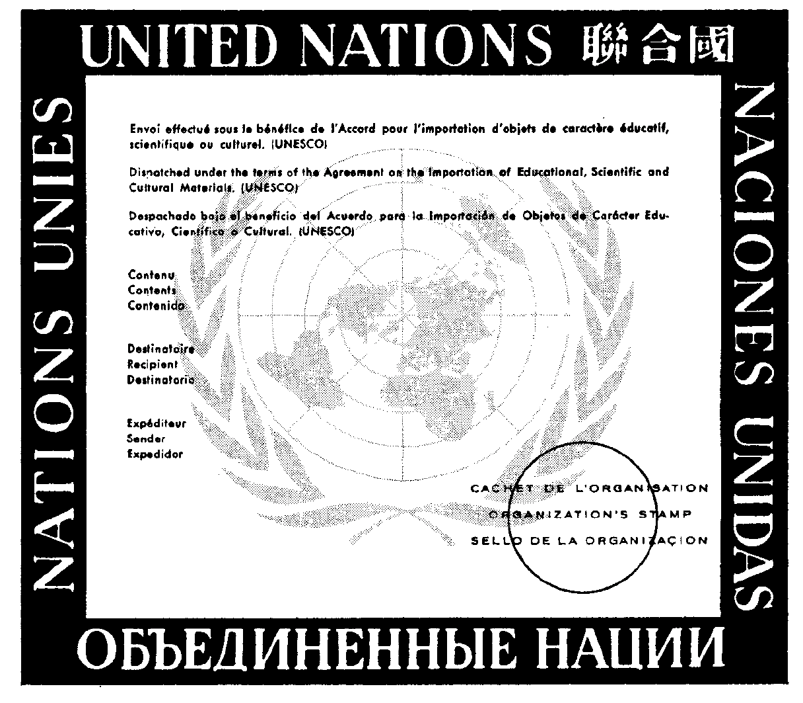
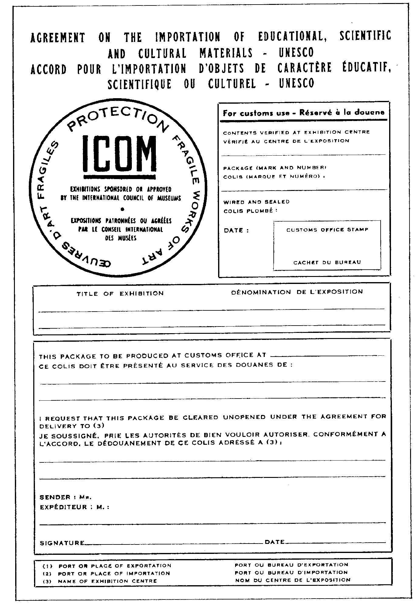

PRÍLOHA E

- Materiály pre nevidiacich

  - i) Knihy, publikácie a dokumenty všetkých druhov, ktoré sú vytlačené Braillovým písmom.

  - ii) Iné tovary, ktoré sú špeciálne určené na vzdelávací, vedecký či kultúrny rozvoj nevidiacich, dovážané priamo inštitúciami pre nevidiacich alebo podpornými organizáciami pre nevidiacich a schválené príslušnými orgánmi krajiny dovozu na bezcolný dovoz týchto druhov materiálov.

  - 

    - Etiketa používaná Organizáciou Spojených národov a jej odbornými organizáciami

  - [Příloha 07](../assets/84c7062e7c181105ecbb1c1266fb93ef3e53eb242447b0301c0361c01775fac9.pdf)

  - 

    - Etiketa používaná Medzinárodnou radou múzeí
