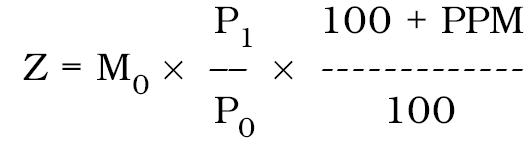
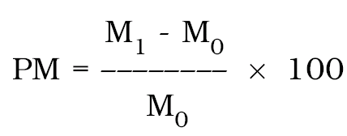
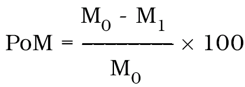
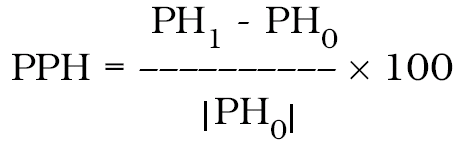
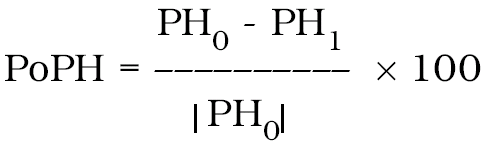

Príloha k nariadeniu vlády č. 3/1998 Z. z. [Vzor 01](../assets/614682ce2635b1ea8be9b704982117903ec0df981bcedc77f31084f2e355cbeb.pdf)

- Metodický pokyn na výpočet odvodu

  - Údaje v stĺpcoch 10 a 11

- Údaj v riadku 1

  - a) Zamestnávatelia, ktorých hodnotené obdobie upravuje § 2 ods. 1 – údaj sa vyplní podľa príslušného výkazu zisku a strát (výsledovky),

  - b) zamestnávatelia, ktorých hodnotené obdobie upravuje § 2 ods. 3 – údaj sa vyplní podľa metodického vymedzenia ukazovateľa pre príslušný odvetvový výkaz P 3-04 (pripočítajú sa údaje za účet 582) aj s prípadnou kumuláciou údajov za dva alebo tri štvrťroky.

- Údaj v riadku 2

  - a) Zamestnávatelia, ktorých hodnotené obdobie upravuje § 2 ods. 1 – údaj sa vyplní podľa príslušného výkazu zisku a strát (výsledovky),

  - b) zamestnávatelia, ktorých hodnotené obdobie upravuje § 2 ods. 3 – údaj sa vyplní podľa metodického vymedzenia ukazovateľa pre príslušný odvetvový výkaz P 3-04 aj s prípadnou kumuláciou údajov za dva alebo tri štvrťroky; zamestnávatelia s priemerným evidenčným počtom zamestnancov v hodnotenom období od 10 do 19 osôb (§ 3 ods. 5) vyplnia údaj podľa metodického vymedzenia ukazovateľa pre výkaz P 13-04 aj s prípadnou kumuláciou údajov za dva alebo tri štvrťroky.

- Údaj v riadku 3

  - Údaj sa vyplní podľa metodického vymedzenia ukazovateľa pre výkaz P 2-04 alebo podľa metodického vymedzenia pre výkaz P 13-04 (zamestnávatelia s priemerným evidenčným počtom zamestnancov v hodnotenom období od 10 do 19 osôb – § 3 ods. 5) s kumuláciou údajov za príslušné štvrťroky.

- Údaj v riadku 4

  - Údaj sa vyplní podľa metodického vymedzenia ukazovateľa pre výkaz P 2-04 (prepočítané osoby) alebo podľa metodického vymedzenia ukazovateľa pre výkaz P 13-04 (fyzické osoby) s kumuláciou údajov za príslušné štvrťroky delených počtom štvrťrokov.

- Údaj v riadku 8 sa vypočíta takto:

  - a) výpočet východiskovej základne (§ 3 ods. 2)

  -  , kde

  - Z - východisková základňa,

  - M - zúčtované mzdy, náhrady miezd a odmeny za pracovnú pohotovosť,

  - P - priemerný evidenčný počet zamestnancov prepočítaný, resp. vo fyzických osobách,

  - 1 - hodnotené obdobie,

  - 0 - rovnaké obdobie predchádzajúceho roka (zhodné s hodnoteným obdobím),

  - PPM - primeraný prírastok miezd v % (§ 3 ods. 5, 7, 8, 11 alebo 12);

  - b) výpočet prírastku miezd [§ 3 ods. 8 písm. a), c) a e), ods. 9]

  -  , kde PM - prírastok miezd;

  - c) výpočet poklesu miezd [§ 3 ods. 8 písm. b), d) a f), ods. 9]

  -  , kde PoM - pokles miezd;

  - d) výpočet prírastku pridanej hodnoty [§ 3 ods. 8 písm. a), c) a e), ods. 9]

  -  , kde

  - PPH - prírastok pridanej hodnoty,

  - PH - pridaná hodnota,

  - |PH| - pridaná hodnota vyjadrená v absolútnej hodnote;

  - e) výpočet poklesu pridanej hodnoty [§ 3 ods. 8 písm. b), d) a f), ods. 9]

  -  , kde PoPH - pokles pridanej hodnoty.

  - Údaj v riadku 9

  - Rozdiel údajov v r. 3 a v r. 8.

  - Hodnoty jednotlivých zlomkov vo výpočte sa vyčísľujú s presnosťou na tri desatinné miesta.

  - Údaje v stĺpci 12

  - Zamestnávatelia, ktorých hodnotené obdobie upravuje § 2 ods. 1, vyplnia údaje za rok 1998; zamestnávatelia, ktorých hodnotené obdobie upravuje § 2 ods. 3, vyplnia údaje za rok 1997.

  - Údaje v riadkoch 5 a 6

  - Údaje vyplní len zamestnávateľ uvedený v § 3 ods. 11 nariadenia vlády.

  - Údaj v riadku 7

  - Údaj vyplní len zamestnávateľ uvedený v § 3 ods. 12 nariadenia vlády; uvedie sa výška dotácie poskytnutá v zmysle zákona o štátnom rozpočte na príslušný rok; uvedené sa vzťahuje aj na zamestnávateľa, ktorému bola poskytnutá dotácia na predmetnú činnosť aj prostredníctvom dotácie zo štátneho rozpočtu pre obce.
