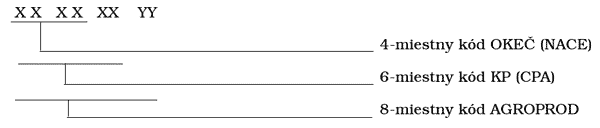

Príloha k opatreniu č. 339/1998 Z. z.

- AGROPROD Zoznam vybraných výrobkov a služieb v pôdohospodárstve

- Úvod

  - AGROPROD je zoznam vybraných výrobkov a služieb v pôdohospodárstve. Zahŕňa aj výrobky vodného hospodárstva. Nadväzuje na opatrenie Štatistického úradu Slovenskej republiky č. 172/1995 Z. z., ktorým sa vyhlasuje klasifikácia produkcie, ktoré nadobudlo záväznosť 1. januára 1996. Kategorizácia produktov AGROPROD vypracovaná na báze klasifikácie produkcie (ďalej len „KP“) umožňuje vykonávať štatistické zisťovania a analýzy podľa podrobnejšie členenej produkcie v oblasti pôdohospodárstva a vodného hospodárstva. Súčasťou AGROPROD-u je prevod na klasifikácie JKP a CS. V prípade zmien v niektorej z klasifikácií sa nadväzne bude aktualizovať aj AGROPROD.

  - AGROPROD vypracoval Štatistický úrad Slovenskej republiky v spolupráci s Ministerstvom pôdohospodárstva Slovenskej republiky.

- METODICKÁ ČASŤ

- AGROPROD obsahuje kategorizáciu výrobkov pre oddiely 01, 02, 05, 41 a podtriedu 90.00.11 KP vrátane súvisiacich služieb.

- Kódovanie a štruktúra AGROPROD-u

- Systém kódovania AGROPROD-u nadväzuje na kódovanie v OKEČ a KP. Označenie položky AGROPROD-u tvorí 8-miestny číselný kód s touto štruktúrou:

- 

- kde

- XX XX XX označuje kód KP (CPA),

- YY označuje zatriedenie položky AGROPROD-u v rámci príslušnej položky KP (CPA).

- Štruktúra AGROPROD-u pozostáva zo šiestich stĺpcov:

- – stĺpec KP obsahuje 6-miestny číselný kód klasifikácie produkcie,

- – stĺpec AGROPROD obsahuje 8-miestny číselný kód položky,

- – stĺpec Názov položky označuje textové označenie výrobkov v AGROPROD-e,

- – stĺpec MJ označuje základnú mernú jednotku, v ktorej sa štatisticky vykazuje produkcia jednotlivých výrobkov,

- – stĺpec JKP označuje úplný alebo čiastočný prevod na kódy v pôvodných štatistických klasifikáciách,

- – stĺpec CS označuje úplný alebo čiastočný prevod na kódy colného sadzobníka. Tento stĺpec nie je vyplnený pri položkách, ktoré predstavujú určitý druh služieb (napr. služby súvisiace s rastlinnou výrobou orba, sušenie obilnín a pod.). Taktiež nie je vykonaný prevod na kódy colného sadzobníka pre oddiel 41 a podtriedu 90.00.11.

- Pôdohospodárska produkcia

  - Pôdohospodárska produkcia zahŕňa priemyselne nespracované výrobky poľnohospodárskej a lesníckej výroby, produkty chovu zvierat a rýb, rybolovu a poľovníctva, ako aj služby, ktoré sa samostatne poskytujú pre rastlinnú výrobu, lesníctvo, poľovníctvo, chov zvierat a rýb a rybolov (napr. zavlažovanie, zber úrody a pod.). Pod príslušnú položku služieb patria len služby poskytované na objednávku, to znamená samostatne fakturované služby. Niektoré služby však AGROPROD nezahŕňa, pretože svojím obsahom patria do iných oddielov KP. Ide napríklad o zvoz mlieka od výrobcu k spracovateľovi (60.24.11), inštalácie, opravy a údržba strojov a prístrojov pre poľnohospodárstvo a lesníctvo (29.32.9) a pod. Nepatria sem ani priemyselné a stavebné činnosti, ktoré môžu vykonávať jednotlivé subjekty.

- Vodohospodárska produkcia

  - Vodohospodárska produkcia zahŕňa okrem produktov – pitnej a úžitkovej vody – aj služby spojené s rozvodom vody, odstraňovanie odpadových vôd vrátane ich čistenia, produkcie a likvidácie vodárenských kalov.

- Zoznam skratiek použitých v AGROPROD-e

- KP | – | klasifikácia produkcie

- CPA | – | Classification of Products by Activity – klasifikácia produkcie platná pre členské štáty Európskej únie

- OKEČ | – | Odvetvová klasifikácia ekonomických činností

- NACE | – | General Industrial Classification of Economic Activities within the Europian Communities – klasifikácia ekonomických činností platná pre členské štáty Európskej únie

- AGROPROD | – | zoznam vybraných výrobkov a služieb v pôdohospodárstve

- MJ | – | merná jednotka

- JKP | – | pôvodné štatistické klasifikácie: – jednotná klasifikácia výrobkov poľnohospodárstva, lesníctva a vodného hospodárstva – jednotná klasifikácia priemyselných odborov a výrobkov – jednotná klasifikácia výkonov

- CS | – | colný sadzobník

- ex | – | symbol, ktorý naznačuje, že obsahové vymedzenie produkcie podľa JKP alebo CS iba čiastočne zodpovedá obsahovému vymedzeniu produkcie podľa AGROPROD-u

- i. n. | – | inde neklasifikované

- Zoznam skratiek ihličnatých a listnatých sortimentov dreva

- SM | – smrek | JS | – jaseň

- JD | – jedľa | JV | – javor

- DG | – duglaska | LP | – lipa

- BO | – borovica | JL | – jelša

- VJ | – vejmutovka | TP | – topoľ

- SMC | – smrekovec opadavý | OS | – osika

- DB | – dub | VR | – vŕba

- BK | – buk | HB | – hrab

  - Zoznam použitých merných a menových jednotiek

- kg | – kilogram | m2 | – štvorcový meter

- kg/r | – kilogram/rok | m3 | – kubický meter

- kg ž. h. | – kilogram živej hmotnosti | m3 b. k. | – kubický meter bez kôry

- ks | – kus | Sk | – slovenská koruna

- l | – liter | |

- SYSTEMATICKÁ ČASŤ KP | AGROPROD | Názov položky | MJ | JKP | cs

- 01.11.11 | | Pšenica tvrdá (cestovinárska) | | |

- | 01.11.11.1 | Pšenica tvrdá ozimná (okrem osiva) | | |

- | 01.11.11.11 | Pšenica tvrdá ozimná priemyselná | kg | 001 13ex | 1001.10ex

- | 01.11.11.12 | Pšenica tvrdá ozimná potravinárska | kg | 001 13ex | 1001.10ex

- | 01.11.11.13 | Pšenica tvrdá ozimná kŕmna | kg | 001 13ex | 1001.10ex

- | 01.11.11.2 | Pšenica tvrdá jarná (okrem osiva) | | |

- | 01.11.11.21 | Pšenica tvrdá jarná priemyselná | kg | 001 13ex | 1001.10ex

- | 01.11.11.22 | Pšenica tvrdá jarná potravinárska | kg | 001 13ex | 1001.10ex

- | 01.11.11.23 | Pšenica tvrdá jarná kŕmna | kg | 001 13ex | 1001.10ex

- | 01.11.11.3 | Osivo pšenice tvrdej | | |

- | 01.11.11.31 | Osivo pšenice tvrdej ozimnej | kg | 001 71ex | 1001.10ex

- | 01.11.11.32 | Osivo pšenice tvrdej jarnej | kg | 001 72ex | 1001.10ex

- 01.11.12 | | Pšenica mäkká a súraž | | |

- | 01.11.12.1 | Pšenica mäkká ozimná | | |

- | | (okrem osiva) | | |

- | 01.11.12.11 | Pšenica ozimná priemyselná | kg | 001 11ex | 1001.90.10ex

- | 01.11.12.12 | Pšenica ozimná potravinárska | kg | 001 12ex | 1001.90.10ex

- | 01.11.12.13 | Pšenica ozimná kŕmna | kg | - | 1001.90.10ex

- | 01.11.12.2 | Pšenica mäkká jarná (okrem osiva) | | |

- | 01.11.12.21 | Pšenica jarná priemyselná | kg | 001 11ex | 1001.90.10ex

- | 01.11.12.22 | Pšenica jarná potravinárska | kg | 001 12ex | 1001.90.10ex

- | 01.11.12.23 | Pšenica jarná kŕmna | kg | - | 1001.90.10ex

- | 01.11.12.3 | Osivo pšenice mäkkej | | |

- | 01.11.12.31 | Osivo pšenice mäkkej ozimnej | kg | 001 71ex | 1001.90.9 lex

- | 01.11.12.32 | Osivo pšenice mäkkej jarnej | kg | 001 72ex | 1001.90.9 lex

- | 01.11.12.4 | Súraž | | |

- | 01.11.12.40 | Zmes pšenice a raže - súraž | kg | 001 611 | 1001.90.99ex

- 01.11.13 | | Kukurica (na zrno) | | |

- | 01.11.13.1 | Kukurica na zrno (okrem osiva) | | |

- | 01. 11.13.11 | Kukurica škrobárenská | kg | 001 41 | 1005.90ex

- | 01. 11.13.12 | Kukurica potravinárska | kg | 001 42ex | 1005.90ex

- | 01.11.13.2 | Osivo kukurice | | |

- | 01. 11.13.21 | Osivo kukurice hybridnej | kg | 001 76-7ex | 1005.10ex

- | 01. 11.13.29 | Ostatné osivo kukurice | kg | 001 76-7ex | 1005.10ex

- 01.11.14 | | Ryža nelúpaná (v plevách) | | |

- | 01.11.14.1 | Ryža nelúpaná (v plevách) | | |

- | 01. 11.14.10 | Ryža nelúpaná (v plevách) | kg | 001 52 | 1006.10

- 01.11.15 | | Jačmeň | | |

- | 01.11.15.1 | Jačmeň ozimný (okrem osiva) | | |

- | 01. 11.15.12 | Jačmeň ozimný priemyselný | kg | 001 32ex | 1003.00.90ex

- | 01. 11.15.13 | Jačmeň ozimný potravinársky | kg | 001 3ex | 1003.00.90ex

- | 01. 11.15.14 | Jačmeň ozimný kŕmny | kg | 001 33ex | 1003.00.90ex

- | 01.11.15.2 | Jačmeň jarný (okrem osiva) | | |

- | 01.11.15.21 | Jačmeň jarný sladovnícky | kg | 001 31 | 1003.00.90ex

- | 01.11.15.22 | Jačmeň jarný priemyselný | kg | 001 32ex | 1003.00.90ex

- | 01.11.15.23 | Jačmeň jarný potravinársky | kg | 001 3ex | 1003.00.90ex

- | 01.11.15.24 | Jačmeň jarný kŕmny | kg | 001 33 | 1003.00.90ex

- | 01.11.15.3 | Osivo jačmeňa | | |

- | 01.11.15.31 | Osivo jačmeňa ozimného | kg | 001 741 | 1003.00.10ex

- | 01.11.15.32 | Osivo jačmeňa jarného | kg | 001 742 | 1003.00.10ex

- 01.11.16 | | Raž, ovos | | |

- | 01.11.16.1 | Raž ozimná (okrem osiva) | | |

- | 01.11.16.11 | Raž ozimná potravinárska | kg | 001 2ex | 1002ex

- | 01.11.16.12 | Raž ozimná ostatná | kg | 001 2ex | 1002ex

- | 01.11.16.2 | Raž jarná (okrem osiva) | | |

- | 01.11.16.21 | Raž jarná potravinárska | kg | 001 2ex | 1002ex

- | 01.11.16.22 | Raž jarná ostatná | kg | 001 2ex | 1002ex

- | 01.11.16.3 | Osivo ráže | | |

- | 01.11.16.31 | Osivo ráže ozimnej | kg | 001 731 | 1002ex

- | 01.11.16.32 | Osivo ráže jarnej | kg | 001 732 | 1002ex

- | 01.11.16.4 | Ovos (okrem osiva) | | |

- | 01.11.16.41 | Ovos potravinársky | kg | 001 511 1 | 1004ex

- | 01.11.16.42 | Ovos kŕmny | kg | 001 511 5 | 1004ex

- | 01.11.16.5 | Osivo ovsa | | |

- | 01.11.16.50 | Osivo ovsa | kg | 001 790-1 | 1004ex

- 01.11.17 | | Ostatné obilniny | | |

- | 01.11.17.1 | Ostatné obilniny (okrem osiva) | | |

- | 01.11.17.11 | Proso | kg | 001 53 | 1008.20ex

- | 01.11.17.12 | Pohánka | kg | 001 54 | 1008.10ex

- | 01.11.17.13 | Cirok na zrno | kg | 001 57 | 1007.00.90

- | 01.11.17.14 | Triticale | kg | 001 58 | 1008.90.10ex

- | 01.11.17.19 | Obilniny i. n. | kg | 001 55-6 | 1008.90ex

- | 01.11.17.2 | Osivo ostatných obilnín | | |

- | 01.11.17.21 | Osivo prosa | kg | 001 792 | 1008.20ex

- | 01.11.17.22 | Osivo pohánky | kg | 001 793 | 1008. 10ex

- | 01.11.17.23 | Osivo ciroku | kg | 001 795-8 | 1007.00.10

- | 01.11.17.24 | Osivo triticale | kg | 001 751 | 1008.90.10ex

- | 01.11.17.29 | Osivo obilnín i. n. | kg | 001 79ex | 1008.90ex

- | 01.11.17.3 | Obilné zmesi (okrem súraže) | | |

- | 01.11.17.31 | Miešanky ovsa a jačmeňa | kg | 001 613 |

- | 01.11.17.39 | Ostatné obilné zmesi | kg | 001 61ex |

- 01.11.21 | | Zemiaky | | |

- | 01.11.21.1 | Zemiaky | | |

- | 01.11.21.11 | Zemiaky konzumné skoré | kg | 003 111-2 | 0701.90.51,

- | | | | | .59

- | 01.11.21.12 | Zemiaky konzumné neskoré | kg | 003 113-5 | 0701.90.90

- | 01.11.21.13 | Zemiaky priemyselné | kg | 003 31 | 0701.90.10

- | 01.11.21.19 | Zemiaky ostatné | kg | 003 11 ex | 0701.90.10

- | 01.11.21.2 | Sadba zemiakov | | |

- | 01.11.21.21 | Sadba zemiakov konzumných skorých | kg | 003 731-2 | 0701.10ex

- | 01.11.21.29 | Sadba zemiakov ostatných | kg | 003 733-5 | 0701.10ex

- 01.11.22 | | Strukoviny suché, vylúpané, | | |

- | | tiež lúpané alebo drvené | | |

- | 01.11.22.1 | Strukoviny jedlé (okrem osiva) | | |

- | 01.11.22.11 | Fazuľa jedlá | kg | 002 13 | 0713.31.00ex,

- | | | | | .32.00ex,

- | | | | | .33ex

- | 01.11.22.12 | Šošovica jedlá | kg | 002 12 | 0713.40.00ex

- | 01.11.22.13 | Hrach jedlý | kg | 002 11 | 0713.10.90

- | 01.11.22.19 | Ostatné jedlé strukoviny | kg | 002 1ex | 0713.20

- | 01.11.22.2 | Osivo strukovín jedlých | | |

- | 01.11.22.21 | Osivo fazule jedlej | kg | 002 73 | 0713.31.00ex,

- | | | | | .32.00ex,

- | | | | | .33ex

- | 01.11.22.22 | Osivo šošovice jedlej | kg | 002 72 | 0713.40.00ex

- | 01.11.22.23 | Osivo hrachu jedlého | kg | 002 71 | 0713.10.10

- | 01.11.22.29 | Osivo ostatných strukovín jedlých | kg | 002 7ex | 0713ex

- | 01.11.22.3 | Strukoviny kŕmne (okrem osiva) | | |

- | 01.11.22.31 | Hrach kŕmny | kg | 002 211 | 1214.90.99ex

- | 01.11.22.32 | Peluška kŕmna | kg | 002 212 | 1214.90.99ex

- | 01.11.22.33 | Vlka siata | kg | 002 22 | 1214.90.99ex

- | 01.11.22.34 | Luplna siata | kg | 002 23 | 1214.90.99ex

- | 01.11.22.35 | Bôb kŕmny | kg | 002 24 | 1214.90.99ex

- | 01.11.22.36 | Zmesi strukovín a strukovinovo-obilné | | |

- | | zmesi | kg | 002 3 | 1214.90.99ex

- | 01.11.22.39 | Ostatné strukoviny kŕmne | kg | 002 29 | 1214.90.99ex

- | 01.11.22.4 | Osivo strukovín kŕmnych | | |

- | 01.11.22.41 | Osivo hrachu kŕmneho | kg | 002 741 | 0713ex

- | 01.11.22.42 | Osivo pelušky kŕmnej | kg | 002 743 | 0713ex

- | 01.11.22.43 | Osivo vlky siatej | kg | 002 75ex | 0713ex

- | 01.11.22.44 | Osivo lupiny | kg | 002 76 | 0713ex

- | 01.11.22.45 | Osivo bôbu kŕmneho | kg | 002 791-2 | 0713ex

- | 01.11.22.49 | Osivo ostatných strukovín kŕmnych | kg | 002 79ex | 0713ex

- 01.11.23 | | Jedlé korene a hľuzy s vysokým | | |

- | | obsahom škrobu alebo inulínu | | |

- | 01.11.23.1 | Jedlé korene a hľuzy s vysokým | | |

- | | obsahom škrobu alebo inulínu | | |

- | 01.11.23.10 | Jedlé korene a hľuzy s vysokým | kg | 003 45, | 0714ex

- | | obsahom škrobu alebo inulínu | | 003 47, |

- | | | | 003 75 |

- | 01.11.23.2 | Sadba jedlých koreňov | | |

- | 01.11.23.20 | Sadba jedlých koreňov | kg | - | 0714ex

- 01.11.31 | | Sójové bôby, tiež drvené | | |

- | 01.11.31.1 | Sója (okrem osiva) | | |

- | 01.11.31.10 | Sója | kg | 011 122 | 1201.00.90

- | 01 11.31.2 | Osivo sóje | | |

- | 01.11.31.20 | Osivo sóje | kg | 011 726 | 1201.00.10

- 01.11.32 | | Arašidové oriešky | | |

- | 01.11.32.0 | Arašidové oriešky | | |

- | 01.11.32.00 | Arašidové oriešky | kg | 011 121, | 1202

- | | | | 021 635 |

- 01.11.33 | | Slnečnicové, sezamové, | | |

- | | očiankové semená; semená | | |

- | | repky, repky olejky, horčičné | | |

- | | semená | | |

- | 01.11.33.1 | Semená olejnaté (okrem osiva) | | |

- | 01.11.33.11 | Semená slnečnice | kg | 011 111 | 1206.00.99

- | 01.11.33.12 | Semená repky olejky ozimnej | kg | 011 114ex | 1205.00.90ex

- | 01.11.33.13 | Semená repky olejky jarnej | kg | 011 114ex | 1205.00.90ex

- | 01.11.33.14 | Semená repice | kg | 011 115 | -

- | 01.11.33.15 | Semená horčice | kg | 011 113 | 1207.50.90

- | 01.11.33.16 | Semená sezamové | kg | 011 124 | 1207.40.90

- | 01.11.33.19 | Ostatné olejnaté semená | kg | 011 11ex | 1207.60.90

- | 01.11.33.2 | Osivo semien olejnatých | | |

- | 01.11.33.21 | Osivo slnečnice | kg | 011 723 | 1206.00.10

- | 01.11.33.22 | Osivo repky olejky ozimnej | kg | 011 711 | 1205.00.10ex

- | 01.11.33.23 | Osivo repky olejky jarnej | kg | 011 712 | 1205.00.10ex

- | 01.11.33.24 | Osivo repice | kg | 011 713 | -

- | 01.11.33.25 | Osivo horčice | kg | 011 715-6 | 1207.50.10

- | 01.11.33.29 | Osivo ostatných olejnatých semien | kg | 011 71ex, | 1207.40.10,

- | | | | 011 72ex | 1207.60.10

- 01.11.34 | | Bavlníkové semená | | |

- | 01.11.34.0 | Bavlníkové semená | | |

- | 01.11.34.00 | Bavlníkové semená | kg | 011 123 | 1207.20

- 01.11.35 | | Olejnaté semená a plody i. n. | | |

- | 01.11.35.1 | Semeno ľanu (okrem osiva) | | |

- | 01.11.35.11 | Semeno ľanu priadneho | kg | 012 81 | 1204.00.90

- | 01.11.35.12 | Semeno ľanu olejného | kg | 012 81 | 1204.00.90

- | 01.11.35.2 | Osivo ľanu | | |

- | 01.11.35.20 | Osivo ľanu | kg | 012 711 | 1204.00.10

- | 01.11.35.3 | Semeno konopy (okrem osiva) | | |

- | 01.11.35.31 | Semeno konopy na vlákno | kg | 012 821 | 1207.99.91ex

- | 01.11.35.39 | Semeno konopy ostatné | kg | 012 82ex | 1207.99.91ex

- | 01.11.35.4 | Osivo konopy | | |

- | 01.11.35.41 | Osivo konopy na vlákno | kg | 012 712 | 1207.99. 10ex

- | 01.11.35.49 | Osivo konopy ostatné | kg | 012 712ex | 1207.99. 10ex

- | 01.11.35.5 | Semená mäkké olejnaté | | |

- | | (okrem osiva) i. n. | | |

- | 01.11.35.51 | Mak | kg | 011 112 | 1207.91.90

- | 01.11.35.59 | Ostatné semená mäkké olejnaté | | |

- | | (saflor a pod.) | kg | 011 12ex | 1207.99.99ex

- | 01.11.35.6 | Osivo semien mäkkých olejnatých | | |

- | | i. n. | | |

- | 01.11.35.61 | Osivo maku | kg | 011 721 | 1207.91.10

- | 01.11.35.69 | Osivo ostatných semien | | |

- | | mäkkých olejnatých i. n. | kg | 011 72ex | 1207.99. 10ex

- | 01.11.35.9 | Ostatné olejnaté semená a plody | | |

- | | i. n. | | |

- | 01.11.35.90 | Ostatné olejnaté semená a plody i. n. | kg | 011 13-4 | 1203.00,

- | | | | | 1207.10,

- | | | | | 1207.30,

- | | | | | 1207.99ex

- 01.11.40 | | Nespracovaný tabak | | |

- | 01.11.40.1 | Tabak nefermentovaný sušený | | |

- | 01.11.40.11 | Tabak nefermentovaný umelo sušený | kg | 011 421ex | 2401.10ex,

- | | cigaretový | | | 2401.20ex

- | 01.11.40.12 | Tabak nefermentovaný prirodzene | kg | 011 421ex | 2401.10ex,

- | | sušený cigaretový | | | 2401.20ex

- | 01.11.40.19 | Tabak nefermentovaný sušený ostatný | kg | 011 42ex | 2401.10ex,

- | | | | | 2401.20ex

- | 01.11.40.9 | Tabak nespracovaný ostatný | | |

- | 01.11.40.90 | Tabak nespracovaný ostatný | kg | 011 4ex | 2401.10ex,

- | | | | | 2401.20ex

- 01.11.51 | | Cukrová repa | | |

- | 01.11.51.1 | Cukrová repa | | |

- | 01.11.51.10 | Cukrová repa | kg | 003 32 | 1212.91

- | 01.11.51.2 | Sadzačky a semenačky cukrovej | | |

- | | repy | | |

- | 01.11.51.21 | Sadzačky cukrovej repy | kg | 003 771 | -

- | 01.11.51.22 | Semenačky cukrovej repy | kg | 003 791 | -

- 01.11.52 | | Cukrová trstina | | |

- | 01.11.52.0 | Cukrová trstina | | |

- | 01.11.52.00 | Cukrová trstina | kg | - | 1212.92

- 01.11.60 | | Slama a zelené krmoviny | | |

- | 01.11.60.1 | Jednoročné krmoviny na zeleno | | |

- | 01.11.60.11 | Kukurica a jej miešanky na zeleno | | |

- | | a siláž | kg | 005 111 | 1214.90.99ex

- | 01.11.60.12 | Ozimné strukovinovo-obilné miešanky | kg | 005 141 1 | 1214.90.99ex

- | 01.11.60.13 | Jarné strukovinovo-obilné miešanky | kg | 005 141 2 | 1214.90.99ex

- | 01.11.60.14 | Bôb na zelené kŕmenie | kg | 005 1134 | 1214.90.99ex

- | 01.11.60.15 | Medziplodiny a následné plodiny | kg | - | 1214.90.99ex

- | 01.11.60.19 | Ostatné jednoročné krmoviny | kg | 005 1ex | 1214.90.99ex

- | 01.11.60.2 | Viacročné krmoviny na zeleno | | |

- | 01.11.60.21 | Ďatelina červená dvojkosná | kg | 005 12ex | 1214.90.99ex

- | 01.11.60.22 | Lucerna | kg | 005 122 | 1214.90.99ex

- | 01.11.60.23 | Ďatelina jednokosná | kg | 005 115ex | 1214.90.99ex

- | 01.11.60.24 | Vičenec | kg | 005 129 2 | 1214.90.99ex

- | 01.11.60.25 | Ďatelinovo- a lucernovo-trávne | | |

- | | miešanky | kg | 005 142 | 1214.90.99ex

- | 01.11.60.26 | Ostatné viacročné ďatelinoviny | kg | 005 12ex | 1214.90.99ex

- | 01.11.60.27 | Trávne porasty viacročné | kg | 005 13 | 1214.90.99ex

- | 01.11.60.28 | Trávne porasty trvalé | kg | 005 13 | 1214.90.99ex

- | 01.11.60.29 | Ostatné viacročné krmoviny | kg | 005 lex | 1214.90.99ex

- | 01.11.60.3 | Kŕmna zelenina a okopaniny | | |

- | 01.11.60.31 | Cukrová repa kŕmna | kg | 003 421 | 1214.90.10ex

- | 01.11.60.32 | Kŕmna repa | kg | 003 422-4 | 1214.90.10ex

- | 01.11.60.33 | Kŕmny kel | kg | 003 43 | 1214.90.99ex

- | 01.11.60.34 | Turín (kváka) | kg | 003 492 | 1214.90.10ex

- | 01.11.60.35 | Kŕmna mrkva | kg | 003 46 | 1214.90.99ex

- | 01.11.60.36 | Kŕmna tekvica | kg | 003 44 | 1214.90.99ex

- | 01.11.60.39 | Ostatná kŕmna zelenina a okopaniny | kg | 003 41 | 1214.90.99ex

- | | | | 003 49ex |

- | 01.11.60.4 | Sadzačky kŕmnych okopanín | | |

- | 01.11.60.41 | Sadzačky kŕmnej repy | kg | 003 761 | -

- | 01.11.60.42 | Sadzačky kvaky | kg | 003 764 | -

- | 01.11.60.49 | Sadzačky ostatných kŕmnych | | |

- | | okopanín | kg | 003 76ex | -

- | 01.11.60.5 | Semenačky kŕmnych okopanín | | |

- | 01.11.60.51 | Semenačky kŕmnej repy | kg | 003 781 | -

- | 01.11.60.52 | Semenačky kvaky | kg | 003 784 | -

- | 01.11.60.59 | Semenačky ostatných kŕmnych | | |

- | | okopanín | kg | 003 78ex | -

- | 01.11.60.6 | Slama a seno | | |

- | 01.11.60.61 | Slama kŕmna | kg | 001 811, | 1213ex

- | | | | 002 8 |

- | 01.11.60.62 | Slama stelivová | kg | 001 812 | 1213ex

- | 01.11.60.63 | Seno | kg | 005 5 | 1214.90ex

- | 01.11.60.7 | Siláž, senáž | | |

- | 01.11.60.71 | Siláž kukuričná | kg | 005 2ex | -

- | 01.11.60.72 | Siláž ďatelinovo-trávna | kg | 005 2ex | -

- | 01.11.60.73 | Siláž odrezková | kg | 005 2ex | -

- | 01.11.60.76 | Senáž ďatelinovo-trávna | kg | 005 3ex | -

- | 01.11.60.77 | Senáž lucernová | kg | 005 3ex | -

- | 01.11.60.79 | Ostatná siláž a senáž | kg | 005 2-3ex | -

- | 01.11.60.9 | Kŕmne odpady a ostatné | | |

- | | zelené krmoviny | | |

- | 01.11.60.90 | Kŕmne odpady a ostatné | kg | 001 91, | 1214.90ex,

- | | zelené krmoviny | | 002 9, | 1213ex

- | | | | 003 921, |

- | | | | 003 922, |

- | | | | 024 9 |

- 01.11.71 | | Bavlna vyzrnená i nevyzrnená | | |

- | 01.11.71.0 | Bavlna surová | | |

- | 01.11.71.00 | Bavlna surová | kg | 012 13 | 5201

- 01.11.72 | | Juta a ostatné textilné lykové | | |

- | | vlákna okrem ľanu, konopy | | |

- | | a ramie | | |

- | 01.11.72.0 | Juta a ostatné textilné lykové | | |

- | | vlákna okrem ľanu, konopy | | |

- | | a ramie | | |

- | 01.11.72.00 | Juta a ostatné textilné lykové | | |

- | | vlákna okrem ľanu, konopy a ramie | kg | 012 14 | 5303.10

- 01.11.73 | | Ľan a konopa, sisalové | | |

- | | a ostatné textilné vlákna surové | | |

- | 01.11.73.1 | Stonky ľanu | | |

- | 01.11.73.11 | Stonky ľanu neodsemenené | kg | 012 111 | 5301.10ex

- | 01.11.73.12 | Stonky ľanu odsemenené rosené | kg | 012 113 | 5301.10ex

- | 01.11.73.13 | Stonky ľanu odsemenené ostatné | kg | 012 112-4 | 5301.10ex

- | 01.11.73.2 | Stonky konopy | | |

- | 01.11.73.21 | Stonky konopy neodsemenené | kg | 012 121 | 5302.10ex

- | 01.11.73.22 | Stonky konopy odsemenené surové | kg | 012 122-3 | 5302.10ex

- | 01.11.73.9 | Rastliny priadne ostatné | | |

- | 01.11.73.90 | Rastliny priadne ostatné | kg | 012 15, | 5304.10,

- | | | | 012 19 | 5305.11,

- | | | | | 5305.21,

- | | | | | 5305.91

- 01.11.80 | | Prírodný kaučuk | | |

- | | v primárnych formách alebo | | |

- | | doskách, listoch alebo pásoch | | |

- | 01.11.80.0 | Prírodný kaučuk v primárnych | | |

- | | formách alebo doskách, listoch | | |

- | | alebo pásoch | | |

- | 01.11.80.00 | Prírodný kaučuk v primárnych formách | kg | 271 1, | 4001.10,

- | | alebo doskách, listoch alebo pásoch | | 271 3 | 4001.21,

- | | | | | 4001.22

- 01.11.91 | | Rastliny používané primárne | | |

- | | v parfumérii, farmácii alebo | | |

- | | na insekticídne, paraziticídne | | |

- | | alebo podobné účely | | |

- | 01.11.91.1 | Rastliny liečivé | | |

- | 01.11.91.10 | Rastliny liečivé | kg | 018, | 1211.90ex

- | | | | 261 1, |

- | | | | 261 3 |

- | 01.11.91.9 | Ostatné rastliny používané | | |

- | | primárne v parfumérii, farmácii | | |

- | | alebo na insekticídne, | | |

- | | paraziticídne alebo podobné účely | | |

- | 01.11.91.90 | Ostatné rastliny používané primárne | | |

- | | v parfumérii, farmácii alebo na | | |

- | | insekticídne, paraziticídne alebo | | |

- | | podobné účely | kg | 017 5ex | 1211ex

- 01.11.92 | | Semená cukrovej repy | | |

- | | a semená krmovín | | |

- | 01.11.92.1 | Osivo technických okopanín | | |

- | 01.11.92.11 | Osivo cukrovej repy | kg | 003 721 | 1209.11

- | 01.11.92.12 | Osivo čakanky | kg | 003 722 | -

- | 01.11.92.2 | Osivo kŕmnych okopanín | | |

- | 01.11.92.21 | Osivo kŕmnej repy | kg | 003 711 | -

- | 01.11.92.29 | Osivo ostatných kŕmnych okopanín | kg | 003 71 ex | -

- | 01.11.92.3 | Semeno krmovín (okrem osiva) | | |

- | 01.11.92.31 | Semeno ďateliny červenej dvojkosnej | kg | - | 1209.2ex

- | 01.11.92.32 | Semeno vičenca | kg | - | 1209.2ex

- | 01.11.92.33 | Semeno ďateliny jednokosnej | kg | - | 1209.2ex

- | 01.11.92.34 | Semeno lucerny | kg | - | 1209.2ex

- | 01.11.92.35 | Semeno viacročných tráv | kg | - | 1209.2ex

- | 01.11.92.39 | Semeno ostatných krmovín | kg | - | 1209.2ex

- | 01.11.92.4 | Osivo krmovín | | |

- | 01.11.92.41 | Osivo ďateliny červenej dvojkosnej | kg | 005 72ex | 1209.2ex

- | 01.11.92.42 | Osivo lucerny | kg | 005 7ex | 1209.2ex

- | 01.11.92.43 | Osivo ďateliny jednokosnej | kg | 005 72ex | 1209.2ex

- | 01.11.92.44 | Osivo traviny | kg | 005 7ex | 1209.2ex

- | 01.11.92.45 | Osivo mätonoha trváceho | kg | 005 7ex | 1209.2ex

- | 01.11.92.46 | Osivo kostravy lúčnej dvojkosnej | kg | 005 7ex | 1209.2ex

- | 01.11.92.49 | Osivo ostatných krmovín | kg | 005 7ex | 1209.2ex

- 01.11.93 | | Ostatné rastlinné produkty | | |

- | 01.11.93.1 | Čakanka (koreň) | | |

- | 01.11.93.10 | Koreň čakanky | kg | 003 33 | 1212.99.10

- | 01.11.93.2 | Sadzačky a semenačky čakanky | | |

- | 01.11.93.21 | Sadzačky čakanky | kg | 003 772 | -

- | 01.11.93.22 | Semenačky čakanky | kg | 003 792 | -

- | 01.11.93.3 | Chmeľ | | |

- | 01.11.93.31 | Chmeľ čerstvý | kg | 011 31 | 1210.10

- | 01.11.93.32 | Chmeľ sušený | kg | 011 32 | 1210.20

- | 01.11.93.4 | Makovice prázdne | | |

- | 01.11.93.40 | Makovice prázdne | kg | 011 82 | -

- | 01.11.93.9 | Ostatné neuvedené rastlinné | | |

- | | produkty | | |

- | 01.11.93.90 | Iné rastlinné produkty | kg | 011 74 | -

- 01.12.11 | | Zelenina koreňová a cibuľová | | |

- | 01.12.11.1 | Zelenina koreňová | | |

- | 01.12.11.11 | Mrkva a karotka skorá a letná | kg | 024 13ex | 0706.10ex

- | 01.12.11.12 | Mrkva a karotka neskorá | kg | 024 13ex | 0706.10ex

- | 01.12.11.13 | Petržlen a paštrnák | kg | 024 14 | 0706.90.90ex

- | 01.12.11.14 | Zeler | kg | 024 11 | 0706.90ex

- | 01.12.11.2 | Ostatná koreňová zelenina | | |

- | 01.12.11.21 | Repa červená šalátová (cvikla) | kg | 024 12 | 0706.90.90ex

- | 01.12.11.22 | Reďkovka | kg | 024 15 | 0706.90.90ex

- | 01.12.11.23 | Chren | kg | 024 16 | 0706.90.30

- | 01.12.11.24 | Reďkev siata | kg | 024 19ex | 0706.90.90ex

- | 01.12.11.29 | Ostatná neuvedená koreňová | | |

- | | zelenina | kg | 024 19 | 0706.90.90ex

- | 01.12.11.3 | Zelenina cibuľová | | |

- | 01.12.11.31 | Cibuľa skorá a letná | kg | 024 41 ex | 0703.10ex

- | 01.12.11.32 | Cibuľa suchá | kg | 024 414 | 0703.10ex

- | 01.12.11.33 | Cesnak čerstvý | kg | 024 421 | 0703.20ex

- | 01.12.11.34 | Cesnak suchý | kg | 024 422 | 0703.20ex

- | 01.12.11.35 | Pór | kg | 024 43 | 0703.90ex

- | 01.12.11.39 | Ostatná neuvedená cibuľová zelenina | kg | 024 49 | 0703.90ex

- | 01.12.11.4 | Sadba cibule a cesnaku | | |

- | 01.12.11.41 | Sadba cibule | kg | 024 41 ex | 0703.90ex

- | 01.12.11.42 | Sadba cesnaku | kg | 024 42ex | 0703.90ex

- 01.12.12 | | Zelenina plodová a struková | | |

- | 01.12.12.1 | Melóny | | |

- | 01.12.12.11 | Melóny cukrové | kg | 024 311 | 0807.19

- | 01.12.12.12 | Dyňa červená | kg | 024 312 | 0807.11

- | 01.12.12.2 | Uhorky | | |

- | 01.12.12.21 | Uhorky nakladačky | kg | 024 32 | 0707.00.90

- | 01.12.12.22 | Uhorky šalátové | kg | 024 33 | 0707.00.10-

- | | | | | .40

- | 01.12.12.3 | Paradajky | | |

- | 01.12.12.31 | Rajčiak konzumný zrelý | kg | 024 351 | 0702ex

- | 01.12.12.32 | Rajčiak priemyselný | kg | 024 352 | 0702ex

- | 01.12.12.4 | Zelenina struková | | |

- | 01.12.12.41 | Fazuľa struková | kg | 024 61 | 0708.20

- | 01.12.12.42 | Hrach strukový | kg | 024 621 | 0708.10ex

- | 01.12.12.43 | Hrach vylúpaný | kg | 024 622 | 0708.10ex

- | 01.12.12.49 | Ostatná struková zelenina | kg | 024 6 | 0708.90

- 01.12.13 | | Zelenina i. n. | | |

- | 01.12.13.1 | Kaleráb | | |

- | 01.12.13.11 | Kaleráb skorý a letný | kg | 024 21ex | 0704.90.90ex

- | 01.12.13.12 | Kaleráb neskorý | kg | 024 21ex | 0704.90.90ex

- | 01.12.13.2 | Kel | | |

- | 01.12.13.21 | Kel hlávkový skorý a letný | kg | 024 221 | 0704.90.90ex

- | 01.12.13.22 | Kel hlávkový neskorý | kg | 024 222 | 0704.90.90ex

- | 01.12.13.23 | Kel ružičkový | kg | 024 23 | 0704.20

- | 01.12.13.3 | Kapusta | | |

- | 01.12.13.31 | Kapusta biela skorá a letná | kg | 024 251, | 0704.90.10ex

- | | | | 024 252ex |

- | 01.12.13.32 | Kapusta biela neskorá | kg | 024 252ex | 0704.90.10ex

- | 01.12.13.33 | Kapusta červená | kg | 024 26 | 0704.90.10ex

- | 01.12.13.34 | Kapusta čínska | kg | 024 29ex | 0704.90.10ex

- | 01.12.13.35 | Kapusta pekinská | kg | 024 29ex | 0704.90.10ex

- | 01.12.13.4 | Karfiol | | |

- | 01.12.13.41 | Karfiol skorý a letný | kg | 024 24ex | 0704.10ex

- | 01.12.13.42 | Karfiol neskorý | kg | 024 24ex | 0704.10ex

- | 01.12.13.43 | Brokolica | kg | 024 291 | 0704.10ex

- | 01.12.13.5 | Ostatná hlúbová zelenina | | |

- | 01.12.13.50 | Ostatná hlúbová zelenina | kg | 024 29ex | 0704ex

- | 01.12.13.6 | Ostatná zelenina plodová | | |

- | | okrem paradajok | | |

- | 01.12.13.61 | Zeleninová paprika | kg | 024 34 | 0709.60.10

- | 01.12.13.62 | Cukety | kg | 024 39ex | 0709.90ex

- | 01.12.13.69 | Ostatná neuvedená plodová zelenina | kg | 024 39ex | 0709.90.2ex,

- | | | | | 0709.90.4-

- | | | | | .9ex

- | 01.12.13.7 | Zelenina listová | | |

- | 01.12.13.71 | Šalát hlávkový | kg | 024 51 | 0705.11

- | 01.12.13.72 | Špenát siaty | kg | 024 521 | 0709.70

- | 01.12.13.79 | Ostatná neuvedená listová zelenina | kg | 024 5ex | 0705ex,

- | | | | | 0709.1-

- | | | | | .90.2ex,

- | | | | | 0709.90.4-

- | | | | | .9ex

- | 01.12.13.9 | Ostatná zelenina i. n. | | |

- | 01.12.13.91 | Šampiňóny a hlivy pestované | kg | 058 211-2 | 0709.51.10,

- | | | | | .90ex

- | 01.12.13.92 | Huby ostatné | kg | 058 3 | 0709.51.30-

- | | | | | .50, .51.90ex

- | 01.12.13.93 | Špargľa | kg | 024 53 | 0709.20

- | 01.12.13.94 | Kukurica cukrová | kg | 001 42ex | 0709.90.60

- | 01.12.13.99 | Ostatná neuvedená zelenina i. n. | kg | - | 0709.1-

- | | | | | .90.2ex,

- | | | | | 0709.90.4-

- | | | | | .9ex

- 01.12.21 | | Sadenice, hľuzy, cibule, | | |

- | | hľuzovité korene, rastlinné | | |

- | | rezký a vrúble, podhubie | | |

- | 01.12.21.1 | Sadzačky a semenačky zeleniny | | |

- | 01.12.21.11 | Sadzačky zeleniny | kg | 024 7ex | 0602.99.30ex

- | 01.12.21.12 | Semenačky zeleniny | kg | - | 0602.99.30ex

- | 01.12.21.2 | Podpníky | | |

- | 01.12.21.20 | Podpníky | ks | 027 8 | 0602.20.90

- | 01.12.21.3 | Stromy a kry ovocné | | |

- | 01.12.21.31 | Jablone | ks | 027 11ex | 0602.90ex

- | 01.12.21.32 | Hrušky | ks | 027 11ex | 0602.90ex

- | 01.12.21.33 | Marhule | ks | 027 11ex | 0602.90ex

- | 01.12.21.34 | Broskyne | ks | 027 11lex | 0602.90ex

- | 01.12.21.35 | Čerešne | ks | 027 11ex | 0602.90ex

- | 01.12.21.36 | Višne | ks | 027 11ex | 0602.90ex

- | 01.12.21.37 | Slivky | ks | 027 11ex | 0602.90ex

- | 01.12.21.38 | Ríbezle | ks | 027 12ex | 0602.90ex

- | 01.12.21.4 | Sadenice ihličnatých lesných | | |

- | | stromov | | |

- | 01.12.21.41 | Sadenice smreka | ks | 051 211 | 0602.90.41ex

- | 01.12.21.42 | Sadenice jedle | ks | 051 212 | 0602.90.41ex

- | 01.12.21.43 | Sadenice borovice | ks | 051 213 | 0602.90.41ex

- | 01.12.21.44 | Sadenice smrekovca | ks | 051 214 | 0602.90.41ex

- | 01.12.21.49 | Sadenice ostatných Ihličnatých | | |

- | | lesných stromov | ks | 051 21ex | 0602.90.41ex

- | 01.12.21.5 | Sadenice listnatých lesných | | |

- | | stromov | | |

- | 01.12.21.51 | Sadenice buka | ks | 051 222 | 0602.90.41ex

- | 01.12.21.52 | Sadenice duba | ks | 051 221 | 0602.90.41ex

- | 01.12.21.53 | Sadenice javora | ks | 051 224 | 0602.90.41ex

- | 01.12.21.54 | Sadenice topoľa | ks | 051 227 | 0602.90.41ex

- | 01.12.21.59 | Sadenice ostatných listnatých | | |

- | | lesných stromov | ks | 051 22ex | 0602.90.41ex

- | 01.12.21.6 | Sadenice lesných krov a rezký | | |

- | | lesných drevín | | |

- | 01.12.21.61 | Sadenice lesných krov | ks | 051.23 | 0602.90.41ex

- | 01.12.21.62 | Rezký lesných stromov | ks | 051 24ex | 0602.90.41ex

- | 01.12.21.63 | Rezký lesných krov | ks | 051.24ex | 0602.90.41ex

- | 01.12.21.9 | Ostatný množiteľský materiál | | |

- | | okrem osiva | | |

- | 01.12.21.91 | Sadenice vínnej révy | ks | 021 7 | 0602.10.10ex

- | 01.12.21.92 | Sadivo chmeľu | ks | 011 743-4 | 0602ex

- | 01.12.21.93 | Korenáče chmeľu | ks | 011 741-2 | 0602ex

- | 01.12.21.94 | Štepy vínnej révy | ks | 021 7 | 0602.10.10ex

- | 01.12.21.99 | Ostatný neuvedený množiteľský | ks | 017 7ex, | 0601,

- | | materiál okrem osiva | | 026 2, | 0602ex

- | | | | 026 3, |

- | | | | 026 4, |

- | | | | 026 5, |

- | | | | 026 6, |

- | | | | 026 72, |

- | | | | 026 8, |

- | | | | 026 96, |

- | | | | 026 99, |

- | | | | 027ex, |

- | | | | 051 2ex, |

- | | | | 058 7, |

- | | | | 058 8 |

- 01.12.22 | | Rezané kvety a kvetinové puky | | |

- | | vrátane kytíc, vencov a pod. | | |

- | 01.12.22.1 | Rezané kvety | | |

- | 01.12.22.10 | Rezané kvety | ks | 026 1 | 0603

- | 01.12.22.2 | Vence a kytice | | |

- | 01.12.22.20 | Vence a kytice | ks | 026 91 | -

- 01.12.23 | | Semená kvetov a ovocia | | |

- | 01.12.23.1 | Osivo kvetín a semená ovocia | | |

- | 01.12.23.10 | Osivo kvetín a semená ovocia | kg | 011 75, | 1209.30,

- | | | | 026 71, | 1209.99.91,

- | | | | 026 73, | .99ex

- | | | | 026 75, |

- | | | | 026 76, |

- | | | | 051 13 |

- | 01.12.23.2 | Semená ihličnatých lesných | | |

- | | stromov | | |

- | 01.12.23.21 | Semeno smreka | kg | 051 111 | 1209.99.10ex

- | 01.12.23.22 | Semeno jedle | kg | 051 112 | 1209.99.10ex

- | 01.12.23.23 | Semeno borovice | kg | 051 113 | 1209.99.10ex

- | 01.12.23.24 | Semeno smrekovca | kg | 051 114 | 1209.99.10ex

- | 01.12.23.29 | Semeno ostatných ihličnatých stromov | kg | 051 11ex | 1209.99.10ex

- | 01.12.23.3 | Semená listnatých lesných | | |

- | | stromov | | |

- | 01.12.23.31 | Semeno buka | kg | 051 122 | 1209.99.10ex

- | 01.12.23.32 | Semeno duba | kg | 051 121 | 1209.99.10ex

- | 01.12.23.33 | Semeno javora | kg | 051 124 | 1209.99.10ex

- | 01.12.23.34 | Semeno jaseňa | kg | 051 123 | 1209.99.10ex

- | 01.12.23.39 | Semeno ostatných listnatých lesných | | |

- | | stromov | kg | 051 12ex | 1209.99.10ex

- | 01.12.23.4 | Semená lesných krov | | |

- | 01.12.23.40 | Semená lesných krov | kg | 051 13 | 1209.99.10ex

- 01.12.24 | | Semená zeleniny | | |

- | 01.12.24.0 | Osivo zeleniny | | |

- | 01.12.24.00 | Osivo zeleniny | kg | 024 7ex, | 1209.19,

- | | | | 017 7ex | 1209.91

- 01.13.11 | | Stolové hrozno | | |

- | 01.13.11.0 | Hrozno stolové | | |

- | 01.13.11.00 | Hrozno stolové | kg | 021 51 | 0806.10ex

- 01.13.12 | | Ostatné hrozno čerstvé | | |

- | 01.13.12.0 | Hrozno muštové | | |

- | 01.13.12.00 | Hrozno muštové | kg | 021 52 | 0806.10ex

- 01.13.21 | | Datle, figy, banány, kokosy, para | | |

- | | a kešu orechy, ananásy, avokádo, | | |

- | | mango, guávy | | |

- | 01.13.21.0 | Datle, figy, banány, kokosy, para | | |

- | | a kešu orechy, ananásy, avokádo, | | |

- | | mango, guávy | | |

- | 01.13.21.00 | Datle, figy, banány, kokosy, para | kg | 021 62ex, | 0801,

- | | a kešu orechy, ananásy, avokádo, | | 021 63ex, | 0803.00,

- | | mango, guávy | | 021 64, | 0804

- | | | | 021 82, |

- | | | | 771 52ex |

- 01.13.22 | | Citrusové plody | | |

- | 01.13.22.0 | Citrusové plody | | |

- | 01.13.22.00 | Citrusové plody | kg | 021 61ex | 0805

- 01.13.23 | | Ostatné ovocie, svätojánsky | | |

- | | chlieb | | |

- | 01.13.23.1 | Jadrovité ovocie mierneho pásma | | |

- | 01.13.23.11 | Jablká oberané | kg | 021 111-2 | 0808.10ex

- | 01.13.23.12 | Jablká priemyselné | kg | 021 115 | 0808.10ex

- | 01.13.23.13 | Hrušky | kg | 021 12 | 0808.20.10-

- | | | | | .67

- | 01.13.23.19 | Ostatné jadrovité ovocie | kg | 021 19 | 0808.20.90

- | 01.13.23.2 | Kôstkovité ovocie mierneho pásma | | |

- | 01.13.23.21 | Broskyne | kg | 021 21 | 0809.30

- | 01.13.23.22 | Marhule | kg | 021 22 | 0809.10

- | 01.13.23.23 | Slivky | kg | 021 23 | 0809.40.10-

- | | | | | .40

- | 01.13.23.24 | Slivy | kg | 021 292 | -

- | 01.13.23.25 | Ringloty | kg | 021 291 | -

- | 01.13.23.26 | Čerešne | kg | 021 24 | 0809.20ex

- | 01.13.23.27 | Višne | kg | 021 251ex | 0809.20ex

- | 01.13.23.28 | Amarelky | kg | 021 251ex | 0809.20ex

- | 01.13.23.29 | Ostatné kôstkovité ovocie | kg | 021 29ex | 0809ex

- | 01.13.23.3 | Ríbezle | | |

- | 01.13.23.31 | Ríbezle červené | kg | 021 321ex | 0810.30.30

- | 01.13.23.32 | Ríbezle biele | kg | 021 321ex | 0810.30.90ex

- | 01.13.23.33 | Ríbezle čierne | kg | 021 322 | 0810.30.10

- | 01.13.23.4 | Ostatné bobuľovité ovocie | | |

- | | mierneho pásma | | |

- | 01.13.23.41 | Egreše | kg | 021 31 | 0810.30.90ex

- | 01.13.23.42 | Maliny (šľachtené) | kg | 021 391 | 0810.20.10

- | 01.13.23.43 | Ostružiny (šľachtené) | kg | 021 392 | 0810.20ex

- | 01.13.23.44 | Šípky (šľachtené) | kg | 021 393 | -

- | 01.13.23.49 | Ostatné bobuľovité ovocie | kg | 021 39ex | 0810ex

- | 01.13.23.5 | Jahody záhradné | | |

- | 01.13.23.50 | Jahody záhradné | kg | 021 55 | 0810.10

- | 01.13.23.6 | Kiwi | | |

- | 01.13.23.60 | Kiwi | kg | 021 616 | 0810.50

- | 01.13.23.7 | Ovocie a plody lesné | | |

- | 01.13.23.71 | Ovocie lesné | kg | 058 11 | 0810.40

- | 01.13.23.72 | Plody lesné (okrem orechov) | kg | 058 12ex | 0809.40.90

- | 01.13.23.9 | Ostatné neuvedené ovocie | | |

- | 01.13.23.90 | Ostatné neuvedené ovocie | kg | 021 62ex, | 0807.20,

- | | | | 021 63ex, | 1212.10

- | | | | 021 81, |

- | | | | 021 83 |

- 01.13.24 | | Škrupinové ovocie a olivy | | |

- | 01.13.24.1 | Vlašské orechy | | |

- | 01.13.24.11 | Vlašské orechy suché | kg | 021 411-3 | 0802.3 1ex

- | 01.13.24.19 | Vlašské orechy ostatné | kg | 021 41ex | 0802.3 1ex,

- | | | | | .32ex

- | 01.13.24.2 | Ostatné lesné plody Škrupinové | | |

- | 01.13.24.21 | Lieskové orechy lesné | kg | 058 124 | 0802.2 lex,

- | | | | | .22ex

- | 01.13.24.22 | Ostatné lesné Škrupinové plody | kg | 058ex | 0802.40

- | 01.13.24.9 | Ostatné Škrupinové ovocie a olivy | | |

- | 01.13.24.90 | Ostatné Škrupinové ovocie a olivy | kg | 011 12ex, | 0802ex,

- | | | | 021 4ex | 0709.90.31,

- | | | | | .39

- 01.13.31 | | Káva nepražená s kofeínom | | |

- | 01.13.31.0 | Káva nepražená s kofeínom | | |

- | 01.13.31.00 | Káva nepražená s kofeínom | kg | 017 1 | 0901.11

- 01.13.32 | | Zelený čaj (nefermentovaný), | | |

- | | čierny čaj (fermentovaný) | | |

- | | a čiastočne fermentovaný čaj | | |

- | | v primárnom balení | | |

- | | prevyšujúcom hmotnosť 3 kg | | |

- | 01.13.32.0 | Zelený čaj (nefermentovaný), | | |

- | | čierny čaj (fermentovaný) | | |

- | | a čiastočne fermentovaný čaj | | |

- | | v primárnom balení prevyšujúcom | | |

- | | hmotnosť 3 kg | | |

- | 01.13.32.00 | Zelený čaj (nefermentovaný), čierny | kg | 017 2 | 0902.20,

- | | čaj (fermentovaný) a čiastočne | | | 0902.40

- | | fermentovaný čaj v primárnom balení | | |

- | | prevyšujúcom hmotnosť 3 kg | | |

- 01.13.33 | | Maté | | |

- | 01.13.33.0 | Maté | | |

- | 01.13.33.00 | Maté | kg | - | 0903.00

- 01.13.34 | | Kakaové bôby | | |

- | 01.13.34.0 | Kakaové bôby | | |

- | 01.13.34.00 | Kakaové bôby | kg | 017 3 | 1801.00

- 01.13.40 | | Korenie nespracované | | |

- | 01.13.40.1 | Rasca | | |

- | 01.13.40.10 | Rasca | kg | 017511 | 0909. 30ex

- | 01.13.40.2 | Paprika koreninová | | |

- | 01.13.40.21 | Paprika koreninová čerstvá | kg | 017 531 | 0904.20.10ex

- | 01.13.40.22 | Paprika koreninová sušená | kg | 017 532 | 0904.20.10ex

- | 01.13.40.9 | Ostatné korenie neupravené | | |

- | 01.13.40.90 | Ostatné korenie neupravené | kg | 017 4, | 0904ex,

- | | | | 017 5ex | 0905ex,

- | | | | | 0906ex,

- | | | | | 0907ex,

- | | | | | 0908ex,

- | | | | | 0909ex,

- | | | | | 0910ex

- 01.21.11 | | Hovädzí dobytok (kravy, | | |

- | | jalovičky, jalovice, býčky, | | |

- | | býky, voly) okrem teliat | | |

- | 01.21.11.1 | Jatočný hovädzí dobytok okrem | | |

- | | teliat | | |

- | 01.21.11.11 | Jatočné kravy | ks, | 031 124 | 0102.90.61

- | | | kg, | |

- | | | kg | |

- | | | ž. h. | |

- | 01.21.11.12 | Jatočné jalovice | ks, | 031 123 | 0102.90.51

- | | | kg | |

- | 01.21.11.13 | Jatočné býky | ks, | 031 121 | 0102.90.71

- | | | kg | |

- | 01.21.11.2 | Chovný hovädzí dobytok okrem | | |

- | | teliat | | |

- | 01.21.11.21 | Chovné kravy | ks | 031 32 | 0102.90.69

- | 01.21.11.22 | Chovné jalovičky | ks | 031 311- | 0102.90.59ex

- | | | | 2ex |

- | 01.21.11.23 | Chovné jalovice | ks | 031 313- | 0102.90.59ex

- | | | | 5ex |

- | 01.21.11.24 | Chovné býčky | ks | 031 43ex | 0102.90.79ex

- | 01.21.11.25 | Chovné býky | ks | - | 0102.90.79ex

- | 01.21.11.3 | Plemenný hovädzí dobytok okrem | | |

- | | teliat | | |

- | 01.21.11.31 | Plemenné kravy | ks | 031 25 | 0102.10.30

- | 01.21.11.32 | Plemenné jalovičky | ks | 031 231ex | 0102.10.10ex

- | 01.21.11.33 | Plemenné jalovice | ks | 031 233-5 | 0102.10.10ex

- | 01.21.11.34 | Plemenné býčky | ks | 031 4ex | 0102.10.90ex

- | 01.21.11.35 | Plemenné býky | ks | 031 22 | 0102.10.90ex

- | 01.21.11.4 | Voly | | |

- | 01.21.11.41 | Voly na vykŕm | ks | - | -

- | 01.21.11.49 | Voly ostatné | ks | - | -

- | 01.21.11.5 | Embryá hovädzieho dobytka skoré | | |

- | 01.21.11.50 | Embryá hovädzieho dobytka skoré | ks | 031 93 | -

- 01.21.12 | | Teľatá | | |

- | 01.21.12.1 | Jatočné teľatá | | |

- | 01.21.12.11 | Jatočné teľatá cicavé | ks, | 031 11ex | 0102.90.21ex

- | | | kg, | |

- | | | kg | |

- | | | ž. h. | |

- | 01.21.12.12 | Jatočné teľatá na mliečny vykŕm | ks, | 031 11ex | 0102.90.21ex,

- | | | kg | | .41

- | 01.21.12.2 | Plemenné teľatá | | |

- | 01.21.12.20 | Plemenné teľatá | ks | 031 231-2 | 0102.90.49ex

- | 01.21.12.3 | Chovné teľatá | | |

- | 01.21.12.30 | Chovné teľatá | ks | 031 311-2 | 0102.90.05,

- | | | | | .29, .49ex

- 01.21.20 | | Mlieko kravské surové | | |

- | 01.21.20.0 | Mlieko kravské surové | | |

- | 01.21.20.00 | Mlieko kravské surové | l | 031 5 | 0401.20ex

- 01.21.30 | | Býčie spermie | | |

- | 01.21.30.0 | Spermie plemenných býkov | | |

- | 01.21.30.00 | Spermie plemenných býkov | l | 031 8 | 0511.10

- 01.22.11 | | Ovce (jahňatá, jahničky, jarky, | | |

- | | bahnice, barany, škopce) | | |

- | 01.22.11.1 | Jatočné ovce | | |

- | 01.22.11.11 | Jatočné jahňatá | ks, | 033 414-7 | 0104.10.30ex

- | | | kg, | |

- | | | kg | |

- | | | ž. h. | |

- | 01.22.11.12 | Jatočné bahnice | ks, | 033 411 | 0104.10.80ex

- | | | kg | |

- | 01.22.11.13 | Jatočné barany | ks, | 033 412 | 0104.10.80ex

- | | | kg | |

- | 01.22.11.14 | Jatočné škopce | ks, | 033 413 | 0104.10.80ex

- | | | kg | |

- | 01.22.11.2 | Plemenné ovce | | |

- | 01.22.11.21 | Plemenné jahničky | ks | - | 0104.10.10ex

- | 01.22.11.22 | Plemenné jarky | ks | 033 512 | 0104.10.10ex

- | 01.22.11.23 | Plemenné bahnice | ks | 033 513 | 0104.10.10ex

- | 01.22.11.24 | Plemenné barany | ks | 033 511 | 0104.10.10ex

- | 01.22.11.3 | Chovné ovce | | |

- | 01.22.11.30 | Chovné ovce | ks | 033 61 | 0104.10.80ex

- | 01.22.11.4 | Úžitkové ovce | | |

- | 01.22.11.41 | Jahňatá na vykŕm | ks | 033 611-2 | 0104.10.30ex

- | 01.22.11.42 | Úžitkové jahničky | ks | 033 622 | 0104.10.80ex

- | 01.22.11.43 | Úžitkové jarky | ks | 033 623 | 0104.10.80ex

- | 01.22.11.44 | Úžitkové bahnice | ks | 033 624 | 0104.10.80ex

- | 01.22.11.5 | Spermie plemenných baranov | | |

- | 01.22.11.50 | Spermie plemenných baranov | l | 033 811 | -

- 01.22.12 | | Kozy (kozľatá, kozy, čapy) | | |

- | 01.22.12.1 | Jatočné kozy | | |

- | 01.22.12.10 | Jatočné kozy | ks, | 033 42 | 0104.20.90ex

- | | | kg, | |

- | | | kg | |

- | | | ž. h. | |

- | 01.22.12.2 | Plemenné kozy | | |

- | 01.22.12.21 | Plemenné kozy | ks | 033 522 | 0104.20.10ex

- | 01.22.12.22 | Plemenné čapy | ks | 033 521 | 0104.20.10ex

- | 01.22.12.3 | Chovné kozy | | |

- | 01.22.12.30 | Chovné kozy | ks | 033 63 | 0104.20.90ex

- | 01.22.12.4 | Úžitkové kozy | | |

- | 01.22.12.40 | Úžitkové kozy | ks | 033 64 | 0104.20.90ex

- | 01.22.12.5 | Spermie plemenných capov | | |

- | 01.22.12.50 | Spermie plemenných capov | l | 033 821 | -

- 01.22.13 | | Kone (žriebätá, kobyly, žrebce, | | |

- | | valachy), somáre, muly | | |

- | | a mulice | | |

- | 01.22.13.1 | Jatočné kone | | |

- | 01.22.13.10 | Jatočné kone | ks, | 034 1 | 0101.19.10

- | | | kg, | |

- | | | kg | |

- | | | ž. h. | |

- | 01.22.13.2 | Plemenné kone | | |

- | 01.22.13.21 | Plemenné kobyly | ks | 034 222, | 0101.11ex

- | | | | 034 232 |

- | 01.22.13.22 | Plemenné žrebce | ks | 034 221, | 0101.11ex

- | | | | 034 231 |

- | 01.22.13.3 | Úžitkové kone | | |

- | 01.22.13.31 | Úžitkové žriebätá | ks | 034 31 | 0101.19.90ex

- | 01.22.13.32 | Úžitkové kobyly | ks | - | 0101.19.90ex

- | 01.22.13.33 | Úžitkové žrebce | ks | - | 0101.19.90ex

- | 01.22.13.34 | Úžitkové valachy | ks | - | 0101.19.90ex

- | 01.22.13.4 | Ostatné kone | | |

- | 01.22.13.40 | Ostatné kone | ks | 034 3ex | 0101ex

- | 01.22.13.5 | Spermie plemenných žrebcov | | |

- | 01.22.13.50 | Spermie plemenných žrebcov | l | - | -

- | 01.22.13.6 | Somáre a krížence (muly a mulice) | | |

- | 01.22.13.60 | Somáre a krížence (muly a mulice) | ks | 034 7 | 0101.20

- 01.22.21 | | Mlieko ovčie surové | | |

- | 01.22.21.0 | Mlieko ovčie surové | | |

- | 01.22.21.00 | Mlieko ovčie surové | l | 033 711 | 0401.20ex

- 01.22.22 | | Mlieko kozie surové | | |

- | 01.22.22.0 | Mlieko kozie surové | | |

- | 01.22.22.00 | Mlieko kozie surové | l | 033 712 | 0401.20ex

- 01.22.31 | | Strižná vlna, v pote, vrátane | | |

- | | pranej na chrbte | | |

- | 01.22.31.1 | Vlna ovčia surová jemná | | |

- | 01.22.31.10 | Vlna ovčia surová jemná | kg | 033 72 | 5101.11ex

- | 01.22.31.2 | Vlna ovčia surová stredná | | |

- | 01.22.31.20 | Vlna ovčia surová stredná | kg | 033 73 | 5101.11ex

- | 01.22.31.3 | Vlna ovčia surová hrubá | | |

- | 01.22.31.30 | Vlna ovčia surová hrubá | kg | 033 74 | 5101.11ex

- 01.22.32 | | Jemné alebo hrubé zvieracie | | |

- | | chlpy vrátane vlásia, | | |

- | | nemykané a nečesané | | |

- | 01.22.32.1 | Srsť kozia surová | | |

- | 01.22.32.10 | Srsť kozia surová | kg | 033 78 | 5102.10.50ex

- | 01.22.32.2 | Srsť a vlásie ostatné | | |

- | 01.22.32.20 | Srsť a vlásie ostatné | kg | 034 51, | 0503.00,

- | | | | 041 51ex | 5102.10.50ex

- 01.23.10 | | Ošípané | | |

- | 01.23.10.1 | Ciciaky | | |

- | 01.23.10.10 | Ciciaky | ks | - | 0103.91ex

- | 01.23.10.2 | Odstavčatá | | |

- | 01.23.10.20 | Odstavčatá | ks | - | 0103.91ex

- | 01.23.10.3 | Jatočné ošípané | | |

- | 01.23.10.31 | Jatočné prasnice | ks | 032 1 | 0103 9ex

- | 01.23.10.39 | Ošípané ostatné | ks | 032 1 | 0103.9ex

- | 01.23.10.4 | Plemenné ošípané | | |

- | 01.23.10.41 | Plemenné prasničky | ks | 032 24ex | 0103.10ex

- | 01.23.10.42 | Plemenné prasnice | ks | 032 24ex | 0103.10ex

- | 01.23.10.43 | Plemenné kance | ks | 032 23 | 0103.10ex

- | 01.23.10.5 | Chovné ošípané | | |

- | 01.23.10.51 | Chovné prasničky | ks | 032 33ex | 0103.9ex

- | 01.23.10.52 | Chovné prasnice | ks | 032 33ex | 0103.9ex

- | 01.23.10.6 | Úžitkové ošípané | | |

- | 01.23.10.60 | Úžitkové ošípané | ks | 032 4 | 0103.9ex

- | 01.23.10.7 | Spermie plemenných kancov | | |

- | 01.23.10.70 | Spermie plemenných kancov | l | 032 8 | -

- 01.24.10 | | Hydina | | |

- | 01.24.10.1 | Jatočná hydina | | |

- | 01.24.10.11 | Jatočné kurčatá (brojlery) | ks, | 041 111 | 0105.92ex

- | | | kg | |

- | 01.24.10.12 | Jatočné sliepky | ks, | 041 112 | 0105.92ex,

- | | | kg | | .93ex

- | 01.24.10.13 | Jatočné husi | ks, | 041 12 | 0105.99.20ex

- | | | kg | |

- | 01.24.10.14 | Jatočné kačky | ks, | 041 13 | 0105.99.10ex

- | | | kg | |

- | 01.24.10.15 | Jatočné morky | ks, | 041 14 | 0105.99.30ex

- | | | kg | |

- | 01.24.10.16 | Jatočné perličky | ks, | 041 15 | 0105.99.50ex

- | | | kg | |

- | 01.24.10.2 | Plemenná hydina | | |

- | 01.24.10.21 | Plemenné sliepky | ks, | 041 232 | 0105.11ex,

- | | | kg | | .92ex,.93ex

- | 01.24.10.22 | Plemenné kohúty | ks, | 041 231 | 0105.11ex,

- | | | kg | | .92ex,.93ex

- | 01.24.10.23 | Plemenné husi | ks, | 041 244 | 0105.19.20ex,

- | | | kg | | .99.20ex

- | 01.24.10.24 | Plemenné kačky | ks, | 041 242 | 0105.19.90ex,

- | | | kg | | .99.10ex

- | 01.24.10.25 | Plemenné morky | ks, | 041 234 | 0105.12ex,

- | | | kg | | .99.30ex

- | 01.24.10.3 | Chovná hydina jednodňová | | |

- | 01.24.10.30 | Chovná hydina jednodňová | ks, | 041 31 | 0105ex

- | | | kg | |

- | 01.24.10.4 | Mladá hydina z rozmnožovacích | | |

- | | chovov | | |

- | 01.24.10.31 | Chovné kurčatá | ks, | 041 32 | 0105.11ex

- | | | kg | |

- | 01.24.10.32 | Chovné húsatá | ks, | - | 0105.19.20ex,

- | | | kg | | .99.20ex

- | 01.24.10.33 | Chovné káčatá | ks, | 041 323 | 0105.19.90ex,

- | | | kg | | .99.10ex

- | 01.24.10.34 | Chovné morčatá | ks, | 041 324 | 0105.12ex,

- | | | kg | | .99.30ex

- | 01.24.10.35 | Chovné perličky mladé | ks, | 041 325 | 0105.19.90ex,

- | | | kg | | .99.50ex

- | 01.24.10.5 | Chovná hydina dospelá | | |

- | 01.24.10.51 | Chovné sliepky | ks, | 041 331 | 0105.92ex,

- | | | kg | | .93ex

- | 01.24.10.52 | Chovné husi | ks, | 041 334 | 0105.99.20ex

- | | | kg | |

- | 01.24.10.53 | Chovné kačky | ks, | 041 335 | 0105.99.10ex

- | | | kg | |

- | 01.24.10.54 | Chovné morky | ks, | 041 336 | 0105.99.30ex

- | | | kg | |

- | 01.24.10.55 | Chovné perličky | ks, | 041 337 | 0105.99.50ex

- | | | kg | |

- 01.24.20 | | Vajcia v škrupinách | | |

- | 01.24.20.1 | Vajcia hydiny | | |

- | 01.24.20.11 | Vajcia slepačie konzumné | ks, | 041 711, | 0407.00.30ex

- | | | kg | 766 2ex |

- | 01.24.20.19 | Vajcia hydiny ostatné | ks, | 766 2ex | 0407.00.30ex

- | | | kg | |

- | 01.24.20.2 | Vajcia hydiny násadové | | |

- | 01.24.20.21 | Vajcia slepačie násadové | ks, | 041 741-2, | 0407.00.19ex

- | | | kg | 766 25ex |

- | 01.24.20.29 | Vajcia hydiny násadové ostatné | ks, | 041 743-6, | 0407.00.19ex,

- | | | kg | 766 25ex | .11

- | 01.24.20.3 | Vajcia pernatej zveri úžitkovej | | |

- | 01.24.20.30 | Vajcia pernatej zveri úžitkovej | ks, | 059 61 | 0407.00.90ex

- | | | kg | |

- | 01.24.20.9 | Ostatné vajcia | | |

- | 01.24.20.90 | Ostatné vajcia | ks, | 041 75ex | 0407.00.90ex

- | | | kg | |

- 01.25.10 | | Ostatné živočíchy | | |

- | 01.25.10.1 | Ostatné živočíchy hospodárske | | |

- | 01.25.10.11 | Včelie matky | ks | 041 41 | 0106.00.90ex

- | 01.25.10.12 | Včelstva | ks | 041 42 | 0106.00.90ex

- | 01.25.10.13 | Jatočné králiky | ks, | 041 511 | 0106.00.10ex

- | | | kg, | |

- | | | kg | |

- | | | ž. h. | |

- | 01.25.10.14 | Ostatné králiky | ks, | 041 512, | 0106.00.10ex

- | | | kg | 041 514 |

- | 01.25.10.15 | Domáce holuby | ks, | 041 52 | 0106.00.20

- | | | kg | |

- | 01.25.10.16 | Pštrosy | ks, | - | 0106.00.90ex

- | | | kg | |

- | 01.25.10.17 | Dážďovky | ks, | 044 651 | 0106.00.90ex

- | | | kg | |

- | 01.25.10.2 | Kožušinové zvieratá | | |

- | | zo špeciálnych chovov | | |

- | 01.25.10.21 | Líšky (z chovu kožušinových zvierat) | ks | 041 61 | 0106.00.90ex

- | 01.25.10.22 | Norky (z chovu kožušinových zvierat) | ks | 041 62 | 0106.00.90ex

- | 01.25.10.23 | Nutrie (z chovu kožušinových zvierat) | ks | 041 63 | 0106.00.90ex

- | 01.25.10.24 | Činčily (z chovu kožušinových zvierat) | ks | 041 692 | 0106.00.90ex

- | 01.25.10.29 | Ostatné kožušinové zvieratá zo | ks | 041 69ex | 0106.00.90ex

- | | špeciálnych chovov | | |

- | 01.25.10.3 | Domáce zvieratá, cudzokrajné | | |

- | | a laboratórne | | |

- | 01.25.10.31 | Psy (okrem poľovných) | ks | 044 54ex | 0106.00.90ex

- | 01.25.10.32 | Zvieratá domáce bežné | ks | 044 55 | 0106.00.90ex

- | | (okrem psov a vtákov) | | |

- | 01.25.10.33 | Domáce vtáctvo | ks | 044 52-3 | 0106.00.90ex

- | 01.25.10.34 | Zvieratá laboratórne | ks | 044 1 | 0106.00.90ex

- | 01.25.10.35 | Zvieratá, cudzokrajné | ks | 044 61 | 0106.00.90ex

- | 01.25.10.4 | Zver úžitková srstnatá | | |

- | 01.25.10.41 | Jelenia zver (jeleň, jelenica, jelienča) | ks | 059 111 | 0106.00.90ex

- | 01.25.10.42 | Dančia zver (daniel, danielka, danielča) | ks | 059 114 | 0106.00.90ex

- | 01.25.10.43 | Diviačia zver (diviak, diviačica, prasce) | ks | 059 117 | 0106.00.90ex

- | 01.25.10.44 | Srnčia zver (srnec, srna, srnčatá) | ks | 059 116 | 0106.00.90ex

- | 01.25.10.45 | Muflonia zver (muflón, muflónka, | ks | 059 115 | 0106.00.90ex

- | | muflónča) | | |

- | 01.25.10.46 | Kamzičia zver (kamzík, kamzica, | ks | 059 118 | 0106.00.90ex

- | | kamzíča) | | |

- | 01.25.10.47 | Zajačia, zver (zajac, zajačica) | ks | 059 121 | 0106.00.90ex

- | 01.25.10.5 | Zver úžitková pernatá | | |

- | 01.25.10.51 | Bažantia (kohút a sliepka) a jarabičia | ks | 059 131, | 0106.00.90ex

- | | (kohútik a sliepka) zver | | 059 132 |

- | 01.25.10.52 | Kačica divá (káčer, kačka) | ks | 059 133 | 0106.00.90ex

- | 01.25.10.53 | Hlucháň (kohút) | ks | 059 139ex | 0106.00.90ex

- | 01.25.10.54 | Tetrov (kohút) | ks | 059 135 | 0106.00.90ex

- | 01.25.10.55 | Jariabok (kohút) | ks | 059 137 | 0106.00.90ex

- | 01.25.10.56 | Sluka hôrna (obe pohlavia) | ks | 059 139ex | 0106.00.90ex

- | 01.25.10.57 | Holub divý (holub, holubica) | ks | 059 139ex | 0106.00.90ex

- | 01.25.10.58 | Divá morka (moriak a morka) | ks | 059 139ex | 0106.00.90ex

- | 01.25.10.59 | Drop veľký (kohút, sliepka) | ks | 059 134 | 0106.00.90ex

- | 01.25.10.6 | Zver škodná srstnatá | | |

- | 01.25.10.61 | Medveď hnedý (medveď, medvedica) | ks | 059 21 ex | 0106.00.90ex

- | 01.25.10.62 | Vlk obyčajný (vlk, vlčica) | ks | 059 21 ex | 0106.00.90ex

- | 01.25.10.63 | Líška obyčajná (lišiak, líška) | ks | 059 21 ex | 0106.00.90ex

- | 01.25.10.64 | Rys ostrovid (obe pohlavia) | ks | 059 21 ex | 0106.00.90ex

- | 01.25.10.65 | Divá mačka (obe pohlavia) | ks | 059 21 ex | 0106.00.90ex

- | 01.25.10.66 | Kuna lesná a skalná (obe pohlavia) | ks | 059 21 ex | 0106.00.90ex

- | 01.25.10.67 | Jazvec obyčajný (obe pohlavia) | ks | 059 21 ex | 0106.00.90ex

- | 01.25.10.68 | Vydra obyčajná (obe pohlavia) | ks | 059 21 ex | 0106.00.90ex

- | 01.25.10.7 | Zver škodná pernatá | | |

- | 01.25.10.71 | Jastrab obyčajný | ks | 059 22ex | 0106.00.90ex

- | 01.25.10.72 | Krahulec obyčajný | ks | 059 22ex | 0106.00.90ex

- | 01.25.10.73 | Sova (vrátane výra lesného) | ks | 059 22ex | 0106.00.90ex

- | 01.25.10.74 | Myšiak obyčajný | ks | 059 22ex | 0106.00.90ex

- | 01.25.10.75 | Orol skalný | ks | 059 22ex | 0106.00.90ex

- | 01.25.10.76 | Sokol | ks | 059 22ex | 0106.00.90ex

- | 01.25.10.77 | Sojka obyčajná | ks | 059 22ex | 0106.00.90ex

- | 01.25.10.78 | Straka obyčajná | ks | 059 22ex | 0106.00.90ex

- | 01.25.10.79 | Krkavcovité vtáky (vrana, krkavec, | ks | 059 22ex | 0106.00.90ex

- | | havran) | | |

- | 01.25.10.8 | Poľovné psy a fretky | | |

- | 01.25.10.81 | Stavače (hanoverský, bavorský) | ks | 044 542ex | 0106.00.90ex

- | 01.25.10.82 | Farbiare | ks | 044 542ex | 0106.00.90ex

- | 01.25.10.83 | Brloháre | ks | 044 542ex | 0106.00.90ex

- | 01.25.10.84 | Sliediče | ks | 044 542ex | 0106.00.90ex

- | 01.25.10.85 | Duriče | ks | 044 542ex | 0106.00.90ex

- | 01.25.10.86 | Fretky | ks | 044 542ex | 0106.00.90ex

- | 01.25.10.9 | Ostatné neuvedené živočíchy | | |

- | 01.25.10.90 | Ostatné neuvedené živočíchy | ks | 044 8 | 0106.00.90ex

- 01.25.21 | | Prírodný med | | |

- | 01.25.21.0 | Včelí med | | |

- | 01.25.21.00 | Včelí med | kg | 041 81, | 0409.00

- | | | | 765 91 |

- 01.25.22 | | Slimáky živé, čerstvé, | | |

- | | chladené, mrazené, sušené, | | |

- | | nasolené alebo v náleve okrem | | |

- | | morských slimákov, žabie | | |

- | | stehienka čerstvé, chladené | | |

- | | alebo mrazené | | |

- | 01.25.22.0 | Slimáky živé, čerstvé, chladené, | | |

- | | mrazené, sušené, nasolené alebo | | |

- | | v náleve okrem morských slimákov, | | |

- | | žabie stehienka čerstvé, chladené | | |

- | | alebo mrazené | | |

- | 01.25.22.00 | Slimáky živé, čerstvé, chladené, | kg | 041 55 | 0208.20,

- | | mrazené, sušené, nasolené alebo | | | 0307.60

- | | v náleve okrem morských slimákov, | | |

- | | žabie stehienka čerstvé, chladené | | |

- | | alebo mrazené | | |

- 01.25.23 | | Jedlé výrobky živočíšneho | | |

- | | pôvodu i. n. | | |

- | 01.25.23.0 | Jedlé výrobky živočíšneho pôvodu | - | |

- | | i. n. | | |

- | 01.25.23.00 | Jedlé výrobky živočíšneho pôvodu i. n. | kg | | 0410

- 01.25.24 | | Zámotky (kokóny) priadky | | |

- | | morušovej | | |

- | 01.25.24.0 | Zámotky (kokóny) priadky | | |

- | | morušovej | | |

- | 01.25.24.00 | Zámotky (kokóny) priadky morušovej | kg | 041 45 | 5001

- 01.25.25 | | Hmyzie vosky a vorvaňovina | | |

- | 01.25.25.1 | Produkty z chovu včiel | | |

- | 01.25.25.11 | Včelí vosk | kg | 041 82 | 1521.90.91ex

- | 01.25.25.12 | Produkty z chovu včiel ostatné | kg | 041 832,4 | 1521.90.99ex

- | 01.25.25.9 | Ostatné hmyzie vosky a vorvaňovina | | |

- | 01.25.25.90 | Ostatné hmyzie vosky a vorvaňovina | kg | - | 1521.90.99ex

- 01.25.31 | | Surové kožušiny zo zvierat | | |

- | | chovaných pre kožušinu | | |

- | | okrem kožušín z králikov, | | |

- | | zajacov a jahniat | | |

- | 01.25.31.0 | Surové kožušiny zo zvierat | | |

- | | chovaných pre kožušinu okrem | | |

- | | kožušín z králikov, zajacov | | |

- | | a jahniat | | |

- | 01.25.31.00 | Surové kožušiny zo zvierat chovaných | ks | 732 15ex | 4301.10,

- | | pre kožušinu okrem kožušín | | | 4301.40,

- | | z králikov, zajacov a jahniat | | | 4301.50,

- | | | | | 4301.60,

- | | | | | 4301.70,

- | | | | | 4301.80,

- | | | | | 4301.90

- 01.25.32 | | Surové králičie, zajačie | | |

- | | a jahňacie kožušiny | | |

- | 01.25.32.1 | Kožky surové triedené králičie | | |

- | 01.25.32.10 | Kožky surové triedené králičie | ks | 732 11 | 4301.20ex,

- | | | | | 4301.30ex

- | 01.25.32.2 | Kožky surové netriedené zajačie | | |

- | 01.25.32.20 | Kožky surové netriedené zajačie | ks | 732 12 | 4301.20ex,

- | | | | | 4301.30ex

- | 01.25.32.3 | Surové kožušiny jahňacie, králičie | | |

- | | a zajačie ostatné | | |

- | 01.25.32.30 | Surové kožušiny jahňacie, králičie | ks | 732 15ex | 4301.20ex,

- | | a zajačie ostatné | | | 4301.30ex

- 01.25.33 | | Surové kože z ostatných | | |

- | | zvierat i. n. | | |

- | 01.25.33.0 | Surové kože z ostatných zvierat i. n. | | |

- | 01.25.33.00 | Surové kože z ostatných zvierat i. n. | ks | 732 15ex | 4103.10,

- | | | | | 4103.20,

- | | | | | 4103.90

- 01.41.11 | | Služby súvisiace s rastlinnou | |

- | | výrobou | |

- | 01.41.11.1 | Služby súvisiace s prípravou | |

- | | a ošetrovaním pôdy a zberom plodín | |

- | 01.41.11.11 | Orba | Sk | 061ex

- | 01.41.11.12 | Rozmetanie hnojív | Sk | 061ex

- | 01.41.11.13 | Zber obilnín kombajnom | Sk | 061ex

- | 01.41.11.14 | Lisovanie slamy | Sk | 061ex

- | 01.41.11.15 | Sušenie obilnín | Sk | 061ex

- | 01.41.11.16 | Čistenie obilnín | Sk | 061ex

- | 01.41.11.17 | Plošný postrek okrem leteckého | Sk | 061ex

- | 01.41.11.2 | Letecké poprašovanie plodín | |

- | 01.41.11.20 | Letecké poprašovanie plodín | Sk | 061ex

- | 01.41.11.3 | Služby spojené s prevádzkou | |

- | | zavlažovacích zariadení | |

- | 01.41.11.30 | Služby spojené s prevádzkou | Sk | 907 92

- | | zavlažovacích zariadení | |

- | 01.41.11.9 | Ostatné služby súvisiace | |

- | | s rastlinnou výrobou | |

- | 01.41.11.90 | Ostatné služby súvisiace | Sk | 061ex

- | | s rastlinnou výrobou | |

- 01.41.12 | | Služby spojené so zakladaním | |

- | | a úpravou záhrad, parkov, | |

- | | cintorínov | |

- | 01.41.12.0 | Služby spojené so zakladaním | |

- | | a úpravou záhrad, parkov, cintorínov | |

- | 01.41.12.00 | Zakladanie a úprava záhrad, parkov, | Sk | 955 21

- | | cintorínov | |

- 01.42.10 | | Služby poskytované | |

- | | v chovateľstve | |

- | | (okrem veterinárnych služieb) | |

- | 01.42.10.1 | Služby poskytované v chovateľstve | |

- | | (okrem veterinárnych služieb) | |

- | 01.42.10.11 | Prvá inseminácia hovädzieho dobytka | Sk | 062ex

- | 01.42.10.12 | Kontrola úžitkovosti | Sk | 062ex

- | | hovädzieho dobytka | |

- | 01.42.10.13 | Aplikácia inseminačných dávok | Sk | 062ex

- | | spermií kancov | |

- | 01.42.10.14 | Kontrola úžitkovosti ošípaných | Sk | 062ex

- | 01.42.10.19 | Služby poskytované | Sk | 062ex

- | | v chovateľstve ostatné | |

- 01.50.10 | | Lov, odchyt zveri, odchov | |

- | | zveriny a služby s tým súvisiace | |

- | 01.50.10.1 | Služby spojené s chovom zveri | |

- | 01.50.10.11 | Zakladanie krmelcov a solísk | Sk | 069 059 21-

- | | | | 2,24

- | 01.50.10.12 | Prikrmovanie zveriny v krmelcoch | Sk | 069 059 1

- | | a soliskách | |

- | 01.50.10.19 | Ostatné služby spojené s chovom zveri | Sk | 069 059 6

- | 01.50.10.2 | Služby spojené s lovom zveri | | |

- | 01.50.10.21 | Stavba posedov a kazateľníc | Sk | 069 059 23, |

- | | | | 25 |

- | 01.50.10.22 | Odstrel zveri (kladenie návnady) | Sk | 069 059 3 |

- | 01.50.10.23 | Odchyt zveri | Sk | 069 059 4 |

- | 01.50.10.29 | Ostatné služby spojené s lovom zveri | Sk | - |

- | 01.50.10.3 | Produkty lovnej zveri | | |

- | 01.50.10.30 | Produkty lovnej zveri | ks | 059 9 |

- 02.01.11 | | Ihličnaté sortimenty dreva | | |

- | 02.01.11.1 | Výrezy ihličnaté I. triedy akosti | | |

- | 02.01.11.11 | Výrezy ihličnaté I. triedy akosti SM, | m3 | 052 11ex | 4403.20ex

- | | JD, DG | b. k. | |

- | 02.01.11.12 | Výrezy ihličnaté I. triedy akosti BO, | m3 | 052 11ex | 4403.20ex

- | | VJ | b. k. | |

- | 02.01.11.13 | Výrezy ihličnaté I. triedy akosti SMC | m3 | 1052 11ex | 4403.20ex

- | | | b. k. | |

- | 02.01.11.2 | Výrezy ihličnaté II. triedy akosti | | |

- | 02.01.11.21 | Výrezy ihličnaté II. triedy akosti SM, | m3 | 052 12 | 4403.20ex

- | | JD, DG | b. k. | |

- | 02.01.11.22 | Výrezy ihličnaté II. triedy akosti | m3 | 052 12 | 4403.20ex

- | | BO, VJ | b. k. | |

- | 02.01.11.23 | Výrezy ihličnaté II. triedy akosti SMC | m3 | 052 12 | 4403.20ex

- | | | b. k. | |

- | 02.01.11.3 | Výrezy ihličnaté III. A triedy akosti | | |

- | 02.01.11.31 | Výrezy ihličnaté III. A triedy akosti | m3 | 052 13ex | 4403.20ex

- | | SM, JD, DG | b. k. | |

- | 02.01.11.32 | Výrezy ihličnaté III. A triedy akosti | m3 | 052 13ex | 4403.20ex

- | | BO, VJ | b. k. | |

- | 02.01.11.33 | Výrezy ihličnaté III. A triedy | m3 | 052 13ex | 4403.20ex

- | | akosti SMC | b. k. | |

- | 02.01.11.4 | Výrezy ihličnaté III. B triedy akosti | | |

- | 02.01.11.41 | Výrezy ihličnaté III. B triedy akosti | m3 | 052 13ex | 4403.20ex

- | | SM, JD, DG | b. k. | |

- | 02.01.11.42 | Výrezy ihličnaté III. B triedy akosti | m3 | 052 13ex | 4403.20ex

- | | BO, VJ | b. k. | |

- | 02.01.11.43 | Výrezy ihličnaté III. B triedy akosti | m3 | 052 13ex | 4403.20ex

- | | SMC | b. k. | |

- | 02.01.11.5 | Výrezy ihličnaté stĺpové a stĺpovina | | |

- | 02.01.11.50 | Výrezy ihličnaté stĺpové a stĺpovina | m3 | 052 14 | 4403.20ex

- | | | b. k. | |

- | 02.01.11.6 | Výrezy ihličnaté IV. triedy akosti | | |

- | 02.01.11.61 | Ihličnaté banské drevo | m3 | 052 16ex | 4403.20ex

- | | | b. k. | |

- | 02.01.11.62 | Žrďovina ihličnatá | m3 | 052 17 | 4403.20ex

- | | | b. k. | |

- | 02.01.11.63 | Drevo na výrobu drevoviny ihličnaté | m3 | 052 18 | 4403.20ex

- | | | b. k. | |

- | 02.01.11.7 | Výrezy ihličnaté V. triedy akosti | | |

- | | vlákninové a ostatné priemyselné | | |

- | 02.01.11.71 | Výrezy ihličnaté V. triedy akosti SM, | m3 | 052 19ex | 4403.20ex

- | | JD, DG | b. k. | |

- | 02.01.11.72 | Výrezy ihličnaté V. triedy akosti BO, | m3 | 052 19ex | 4403.20ex

- | | VJ | b. k. | |

- | 02.01.11.73 | Výrezy ihličnaté V. triedy akosti SMC | m3 | 052 19ex | 4403 20ex

- | | | b. k. | |

- | 02.01.11.8 | Ostatné ihličnaté surové drevo | | |

- | 02.01.11.81 | Kmene surové ihličnaté | m3 | 052 51 | 4403.20ex

- | | | b. k. | |

- | 02.01.11.82 | Lesné štiepky úžitkové ihličnaté | m3 | 052 931,3 | 4403.20ex

- | | | b. k. | |

- | 02.01.11.89 | Ostatné ihličnaté surové drevo | m3 | — | 4403.20ex

- | | | b. k. | |

- 02.01.12 | | Listnaté sortimenty dreva | | |

- | 02.01.12.1 | Výrezy listnaté I. triedy akosti | | |

- | 02.01.12.11 | Výrezy listnaté I. triedy akosti DB | m3 | 052 21 ex | 4403.9ex

- | | | b. k. | |

- | 02.01.12.12 | Výrezy listnaté I. triedy akosti BK | m3 | 052 21 ex | 4403.9ex

- | | | b. k. | |

- | 02.01.12.13 | Výrezy listnaté I. triedy akosti JS | m3 | 052 21 ex | 4403.9ex

- | | | b. k. | |

- | 02.01.12.14 | Výrezy listnaté I. triedy akosti JV | m3 | 052 21 ex | 4403.9ex

- | | | b. k. | |

- | 02.01.12.15 | Výrezy listnaté I. triedy akosti LP | m3 | 052 21 ex | 4403.9ex

- | | | b. k. | |

- | 02.01.12.16 | Výrezy listnaté I. triedy akosti JL | m3 | 052 21 ex | 4403.9ex

- | | | b. k. | |

- | 02.01.12.17 | Výrezy listnaté I. triedy akosti TP, | m3 | 052 21 ex | 4403.9ex

- | | OS, VR | b. k. | |

- | 02.01.12.18 | Výrezy listnaté I. triedy akosti HB | m3 | 052 21 ex | 4403.9ex

- | | | b. k. | |

- | 02.01.12.19 | Výrezy listnaté I. triedy akosti ostatné | m3 | 052 21 ex | 4403.9ex

- | | | b. k. | |

- | 02.01.12.2 | Výrezy listnaté II. triedy akosti | | |

- | 02.01.12.21 | Výrezy listnaté II. triedy akosti DB | m3 | 052 22ex | 4403.9ex

- | | | b. k. | |

- | 02.01.12.22 | Výrezy listnaté II. triedy akosti BK | m3 | 052 22ex | 4403.9ex

- | | | b. k. | |

- | 02.01.12.23 | Výrezy listnaté II. triedy akosti JS | m3 | 052 22ex | 4403.9ex

- | | | b. k. | |

- | 02.01.12.24 | Výrezy listnaté II. triedy akosti JV | m3 | 052 22ex | 4403.9ex

- | | | b. k. | |

- | 02.01.12.25 | Výrezy listnaté II. triedy akosti LP | m3 | 052 22ex | 4403.9ex

- | | | b. k. | |

- | 02.01.12.26 | Výrezy listnaté II. triedy akosti JL | m3 | 052 22ex | 4403.9ex

- | | | b. k. | |

- | 02.01.12.27 | Výrezy listnaté II. triedy akosti TP, | m3 | 052 22ex | 4403.9ex

- | | OS, VR | b. k. | |

- | 02.01.12.28 | Výrezy listnaté II. triedy akosti HB | m3 | 052 22ex | 4403.9ex

- | | | b. k. | |

- | 02.01.12.29 | Výrezy listnaté II. triedy akosti ostatné | m3 | 052 22ex | 4403.9ex

- | | | b. k. | |

- | 02.01.12.3 | Výrezy listnaté III. A triedy akosti | | |

- | 02.01.12.31 | Výrezy listnaté III. A triedy akosti | m3 | 052 23ex, | 4403.9ex

- | | pillarske DB | b. k. | 24ex |

- | 02.01.12.32 | Výrezy listnaté III. A triedy akosti | m3 | 052 23ex, | 4403.9ex

- | | pillarske BK | b. k. | 24ex |

- | 02.01.12.33 | Výrezy listnaté III. A triedy akosti | m3 | 052 23ex, | 4403.9ex

- | | pillarske JS | b. k. | 24ex |

- | 02.01.12.34 | Výrezy listnaté III. A triedy akosti | m3 | 052 23ex, | 4403.9ex

- | | pillarske JV | b. k. | 24ex |

- | 02.01.12.35 | Výrezy listnaté III. A triedy akosti | m3 | 052 23ex, | 4403.9ex

- | | pillarske LP | b. k. | 24ex |

- | 02.01.12.36 | Výrezy listnaté III. A triedy akosti | m3 | 052 23ex, | 4403.9ex

- | | pillarske JL | b. k. | 24ex |

- | 02.01.12.37 | Výrezy listnaté III. A triedy akosti | m3 | 052 23ex, | 4403.9ex

- | | piliarske TP, OS, VR | b. k. | 24ex |

- | 02.01.12.38 | Výrezy listnaté III. A triedy akosti | m3 | 052 23ex, | 4403.9ex

- | | pillarske HB | b. k. | 24ex |

- | 02.01.12.39 | Výrezy listnaté III. A triedy akosti | m3 | 052 23ex, | 4403.9ex

- | | pillarske ostatné | b. k. | 24ex |

- | 02.01.12.4 | Výrezy listnaté III. B triedy akosti | | |

- | 02.01.12.41 | Výrezy listnaté III. B triedy akosti | m3 | 052 23ex, | 4403.9ex

- | | pillarske DB | b. k. | 24ex |

- | 02.01.12.42 | Výrezy listnaté III. B triedy akosti | m3 | 052 23ex, | 4403.9ex

- | | pillarske BK | b. k. | 24ex |

- | 02.01.12.43 | Výrezy listnaté III. B triedy akosti | m3 | 052 23ex, | 4403.9ex

- | | pillarske JS | b. k. | 24ex |

- | 02.01.12.44 | Výrezy listnaté III. B triedy akosti | m3 | 052 23ex, | 4403.9ex

- | | pillarske JV | b. k. | 24ex |

- | 02.01.12.45 | Výrezy listnaté III. B triedy akosti | m3 | 052 23ex, | 4403.9ex

- | | pillarske LP | b. k. | 24ex |

- | 02.01.12.46 | Výrezy listnaté III. B triedy akosti | m3 | 052 23ex, | 4403.9ex

- | | pillarske JL | b. k. | 24ex |

- | 02.01.12.47 | Výrezy listnaté III. B triedy akosti | m3 | 052 23ex, | 4403.9ex

- | | piliarske TP, OS, VR | b. k. | 24ex |

- | 02.01.12.48 | Výrezy listnaté III. B triedy akosti | m3 | 052 23ex, | 4403.9ex

- | | pillarske HB | b. k. | 24ex |

- | 02.01.12.49 | Výrezy listnaté III. B triedy akosti | m3 | 052 23ex, | 4403.9ex

- | | pillarske ostatné | b. k. | 24ex |

- | 02.01.12.5 | Drevo listnaté IV. triedy akosti | | |

- | 02.01.12.51 | Listnaté banské drevo | m3 | - | 4403.9ex

- | | | b. k. | |

- | 02.01.12.52 | Žrďovina listnatá | m3 | 052 27 | 4403.9ex

- | | | b. k. | |

- | 02.01.12.53 | Drevo na výrobu drevoviny listnaté | m3 | - | 4403.9ex

- | | | b. k. | |

- | 02.01.12.6 | Drevo listnaté V. triedy akosti | | |

- | | vlákninové a ostatné priemyselné | | |

- | 02.01.12.61 | Drevo listnaté vlákninové a ostatné | m3 | 052 28ex | 4403.9ex

- | | priemyselné DB | b. k. | W1C1 |

- | 02.01.12.62 | Drevo listnaté vlákninové a ostatné | m3 | 052 28ex | 4403.9ex

- | | priemyselné BK | b. k. | |

- | 02.01.12.63 | Drevo listnaté vlákninové a ostatné | m3 | 052 28ex | 4403.9ex

- | | priemyselné JS | b. k. | |

- | 02.01.12.64 | Drevo listnaté vlákninové a ostatné | m3 | 052 28ex | 4403.9ex

- | | priemyselné JV | b. k. | |

- | 02.01.12.65 | Drevo listnaté vlákninové a ostatné | m3 | 052 28ex | 4403.9ex

- | | priemyselné LP | b. k. | |

- | 02.01.12.66 | Drevo listnaté vlákninové a ostatné | m3 | 052 28ex | 4403.9ex

- | | priemyselné JL | b. k. | |

- | 02.01.12.67 | Drevo listnaté vlákninové a ostatné | m3 | 052 28ex | 4403.9ex

- | | priemyselné TP, OS, VR | b. k. | |

- | 02.01.12.68 | Drevo listnaté vlákninové a ostatné | m3 | 052 28ex | 4403.9ex

- | | priemyselné HB | b. k. | |

- | 02.01.12.69 | Drevo listnaté vlákninové a ostatné | m3 | 052 28ex | 4403.9ex

- | | priemyselné ostatné | b. k. | |

- | 02.01.12.7 | Drevo listnaté V. triedy akosti | | |

- | | netriedené | | |

- | 02.01.12.71 | Drevo listnaté netriedené DB | m3 | 052 28ex | 4403.9ex

- | | | b. k. | |

- | 02.01.12.72 | Drevo listnaté netriedené BK | m3 | 052 28ex | 4403.9ex

- | | | b. k. | |

- | 02.01.12.73 | Drevo listnaté netriedené JS | m3 | °52 28ex | 4403.9ex

- | | | b. k. | |

- | 02.01.12.74 | Drevo listnaté netriedené JV | m3 | 052 28ex | 4403.9ex

- | | | b. k. | |

- | 02.01.12.75 | Drevo listnaté netriedené LP | m3 | 052 28ex | 4403.9ex

- | | | b. k. | |

- | 02.01.12.76 | Drevo listnaté netriedené JL | m3 | 052 28ex | 4403.9ex

- | | | b. k. | |

- | 02.01.12.77 | Drevo listnaté netriedené TP, OS, VR | m31 | 052 28ex | 4403.9ex

- | | | b. k. | |

- | 02.01.12.78 | Drevo listnaté netriedené HB | m3 | 052 28ex | 4403.9ex

- | | | b. k. | |

- | 02.01.12.79 | Drevo listnaté netriedené ostatné | m3 | 052 28ex | 4403.9ex

- | | | b. k. | |

- | 02.01.12.8 | Ostatné listnaté sortimenty dreva | | |

- | 02.01.12.81 | Kmene surové listnaté | m3 | 052 52 | 4403.9ex

- | | | b. k. | |

- | 02.01.12.82 | Lesné štiepky úžitkové listnaté | m3 | 052 932 | 4403.9ex

- | | | b. k. | |

- | 02.01.12.9 | Ostatné listnaté surové drevo | | |

- | 02.01.12.90 | Ostatné listnaté surové drevo | m3 | 052 25 | 4403.9ex

- | | | b. k. | 052 29 |

- 02.01.13 | | Výrezy z tropických driev | | |

- | 02.01.13.0 | Drevo exotické, výrezy, guľatina | | |

- | 02.01.13.00 | Drevo exotické, výrezy, guľatina | m3 | 052 6 | 4403.4

- | | | b. k. | |

- 02.01.14 | | Palivové drevo | | |

- | 02.01.14.1 | Drevo palivové ihličnaté | | |

- | 02.01.14.10 | Drevo palivové ihličnaté | m3 | 052 31 | 4401.10ex

- | | | b. k. | |

- | 02.01.14.2 | Drevo palivové listnaté | | |

- | 02.01.14.20 | Drevo palivové listnaté | m3 | 052 32 | 4401.10ex

- | | | b. k. | |

- 02.01.15 | | Ostatné drevo v surovom stave | | |

- | | (vrátane štiepaných kolov | | |

- | | a kolíkov) | | |

- | 02.01.15.0 | Ostatné drevo v surovom stave | | |

- | | (vrátane štiepaných kolov a kolíkov) | | |

- | 02.01.15.00 | Ostatné drevo v surovom stave | m3 | - | 4404

- | | (vrátane štiepaných kolov a kolíkov) | b. k. | |

- 02.01.21 | | Balata, gutaperča, guajal, | | |

- | | chicle (čajkl) a pod. | | |

- | | prírodné gumy | | |

- | 02.01.21.0 | Balata, gutaperča, guajal, | | |

- | | chicle (čajkl) a pod. prírodné gumy | | |

- | 02.01.21.00 | Balata, gutaperča, guajal, | m3 | 055 11ex, | 4001.30

- | | chicle (čajkl) a pod. | | 055 12 |

- | | prírodné gumy | | |

- 02.01.22 | | Šelak, živice, glejoživice a bal- | | |

- | | zamy | | |

- | 02.01.22.0 | Šelak, živice, glejoživice a balzamy | | |

- | 02.01.22.00 | Šelak, živice, glejoživice a balzamy | m3 | 055 11ex | 1301

- 02.01.30 | | Prírodný korok, surový alebo | | |

- | | jednoducho upravený | | |

- | 02.01.30.0 | Prírodný korok, surový alebo | | |

- | | jednoducho upravený | | |

- | 02.01.30.00 | Prírodný korok, surový alebo | m3 | 052 7ex | 4501.10

- | | jednoducho upravený | | |

- 02.01.41 | | Časti rastlín, tráva, machy | | |

- | | a lišajníky vhodné na | | |

- | | dekoratívne účely | | |

- | 02.01.41.1 | Plody lesných stromov | | |

- | | a iný rastlinný materiál vhodný na | | |

- | | dekoratívne účely | | |

- | 02.01.41.10 | Plody lesných stromov a iný rastlinný | Sk | 052 91ex, | 0604

- | | materiál vhodný na dekoratívne účely | | 052 92, |

- | | | | 055 43 |

- | 02.01.41.2 | Vianočné stromy | | |

- | 02.01.41.20 | Vianočné stromy | ks | 0055 2 |

- | | | | 026 93 |

- 02.01.42 | | Rastlinné materiály i. n., | | |

- | | používané na opletanie, | | |

- | | košikársku výrobu, čalúnenie, | | |

- | | vypchávanie, pri výrobe metiel | | |

- | | alebo kief, rastlinné suroviny | | |

- | | používané na farbenie alebo | | |

- | | vyčiňovanie; rastlinné | | |

- | | produkty i. n. | | |

- | 02.01.42.0 | Rastlinné materiály i. n., | | |

- | | používané na opletanie, | | |

- | | košikársku výrobu, čalúnenie, | | |

- | | vypchávanie, pri výrobe metiel | | |

- | | alebo kief, rastlinné suroviny | | |

- | | používané na farbenie alebo | | |

- | | vyčiňovanie; rastlinné produkty i. n. | | |

- | 02.01.42.00 | Rastlinné materiály i. n., používané na | kg, | 012 2, | 1401,

- | | opletanie, košikársku výrobu, | ks | 012 3, | 1402,

- | | čalúnenie, vypchávanie, pri výrobe | | 012 4, | 1403,

- | | metiel alebo kief, rastlinné suroviny | | 012 5, | 1404.10,

- | | používané na farbenie alebo | | 012 6, | 1404.90

- | | vyčiňovanie; rastlinné produkty i. n. | | 055 41, |

- | | | | 055 42, |

- | | | | 052 7ex, |

- | | | | 761 5 |

- 02.01.50 | | Prírastok lesa | | |

- | 02.01.50.1 | Meratelný produkt lesa | | |

- | | vyprodukovaný za určitý čas | | |

- | | (surové drevo na pni) | | |

- | 02.01.50.11 | Celkový bežný prírastok (CBP) | m3 | - | -

- | 02.01.50.12 | Celkový priemerný prírastok (CPP) | m3 | - | -

- | 02.01.50.13 | Priemerný rubný prírastok (PRP) | m3 | - | -

- | 02.01.50.14 | Drevo na pni ihličnaté | m3 | - | 4403.20ex

- | 02.01.50.15 | Drevo na pni listnaté | m3 | - | 4403.9ex

- 02.02.10 | | Služby súvisiace s lesníctvom | | |

- | | a ťažbou dreva | | |

- | 02.02.10.1 | Služby lesných škôlok | | |

- | 02.02.10.11 | Zber semien lesných stromov a krov | Sk | 067 051 2 |

- | | a zber šišiek | | |

- | 02.02.10.12 | Lúštenie semien lesných stromov | Sk | 067 051 31 |

- | | a krov | | |

- | 02.02.10.13 | Zakladanie lesných škôlok a semeníšť | m2 | 067 051 11 |

- | 02.02.10.14 | Zakladanie semenných plantáží | m2 | - |

- | 02.02.10.15 | Pestovanie sadeníc lesných stromov | Sk | 067 051 4 |

- | | a krov | | |

- | 02.02.10.19 | Ostatné služby spojené s prevádzkou | Sk | 067ex |

- | | lesných škôlok | | |

- | 02.02.10.2 | Služby spojené s výsadbou lesa | | |

- | 02.02.10.21 | Príprava pôdy na obnovu lesa | m2 | 067 051 5 |

- | 02.02.10.22 | Prirodzená obnova lesa | m21 | 067 051 61 |

- | | | | 3 |

- | 02.02.10.23 | Zalesňovanie lesných pôd | m2 | 067 051 |

- | | | | 64ex |

- | 02.02.10.24 | Zalesňovanie nelesných pôd | m2 | 067 051 |

- | | | | 64ex |

- | 02.02.10.29 | Ostatné služby spojené s výsadbou lesa | Sk | 067 ex |

- | 02.02.10.3 | Služby spojené s ochranou lesných | | |

- | | porastov | | |

- | 02.02.10.31 | Aplikácia ochranných látok pre lesné | Sk | 067 051 93 |

- | | kultúry | | |

- | 02.02.10.32 | Ochrana lesa vrátane protipožiarnej | Sk | 067 051 94 |

- | 02.02.10.39 | Ochrana lesných kultúr | m2 | 067 051 94 |

- | 02.02.10.4 | Služby spojené s ošetrovaním | | |

- | | lesných porastov | | |

- | 02.02.10.41 | Aplikácia hnojenia lesných pozemkov | m2 | 067 051 |

- | | | | 92ex |

- | 02.02.10.42 | Aplikácia vápnenia lesných pozemkov | m2 | 067 051 |

- | | | | 92ex |

- | 02.02.10.43 | Aplikácia revitalizačných postrekov | m2 | 067 051 |

- | | na lesných pozemkoch | | 92ex |

- | 02.02.10.44 | Meliorácie lesných pozemkov | m2 | 067 051 |

- | | | | 92ex |

- | 02.02.10.49 | Ostatné služby spojené s ošetrovaním | Sk | 067 051 |

- | | lesných porastov | | 92ex |

- | 02.02.10.5 | Prečistky a prieseky lesných | | |

- | | porastov | | |

- | 02.02.10.51 | Prečistky lesných porastov | m2 | 067 051 7 |

- | 02.02.10.52 | Udržiavanie lesných priesekov | Sk | - |

- | 02.02.10.6 | Ostatné služby spojené | | |

- | | s pestovaním lesa | | |

- | 02.02.10.61 | Čistenie lesných chodníkov | m | 067ex |

- | 02.02.10.62 | Ničenie komárov | m2 | - |

- | 02.02.10.69 | Ostatné neuvedené služby spojené | Sk | 067ex |

- | | s pestovaním lesa | | |

- | 02.02.10.7 | Služby spojené s prebierkami | | |

- | | a likvidáciou prestarnutých porastov | | |

- | 02.02.10.71 | Prebierky v predrubných porastoch | m2 | - |

- | 02.02.10.72 | Prevod lesných porastov a likvidácia | m2 | - |

- | | prestarnutých lesných porastov | | |

- | 02.02.10.8 | Služby spojené s ťažbou dreva | | |

- | 02.02.10.81 | Ťažba dreva | m3 | 068 052 1 |

- | 02.02.10.82 | Odkôrňovanie dreva | m3 | - |

- | 02.02.10.83 | Manipulácia s drevom | m3 | 068 052 4 |

- | 02.02.10.84 | Približovanie dreva | m3 | 068 052 2 |

- | 02.02.10.85 | Odvoz dreva v rámci lesa | m3 | 068 052 3 |

- | 02.02.10.89 | Ostatné služby spojené s ťažbou dreva | Sk | 068ex |

- 05.00.11 | | Ryby živé | | |

- | 05.00.11.1 | Pstruhy | | |

- | 05.00.11.11 | Pstruh potočný štandard | kg | 042 11ex | 0301.91ex

- | 05.00.11.12 | Pstruh potočný ostatný | kg | 042 11ex | 0301.91ex

- | 05.00.11.13 | Pstruh jazerný štandard | kg | 042 11ex | 0301.91ex

- | 05.00.11.14 | Pstruh jazerný ostatný | kg | 042 11ex | 0301.91ex

- | 05.00.11.15 | Pstruh dúhový štandard | kg | 042 116ex | 0301.91ex

- | 05.00.11.16 | Pstruh dúhový ostatný | kg | 042 116ex | 0301.91ex

- | 05.00.11.2 | Kapry | | |

- | 05.00.11.21 | Kapor 1. trieda | kg | 042 111 2 | 0301.93ex

- | 05.00.11.22 | Kapor výber | kg | 042 111 1 | 0301.93ex

- | 05.00.11.29 | Kapor ostatný | kg | 042ex | 0301.93ex

- | 05.00.11.3 | Ostatné druhy sladkovodných | | |

- | | konzumných rýb | | |

- | 05.00.11.31 | Amur biely | kg | - | 0301.99.19ex

- | 05.00.11.32 | Tolstolobik | kg | 042 133-4 | 0301.99.19ex

- | 05.00.11.33 | Sumec | kg | 042 118 | 0301.99.19ex

- | 05.00.11.34 | Šťuka | kg | 042 113 | 0301.99.19ex

- | 05.00.11.35 | Zubáč | kg | - | 0301.99.19ex

- | 05.00.11.36 | Lipeň | kg | - | 0301.99.19ex

- | 05.00.11.37 | Hlavátka | kg | 042 136 | 0301.99.11ex

- | 05.00.11.39 | Ostatné neuvedené druhy | kg | 042ex | 0301.99.11ex

- | | sladkovodných konzumných rýb | | | .19ex

- | 05.00.11.9 | Ostatné živé ryby | | |

- | 05.00.11.90 | Ostatné živé ryby | kg | 042 2, | 0301.10.10,

- | | | | 042 3, | 0301.10.90,

- | | | | 044 51, | 0301.99.90

- | | | | 761 1 |

- 05.00.12 | | Ryby čerstvé alebo chladené | | |

- | 05.00.12.0 | Ryby čerstvé alebo chladené | | |

- | 05.00.12.00 | Ryby čerstvé alebo chladené | kg | 762 31ex, | 0302.1,

- | | | | 762 21ex | 0302.2,

- | | | | | 0302.3,

- | | | | | 0302.4,

- | | | | | 0302.5,

- | | | | | 0302.6

- 05.00.21 | | Kôrovce nemrazené | | |

- | 05.00.21.0 | Kôrovce nemrazené | | |

- | 05.00.21.00 | Kôrovce nemrazené | kg | 042 91 | 0306.2

- | | | | 761 2ex |

- 05.00.22 | | Ustrice | | |

- | 05.00.22.0 | Ustrice | | |

- | 05.00.22.00 | Ustrice | kg | 761 2ex | 0307.10

- 05.00.23 | | Ostatné mäkkýše a vodné | | |

- | | bezstavovce živé, čerstvé | | |

- | | alebo chladené | | |

- | 05.00.23.0 | Ostatné mäkkýše a vodné | | |

- | | bezstavovce živé, čerstvé alebo | | |

- | | chladené | | |

- | 05.00.23.00 | Ostatné mäkkýše a vodné bezstavovce | kg | 761 2ex | 0307.21,

- | | živé, čerstvé alebo chladené | | | 0307.31,

- | | | | | 0307.41,

- | | | | | 0307.51,

- | | | | | 0307.91

- 05.00.31 | | Koraly a podobné produkty, | | |

- | | ulity, lastúry a panciere | | |

- | | mäkkýšov, kôrovcov alebo | | |

- | | ostnokožcov a sépiové kosti | | |

- | 05.00.31.0 | Koraly a podobné produkty, ulity, | | |

- | | lastúry a panciere mäkkýšov, | | |

- | | kôrovcov alebo ostnokožcov | | |

- | | a sépiové kosti | | |

- | 05.00.31.00 | Koraly a podobné produkty, ulity, | kg | 761 3, | 0508.00

- | | lastúry a panciere mäkkýšov, kôrovcov | | 761 42, |

- | | alebo ostnokožcov a sépiové kosti | | 761 43 |

- 05.00.32 | | Huby živočíšneho pôvodu | | |

- | | používané na umývanie | | |

- | 05.00.32.0 | Huby živočíšneho pôvodu | | |

- | | používané na umývanie | | |

- | 05.00.32.00 | Huby živočíšneho pôvodu používané | kg | 761 2ex | 0509.00

- | | na umývanie | | 762 6 |

- 05.00.33 | | Riasy (chaluhy) a iné rastliny | | |

- | | rodu Algae, čerstvé alebo | | |

- | | sušené | | |

- | 05.00.33.0 | Riasy (chaluhy) a iné rastliny rodu | | |

- | | Algae, čerstvé alebo sušené | | |

- | 05.00.33.00 | Riasy (chaluhy) a iné rastliny rodu | kg | 761 91 | 1212.20

- | | Algae, čerstvé alebo sušené | | |

- 05.00.41 | | Perly prírodné neopracované | | |

- | 05.00.41.0 | Perly prírodné neopracované | | |

- | 05.00.41.00 | Perly prírodné neopracované | kg | 761 41ex | 7101.10

- 05.00.42 | | Perly umelo pestované, | | |

- | | neopracované | | |

- | 05.00.42.0 | Perly umelo pestované, | | |

- | | neopracované | | |

- | 05.00.42.00 | Perly umelo pestované, neopracované | kg | 761 41ex | 7101.21

- 05.00.50 | | Služby súvisiace s chovom rýb | | |

- | | a rybolovom | | |

- | 05.00.50.0 | Služby súvisiace s chovom rýb | | |

- | | a rybolovom | | |

- | 05.00.50.00 | Chov rýb a rybolov | Sk | 063 |

- | 05.00.11.21 | Kapor 1. trieda | kg | 042 111 2 | 0301.93ex

- | 05.00.11.22 | Kapor výber | kg | 042 111 1 | 0301.93ex

- | 05.00.11.29 | Kapor ostatný | kg | 042ex | 0301.93ex

- | 05.00.11.3 | Ostatné druhy sladkovodných | | |

- | | konzumných rýb | | |

- | 05.00.11.31 | Amur biely | kg | - | 0301.99.19ex

- | 05.00.11.32 | Tolstolobik | kg | 042 133-4 | 0301.99.19ex

- | 05.00.11.33 | Sumec | kg | 042 118 | 0301.99.19ex

- | 05.00.11.34 | Šťuka | kg | 042 113 | 0301.99.19ex

- | 05.00.11.35 | Zubáč | kg | - | 0301.99.19ex

- | 05.00.11.36 | Lipeň | kg | - | 0301.99.19ex

- | 05.00.11.37 | Hlavátka | kg | 042 136 | 0301.99.11ex

- | 05.00.11.39 | Ostatné neuvedené druhy | kg | 042ex | 0301.99.11lex

- | | sladkovodných konzumných rýb | | | .19ex

- | 05.00.11.9 | Ostatné živé ryby | | |

- | 05.00.11.90 | Ostatné živé ryby | kg | 042 2, | 0301.10.10,

- | | | | 042 3, | 0301.10.90,

- | | | | 044 51, | 0301.99.90

- | | | | 761 1 |

- 05.00.12 | | Ryby čerstvé alebo chladené | | |

- | 05.00.12.0 | Ryby čerstvé alebo chladené | | |

- | 05.00.12.00 | Ryby čerstvé alebo chladené | kg | 762 31 ex, | 0302.1,

- | | | | 762 21 ex | 0302.2,

- | | | | | 0302.3,

- | | | | | 0302.4,

- | | | | | 0302.5,

- | | | | | 0302.6

- 05.00.21 | | Kôrovce nemrazené | | |

- | 05.00.21.0 | Kôrovce nemrazené | | |

- | 05.00.21.00 | Kôrovce nemrazené | kg | 042 91 | 0306.2

- | | | | 761 2ex |

- 05.00.22 | | Ustrice | | |

- | 05.00.22.0 | Ustrice | | |

- | 05.00.22.00 | Ustrice | kg | 761 2ex | 0307.10

- 05.00.23 | | Ostatné mäkkýše a vodné | | |

- | | bezstavovce živé, čerstvé | | |

- | | alebo chladené | | |

- | 05.00.23.0 | Ostatné mäkkýše a vodné | | |

- | | bezstavovce živé, čerstvé alebo | | |

- | | chladené | | |

- | 05.00.23.00 | Ostatné mäkkýše a vodné bezstavovce | kg | 761 2ex | 0307.21,

- | | živé, čerstvé alebo chladené | | | 0307.31,

- | | | | | 0307.41,

- | | | | | 0307.51,

- | | | | | 0307.91

- 05.00.31 | | Koraly a podobné produkty, | | |

- | | ulity, lastúry a panciere | | |

- | | mäkkýšov, kôrovcov alebo | | |

- | | ostnokožcov a sépiové kosti | | |

- | 05.00.31.0 | Koraly a podobné produkty, ulity, | | |

- | | lastúry a panciere mäkkýšov, | | |

- | | kôrovcov alebo ostnokožcov | | |

- | | a sépiové kosti | | |

- | 05.00.31.00 | Koraly a podobné produkty, ulity, | kg | 761 3, | 0508.00

- | | lastúry a panciere mäkkýšov, kôrovcov | | 761 42, |

- | | alebo ostnokožcov a sépiové kosti | | 761 43 |

- 05.00.32 | | Huby živočíšneho pôvodu | | |

- | | používané na umývanie | | |

- | 05.00.32.0 | Huby živočíšneho pôvodu | | |

- | | používané na umývanie | | |

- | 05.00.32.00 | Huby živočíšneho pôvodu používané | kg | 761 2ex | 0509.00

- | | na umývanie | | 762 6 |

- 05.00.33 | | Riasy (chaluhy) a iné rastliny | | |

- | | rodu Algae, čerstvé alebo | | |

- | | sušené | | |

- | 05.00.33.0 | Riasy (chaluhy) a iné rastliny rodu | | |

- | | Algae, čerstvé alebo sušené | | |

- | 05.00.33.00 | Riasy (chaluhy) a iné rastliny rodu | kg | 761 91 | 1212.20

- | | Algae, čerstvé alebo sušené | | |

- 05.00.41 | | Perly prírodné neopracované | | |

- | 05.00.41.0 | Perly prírodné neopracované | | |

- | 05.00.41.00 | Perly prírodné neopracované | kg | 761 41ex | 7101.10

- 05.00.42 | | Perly umelo pestované, | | |

- | | neopracované | | |

- | 05.00.42.0 | Perly umelo pestované, | | |

- | | neopracované | | |

- | 05.00.42.00 | Perly umelo pestované, neopracované | kg | 761 41ex | 7101.21

- 05.00.50 | | Služby súvisiace s chovom rýb | | |

- | | a rybolovom | | |

- | 05.00.50.0 | Služby súvisiace s chovom rýb | | |

- | | a rybolovom | | |

- | 05.00.50.00 | Chov rýb a rybolov | Sk | 063 |

- 41.00.11 | | Pitná voda | | |

- | 41.00.11.1 | Voda pitná vyrobená bez úpravy | | |

- | | vo vlastných zariadeniach | | |

- | 41.00.11.11 | Voda pitná vyrobená bez úpravy | m3 | 082 1ex | -

- | | vo vlastných zariadeniach | | |

- | | z podzemnej vody | | |

- | 41.00.11.12 | Voda pitná vyrobená bez úpravy | m3 | 082 1ex | -

- | | vo vlastných zariadeniach | | |

- | | z povrchovej vody | | |

- | 41.00.11.2 | Voda pitná vyrobená po úprave | | |

- | | vo vlastných zariadeniach | | |

- | 41.00.11.21 | Voda pitná vyrobená po úprave | m3 | 082 1ex | -

- | | vo vlastných zariadeniach | | |

- | | z podzemnej vody | | |

- | 41.00.11.22 | Voda pitná vyrobená po úprave | m3 | 082 1ex | -

- | | vo vlastných zariadeniach | | |

- | | z povrchovej vody | | |

- | 41.00.11.3 | Voda pitná prevzatá | | |

- | | (voda prevzatá od inej organizácie) | | |

- | 41.00.11.30 | Voda pitná prevzatá | m3 | 082 1ex | -

- | | (voda prevzatá od inej organizácie) | | |

- 41.00.12 | | Úžitková voda (nepitná) | | |

- | 41.00.12.1 | Voda povrchová | | |

- | 41.00.12.11 | Voda povrchová pre verejné vodovody | m3 | 081 11 | -

- | 41.00.12.12 | Voda povrchová pre poľnohospodárstvo | m3 | 081 122,9 | -

- | 41.00.12.13 | Voda povrchová na závlahy | m3W1 | 081 121 | -

- | 41.00.12.14 | Voda povrchová pre priemysel | m3W1 | 081 39 | -

- | | a ostatné činnosti | | |

- | 41.00.12.15 | Voda povrchová pre energetiku | m3Wl | 081 2 | -

- | 41.00.12.16 | Voda povrchová na prietokové | m3 | 081 133 | -

- | | chladenie | | |

- | 41.00.12.17 | Voda povrchová pre ostatných | m3 | 081 19 | -

- | | odberateľov | | |

- | 41.00.12.2 | Voda podzemná | | |

- | 41.00.12.21 | Voda podzemná pre verejné vodovody | m3 | 081 31 | -

- | 41.00.12.22 | Voda podzemná pre poľnohospodárstvo | m3 | 081 32 | -

- | 41.00.12.23 | Voda podzemná pre priemysel | m3 | 081 33 | -

- | | a ostatné činnosti | | |

- | 41.00.12.24 | Voda podzemná pre ostatných | m3 | 081 39 | -

- | | odberateľov | | |

- 41.00.20 | | Rozvod vody | | |

- | 41.00.20.1 | Rozvod vody pitnej a úžitkovej | | |

- | 41.00.20.11 | Rozvod vody pre obyvateľstvo | m3 | 082 111ex | -

- | | (do domácností) | | |

- | 41.00.20.12 | Rozvod vody pre ostatných odberateľov | m3 | 082 lex, | -

- | | (priemysel a ostatné činnosti) | | 082 2ex |

- | 41.00.20.13 | Rozvod vody pre ďalších dodávateľov | m3 | 082 lex, | -

- | | vody | | 082 2ex |

- 90.00.11 | | Odstraňovanie odpadových vôd | | |

- | | a ich čistenie | | |

- | 90.00.11.1 | Odvedenie odpadových vôd | | |

- | | od producentov | | |

- | 90.00.11.11 | Odvedenie odpadových vôd | m3 | 082 31 | -

- | | od obyvateľov | | |

- | 90.00.11.12 | Odvedenie odpadových vôd | m3 | 082 32-33 | -

- | | od ostatných (priemyslu, | | |

- | | poľnohospodárstva | | |

- | | a iných činností) | | |

- | 90.00.11.13 | Odvedenie dažďových odpadových vôd | m3 | 082 34 | -

- | 90.00.11.14 | Odvedenie cudzích (balastných) vôd | m3 | 082 39 | -

- | 90.00.11.2 | Čistenie odpadových vôd | | |

- | 90.00.11.21 | Čistenie odpadových vôd na ČOV | m3 | 082 4ex | -

- | 90.00.11.22 | Vypúšťanie čistených odpadových | m3 | 082 4ex | -

- | | vôd do recipienta | | |

- | 90.00.11.23 | Vypúšťanie nečistených odpadových | m3 | 082 4ex | -

- | | vôd do recipienta | | |

- | 90.00.11.3 | Produkcia a likvidácia | | |

- | | vodárenských kalov | | |

- | 90.00.11.31 | Produkcia a likvidácia vodárenských | kg | 082 5ex | -

- | | kalov z úpravní vôd | | |

- | 90.00.11.32 | Produkcia a likvidácia vodárenských | kg | 082 5ex | -

- | | kalov z ČOV | | |
