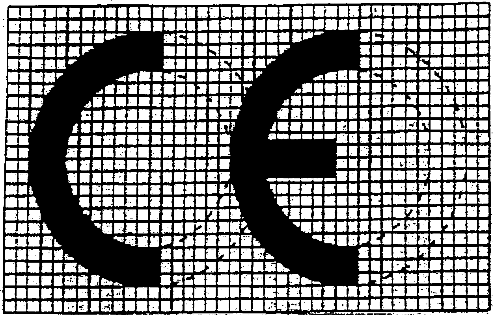

Príloha č. 3 k nariadeniu vlády č. 391/1999 Z. z. ZNAČKA ZHODY

Značka zhody pozostáva z písmen „CE“ a má túto formu:

Ak sa označenie CE zmenší alebo zväčší, vzájomné proporcie podľa nákresu sa musia dodržať.

Rôzne časti označenia CE musia mať v zásade rovnaký zvislý rozmer, ktorý nesmie byť menší ako 5 mm. V prípade malorozmerových strojových zariadení sa tento najmenší rozmer nemusí dodržať.
