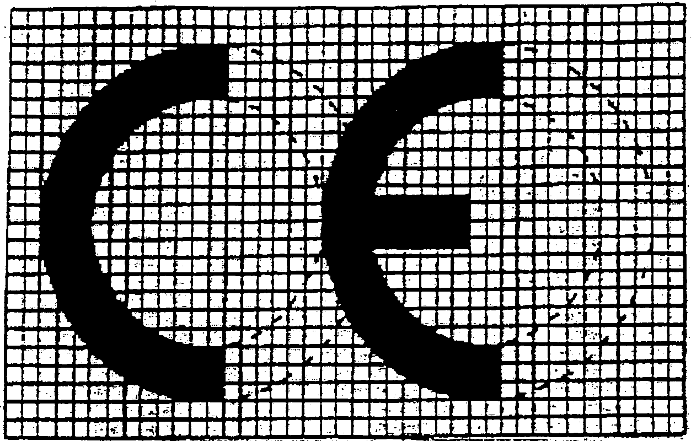

Príloha č. 4 k nariadeniu vlády č. 393/1999 Z. z.

ZNAČKA ZHODY - OZNAČENIE CE

Označenie CE sa skladá z písmen „CE" podľa § 21 zákona.

Ak je označenie zmenšené alebo zväčšené, mierka rozmerov zostáva zachovaná.

Jednotlivé prvky označenia CE majú približne rovnaký vertikálny rozmer, ktorý je najmenej 5 mm.

Na výrobku alebo na štítku s údajmi musí byť označenie CE spolu s nasledujúcimi údajmi:

a) názov výrobcu alebo jeho identifikačná značka,

b) obchodný názov výrobku,

c) typ elektrického napájania, ak je použité,

d) kategória výrobku,

e) posledné dvojčíslie roka, v ktorom bolo označenie CE umiestnené.

Informácie potrebné na inštaláciu možno doplniť v závislosti od povahy zariadenia.
