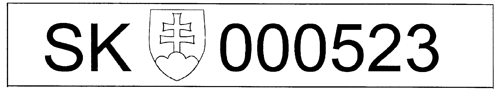
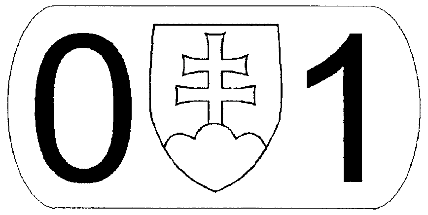

Príloha č. 12 k vyhláške č. 93/1999 Z. z. 

Rozvinutý krúžok (nedelený, delený)

Vnútorný priemer krúžku je od 6 do 30 mm, do plášťa krúžku je vyrazený šesťciferný číselný kód, slovenský znak a medzinárodne používaná skratka Slovenskej republiky - SK.

Vzor pečatidla

Delený krúžok sa na nohe vtáka uzatvára plombou, do ktorej sa vtláča pečatidlom pečať opatrená slovenským znakom a číselným kódom od 01 do 05. Skutočná veľkosť pečatidla je 5 x 2 mm.
