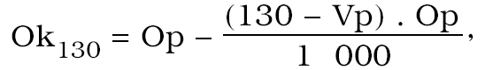

Príloha č. 14 k vyhláške č. 93/1999 Z. z.

- PREPOČET HODNÔT NAMERANÝCH NA PNI Hodnoty obvodu drevín nameraného na pni sa prepočítavajú na obvod kmeňa vo výške 130 cm nad zemou podľa vzorca

- 

- kde - Ok130 je redukovaný obvod kmeňa v mernej výške 130 cm (v cm),

- - Op je obvod pňa (v cm),

- - Vp je výška pňa (v cm),

- - 130 je konštanta,

- - 1 000 je konštanta.
